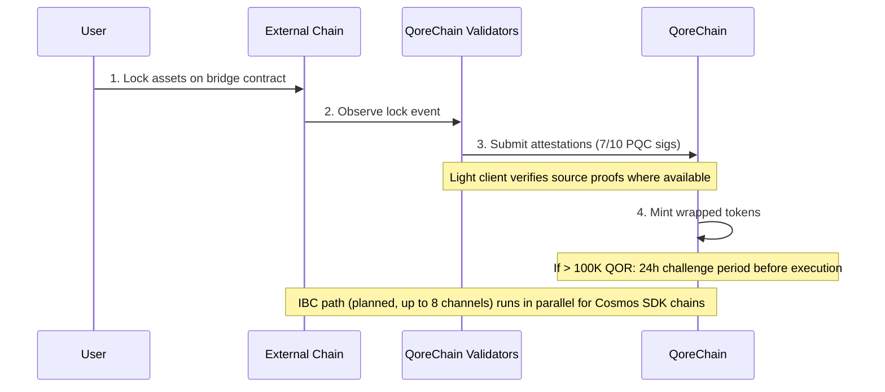

# Bridge Architecture

The `x/bridge` module is designed to connect QoreChain to the broader blockchain ecosystem through **37 chain configurations (36 external chains plus Injective, reached over IBC) and up to 8 IBC (Inter-Blockchain Communication) counterparties**. Every bridge operation is designed to be secured by post-quantum cryptography.

:::caution Not live on either network
The bridge module is deployed on mainnet and testnet, but **no bridge route is active**: all 37 chain configurations are in `pending` status with no bridge contract set, no bridge validators are registered, no bridge operation has ever been created, and no IBC channel exists on mainnet (the testnet has a single ICS-20 test channel to a chain with ID `provider`, none to the counterparties below). Everything below describes the intended design. Do not send assets expecting them to be bridged.
:::

## Current status {#current-status}

| | Mainnet | Testnet |
|---|---|---|
| Bridge module | enabled | enabled |
| Chain configurations | 37, all `pending` | 37, all `pending` |
| Bridge validators registered | 0 | 0 |
| Bridge operations | 0 | 0 |
| IBC channels / clients | 0 / 0 | 1 / 1 (a test channel to the Cosmos Hub testnet) |

(Checked 27 October 2026 against mainnet (v3.2.4) and testnet (v3.2.6). Read the live values with `qorechaind query bridge chains` and `qorechaind query bridge validators`, or over REST at `/qorechain/bridge/v1/chains` and `/qorechain/bridge/v1/validators`.) The module configuration is the same on both networks: `min_validators` 10, `attestation_threshold` 7, `challenge_period_secs` 86,400 and `large_transfer_threshold` 100,000 QOR (`100000000000` uqor). The IBC stack the module would use is ibc-go v10.7 (since v3.2.2), but no mainnet client or channel has been created (the testnet has one test client and channel, see above).

## Connection Overview

QoreChain is designed to support two bridge protocols operating in parallel:

| Protocol | Connections          | Security Model                       | Use Case                                |
| -------- | -------------------- | ------------------------------------ | --------------------------------------- |
| **IBC**  | up to 8 channels (none open)  | Standard IBC (ICS-20) | Cosmos SDK-compatible chains            |
| **QCB**  | 37 chain configs (all pending) | 7-of-10 Dilithium-5 multisig         | Non-IBC chains (EVM, Solana, TON, etc.) |

The **37 chain configurations** are the **36 external chains** listed below plus **Injective**, which is configured as an IBC-type chain. There is no QoreChain loopback configuration. The planned IBC channels connect to Cosmos SDK-compatible chains.

## IBC Channels

QoreChain is designed to maintain IBC connections to the following 8 chains, relayed by an IBC relayer. **None of these counterparties is connected yet** (mainnet has no IBC channel or client; the testnet has a single ICS-20 test channel to a chain with ID `provider`, checked 27 October 2026), so this table lists planned counterparties only:

| Chain      | Description                    |
| ---------- | ------------------------------ |
| Cosmos Hub | Primary hub connection         |
| Osmosis    | DEX liquidity routing          |
| Noble      | USDC native issuance           |
| Celestia   | Data availability layer        |
| Stride     | Liquid staking                 |
| Akash      | Decentralized compute          |
| Babylon    | BTC restaking protocol         |
| Injective  | DeFi / orderbook interoperability |

### IBC Relayer {#ibc-relayer}

IBC packets and client updates are carried between chains by a relayer, a separate program that watches both chains and submits the packets, proofs and client updates. The relayer is not part of the chain, and this manual does not publish or promise a relayer service. QoreChain maintains a public relayer fork named QORel ([github.com/qorechain/QORel](https://github.com/qorechain/QORel)); it has no release yet, so there is nothing to install from it today.

* **Client updates, misbehaviour monitoring and packet clearing** are settings of whichever relayer an operator runs, not chain parameters. For example, a relayer can refresh light clients automatically, watch for equivocation, and periodically clear pending packets.
* **Post-quantum signatures.** Transactions that QoreChain accepts on its native lane carry a hybrid secp256k1 + ML-DSA-87 signature (FIPS 204), including the transactions a relayer submits to it; see [Post-Quantum Security](/architecture/post-quantum-security). The IBC packet format itself is the standard one, and this manual makes no claim that packets carry an extra signature that other chains verify.

## QCB (QoreChain Bridge) Protocol

The QCB protocol uses a hub-and-spoke architecture secured by post-quantum cryptography. QoreChain acts as the hub, with a spoke configuration for each external chain.

### External Chain Configurations (36)

The QCB protocol is designed to target the following 36 external chains. Together with Injective (an IBC-type configuration), this gives **37 chain configurations in total**, all currently in `pending` status.

**Baseline chains (10)**

Ethereum, Solana, TON, BSC, Avalanche, Polygon, Arbitrum, Optimism, Base, Sui.

**EVM-family chains (14)**

zkSync Era, Linea, Scroll, Blast, Mantle, Hyperliquid, Berachain, Sonic, Sei, Monad, Plasma, Filecoin FVM, Cronos, Kaia.

**Non-EVM chains (5)**

Starknet, XRP Ledger, Stellar, Hedera, Algorand.

**Further chains (7)**

NEAR, Bitcoin, Cardano, Polkadot, Tezos, Tron, Aptos.

:::note
Count check: 10 baseline + 14 EVM-family + 5 non-EVM + 7 further = **36 external chains**. Adding Injective (IBC) yields **37 chain configurations**.
:::

### Address Formats

The QCB protocol classifies chains by type to validate destination addresses:

| Chain Type   | Example Chains                                                          | Address Format                                     |
| ------------ | ----------------------------------------------------------------------- | -------------------------------------------------- |
| `evm`        | Ethereum, BSC, Avalanche, Polygon, Arbitrum, Optimism, Base             | `0x` + 40 hex characters                           |
| `solana`     | Solana                                                                  | Base58, 32-44 characters                           |
| `ton`        | TON                                                                     | `EQ` + base64 encoded                              |
| `sui_move`   | Sui                                                                     | `0x` + 64 hex characters                           |
| `aptos_move` | Aptos                                                                   | `0x` + 64 hex characters                           |
| `bitcoin`    | Bitcoin                                                                 | Bech32 (`bc1`), P2SH (`3...`), or legacy (`1...`)  |
| `near`       | NEAR Protocol                                                           | `.near` suffix or implicit                         |
| `cardano`    | Cardano                                                                 | `addr1` (payment) or `stake1` (staking)            |
| `polkadot`   | Polkadot                                                                | SS58 encoded                                       |
| `tezos`      | Tezos                                                                   | `tz1`/`tz2`/`tz3` (implicit) or `KT1` (originated) |
| `tron`       | TRON                                                                    | `T` + base58, 34 characters                        |

## Light Clients

To verify external-chain events trustlessly, the bridge is designed to run on-chain light clients tailored to each source chain's consensus and proof system. These light clients enable QoreChain to validate deposits and withdrawals without relying solely on validator attestations.

| Light Client            | Source Chain        | Verification Primitives                                              |
| ----------------------- | ------------------- | ------------------------------------------------------------------- |
| **Ethereum light client** | Ethereum / EVM L1 | BLS12-381 signature verification, SSZ serialization, MPT state proofs |
| **Bitcoin SPV**         | Bitcoin             | Simplified Payment Verification against block headers                |
| **Starknet STARK**      | Starknet            | STARK proof verification of Starknet state transitions              |
| **Sui BLS**             | Sui                 | BLS aggregate signature verification of Sui checkpoints             |
| **Wormhole / Solana VAA** | Solana (via Wormhole) | Verified Action Approval (VAA) guardian-signature verification     |

## Deposit Flow (External to QoreChain)

The sequence below shows the designed QCB deposit: assets are locked on an external chain, QoreChain validators submit PQC-signed attestations (7-of-10 Dilithium-5), and wrapped tokens are minted. Cosmos SDK-compatible chains would instead use the parallel IBC path (up to 8 channels, carried by an IBC relayer). Neither path is active; no deposit has ever been made.



```
External Chain          QoreChain Validators           QoreChain
     |                         |                          |
     | 1. Lock assets on       |                          |
     |    bridge contract      |                          |
     |------------------------>|                          |
     |                         | 2. Observe & attest      |
     |                         |    (7/10 PQC sigs)       |
     |                         |------------------------->|
     |                         |                          | 3. Mint wrapped
     |                         |                          |    tokens
     |                         |                          |
     |                         |    [If > 100K QOR]       |
     |                         |    24h challenge period   |
     |                         |    before execution       |
```

1. **Lock** — User locks assets in the bridge contract on the external chain.
2. **Attest** — Bridge validators observe the lock transaction and submit Dilithium-5 signed attestations. A minimum of **7 out of 10** validator attestations are required. Where a light client is available for the source chain, the locked event is additionally verified against the chain's own proofs.
3. **Mint** — Once the attestation threshold is met, wrapped tokens are minted on QoreChain.
4. **Challenge period** — For transfers exceeding 100,000 QOR equivalent, a **24-hour challenge period** applies before execution. During this window, validators can flag suspicious activity.

## Withdrawal Flow (QoreChain to External)

```
QoreChain               QoreChain Validators           External Chain
     |                         |                          |
     | 1. Burn wrapped tokens  |                          |
     |------------------------>|                          |
     |                         | 2. Attest burn           |
     |                         |    (7/10 PQC sigs)       |
     |                         |------------------------->|
     |                         |                          | 3. Unlock original
     |                         |                          |    assets
```

1. **Burn** — User burns wrapped tokens on QoreChain.
2. **Attest** — Validators attest to the burn event with Dilithium-5 signatures (7/10 threshold).
3. **Unlock** — Once the threshold is reached, original assets are unlocked on the external chain.

All bridge fees collected during withdrawals are routed to the `x/burn` module via the `bridge_fee` burn channel (100% of bridge fees are burned).

### L2 → L1 withdrawals (rollups)

Rollup withdrawals do not use the bridge. They are paid by the `x/rdk` module with `execute-withdrawal` against a finalized batch's withdrawals root — see [ZK / STARK & Withdrawals](/rollups/zk-stark-withdrawals).

## Security Architecture

### PQC Multisig

All QCB bridge operations require a **7-of-10 threshold** of Dilithium-5 post-quantum signatures from registered bridge validators. Each bridge validator registers with:

* A QoreChain validator address
* A Dilithium-5 public key (2,592 bytes)
* A list of supported chains
* A reputation score (maintained by `x/reputation`)

Since v3.2.2 the module validates zero amounts and its configuration consistently on every path. **From v3.2.4 (mainnet since 23 October 2026, testnet since 19 October 2026):** registering a bridge validator also requires a proof of possession of the Dilithium-5 key (the same `proof_of_possession` format as PQC key registration, see [Post-Quantum Security](/architecture/post-quantum-security#proof-of-possession)) and refuses a key that another bridge validator already uses. Earlier releases have no such check, and no bridge validator is registered on either network.

### Circuit Breakers

Each connected chain has independent circuit breaker protections:

| Protection                | Description                                                                          |
| ------------------------- | ------------------------------------------------------------------------------------ |
| **Single transfer limit** | Maximum amount for any individual bridge operation per chain                         |
| **Daily aggregate limit** | Total volume cap per chain per 24-hour window                                        |
| **Manual pause**          | Governance or validator-triggered emergency halt per chain                           |
| **Anomaly detection**     | Automatic pause if >50 operations in a short window or volume exceeds 5x daily limit |

Circuit breaker state is tracked per chain and includes: max single transfer, daily limit, current daily usage, last reset height, and pause status with reason.

### Challenge Period

For large transfers (>100,000 QOR equivalent, configurable via `large_transfer_threshold`):

* A **24-hour challenge period** (86,400 seconds) applies after the attestation threshold is met.
* During this window, validators are designed to be able to flag the operation.
* If unchallenged, the operation executes automatically after the period expires.
* Challenged operations are frozen for governance review.

### AI Path Optimization

The bridge module integrates with the AI subsystem for route optimization (not exposed over REST). For transfers that can traverse multiple paths (e.g., chain A to chain B via an intermediary), the path optimizer evaluates:

* Estimated fees across routes
* Estimated completion time
* Security score per path
* Confidence level of the estimate

## Bridge Administration

### Post-deploy chain activation (no governance)

As of chain version **v3.1.78**, a bridge chain can be activated and reconfigured after deployment with a single signed transaction — no governance proposal and no chain upgrade. A `bridge_admin` key (set in `BridgeConfig.BridgeAdmin` at genesis) or a holder of the `qcb_bridge` license can:

* **`tx bridge update-chain-config`** — set a chain's contract address, confirmation count, architecture, and status (`MsgUpdateChainConfig`).
* **`tx bridge set-verifier-bootstrap`** — select the active verifier for a chain and install its trust root (`MsgSetVerifierBootstrap`).

This lets an operator bring a connected chain's bridge online — or rotate its verifier — directly, with authorization checked against the bridge admin key. As of chain version **v3.2.0** the bridge module also has its own module account (earlier releases had none, so the first deposit on an activated route would have failed).

Licences such as `qcb_bridge` are granted by the licence authority account. Since v3.2.3 (mainnet) governance can replace that account with a `MsgUpdateAuthority` proposal; the module itself is described in [Chain Licensing](/architecture/chain-licensing).

### Validating connected networks

As of chain version **v3.1.79**, a validator that holds the matching `validator_<chain>` (or `qcb_bridge`) license can run the external network's client on the same node, provisioned automatically under QoreChain's orchestration once the license is activated. Drivers ship for all 37 bridge networks, classified by participation model (permissionless validator, capped/elected/admission, L2 full-node, and non-staking/trust-list). The external network's stake and signing keys are operator-supplied per network. See [Run a Validator](/developer-guide/running-a-validator#connected-networks) for operator steps. Because every chain configuration is `pending`, no connected network is being validated through the bridge today.

## REST API Endpoints {#rest-api-endpoints}

Bridge state is queryable **read-only over REST** via grpc-gateway under the `/qorechain/bridge/v1/...` prefix. These serve real on-chain JSON over HTTP for explorers and light-node telemetry. See [REST / gRPC Endpoints](/api-reference/rest-grpc-endpoints#bridge-module) for the full list.

| Method | Endpoint                                  | Description                                                                                                         |
| ------ | ----------------------------------------- | ------------------------------------------------------------------------------------------------------------------- |
| GET    | `/qorechain/bridge/v1/config`             | Bridge module configuration (`min_validators`, `attestation_threshold`, `challenge_period_secs`, `large_transfer_threshold`, `enabled`) |
| GET    | `/qorechain/bridge/v1/chains`             | All chain configurations and their status                                                                           |
| GET    | `/qorechain/bridge/v1/chains/{chain_id}`  | One chain configuration                                                                                             |
| GET    | `/qorechain/bridge/v1/validators`         | Registered bridge validators                                                                                        |
| GET    | `/qorechain/bridge/v1/validators/{address}` | One bridge validator                                                                                              |
| GET    | `/qorechain/bridge/v1/operations`         | Bridge operations                                                                                                   |
| GET    | `/qorechain/bridge/v1/operations/{id}`    | One bridge operation                                                                                                |

Locked amounts, circuit-breaker state and route estimates have no query route today.

## Bridge Events

The bridge module emits the following on-chain events:

| Event Type                    | Description                                     |
| ----------------------------- | ----------------------------------------------- |
| `bridge_deposit`              | New deposit operation created                   |
| `bridge_withdraw`             | New withdrawal operation created                |
| `bridge_attestation`          | Validator attestation submitted                 |
| `bridge_operation_executed`   | Operation finalized and executed                |
| `bridge_circuit_breaker_trip` | Circuit breaker activated or deactivated        |
| `bridge_validator_registered` | New bridge validator registered                 |
| `bridge_pqc_verification`     | PQC signature verification result (IBC packets) |

## Related

* [Bridging Assets](/user-guide/bridging-assets) — move assets across chains step by step.
* [BTC Restaking via Babylon](/architecture/btc-restaking-babylon) — Bitcoin-backed security.
* [Post-Quantum Security](/architecture/post-quantum-security) — PQC verification on IBC packets.
