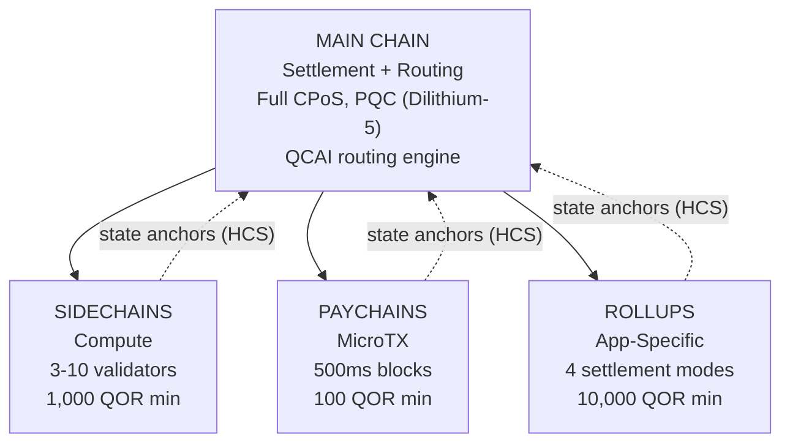

# Multilayer Architecture

QoreChain implements a **4-tier hierarchical chain architecture** through the `x/multilayer` module. The main chain serves as the settlement and trust root, while subsidiary layers (sidechains, paychains, and rollups) handle specialized workloads with different performance and security trade-offs.

:::caution Early-stage capability
The module is deployed on mainnet (chain version **v3.2.3**) and testnet (**v3.2.4**), but **no layer and no anchor exists on either network yet** (checked 20 October 2026: `GET /qorechain/multilayer/v1/layers` returns an empty list on both). Everything below describes the module as built; the parameters are the live values. On mainnet the `MsgUpdateLayerStatus` message is currently switched off by the circuit breaker (see [Chain Parameters](/appendix/chain-parameters#circuit-breaker)); on the testnet it is not.
:::

---

## System Overview

The 4-tier hierarchy below shows the main chain as the settlement and trust root, with three subsidiary layer types anchoring their state roots back to it via Hierarchical Commitment Schemes (HCS).



```
                    +---------------------------+
                    |       MAIN CHAIN          |
                    |  (Settlement + Routing)   |
                    |  Full CPoS consensus      |
                    |  PQC-secured (Dilithium-5)|
                    |  QCAI routing engine       |
                    +------+------+------+------+
                           |      |      |
              +------------+      |      +------------+
              |                   |                    |
    +---------v--------+ +-------v--------+ +---------v---------+
    |   SIDECHAINS     | |   PAYCHAINS    | |     ROLLUPS       |
    |  (Compute)       | |  (MicroTX)     | |  (App-Specific)   |
    |  3-10 validators | |  500ms blocks  | |  4 settlement     |
    |  1,000 QOR min   | |  100 QOR min   | |    modes          |
    |  Max: 10         | |  Max: 50       | |  10,000 QOR min   |
    +------------------+ +----------------+ |  Max: 100 (x/rdk) |
                                            +-------------------+
```

---

## Layer Types

### Main Chain

The main chain is the trust root for the entire QoreChain ecosystem.

| Property   | Value                                                                          |
| ---------- | ------------------------------------------------------------------------------ |
| Consensus  | QoreChain consensus (see [Consensus Mechanism](/architecture/consensus-mechanism) for what is wired today) |
| Security   | PQC-secured with Dilithium-5 signatures                                        |
| Role       | Settlement layer, state anchor storage, QCAI routing engine, trust root        |
| Block time | Network-dependent: about 3.2 seconds on mainnet, about 1.0 second on testnet (measured 20 October 2026) |

All subsidiary layers periodically anchor their state roots to the main chain via Hierarchical Commitment Schemes (HCS).

### Sidechains

Sidechains handle **compute-intensive operations** such as DeFi protocols, gaming engines, and IoT data processing.

| Parameter                 | Value             |
| ------------------------- | ----------------- |
| Minimum validators        | 3                 |
| Maximum validators        | 10                |
| Minimum creator stake     | 1,000 QOR         |
| Maximum active sidechains | 10                |
| Target domains            | DeFi, Gaming, IoT |

### Paychains

Paychains are optimized for **high-frequency microtransactions** with minimal latency.

| Parameter                | Value                                   |
| ------------------------ | --------------------------------------- |
| Target block time        | 500 ms                                  |
| Maximum active paychains | 50                                      |
| Minimum creator stake    | 100 QOR                                 |
| Target domains           | Payments, streaming, micro-transactions |

### Rollups

Rollups are **application-specific chains** deployed via the Rollup Development Kit (`x/rdk`). When a rollup is created, the RDK registers a layer for it in the multilayer module (as a `sidechain`-type layer, see below).

| Parameter              | Value                                       |
| ---------------------- | ------------------------------------------- |
| Settlement modes       | 4 (optimistic, zk, based, sovereign)        |
| Maximum registered rollups | 100 (`max_rollups`); but only 10 sidechain-type layers can exist at a time (`max_sidechains`), so at most 10 rollups can have an anchorable layer |
| Minimum creator stake  | 10,000 QOR for the rollup, plus 1,000 QOR layer-registration stake (`min_sidechain_stake`) |
| Layer type             | Rollups registered through the RDK use the `sidechain` layer type (the `rollup` layer type is defined but not yet used by `x/rdk`) |
| Target domains         | DeFi, Gaming, NFT, Enterprise               |

Rollup deployment and configuration is covered in detail in the [Rollup Development Kit](/architecture/rollup-development-kit).

---

## QCAI Transaction Routing

The QCAI router evaluates all active layers for each incoming transaction and selects the optimal destination using a 4-factor weighted scoring model.

### Scoring Formula

Each candidate layer receives a composite score (higher is better):

```
Score = w_congestion * (1 - Congestion) + w_capability * Capability + w_cost * (1 - Cost) + w_latency * (1 - Latency)
```

| Factor     | Weight | Description                                                                 |
| ---------- | ------ | --------------------------------------------------------------------------- |
| Congestion | 0.30   | Current load level (inverted: lower congestion = higher score)              |
| Capability | 0.40   | How well the layer matches the transaction requirements                     |
| Cost       | 0.20   | Fee multiplier relative to main chain (inverted: lower cost = higher score) |
| Latency    | 0.10   | Expected time to finality (inverted: lower latency = higher score)          |

### Confidence Threshold

The router requires a minimum confidence score of **0.6** before routing a transaction to a subsidiary layer. If no layer meets this threshold, the transaction defaults to the main chain.

A preferred layer hint can be supplied by the transaction sender. If the preferred layer scores at least 80% of the confidence threshold (i.e., 0.48), it is accepted as the routing target.

### Payload Heuristics

When detailed transaction metadata is unavailable, the router uses payload size as a classification signal:

| Payload Size      | Preferred Layer | Rationale                                    |
| ----------------- | --------------- | -------------------------------------------- |
| &lt; 256 bytes    | Paychain        | Likely a simple transfer or microtransaction |
| 256 - 1,024 bytes | Main Chain      | Standard transaction complexity              |
| > 1,024 bytes     | Sidechain       | Likely a complex contract interaction        |

---

## Hierarchical Commitment Schemes (HCS)

Subsidiary layers periodically commit their state to the main chain via **state anchors**. Each anchor contains a cryptographic proof of the subsidiary chain's state at a given height.

### Anchor Contents

| Field                     | Description                                          |
| ------------------------- | ---------------------------------------------------- |
| `layer_id`                | Identifier of the subsidiary layer                   |
| `layer_height`            | Block height on the subsidiary chain                 |
| `state_root`              | Merkle root of the subsidiary chain's state tree     |
| `validator_set_hash`      | Hash of the validator set that signed the commitment |
| `pqc_aggregate_signature` | Dilithium-5 aggregate signature over the anchor data |
| `transaction_count`       | Number of transactions since the last anchor         |
| `compressed_state_proof`  | Compressed state transition proof                    |

### Layer and rollup ids {#id-grammar}

Since v3.2.2 a **new** layer id (and a rollup id, which a rollup shares with its layer) must match `^[a-z0-9][a-z0-9._-]{2,63}$`: 3 to 64 characters, lowercase letters, digits, `.`, `_` and `-`, starting with a letter or digit. The keeper checks this when the layer is created, and a transaction that fails it still pays its fee, so validate ids on the client first. Ids created before v3.2.2 are unaffected.

### Anchor Submission {#anchor-submission}

Anchors are submitted to the main chain via `MsgAnchorState`. The keeper validates the anchor according to the following steps:

1. **Layer exists and is active** — The keeper verifies that the layer exists in state and currently has `active` status.
2. **Minimum anchor interval elapsed** — The keeper checks that at least `min_anchor_interval` blocks (default: 100) have elapsed since the last anchor for this layer.
3. **PQC aggregate signature** — The keeper ensures the PQC aggregate signature is present and valid for the anchor data. The signature is checked against the **layer creator's** registered ML-DSA-87 key; an anchor is refused when the creator has no registered key.

A **settlement anchor** written through `x/rdk` (a batch submitted with an `anchor_signature`, since v3.2.2) is a special case: it skips the minimum-interval check because batches arrive in order, it may anchor a layer that is still `proposed` (nothing on chain promotes a layer an RDK rollup registered), and it is accepted only when the submitter is the layer's own creator. The signature check is the same.

### Challenge Period

Each anchor enters a **challenge period** of **24 hours** (86,400 seconds, configurable per layer). During this period, any party can dispute the anchor by submitting a fraud proof via `MsgChallengeAnchor`. If the fraud proof is valid, the anchor is invalidated and the subsidiary chain's state is rolled back to the previous anchor.

After the challenge period expires without a successful dispute, the anchor is considered finalized.

### Reading Anchors {#reading-anchors}

Anchors are **readable** through the multilayer query service. Two queries expose anchor state over both gRPC and REST:

* **`Anchor`** (`/qorechain/multilayer/v1/anchor/{layer_id}`) — returns the latest state anchor for a layer.
* **`Anchors`** (`/qorechain/multilayer/v1/anchors/{layer_id}`) — returns the anchor history for a layer.

Each anchor carries a Dilithium-5 (ML-DSA-87) signature by the layer creator. The signed message depends on the height at which the anchor is submitted:

* **From v3.2.2 (mainnet height 3,556,788, testnet height 6,905,034): v2.** Every variable-length field carries an 8-byte big-endian length, the chain id is part of the message, and the transaction count and compressed state proof are covered:

```text
"qorechain-multilayer-anchor-v2"
‖ BE64(len(chain_id))            ‖ chain_id
‖ BE64(len(layer_id))            ‖ layer_id
‖ BE64(layer_height)
‖ BE64(len(state_root))          ‖ state_root
‖ BE64(len(validator_set_hash))  ‖ validator_set_hash
‖ BE64(transaction_count)
‖ BE64(len(compressed_state_proof)) ‖ compressed_state_proof
```

* **Below v3.2.2: v1** (`layer_id ‖ layer_height (8-byte big-endian) ‖ state_root ‖ validator_set_hash`, with no length prefixes and no chain id, so a v1 signature is valid on every chain). The chain does not accept a v1 anchor from the v3.2.2 height on.

Because the message can change between releases, a client should select the form from the applied-plan height (`GET /cosmos/upgrade/v1beta1/applied_plan/v3.2.2`; `"height":"0"` means not applied) instead of hard-coding it. For an RDK batch the mapping is: `layer_id` = the rollup's layer id, `layer_height` = the batch index, `state_root` = the batch state root, `transaction_count` = the batch's transaction count and an empty `compressed_state_proof`. `qorechaind query rdk anchor-sign-bytes <layer-id> <batch-index> <state-root-hex> --chain-id <id>` prints these bytes offline. A signature proves that the registered creator key signed those bytes; whether the anchor exists is a question for the chain, so a verifier should read the anchor from a node it trusts. No layer or anchor exists on either network yet. This is the on-chain primitive behind the Rollup Development Kit's [settlement receipts](/rollups/settlement-receipts).

---

## Cross-Layer Fee Bundling (CLFB)

CLFB allows a single fee payment on the source layer to cover execution across multiple layers in a cross-layer transaction path.

### Fee Calculation

```
avgMultiplier = sum(layer_multiplier_i) / num_layers
bundledFee = (totalGas / 1000) * avgMultiplier
```

Where:

* `layer_multiplier_i` is the base fee multiplier for each layer in the transaction path (main chain = 1.0).
* `totalGas` is the estimated total gas consumption across all layers.
* The result is denominated in **uqor** with a minimum fee of 1 uqor.

### Example

A cross-layer transaction touches three layers: main chain (multiplier 1.0), a sidechain (multiplier 0.5), and a paychain (multiplier 0.1).

```
avgMultiplier = (1.0 + 0.5 + 0.1) / 3 = 0.533
bundledFee = (150,000 / 1000) * 0.533 = 80 uqor
```

CLFB can be enabled or disabled globally via the `cross_layer_fee_bundling` parameter, and individual layers can opt out via their `cross_layer_fee_bundling_enabled` configuration flag.

---

## Layer Lifecycle

Each subsidiary layer progresses through a well-defined lifecycle:

```
Proposed --> Active --> Suspended --> Decommissioned
                  \                /
                   +-- Active <--+
```

| Status             | Description                                                                     | Allowed Transitions       |
| ------------------ | ------------------------------------------------------------------------------- | ------------------------- |
| **Proposed**       | Layer has been registered but not yet activated                                 | Active, Decommissioned    |
| **Active**         | Layer is operational and accepting transactions                                 | Suspended, Decommissioned |
| **Suspended**      | Layer is temporarily paused (e.g., for maintenance or due to security concerns) | Active, Decommissioned    |
| **Decommissioned** | Layer is permanently shut down (terminal state)                                 | None                      |

Status transitions are enforced by the keeper. Invalid transitions (e.g., Decommissioned to Active) are rejected.

---

## Parameters

| Parameter                      | Type   | Default         | Description                                             |
| ------------------------------ | ------ | --------------- | ------------------------------------------------------- |
| `max_sidechains`               | uint64 | `10`            | Maximum number of active sidechains                     |
| `max_paychains`                | uint64 | `50`            | Maximum number of active paychains                      |
| `min_anchor_interval`          | uint64 | `100`           | Minimum blocks between state anchors                    |
| `max_anchor_interval`          | uint64 | `1,000`         | Maximum blocks between state anchors (forced anchor)    |
| `default_challenge_period`     | uint64 | `86,400`        | Default challenge period in seconds (24 hours)          |
| `min_sidechain_stake`          | string | `1,000,000,000` | Minimum stake to create a sidechain (1,000 QOR in uqor) |
| `min_paychain_stake`           | string | `100,000,000`   | Minimum stake to create a paychain (100 QOR in uqor)    |
| `routing_enabled`              | bool   | `true`          | Enable QCAI-based transaction routing                   |
| `routing_confidence_threshold` | string | `0.6`           | Minimum confidence for QCAI routing decisions           |
| `cross_layer_fee_bundling`     | bool   | `true`          | Enable global Cross-Layer Fee Bundling                  |

These are the values returned by `qorechaind query multilayer params` (REST: `/qorechain/multilayer/v1/params`) on mainnet and testnet on 20 October 2026. Since v3.2.2 the module's `MsgUpdateParams` can be routed, so a governance proposal can change them.
