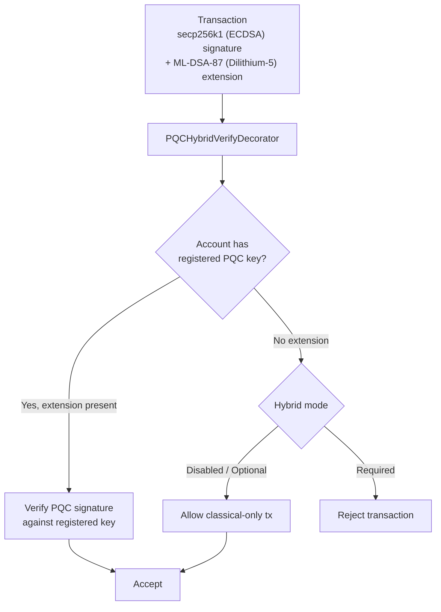

# Post-Quantum Security

QoreChain is built with **post-quantum cryptography (PQC) at genesis** — not retrofitted as an upgrade. The `x/pqc` module provides lattice-based digital signatures and key encapsulation as the primary cryptographic primitives, with a governance-controlled algorithm agility framework for long-term resilience.

The full PQC baseline — **Dilithium-5 (signatures) + ML-KEM-1024 (KEM) + SHAKE-256 (hash)** — is now complete and the network default. On the live networks (v3.2.x), hybrid signatures are **required by default** on the cosmos transaction path: `hybrid_signature_mode = required` and `allow_classical_fallback = false`. Every cosmos-path transaction must carry a Dilithium-5 signature alongside its classical secp256k1 signature; classical-only transactions from a PQC account are rejected, and the classical downgrade path is closed. Mainnet runs v3.2.4 and the testnet v3.2.6 (checked 27 October 2026); what the v3.2.2 and v3.2.3 releases added to the post-quantum rules (key integrity, optional proof of possession, scoped EVM windows, EIP-7702 consent) is described in [Key integrity rules](#key-integrity), [Proof of possession](#proof-of-possession) and [EIP-7702 delegations](#eip-7702).

## Design Principles

* **PQC-required by default**: Post-quantum signatures are mandatory on the cosmos path. Classical secp256k1 signatures alone are no longer sufficient — `allow_classical_fallback = false`.
* **Hybrid by default**: Cosmos transactions carry both a classical secp256k1 signature and a Dilithium-5 PQC signature simultaneously. The classical-only fallback is closed.
* **Algorithm agility**: The cryptographic algorithm registry is governance-controlled, allowing the network to adopt new algorithms or deprecate compromised ones without hard forks.
* **Deterministic verification**: All signature verification is deterministic and reproducible across validator nodes.

## Supported Algorithms

| Algorithm       | Standard             | Category          | NIST Level | Public Key  | Private Key | Signature / Ciphertext | Shared Secret |
| --------------- | -------------------- | ----------------- | ---------- | ----------- | ----------- | ---------------------- | ------------- |
| **Dilithium-5** | ML-DSA-87 (FIPS 204) | Signature         | 5          | 2,592 bytes | 4,896 bytes | 4,627 bytes            | --            |
| **ML-KEM-1024** | FIPS 203             | Key Encapsulation | 5          | 1,568 bytes | 3,168 bytes | 1,568 bytes            | 32 bytes      |

Both algorithms operate at **NIST Security Level 5**, the highest standardized security category, providing protection equivalent to AES-256 against both classical and quantum adversaries.

## Cryptographic Backend

PQC operations are implemented in a high-performance, memory-safe cryptographic backend that exposes lattice-based signing, verification, and key encapsulation to the QoreChain runtime. The backend provides:

Algorithm-specific operations:

* Dilithium-5 key generation, signing, and verification
* ML-KEM-1024 key generation, encapsulation, and decapsulation
* Deterministic random beacon generation (`seed`, `epoch`)

Algorithm-aware operations:

* `Keygen(algorithmID)` — Generate a keypair for any registered algorithm
* `Sign(algorithmID, privkey, message)` — Create a signature
* `Verify(algorithmID, pubkey, message, signature)` — Verify a signature
* `AlgorithmInfo(algorithmID)` — Query key/output sizes
* `ListAlgorithms()` — Enumerate all supported algorithms

All signing and verification operations are deterministic and produce identical results across every validator node and supported platform.

These same primitives — ML-DSA (FIPS-204), ML-KEM (FIPS-203), and SHAKE-256 (FIPS-202) — are available to wallets and integrators through the open-source [**qorechain-pqc**](https://github.com/qorechain/qorechain-pqc) library, which provides one consistent, byte-compatible API across six languages (JavaScript/TypeScript, Rust, Go, C, Python, Java). See [Post-Quantum Signing](/developer-guide/post-quantum-signing).

## Key Registration {#key-registration}

Accounts register PQC keys explicitly via `MsgRegisterPQCKey` (legacy, defaults to Dilithium-5) or `MsgRegisterPQCKeyV2` (algorithm-aware); the chain never registers a key on its own, and the CLI flow is `qorechaind tx pqc gen-key <name>` followed by `qorechaind tx pqc register-key <public_key_hex> hybrid --from <key>` (see [First Transaction](/getting-started/first-transaction#register-pqc-key)). Each message includes:

* **Sender**: The account address registering the key.
* **PublicKey**: The PQC public key bytes.
* **AlgorithmID**: The PQC algorithm identifier (v2 only).
* **ProofOfPossession**: Optional signature by the new key (v2 only, from v3.2.3); see [Proof of possession](#proof-of-possession).
* **KeyType**: One of `hybrid` or `pqc_only` (a third value, `classical_only`, still exists in the schema but is refused since v3.2.3):

| Key Type         | Description                                                              |
| ---------------- | ------------------------------------------------------------------------ |
| `hybrid`         | Both classical (ECDSA) and PQC keys. Transactions carry dual signatures. |
| `pqc_only`       | Registered like `hybrid`: the classical secp256k1 signature is still verified by the standard signature checks, and the PQC signature is required as well. |
| `classical_only` | **Refused since v3.2.3.** A registration with this key type records no usable post-quantum key and would leave the account unable to sign, so the chain rejects it. |

### Key integrity rules (v3.2.3) {#key-integrity}

Since the v3.2.3 upgrade (mainnet height 3,662,051, 20 October 2026; testnet height 8,003,746) the chain applies these rules to post-quantum keys. Below that height none of them was enforced.

| Rule | Behaviour |
| --- | --- |
| No weak keys | A registration is refused if the key type is `classical_only`, the key is empty, or the key is degenerate: a key of the right length whose structure gives no post-quantum protection. Generate keys with `tx pqc gen-key` or the `qorechain-pqc` library and register what they print |
| No key reuse | A rotation or migration is refused if the new key is one the account has used before. The chain remembers a hash of every key an account has rotated or migrated away from |
| Keyed accounts need the hybrid signature | An account that already holds a usable key must carry its hybrid signature on a register or migrate transaction as well. The classical-only exemption now covers only an account with **no** registered key, or one whose stored record holds no usable key (which `MsgRegisterPQCKeyV2` may then replace) |
| No keyless extension | Under `required` mode, an account with no registered key cannot pass by attaching a hybrid extension that nothing can verify; only a registration may pass without one |
| One extension | A transaction carries at most one hybrid signature extension |
| No key messages through authz | `MsgRegisterPQCKey`, `MsgRegisterPQCKeyV2`, `MsgRotatePQCKey` and `MsgMigratePQCKey` cannot be executed on an account's behalf through `x/authz`; the account's own signature is required |
| Algorithm governance guards | Deprecating or disabling an algorithm cannot leave the chain without an active signature algorithm, and the replacement algorithm must be able to sign |

v3.2.2 added a related check: a registration validates the classical `ecdsa_pubkey` it carries and binds it to the signing account, so an account cannot record a classical key that is not its own.

Nodes also screen these cases in the mempool, so a transaction that can only fail is not relayed and does not cost a fee.

### Proof of possession (optional) {#proof-of-possession}

`MsgRegisterPQCKeyV2` has an optional `proof_of_possession` field. When present, the chain verifies it; when absent, registration proceeds as before (the proof is **not required**). The proof is a signature by the key being registered over

```text
qorechain-pqc-pop-v1|<chain-id>|<algorithm-id>|<account-address>|<hex(public-key)>
```

so a proof made for one account or chain proves nothing on another. The CLI builds it for you when you name the local key file:

```bash
qorechaind tx pqc register-key-v2 dilithium5 <pubkey-hex> hybrid \
  --pqc-key mypqc --from mykey --chain-id qorechain-vladi --gas 600000 --fees 60000uqor
```

Registration is exempt from the hybrid requirement only for an account without a key, so this transaction is signed with the account's classical key alone. A malformed proof is refused with `ErrInvalidProofOfPossession` (code 231 in module `pqc`).

**From v3.2.4 (mainnet since 23 October 2026, testnet since 19 October 2026):** the account record gains a boolean `possession_proven`, returned by `GET /qorechain/pqc/v1/account/{address}`. It is `true` when the current key was registered with a valid proof, or arrived through a rotation or migration (both of which verify a signature by the new key over bytes that name the chain, the account and the key); a registration without a proof records `false`, and a key that changes without one clears the flag. The proof remains optional for account keys under v3.2.4.

## Hybrid Signatures {#hybrid-signatures}

The hybrid signature system requires cosmos-path transactions to carry **both** a classical signature and a PQC signature simultaneously. This provides defense-in-depth: even if one scheme is broken, the other protects the transaction.

With the network default of `hybrid_signature_mode = required`, every cosmos-path transaction must include the Dilithium-5 extension alongside the secp256k1 signature. The only exemptions (for bootstrap) are **genesis gentxs (height 0)**, **PQC key registration** (`MsgRegisterPQCKey`, `MsgRegisterPQCKeyV2`) from an account that has no registered key (or whose record holds no usable key), which is allowed to be classical-only so the account can register its first PQC key, and an unjail from an operator account that has no registered key. Since v3.2.3 a register or migrate from an account that already holds a usable key needs the hybrid signature like any other transaction (see [Key integrity rules](#key-integrity)).

**The EVM lane is protected by an authorisation window instead.** An EVM transaction cannot carry a second (ML-DSA) signature — standard wallets sign one secp256k1 signature over an Ethereum transaction and expose no way to attach another. So the post-quantum authorisation travels *ahead* of the transaction: the account opens a bounded **EVM authorisation window** with a Cosmos-lane message (`MsgOpenEVMWindow`), which carries the ordinary hybrid signature, and the EVM lane then admits only transactions covered by a live window. Since v3.2.0 an EVM transaction is refused unless its sender (1) has a registered post-quantum key and (2) has a live window with blocks, transactions and value remaining. Inside a window an ordinary MetaMask/ethers/Hardhat transaction works unmodified, because the check reads chain state, not the transaction. See [EVM authorisation window](/getting-started/first-transaction#evm-window).

Since v3.2.3 a window can also be **scoped** when it is opened: `--native-only` narrows it to plain transfers of native QOR (no calldata, no contract creation, no recipient that carries code, no EIP-7702 authorisation), and `--allowed-targets 0x…,0x…` admits only listed recipients and refuses contract creation. A window opened without a scope admits what it always did. The scope is part of `MsgOpenEVMWindow` (`native_only`, `allowed_targets`).

### EIP-7702 delegations {#eip-7702}

An EIP-7702 authorisation tuple installs code on the account that signed it, and that signature is a classical secp256k1 signature that anyone can carry in a type-4 transaction. From v3.2.2 (mainnet height 3,556,788) the EVM lane therefore admits a type-4 transaction only if **every authority whose tuple would take effect** holds a registered post-quantum key and has **consented**, with a Cosmos-lane message signed hybrid, to exactly the delegation the tuple installs.

| Item | Detail |
| --- | --- |
| Give consent | `qorechaind tx pqc authorize-evm-delegation <delegate-0x-address> <blocks>` (`MsgAuthorizeEVMDelegation`): names the delegate address the tuple must carry and how long the consent stays usable (at most 17,280 blocks, the same bound as a window) |
| Clear a delegation | The zero address as the delegate consents to clearing. `tx pqc clear-evm-delegation` (`MsgClearEVMDelegation`) clears an existing delegation without any EVM transaction |
| Single use | A consent is used up by the transaction that installs the delegation, replaces any earlier consent for the account, and is revoked by `MsgCloseEVMWindow` |
| Read it | `qorechaind query pqc evm-delegation-consent <address>`, or `GET /qorechain/pqc/v1/evm_delegation_consent/{address}` (fields `live`, `delegate`, `granted_height`, `expiry_height`, `current_delegate`, `nonce`) |
| Limits | At most 8 authorisations per type-4 transaction. Value that leaves a delegated account is charged to its own window. A failed type-4 transaction keeps the authorisations it applied |
| Sponsored delegation | Still works: the sponsor pays from its own window, and the authority only consents beforehand |

### Cosign Flow

To produce a compliant cosmos transaction, the classical secp256k1 signature is computed over the standard sign bytes (which exclude the PQC extension), and a Dilithium-5 signature is computed over the v2 signed bytes (see [Signed bytes (v2)](#sign-bytes-v2) below) and attached as the `PQCHybridSignature` extension. Standard CosmJS / relayer tooling must produce this extension to transact on the cosmos path. Today this is done via:

* `qorechaind tx pqc gen-key <name>` — generate a Dilithium-5 key.
* `qorechaind tx pqc cosign <unsigned_tx_file> --from <key> --pqc-key <name>` — attach the Dilithium-5 cosignature to a transaction built with `--generate-only`.
* The QoreChain SDK's hybrid signing — `buildHybridTx`. The account's key must already be registered with `MsgRegisterPQCKey`.
* [QoreX](/qorex/overview), which does both for you.

*A transaction signed with secp256k1 (ECDSA) plus ML-DSA-87 (Dilithium-5), verified by the ante handler under the chain-wide enforcement mode.*



### Signed bytes (v2) {#sign-bytes-v2}

The ML-DSA signature covers domain-tagged, chain-bound bytes. From v3.2.0 the chain verifies **only** this form:

```text
"qorechain-pqc-hybrid-v2" ‖ BE64(len(chainID)) ‖ chainID ‖
BE32(len(B0)) ‖ B0 ‖ BE32(len(authInfo)) ‖ authInfo
```

where `B0` is the transaction body serialised **without** the PQC extension and `authInfo` is the AuthInfo bytes verbatim (`‖` is concatenation, lengths are big-endian). The domain tag stops a signature made in another context (a login challenge, a message-signing request) from being valid as a transaction signature, and binding the chain ID makes the post-quantum signature itself invalid on any other network. The first form (`BE32(len(B0)) ‖ B0 ‖ BE32(len(authInfo)) ‖ authInfo`) was verified only below the upgrade height; no block accepts both. Key-migration and bridge-attestation payloads moved to the same domain-tagged, chain-bound scheme.

**Which form does my network verify?** Ask the node whether the upgrade has been applied:

```bash
curl -s https://api.qore.host/cosmos/upgrade/v1beta1/applied_plan/v3.2.0         # height 2981742 on mainnet
curl -s https://api-testnet.qore.host/cosmos/upgrade/v1beta1/applied_plan/v3.2.0 # height 5920000 on testnet
```

(`"height":"0"` means not applied.) Both networks applied the change long ago, so a current client signs the v2 form everywhere; the check matters when you replay or verify old blocks. The CLI does this with `--sign-bytes auto`, and current SDK and wallet-adapter releases do the same. A client on the wrong form produces a digest the chain rejects — it fails closed.

### TX Extension Format

PQC signatures are attached to transactions as a **TX extension** with type URL `/qorechain.pqc.v1.PQCHybridSignature`:

```text
{
  "algorithm_id": 1,
  "pqc_signature": "<4627 bytes for Dilithium-5>",
  "pqc_public_key": "<2592 bytes, optional>"
}
```

The `pqc_public_key` field is optional and informational; keys are registered only by an explicit registration message (see [Key Registration](#key-registration)).

### PQCHybridVerifyDecorator

The `PQCHybridVerifyDecorator` ante handler processes hybrid signatures with three-way verification logic:

| Scenario | Account Has PQC Key | Extension Present | Public Key in Extension | Result                                              |
| -------- | ------------------- | ----------------- | ----------------------- | --------------------------------------------------- |
| Path 1   | Yes                 | Yes               | --                      | Verify PQC signature against registered key         |
| Path 3a  | No                  | No                | --                      | **Optional mode**: Allow classical-only transaction |
| Path 3b  | No                  | No                | --                      | **Required mode**: Reject transaction               |
| Path 4   | Yes                 | No                | --                      | Handled by the standard PQCVerifyDecorator          |

A key must be registered with `MsgRegisterPQCKey` / `MsgRegisterPQCKeyV2` before the account sends hybrid-signed transactions; the extension's `pqc_public_key` field does not register anything.

### Hybrid Signature Modes

The chain-wide hybrid enforcement level is governance-configurable. The **current network default is `required`**:

| Mode         | ID | Default | Behavior                                                                                                          |
| ------------ | -- | ------- | ----------------------------------------------------------------------------------------------------------------- |
| **Disabled** | 0  | No      | Classical signatures only. PQC extensions are ignored.                                                            |
| **Optional** | 1  | No      | PQC extensions are verified if present. Accounts without PQC keys may transact with classical signatures only.    |
| **Required** | 2  | **Yes** | All cosmos-path transactions must carry both classical and PQC signatures. Transactions without a PQC extension are rejected. |

The network has completed its migration: **Optional** (genesis) → **Required** (the current default since v3.1.71, with `allow_classical_fallback = false`). The three modes remain governance-controlled and can be adjusted by proposal.

## Algorithm Agility Framework

The algorithm agility framework provides a governance-controlled registry for PQC algorithms, enabling the network to add new algorithms, deprecate vulnerable ones, and migrate accounts — all without hard forks.

### Algorithm Lifecycle

Each registered algorithm has a lifecycle status:

```
active --> migrating --> deprecated --> disabled
```

| Status         | Description                                                                                                                                 |
| -------------- | ------------------------------------------------------------------------------------------------------------------------------------------- |
| **Active**     | Fully operational. New key registrations and verifications are accepted.                                                                    |
| **Migrating**  | Dual-signature period is active. Accounts are encouraged to migrate to the replacement algorithm. Both old and new signatures are accepted. |
| **Deprecated** | Existing signatures can still be verified, but no new key registrations are accepted.                                                       |
| **Disabled**   | Emergency kill switch. The algorithm cannot verify any signatures. Used when a vulnerability is discovered.                                 |

### Dual-Signature Migration

When an algorithm is deprecated, a **migration period** begins (default: 1,000,000 blocks — about 36 days at mainnet's current ≈3.1 s block time). During this period:

1. Accounts with keys using the deprecated algorithm must migrate to the replacement.
2. Migration requires dual signatures (`MsgMigratePQCKey`): one from the old key and one from the new key, proving ownership of both.
3. Both algorithms are accepted for verification throughout the migration period.

### Messages

| Message                 | Description                                                                                                                                                       |
| ----------------------- | ----------------------------------------------------------------------------------------------------------------------------------------------------------------- |
| `MsgRegisterPQCKey` / `MsgRegisterPQCKeyV2` | Register an account's PQC key (see [Key Registration](#key-registration)). May be signed classically so a new account can bootstrap.                  |
| `MsgMigratePQCKey`      | Dual-signed migration from one algorithm's key to another during a migration period. Refuses a key the account used before (v3.2.3).                              |
| `MsgRotatePQCKey`       | Rotate the account's ML-DSA-87 key within the same algorithm (dual-signed by the old and new keys; `tx pqc rotate-key`). Refuses a key the account used before (v3.2.3). |
| `MsgOpenEVMWindow` / `MsgCloseEVMWindow` | Open or close the EVM authorisation window (v3.2.0; optional scope from v3.2.3); see [EVM authorisation window](/getting-started/first-transaction#evm-window).                  |
| `MsgAuthorizeEVMDelegation` / `MsgClearEVMDelegation` | Consent to, or clear, an EIP-7702 delegation of the sender's own account (v3.2.2); see [EIP-7702 delegations](#eip-7702). |
| `MsgDeprecateAlgorithm` | Governance message: begins the deprecation process for an algorithm. Specifies the replacement algorithm and migration period in blocks.                          |
| `MsgDisableAlgorithm`   | Governance message: emergency-disables an algorithm immediately. Requires a reason string. Used when a cryptographic vulnerability is discovered.                |

`MsgDeprecateAlgorithm` and `MsgDisableAlgorithm` are currently switched off on mainnet by the circuit breaker (see [Chain Parameters](/appendix/chain-parameters#circuit-breaker)); they are not switched off on the testnet. On both networks, since v3.2.3, the algorithm governance guards in [Key integrity rules](#key-integrity) apply.

### Extensibility

Adding an algorithm requires a software release that implements it behind the unified signing and verification interface; the registry and the deprecation/disable lifecycle are governance-controlled.

## SHAKE-256 Hash

As of v3.1.73, **SHAKE-256** (SHA-3 extendable-output function) is the **default application hash** across QoreChain — provided by the `qorehash` package — completing the cryptographic baseline alongside Dilithium-5 signatures and ML-KEM-1024 key encapsulation. The `x/pqc` module provides pure-Go SHAKE-256 utilities:

| Function                           | Description                       | Output           |
| ---------------------------------- | --------------------------------- | ---------------- |
| `SHAKE256Hash(data, outputLen)`    | Variable-length SHAKE-256 digest  | Arbitrary length |
| `SHAKE256Hash32(data)`             | Standard 256-bit SHAKE-256 digest | 32 bytes         |
| `SHAKE256ConcatHash(left, right)`  | Hash of concatenated inputs       | 32 bytes         |
| `SHAKE256DomainHash(domain, data)` | Domain-separated hash             | 32 bytes         |

These utilities back the default application hash and are used for:

* Merkle tree node hashing
* Hash commitments in cross-layer attestations
* Domain separation for different hash contexts (e.g., `"leaf:"` vs `"node:"`)

## Bridge PQC

Bridge attestations are designed to use **Dilithium-5** (ML-DSA-87) signatures, so that cross-chain security is not degraded by classical cryptography in bridge infrastructure. This is design intent: it describes how bridge validators are meant to attest, not a behaviour you can exercise on a live network today. No bridge route is live (see [Bridge Architecture](/architecture/bridge-architecture#current-status)); from v3.2.4 (mainnet since 23 October 2026, testnet since 19 October 2026), registering a bridge validator also requires a proof of possession of its PQC key.

## Module Parameters

| Parameter                  | Type                | Default           | Description                                           |
| -------------------------- | ------------------- | ----------------- | ----------------------------------------------------- |
| `pqc_primary`              | bool                | `true`            | PQC is the primary signature scheme                   |
| `allow_classical_fallback` | bool                | `false`           | Classical-only fallback is closed; cosmos txs must be hybrid |
| `min_security_level`       | int32               | `5`               | Minimum NIST security level for accepted algorithms   |
| `default_migration_blocks` | int64               | `1,000,000`       | Default dual-signature migration period in blocks     |
| `default_signature_algo`   | AlgorithmID         | `1` (Dilithium-5) | Default signature algorithm for new key registrations |
| `hybrid_signature_mode`    | HybridSignatureMode | `2` (Required)    | Chain-wide hybrid signature enforcement level         |

The testnet returns these same values (checked 27 October 2026). Since v3.2.6 the testnet also serves them over REST at `GET /qorechain/pqc/v1/params`; on mainnet that route answers 501 (not implemented) and the parameters are read with `qorechaind query pqc params`.

## Related

* [Post-Quantum Signing](/developer-guide/post-quantum-signing) — the open-source `qorechain-pqc` library (six languages) for these primitives and hybrid signing.
* [Wallet Setup](/getting-started/wallet-setup) — create and manage PQC-backed accounts.
* [SDK Accounts & PQC signing](/sdk/concepts/accounts-pqc) — keys and post-quantum signing from code.
* [Chain Parameters](/appendix/chain-parameters) — default algorithms and migration settings.
* [Bridge Architecture](/architecture/bridge-architecture) — PQC verification on cross-chain packets.
