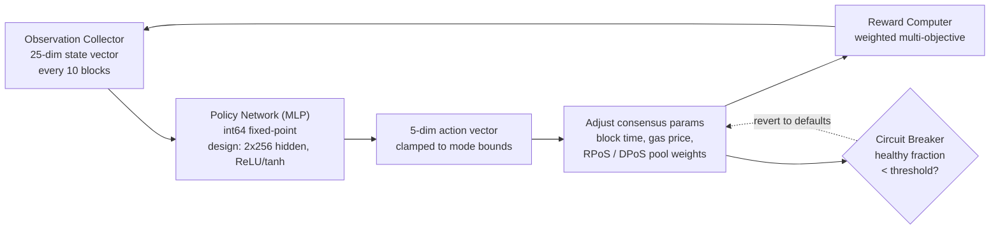

# PRISM Consensus Engine

QoreChain embeds **PRISM** (Policy-driven Reinforcement-learning for Intelligent State Machines), a reinforcement-learning optimization layer, directly into the consensus layer via the `x/rlconsensus` module. PRISM observes chain metrics every N blocks and is designed to run inference through a fixed-point neural network and propose consensus parameter adjustments — all deterministically, with no floating-point arithmetic in consensus-critical paths.

:::note Current status (mainnet v3.2.4, checked 20 October 2026 and unchanged since; testnet v3.2.6, checked 27 October 2026)
**Mainnet.** The agent is in `conservative` mode, collects an observation and a reward every 10 blocks, and has **no policy weights loaded**: it has taken 0 steps and applies no parameter change. Block time is determined by the validators' node configuration, not by PRISM. Loading a policy, changing the mode, resuming the agent and updating the reward weights are governance actions that are currently disabled on mainnet by the circuit breaker (the four control messages are still on the disabled list), so the agent's state cannot have changed. The PRISM query routes under `/qorechain/rlconsensus/v1/` answer 501 (not implemented) on mainnet.

**Testnet.** Testnet governance set the agent to **shadow mode** and loaded a small demonstration policy (25 inputs, one hidden layer of 4 units, 5 outputs, 129 weights, epoch 1; it is a test of the plumbing, not the production network described below). In shadow mode the agent observes every 10 blocks, computes its reward and a proposed action, and records them (`rl_action_proposed` event) without changing any value: `applied_params` keeps its defaults (block time 5000 ms, gas price floor 100) and `last_action` reports `"applied": false`. Since v3.2.6 the testnet serves the module over REST under `/qorechain/rlconsensus/v1/`: `agent` (mode, epoch, step count, circuit-breaker state), `params`, `observation`, `reward`, `policy`, `applied_params` and `last_action`; the agent circuit breaker was corrected and its history is bounded in the same release, and the `rlConsensusParams` EVM precompile (`0x…0C01`) now returns the module's values.

Two release changes tighten what a future policy or parameter change can do. Since v3.2.2 a governance policy update is validated with checked arithmetic. Since v3.2.3 the governance messages are range-checked on the raw wire value (the agent mode) and each reward weight must lie between 0 and 1.
:::

*The PRISM optimization loop: observe chain state, run policy inference, clamp and apply parameter changes, then feed the result back.*



---

## Architecture Overview

PRISM consists of four components:

1. **Observation Collector** — Gathers 25-dimensional chain state vectors at configurable intervals.
2. **Policy Network (MLP)** — A Go-native multi-layer perceptron that maps observations to actions.
3. **Reward Computer** — Evaluates the quality of parameter changes using a weighted multi-objective function.
4. **Circuit Breaker** — Monitors chain health and reverts all PRISM-tuned parameters if instability is detected.

All components operate within the ABCI lifecycle and produce deterministic, verifiable outputs across all validator nodes.

---

## Policy Network

The policy network is a feedforward multi-layer perceptron (MLP) implemented entirely in Go with **int64 fixed-point arithmetic** (scaled by 10^8).

### Network Architecture

The table and parameter count below describe the **design size** of the policy network (two hidden layers of 256 units). No policy of this size is loaded on either network: mainnet has no policy loaded, and the testnet runs a small demonstration policy (25 inputs, one hidden layer of 4 units, 5 outputs, 129 weights).

| Property            | Value                              |
| ------------------- | ---------------------------------- |
| Input dimensions    | 25                                 |
| Hidden layers       | 2                                  |
| Hidden layer sizes  | 256, 256                           |
| Output dimensions   | 5                                  |
| Activation (hidden) | ReLU                               |
| Activation (output) | tanh                               |
| Total parameters    | 73,733                             |
| Precision           | int64 fixed-point (scaled by 10^8) |

### Parameter Count Breakdown

```
Layer 1: 25 * 256 + 256   =  6,656  (input -> hidden_1)
Layer 2: 256 * 256 + 256   = 65,792  (hidden_1 -> hidden_2)
Layer 3: 256 * 5 + 5       =  1,285  (hidden_2 -> output)
Total:                       73,733
```

### Fixed-Point Arithmetic

All MLP computations use `int64` values scaled by `FixedPointScale = 10^8`. This eliminates non-determinism from IEEE 754 floating-point rounding differences across hardware platforms.

* **Multiplication**: `fixMul(a, b) = (a / SCALE) * b + (a % SCALE) * b / SCALE` (split to prevent overflow)
* **ReLU**: `relu(x) = max(0, x)`
* **tanh**: Pade approximant `tanh(x) ~ x * (3*S - x^2) / (3*S + x^2)` for `|x| <= 2.5*SCALE`, clamped to +/- SCALE otherwise

Policy weights are designed to be stored on-chain as a flattened `[]int64` vector and updated via governance proposal. No policy is loaded on mainnet today; the testnet runs a small demonstration policy in shadow mode (see the status note above).

---

## Observation Vector

PRISM collects a 25-dimensional observation vector at each observation interval (default: every 10 blocks).

| Index | Dimension              | Description                                      |
| ----- | ---------------------- | ------------------------------------------------ |
| 0     | `block_utilization`    | Block gas used / block gas limit                 |
| 1     | `tx_count`             | Number of transactions in the block              |
| 2     | `avg_tx_size`          | Mean transaction size in bytes                   |
| 3     | `block_time`           | Time since previous block (ms)                   |
| 4     | `block_time_delta`     | Block time minus target block time (ms)          |
| 5     | `gas_price_50th`       | Median gas price                                 |
| 6     | `gas_price_95th`       | 95th-percentile gas price                        |
| 7     | `mempool_size`         | Number of pending transactions                   |
| 8     | `mempool_bytes`        | Total bytes of pending transactions              |
| 9     | `validator_count`      | Active validator count                           |
| 10    | `validator_gini`       | Gini coefficient of validator power distribution |
| 11    | `missed_block_ratio`   | Fraction of validators that missed signing       |
| 12    | `avg_commit_latency`   | Average commit round latency (ms)                |
| 13    | `max_commit_latency`   | Maximum commit round latency (ms)                |
| 14    | `precommit_ratio`      | Fraction of precommits received                  |
| 15    | `failed_tx_ratio`      | Fraction of failed transactions                  |
| 16    | `avg_gas_per_tx`       | Mean gas consumed per transaction                |
| 17    | `reward_per_validator` | Mean reward per validator (uqor)                 |
| 18    | `slash_count`          | Number of slashing events in observation window  |
| 19    | `jail_count`           | Number of jail events in observation window      |
| 20    | `inflation_rate`       | Current emission rate                            |
| 21    | `bonded_ratio`         | Bonded tokens / total supply                     |
| 22    | `reputation_mean`      | Mean reputation score across active validators   |
| 23    | `reputation_stddev`    | Standard deviation of reputation scores          |
| 24    | `mev_estimate`         | Estimated MEV extracted (heuristic)              |

All values are stored as `LegacyDec` string representations and converted to int64 fixed-point before inference.

---

## Action Space

The MLP output is a 5-dimensional action vector, where each dimension represents a proposed change to a consensus parameter. The tanh activation constrains raw outputs to \[-1, 1], which are then scaled by mode-specific bounds.

| Index | Action Dimension           | Description                                                             |
| ----- | -------------------------- | ----------------------------------------------------------------------- |
| 0     | `block_time_delta`         | Proposed change to target block time (ms)                               |
| 1     | `gas_price_delta`          | Proposed change to base gas price                                       |
| 2     | `validator_set_size_delta` | Proposed change to target validator set size (logged only, not applied) |
| 3     | `pool_weight_rpos_delta`   | Proposed change to RPoS pool priority weight                            |
| 4     | `pool_weight_dpos_delta`   | Proposed change to DPoS pool priority weight                            |

Actions are **clamped** to the maximum change bounds defined by the current PRISM mode before application.

---

## Reward Function

The reward signal evaluates how well recent parameter changes improved chain performance. It is computed as a weighted sum of five objectives:

```
R = 0.30 * delta_throughput
  + 0.25 * delta_finality
  + 0.20 * delta_decentralization
  - 0.15 * mev_estimate
  - 0.10 * failed_tx_ratio
```

| Component           | Weight | Direction | Source Metric                                 |
| ------------------- | ------ | --------- | --------------------------------------------- |
| Throughput          | +0.30  | Maximize  | Change in block utilization                   |
| Finality            | +0.25  | Maximize  | Change in precommit ratio                     |
| Decentralization    | +0.20  | Maximize  | Negative change in validator Gini coefficient |
| MEV                 | -0.15  | Minimize  | Current MEV estimate                          |
| Failed Transactions | -0.10  | Minimize  | Current failed transaction ratio              |

The reward weights are governance-configurable and must sum to exactly 1.0.

---

## PRISM Modes

PRISM operates in one of four modes, controllable via governance (the mode-change message is currently switched off on mainnet):

| Mode             | ID | Max Change | Behavior                                                                                   |
| ---------------- | -- | ---------- | ------------------------------------------------------------------------------------------ |
| **Shadow**       | 0  | 0%         | Observe and log recommendations only. No parameters are changed. Default in code. Since testnet governance proposal 29 the **testnet agent runs in Shadow mode**; the mainnet agent is in Conservative mode (genesis setting) with no policy loaded, so it applies no change. |
| **Conservative** | 1  | +/- 10%    | Apply parameter changes within tight bounds. Suitable for initial live deployment (mainnet's current mode, with no policy loaded). |
| **Autonomous**   | 2  | +/- 25%    | Apply parameter changes within wider bounds. For mature networks with validated policies.  |
| **Paused**       | 3  | 0%         | PRISM is completely idle. No observations are collected and no inference runs.             |

Mode transitions require a governance proposal. The recommended deployment path is: Shadow → Conservative → Autonomous.

---

## Circuit Breaker

The circuit breaker is a safety mechanism that monitors chain health and automatically reverts all PRISM-tuned parameters if instability is detected.

### Detection Logic

The circuit breaker evaluates the last **50 blocks** (configurable via `circuit_breaker_window`):

1. **Compute block time deltas** — For each consecutive pair of block timestamps, compute the block time delta.
2. **Classify healthy blocks** — A block is considered **healthy** if its delta is positive and within 2x the target block time.
3. **Compute healthy fraction** — Compute the **healthy fraction** = healthy blocks / total deltas.

### Trigger Condition

If the healthy fraction falls below the threshold (default: **50%**), the circuit breaker triggers.

### Response

When triggered, the circuit breaker:

1. **Reverts** all PRISM-applied parameters (block time, gas price, pool weights) to their default values.
2. **Pauses** PRISM (sets `CircuitBreakerActive = true`).
3. **Clears** the in-memory policy to force a fresh reload.
4. **Emits** a `circuit_breaker_triggered` event.

The circuit breaker automatically clears when the healthy fraction recovers above the threshold on subsequent evaluations.

---

## Rollup Advisory Functions

PRISM provides advisory functions for rollup parameter optimization:

* **`SuggestRollupProfile`** — Analyzes current chain conditions and suggests optimal rollup configuration parameters (block time, gas limit, settlement frequency).
* **`OptimizeRollupGas`** — Recommends gas pricing adjustments for rollup settlement transactions based on main chain congestion patterns.

These functions are informational only and do not modify chain state.

---

## Deterministic Math Library

All PRISM calculations use the `mathutil` package, which provides deterministic alternatives to standard floating-point math:

| Function                  | Description                 | Method                                                    |
| ------------------------- | --------------------------- | --------------------------------------------------------- |
| `IntegerSqrt(x)`          | Square root                 | Newton's method on `LegacyDec`, 100-iteration convergence |
| `TaylorLn1PlusX(x)`       | Natural logarithm `ln(1+x)` | Argument reduction + 15-term Taylor series                |
| `ExpApprox(x)`            | Exponential `e^x`           | 12-term Taylor series                                     |
| `SigmoidApprox(x)`        | Sigmoid `1/(1+e^-x)`        | `ExpApprox` with symmetry for negative inputs             |
| `ReputationMultiplier(r)` | Maps \[0,1] to \[0.5,2.0]   | Sigmoid with scale and offset                             |

All functions operate on `cosmossdk.io/math.LegacyDec` values, ensuring identical results across all hardware platforms and Go compiler versions.

---

## Parameters

| Parameter                        | Type      | Default      | Description                                          |
| -------------------------------- | --------- | ------------ | ---------------------------------------------------- |
| `enabled`                        | bool      | `true`       | Enable PRISM                                          |
| `observation_interval`           | uint64    | `10`         | Blocks between observation collections               |
| `agent_mode`                     | PrismMode | Mainnet: `1` (Conservative). Testnet: `0` (Shadow, since proposal 29; the REST route reports it as `shadow`) | Current operating mode                  |
| `max_change_conservative`        | LegacyDec | `0.10`       | Maximum parameter change in Conservative mode        |
| `max_change_autonomous`          | LegacyDec | `0.25`       | Maximum parameter change in Autonomous mode          |
| `circuit_breaker_window`         | uint64    | `50`         | Number of recent blocks monitored by circuit breaker |
| `circuit_breaker_threshold`      | LegacyDec | `0.50`       | Minimum healthy block fraction before trigger        |
| `default_block_time_ms`          | int64     | `5000`       | Default target block time (ms) used as the observation baseline; the live block time is about 3.1 s on mainnet and about 1.3 s on testnet |
| `default_base_gas_price`         | LegacyDec | `100`        | Default base gas price                               |
| `default_validator_set_size`     | uint64    | `100`        | Default target validator set size                    |
| `reward_weight_throughput`       | LegacyDec | `0.30`       | Reward weight for throughput improvement             |
| `reward_weight_finality`         | LegacyDec | `0.25`       | Reward weight for finality improvement               |
| `reward_weight_decentralization` | LegacyDec | `0.20`       | Reward weight for decentralization improvement       |
| `reward_weight_mev`              | LegacyDec | `0.15`       | Penalty weight for MEV extraction                    |
| `reward_weight_failed_txs`       | LegacyDec | `0.10`       | Penalty weight for failed transactions               |

## Related

* [Consensus Mechanism](/architecture/consensus-mechanism) — the consensus layer PRISM optimizes.
* [AI Engine](/architecture/ai-engine) — the broader on-chain AI services and endpoints.
* [Tokenomics](/architecture/tokenomics) — how RL signals feed reward and parameter adjustments.
