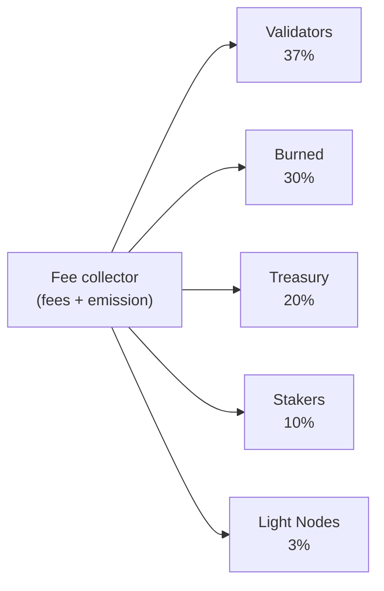

# Tokenomics

QoreChain's economic model is centered on the native **QOR** token and has a **finite, capped supply path**: a fixed genesis supply, staking-reward emission minted under a hard cumulative cap, and a multi-channel burn engine that permanently removes tokens. This page describes how supply, emission, burns and the fee split work, using figures read from the live chain.

---

## Token Basics

| Property              | Value                                                    |
| --------------------- | -------------------------------------------------------- |
| **Display token**     | QOR                                                      |
| **Base denomination** | uqor                                                     |
| **Decimal precision** | 10^6 (1 QOR = 1,000,000 uqor)                            |
| **Supply**            | Genesis 4,420,000,000 QOR; see [Supply and Emission Model](#supply-and-emission) |
| **Chain ID**          | `qorechain-vladi` (mainnet, EVM chain ID 9801)          |
| **Bech32 prefix**     | `qor` (accounts: `qor1...`, validators: `qorvaloper...`) |

:::note
The figures on this page describe the **mainnet** (`qorechain-vladi`, EVM chain ID **9801**), live since 7 June 2026, on release **v3.2.5** since 29 October 2026 (height 3,906,833, governance proposal 14; v3.2.4 was applied at height 3,742,566 on 23 October 2026). The **`qorechain-diana`** testnet (EVM chain ID **9800**, release **v3.2.6** since 27 October 2026) has its own emission and supply history (testnet supply is far above mainnet's and its emission is already past the cap), so use the mainnet figures. Amounts that move with every block are marked with the date they were read (23 October 2026).
:::

---

## Supply and Emission Model {#supply-and-emission}

QoreChain has a **finite, capped supply path**. Genesis supply was **4,420,000,000 QOR** (4,500,000,000 QOR planned; 80,000,000 QOR, 1.78 %, was burned at the Token Generation Event before genesis). After genesis the protocol changes the supply through two mechanisms:

* **Emission** — the `x/inflation` module mints a fixed amount each epoch, under a **hard cumulative cap of 590,000,000 QOR**. Minted tokens enter the fee collector and pass through the same fee split as transaction fees (see [Fee Distribution](#fee-distribution)).
* **Burns** — the `x/burn` module permanently removes the burn share of everything in the fee collector.

### Emission {#staking-reward-schedule}

| Parameter | Value |
| --- | --- |
| Emission mode | `fixed` (since v3.1.94, height 2,122,074 — 26 August 2026) |
| Emission per epoch | **86,000 QOR** (16,239 QOR until governance proposal 10; the first 86,000 QOR epoch starts at block 3,672,000) |
| Epoch length | 43,200 blocks (about 37.7 hours at the current ≈3.1 s block time) |
| Cumulative cap (`max_total_emission`) | **590,000,000 QOR** (114,285,714 QOR until proposal 10) |
| Minted so far (23 October 2026, epoch 86) | 105,420,896.21 QOR (17.87 % of the cap) |
| Remaining under the cap | 484,579,103.79 QOR (about 5,635 epochs at 86,000 QOR per epoch; the last one is partial) |

Once the cap is reached the module stops minting permanently; after that, rewards come from transaction fees alone. The emission figures were set by governance: proposal #4 (26 August 2026) replaced the original decaying schedule with a fixed amount under a hard cap, and proposal #10 (passed 19 October 2026 with all bonded stake voting in favour) changed that amount from 16,239 QOR to 86,000 QOR per epoch and raised the cap from 114,285,714 QOR to 590,000,000 QOR. The epoch length did not change. The schedule values (17.5 %, 11 %, 7 %, 7 %, 2 % for years 1–5) remain stored in the module parameters but are not used in `fixed` mode.

The minted total, the remaining amount and the next epoch height are live at `GET /qorechain/inflation/v1/epoch_info` (its `current_inflation_rate` field reports the legacy year-based rate, which `fixed` mode does not use).

QoreChain does not expose a live staking-return figure; treat any quoted percentage as unverified. Current figures can be read from chain state: the supply is at `GET /cosmos/bank/v1beta1/supply/by_denom?denom=uqor` (4,493,785,581.46 QOR on 23 October 2026) and the burn totals at `GET /qorechain/burn/v1/stats`.

---

## x/burn — Multi-Channel Burn Engine

The `x/burn` module defines **12 burn sources** on mainnet today. Every burned token is permanently removed from supply. On mainnet only `gas_fee` (31,626,314.61 QOR as of 23 October 2026) and, since v3.2.2, `failed_tx` (0.1355 QOR) have recorded burns; the others are defined but have recorded none. From v3.2.4 there is a thirteenth source, `staking_tier_penalty`, which records the penalty burned when a time-locked delegation is unlocked early (live on the testnet since 19 October 2026 and on mainnet since 23 October 2026; no early unlock has been recorded on mainnet yet; see [Staking and Delegation](/user-guide/staking-and-delegation#time-locked-staking)).

### Burn Channels

| #  | Channel            | Source                     | Description                                   |
| -- | ------------------ | -------------------------- | --------------------------------------------- |
| 1  | `gas_fee`          | Transaction fees           | 30% of all gas fees are burned                |
| 2  | `contract_create`  | Smart contract deployment  | Flat 100 QOR fee burned per contract creation |
| 3  | `ai_service`       | AI module usage fees       | 50% of AI service fees burned                 |
| 4  | `bridge_fee`       | Cross-chain bridge fees    | 100% of bridge fees burned                    |
| 5  | `treasury_buyback` | Treasury operations        | Periodic buyback-and-burn from treasury       |
| 6  | `failed_tx`        | Failed transaction gas     | 10% of gas from failed transactions burned (applied by the chain since v3.2.2) |
| 7  | `xqore_penalty`    | xQORE early exit penalties | Penalty amounts routed through burn           |
| 8  | `auto_buyback`     | Automated buyback program  | Protocol-level automated burns                |
| 9  | `tge`              | Token generation event     | The 80,000,000 QOR TGE burn happened before genesis (genesis supply is 4,420,000,000 QOR); this channel is reserved and records 0 |
| 10 | `rollup_create`    | Rollup deployment          | 1% of rollup creation stake burned            |
| 11 | `milestone`        | Transaction-count milestones | Scheduled burns at fixed cumulative transaction counts (none triggered yet) |
| 12 | `amm`              | AMM                        | Reserved for AMM protocol fees (none recorded) |

The `contract_create`, `ai_service`, `bridge_fee` and `auto_buyback` channels are inactive today: QoreChain Native upload is closed, AI service fees and the bridge are not live.

### Fee Distribution {#fee-distribution}

Everything in the fee collector is split across five destinations, as shown below. The fee collector holds both transaction fees and the epoch emission minted by `x/inflation`. The shares are enforced on-chain and always sum to exactly 100%.

The shares are:

| Recipient       | Share | Description                                                          |
| --------------- | ----- | -------------------------------------------------------------------- |
| **Validators**  | 37%   | Distributed to the active validator set proportional to stake        |
| **Burned**      | 30%   | Permanently removed from supply via the `gas_fee` burn channel       |
| **Treasury**    | 20%   | Allocated to the community treasury for governance-directed spending |
| **Stakers**     | 10%   | Distributed to all QOR stakers proportional to delegation            |
| **Light Nodes** | 3%    | Distributed to light nodes for serving network data                  |

The shares are enforced on-chain and must always sum to exactly 100%.

:::note What actually flows through the split
The split applies to everything in the fee collector, which holds both transaction fees and the epoch emission minted by `x/inflation`. In practice almost all of it today is emission: of 105,420,896 QOR minted, 31,626,315 QOR (30.0 %) has been burned through the gas-fee channel. Until the v3.2.0 upgrade (25 September 2026, height 2,981,742) the 10 % staker share was moved into the distribution module's balance without backing any claim, so stakers and validators together received 37 %, not 47 %; from that height the staker share is paid as a normal staking reward. The amount that had already stranded was recorded on chain and has since been released by governance votes — see [Stranded Staker Share and Light-Node Reserve](#stranded-and-reserve).
:::

### Burn Parameters

| Parameter              | Default                    | Description                              |
| ---------------------- | -------------------------- | ---------------------------------------- |
| `gas_burn_rate`        | 0.30                       | Fraction of gas fees burned (30%)        |
| `contract_create_fee`  | 100,000,000 uqor (100 QOR) | Flat burn fee for contract creation      |
| `ai_service_burn_rate` | 0.50                       | Fraction of AI service fees burned (50%) |
| `bridge_burn_rate`     | 1.00                       | Fraction of bridge fees burned (100%)    |
| `failed_tx_burn_rate`  | 0.10                       | Fraction of failed TX gas burned (10%)   |
| `validator_share`      | 0.37                       | Share of the fee collector to validators |
| `treasury_share`       | 0.20                       | Share to the treasury                    |
| `staker_share`         | 0.10                       | Share to stakers                         |
| `light_node_share`     | 0.03                       | Share to light nodes                     |
| `enabled`              | true                       | Module activation flag                   |

Each burn event is recorded on-chain with its source, amount, block height, and associated transaction hash. Aggregate statistics are queryable per channel and in total.

---

## Stranded Staker Share and Light-Node Reserve {#stranded-and-reserve}

Two amounts accumulated on mainnet before the v3.2.0 upgrade (25 September 2026, height 2,981,742). The upgrade recorded them **on chain, outside any distribution**, and made them movable only through a governance vote. Governance has since released both to the foundation, in October 2026:

| Record | Release | Amount | Governance message |
| --- | --- | --- | --- |
| **Stranded staker share** — the 10 % staker share that had been deposited where it backed no staking-reward claim | Proposal 9 (passed 19 October 2026) | 6,693,045.921330 QOR released | `MsgReleaseStrandedRewards` (governance authority; named destination; cannot exceed the record) |
| **Light-node reserve** — the 3 % light-node share that accumulated while no light node was eligible | Proposal 8 (passed 19 October 2026) | 3,156,983.796395 QOR released | `MsgReleaseLightNodeReserve` (governance authority) |

**Corrected remainder of the stranded share.** At the v3.2.3 upgrade (height 3,662,051, 20 October 2026) the chain recomputed the stranded-share record, which then stood at 3,807,496.785528 QOR (`reserved` in `GET /qorechain/burn/v1/stranded_rewards`, alongside `released`, 6,693,045.921330 QOR). Governance proposal 12 released that remainder, 3,807,496.785528 QOR, to the foundation: it passed (voting ended 21 October 2026 at 20:01 UTC) with all voting bonded stake in favour. The record can be checked at `GET /qorechain/burn/v1/stranded_rewards` and the proposal at `GET /cosmos/gov/v1/proposals/12`.

**The light-node pool now.** From the v3.2.0 upgrade, light-node rewards are paid only from what accrued since the previous distribution run, bounded per node. Since v3.2.3 the bound is **2,000 QOR per node per 30 days** (`max_reward_per_month_per_node`), prorated by block time and the node's uptime; the per-block value (`max_reward_per_block_per_node`, 1,713 uqor) is still reported but no longer the rule. Whatever is not earned stays in the pool's reserve, which only a governance vote can release. After proposal 8 the reserve accrues again: on 27 October 2026 the mainnet pool's `reserved` (in `GET /qorechain/lightnode/v1/reward_pool`) was about 13,380.9 QOR, with 0.06 QOR outstanding and nothing payable; one light node was registered on each network that day. Registration is open and licence-gated (see [Light Node](/light-node/overview#reward-program-status)). A release before the upgrade snapshot, above the recorded amount, or to an invalid destination is refused.

## x/xqore — Locked Staking and Governance Amplification {#x-xqore}

:::warning Not live yet
The xQORE module's accounting exists and it is enabled in genesis, but it is **not usable yet** on mainnet (`qorechain-vladi`) or testnet (`qorechain-diana`). The node has no transaction, query, CLI or RPC entry point for it, so `tx xqore lock` / `unlock`, `query xqore ...`, the xQORE REST routes and `qor_getXQOREPosition` do not work, and nobody holds xQORE. It is planned for a future chain release, which will also change how exit penalties are redistributed so that unlocking stays cheap however many holders there are. The release will be named here when it ships.
:::

The `x/xqore` module introduces **xQORE**, a non-transferable locked-staking derivative. Users lock QOR to mint xQORE at a 1:1 ratio. xQORE holders receive amplified governance power and a share of redistributed exit penalties.

### Lock Mechanism

* **Lock**: Send QOR to the xQORE module to mint xQORE at a 1:1 ratio.
* **Governance weight**: xQORE holders receive **2x governance voting power** compared to standard QOR stakers.
* **Non-transferable**: xQORE cannot be sent between accounts. It is bound to the locking address.

### Exit Penalty Schedule

Early withdrawal from xQORE incurs a penalty that decreases with lock duration:

| Lock Duration  | Penalty Rate | Description                                |
| -------------- | ------------ | ------------------------------------------ |
| &lt; 30 days   | **50%**      | Half of locked QOR is forfeited            |
| 30 -- 90 days  | **35%**      | Significant penalty for short-term locks   |
| 90 -- 180 days | **15%**      | Reduced penalty for medium-term commitment |
| > 180 days     | **0%**       | Full withdrawal with no penalty            |

### PvP Rebase Redistribution

Penalties collected from early exits are not simply destroyed. Instead, they follow a PvP (player-versus-player) rebase model:

1. In the genesis configuration **0%** of penalty amounts are burned (`penalty_burn_rate = 0`; the `xqore_penalty` burn channel exists if governance changes it).
2. **100%** are redistributed pro-rata to all remaining xQORE holders.

This creates a positive-sum dynamic for long-term holders: every early exit increases the effective value of remaining xQORE positions. Rebases occur every **100 blocks**.

### xQORE Parameters

| Parameter               | Default                | Description                               |
| ----------------------- | ---------------------- | ----------------------------------------- |
| `governance_multiplier` | 2.0                    | Voting power multiplier for xQORE holders |
| `min_lock_amount`       | 1,000,000 uqor (1 QOR) | Minimum QOR required to lock              |
| `penalty_burn_rate`     | 0.00                   | Fraction of exit penalties burned (genesis default: all penalties are redistributed) |
| `rebase_interval`       | 100 blocks             | Blocks between PvP rebase events          |
| `enabled`               | true                   | Module activation flag                    |

---

## x/inflation — Capped Emission

The `x/inflation` module mints the per-epoch emission (86,000 QOR since proposal 10, `emission_mode = fixed`) and sends it to the fee collector, until the cumulative cap of 590,000,000 QOR is reached. Parameter changes go through a normal governance parameter proposal (`MsgUpdateParams`, added in v3.1.94).

### Epoch Mechanics

* **Epoch length**: 43,200 blocks (about 37.7 hours at ≈3.1 s per block).
* At each epoch boundary the module mints the epoch emission (or the remainder up to the cap), updates the epoch record and stops minting once `total_minted` reaches the cap.
* Since v3.2.3 the emission year is derived from the epoch length rather than a fixed block count.

### Parameters

Read live on 23 October 2026 from `GET /qorechain/inflation/v1/params`:

| Parameter | Value (mainnet) | Description |
| --- | --- | --- |
| `emission_mode` | `fixed` | `schedule` (legacy, year-based rates) or `fixed`; v3.2.4 adds a third mode, `target_apy` |
| `fixed_epoch_emission` | 86,000,000,000 uqor (86,000 QOR) | Minted per epoch in fixed mode |
| `max_total_emission` | 590,000,000,000,000 uqor (590,000,000 QOR) | Hard cumulative ceiling |
| `epoch_length` | 43,200 blocks | Blocks per emission epoch |
| `schedule` | 17.5 %, 11 %, 7 %, 7 %, 2 % (years 1–5) | Legacy schedule, unused in fixed mode |
| `enabled` | `true` | Module activation flag |

The module's parameters and epoch record are exposed over REST on mainnet since v3.2.3 (`/qorechain/inflation/v1/params` and `/qorechain/inflation/v1/epoch_info`); they can also be read from chain state with the RPC `abci_query` raw store interface (store `inflation`, keys `inflation/params` and `inflation/epoch`).

:::note v3.2.4 and the testnet's emission
The `qorechain-diana` testnet is tuned for testing and differs from mainnet (read 27 October 2026): it is in `target_apy` mode with `target_apy_bps` `1667`, `fixed_epoch_emission` is still 16,239 QOR, and `max_total_emission` is 3,950,390,341,362,112,750 uqor, which equals the amount already minted there (`remaining_emission` is `0` at `/qorechain/inflation/v1/epoch_info`), so the testnet mints nothing more. Mainnet uses the values above. The v3.2.4 release adds the third emission mode, `target_apy`, with a `target_apy_bps` parameter: on the testnet since 19 October 2026 and on mainnet since 23 October 2026 (governance proposal 13). On mainnet the parameter is `0` and does not drive emission. Switching mainnet to that mode is a separate governance vote and has not been proposed; until one passes, mainnet stays in `fixed` mode at 86,000 QOR per epoch.
:::

---

## Burn Versus Emission

Emission is capped (590,000,000 QOR in total) and the burn share applies to everything that enters the fee collector, emission included. To date (23 October 2026) 31,626,315 QOR has been burned against 105,420,896 QOR minted, so the supply (4,493,785,581 QOR) is currently above its genesis level. After the cap is reached the supply can only fall, by the amount burned.

---

## Related

* [Chain Parameters](/appendix/chain-parameters) — canonical economic and consensus defaults.
* [Staking and Delegation](/user-guide/staking-and-delegation) — delegate QOR and receive staking rewards.
* [xQORE Staking](/user-guide/xqore-staking) — the PvP rebase staking mechanism.
* [Light Node Rewards](/light-node/rewards-and-monitoring) — the light-node reward share.
