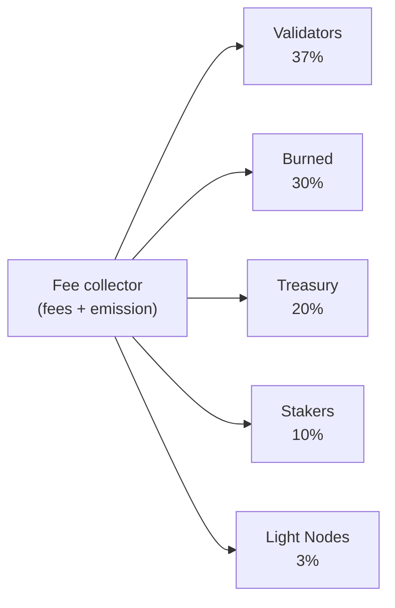

# Tokenomics

QoreChain's economic model is centered on the native **QOR** token and has a **finite, capped supply path**: a fixed genesis supply, staking-reward emission minted under a hard cumulative cap, and a multi-channel burn engine that permanently removes tokens. This page describes how supply, emission, burns and the fee split work, using figures read from the live chain.

---

## Token Basics

| Property              | Value                                                    |
| --------------------- | -------------------------------------------------------- |
| **Display token**     | QOR                                                      |
| **Base denomination** | uqor                                                     |
| **Decimal precision** | 10^6 (1 QOR = 1,000,000 uqor)                            |
| **Supply**            | Genesis 4,420,000,000 QOR; see [Supply and Emission Model](#supply-and-emission) |
| **Chain ID**          | `qorechain-vladi` (mainnet, EVM chain ID 9801)          |
| **Bech32 prefix**     | `qor` (accounts: `qor1...`, validators: `qorvaloper...`) |

:::note
The figures on this page describe the **mainnet** (`qorechain-vladi`, EVM chain ID **9801**), live since 29 June 2026 on release **v3.2.1**. The **`qorechain-diana`** testnet (EVM chain ID **9800**) shares the same module parameters; its supply and emission history differ (testnet supply is far above mainnet's and its emission is already past the cap), so use the mainnet figures.
:::

---

## Supply and Emission Model {#supply-and-emission}

QoreChain has a **finite, capped supply path**. Genesis supply was **4,420,000,000 QOR** (4,500,000,000 QOR planned; 80,000,000 QOR, 1.78 %, was burned at the Token Generation Event before genesis). After genesis only two things change the supply:

* **Emission** — the `x/inflation` module mints a fixed amount each epoch, under a **hard cumulative cap of 114,285,714 QOR**. Minted tokens enter the fee collector and pass through the same fee split as transaction fees (see [Fee Distribution](#fee-distribution)).
* **Burns** — the `x/burn` module permanently removes the burn share of everything in the fee collector.

### Emission {#staking-reward-schedule}

| Parameter | Value |
| --- | --- |
| Emission mode | `fixed` (since v3.1.94, height 2,122,074 — 26 August 2026) |
| Emission per epoch | 16,239 QOR |
| Epoch length | 43,200 blocks (about 38.6 hours at the current ≈3.2 s block time) |
| Cumulative cap (`max_total_emission`) | 114,285,714 QOR |
| Minted so far (14 October 2026, epoch 81) | 105,200,179 QOR (92.05 % of the cap) |
| Remaining under the cap | 9,085,535 QOR (about 559 epochs at 16,239 QOR per epoch) |

Once the cap is reached the module stops minting permanently; after that, rewards come from transaction fees alone. The cap was set by governance proposal #4 (passed with all bonded stake voting in favour), replacing the original decaying schedule, which had been calibrated for a mature, fully bonded network and paid out far faster than intended against the stake actually bonded. The schedule values (17.5 %, 11 %, 7 %, 7 %, 2 % for years 1–5) remain stored in the module parameters but are not used in `fixed` mode.

QoreChain does not expose a live staking-return figure; treat any quoted percentage as unverified. Current figures can be read from chain state: the supply is at `GET /cosmos/bank/v1beta1/supply/by_denom?denom=uqor` and the burn totals at `GET /qorechain/burn/v1/stats`.

---

## x/burn — Multi-Channel Burn Engine

The `x/burn` module defines **12 burn sources**. Every burned token is permanently removed from supply. On mainnet only `gas_fee` has recorded burns so far (31,560,093 QOR as of 14 October 2026); the others are defined but have recorded none.

### Burn Channels

| #  | Channel            | Source                     | Description                                   |
| -- | ------------------ | -------------------------- | --------------------------------------------- |
| 1  | `gas_fee`          | Transaction fees           | 30% of all gas fees are burned                |
| 2  | `contract_create`  | Smart contract deployment  | Flat 100 QOR fee burned per contract creation |
| 3  | `ai_service`       | AI module usage fees       | 50% of AI service fees burned                 |
| 4  | `bridge_fee`       | Cross-chain bridge fees    | 100% of bridge fees burned                    |
| 5  | `treasury_buyback` | Treasury operations        | Periodic buyback-and-burn from treasury       |
| 6  | `failed_tx`        | Failed transaction gas     | 10% of gas from failed transactions burned (applied by the chain from v3.2.2; testnet only so far) |
| 7  | `xqore_penalty`    | xQORE early exit penalties | Penalty amounts routed through burn           |
| 8  | `auto_buyback`     | Automated buyback program  | Protocol-level automated burns                |
| 9  | `tge`              | Token generation event     | The 80,000,000 QOR TGE burn happened before genesis (genesis supply is 4,420,000,000 QOR); this channel is reserved and records 0 |
| 10 | `rollup_create`    | Rollup deployment          | 1% of rollup creation stake burned            |
| 11 | `milestone`        | Transaction-count milestones | Scheduled burns at fixed cumulative transaction counts (none triggered yet) |
| 12 | `amm`              | AMM                        | Reserved for AMM protocol fees (none recorded) |

The `contract_create`, `ai_service`, `bridge_fee` and `auto_buyback` channels are inactive today: CosmWasm upload is closed, AI service fees and the bridge are not live.

### Fee Distribution {#fee-distribution}

Everything in the fee collector is split across five destinations, as shown below. The fee collector holds both transaction fees and the epoch emission minted by `x/inflation`. The shares are enforced on-chain and always sum to exactly 100%.

The shares are:

| Recipient       | Share | Description                                                          |
| --------------- | ----- | -------------------------------------------------------------------- |
| **Validators**  | 37%   | Distributed to the active validator set proportional to stake        |
| **Burned**      | 30%   | Permanently removed from supply via the `gas_fee` burn channel       |
| **Treasury**    | 20%   | Allocated to the community treasury for governance-directed spending |
| **Stakers**     | 10%   | Distributed to all QOR stakers proportional to delegation            |
| **Light Nodes** | 3%    | Distributed to light nodes for serving network data                  |

The shares are enforced on-chain and must always sum to exactly 100%.

:::note What actually flows through the split
The split applies to everything in the fee collector, which holds both transaction fees and the epoch emission minted by `x/inflation`. In practice almost all of it today is emission: of 105,200,179 QOR minted, 31,560,093 QOR (30.0 %) has been burned and 3,156,009 QOR (3.0 %) sits in the light-node reserve. Until the v3.2.0 upgrade (25 September 2026, height 2,981,742) the 10 % staker share was moved into the distribution module's balance without backing any claim, so stakers and validators together received 37 %, not 47 %; from that height the staker share is paid as a normal staking reward, and the amount already stranded (6,693,045.92 QOR) was recorded and can move only by a governance vote — see [Stranded Staker Share and Light-Node Reserve](#stranded-and-reserve).
:::

### Burn Parameters

| Parameter              | Default                    | Description                              |
| ---------------------- | -------------------------- | ---------------------------------------- |
| `gas_burn_rate`        | 0.30                       | Fraction of gas fees burned (30%)        |
| `contract_create_fee`  | 100,000,000 uqor (100 QOR) | Flat burn fee for contract creation      |
| `ai_service_burn_rate` | 0.50                       | Fraction of AI service fees burned (50%) |
| `bridge_burn_rate`     | 1.00                       | Fraction of bridge fees burned (100%)    |
| `failed_tx_burn_rate`  | 0.10                       | Fraction of failed TX gas burned (10%)   |
| `validator_share`      | 0.37                       | Share of the fee collector to validators |
| `treasury_share`       | 0.20                       | Share to the treasury                    |
| `staker_share`         | 0.10                       | Share to stakers                         |
| `light_node_share`     | 0.03                       | Share to light nodes                     |
| `enabled`              | true                       | Module activation flag                   |

Each burn event is recorded on-chain with its source, amount, block height, and associated transaction hash. Aggregate statistics are queryable per channel and in total.

---

## Stranded Staker Share and Light-Node Reserve {#stranded-and-reserve}

Two amounts accumulated on mainnet before the v3.2.0 upgrade (25 September 2026, height 2,981,742) and are now held **on record, outside any distribution**. Both can move only through a governance vote.

| Record | Amount on mainnet | Query | Governance message |
| --- | --- | --- | --- |
| **Stranded staker share** — the 10 % staker share that had been deposited where it backed no staking-reward claim | 6,693,045.921330 QOR recorded, 0 released | `GET /qorechain/burn/v1/stranded_rewards` | `MsgReleaseStrandedRewards` (governance authority; named destination; cannot exceed the record) |
| **Light-node reserve** — the 3 % light-node share that accumulated while no light node was eligible | 3,156,009.326407 QOR reserved, 0 outstanding | `GET /qorechain/lightnode/v1/reward_pool` | `MsgReleaseLightNodeReserve` (governance authority) |

From the upgrade height the staker share is paid as a normal staking reward and light-node rewards are paid only from what accrued since the previous distribution run, with a per-node, per-block ceiling (`max_reward_per_block_per_node`, 1,713 uqor as read on 14 October 2026). Light-node registration is currently closed, so no node is eligible and the 3 % share continues to accrue to the reserve. A release before the upgrade snapshot, above the recorded amount, or to an invalid destination is refused.

---

## x/xqore — Locked Staking and Governance Amplification {#x-xqore}

:::warning Not live yet
The xQORE module's accounting exists and it is enabled in genesis, but it is **not usable yet** on mainnet (`qorechain-vladi`) or testnet (`qorechain-diana`). The node has no transaction, query, CLI or RPC entry point for it, so `tx xqore lock` / `unlock`, `query xqore ...`, the xQORE REST routes and `qor_getXQOREPosition` do not work, and nobody holds xQORE. It is planned for a future chain release, which will also change how exit penalties are redistributed so that unlocking stays cheap however many holders there are. The release will be named here when it ships.
:::

The `x/xqore` module introduces **xQORE**, a non-transferable locked-staking derivative. Users lock QOR to mint xQORE at a 1:1 ratio. xQORE holders receive amplified governance power and a share of redistributed exit penalties.

### Lock Mechanism

* **Lock**: Send QOR to the xQORE module to mint xQORE at a 1:1 ratio.
* **Governance weight**: xQORE holders receive **2x governance voting power** compared to standard QOR stakers.
* **Non-transferable**: xQORE cannot be sent between accounts. It is bound to the locking address.

### Exit Penalty Schedule

Early withdrawal from xQORE incurs a penalty that decreases with lock duration:

| Lock Duration  | Penalty Rate | Description                                |
| -------------- | ------------ | ------------------------------------------ |
| &lt; 30 days   | **50%**      | Half of locked QOR is forfeited            |
| 30 -- 90 days  | **35%**      | Significant penalty for short-term locks   |
| 90 -- 180 days | **15%**      | Reduced penalty for medium-term commitment |
| > 180 days     | **0%**       | Full withdrawal with no penalty            |

### PvP Rebase Redistribution

Penalties collected from early exits are not simply destroyed. Instead, they follow a PvP (player-versus-player) rebase model:

1. In the genesis configuration **0%** of penalty amounts are burned (`penalty_burn_rate = 0`; the `xqore_penalty` burn channel exists if governance changes it).
2. **100%** are redistributed pro-rata to all remaining xQORE holders.

This creates a positive-sum dynamic for long-term holders: every early exit increases the effective value of remaining xQORE positions. Rebases occur every **100 blocks**.

### xQORE Parameters

| Parameter               | Default                | Description                               |
| ----------------------- | ---------------------- | ----------------------------------------- |
| `governance_multiplier` | 2.0                    | Voting power multiplier for xQORE holders |
| `min_lock_amount`       | 1,000,000 uqor (1 QOR) | Minimum QOR required to lock              |
| `penalty_burn_rate`     | 0.00                   | Fraction of exit penalties burned (genesis default: all penalties are redistributed) |
| `rebase_interval`       | 100 blocks             | Blocks between PvP rebase events          |
| `enabled`               | true                   | Module activation flag                    |

---

## x/inflation — Capped Emission

The `x/inflation` module mints the per-epoch emission (16,239 QOR, `emission_mode = fixed`) and sends it to the fee collector, until the cumulative cap of 114,285,714 QOR is reached. Parameter changes go through a normal governance parameter proposal (`MsgUpdateParams`, added in v3.1.94).

### Epoch Mechanics

* **Epoch length**: 43,200 blocks (about 38.6 hours at ≈3.2 s per block).
* At each epoch boundary the module mints the epoch emission (or the remainder up to the cap), updates the epoch record and stops minting once `total_minted` reaches the cap.

### Parameters

| Parameter | Value (mainnet) | Description |
| --- | --- | --- |
| `emission_mode` | `fixed` | `schedule` (legacy, year-based rates) or `fixed` |
| `fixed_epoch_emission` | 16,239,000,000 uqor | Minted per epoch in fixed mode |
| `max_total_emission` | 114,285,714,000,000 uqor | Hard cumulative ceiling |
| `epoch_length` | 43,200 blocks | Blocks per emission epoch |
| `schedule` | 17.5 %, 11 %, 7 %, 7 %, 2 % (years 1–5) | Legacy schedule, unused in fixed mode |
| `enabled` | `true` | Module activation flag |

On mainnet these values are not exposed over a REST route; they can be read from chain state with the RPC `abci_query` raw store interface (store `inflation`, keys `inflation/params` and `inflation/epoch`). A dedicated query service for them exists on the testnet only (v3.2.2).

---

## Burn Versus Emission

Emission is capped (114,285,714 QOR) and the burn share applies to everything that enters the fee collector, emission included. To date 31,560,093 QOR has been burned against 105,200,179 QOR minted, so the supply is currently above its genesis level. After the cap is reached the supply can only fall, by the amount burned.

---

## Related

* [Chain Parameters](/appendix/chain-parameters) — canonical economic and consensus defaults.
* [Staking and Delegation](/user-guide/staking-and-delegation) — delegate QOR and receive staking rewards.
* [xQORE Staking](/user-guide/xqore-staking) — the PvP rebase staking mechanism.
* [Light Node Rewards](/light-node/rewards-and-monitoring) — the light-node reward share.
