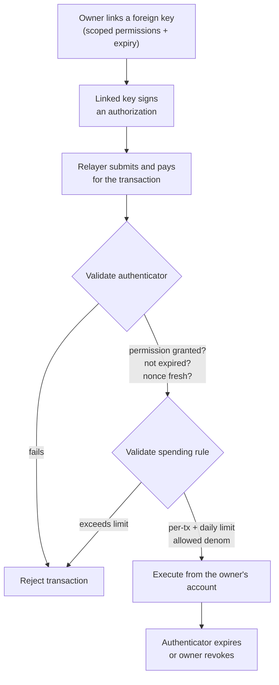

# Account Abstraction

QoreChain provides **protocol-level account abstraction** through the `x/abstractaccount` module. The module records abstract accounts with spending rules and lets the account owner link foreign keys (**authenticators**) that can spend from the account within permission and spending-limit bounds, without external smart contract infrastructure.

:::danger Not enabled on mainnet; enabled on the testnet
The abstract-account module is **switched off on the `qorechain-vladi` mainnet** at the time of writing (checked 27 October 2026): `qorechaind query abstractaccount config` (and `GET /qorechain/abstractaccount/v1/config`) report `enabled: false`. On the **`qorechain-diana` testnet** it was switched on by a governance decision (proposal 18, passed 27 October 2026) and reports `enabled: true`. From chain v3.2.0 the flag is enforced on every path: where it is `false` the chain refuses account creation, authenticator registration and both execute lanes (`MsgExecuteEVM`, `MsgExecuteCosmos`) with `abstract accounts are disabled on this chain`. No ordinary transaction can switch the module on; the setting changes only by a governance decision. No abstract-account transaction has ever been included on mainnet. Everything below describes the module's interfaces; try it on the testnet, and do not build a linked-key or delegated-spending flow for mainnet until the module is enabled there. Always check the flag first.
:::

:::note
The commands below use the **`qorechain-vladi`** mainnet (live since 7 June 2026), which runs node release **v3.2.6** (applied at height 4,020,000 on 4 November 2026, governance proposal 15; v3.2.5 was applied at height 3,906,833 on 29 October 2026, proposal 14, and v3.2.4 at height 3,742,566 on 23 October 2026). Substitute `--chain-id qorechain-diana` for the testnet, which runs v3.2.8 (since 12 November 2026; v3.2.4 since 19 October 2026).
:::

:::caution Every Cosmos-lane transaction needs the hybrid post-quantum cosign
The `qorechaind tx` samples on this page show only the fee flags. On the live networks every Cosmos-lane transaction must also carry the ML-DSA-87 hybrid co-signature, so build the transaction with `--generate-only` and sign it with `qorechaind tx pqc cosign` (or use QoreX or the SDK, which do it for you). The community build of `qorechaind` cannot produce that signature; use the release binary from the [download manifest](/developer-guide/running-a-node#fetch-the-manifest). The fee floor is **0.1 uqor per unit of gas**, so `--gas 400000` needs at least `--fees 40000uqor`. See [Post-Quantum Signing](/developer-guide/post-quantum-signing).
:::

## Overview

Traditional blockchain accounts are controlled by a single private key. Account abstraction decouples the concept of "who can authorize a transaction" from a single cryptographic key. The `x/abstractaccount` module provides:

* **Abstract accounts** with a recorded account type and owner
* **Spending rules** (per-transaction and daily limits, allowed denominations) that bound what linked keys (authenticators and session keys) can spend; they do not limit the owner's own key
* **Authenticators**: foreign keys (a Phantom ed25519 key or a MetaMask secp256k1 address) that the owner links with scoped permissions and an expiry, and can revoke at any time

*A linked-key (authenticator) flow: the linked key signs an authorization, a relayer submits it, the module checks permissions, expiry and spending rules, then executes from the owner's account.*



## Account Types

`create` records one of three account types. The type is stored on the account and is part of how its address is derived; the module has no multisig, session-key or recovery transactions of its own (the transaction service is `create`, `update-rules`, `register-authenticator`, `revoke-authenticator`, `execute-cosmos`, `execute-evm`).

| Type              | Intended use                    |
| ----------------- | ------------------------------- |
| `multisig`        | DAO treasuries, shared wallets  |
| `social_recovery` | Consumer wallets, onboarding    |
| `session_based`   | dApp sessions, mobile wallets   |

## Creating an Abstract Account

`create` takes the account type as a positional argument (`multisig`, `social_recovery` or `session_based`):

```bash
qorechaind tx abstractaccount create session_based \
  --from mykey \
  --gas 400000 --fees 40000uqor
```

The command has no flags for signers, thresholds or guardians.

## Authenticators (linked keys)

The module's delegated-key mechanism is the **authenticator**, described in [Linked Wallet Authenticators](#authenticators) below: the owner links a foreign key (ed25519 or secp256k1) with a set of permissions and an expiry, and revokes it at any time:

```bash
qorechaind tx abstractaccount register-authenticator <account-address> <scheme> <pubkey-base64> <permissions-csv> <expiry-unix> <label> \
  --from mykey --gas 400000 --fees 40000uqor
qorechaind tx abstractaccount revoke-authenticator <account-address> <scheme> <pubkey-base64> \
  --from mykey --gas 400000 --fees 40000uqor
```

`scheme` is `ed25519` (for example Phantom) or `secp256k1` (for example MetaMask). There is no `grant-session`, `revoke-session` or `query abstractaccount sessions` command.

## Spending Rules

Spending rules add financial guardrails for the authenticators and session keys linked to an abstract account. Spending rules bind only authenticators and session keys, not the owner's own key; the owner's key is limited, on the EVM lane, by the [EVM authorisation window](/getting-started/first-transaction#evm-window).

The rule fields:

| Rule             | Description                                           |
| ---------------- | ----------------------------------------------------- |
| `daily_limit`    | Maximum total spend per UTC calendar day              |
| `per_tx_limit`   | Maximum spend per individual authorised execution     |
| `allowed_denoms` | Restrict which token denominations can be spent (an ERC-20 is listed as `erc20/<EIP-55 0x address>`, the spending rule's own spelling with a slash; the chain compares the address in its EIP-55 form, so the letter case you type does not create a different token. This is not the bank denom of a registered token pair, which is written `erc20:<EIP-55 0x address>` with a colon and is case-sensitive, see [EVM Development](/developer-guide/evm-development#fest-tokens)) |
| `denom_limits`   | Per-denomination limits as decimal strings (v3.2.2): `{"denom","per_tx_limit","daily_limit"}`; they replace `per_tx_limit` and `daily_limit` for the denominations they name, so an 18-decimal token can be capped |
| `allowed_evm_calls` | EVM calls a rule-bound key may make **with call data** (v3.2.2), as `0x<target>` (any function of that contract) or `0x<target>/0x<selector>` (that function only). Without an entry a rule-bound key can only send value, deploy (with the `deploy` permission) and move the ERC-20 tokens listed in `allowed_denoms`. Listing a target trusts every argument of calls made to it, recipients included |

### Set Spending Rules

`update-rules` replaces the account's rules with a JSON array of `SpendingRule` objects (inline JSON, not a file and not flags):

```bash
qorechaind tx abstractaccount update-rules <account-address> \
  '[{"id":"daily","enabled":true,"daily_limit":1000000000,"per_tx_limit":100000000,"allowed_denoms":["uqor"]}]' \
  --from mykey --gas 400000 --fees 40000uqor
```

Limits are in the base unit (`uqor`) and count per authorised execution; the daily limit bounds the total per UTC calendar day. The rules replace the stored ones as a whole, so a field you leave out is removed. Since v3.2.2 the EVM lane measures what a call actually moves (native value, the account's native balance decrease, bank coins spent, and the balance or allowance change of every listed ERC-20) instead of only `msg.value`, and contract creation needs the separate `deploy` permission. A richer example (the ERC-20 shown is the testnet fUSD test token; use your own token's contract address, and note the slash in `erc20/<address>` in a rule versus the colon in the bank denom `erc20:<address>`):

```bash
qorechaind tx abstractaccount update-rules <account-address> \
  '[{"id":"daily","enabled":true,"daily_limit":5000000,"allowed_denoms":["uqor","erc20/0x97143B771D34ddb9130b807b135Ae675A5a963CA"],"allowed_evm_calls":["0xROUTER/0x38ed1739"],"denom_limits":[{"denom":"erc20/0x97143B771D34ddb9130b807b135Ae675A5a963CA","per_tx_limit":"100000000000000000000","daily_limit":"500000000000000000000"}]}]' \
  --from mykey --gas 400000 --fees 40000uqor
```

### Query Current Rules

The account record includes its rules and the number of linked keys:

```bash
qorechaind query abstractaccount account <account-address>
```

From v3.2.8 (testnet only until a later mainnet upgrade) a key with value permissions is refused at registration and at execution unless a rule bounds it, so "no limit" no longer applies to such keys.

:::caution A rule bounds a key only when one exists
The chain resolves the limit in this order: the authenticator's own rule if set and `enabled`; otherwise the first `enabled` rule on the account; otherwise **there is no limit**. A rule stored with `enabled: false` is no limit, not a zero limit. `MsgRegisterAuthenticator` carries no rule, so a key linked by that message alone is bounded only by an account-level rule. Set a rule deliberately with `update-rules`, and register only the permissions the key needs. A limit bounds the damage a linked key can do; it does not replace revoking the key.
:::

## Linked Wallet Authenticators — Delegated Spending {#authenticators}

The authenticator design was introduced in chain version **v3.1.85** (building on the v3.1.84 permission model). It is **not usable on mainnet while the module is disabled there**, and is available on the testnet, where the module is enabled (see the status box at the top of this page). A **linked external wallet key** — a Phantom (ed25519) key or a MetaMask (secp256k1) account — can **spend from the canonical post-quantum account** under least-privilege, spending-limited, revocable terms. The external key never produces an ML-DSA signature; a **relayer** submits and pays for the transaction envelope (the relayer's own hybrid PQC signature satisfies the chain's signing requirements), while the authenticator's signature over **domain-separated, replay-bound sign bytes** is the authorization.

### Register an authenticator {#register-authenticator}

The account owner registers the external key with `MsgRegisterAuthenticator` (an ordinary root-key transaction), giving it a scheme, permissions, an expiry, and optional spending limits:

```js
import { registerEthAuthenticatorMsg } from "@qorechain/wallet-adapter";

// Link a MetaMask account by its 20-byte address (EIP-191 verification):
const msg = registerEthAuthenticatorMsg({
  owner: "qor1owner...",              // the canonical account (signs this message)
  ethAddress: "0xAbC...123",          // the MetaMask address to link
  permissions: ["evm"],               // least privilege — see the taxonomy below
  expiryUnix: Math.floor(Date.now() / 1000) + 30 * 24 * 3600, // absolute Unix seconds, ≤ 30 days recommended
  label: "metamask",
});
// Limits are a separate message (MsgUpdateSpendingRules), see "Spending Rules" above.
// Sign & broadcast this msg with the OWNER's normal hybrid-PQC signer.
```

**From release v3.2.8 (testnet only until a later mainnet upgrade) registration needs two more things.**

1. **A possession proof.** `MsgRegisterAuthenticator` has a required field `possession_proof` (field 8): a signature by the key being linked, proving it agrees to the link. The key signs this plain text under its own scheme, so a browser wallet shows the user what they sign (Phantom `signMessage`, MetaMask `personal_sign`); a 33-byte secp256k1 key signs the SHA-256 of the text:

   ```text
   QoreChain authenticator link v1
   chain: <chain-id>
   account: <bech32 account>
   scheme: <scheme>
   key: <lowercase hex of the public key, or of the 20-byte address>
   ```

   The text names the chain, the account, the scheme and the key, so a proof cannot be reused for another chain, account or key. A registration without a valid proof is refused.
2. **A spending rule for value keys.** A key whose permissions can move value (`send`, `evm`, `svm`, `deploy`, `all`) needs a spending rule that bounds every denomination it can spend, set with `MsgUpdateSpendingRules` before or together with the link. The same rule is enforced at execution for keys linked before the upgrade, so add rules for them too.

From code, SDK 0.14.0 has the helpers for both (TypeScript: `signAuthenticatorLinkPhantom`, `signAuthenticatorLinkMetaMask`, `signAuthenticatorLinkEd25519`, `signAuthenticatorLinkSecp256k1`, `signAuthenticatorLinkEip191` for the proof; `linkAuthenticatorMsgs` for the spending rule and the link in one owner-signed transaction), and `@qorechain/wallet-adapter` 0.6.0 has `phantomPossessionProof`, `metaMaskPossessionProof` and `linkAuthenticatorMsgs`. See [Linking from chain v3.2.8](/sdk/guides/authenticators#link-v328). For the failed-execution case, `assertAuthenticatorExecutionsSucceeded` raises on `success=false`. These helpers have not been run on the testnet.

A Phantom key is registered the same way with scheme `ed25519` and the Phantom public key (`register-authenticator` on the CLI). Revocation is instant via `MsgRevokeAuthenticator`.

**An execution can fail inside a successful transaction.** From v3.2.8 (testnet only until a later mainnet upgrade) a failed `MsgExecuteEVM` or `MsgExecuteCosmos` returns `success=false` in its response with transaction code 0, emits the event `abstractaccount_execution_failed` with the reason, and still consumes the authenticator nonce. A client that checks only the transaction code will report such a call as a success: read the response or the event.

### Permission taxonomy {#permission-taxonomy}

Eleven canonical permissions gate what a registered authenticator may do. The map is **fail-closed**: a message type with no mapping is denied.

| Permission | Grants |
| --- | --- |
| `send` | Native-lane bank transfers |
| `delegate` / `withdraw` / `vote` | Staking, reward withdrawal, governance |
| `evm` / `wasm` / `svm` | Execution on the respective VM lane |
| `amm` / `ibc` / `deploy` | AMM operations, IBC transfers, contract deployment |
| `all` | Any *delegable* message |

**Key-management messages are never delegable** — `MsgRegisterAuthenticator`, `MsgRevokeAuthenticator`, PQC key registration/migration, and `MsgRotatePQCKey` always require the root key, so a linked key can never escalate its own privileges. The schema (`schema_version` 2) also lists `lane_rules`: contract creation from the account's address, a call that advances the account's EVM nonce, and a call to the account itself when its code is an EIP-7702 delegation each need the `deploy` or `all` permission. Since v3.2.3 registration refuses unknown permission strings and 65-byte secp256k1 keys that could never verify.

Read the live taxonomy (with `schema_version` for drift detection) instead of hardcoding it:

```bash
curl -s https://api.qore.host/qorechain/abstractaccount/v1/permission_schema | jq
# or: qorechaind query abstractaccount permission-schema
```

### Spend via a linked key {#execute-messages}

Two messages carry authenticator-authorized actions. In both, the relayer is the transaction's signer/fee-payer; the authenticator's signature travels inside the message.

**`MsgExecuteEVM`** — an EVM call or transfer **from the canonical account's `0x…` address**. The authenticator signs `sha256("qorechain-evm-auth-v1" ‖ chainId ‖ account ‖ pubkey ‖ to ‖ value ‖ data ‖ nonce)` (all fields length-prefixed). From v3.2.3 (the `abstractaccount-hardening` feature) the chain requires the **v2 digest**, `sha256("qorechain-evm-auth-v2" ‖ … ‖ nonce ‖ gasLimit)`, which also binds the call's gas limit (8-byte big-endian) so a relayer cannot replay the signature with a different limit; no block accepts both forms. `qorechaind query abstractaccount auth-sign-evm` takes `--gas-limit` for this, and you pass the same value to `execute-evm`. Replay protection is the account's own EVM nonce.

**`MsgExecuteCosmos`** — a Native-lane bank send from the canonical account. The authenticator signs `sha256("qorechain-cosmos-auth-v1" ‖ chainId ‖ account ‖ pubkey ‖ to ‖ amount ‖ nonce)`. Replay protection is a **per-authenticator sequence** kept by the module (a bank send does not bump the account nonce). Self-sends are rejected.

:::caution Nonce rules
* `MsgExecuteEVM.nonce` = the account's **current** EVM nonce (`eth_getTransactionCount(account0x, "latest")`). In production the relayer is a *different* account, so do **not** add +1. Signing a stale nonce returns code `11`.
* `MsgExecuteCosmos.nonce` = the per-authenticator sequence (query the account's authenticator state), **not** the account's Cosmos sequence. From v3.2.4 (testnet since 19 October 2026, mainnet since 23 October 2026), `GET /qorechain/abstractaccount/v1/auth_nonce/{address}/{pubkey_hex}` returns that sequence directly (`nonce`, `linked`).
:::

**Phantom example** (browser: Phantom signs, your backend relays):

```js
import { buildPhantomExecuteCosmos } from "@qorechain/wallet-adapter";

// In the dApp: Phantom signs the digest with ed25519 signMessage.
const msg = await buildPhantomExecuteCosmos({
  wallet: window.solana,              // Phantom: { publicKey, signMessage }
  relayer: "qor1relayer...",          // submits the tx and pays the fee (a different account)
  chainId: "qorechain-vladi",
  account: "qor1owner...",            // canonical account being spent from
  to: "qor1recipient...",
  amount: "900000uqor",               // single-coin string
  nonce: authSequence,                // per-authenticator sequence
});
// Send `msg` to your relayer; the relayer wraps it in a tx it signs
// (hybrid PQC) and broadcasts. The transfer moves the OWNER's funds.
```

**MetaMask example** (EIP-191 `personal_sign` from the linked 20-byte address):

```js
import { buildMetaMaskExecuteEvm } from "@qorechain/wallet-adapter";

const msg = await buildMetaMaskExecuteEvm({
  provider: window.ethereum,          // MetaMask (EIP-1193)
  address: ethAddress,                // the linked 20-byte address
  relayer: "qor1relayer...",
  chainId: "qorechain-vladi",
  account: "qor1owner...",
  to: "0xRecipient...",
  value: (10n ** 16n).toString(),     // 0.01 QOR in wei (18-decimal EVM view), as a decimal string
  gasLimit: 100000,
  nonce: currentEvmNonce,             // eth_getTransactionCount(owner0x, "latest")
});
// Relay as above. The chain verifies the signature via EIP-191 + ecrecover
// against the registered 20-byte address.
```

The same builders exist in the [QoreChain SDK](/sdk/guides/authenticators) for all five languages, plus CLI equivalents:

```bash
# Generate an ed25519 authenticator key: the seed goes to a new 0600 file, only the public key is printed
qorechaind query abstractaccount auth-keygen --out authenticator.seed

# Sign the exact bytes the chain verifies (seed from --seed-file, "-" for stdin, QORE_AUTH_SEED, or a prompt)
qorechaind query abstractaccount auth-sign-cosmos <chain-id> <account> <to> <amount> <nonce> --seed-file authenticator.seed
qorechaind query abstractaccount auth-sign-evm <chain-id> <account> <to-0xhex> <value-wei> <data-hex> <nonce> --seed-file authenticator.seed

# Relay a pre-signed authorization (the relayer's --from key pays; cosign the envelope with `tx pqc cosign`)
qorechaind tx abstractaccount execute-cosmos <account> <to> <amount> <scheme> <pubkey-base64> <signature-base64> <nonce> --from relayer --generate-only > tx.json
qorechaind tx abstractaccount execute-evm <account> <to-0xhex> <value-wei> <data-hex> <gas-limit> <scheme> <pubkey-base64> <signature-base64> <nonce> --from relayer --generate-only > tx.json
```

Keys and signatures in these commands are base64. The `auth-sign-*` helpers read the seed from a file, stdin or the environment rather than a command-line argument (node release v3.2.1 and later), so it does not appear in shell history. The seed-handling flags (`--out`, `--seed-file`) exist only in v3.2.1 and later binaries.

### Error codes {#authenticator-errors}

Enforcement failures return distinct codes (codespace `abstractaccount`) so wallets can show the right message:

| Code | Meaning | Wallet UX |
| --- | --- | --- |
| `5` | Spending limit exceeded (per-tx or daily) | Show the remaining allowance |
| `6` | Authenticator expired | "Expired — re-link your wallet" |
| `9` | Module disabled (the live state on mainnet) | "Linked wallets are not available yet" |
| `10` | Permission denied (scope or non-delegable msg) | Show the missing permission |
| `11` | Replay rejected (stale nonce/sequence) | Re-query the nonce and re-sign |

(Codespace `pqc` code `21` = hybrid signature verification failed — a relayer-side signing problem, not an authorization one.)

### REST queries {#abstractaccount-rest}

The module's read queries are served over REST (since **v3.1.85**):

```
GET /qorechain/abstractaccount/v1/config      # {"config":{"enabled":false,...}} on mainnet today; enabled: true on the testnet
GET /qorechain/abstractaccount/v1/accounts
GET /qorechain/abstractaccount/v1/accounts/{address}
GET /qorechain/abstractaccount/v1/permission_schema
```

## Linking a key in v3.2.8: worked example {#link-example-v328}

This section walks through one complete link on the **`qorechain-diana` testnet**, which runs v3.2.8 since 12 November 2026. The mainnet does not run v3.2.8 yet, and its abstract-account module is switched off, so none of this applies there today. In short: the key you link has to sign a short text to show it agrees to be linked, a key that can move value needs a spending rule on the account, and when a linked key later spends, a failed spend is reported inside a successful transaction.

Why it matters: from v3.2.8 the holder of the key takes part in the link, so a key can only be linked by someone who actually holds it, and a key that can move value is always bounded by a limit on the account.

:::note What you can run today
The link text and the three signing schemes below work with plain `node:crypto` and `@noble` as shown. The published packages (SDK 0.13.0 and wallet-adapter 0.5.0) cannot yet put the proof into `MsgRegisterAuthenticator`: their `registerAuthenticator` and `registerEthAuthenticatorMsg` build the message without the proof field, which the v3.2.8 testnet refuses. A later SDK and wallet-adapter release adds helpers that build the link text, ask the wallet to sign it and attach the proof; until then use the command line (step 3) or the raw message. `qorechaind` here means the Linux node CLI; there is no packaged macOS binary.
:::

### 1. The link text and how each scheme signs it {#link-text}

The text has five lines, joined by a single newline, with no trailing newline:

```text
QoreChain authenticator link v1
chain: qorechain-diana
account: qor1youraccount...
scheme: secp256k1
key: b31c9bca95fa18bc6bf5cbf748f73925e0e05913
```

`chain` is the chain id, `account` is the bech32 account the key is linked to, `scheme` is the scheme you pass to `register-authenticator`, and `key` is the lowercase hex of the public key (32 bytes for ed25519, 33 bytes for a compressed secp256k1 key) or, for a MetaMask account, of the 20-byte Ethereum address. The bytes the chain checks are exactly these characters, so a different chain id, account or key gives a proof that does not verify.

| Linked key | `scheme` | What `key` holds | What is signed | Proof size |
| --- | --- | --- | --- | --- |
| Phantom (ed25519) | `ed25519` | 32-byte public key | the UTF-8 bytes of the text (wallet `signMessage`) | 64 bytes |
| Compressed secp256k1 key | `secp256k1` | 33-byte public key | SHA-256 of the text, compact `r` then `s` | 64 bytes |
| Ethereum address (MetaMask) | `secp256k1` | 20-byte address | EIP-191 `personal_sign` of the text | 65 bytes (`r`, `s`, `v` = 27 or 28) |

This TypeScript builds the text and signs it with three throwaway keys, using `node:crypto` and `@noble/curves` 2.x and `@noble/hashes` 1.8 (run on Node 20 or later; never use these keys for anything else):

```ts
import { generateKeyPairSync, sign } from "node:crypto";
import { secp256k1 } from "@noble/curves/secp256k1.js";
import { sha256 } from "@noble/hashes/sha2.js";
import { keccak_256 } from "@noble/hashes/sha3.js";
import { bytesToHex, utf8ToBytes, concatBytes } from "@noble/hashes/utils.js";

const chainId = "qorechain-diana";
const account = "qor1youraccount..."; // the account the key is linked to

function linkText(scheme: string, key: Uint8Array): string {
  return [
    "QoreChain authenticator link v1",
    `chain: ${chainId}`,
    `account: ${account}`,
    `scheme: ${scheme}`,
    `key: ${bytesToHex(key)}`, // lowercase hex
  ].join("\n");
}

// ed25519 (what Phantom signMessage does): sign the text bytes.
const ed = generateKeyPairSync("ed25519");
const edPub = ed.publicKey.export({ format: "der", type: "spki" }).subarray(-32);
const edProof = sign(null, utf8ToBytes(linkText("ed25519", edPub)), ed.privateKey);

// 33-byte secp256k1 key: sign sha256(text), 64-byte r||s.
const sk = secp256k1.utils.randomSecretKey();
const pub33 = secp256k1.getPublicKey(sk, true);
const cosmosProof = secp256k1.sign(sha256(utf8ToBytes(linkText("secp256k1", pub33))), sk, { prehash: false });

// Ethereum address: EIP-191 personal_sign, key = the 20-byte address.
const ethSk = secp256k1.utils.randomSecretKey();
const addr = keccak_256(secp256k1.getPublicKey(ethSk, false).subarray(1)).subarray(-20);
const text = utf8ToBytes(linkText("secp256k1", addr));
const digest = keccak_256(concatBytes(utf8ToBytes(`\x19Ethereum Signed Message:\n${text.length}`), text));
const rec = secp256k1.sign(digest, ethSk, { prehash: false, format: "recovered" }); // recovery byte first
const ethProof = concatBytes(rec.subarray(1), Uint8Array.of(rec[0] + 27));          // r || s || v

// The CLI takes the proof as base64:
console.log(Buffer.from(edProof).toString("base64"));
```

In a browser dApp you do not hold the key: pass the same text to the wallet (Phantom `signMessage` with the UTF-8 bytes, MetaMask `personal_sign` with the text) and base64 what comes back. The wallet shows the user the five lines, which is the point of using plain text.

### 2. The spending rule {#link-spending-rule}

A key whose permissions can move value (`send`, `evm`, `svm`, `deploy`, `all`) is refused at registration unless the account already has an enabled rule that bounds every denomination the key can spend. Set the rule first, or in the same transaction as the link. The chain applies the account's **first enabled rule** to a key that has none of its own. `update-rules` replaces all rules, so include every rule the account should keep. From the command line:

```bash
qorechaind tx abstractaccount update-rules <account-address> \
  '[{"id":"linked","enabled":true,"daily_limit":5000000,"per_tx_limit":1000000,"allowed_denoms":["uqor"]}]' \
  --chain-id qorechain-diana --from mykey --generate-only --gas 400000 --fees 40000uqor > rules.json
# cosign with `qorechaind tx pqc cosign`, then broadcast (see the caution at the top of this page)
```

In TypeScript with the published SDK 0.13.0 the composer is `msg.abstractaccount.updateSpendingRules`, which also checks the rule locally and refuses an enabled rule that bounds nothing:

```ts
import { msg } from "@qorechain/sdk";

const rules = msg.abstractaccount.updateSpendingRules({
  owner: "qor1owner...",
  accountAddress: "qor1youraccount...",
  rules: [
    { id: "linked", enabled: true, dailyLimit: "5000000", perTxLimit: "1000000", allowedDenoms: ["uqor"] },
  ],
});
// Sign with the owner's hybrid signer and broadcast (see the SDK guide on authenticators).
```

A key with only non-value permissions (`vote`, `delegate`, `withdraw`, `amm`, `ibc`, `wasm`) does not need a rule to be linked. Keys linked before the upgrade with value permissions are held to the same rule when they execute, so add a rule for them too.

### 3. Link, then revoke {#link-revoke}

Print the text for the key you are linking (it reads nothing from the chain; the chain id comes from `--chain-id`), sign it as in step 1, then register with the proof:

```bash
# Print the exact text the key must sign. The key argument is base64 (for an Ethereum address: the 20 address bytes).
qorechaind tx abstractaccount link-message <account-address> ed25519 <pubkey-base64> --chain-id qorechain-diana

# Register the key with its proof (base64 of the signature):
qorechaind tx abstractaccount register-authenticator <account-address> ed25519 <pubkey-base64> send <expiry-unix> phantom \
  --possession-proof <proof-base64> \
  --chain-id qorechain-diana --from mykey --generate-only --gas 400000 --fees 40000uqor > link.json
# cosign with `qorechaind tx pqc cosign`, then broadcast

# Check the result:
curl -s https://api-testnet.qore.host/qorechain/abstractaccount/v1/accounts/<account-address>/authenticators

# Revoke the key (no proof is needed; only the owner can revoke):
qorechaind tx abstractaccount revoke-authenticator <account-address> ed25519 <pubkey-base64> \
  --chain-id qorechain-diana --from mykey --generate-only --gas 400000 --fees 40000uqor > revoke.json
```

The proof is the `--possession-proof` flag of `register-authenticator`, so the positional arguments are the same as before. Registration and revocation must be the owner's own top-level, signed messages; they cannot be wrapped in an authz grant or sent by the linked key. The authenticators route lists the key with `revoked: true` once the revocation is included.

### 4. Reading the result of an execution {#link-execution-result}

When a linked key spends through `MsgExecuteEVM` or `MsgExecuteCosmos`, a failure after the signature was accepted (for example a limit exceeded or a call that reverts) no longer fails the whole transaction. The transaction is included with code `0`, the response carries `success=false`, the key's nonce is used up, and the transaction emits an event:

| Event | Attribute | Meaning |
| --- | --- | --- |
| `abstractaccount_execution_failed` | `account` | the account the key was spending from |
| | `lane` | the lane that was attempted (the exact values are not listed in the node documentation) |
| | `nonce` | the nonce that was consumed |
| | `reason` | why the execution failed |

Read it from REST by transaction hash and look at the events of `tx_response`:

```bash
curl -s https://api-testnet.qore.host/cosmos/tx/v1beta1/txs/<txhash> \
  | jq '.tx_response | {code, events: [.events[] | select(.type=="abstractaccount_execution_failed")]}'
```

To find failed executions without a hash, search by event (the route answers `200`; an empty result is `"total":"0"`):

```bash
curl -s -g "https://api-testnet.qore.host/cosmos/tx/v1beta1/txs?query=abstractaccount_execution_failed.account%3D%27<account-address>%27&limit=10"
```

A client that checks only `code === 0` reports such a call as a success. Check for the event (or decode `success` in the message response) before you tell a user that a spend went through. Because the nonce is consumed, read the next value from `GET /qorechain/abstractaccount/v1/auth_nonce/{address}/{pubkey_hex}` before signing again.

### 5. Errors {#link-errors}

| Where | What you see | Meaning and what to do |
| --- | --- | --- |
| Registration | refused without a valid possession proof | The proof is missing, has the wrong size, or does not verify for this chain, account, scheme and key. Rebuild the text from the exact five lines and sign again. Tested on the testnet on 12 November 2026 (SDK 0.13.0, key linked without a proof, after the rule was set): codespace `abstractaccount`, code 10, `possession_proof is required: a signature by the linked key over the link message` |
| Registration | refused for a value permission without a rule | Set a rule that bounds every denomination first (step 2). Tested on the testnet on 12 November 2026: codespace `abstractaccount`, code 8, `a linked key with the send, evm, deploy, svm or all permission needs a spending rule on the account that bounds every denom it admits (a per_tx_limit or daily_limit, or an allowed_denoms list whose every denom has a denom_limits amount)` |
| Registration | refused for an unknown permission string, or a 65-byte secp256k1 key | Use only the eleven permissions in the [taxonomy](#permission-taxonomy) and a 33-byte key or a 20-byte address |
| Registration or update | codespace `abstractaccount` code `8`, invalid spending rule | An enabled rule that bounds nothing, an unparsable denom or too many entries. Correct the rule JSON and resend |
| Registration, revoke, execute | code `9`, module disabled | The module is off on this network (it is off on the mainnet today) |
| Execute | code `10`, permission denied | The key lacks the permission for this message, or the message is a key-management message that a linked key can never send |
| Execute | code `6`, authenticator expired | Link the key again with a later expiry |
| Execute | code `11`, replay rejected | Stale nonce: query `auth_nonce` (or the account's EVM nonce on the EVM lane) and sign again |
| Execute | code `5`, spending limit exceeded | Over the per-transaction or daily limit; wait for the next UTC day or raise the rule |
| Execute | code `0` with `success=false` and the `abstractaccount_execution_failed` event | Failed after the signature was accepted; the nonce is used. Read `reason` (section 4) |
| Relayer envelope | codespace `pqc` code `21` | The relayer's own hybrid signature failed; unrelated to the linked key |

### What was checked {#link-example-checks}

On the testnet on 12 November 2026 (release v3.2.8, SDK 0.13.0, hybrid signing): `MsgUpdateSpendingRules` with one rule (daily limit 1,000,000 uqor, per-transaction limit 100,000 uqor, `uqor` only) succeeded with code 0 and 186,319 gas used. A `MsgRegisterAuthenticator` for the `evm` permission sent before the rule existed was refused with code 8, and sent after the rule but without a possession proof it was refused with code 10, with the messages in the errors table. A registration carrying a valid proof was not sent: SDK 0.13.0 has no possession-proof field in its register composers, so the successful link and revoke steps remain untested here.

The signing code in step 1 was run with throwaway keys: the ed25519 and compressed secp256k1 proofs verify against their public keys and the EIP-191 proof recovers the 20-byte address it was made for. The read routes `config`, `params`, `accounts`, `accounts/{address}`, `accounts/{address}/spending_rules`, `accounts/{address}/authenticators`, `permission_schema`, `auth_nonce/{address}/{pubkey_hex}` and a transaction-by-hash lookup all answered on the testnet (the lookup of an unknown hash answers `404`). The `link-message` and `--possession-proof` command shapes are taken from the v3.2.8 node source and have not been run here, and no transaction was signed or sent, so a real link and a real `abstractaccount_execution_failed` event are not shown.

See also: [Post-Quantum Signing](/developer-guide/post-quantum-signing), [REST and gRPC endpoints](/api-reference/rest-grpc-endpoints), [Authenticators in the SDK](/sdk/guides/authenticators), [EVM authorisation window](/developer-guide/evm-window-reference).

## Querying Abstract Accounts

### CLI

```bash
# Module configuration (enabled flag and limits)
qorechaind query abstractaccount config

# Get full account configuration
qorechaind query abstractaccount account <address>

# List all abstract accounts (paginated)
qorechaind query abstractaccount accounts --page-limit 10
```

On mainnet the account list is empty. The testnet lists a few accounts (four on 27 October 2026), some created before the enabled flag was enforced on every path.

### JSON-RPC

> **Not served yet:** no released node build serves the `qor_` JSON-RPC namespace, so `qor_getAbstractAccount` returns `-32601` (method not found) on every public endpoint today. Use the REST routes above or the CLI. See [the `qor_` namespace](/api-reference/json-rpc-qor_-namespace).

### Example Account Response

The shape of an abstract-account record (illustrative values):

```json
{
  "address": "qor1myaccount...",
  "account_type": "session_based",
  "owner": "qor1owner...",
  "spending_rules": [
    {
      "id": "daily",
      "enabled": true,
      "daily_limit": "1000000000",
      "per_tx_limit": "100000000",
      "allowed_denoms": ["uqor"]
    }
  ]
}
```

## Social Recovery

`social_recovery` is an account type, but the module has no recovery transactions: there is no `initiate-recovery` or `approve-recovery` command and no recovery message in the module's transaction service. Key recovery for a QoreChain account is done by re-deriving the account's post-quantum key from its mnemonic (`tx pqc recover-key`) and, if needed, rotating it (`tx pqc rotate-key`); see [Post-Quantum Signing](/developer-guide/post-quantum-signing).

## Integration with dApps

When the module is enabled, linked-key authorization is meant for flows such as:

* Mobile wallets where repeated biometric prompts are disruptive
* Gaming dApps that need rapid transaction signing within a bounded allowance
* Phantom or MetaMask users spending from their QoreChain account through a relayer

A dApp backend acts as the relayer: it receives the linked key's signed authorization, wraps it in a transaction it signs itself, and broadcasts it. The linked key can be revoked, or can expire, at any time. Until the module is enabled on the network you target, use ordinary signing through [QoreX or the SDK](/sdk/overview).

## Next Steps

* [Running a Validator](/developer-guide/running-a-validator) — Set up and operate a validator node
* [EVM Development](/developer-guide/evm-development) — EVM tooling, accounts and the EVM authorisation window
* [Cross-VM Interoperability](/developer-guide/cross-vm-interoperability) — Cross-VM messaging
