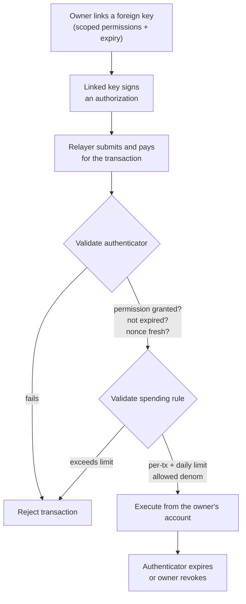

# Account Abstraction

QoreChain provides **protocol-level account abstraction** through the `x/abstractaccount` module. The module records abstract accounts with spending rules and lets the account owner link foreign keys (**authenticators**) that can spend from the account within permission and spending-limit bounds, without external smart contract infrastructure.

:::danger Not enabled on mainnet or testnet
The abstract-account module is currently **switched off** on both networks: `qorechaind query abstractaccount config` (and `GET /qorechain/abstractaccount/v1/config`) report `enabled: false` on `qorechain-vladi` and `qorechain-diana`. From chain v3.2.0 the flag is enforced on every path: the chain refuses account creation, authenticator registration and both execute lanes (`MsgExecuteEVM`, `MsgExecuteCosmos`) with `abstract accounts are disabled on this chain`. No transaction can switch the module on, and no abstract-account transaction has ever been included on mainnet. Everything below describes the module's interfaces for reference. Do not build a linked-key or delegated-spending flow on the live networks until the module is enabled, and check the flag first.
:::

:::note
The commands below use the **`qorechain-vladi`** mainnet (live since 7 June 2026), which runs node release **v3.2.4** (applied at height 3,742,566 on 23 October 2026, governance proposal 13). Substitute `--chain-id qorechain-diana` for the testnet, which has run v3.2.4 since 19 October 2026.
:::

:::caution Every Cosmos-lane transaction needs the hybrid post-quantum cosign
The `qorechaind tx` samples on this page show only the fee flags. On the live networks every Cosmos-lane transaction must also carry the ML-DSA-87 hybrid co-signature, so build the transaction with `--generate-only` and sign it with `qorechaind tx pqc cosign` (or use QoreX or the SDK, which do it for you). The community build of `qorechaind` cannot produce that signature; use the release binary from the [download manifest](/developer-guide/running-a-node#fetch-the-manifest). The fee floor is **0.1 uqor per unit of gas**, so `--gas 400000` needs at least `--fees 40000uqor`. See [Post-Quantum Signing](/developer-guide/post-quantum-signing).
:::

## Overview

Traditional blockchain accounts are controlled by a single private key. Account abstraction decouples the concept of "who can authorize a transaction" from a single cryptographic key. The `x/abstractaccount` module provides:

* **Abstract accounts** with a recorded account type and owner
* **Spending rules** (per-transaction and daily limits, allowed denominations) that bound what linked keys can spend
* **Authenticators**: foreign keys (a Phantom ed25519 key or a MetaMask secp256k1 address) that the owner links with scoped permissions and an expiry, and can revoke at any time

*A linked-key (authenticator) flow: the linked key signs an authorization, a relayer submits it, the module checks permissions, expiry and spending rules, then executes from the owner's account.*



## Account Types

`create` records one of three account types. The type is stored on the account and is part of how its address is derived; the module has no multisig, session-key or recovery transactions of its own (the transaction service is `create`, `update-rules`, `register-authenticator`, `revoke-authenticator`, `execute-cosmos`, `execute-evm`).

| Type              | Intended use                    |
| ----------------- | ------------------------------- |
| `multisig`        | DAO treasuries, shared wallets  |
| `social_recovery` | Consumer wallets, onboarding    |
| `session_based`   | dApp sessions, mobile wallets   |

## Creating an Abstract Account

`create` takes the account type as a positional argument (`multisig`, `social_recovery` or `session_based`):

```bash
qorechaind tx abstractaccount create session_based \
  --from mykey \
  --gas 400000 --fees 40000uqor
```

The command has no flags for signers, thresholds or guardians.

## Authenticators (linked keys)

The module's delegated-key mechanism is the **authenticator**, described in [Linked Wallet Authenticators](#authenticators) below: the owner links a foreign key (ed25519 or secp256k1) with a set of permissions and an expiry, and revokes it at any time:

```bash
qorechaind tx abstractaccount register-authenticator <account-address> <scheme> <pubkey-base64> <permissions-csv> <expiry-unix> <label> \
  --from mykey --gas 400000 --fees 40000uqor
qorechaind tx abstractaccount revoke-authenticator <account-address> <scheme> <pubkey-base64> \
  --from mykey --gas 400000 --fees 40000uqor
```

`scheme` is `ed25519` (for example Phantom) or `secp256k1` (for example MetaMask). There is no `grant-session`, `revoke-session` or `query abstractaccount sessions` command.

## Spending Rules

Spending rules add financial guardrails to abstract accounts:

| Rule             | Description                                           |
| ---------------- | ----------------------------------------------------- |
| `daily_limit`    | Maximum total spend per UTC calendar day              |
| `per_tx_limit`   | Maximum spend per individual authorised execution     |
| `allowed_denoms` | Restrict which token denominations can be spent (an ERC-20 is listed as `erc20/<contract>`) |
| `denom_limits`   | Per-denomination limits as decimal strings (v3.2.2): `{"denom","per_tx_limit","daily_limit"}`; they replace `per_tx_limit` and `daily_limit` for the denominations they name, so an 18-decimal token can be capped |
| `allowed_evm_calls` | EVM calls a rule-bound key may make **with call data** (v3.2.2), as `0x<target>` (any function of that contract) or `0x<target>/0x<selector>` (that function only). Without an entry a rule-bound key can only send value, deploy (with the `deploy` permission) and move the ERC-20 tokens listed in `allowed_denoms`. Listing a target trusts every argument of calls made to it, recipients included |

### Set Spending Rules

`update-rules` replaces the account's rules with a JSON array of `SpendingRule` objects (inline JSON, not a file and not flags):

```bash
qorechaind tx abstractaccount update-rules <account-address> \
  '[{"id":"daily","enabled":true,"daily_limit":1000000000,"per_tx_limit":100000000,"allowed_denoms":["uqor"]}]' \
  --from mykey --gas 400000 --fees 40000uqor
```

Limits are in the base unit (`uqor`) and count per authorised execution; the daily limit bounds the total per UTC calendar day. The rules replace the stored ones as a whole, so a field you leave out is removed. Since v3.2.2 the EVM lane measures what a call actually moves (native value, the account's native balance decrease, bank coins spent, and the balance or allowance change of every listed ERC-20) instead of only `msg.value`, and contract creation needs the separate `deploy` permission. A richer example:

```bash
qorechaind tx abstractaccount update-rules <account-address> \
  '[{"id":"daily","enabled":true,"daily_limit":5000000,"allowed_denoms":["uqor","erc20/0xTOKEN"],"allowed_evm_calls":["0xROUTER/0x38ed1739"],"denom_limits":[{"denom":"erc20/0xTOKEN","per_tx_limit":"100000000000000000000","daily_limit":"500000000000000000000"}]}]' \
  --from mykey --gas 400000 --fees 40000uqor
```

### Query Current Rules

The account record includes its rules and the number of linked keys:

```bash
qorechaind query abstractaccount account <account-address>
```

:::caution A rule bounds a key only when one exists
The chain resolves the limit in this order: the authenticator's own rule if set and `enabled`; otherwise the first `enabled` rule on the account; otherwise **there is no limit**. A rule stored with `enabled: false` is no limit, not a zero limit. `MsgRegisterAuthenticator` carries no rule, so a key linked by that message alone is bounded only by an account-level rule. Set a rule deliberately with `update-rules`, and register only the permissions the key needs. A limit bounds the damage a linked key can do; it does not replace revoking the key.
:::

## Linked Wallet Authenticators — Delegated Spending {#authenticators}

The authenticator design was introduced in chain version **v3.1.85** (building on the v3.1.84 permission model). It is **not usable on the live networks while the module is disabled** (see the status box at the top of this page). A **linked external wallet key** — a Phantom (ed25519) key or a MetaMask (secp256k1) account — can **spend from the canonical post-quantum account** under least-privilege, spending-limited, revocable terms. The external key never produces an ML-DSA signature; a **relayer** submits and pays for the transaction envelope (the relayer's own hybrid PQC signature satisfies the chain's signing requirements), while the authenticator's signature over **domain-separated, replay-bound sign bytes** is the authorization.

### Register an authenticator {#register-authenticator}

The account owner registers the external key with `MsgRegisterAuthenticator` (an ordinary root-key transaction), giving it a scheme, permissions, an expiry, and optional spending limits:

```js
import { registerEthAuthenticatorMsg } from "@qorechain/wallet-adapter";

// Link a MetaMask account by its 20-byte address (EIP-191 verification):
const msg = registerEthAuthenticatorMsg({
  owner: "qor1owner...",              // the canonical account (signs this message)
  ethAddress: "0xAbC...123",          // the MetaMask address to link
  permissions: ["evm"],               // least privilege — see the taxonomy below
  expiryUnix: Math.floor(Date.now() / 1000) + 30 * 24 * 3600, // absolute Unix seconds, ≤ 30 days recommended
  label: "metamask",
});
// Limits are a separate message (MsgUpdateSpendingRules), see "Spending Rules" above.
// Sign & broadcast this msg with the OWNER's normal hybrid-PQC signer.
```

A Phantom key is registered the same way with scheme `ed25519` and the Phantom public key (`register-authenticator` on the CLI). Revocation is instant via `MsgRevokeAuthenticator`.

### Permission taxonomy {#permission-taxonomy}

Eleven canonical permissions gate what a registered authenticator may do. The map is **fail-closed**: a message type with no mapping is denied.

| Permission | Grants |
| --- | --- |
| `send` | Native-lane bank transfers |
| `delegate` / `withdraw` / `vote` | Staking, reward withdrawal, governance |
| `evm` / `wasm` / `svm` | Execution on the respective VM lane |
| `amm` / `ibc` / `deploy` | AMM operations, IBC transfers, contract deployment |
| `all` | Any *delegable* message |

**Key-management messages are never delegable** — `MsgRegisterAuthenticator`, `MsgRevokeAuthenticator`, PQC key registration/migration, and `MsgRotatePQCKey` always require the root key, so a linked key can never escalate its own privileges. The schema (`schema_version` 2) also lists `lane_rules`: contract creation from the account's address, a call that advances the account's EVM nonce, and a call to the account itself when its code is an EIP-7702 delegation each need the `deploy` or `all` permission. Since v3.2.3 registration refuses unknown permission strings and 65-byte secp256k1 keys that could never verify.

Read the live taxonomy (with `schema_version` for drift detection) instead of hardcoding it:

```bash
curl -s https://api.qore.host/qorechain/abstractaccount/v1/permission_schema | jq
# or: qorechaind query abstractaccount permission-schema
```

### Spend via a linked key {#execute-messages}

Two messages carry authenticator-authorized actions. In both, the relayer is the transaction's signer/fee-payer; the authenticator's signature travels inside the message.

**`MsgExecuteEVM`** — an EVM call or transfer **from the canonical account's `0x…` address**. The authenticator signs `sha256("qorechain-evm-auth-v1" ‖ chainId ‖ account ‖ pubkey ‖ to ‖ value ‖ data ‖ nonce)` (all fields length-prefixed). From v3.2.3 (the `abstractaccount-hardening` feature) the chain requires the **v2 digest**, `sha256("qorechain-evm-auth-v2" ‖ … ‖ nonce ‖ gasLimit)`, which also binds the call's gas limit (8-byte big-endian) so a relayer cannot replay the signature with a different limit; no block accepts both forms. `qorechaind query abstractaccount auth-sign-evm` takes `--gas-limit` for this, and you pass the same value to `execute-evm`. Replay protection is the account's own EVM nonce.

**`MsgExecuteCosmos`** — a Native-lane bank send from the canonical account. The authenticator signs `sha256("qorechain-cosmos-auth-v1" ‖ chainId ‖ account ‖ pubkey ‖ to ‖ amount ‖ nonce)`. Replay protection is a **per-authenticator sequence** kept by the module (a bank send does not bump the account nonce). Self-sends are rejected.

:::caution Nonce rules
* `MsgExecuteEVM.nonce` = the account's **current** EVM nonce (`eth_getTransactionCount(account0x, "latest")`). In production the relayer is a *different* account, so do **not** add +1. Signing a stale nonce returns code `11`.
* `MsgExecuteCosmos.nonce` = the per-authenticator sequence (query the account's authenticator state), **not** the account's Cosmos sequence. From v3.2.4 (testnet since 19 October 2026, mainnet since 23 October 2026), `GET /qorechain/abstractaccount/v1/auth_nonce/{address}/{pubkey_hex}` returns that sequence directly (`nonce`, `linked`).
:::

**Phantom example** (browser: Phantom signs, your backend relays):

```js
import { buildPhantomExecuteCosmos } from "@qorechain/wallet-adapter";

// In the dApp: Phantom signs the digest with ed25519 signMessage.
const msg = await buildPhantomExecuteCosmos({
  wallet: window.solana,              // Phantom: { publicKey, signMessage }
  relayer: "qor1relayer...",          // submits the tx and pays the fee (a different account)
  chainId: "qorechain-vladi",
  account: "qor1owner...",            // canonical account being spent from
  to: "qor1recipient...",
  amount: "900000uqor",               // single-coin string
  nonce: authSequence,                // per-authenticator sequence
});
// Send `msg` to your relayer; the relayer wraps it in a tx it signs
// (hybrid PQC) and broadcasts. The transfer moves the OWNER's funds.
```

**MetaMask example** (EIP-191 `personal_sign` from the linked 20-byte address):

```js
import { buildMetaMaskExecuteEvm } from "@qorechain/wallet-adapter";

const msg = await buildMetaMaskExecuteEvm({
  provider: window.ethereum,          // MetaMask (EIP-1193)
  address: ethAddress,                // the linked 20-byte address
  relayer: "qor1relayer...",
  chainId: "qorechain-vladi",
  account: "qor1owner...",
  to: "0xRecipient...",
  value: (10n ** 16n).toString(),     // 0.01 QOR in wei (18-decimal EVM view), as a decimal string
  gasLimit: 100000,
  nonce: currentEvmNonce,             // eth_getTransactionCount(owner0x, "latest")
});
// Relay as above. The chain verifies the signature via EIP-191 + ecrecover
// against the registered 20-byte address.
```

The same builders exist in the [QoreChain SDK](/sdk/guides/authenticators) for all five languages, plus CLI equivalents:

```bash
# Generate an ed25519 authenticator key: the seed goes to a new 0600 file, only the public key is printed
qorechaind query abstractaccount auth-keygen --out authenticator.seed

# Sign the exact bytes the chain verifies (seed from --seed-file, "-" for stdin, QORE_AUTH_SEED, or a prompt)
qorechaind query abstractaccount auth-sign-cosmos <chain-id> <account> <to> <amount> <nonce> --seed-file authenticator.seed
qorechaind query abstractaccount auth-sign-evm <chain-id> <account> <to-0xhex> <value-wei> <data-hex> <nonce> --seed-file authenticator.seed

# Relay a pre-signed authorization (the relayer's --from key pays; cosign the envelope with `tx pqc cosign`)
qorechaind tx abstractaccount execute-cosmos <account> <to> <amount> <scheme> <pubkey-base64> <signature-base64> <nonce> --from relayer --generate-only > tx.json
qorechaind tx abstractaccount execute-evm <account> <to-0xhex> <value-wei> <data-hex> <gas-limit> <scheme> <pubkey-base64> <signature-base64> <nonce> --from relayer --generate-only > tx.json
```

Keys and signatures in these commands are base64. The `auth-sign-*` helpers read the seed from a file, stdin or the environment rather than a command-line argument (node release v3.2.1 and later), so it does not appear in shell history. The seed-handling flags (`--out`, `--seed-file`) exist only in v3.2.1 and later binaries.

### Error codes {#authenticator-errors}

Enforcement failures return distinct codes (codespace `abstractaccount`) so wallets can show the right message:

| Code | Meaning | Wallet UX |
| --- | --- | --- |
| `5` | Spending limit exceeded (per-tx or daily) | Show the remaining allowance |
| `6` | Authenticator expired | "Expired — re-link your wallet" |
| `9` | Module disabled (the live state on both networks) | "Linked wallets are not available yet" |
| `10` | Permission denied (scope or non-delegable msg) | Show the missing permission |
| `11` | Replay rejected (stale nonce/sequence) | Re-query the nonce and re-sign |

(Codespace `pqc` code `21` = hybrid signature verification failed — a relayer-side signing problem, not an authorization one.)

### REST queries {#abstractaccount-rest}

The module's read queries are served over REST (since **v3.1.85**):

```
GET /qorechain/abstractaccount/v1/config      # {"config":{"enabled":false,...}} on both networks today
GET /qorechain/abstractaccount/v1/accounts
GET /qorechain/abstractaccount/v1/accounts/{address}
GET /qorechain/abstractaccount/v1/permission_schema
```

## Querying Abstract Accounts

### CLI

```bash
# Module configuration (enabled flag and limits)
qorechaind query abstractaccount config

# Get full account configuration
qorechaind query abstractaccount account <address>

# List all abstract accounts (paginated)
qorechaind query abstractaccount accounts --page-limit 10
```

On mainnet the account list is empty; the testnet lists a few accounts created before the enabled flag was enforced on every path.

### JSON-RPC

> **Not served yet:** no released node build serves the `qor_` JSON-RPC namespace, so `qor_getAbstractAccount` returns `-32601` (method not found) on every public endpoint today. Use the REST routes above or the CLI. See [the `qor_` namespace](/api-reference/json-rpc-qor_-namespace).

### Example Account Response

The shape of an abstract-account record (illustrative values):

```json
{
  "address": "qor1myaccount...",
  "account_type": "session_based",
  "owner": "qor1owner...",
  "spending_rules": [
    {
      "id": "daily",
      "enabled": true,
      "daily_limit": "1000000000",
      "per_tx_limit": "100000000",
      "allowed_denoms": ["uqor"]
    }
  ]
}
```

## Social Recovery

`social_recovery` is an account type, but the module has no recovery transactions: there is no `initiate-recovery` or `approve-recovery` command and no recovery message in the module's transaction service. Key recovery for a QoreChain account is done by re-deriving the account's post-quantum key from its mnemonic (`tx pqc recover-key`) and, if needed, rotating it (`tx pqc rotate-key`); see [Post-Quantum Signing](/developer-guide/post-quantum-signing).

## Integration with dApps

When the module is enabled, linked-key authorization is meant for flows such as:

* Mobile wallets where repeated biometric prompts are disruptive
* Gaming dApps that need rapid transaction signing within a bounded allowance
* Phantom or MetaMask users spending from their QoreChain account through a relayer

A dApp backend acts as the relayer: it receives the linked key's signed authorization, wraps it in a transaction it signs itself, and broadcasts it. The linked key can be revoked, or can expire, at any time. Until the module is enabled on the network you target, use ordinary signing through [QoreX or the SDK](/sdk/overview).

## Next Steps

* [Running a Validator](/developer-guide/running-a-validator) — Set up and operate a validator node
* [EVM Development](/developer-guide/evm-development) — EVM tooling, accounts and the EVM authorisation window
* [Cross-VM Interoperability](/developer-guide/cross-vm-interoperability) — Cross-VM messaging
