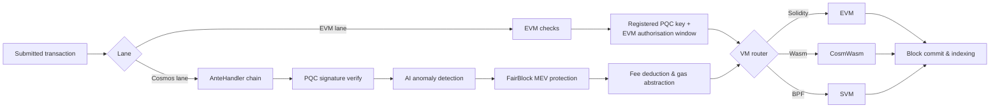

# Architecture Overview

QoreChain is a modular blockchain node composed of three primary processes — the chain node, AI sidecar, and block indexer — backed by a Postgres database and monitored via Prometheus and Grafana. Mainnet (`qorechain-vladi`, EVM chain ID **9801**) has been live since 7 June 2026 on release **v3.2.3**, with a parallel testnet (`qorechain-diana`, EVM chain ID **9800**, release v3.2.4, testnet only). The chain is built on the Cosmos SDK v0.53. The following diagram shows the high-level component layout.

The transaction lifecycle below summarises how a submitted transaction flows through the node — from the AnteHandler decorator chain (security and fee checks) into VM execution and on-chain settlement:



```
┌────────────────────────────────────────────────────────────────────────────┐
│                            QoreChain Node                                  │
│                                                                            │
│  ┌──────────────────── Virtual Machines ──────────────────────┐           │
│  │  ┌───────┐    ┌──────────┐    ┌───────┐                   │           │
│  │  │  EVM  │    │ CosmWasm │    │  SVM  │                   │           │
│  │  │(Sol.) │◄──►│ (Wasm)   │◄──►│ (BPF) │                   │           │
│  │  └───┬───┘    └────┬─────┘    └───┬───┘                   │           │
│  │      └─────────┬───┘──────────────┘                       │           │
│  │           x/crossvm (bridge)                               │           │
│  └────────────────────────────────────────────────────────────┘           │
│                                                                            │
│  ┌────────────────────── Tokenomics ─────────────────────────┐           │
│  │  ┌──────┐   ┌───────┐   ┌───────────┐                    │           │
│  │  │x/burn│   │x/xqore│   │x/inflation│                    │           │
│  │  │12 src│   │lock/  │   │capped     │                    │           │
│  │  │37/30/│   │unlock │   │emission   │                    │           │
│  │  │20/10/│   │PvP    │   │emission   │                    │           │
│  │  │3     │   │       │   │590M cap   │                    │           │
│  │  └──────┘   └───────┘   └───────────┘                    │           │
│  └────────────────────────────────────────────────────────────┘           │
│                                                                            │
│  ┌──────────── IBC / Bridges ────────────────────────────────┐           │
│  │  ┌──────────┐  ┌──────────┐  ┌───────────┐  ┌──────────┐ │           │
│  │  │x/bridge  │  │x/babylon │  │x/abstract │  │x/gas     │ │           │
│  │  │37 QCB    │  │BTC re-   │  │ account   │  │abstract. │ │           │
│  │  │configs   │  │staking   │  │session key│  │multi-tok │ │           │
│  │  └────┬─────┘  └────┬─────┘  └───────────┘  └──────────┘ │           │
│  │  QCB Bridge     Babylon IBC   ERC-4337-like   ibc/USDC    │           │
│  │  PQC-signed     BTC finality  social recov.   ibc/ATOM    │           │
│  │  36 ext chains  checkpoint    spending rules  fee convert  │           │
│  │  ┌──────────┐                                              │           │
│  │  │x/fair    │  Lane config (not enforced): PQC|MEV|AI|... │           │
│  │  │ block    │  tIBE encrypted mempool framework           │           │
│  │  └──────────┘                                              │           │
│  └────────────────────────────────────────────────────────────┘           │
│                                                                            │
│  ┌──── Rollup Development Kit ───────────────────────────────┐           │
│  │  ┌──────────┐  ┌──────────┐  ┌───────────┐  ┌──────────┐ │           │
│  │  │ x/rdk    │  │Settlement│  │ DA Router │  │ Profiles │ │           │
│  │  │ 4 modes: │  │Optimistic│  │ Native    │  │ defi     │ │           │
│  │  │ opt/zk/  │  │ZK/Based/ │  │ Celestia* │  │ gaming   │ │           │
│  │  │ based/   │  │Sovereign │  │ Both      │  │ nft      │ │           │
│  │  │ sovereign│  │          │  │           │  │ social/  │ │           │
│  │  │          │  │          │  │           │  │ general  │ │           │
│  │  └────┬─────┘  └────┬─────┘  └───────────┘  └──────────┘ │           │
│  │  Bank escrow    Auto-finalize  SHAKE-256 commit AI-assisted │           │
│  │  Burn on create EndBlocker     Blob pruning    PRISM sugg. │           │
│  │  → x/multilayer (RegisterSidechain + AnchorState)          │           │
│  └────────────────────────────────────────────────────────────┘           │
│                                                                            │
│  ┌──────────────┐ ┌──────┐ ┌────────────┐ ┌─────┐                       │
│  │x/rlconsensus │ │ x/ai │ │x/reputation│ │x/qca│                       │
│  │  PRISM (RL)  │ │      │ │            │ │     │                       │
│  └──────┬───────┘ └──┬───┘ └────┬──────┘ └──┬──┘                       │
│   PPO MLP         AI Engine   Scoring    CPoS Pools                      │
│   Obs/Action      Fraud Det.  Decay      Bonding                         │
│   Circuit Brk     Fee Opt.    Sigmoid    Slashing                        │
│   Rollup Adv.     TEE/FL                 QDRW Gov                        │
│                                                                            │
│  ┌──────┐ ┌──────────┐                                                   │
│  │x/pqc │ │ x/multi  │                                                   │
│  └──┬───┘ └────┬─────┘                                                   │
│  Dilithium    Layer Router                                                │
│  ML-KEM       Sidechains                                                  │
│  Hybrid Sig   + Rollups                                                   │
│  SHAKE-256                                                                │
│                                                                            │
│  ┌──────┐ ┌───────┐                                                      │
│  │x/svm │ │x/cross│                                                      │
│  └──┬───┘ └───┬───┘                                                      │
│  BPF Exec   CrossVM Msg                                                   │
└────────┬──────┬───────────────────────────────────────┬───────────────────┘
         │      │                                       │
   ┌─────┴─────┐│                              ┌───────┴──────┐
   │libqorepqc ││                              │  Indexer     │
   │(Rust PQC) ││                              │  (Postgres)  │
   └───────────┘│                              └──────────────┘
   ┌───────────┐│  ┌──────────┐
   │libqoresvm ││  │AI Sidecar│
   │(Rust BPF) │└──│ (gRPC)   │
   └───────────┘   └──────────┘
```

## Node Components

QoreChain runs as three cooperating processes, each with its own Go module and binary:

| Component          | Description                                                                                                                                                                                                                                                                                          | Location                  |
| ------------------ | ---------------------------------------------------------------------------------------------------------------------------------------------------------------------------------------------------------------------------------------------------------------------------------------------------- | ------------------------- |
| **qorechain-node** | The core blockchain node. Runs the QoreChain Consensus Engine, executes all custom modules, manages all three VM runtimes, and exposes RPC, REST, gRPC, and JSON-RPC endpoints.                                                                                                                      | `qorechain-core/`         |
| **ai-sidecar**     | A gRPC service that provides advanced AI inference capabilities backed by the QCAI Backend. The sidecar handles inference requests that exceed the on-chain RL agent's scope, such as natural language analysis and complex pattern recognition. Communicates with the node over gRPC on port 50051. | `qorechain-core/sidecar/` |
| **block-indexer**  | A WebSocket listener that subscribes to new blocks and transactions from the node's RPC endpoint, parses events, and writes structured data to a Postgres database for fast querying by explorers and APIs.                                                                                          | `qorechain-core/indexer/` |

## Ports

| Port  | Protocol       | Service                                                                           |
| ----- | -------------- | --------------------------------------------------------------------------------- |
| 26657 | HTTP/WebSocket | QoreChain Consensus Engine RPC (blocks, transactions, consensus state)            |
| 1317  | HTTP           | REST API (query endpoints, transaction broadcast)                                 |
| 9090  | gRPC           | gRPC query and transaction endpoints                                              |
| 8545  | HTTP           | EVM JSON-RPC (`eth_`, `web3_`, `net_`, `txpool_` namespaces)                      |
| 8546  | WebSocket      | EVM JSON-RPC (WebSocket subscriptions)                                            |
| 8899  | HTTP           | SVM JSON-RPC (Solana-compatible: `getAccountInfo`, `getBalance`, `getSlot`, etc.) |
| 50051 | gRPC           | AI Sidecar (inference requests from the node)                                     |
| 5432  | TCP            | Postgres (block indexer storage)                                                  |
| 26660 | HTTP           | Node Prometheus metrics endpoint                                                  |
| 9091  | HTTP           | Prometheus server (host port in the Docker Compose stack)                         |
| 3001  | HTTP           | Grafana dashboards (host port in the Docker Compose stack; container port 3000)   |

## Module Map

QoreChain registers **48 genesis modules, 20 of them QoreChain-specific**, grouped by function:

**Security**

* `x/pqc` — Post-quantum cryptography: Dilithium-5, ML-KEM-1024, hybrid secp256k1 (ECDSA) + ML-DSA-87, SHAKE-256, algorithm agility

**AI and Machine Learning**

* `x/ai` — Transaction routing, anomaly detection, fraud detection, fee optimization, TEE attestation, federated learning
* `x/reputation` — Multi-factor validator reputation scoring with temporal decay
* `x/rlconsensus` — On-chain RL agent (PPO MLP), consensus-tuning design, circuit breaker, rollup advisory — the PRISM optimization layer (observation only on the live networks: no policy is loaded)

**Consensus**

* `x/qca` — Triple-Pool Composite PoS (RPoS/DPoS/PoS) design, custom bonding curve, progressive slashing, QDRW governance — implemented but not yet wired into block production, rewards, slashing or the governance tally

**Virtual Machines**

* `x/vm` — VM routing and lifecycle management
* `x/svm` — SVM runtime: BPF deployment/execution, rent collection, Solana-compatible RPC
* `x/crossvm` — Cross-VM communication: EVM-CosmWasm precompile + SVM async events

**Tokenomics and Liquidity**

* `x/burn` — 12 burn sources, EndBlocker fee distribution (37/30/20/10/3 split)
* `x/xqore` — Governance-boosted staking design: lock/unlock, graduated exit penalties, PvP rebase (accounting only; lock and unlock transactions are not yet wired on the live networks)
* `x/inflation` — Capped emission: a fixed amount minted per epoch until a hard cumulative cap (590,000,000 QOR) is reached
* `x/amm` — On-chain liquidity / automated market maker

**Bridges and Interoperability**

* `x/bridge` — 37 chain configurations (36 external chains plus Injective over IBC) across every major chain type, PQC-signed attestations, circuit breakers (all configurations `pending`; not live)
* `x/babylon` — BTC restaking via Babylon Protocol, epoch checkpoints (design stage; no transactions enabled)
* `x/multilayer` — Sidechain/paychain/rollup layer management, state anchoring

**Governance and Licensing Extensions**

* `x/abstractaccount` — Smart accounts: multisig, social recovery, session keys, spending rules (switched off on both networks: `enabled = false`)
* `x/fairblock` — MEV protection: threshold IBE encrypted mempool framework (disabled on both networks)
* `x/gasabstraction` — Multi-token gas payment design: ibc/USDC, ibc/ATOM fee conversion (no IBC channel is open yet, so fees are paid in QOR)
* `x/license` — Chain licensing

**Rollups**

* `x/rdk` — Rollup Development Kit: 4 settlement modes (optimistic, zk, based, sovereign), preset profiles, native DA, bank escrow

## AnteHandler Chain

Every transaction passes through a decorator chain before execution; any decorator can reject it. There are two chains.

**Cosmos lane** (in order): `RejectMessages` (no `MsgEthereumTx` on this lane) → `AuthzLimiter` (no EVM or vesting-creation messages inside authz, and from v3.2.3 no post-quantum key-management messages) → `SetUpContext` → mempool and multisig-depth guards → CosmWasm simulation-gas, tx-counter, gas-register and contracts decorators → `CircuitBreaker` → extension-option check → `ValidateBasic` → `TxTimeout` → `Memo` → validator-licence gate (`MsgCreateValidator`) → `PQCVerify` → `PQCHybridVerify` → `PQCReplayGuard` → `AIAnomaly` (includes the per-sender rate limit) → `FairBlock` → `SVMComputeBudget` → `SVMDeductFee` → `MinGasPrice` → `ConsumeTxSize` → `GasAbstraction` → `DeductFee` → `SetPubKey` → `ValidateSigCount` → `SigGasConsume` → `SigVerify` → `IncrementSequence` → burn transaction counter → IBC redundant-relay check → gas-wanted tracking.

**EVM lane** (transactions carrying the Ethereum extension option): `CircuitBreaker` → the EVM mono decorator (signature, nonce, fee and balance checks) → `EVMWindowDecorator` (registered post-quantum key and a live authorisation window; see [EVM authorisation window](/getting-started/first-transaction#evm-window)).

Key decorators on the Cosmos lane:

1. **PQCVerify** — Module `x/pqc`. Verify Dilithium-5 signatures on PQC-flagged transactions.
2. **PQCHybridVerify** — Module `x/pqc`. Verify dual secp256k1 (ECDSA) + ML-DSA-87 hybrid signatures.
3. **AIAnomaly** — Module `x/ai`. Run isolation forest anomaly detection and risk scoring, and enforce the per-sender transaction limit.
4. **FairBlock** — Module `x/fairblock`. Process tIBE encrypted transactions for MEV protection (disabled on the live networks).
5. **SVMComputeBudget** — Module `x/svm`. Validate and allocate compute units for SVM programs.
6. **SVMDeductFee** — Module `x/svm`. Deduct SVM-specific execution fees.
7. **GasAbstraction** — Module `x/gasabstraction`. Convert non-native fee tokens before deduction (fees are currently paid in QOR).

## Docker Compose Stack

The full development stack runs as a six-service Docker Compose deployment on a shared bridge network (`qorechain-net`):

| Service          | Image                      | Purpose                                             |
| ---------------- | -------------------------- | --------------------------------------------------- |
| `qorechain-node` | `qorechain-core:latest` (built locally from the Dockerfile; no published node image) | Chain node with all modules, VMs, and RPC endpoints |
| `ai-sidecar`     | `ghcr.io/qorechain/ai-sidecar:latest` | AI inference service (gRPC + QCAI Backend)          |
| `block-indexer`  | `ghcr.io/qorechain/block-indexer:latest` | Block/transaction indexer (WebSocket + Postgres)    |
| `postgres`       | `postgres:16-alpine`       | Database for the block indexer                      |
| `prometheus`     | `prom/prometheus:v3.10.0`  | Metrics collection and storage                      |
| `grafana`        | `grafana/grafana:12.4.1`   | Monitoring dashboards and alerting                  |

Start the full stack:

```bash
docker compose up -d
```

Before the first start, copy `.env.example` to `.env` and `.env.sidecar.example` to `.env.sidecar`, and set `GRAFANA_PASSWORD` (Compose refuses to start without it).

All persistent data is stored in named Docker volumes: `node-data`, `postgres-data`, `prometheus-data`, and `grafana-data`.

## Related

* [Multilayer Architecture](/architecture/multilayer-architecture) — sidechain registration and state anchoring.
* [Consensus Mechanism](/architecture/consensus-mechanism) — block production, finality, and slashing.
* [PRISM Consensus Engine](/architecture/prism-consensus-engine) — AI-driven parameter optimization.
* [Post-Quantum Security](/architecture/post-quantum-security) — Dilithium-5 signatures across the stack.
