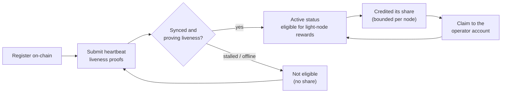

# Rewards and Monitoring

A registered light node is credited a share of the light-node allocation and **needs to stay healthy** to keep qualifying for it. This page covers the 3% light-node reward share, how rewards are credited and claimed, what the node does and does not do with delegations, and how to monitor the node.

:::note Nothing here is a promise of earnings
Registration is open on both networks; see [Status of the reward program](/light-node/overview#reward-program-status) for the current state. What a node is credited depends on the light-node allocation, the number of eligible nodes, their stake and uptime, and the per-node bound described below.
:::

## The 3% block-reward share

QoreChain's fee distribution reserves a fixed **3% share for light nodes** that serve network data. This is one of the five destinations in the protocol's reward split — validators (37%), burned (30%), treasury (20%), stakers (10%), and **light nodes (3%)** — enforced on-chain. See [Tokenomics](/architecture/tokenomics) for the full breakdown.

To take part in this share a node needs, checked on-chain rather than self-declared: an active `lightnode_operator` license (checked when you register), at least **1,000 QOR delegated to bonded validators** — counted as your total across all the validators you delegate to, not per validator; delegations to jailed or unbonded validators do not count; required when you register and re-read from staking each time rewards are credited — and a **1 QOR** registration fee, paid once when you register. Participation is capped network-wide at **10,000 light nodes**. See [Registration and Licensing](/light-node/registration-and-licensing) for how registration works and [Status of the reward program](/light-node/overview#reward-program-status) for the current state.

The 3% is what flows into the light-node module, not a per-node entitlement: each eligible node is credited its stake-weighted share of what has accrued, bounded per node, and anything unearned goes to a reserve that only a governance vote can release. Since chain v3.2.3 the per-node bound is **2,000 QOR per 30 days** (`max_reward_per_month_per_node`), prorated over the block time elapsed between settlements and scaled by uptime (the `lightnode-monthly-cap` rule); it replaces the earlier per-block bound (`max_reward_per_block_per_node`, `1713` uqor per block). From v3.2.4 (mainnet since 23 October 2026, testnet since 19 October 2026) the bound for a node starts at the later of the previous settlement and the node's own registration, so a newly registered node is not credited for time before it registered. See [the 3% light-node reward share](/light-node/overview#the-3-light-node-reward-share).

Once registered and delegated, staying eligible is a matter of staying live. A node needs at least **80% uptime**, and must keep submitting heartbeat liveness proofs on a **1,000-block interval** (about 52 minutes on mainnet at the measured average block time of roughly 3.1 s; about 22 minutes on testnet, at roughly 1.3 s per block).

**The timing rules.** The chain rejects a heartbeat sent **fewer than 1,000 blocks after your previous one** (`heartbeat submitted too early`); your first heartbeat after registering has no such lower limit. If no heartbeat arrives within **1,000 + 100 blocks** (the `heartbeat_interval` plus the `heartbeat_grace_period`; on mainnet about 52 minutes plus a grace of roughly 5 minutes) of your last one — or of registration, if you have not sent one — the node is marked inactive and stops being credited. A heartbeat sent later is still accepted and reactivates it. The daemon sends the next heartbeat as soon as 1,000 blocks have passed since the chain's own `last_heartbeat` for your node, checking every 60 seconds.

**Missing the window costs uptime, not your registration.** A node that misses is marked inactive and stops earning, but the very next successful heartbeat reactivates it — there is no re-registration to do. Your **uptime** is the running ratio of heartbeats received to heartbeats expected (one per 1,000 blocks) since the block you registered, capped at 1. Below the `min_uptime_for_rewards` threshold (`0.80`) a node earns nothing; at or above it, the per-node ceiling is scaled by your uptime. A long outage therefore lowers the ratio, and it recovers only as on-time heartbeats accumulate. Check `status` if a node shows as inactive: it reports the signer, licence and registration state.

:::note What a heartbeat actually proves
A successful heartbeat proves the operator's key signed on time — it does not prove a node is continuously running the full software. Treat it as a liveness signature, not as "verified as an active node."
:::

:::note `last_heartbeat` is a block height, not a timestamp
If you query a node's on-chain record directly, `last_heartbeat` is a block height, and a value of `0` means no heartbeat has been recorded yet — the chain then measures the inactivity deadline from the node's `registered_at` height. Reading `0` as a naive elapsed-time calculation makes a freshly registered node look like it's millions of blocks overdue.
:::

*Reward eligibility: hold an active on-chain license and the minimum bonded stake, register, then keep proving liveness via heartbeats to stay above the uptime and heartbeat-interval thresholds.*



## How rewards work {#how-rewards-work}

### Crediting

Every 100 blocks the chain credits each eligible node (active, with at least the minimum delegated stake and at least the minimum uptime) its share of what has accrued, bounded per node (at most 2,000 QOR per 30 days, prorated over the time since the previous settlement) as described in [the 3% light-node reward share](/light-node/overview#the-3-light-node-reward-share). The amount is added to the node's `accumulated_rewards`. Read it with:

```bash
curl -s https://api.qore.host/qorechain/lightnode/v1/rewards/<operator-address>
# or: qorechaind query lightnode rewards <operator-address>
```

(Use `https://api-testnet.qore.host` for the testnet.)

### Claiming

Credited rewards stay on the node record until you claim them. The node can claim them for you: set `auto_claim = true` under `[delegation]`, and the daemon claims accrued light-node rewards to the operator account once they pass `min_reward_claim` (default `1000000` uqor, 1 QOR), checking every `compound_interval` (default `1h`). It signs the claim the same way as heartbeats (natively, or through the `qorechaind` fallback). Auto-claim is **off by default**, and it only claims: the node never re-delegates or moves stake.

To claim by hand with `qorechaind` (the operator key in a `qorechaind` keyring, and the post-quantum key exported with `lightnode-sx keys export <key-name> --out ~/.qorechaind/pqc/<key-name>.dilithium`), use a generate-then-cosign pair:

```bash
qorechaind tx lightnode claim-rewards --from operator --chain-id <chain-id> --node https://rpc.qore.host --gas 300000 --fees 30000uqor --generate-only > claim.json
qorechaind tx pqc cosign claim.json --from operator --pqc-key <key-name> --chain-id <chain-id> --node https://rpc.qore.host
```

`qorechaind tx lightnode deregister` removes the registration and pays out anything still credited; the registration fee is not refunded.

### Delegation tracking and stake alerts {#delegation-alerts}

The node mirrors the operator account's delegations from the chain when it starts and then every five minutes. It never moves stake: change delegations from your own wallet. What it warns about depends on the light node version:

- **3.1.11 and later (with `rebalance_enabled = true`, the default).** It warns when a validator you delegate to is jailed, when it is not in the active set, and when your bonded stake falls below `min_delegated_stake` (1,000 QOR). In all three cases the chain stops crediting the node and gives no message. A warning is logged when it appears, hourly while it lasts, and once when it clears.
- **Reputation score (3.1.12, testnet only for now).** The node also reads each delegated validator's score from `GET /qorechain/reputation/v1/validator/<valoper>` and warns when it is below `min_reputation` (default `0.5`). A validator the chain has not scored yet (`404`) is skipped. The testnet serves this route now; **mainnet does not yet, even after v3.2.5 (checked 30 October 2026: the route answers "Not Implemented"); it will from a later chain release**. Until the route is served, the node notes once that scores are not published and asks again every six hours.
- **3.1.10 and earlier.** The reputation check never worked: it logged "failed to check reputation" every five minutes and raised no warning. Do not rely on alerts on those versions; install 3.1.12 by hand once (see [SX Edition: updating](/light-node/sx-edition#updating)).

The `validators` and `split_weights` options in `[delegation]` are accepted but not currently acted on.

### Inspecting rewards and delegations

```bash
lightnode-sx validators   # the bonded validator set
lightnode-sx delegation   # the operator account's delegations, as mirrored by the running daemon
lightnode-sx rewards      # the operator account's pending staking rewards
```

Since 3.1.6 these, and the UX **Delegation** view, read the account in `operator_address`. `rewards` shows **staking** rewards from your delegations, not light-node rewards. To read everything straight from the chain:

```bash
curl -s https://api.qore.host/cosmos/staking/v1beta1/delegations/<operator-address>
curl -s https://api.qore.host/cosmos/distribution/v1beta1/delegators/<operator-address>/rewards
curl -s https://api.qore.host/qorechain/lightnode/v1/rewards/<operator-address>   # light-node rewards
```

## Monitoring

Keeping the node healthy is what keeps it eligible for rewards. There are three things worth watching.

### Telemetry

Real-time telemetry covers validators, consensus/network, the bridge, and tokenomics, each refreshed on its own interval (configured under `[telemetry]` in `config.toml`). From the CLI:

```bash
lightnode-sx status    # node and light-client sync status
lightnode-sx network   # recent synced headers and latest height
```

The UX edition surfaces the same data live across its **Overview**, **Network**, **Bridge**, and **Tokenomics** views — see [UX Edition](/light-node/ux-edition).

### Sync and heartbeat health

The `status` command reports the chain ID, latest block height, whether the chain is catching up, the light client's synced height and syncing state, the `Signer` (native, or `qorechaind`, or unavailable with the reason), and — once `operator_address` is set — the `Licence` and `Registration` state (including the node's status and last heartbeat height). A node that is registered, synced, and running continues to submit **heartbeat liveness proofs** and so stays eligible for rewards. These heartbeats are produced via a **PQC-cosigned transaction pipeline** (hybrid Dilithium-5 / ML-DSA-87), consistent with the chain's PQC-required default — see [Registration and Licensing](/light-node/registration-and-licensing#pqc-cosigned-heartbeat-pipeline) for how the pipeline works and how the node chooses its signer. If `status` shows the node stalled or not syncing, it may be failing to prove liveness — investigate before eligibility is affected.

### Self-test health

If you suspect a problem with the cryptographic stack, run the PQC self-test at any time:

```bash
lightnode-sx selftest
```

It runs keygen → sign → verify → tamper-detection (five checks) and exits non-zero on any failure. This is the fastest way to rule out a problem with the post-quantum signing stack when diagnosing node issues. See [SX Edition](/light-node/sx-edition) for the full self-test breakdown.

### Chain queries {#chain-queries}

Base URLs: `https://api.qore.host` (mainnet) and `https://api-testnet.qore.host` (testnet).

| Query | Returns |
| --- | --- |
| `GET /qorechain/lightnode/v1/params` | Registration fee, heartbeat interval and grace, minimum delegated stake, reward share, minimum uptime, node cap. |
| `GET /qorechain/lightnode/v1/stats` | Registered and active counts, total rewards credited. |
| `GET /qorechain/lightnode/v1/node/{address}` | One node's record (`status`, `last_heartbeat`, `total_heartbeats`, `expected_heartbeats`, `accumulated_rewards`). |
| `GET /qorechain/lightnode/v1/rewards/{address}` | Rewards credited and not yet claimed. |
| `GET /qorechain/lightnode/v1/reward_pool` | How the module balance divides between reserve, credited rewards and the next payout; includes the per-node bounds (`max_reward_per_month_per_node`, and the earlier `max_reward_per_block_per_node`). |
| `GET /qorechain/license/v1/check/{address}/lightnode_operator` | Whether an address holds an active licence. |

## Where to go next

- [Registration and Licensing](/light-node/registration-and-licensing) — get registered and stay live.
- [Tokenomics](/architecture/tokenomics) — the full reward and burn model.
