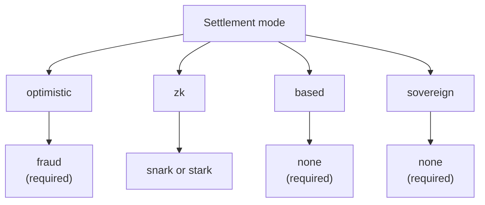

# Rollups Overview

The QoreChain **Rollup Development Kit (RDK)** is a set of client libraries (TypeScript, Python, Go, Rust and Java), an operator command-line tool and starter templates for building application-specific rollups that settle on QoreChain through the on-chain `x/rdk` module. With it you configure a rollup, build and sign its transactions, read its state, follow its challenge windows, issue and verify settlement receipts, and assemble cross-VM calls and withdrawal proofs. Each rollup is an independent execution environment with its own block time, virtual machine, fee model and sequencing, while it inherits QoreChain's security, post-quantum cryptography and data availability. This page is for developers who want to launch or operate a rollup, and for anyone deciding whether the RDK fits their application.

:::caution Early-stage capability
The RDK is deployed on both networks, but **no rollup has been created on either one yet** (checked 27 October 2026), so the flows described in this section have not been exercised by third parties. **ZK settlement (the `defi` profile, the `defi-rollup` template and every `zk` rollup) cannot be used on either network yet:** the chain has no way to register a verification key, so every ZK batch is refused after its fee is paid. Key registration is planned for chain v3.2.7. Use `optimistic` settlement until then.

Mainnet (**`qorechain-vladi`**, EVM chain ID **9801**, live since 7 June 2026) runs chain version **v3.2.4** (applied at height 3,742,566 on 23 October 2026, governance proposal 13); the testnet (**`qorechain-diana`**, EVM chain ID **9800**) runs **v3.2.6** (v3.2.4 reached it on 19 October 2026, v3.2.5 on 26 October and v3.2.6 on 27 October). Mainnet governance proposal 14 would apply v3.2.5 at height 3,906,833 and was in its voting period at the time of writing; what v3.2.5 changes for rollups is documented the day mainnet applies it. Where behaviour changed between v3.2.3 and v3.2.4, this section says which release applies. Validate every deployment on the testnet first, and read the status notes on each page: several capabilities (ZK verification, Celestia data availability, the QCAI Copilot, cross-VM calls, settlement receipts) are not usable end to end today.
:::

## Innovations {#innovations}

* **Post-quantum settlement receipts.** A batch's state anchor is signed with ML-DSA-87 by the rollup creator's registered key. `verifySettlementReceipt` re-reads every field of the receipt from the chain (rollup, layer, batch root, and the anchor: state root, layer height, Main Chain height, anchor time, validator-set hash, transaction count, proof, signature). The verifying key comes from the chain and never from the receipt; the receipt must name the network you query; an unknown receipt version or an algorithm other than ML-DSA-87 is refused before any read; and a signature-only check is never reported as valid. The anchor message has a first form below the height of chain v3.2.2 and a second form, which also binds the chain id, from it; the version is chosen by the anchor's height. See [Settlement receipts](/rollups/settlement-receipts).
* **Hybrid signing with two key derivations.** Transactions are signed with secp256k1 plus ML-DSA-87. The post-quantum key is derived from the mnemonic both in the canonical way (SHAKE-256 over `qorechain:pqc:v1|`, the address and the mnemonic) and in the legacy way, and the client uses whichever key the chain has registered for the account. Only the TypeScript client signs hybrid today.
* **Canonical transition root.** `batchTransitionRoot` computes the exact state root the chain judges an optimistic batch by (the form mainnet applies today is a SHAKE-256 commitment of the previous state root, the data hash and the transaction count; `transitionRootVersionFor` selects the form the connected network applies), and `fraudProof` builds the 64-byte proof from it. Both were tested against vectors generated by the chain's own code.
* **Chain-exact challenge windows.** `batchChallengeWindow` computes a batch's window the way the chain does (time-based: open while block time is below the submission time plus the window; for older batches, the window divided by six in blocks from the submission height) and judges it against the chain tip read from RPC `/status`, not the local clock. The [Watchtower](/rollups/watchtower) and the health monitor use it.
* **Checks before any fee is paid.** The kit refuses a rollup id outside `^[a-z0-9][a-z0-9._-]{2,63}$`; a withdrawal that is not in `uqor`, has a zero amount, carries a proof deeper than 64 levels of 32 bytes or names an invalid bech32 address; and, when it can read the rollup, a batch that names a data hash on a `native` or `both` data-availability rollup. Each of these would otherwise be refused by the chain after the fee is spent.
* **Cross-VM calldata and a live check.** `encodeCrossVmCalldata` builds calldata for `executeCrossVMCall(uint8,string,bytes)` (selector `0x3c11078c`, precompile `0x...0901`), and `isCrossVmPrecompileActive` reads whether the precompile is active on the network. See [Multi-VM](/rollups/multi-vm).
* **One set of test vectors for five languages.** The TypeScript, Python, Go, Rust and Java packages are checked against the same golden fixture (the Go package has 100 unit tests, Rust 77 and Java 75).

## How to use {#how-to-use}

Reads need no key and no funds. The snippets below read the live `rdk` module parameters and the list of rollups on the public testnet (`qorechain-diana`) and were run on 27 October 2026 from the published packages (the library snippets with 0.6.1, the version of the library code that 0.6.2 also ships; the CLI with 0.6.2). Each printed the testnet parameters (max rollups 200, minimum stake 10,000 QOR, creation burn rate 0.01, default challenge window 3,600 seconds, maximum DA blob size 2,097,152 bytes, blob retention 432,000 blocks, maximum 10 batches per block) and `0 rollups`.

### TypeScript (tested)

```bash
npm install @qorechain/rdk
```

```ts
import { createRdkClient } from "@qorechain/rdk";

// Public testnet (chain id qorechain-diana).
const rdk = createRdkClient({
  network: "testnet",
  endpoints: { rest: "https://api-testnet.qore.host" },
});

// Read the live rdk module parameters and the registered rollups.
const params = await rdk.params();
const rollups = await rdk.rest.listRollups();
console.log(rdk.network.chainId, params, `${rollups.length} rollups`);
```

The `mainnet` and `testnet` presets already carry the public `qore.host` endpoints, so `createRdkClient({ network: "testnet" })` works without the `endpoints` field; it is shown above because the tested snippet passed it. Run with Node 20 or later (the test used Node 26).

### Python (tested)

```bash
pip install qorechain-rdk
```

```python
from qorrdk import create_rdk_client

# Public testnet (chain id qorechain-diana).
rdk = create_rdk_client(network="testnet", endpoints={"rest": "https://api-testnet.qore.host"})

# Read the live rdk module parameters and the registered rollups.
params = rdk.params()
rollups = rdk.rest.list_rollups()
print(rdk.network.chain_id, params, f"{len(rollups)} rollups")
```

Python 3.10 or later. `qorechain-rdk` depends on `qorechain-pqc`, which pulls `liboqs-python` and needs the `liboqs` library; on a machine without it, the first import builds it (git, CMake and a C compiler are needed). Tested in a fresh virtual environment on Python 3.12.

### Go (tested)

```bash
go get github.com/qorechain/qorechain-rdk/packages/go@v0.6.2
```

```go
package main

import (
	"context"
	"fmt"

	rdk "github.com/qorechain/qorechain-rdk/packages/go"
)

func main() {
	// Public testnet (chain id qorechain-diana).
	client := rdk.NewRdkClient(rdk.RdkClientOptions{
		Network:   "testnet",
		Endpoints: &rdk.Endpoints{Rest: "https://api-testnet.qore.host"},
	})
	ctx := context.Background()
	// Read the live rdk module parameters and the registered rollups.
	params, err := client.Params(ctx)
	if err != nil {
		panic(err)
	}
	rollups, _ := client.Rest.ListRollups(ctx)
	fmt.Printf("%s %+v %d rollups\n", client.Network.ChainID, params, len(rollups))
}
```

Tested with Go 1.26, with the module fetched from the Go proxy.

### Rust (tested)

```bash
cargo add qorechain-rdk
```

```rust
use qorechain_rdk::client::{RdkClient, RdkClientOptions};

fn main() -> Result<(), Box<dyn std::error::Error>> {
    // Public testnet (chain id qorechain-diana).
    let rdk = RdkClient::new(RdkClientOptions {
        rest_url: Some("https://api-testnet.qore.host".into()),
        ..Default::default()
    });

    // Read the live rdk module parameters and the registered rollups.
    let params = rdk.params()?;
    let rollups = rdk.rest.list_rollups()?;
    println!("{} {:?} {} rollups", rdk.network.chain_id, params, rollups.len());
    Ok(())
}
```

The library is `qorechain_rdk`. Tested with Rust 1.95, built against crates.io.

### Java (tested)

```kotlin
// build.gradle.kts - Maven Central serves 0.6.1 until 0.6.2 is live there
implementation("io.github.qorechain:qorechain-rdk:0.6.1")
```

```java
import io.github.qorechain.rdk.client.RdkClient;
import io.github.qorechain.rdk.client.Views.ParamsView;
import io.github.qorechain.rdk.config.Networks;

public class RdkQuickstart {
    public static void main(String[] args) {
        // Public testnet (chain id qorechain-diana).
        RdkClient.Options options = new RdkClient.Options();
        options.network = "testnet";
        options.endpoints = new Networks.Endpoints();
        options.endpoints.rest = "https://api-testnet.qore.host";
        RdkClient rdk = new RdkClient(options);

        // Read the live rdk module parameters and the registered rollups.
        ParamsView params = rdk.params();
        int rollups = rdk.rest.listRollups().size();
        System.out.println(rdk.network.chainId + " maxRollups=" + params.maxRollups
                + " minStakeForRollup=" + params.minStakeForRollup + " " + rollups + " rollups");
    }
}
```

JDK 17 or later; tested with JDK 21 and Gradle 9.6 resolving from Maven Central. The file must be named `RdkQuickstart.java`. 0.6.2 contains no Java change, so the 0.6.1 artifact is the same library.

### Command line (tested)

```bash
npm install -g @qorechain/rdk-cli
qorollup --version
qorollup params --network testnet
```

`qorollup --version` prints `0.6.2` and `qorollup params --network testnet` prints the live module parameters. **This works from 0.6.2.** Releases 0.6.1 and earlier exited with code 0 and printed nothing when installed from npm. The test installed `@qorechain/rdk-cli@0.6.2` in an empty project and ran it through `node_modules/.bin/qorollup`; a global install and `npx` use the same bin link. Node 20 or later is required.

### Scaffold a project (tested)

```bash
npx create-qorechain-rollup my-rollup --template nft-rollup --network testnet --yes
cd my-rollup && npm run doctor
```

Templates are `defi-rollup`, `gaming-rollup`, `nft-rollup`, `enterprise-rollup`, `custom-rollup` and `multivm-rollup`. The scaffolded project depends on `@qorechain/rdk` `^0.6.1`, which a fresh install resolves to 0.6.2. Scaffolding `nft-rollup` produced a project on `@qorechain/rdk` 0.6.1 and its `npm run doctor` passed against the testnet (REST reachable, parameters readable, network `qorechain-diana`; it warns about Celestia data availability and a missing signer); scaffolding `defi-rollup` and running `npm run typecheck` passed. **Do not use `defi-rollup` to launch a rollup yet** (see [Limits](#limits)). To create a rollup and submit batches, follow [Deploying a Rollup](/rollups/deploying-a-rollup); transactions need a registered post-quantum key and, in the RDK, the TypeScript client given a `pqcKeypair`.

## How to access {#how-to-access}

**Networks and endpoints.** The RDK talks to the public endpoints of the two networks; the `mainnet` and `testnet` presets already carry them.

| Network | Chain id | EVM chain ID | REST endpoint | Chain version |
| ------- | -------- | ------------ | ------------- | ------------- |
| Mainnet | `qorechain-vladi` | 9801 | `https://api.qore.host` | v3.2.4 |
| Testnet | `qorechain-diana` | 9800 | `https://api-testnet.qore.host` | v3.2.6 |

Both networks serve the RDK queries (`/qorechain/rdk/v1/...`) over REST, gRPC and the CLI, so reads such as `rdk.params()` work against either. The testnet is a staging network with its own parameters: the default challenge window is 3,600 seconds on the testnet and 604,800 on mainnet, at most 200 rollups can exist on the testnet and 100 on mainnet, and the multilayer module allows 64 sidechain layers on the testnet and 10 on mainnet (checked 27 October 2026). Read `GET /qorechain/rdk/v1/params` on the network you target.

**Prerequisites for creating a rollup.**

| Requirement | Details |
| ----------- | ------- |
| **Funded account** | An account with enough QOR for the stake, the layer stake and fees. |
| **Escrowed stake** | Creating a rollup escrows `min_stake_for_rollup`, **10,000 QOR** on both networks. **1 % of the stake (100 QOR) is burned** on creation; the rest stays in escrow and is returned when the rollup is stopped. |
| **Layer stake** | Creation also registers the rollup's layer in the multilayer module (minimum stake 1,000 QOR). If the layer cannot be registered, the rollup is still created but has no real layer, so its batches cannot be anchored and no receipts can be issued. |
| **Registered post-quantum key** | An ML-DSA-87 key registered for the account. Native-lane transactions signed only with the classical key are refused. |
| **Fees** | The fee floor is 0.1 uqor per unit of gas; set the gas limit and the fee together. |
| **Tooling** | Node 20 or later for the CLI and the scaffolder; Python 3.10 or later (with `liboqs`, see above) for the Python client; JDK 17 or later for Java; the Go module `github.com/qorechain/qorechain-rdk/packages/go`. |

Reading state needs none of these. You can also request a rollup through the Dashboard (a request form, not an on-chain transaction) or create one with the chain CLI; see [Deploying a Rollup](/rollups/deploying-a-rollup) for the full flow, the CLI commands and the TypeScript signing path.

### What exists today {#what-exists-today}

| | Status |
|---|---|
| Rollups registered (mainnet and testnet) | None |
| `x/rdk` module and its parameters | Deployed on both networks; read them with `qorechaind query rdk config` |
| RDK queries | Served on both networks over the CLI, gRPC and REST (`/qorechain/rdk/v1/...`), so REST-based reads such as the TypeScript `rdk.params()` work against mainnet |
| Settlement anchors written by the RDK | None. Since v3.2.2 a batch can carry an `anchor_signature` and is then anchored in `x/multilayer` in the same transaction; without it the batch settles unanchored. No rollup, layer or anchor exists yet. The TypeScript RDK (0.6.0 to 0.6.2) sends the field when its client signs hybrid and is the rollup's creator (untested live); the Python, Go, Rust and Java clients do not send it |
| Rollup layers registered in `x/multilayer` | None |
| ZK settlement | Cannot be used on either network yet (no way to register a verification key; planned for chain v3.2.7) |
| Withdrawals | Paid from a per-rollup escrow ledger since v3.2.3 (see [ZK / STARK & Withdrawals](/rollups/zk-stark-withdrawals)); none has been made, because no rollup exists |

For the lower-level module reference (module parameters, lifecycle internals, burn integration and multilayer anchoring) see the **[Rollup Development Kit](/architecture/rollup-development-kit)** page in the Architecture section. This Rollups section is the developer-facing how-to.

## Where it is published {#where-published}

Versions checked on the registries on 27 October 2026. All packages are Apache-2.0.

| Registry | Package | Current version | Link |
| -------- | ------- | --------------- | ---- |
| npm | `@qorechain/rdk` (TypeScript client) | 0.6.2 | [npmjs.com](https://www.npmjs.com/package/@qorechain/rdk) |
| npm | `@qorechain/rdk-cli` (`qorollup`) | 0.6.2 | [npmjs.com](https://www.npmjs.com/package/@qorechain/rdk-cli) |
| npm | `create-qorechain-rollup` (scaffolder) | 0.6.2 | [npmjs.com](https://www.npmjs.com/package/create-qorechain-rollup) |
| PyPI | `qorechain-rdk` (import `qorrdk`) | 0.6.2 | [pypi.org](https://pypi.org/project/qorechain-rdk/) |
| crates.io | `qorechain-rdk` (library `qorechain_rdk`) | 0.6.2 | [crates.io](https://crates.io/crates/qorechain-rdk) |
| Go module proxy | `github.com/qorechain/qorechain-rdk/packages/go` | v0.6.2 | [pkg.go.dev](https://pkg.go.dev/github.com/qorechain/qorechain-rdk/packages/go) |
| Maven Central | `io.github.qorechain:qorechain-rdk` | **0.6.1** (0.6.2 not yet live there) | [central.sonatype.com](https://central.sonatype.com/artifact/io.github.qorechain/qorechain-rdk) |

Maven Central serves 0.6.1 until 0.6.2 is live there; 0.6.2 contains no Java change. The source is public at [github.com/qorechain/qorechain-rdk](https://github.com/qorechain/qorechain-rdk), the release notes are at [v0.6.2](https://github.com/qorechain/qorechain-rdk/releases/tag/v0.6.2), and the kit's own documentation is at [qorechain.github.io/qorechain-rdk](https://qorechain.github.io/qorechain-rdk/). The TypeScript package depends on `@qorechain/sdk` `^0.9.0` and `@qorechain/evm` `^0.8.0` (an application on SDK 0.10.0 therefore gets a second, nested SDK 0.9.x copy with the kit), and the Python package on `qorechain-pqc` 0.2.x. The chain's `x/rdk` module logic itself is not part of the public kit.

## Limits and known issues {#limits}

* **ZK settlement cannot be used on either network yet.** This covers the `defi` profile, the `defi-rollup` template and every rollup created with `zk` settlement. The chain has no way to register a verification key for a rollup, so every ZK batch is refused after its fee is paid. Key registration is planned for chain v3.2.7. Use `optimistic` settlement until then (see [ZK / STARK & Withdrawals](/rollups/zk-stark-withdrawals)).
* **No rollup has been created on either network.** The create, batch, challenge, receipt and withdrawal paths are covered by unit tests and shared vectors, but have not been exercised on chain.
* **Only the TypeScript client signs hybrid transactions.** The Python, Go, Rust and Java transaction paths and the `qorollup` transaction commands (`create`, `pause`, `resume`, `stop`, `withdraw`) sign classical-only, which both networks refuse. Their reads work. For transactions from those, build the message and cosign it with the chain CLI, or use the TypeScript client with a `pqcKeypair`.
* **(a) The `qorollup` CLI printed nothing when installed from npm in 0.6.1 and earlier.** This is **fixed in 0.6.2**: after `npm i -g @qorechain/rdk-cli`, `qorollup ...` works and `qorollup --version` prints 0.6.2.
* **(b) Withdrawal Merkle helpers default to SHA-256, while the chain uses SHAKE-256.** A proof built with the defaults does not verify; override the hash and leaf encoding (see [Leaf and node encoding](/rollups/zk-stark-withdrawals#leaf-and-node-encoding)).
* **(c) `buildDaBlob` hashes with SHA-256, while the chain's blob commitment is SHAKE-256.** It has no practical effect today, because no transaction posts a blob; leave `dataHash` empty on `native` and `both` data availability (see [Data Availability](/rollups/data-availability)).
* **(d) The `defi` template's demo circuit cannot verify.** It is a `snarkjs` multiplier, and the chain checks Groth16 over BLS12-381 with the previous state root, the state root and the data hash as public inputs, which that circuit does not expose. Even after key registration ships, you need your own circuit.
* **On mainnet only the rollup's creator can resolve a challenge.** The chain checks the fraud proof itself, but the creator submits the resolution (see [Optimistic](#optimistic)).
* **Not usable on the live networks:** Celestia data availability (not implemented), the [QCAI Rollup Copilot](/rollups/qcai-copilot) (its advisory services are not on the public endpoints), cross-VM calls (the precompile at `0x...0901` is not active), shared and based sequencers (the chain admits only the configured sequencer or, when none is set, the creator), and `suggest-profile` (it returns `defi` as a fixed fallback).
* **Version notes.** Maven Central serves 0.6.1 until 0.6.2 is live there. Use 0.6.2 or later for receipts, the Watchtower and cross-VM calldata; 0.5.0 and earlier should not be used for them. The full list of what each release changed is in [RDK 0.6.2: changes and limits](/rollups/deploying-a-rollup#rdk-050-limits).

---

## Reference: what a rollup is made of {#reference}

### What the RDK gives you

A rollup created through the RDK bundles four configurable concerns:

| Concern | What it controls | Options |
| ------- | ---------------- | ------- |
| **Settlement mode** | How the rollup's state transitions are verified and finalized on QoreChain | `optimistic`, `zk`, `based`, `sovereign` |
| **Proof system** | The cryptographic or economic mechanism backing settlement | `fraud`, `snark`, `stark`, `none` |
| **Sequencer mode** | Who orders transactions before they are settled | `dedicated`, `shared`, `based` |
| **Data availability** | Where transaction data is published so anyone can reconstruct state | `native`, `celestia`, `both` |

Each rollup is registered with a unique `rollup-id`, backed by a stake bond in QOR, and assigned a lifecycle status (`pending`, `active`, `paused`, `stopped`). See **[Deploying a Rollup](/rollups/deploying-a-rollup)** for the full create and lifecycle flow.

### QoreChain-specific capabilities and their status

Beyond the table-stakes of any rollup kit, the RDK includes three capabilities built around QoreChain's Layer 1, plus a watchtower auto-challenger. Their status differs; the table says what works today.

| Capability | What it does |
| ---------- | ------------ |
| **[Settlement receipts](/rollups/settlement-receipts)** | Package a settlement anchor as a portable receipt that carries a post-quantum (ML-DSA-87 / Dilithium-5) signature. Early stage: no anchors exist yet, so nothing has been verified against a real anchor; a receipt is a claim that must be checked against chain state, which the 0.6.2 verifier does, field by field. |
| **[QCAI Rollup Copilot](/rollups/qcai-copilot)** | A read-only advisory helper for one rollup (fee estimate, recommendations, fraud investigations). The advisory services it reads are not exposed on the public endpoints yet. |
| **[Multi-VM cross-VM calls](/rollups/multi-vm)** | Tooling to encode an EVM to QoreChain Native call through the cross-VM precompile (`0x...0901`). The precompile is not activated on the live networks, so a call does nothing; the encoder since 0.6.0 matches the layout the chain decodes. |
| **[Watchtower](/rollups/watchtower)** | An auto-challenger framework for optimistic rollups that surfaces new batches and challenge-window deadlines and challenges invalid batches against your validity predicate. It reads over REST, which both networks serve; since 0.6.0 it judges each batch's window the way the chain does (0.6.2 keeps that). |

See **[Why QoreChain RDK](/rollups/why)** for the full rationale and code samples.

### The four settlement paradigms {#settlement-paradigms}

QoreChain RDK supports four settlement modes, each with different trust assumptions, finality characteristics and proof requirements. The combination of settlement mode and proof system is validated on-chain, and an incompatible pairing is rejected at creation. The diagram maps each settlement mode to its valid proof system.



#### Optimistic {#optimistic}

Optimistic rollups assume submitted batches are valid by default and rely on **fraud proofs** for dispute resolution.

* **Proof system**: `fraud` (interactive fraud proofs).
* **Sequencer**: `dedicated` or `shared`.
* **Finality**: Delayed until a configurable challenge window expires with no successful challenge.
* **Disputes**: Anyone may challenge a submitted batch within the window by posting a bond and a fraud proof. A challenge freezes the batch; on mainnet the rollup creator then resolves it, and the chain checks the proof itself: upheld fraud rejects the batch and pays the challenger, a dismissed challenge returns the batch to `submitted`. See [Deploying a Rollup](/rollups/deploying-a-rollup#challenge-a-batch-optimistic-rollups).
* **Window length**: the default window is 604,800 "seconds" on mainnet (the module's `default_challenge_window`; the testnet's default is 3,600 seconds, read on 27 October 2026, and a rollup can set its own). **Before v3.2.4 (on mainnet, before height 3,742,566)** the chain converts this to blocks at a fixed 6 seconds per block, which is **100,800 blocks**, so real elapsed time follows actual block time (about 3.7 days at mainnet's current ≈3.1 s blocks); plan in blocks, not days. **From v3.2.4**, a batch submitted from the upgrade height on gets a window measured in seconds of block time (a full 7 days); earlier batches keep the block-count rule. The upgrade height is 8,337,253 on the testnet (since 19 October 2026) and 3,742,566 on mainnet (23 October 2026).

#### ZK (zero-knowledge) {#zk}

ZK rollups attach a cryptographic validity proof to each batch, proving state-transition correctness without re-execution.

* **Proof system**: `snark` (succinct proofs) or `stark` (transparent proofs, no trusted setup).
* **Sequencer**: `dedicated` or `shared`.
* **Finality**: On valid proof verification, with no challenge window.
* **Maturity**: **ZK settlement cannot be used on either network yet.** SNARK batches are meant to be verified on-chain (Groth16 over BLS12-381) against a verification key stored with the rollup, and the chain has no way yet to register one, so every ZK batch is refused after its fee is paid. Key registration is planned for chain v3.2.7. STARK verification is experimental: it is opt-in and checks a demonstration circuit, not your rollup's own state transition. See **[ZK / STARK & Withdrawals](/rollups/zk-stark-withdrawals)**.

#### Based {#based}

Based rollups delegate transaction sequencing to QoreChain (L1) proposers, inheriting the host chain's liveness and censorship resistance.

* **Proof system**: `none` (L1 proposers are the source of ordering truth).
* **Sequencer**: `based` (required, enforced by on-chain validation).
* **Finality**: Follows host-chain confirmation.
* **Trade-off**: The simplest operational model, since QoreChain validators handle sequencing, at the cost of dedicated-sequencer latency control.
* **Status today**: `based` is recorded in the rollup configuration, but QoreChain does not yet admit L1 proposers as batch submitters; the rollup creator submits (see [Sequencer modes](#sequencer-modes)).

#### Sovereign {#sovereign}

Sovereign rollups run their own consensus and self-sequence. They anchor state to QoreChain for verifiability but do not depend on the host chain for finality.

* **Proof system**: `none`.
* **Sequencer**: self-managed by the rollup.
* **Finality**: Independent, determined by the rollup's own consensus.
* **State anchoring**: State roots are posted to QoreChain for transparency, but the host chain does not enforce them.

### Proof-system compatibility

The settlement mode constrains which proof systems are valid. These pairings are enforced when a rollup is created.

| Settlement mode | `fraud` | `snark` | `stark` | `none` |
| --------------- | :-----: | :-----: | :-----: | :----: |
| **optimistic**  | Required | - | - | - |
| **zk**          | - | Supported | Supported | - |
| **based**       | - | - | - | Required |
| **sovereign**   | - | - | - | Required |

### Sequencer modes {#sequencer-modes}

The sequencer determines who orders transactions within a rollup block before settlement.

| Mode | Who sequences | Notes |
| ---- | ------------- | ----- |
| **`dedicated`** | A single designated operator address | Lowest latency; requires trust in the operator for liveness and fair ordering |
| **`shared`** | A shared sequencer set | Ordering distributed across the set; slightly higher coordination overhead |
| **`based`** | QoreChain L1 proposers | Inherits host-chain validator security and censorship resistance; required for `based` settlement |

:::note What is enforced today
On-chain, a batch may be submitted only by the rollup's configured sequencer address or, when none is set (every preset), by its creator. The `shared` and `based` modes are recorded in the rollup configuration, but QoreChain does not yet admit a shared sequencer roster or L1 proposers as batch submitters; those modes describe the intended design.
:::

### Choosing a paradigm

| If you want... | Consider |
| -------------- | -------- |
| The simplest operational setup, with QoreChain validators sequencing | **based** |
| Fast finality with cryptographic guarantees (not usable yet) | **zk** (`snark` / `stark`) |
| A well-understood model with economic dispute resolution | **optimistic** (`fraud`) |
| Full independence with your own consensus, anchored for verifiability | **sovereign** |

Not sure where to start? The RDK ships **preset profiles** that bundle these choices for common application categories; see **[Preset Profiles](/rollups/preset-profiles)**. A `suggest-profile` helper exists, but it currently returns a fixed `defi` fallback (and `defi` cannot be used yet), so choose from the profile table.

## Related

* [Deploying a Rollup](/rollups/deploying-a-rollup): launch a rollup from the CLI or the TypeScript RDK.
* [Preset Profiles](/rollups/preset-profiles): bundles for common application categories.
* [Data Availability](/rollups/data-availability): the native DA router and blob storage.
* [ZK / STARK Withdrawals](/rollups/zk-stark-withdrawals): proof-backed withdrawal flows.
* [Settlement receipts](/rollups/settlement-receipts), [Watchtower](/rollups/watchtower), [Multi-VM](/rollups/multi-vm) and [Why QoreChain RDK](/rollups/why).
