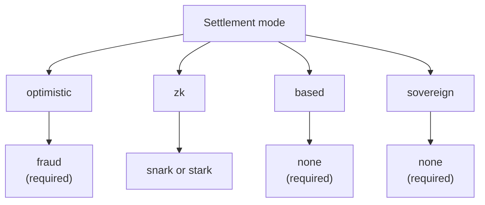

# Rollups Overview

The QoreChain **Rollup Development Kit (RDK)** — the `x/rdk` module — lets developers launch application-specific rollups that settle on QoreChain. Each rollup is an independent execution environment with its own block time, virtual machine, fee model, and sequencing, while it inherits QoreChain's security, post-quantum cryptography, and data availability guarantees.

:::caution Early-stage capability
The RDK is deployed on both networks, but **no rollup has been created on either one yet** (checked 21 October 2026), so the flows described in this section have not been exercised by third parties. Mainnet (**`qorechain-vladi`**, EVM chain ID **9801**, live since 7 June 2026) runs chain version **v3.2.3** until height 3,742,566 and **v3.2.4** from that block (governance proposal 13); the testnet (**`qorechain-diana`**, EVM chain ID **9800**) has run **v3.2.4** since 19 October 2026, so details can differ between the two until that height. Where the two releases differ, this section says which applies when. Validate every deployment on the testnet first, and read the status notes on each page: several capabilities (ZK verification, Celestia data availability, the QCAI Copilot, cross-VM calls, settlement receipts) are not usable end to end today, and the released RDK clients have limits of their own (see [RDK 0.6.0: changes and limits](/rollups/deploying-a-rollup#rdk-050-limits)).
:::

## What exists today {#what-exists-today}

| | Status |
|---|---|
| Rollups registered (mainnet and testnet) | None |
| `x/rdk` module and its parameters | Deployed on both networks; read them with `qorechaind query rdk config` |
| RDK queries | Served on both networks over the CLI, gRPC and REST (`/qorechain/rdk/v1/…`), so REST-based reads such as the TypeScript `rdk.params()` work against mainnet |
| Settlement anchors written by the RDK | None. Since v3.2.2 a batch can carry an `anchor_signature` and is then anchored in `x/multilayer` in the same transaction; without it the batch settles unanchored. No rollup, layer or anchor exists yet. The TypeScript RDK 0.6.0 sends the field when its client signs hybrid and is the rollup's creator (untested live); the Python, Go, Rust and Java clients do not send it |
| Rollup layers registered in `x/multilayer` | None |
| Withdrawals | Paid from a per-rollup escrow ledger since v3.2.3 (see [ZK / STARK & Withdrawals](/rollups/zk-stark-withdrawals)); none has been made, because no rollup exists |

For the lower-level module reference — module parameters, lifecycle internals, burn integration, and multilayer anchoring — see the **[Rollup Development Kit](/architecture/rollup-development-kit)** page in the Architecture section. This Rollups section is the developer-facing how-to: what the RDK is, which paradigm to choose, how to deploy, how data availability works, and how withdrawals settle from L2 back to L1.

---

## What the RDK gives you

A rollup created through the RDK bundles four configurable concerns:

| Concern | What it controls | Options |
| ------- | ---------------- | ------- |
| **Settlement mode** | How the rollup's state transitions are verified and finalized on QoreChain | `optimistic`, `zk`, `based`, `sovereign` |
| **Proof system** | The cryptographic or economic mechanism backing settlement | `fraud`, `snark`, `stark`, `none` |
| **Sequencer mode** | Who orders transactions before they are settled | `dedicated`, `shared`, `based` |
| **Data availability** | Where transaction data is published so anyone can reconstruct state | `native`, `celestia`, `both` |

Each rollup is registered with a unique `rollup-id`, backed by a stake bond in QOR, and assigned a lifecycle status (`pending`, `active`, `paused`, `stopped`). See **[Deploying a Rollup](/rollups/deploying-a-rollup)** for the full create and lifecycle flow.

---

## What makes the QoreChain RDK different

Beyond the table-stakes of any rollup kit, the QoreChain RDK includes three QoreChain-specific capabilities that are built around QoreChain's Layer 1 — plus a watchtower auto-challenger. Their status differs; the table says what works today. The RDK ships in five languages (TypeScript, Python, Go, Rust, Java). **Version 0.6.0 is published on all five registries** (checked 21 October 2026: npm `@qorechain/rdk`, `@qorechain/rdk-cli` and `create-qorechain-rollup`; PyPI `qorechain-rdk`; crates.io `qorechain-rdk`; Maven Central `io.github.qorechain:qorechain-rdk`; Go module `v0.6.0`, which you should pin because the proxy's `@latest` still answered `v0.5.0`). Of the five, only the TypeScript client signs hybrid transactions. The `mainnet` and `testnet` presets ship the public `qore.host` endpoints baked in, so `createRdkClient({ network })` needs no manual endpoint configuration, and its REST reads work against both networks.

| Differentiator | What it does |
| -------------- | ------------ |
| **[Quantum-safe settlement receipts](/rollups/settlement-receipts)** | Package a settlement anchor as a portable receipt that carries a post-quantum (ML-DSA-87 / Dilithium-5) signature. Early stage: no anchors exist yet, so nothing has been verified against a real anchor; a receipt is a claim that must be checked against chain state, which the 0.6.0 verifier does. |
| **[QCAI Rollup Copilot](/rollups/qcai-copilot)** | A read-only advisory helper for one rollup (fee estimate, recommendations, fraud investigations). The advisory services it reads are not exposed on the public endpoints yet. |
| **[Multi-VM cross-VM calls](/rollups/multi-vm)** | Tooling to encode an EVM → QoreChain Native call through the cross-VM precompile (`0x…0901`). The precompile is not activated on the live networks, so a call does nothing; the 0.6.0 encoder matches the layout the chain decodes. |
| **[Watchtower](/rollups/watchtower)** | An auto-challenger framework for optimistic rollups that surfaces new batches and challenge-window deadlines and challenges invalid batches against your validity predicate. It reads over REST, which both networks serve; since 0.6.0 it judges each batch's window the way the chain does. |

See **[Why QoreChain RDK](/rollups/why)** for the full rationale and code samples.

---

## The four settlement paradigms

QoreChain RDK supports four distinct settlement modes, each with different trust assumptions, finality characteristics, and proof requirements. The combination of settlement mode and proof system is validated on-chain — an incompatible pairing is rejected at creation. The diagram below maps each settlement mode to its valid proof system.

### Optimistic

Optimistic rollups assume submitted batches are valid by default and rely on **fraud proofs** for dispute resolution.

* **Proof system**: `fraud` — interactive fraud proofs
* **Sequencer**: `dedicated` or `shared`
* **Finality**: Delayed until a configurable challenge window expires with no successful challenge
* **Disputes**: Anyone may challenge a submitted batch within the window by posting a bond and a fraud proof. A challenge freezes the batch; the rollup creator then resolves it, and the chain checks the proof itself — upheld fraud rejects the batch and pays the challenger, a dismissed challenge returns the batch to `submitted`. See [Deploying a Rollup](/rollups/deploying-a-rollup#challenge-a-batch-optimistic-rollups).
* **Window length**: the default window is 604,800 "seconds". **On mainnet before height 3,742,566 (v3.2.3)** the chain converts this to blocks at a fixed 6 seconds per block — **100,800 blocks** — so real elapsed time follows actual block time (about 3.7 days at mainnet's current ≈3.2 s blocks); plan in blocks, not days. **From v3.2.4**, a batch submitted from the upgrade height on gets a window measured in seconds of block time (a full 7 days); earlier batches keep the block-count rule. The upgrade height is 8,337,253 on the testnet (since 19 October 2026) and 3,742,566 on mainnet, so on mainnet the block-count rule applies to every batch submitted below that height and the block-time rule from it.

### ZK (Zero-Knowledge)

ZK rollups attach a cryptographic validity proof to each batch, proving state-transition correctness without re-execution.

* **Proof system**: `snark` (succinct proofs) or `stark` (transparent proofs, no trusted setup)
* **Sequencer**: `dedicated` or `shared`
* **Finality**: On valid proof verification — no challenge window required
* **Maturity**: SNARK batches are verified on-chain (Groth16 over BLS12-381) against a verifying key stored with the rollup. A rollup created through `create-rollup` does not currently carry a verifying key, so ZK batches cannot yet be finalised end to end. STARK verification is experimental: it is opt-in and checks a demonstration circuit, not your rollup's own state transition. Treat ZK settlement as not production-ready. See **[ZK / STARK & Withdrawals](/rollups/zk-stark-withdrawals)**.

### Based

Based rollups delegate transaction sequencing to QoreChain (L1) proposers, inheriting the host chain's liveness and censorship resistance.

* **Proof system**: `none` — L1 proposers are the source of ordering truth
* **Sequencer**: `based` (required — enforced by on-chain validation)
* **Finality**: Follows host-chain confirmation
* **Trade-off**: Simplest operational model, since QoreChain validators handle sequencing, at the cost of dedicated-sequencer latency control
* **Status today**: `based` is recorded in the rollup configuration, but QoreChain does not yet admit L1 proposers as batch submitters — the rollup creator submits (see [Sequencer modes](#sequencer-modes))

### Sovereign

Sovereign rollups run their own consensus and self-sequence. They anchor state to QoreChain for verifiability but do not depend on the host chain for finality.

* **Proof system**: `none`
* **Sequencer**: self-managed by the rollup
* **Finality**: Independent — determined by the rollup's own consensus
* **State anchoring**: State roots are posted to QoreChain for transparency, but the host chain does not enforce them

---

## Proof-system compatibility

The settlement mode constrains which proof systems are valid. These pairings are enforced when a rollup is created.

| Settlement mode | `fraud` | `snark` | `stark` | `none` |
| --------------- | :-----: | :-----: | :-----: | :----: |
| **optimistic**  | Required | — | — | — |
| **zk**          | — | Supported | Supported | — |
| **based**       | — | — | — | Required |
| **sovereign**   | — | — | — | Required |

---

## Sequencer modes {#sequencer-modes}

The sequencer determines who orders transactions within a rollup block before settlement.

| Mode | Who sequences | Notes |
| ---- | ------------- | ----- |
| **`dedicated`** | A single designated operator address | Lowest latency; requires trust in the operator for liveness and fair ordering |
| **`shared`** | A shared sequencer set | Ordering distributed across the set; slightly higher coordination overhead |
| **`based`** | QoreChain L1 proposers | Inherits host-chain validator security and censorship resistance; required for `based` settlement |

:::note What is enforced today
On-chain, a batch may be submitted only by the rollup's configured sequencer address or, when none is set (every preset), by its creator. The `shared` and `based` modes are recorded in the rollup configuration, but QoreChain does not yet admit a shared sequencer roster or L1 proposers as batch submitters; those modes describe the intended design.
:::

---

## Choosing a paradigm

| If you want... | Consider |
| -------------- | -------- |
| The simplest operational setup, with QoreChain validators sequencing | **based** |
| Fast finality with cryptographic guarantees (not production-ready yet) | **zk** (`snark` / `stark`) |
| A well-understood model with economic dispute resolution | **optimistic** (`fraud`) |
| Full independence with your own consensus, anchored for verifiability | **sovereign** |

Not sure where to start? The RDK ships **preset profiles** that bundle these choices for common application categories — see **[Preset Profiles](/rollups/preset-profiles)** — and, when the advisory RPC is available, a `suggest-profile` helper (currently it returns a fixed `defi` fallback, so choose from the profile table).

For developers, the RDK also ships as the public TypeScript SDK **`@qorechain/rdk`** plus the **`create-qorechain-rollup`** scaffolder, which drive the same on-chain module from code — see **[Deploying a Rollup](/rollups/deploying-a-rollup#deploy-with-the-typescript-rdk-qorechainrdk)**.

## Related

* [Deploying a Rollup](/rollups/deploying-a-rollup) — launch a rollup from the CLI or TypeScript RDK.
* [Preset Profiles](/rollups/preset-profiles) — one-click bundles for common application categories.
* [Data Availability](/rollups/data-availability) — the native DA router and blob storage.
* [ZK / STARK Withdrawals](/rollups/zk-stark-withdrawals) — proof-backed withdrawal flows.
