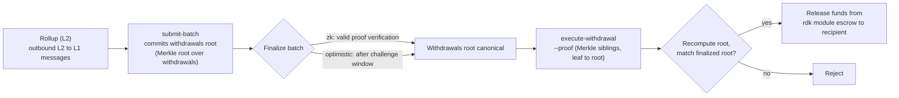

# ZK / STARK & Withdrawals

This page covers two related topics: the **ZK proof systems** (`snark` and `stark`) used by ZK-settled rollups, and the **L2 → L1 withdrawal flow** that moves funds from a rollup back to QoreChain once a batch is finalized.

:::caution Early-stage capability
No rollup has been created on either network yet (checked 27 October 2026), so neither the proof verification nor the withdrawal flow described here has been exercised on a live rollup. Withdrawals can succeed on mainnet only from v3.2.3 (height 3,662,051, 20 October 2026), when the per-rollup escrow ledger went live (see [Where the funds come from](#where-the-funds-come-from)); before that every withdrawal failed. **ZK settlement cannot be used on either network yet** (the `defi` profile and every `zk` rollup): the chain has no way to register a verification key, so every ZK batch is refused after its fee is paid, and key registration is planned for chain v3.2.7. STARK verification is experimental. Validate on the **`qorechain-diana`** testnet and do not assume production-hardened guarantees on mainnet.
:::

---

## ZK proof systems

A ZK-settled rollup (`zk` settlement mode) attaches a validity proof to each settlement batch, proving the state transition is correct without re-executing the rollup's transactions. ZK settlement supports two proof systems:

| Proof system | Characteristics |
| ------------ | --------------- |
| **`snark`** | Succinct proofs (Groth16 over BLS12-381), verified on-chain against the rollup's verifying key |
| **`stark`** | Transparent proofs, no trusted setup — experimental; opt-in and bound to a demonstration circuit |

The `zk` settlement mode requires one of `snark` or `stark`; the pairing is enforced on-chain when the rollup is created. By contrast, `optimistic` settlement uses the `fraud` proof system, and `based` and `sovereign` settlement use `none`. See **[Rollups Overview](/rollups/overview)** for the full compatibility matrix.

### Finality

Unlike optimistic rollups — which wait out a fraud-proof challenge window — a ZK batch can finalize on **valid proof verification**, without a dispute window. This is the core trade-off of ZK settlement: stronger, faster finality in exchange for the cost and complexity of generating proofs.

### Maturity

**ZK settlement cannot be used on either network yet.** SNARK batches are meant to be verified on-chain (Groth16 over BLS12-381, with three public inputs: the previous state root, the new state root and the data hash) against a verification key stored with the rollup. The chain has no way to register that key, so a rollup created with `zk` settlement, including every rollup from the `defi` profile or the `defi-rollup` template, has none, and every ZK batch it submits is refused after its fee is paid. Key registration is planned for chain v3.2.7; until it ships, do not create a ZK rollup or fund one. When it does, the `defi` template's demo circuit (a `snarkjs` multiplier) still cannot verify, because it does not have the public inputs the chain checks; you will need your own circuit. From RDK 0.7.0 the `defi-rollup` template stops before sending a batch, so it no longer spends a fee on one the chain always refuses. STARK verification is experimental: it is opt-in and checks a demonstration circuit, not your rollup's own state transition. For settlement you can use today, choose `optimistic` (the `nft` and `custom` profiles).

---

## How batches carry withdrawals

When a rollup settles a batch, that batch can also commit the rollup's outbound cross-layer messages — its **L2 → L1 withdrawals**. Conceptually:

* A finalized batch can carry a commitment to its set of withdrawals (a Merkle root over the batch's withdrawal messages).
* Each individual withdrawal is a leaf under that root, identified by its batch index and a withdrawal index.
* Once the batch is finalized, any party can prove that a specific withdrawal leaf is included under the committed root, and trigger payout.

This is why withdrawals depend on settlement: a withdrawal can only be executed against a **finalized** batch, because finalization is what makes the committed withdrawals root canonical.

For how batches are submitted and finalized — including `submit-batch` and the `challenge-batch` dispute path for optimistic rollups — see **[Deploying a Rollup](/rollups/deploying-a-rollup)**.

---

## Executing a withdrawal: `execute-withdrawal`

The `execute-withdrawal` command finalizes an L2 → L1 withdrawal against a finalized batch's withdrawals root. It proves that a withdrawal leaf is committed in that root and pays the recipient from the rdk module escrow. The action is **permissionless** — anyone may submit a valid proof. Like every native-lane transaction it needs the hybrid post-quantum co-signature, so build it with `--generate-only` and cosign it (see [Deploying a Rollup](/rollups/deploying-a-rollup)). Withdrawals have not been exercised on a live rollup yet; treat the flow as untested. Check these before you pay a fee, because the chain refuses the transaction otherwise: the denom must be exactly `uqor`, the amount must be positive, the proof has at most 64 levels and every sibling is exactly 32 bytes, the submitter and recipient are valid `qor1…` addresses, the batch is finalized and committed a `withdrawals_root`, the rollup is not stopped, and that withdrawal leaf has not been paid before. The TypeScript `@qorechain/rdk` (0.6.0 and later) runs the first group of these checks for you (`withdrawalErrors`: addresses, denom, amount, proof depth and sibling length), and `executeWithdrawal` throws before it broadcasts when any of them fails; from 0.7.0 `qorollup withdraw --file withdrawal.json [--dry-run]` also builds the proof from the batch's withdrawals and refuses before paying a fee when the result is not the batch's on-chain `withdrawals_root`; the batch, rollup and ledger conditions depend on chain state, which this check does not read.

```bash
qorechaind tx rdk execute-withdrawal \
  [rollup-id] [batch-index] [withdrawal-index] [recipient] [denom] [amount] \
  --proof <sibling-hash-1>,<sibling-hash-2>,... \
  --from mykey \
  --chain-id qorechain-diana \
  --gas 400000 --fees 40000uqor \
  --generate-only > withdrawal.json
qorechaind tx pqc cosign withdrawal.json --from mykey --pqc-key mypqckey --chain-id qorechain-diana
```

**Positional arguments:**

| Argument | Description |
| -------- | ----------- |
| `rollup-id` | The rollup the withdrawal belongs to |
| `batch-index` | The finalized batch whose withdrawals root commits this withdrawal |
| `withdrawal-index` | The index of the withdrawal leaf within that batch |
| `recipient` | The address to pay out to |
| `denom` | The denomination to pay |
| `amount` | The amount to pay |

**Flag:**

| Flag | Description |
| ---- | ----------- |
| `--proof` | Comma-separated hex Merkle sibling hashes, ordered from leaf to root, that prove the withdrawal leaf is committed in the batch's withdrawals root |

The `--proof` value is the inclusion proof: the sibling hashes along the path from the withdrawal leaf up to the batch's committed withdrawals root. The module recomputes the root from the leaf and the supplied siblings and checks it against the finalized batch's committed root before paying.

### Leaf and node encoding {#leaf-and-node-encoding}

* **Leaf (first form, for batches before chain v3.2.5)** = SHAKE-256 (32 bytes) of `rollup_id`, a `0x00` byte, the withdrawal index (8-byte big-endian), the `recipient` string, `0x00`, the `denom` string, `0x00`, and the `amount` (8-byte big-endian).
* **Leaf (second form, from chain v3.2.5 on both networks)**: for batches from chain v3.2.5 the leaf also names the chain id. The RDK builds both forms (`withdrawalLeafV1`, `withdrawalLeafV2`).
* **Parent** = SHAKE-256 of `left || right`. At each level the corresponding bit of the withdrawal index decides the side: `0` means the leaf (or running hash) is the left node, so the leaf's position in the tree is its withdrawal index.
* Every sibling hash must be exactly 32 bytes.
* **Withdrawals root (from chain v3.2.5, both networks):** a batch's `withdrawals_root` is either empty or exactly 32 bytes; before v3.2.5 that length rule was not enforced.

Do not hand-roll this tree. `withdrawalsTree` in `@qorechain/rdk` 0.7.0 (and its Python, Go, Rust and Java equivalents) builds a batch's withdrawals root and every proof exactly as the chain does, and was checked against the chain's own verifier; `assembleWithdrawalProof` builds the chain's tree by default, and the generic Merkle helpers now default to SHAKE-256.

:::caution Releases before 0.7.0
In `@qorechain/rdk` 0.6.2 and earlier, the generic `binaryMerkleRoot` / `binaryMerkleProof` helpers (and their Python, Go, Rust and Java equivalents) defaulted to SHA-256 with duplicated odd nodes and re-hashed each leaf, while the chain uses SHAKE-256 and builds its leaves from the withdrawal, so a proof built with those defaults never verified on chain. Upgrade to 0.7.0, or override the hash and leaf encoding to the rules above, or the proof will not verify on-chain.
:::

### Where the funds come from {#where-the-funds-come-from}

A withdrawal is paid from the **rollup's own escrowed stake** (the stake less the 1% creation burn). All rollups' escrow sits in one pooled module balance, and since **v3.2.3** a per-rollup **escrow ledger** is the account of what each rollup holds: `create-rollup` credits it with the escrow the rollup keeps, a withdrawal or a fraud-proof reward is paid out of it and debited from it, and a withdrawal larger than the rollup still holds is refused with an insufficient-escrow error. `stop-rollup` refunds only what is left and zeroes the ledger, and a stopped rollup pays no further withdrawals. A withdrawal proved for one rollup therefore cannot be paid out of another rollup's stake. The rollup queries carry `escrow_balance` (uqor still held for that rollup). There is no L1 → L2 deposit message in the module, so this is not a bridge of user funds.

---

## End-to-end withdrawal flow

*The L2 to L1 path: a settlement batch commits a withdrawals root, the batch finalizes, then a permissionless inclusion proof releases escrowed funds on QoreChain.*



1. **Settle a batch.** The rollup operator submits a settlement batch with `submit-batch`. The batch can commit a withdrawals root over its outbound L2 → L1 messages.
2. **Finalize.** The batch finalizes according to the rollup's settlement mode — on valid proof verification for `zk`, or after the challenge window for `optimistic` (during which `challenge-batch` may dispute it). Since chain v3.2.5 (testnet from 26 October 2026, mainnet from 29 October 2026), batches also finalize strictly in index order, so a batch waits for any earlier batch that is still `submitted` or `challenged`. The optimistic window is 100,800 blocks by default for a batch submitted before the v3.2.4 upgrade; from v3.2.4 it is measured in seconds of block time for batches submitted from the upgrade height on (testnet since height 8,337,253 on 19 October 2026, mainnet since height 3,742,566 on 23 October 2026).
3. **Prove and execute.** Once finalized, anyone submits `execute-withdrawal` with the Merkle inclusion proof (`--proof`) for the specific withdrawal leaf. The module verifies inclusion against the finalized batch's withdrawals root and pays the recipient from escrow.

Because step 3 is permissionless and proof-based, a withdrawal does not depend on the rollup operator's cooperation once the batch carrying it is finalized.

---

## Related

* **[Rollups Overview](/rollups/overview)** — settlement paradigms and the proof-system compatibility matrix.
* **[Deploying a Rollup](/rollups/deploying-a-rollup)** — `submit-batch` and `challenge-batch` operator commands.
* **[Rollup Development Kit](/architecture/rollup-development-kit)** — the lower-level module reference.
