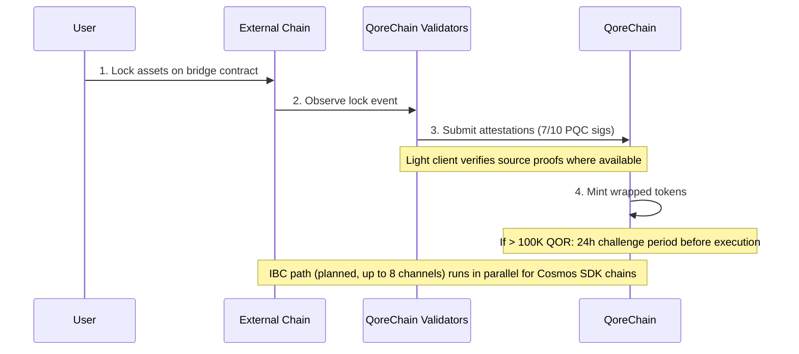

# بنية الجسر

تم تصميم وحدة `x/bridge` لربط QoreChain بنظام البلوكتشين الأوسع من خلال **37 تكوينًا للسلاسل (36 سلسلة خارجية بالإضافة إلى Injective، المتصلة عبر IBC) وما يصل إلى 8 أطراف مقابلة عبر IBC (Inter-Blockchain Communication)**. صُمِّمت كل عملية جسر لتكون مؤمَّنة بتشفير ما بعد الكم.

:::caution غير مفعّل على أي من الشبكتين
وحدة الجسر منشورة على الشبكة الرئيسية وشبكة الاختبار، لكن **لا يوجد أي مسار جسر نشط**: جميع تكوينات السلاسل الـ37 في حالة `pending` دون تعيين أي عقد جسر، ولم يُسجَّل أي مُحقِّق جسر، ولم تُنشأ أي عملية جسر قط، ولا توجد أي قناة IBC على الشبكة الرئيسية (لدى شبكة الاختبار قناة اختبار واحدة بمعيار ICS-20 مع سلسلة معرّفها `provider`، ولا قناة مع أي من الأطراف المقابلة أدناه). كل ما يلي يصف التصميم المقصود. لا ترسل أصولًا متوقعًا أن يتم نقلها عبر الجسر.
:::

## الحالة الحالية {#current-status}

| | الشبكة الرئيسية | شبكة الاختبار |
|---|---|---|
| وحدة الجسر | مفعّلة | مفعّلة |
| تكوينات السلاسل | 37، جميعها `pending` | 37، جميعها `pending` |
| مُحقِّقو الجسر المسجَّلون | 0 | 0 |
| عمليات الجسر | 0 | 0 |
| قنوات / عملاء IBC | 0 / 0 | 1 / 1 (قناة اختبار إلى شبكة اختبار Cosmos Hub) |

(جرى التحقق بتاريخ 27 أكتوبر 2026 على الشبكة الرئيسية (v3.2.4) وشبكة الاختبار (v3.2.6). اقرأ القيم الحية عبر `qorechaind query bridge chains` و`qorechaind query bridge validators`، أو عبر REST على `/qorechain/bridge/v1/chains` و`/qorechain/bridge/v1/validators`.) إعدادات الوحدة هي نفسها على الشبكتين: `min_validators` يساوي 10، و`attestation_threshold` يساوي 7، و`challenge_period_secs` يساوي 86,400، و`large_transfer_threshold` يساوي 100,000 QOR (`100000000000` uqor). حزمة IBC التي ستستخدمها الوحدة هي ibc-go v10.7 (منذ v3.2.2)، لكن لم يُنشأ أي عميل أو قناة على الشبكة الرئيسية (لدى شبكة الاختبار عميل وقناة اختبار واحدان، انظر أعلاه).

## نظرة عامة على الاتصال

تم تصميم QoreChain لدعم بروتوكولَي جسر يعملان بالتوازي:

| البروتوكول | الاتصالات          | نموذج الأمان                       | حالة الاستخدام                                |
| -------- | -------------------- | ------------------------------------ | --------------------------------------- |
| **IBC**  | ما يصل إلى 8 قنوات (لا توجد قناة مفتوحة)  | IBC قياسي (ICS-20) | السلاسل المتوافقة مع Cosmos SDK            |
| **QCB**  | 37 تكوين سلسلة (جميعها pending) | توقيع متعدد Dilithium-5 بنسبة 7 من 10         | السلاسل غير IBC (EVM، Solana، TON، إلخ) |

**تكوينات السلاسل الـ37** هي **السلاسل الخارجية الـ36** المدرجة أدناه بالإضافة إلى **Injective**، المهيَّأة كسلسلة من نوع IBC. لا يوجد تكوين استرجاعي (loopback) لـ QoreChain. قنوات IBC المخطَّط لها تتصل بالسلاسل المتوافقة مع Cosmos SDK.

## قنوات IBC

تم تصميم QoreChain للحفاظ على اتصالات IBC مع السلاسل الـ8 التالية، المُرحَّلة بواسطة مُرحِّل IBC. **لا يوجد أي من هذه الأطراف المقابلة متصلًا حتى الآن** (لا توجد على الشبكة الرئيسية أي قناة أو عميل IBC؛ ولدى شبكة الاختبار قناة اختبار واحدة بمعيار ICS-20 مع سلسلة معرّفها `provider`، جرى التحقق في 27 أكتوبر 2026)، لذا يسرد هذا الجدول الأطراف المقابلة المخطَّط لها فقط:

| السلسلة      | الوصف                    |
| ---------- | ------------------------------ |
| Cosmos Hub | اتصال الـ hub الأساسي         |
| Osmosis    | توجيه سيولة DEX          |
| Noble      | الإصدار الأصلي لـ USDC            |
| Celestia   | طبقة توفّر البيانات        |
| Stride     | الـ staking السائل                 |
| Akash      | الحوسبة اللامركزية          |
| Babylon    | بروتوكول إعادة staking لـ BTC         |
| Injective  | قابلية التشغيل البيني لـ DeFi / دفتر الأوامر |

### مُرحِّل IBC {#ibc-relayer}

تُنقل حزم IBC وتحديثات العملاء بين السلاسل بواسطة مُرحِّل (relayer)، وهو برنامج منفصل يراقب السلسلتين ويُرسل الحزم والإثباتات وتحديثات العملاء. المُرحِّل ليس جزءًا من السلسلة، ولا تنشر هذه الوثائق خدمة مُرحِّل ولا تعد بها. تحتفظ QoreChain بنسخة مُفرَّعة عامة من مُرحِّل باسم QORel ([github.com/qorechain/QORel](https://github.com/qorechain/QORel))؛ وليس لها إصدار بعد، لذا لا يوجد منها شيء يمكن تثبيته اليوم.

* **تحديثات العميل ومراقبة سوء السلوك ومسح الحزم** هي إعدادات خاصة بأي مُرحِّل يشغّله المشغِّل، وليست معاملات للسلسلة. فعلى سبيل المثال، يمكن للمُرحِّل تحديث العملاء الخفيفين تلقائيًا، ومراقبة التوقيع المزدوج (equivocation)، ومسح الحزم المعلقة بشكل دوري.
* **توقيعات ما بعد الكم.** المعاملات التي تقبلها QoreChain على مسارها الأصلي تحمل توقيعًا هجينًا secp256k1 + ML-DSA-87 (FIPS 204)، ومنها المعاملات التي يرسلها إليها مُرحِّل؛ انظر [Post-Quantum Security](/architecture/post-quantum-security). أما تنسيق حزمة IBC نفسه فهو القياسي، ولا تدّعي هذه الوثائق أن الحزم تحمل توقيعًا إضافيًا تتحقق منه سلاسل أخرى.

## بروتوكول QCB (QoreChain Bridge)

يستخدم بروتوكول QCB بنية hub-and-spoke مؤمَّنة بتشفير ما بعد الكم. تعمل QoreChain بصفتها الـ hub، مع تكوين spoke لكل سلسلة خارجية.

### تكوينات السلاسل الخارجية (36)

تم تصميم بروتوكول QCB لاستهداف السلاسل الخارجية الـ36 التالية. وبالاقتران مع Injective (تكوين من نوع IBC)، يعطي ذلك **37 تكوين سلسلة إجمالًا**، جميعها حاليًا في حالة `pending`.

**السلاسل الأساسية (10)**

Ethereum، Solana، TON، BSC، Avalanche، Polygon، Arbitrum، Optimism، Base، Sui.

**سلاسل عائلة EVM (14)**

zkSync Era، Linea، Scroll، Blast، Mantle، Hyperliquid، Berachain، Sonic، Sei، Monad، Plasma، Filecoin FVM، Cronos، Kaia.

**السلاسل غير EVM (5)**

Starknet، XRP Ledger، Stellar، Hedera، Algorand.

**سلاسل أخرى (7)**

NEAR، Bitcoin، Cardano، Polkadot، Tezos، Tron، Aptos.

:::note
التحقق من العدد: 10 أساسية + 14 من عائلة EVM + 5 غير EVM + 7 أخرى = **36 سلسلة خارجية**. وبإضافة Injective (IBC) يكون الناتج **37 تكوين سلسلة**.
:::

### تنسيقات العناوين

يصنّف بروتوكول QCB السلاسل حسب النوع للتحقق من عناوين الوجهة:

| نوع السلسلة   | أمثلة على السلاسل                                                          | تنسيق العنوان                                     |
| ------------ | ----------------------------------------------------------------------- | -------------------------------------------------- |
| `evm`        | Ethereum، BSC، Avalanche، Polygon، Arbitrum، Optimism، Base             | `0x` + 40 حرفًا سداسيًا عشريًا                           |
| `solana`     | Solana                                                                  | Base58، 32-44 حرفًا                           |
| `ton`        | TON                                                                     | `EQ` + مُرمَّز بـ base64                              |
| `sui_move`   | Sui                                                                     | `0x` + 64 حرفًا سداسيًا عشريًا                           |
| `aptos_move` | Aptos                                                                   | `0x` + 64 حرفًا سداسيًا عشريًا                           |
| `bitcoin`    | Bitcoin                                                                 | Bech32 (`bc1`)، P2SH (`3...`)، أو الإرث (`1...`)  |
| `near`       | NEAR Protocol                                                           | لاحقة `.near` أو ضمنية                         |
| `cardano`    | Cardano                                                                 | `addr1` (دفع) أو `stake1` (staking)            |
| `polkadot`   | Polkadot                                                                | مُرمَّز بـ SS58                                       |
| `tezos`      | Tezos                                                                   | `tz1`/`tz2`/`tz3` (ضمني) أو `KT1` (منشأ) |
| `tron`       | TRON                                                                    | `T` + base58، 34 حرفًا                           |

## العملاء الخفيفون

للتحقق من أحداث السلاسل الخارجية دون الحاجة إلى الثقة، تم تصميم الجسر لتشغيل عملاء خفيفين على السلسلة مصممين خصيصًا لإجماع كل سلسلة مصدر ونظام إثباتها. يمكّن هؤلاء العملاء الخفيفون QoreChain من التحقق من صحة الإيداعات والسحوبات دون الاعتماد كليًا على شهادات المُحقِّقين.

| العميل الخفيف            | السلسلة المصدر        | بدائيات التحقق                                              |
| ----------------------- | ------------------- | ------------------------------------------------------------------- |
| **العميل الخفيف لـ Ethereum** | Ethereum / EVM L1 | التحقق من توقيع BLS12-381، تسلسل SSZ، إثباتات حالة MPT |
| **Bitcoin SPV**         | Bitcoin             | التحقق المبسّط من الدفع (Simplified Payment Verification) مقابل رؤوس الكتل                |
| **Starknet STARK**      | Starknet            | التحقق من إثبات STARK لانتقالات حالة Starknet              |
| **Sui BLS**             | Sui                 | التحقق من توقيع BLS المجمَّع لنقاط تفتيش Sui             |
| **Wormhole / Solana VAA** | Solana (عبر Wormhole) | التحقق من توقيع حارس Verified Action Approval (VAA)     |

## تدفق الإيداع (من خارجي إلى QoreChain)

يوضح التسلسل أدناه إيداع QCB كما هو مصمَّم: تُقفل الأصول على سلسلة خارجية، ويقدّم مُحقِّقو QoreChain شهادات موقَّعة بـ PQC (7 من 10 Dilithium-5)، وتُسكّ الرموز المغلَّفة. ستستخدم السلاسل المتوافقة مع Cosmos SDK بدلاً من ذلك مسار IBC الموازي (ما يصل إلى 8 قنوات، يحملها مُرحِّل IBC). لا أحد من المسارين نشط؛ ولم يتم أي إيداع قط.



```
External Chain          QoreChain Validators           QoreChain
     |                         |                          |
     | 1. Lock assets on       |                          |
     |    bridge contract      |                          |
     |------------------------>|                          |
     |                         | 2. Observe & attest      |
     |                         |    (7/10 PQC sigs)       |
     |                         |------------------------->|
     |                         |                          | 3. Mint wrapped
     |                         |                          |    tokens
     |                         |                          |
     |                         |    [If > 100K QOR]       |
     |                         |    24h challenge period   |
     |                         |    before execution       |
```

1. **القفل** — يقفل المستخدم الأصول في عقد الجسر على السلسلة الخارجية.
2. **الشهادة** — يراقب مُحقِّقو الجسر معاملة القفل ويقدّمون شهادات موقَّعة بـ Dilithium-5. مطلوب حد أدنى من **7 من 10** شهادات للمُحقِّقين. وحيث يتوفر عميل خفيف للسلسلة المصدر، يُتحقَّق من حدث القفل إضافيًا مقابل إثباتات السلسلة الخاصة.
3. **السك** — بمجرد بلوغ عتبة الشهادة، تُسكّ الرموز المغلَّفة على QoreChain.
4. **فترة الطعن** — بالنسبة للتحويلات التي تتجاوز ما يعادل 100,000 QOR، تنطبق **فترة طعن مدتها 24 ساعة** قبل التنفيذ. خلال هذه النافذة، يمكن للمُحقِّقين الإبلاغ عن النشاط المشبوه.

## تدفق السحب (من QoreChain إلى خارجي)

```
QoreChain               QoreChain Validators           External Chain
     |                         |                          |
     | 1. Burn wrapped tokens  |                          |
     |------------------------>|                          |
     |                         | 2. Attest burn           |
     |                         |    (7/10 PQC sigs)       |
     |                         |------------------------->|
     |                         |                          | 3. Unlock original
     |                         |                          |    assets
```

1. **الحرق** — يحرق المستخدم الرموز المغلَّفة على QoreChain.
2. **الشهادة** — يشهد المُحقِّقون على حدث الحرق بتوقيعات Dilithium-5 (عتبة 7/10).
3. **إلغاء القفل** — بمجرد بلوغ العتبة، يُلغى قفل الأصول الأصلية على السلسلة الخارجية.

تُوجَّه جميع رسوم الجسر المحصَّلة أثناء السحوبات إلى وحدة `x/burn` عبر قناة الحرق `bridge_fee` (تُحرق 100% من رسوم الجسر).

### سحوبات L2 → L1 (الـ rollups)

لا تستخدم سحوبات الـ rollup الجسر. بل تتولى وحدة `x/rdk` دفعها عبر `execute-withdrawal` مقابل جذر السحوبات لدفعة منتهية — راجع [ZK / STARK & Withdrawals](/rollups/zk-stark-withdrawals).

## بنية الأمان

### التوقيع المتعدد لـ PQC

تتطلب جميع عمليات جسر QCB **عتبة 7 من 10** من توقيعات Dilithium-5 لما بعد الكم من مُحقِّقي الجسر المسجَّلين. يسجّل كل مُحقِّق جسر بـ:

* عنوان مُحقِّق QoreChain
* مفتاح Dilithium-5 العام (2,592 بايت)
* قائمة بالسلاسل المدعومة
* درجة سمعة (تحافظ عليها `x/reputation`)

منذ v3.2.2 تتحقق الوحدة من المبالغ الصفرية ومن إعداداتها بشكل متسق على كل مسار. **من v3.2.4 (على الشبكة الرئيسية منذ 23 أكتوبر 2026، وعلى شبكة الاختبار منذ 19 أكتوبر 2026):** يتطلب تسجيل مُحقِّق جسر أيضًا إثبات امتلاك لمفتاح Dilithium-5 (بصيغة `proof_of_possession` نفسها المستخدمة في تسجيل مفتاح PQC، انظر [Post-Quantum Security](/architecture/post-quantum-security#proof-of-possession))، ويرفض مفتاحًا يستخدمه بالفعل مُحقِّق جسر آخر. الإصدارات الأقدم لا تجري هذا الفحص، ولا يوجد مُحقِّق جسر مسجَّل على أي من الشبكتين.

### قواطع الدائرة

لكل سلسلة متصلة حمايات قاطع دائرة مستقلة:

| الحماية                | الوصف                                                                          |
| ------------------------- | ------------------------------------------------------------------------------------ |
| **حد التحويل الواحد** | الحد الأقصى لمبلغ أي عملية جسر فردية لكل سلسلة                         |
| **الحد الإجمالي اليومي** | سقف الحجم الإجمالي لكل سلسلة لكل نافذة 24 ساعة                                        |
| **الإيقاف اليدوي**          | إيقاف طارئ تطلقه الحوكمة أو المُحقِّق لكل سلسلة                           |
| **كشف الشذوذ**     | إيقاف تلقائي إذا تجاوزت العمليات 50 خلال نافذة قصيرة أو تجاوز الحجم 5 أضعاف الحد اليومي |

تُتتبع حالة قاطع الدائرة لكل سلسلة وتتضمن: الحد الأقصى للتحويل الواحد، الحد اليومي، الاستخدام اليومي الحالي، ارتفاع آخر إعادة ضبط، وحالة الإيقاف مع السبب.

### فترة الطعن

بالنسبة للتحويلات الكبيرة (أكثر من ما يعادل 100,000 QOR، قابلة للتكوين عبر `large_transfer_threshold`):

* تنطبق **فترة طعن مدتها 24 ساعة** (86,400 ثانية) بعد بلوغ عتبة الشهادة.
* خلال هذه النافذة، صُمِّم النظام بحيث يستطيع المُحقِّقون الإبلاغ عن العملية.
* إذا لم يُطعن فيها، تُنفَّذ العملية تلقائيًا بعد انتهاء الفترة.
* تُجمَّد العمليات المطعون فيها لمراجعة الحوكمة.

### تحسين المسار بالذكاء الاصطناعي

تتكامل وحدة الجسر مع نظام الذكاء الاصطناعي الفرعي لتحسين المسار (غير متاح عبر REST). بالنسبة للتحويلات التي يمكن أن تعبر مسارات متعددة (مثلًا، من السلسلة A إلى السلسلة B عبر وسيط)، يقيّم مُحسِّن المسار:

* الرسوم المقدَّرة عبر المسارات
* وقت الإكمال المقدَّر
* درجة الأمان لكل مسار
* مستوى الثقة في التقدير

## إدارة الجسر

### تفعيل السلسلة بعد النشر (بدون حوكمة)

اعتبارًا من إصدار السلسلة **v3.1.78**، يمكن تفعيل سلسلة جسر وإعادة تكوينها بعد النشر بمعاملة موقَّعة واحدة — دون اقتراح حوكمة ودون ترقية سلسلة. يمكن لمفتاح `bridge_admin` (المعيَّن في `BridgeConfig.BridgeAdmin` عند genesis) أو لحامل ترخيص `qcb_bridge`:

* **`tx bridge update-chain-config`** — تعيين عنوان عقد السلسلة، وعدد التأكيدات، والبنية، والحالة (`MsgUpdateChainConfig`).
* **`tx bridge set-verifier-bootstrap`** — اختيار المُحقِّق النشط لسلسلة وتثبيت جذر الثقة الخاص بها (`MsgSetVerifierBootstrap`).

يتيح هذا لمشغِّل أن يُشغِّل جسر سلسلة متصلة — أو يدوّر مُحقِّقها — مباشرةً، مع التحقق من التفويض مقابل مفتاح مدير الجسر. واعتبارًا من إصدار السلسلة **v3.2.0** أصبح لوحدة الجسر أيضًا حساب وحدة خاص بها (لم يكن لها حساب في الإصدارات السابقة، ولذلك كان أول إيداع على مسار مفعَّل سيفشل).

التراخيص مثل `qcb_bridge` تمنحها سلطة الترخيص (حساب سلطة الترخيص). ومنذ v3.2.3 (الشبكة الرئيسية) يمكن للحوكمة استبدال هذا الحساب بمقترح `MsgUpdateAuthority`؛ أما الوحدة نفسها فموصوفة في [Chain Licensing](/architecture/chain-licensing).

### التحقق من الشبكات المتصلة

اعتبارًا من إصدار السلسلة **v3.1.79**، يمكن لمُحقِّق يحمل ترخيص `validator_<chain>` (أو `qcb_bridge`) المطابق تشغيل عميل الشبكة الخارجية على العقدة نفسها، مُهيَّأً تلقائيًا تحت تنسيق QoreChain بمجرد تفعيل الترخيص. تُشحن المشغّلات (drivers) لجميع شبكات الجسر الـ37، مصنّفة حسب نموذج المشاركة (مُحقِّق بدون إذن، محدود/منتخَب/بقبول، عقدة كاملة L2، وغير staking/قائمة ثقة). يوفّر المشغِّل حصة الشبكة الخارجية ومفاتيح التوقيع لكل شبكة. راجع [Run a Validator](/developer-guide/running-a-validator#connected-networks) لخطوات المشغِّل. ولأن كل تكوين سلسلة في حالة `pending`، لا يجري اليوم التحقق من أي شبكة متصلة عبر الجسر.

## نقاط نهاية REST API {#rest-api-endpoints}

حالة الجسر قابلة للاستعلام **للقراءة فقط عبر REST** من خلال grpc-gateway تحت البادئة `/qorechain/bridge/v1/...`. تقدّم هذه بيانات JSON حقيقية على السلسلة عبر HTTP للمستكشفات وقياس العقد الخفيفة عن بُعد. راجع [REST / gRPC Endpoints](/api-reference/rest-grpc-endpoints#bridge-module) للقائمة الكاملة.

| الطريقة | نقطة النهاية                                  | الوصف                                                                                                         |
| ------ | ----------------------------------------- | ------------------------------------------------------------------------------------------------------------------- |
| GET    | `/qorechain/bridge/v1/config`             | إعدادات وحدة الجسر (`min_validators`، `attestation_threshold`، `challenge_period_secs`، `large_transfer_threshold`، `enabled`) |
| GET    | `/qorechain/bridge/v1/chains`             | جميع تكوينات السلاسل وحالتها                                                                           |
| GET    | `/qorechain/bridge/v1/chains/{chain_id}`  | تكوين سلسلة واحدة                                                                                             |
| GET    | `/qorechain/bridge/v1/validators`         | مُحقِّقو الجسر المسجَّلون                                                                                        |
| GET    | `/qorechain/bridge/v1/validators/{address}` | مُحقِّق جسر واحد                                                                                              |
| GET    | `/qorechain/bridge/v1/operations`         | عمليات الجسر                                                                                                   |
| GET    | `/qorechain/bridge/v1/operations/{id}`    | عملية جسر واحدة                                                                                             |

لا يوجد اليوم مسار استعلام للمبالغ المقفلة أو حالة قواطع الدائرة أو تقديرات المسارات.

## أحداث الجسر

تصدر وحدة الجسر الأحداث التالية على السلسلة:

| نوع الحدث                    | الوصف                                     |
| ----------------------------- | ----------------------------------------------- |
| `bridge_deposit`              | إنشاء عملية إيداع جديدة                   |
| `bridge_withdraw`             | إنشاء عملية سحب جديدة                |
| `bridge_attestation`          | تقديم شهادة مُحقِّق                 |
| `bridge_operation_executed`   | إنهاء العملية وتنفيذها                |
| `bridge_circuit_breaker_trip` | تفعيل قاطع الدائرة أو إلغاء تفعيله        |
| `bridge_validator_registered` | تسجيل مُحقِّق جسر جديد                 |
| `bridge_pqc_verification`     | نتيجة التحقق من توقيع PQC (حزم IBC) |

## ذات صلة

* [Bridging Assets](/user-guide/bridging-assets) — نقل الأصول عبر السلاسل خطوة بخطوة.
* [BTC Restaking via Babylon](/architecture/btc-restaking-babylon) — أمان مدعوم بـ Bitcoin.
* [Post-Quantum Security](/architecture/post-quantum-security) — التحقق من PQC على حزم IBC.
