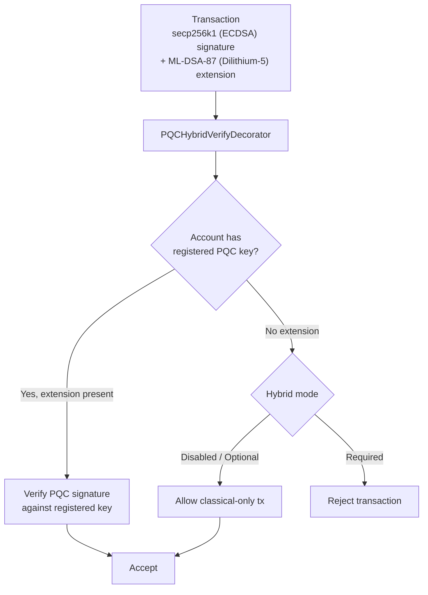

# الأمان ما بعد الكمومي

بُنيت QoreChain بـ**التشفير ما بعد الكمومي (post-quantum cryptography، PQC) منذ نشأتها** — لا مُضافًا لاحقًا كترقية. وتوفّر وحدة `x/pqc` تواقيع رقمية شبكية (lattice-based) وتغليفًا للمفاتيح بوصفها البدائيات التشفيرية الأساسية، مع إطار رشاقة خوارزمية خاضع للحوكمة من أجل المرونة طويلة الأمد.

اكتمل الآن خطّ الأساس الكامل لـPQC — **Dilithium-5 (التواقيع) + ML-KEM-1024 (KEM) + SHAKE-256 (التجزئة)** — وأصبح هو الافتراضي للشبكة. وعلى الشبكات الحية (v3.2.x)، أصبحت التواقيع الهجينة **مطلوبة افتراضيًا** على مسار معاملات cosmos: `hybrid_signature_mode = required` و`allow_classical_fallback = false`. ويجب أن تحمل كل معاملة على مسار cosmos توقيع Dilithium-5 إلى جانب توقيعها الكلاسيكي secp256k1؛ وتُرفَض المعاملات الكلاسيكية فقط الصادرة من حساب PQC، كما أُغلق مسار التخفيض الكلاسيكي. تعمل الشبكة الرئيسية وشبكة الاختبار كلتاهما بالإصدار v3.2.4؛ أما ما أضافه الإصداران v3.2.2 وv3.2.3 إلى القواعد ما بعد الكمومية (سلامة المفاتيح، وإثبات الحيازة الاختياري، ونوافذ EVM المقيَّدة النطاق، وموافقة EIP-7702) فموصوف في [قواعد سلامة المفاتيح](#key-integrity) و[إثبات الحيازة](#proof-of-possession) و[تفويضات EIP-7702](#eip-7702).

## مبادئ التصميم

* **PQC مطلوب افتراضيًا**: التواقيع ما بعد الكمومية إلزامية على مسار cosmos. ولم تعد تواقيع secp256k1 الكلاسيكية وحدها كافية — `allow_classical_fallback = false`.
* **هجين افتراضيًا**: تحمل معاملات cosmos في آنٍ واحد توقيعًا كلاسيكيًا secp256k1 وتوقيع PQC من نوع Dilithium-5. والاحتياط الكلاسيكي فقط مُغلق.
* **رشاقة الخوارزميات**: سجلّ الخوارزميات التشفيرية خاضع للحوكمة، ما يتيح للشبكة اعتماد خوارزميات جديدة أو إيقاف المخترَقة دون انقسامات صلبة (hard forks).
* **التحقق الحتمي**: كل عمليات التحقق من التواقيع حتمية وقابلة لإعادة الإنتاج عبر عقد المدققين.

## الخوارزميات المدعومة

| الخوارزمية       | المعيار             | الفئة          | مستوى NIST | المفتاح العام  | المفتاح الخاص | التوقيع / النص المشفَّر | السرّ المشترك |
| --------------- | -------------------- | ----------------- | ---------- | ----------- | ----------- | ---------------------- | ------------- |
| **Dilithium-5** | ML-DSA-87 (FIPS 204) | توقيع         | 5          | 2,592 bytes | 4,896 bytes | 4,627 bytes            | --            |
| **ML-KEM-1024** | FIPS 203             | تغليف المفاتيح | 5          | 1,568 bytes | 3,168 bytes | 1,568 bytes            | 32 bytes      |

تعمل كلتا الخوارزميتين عند **مستوى الأمان 5 من NIST**، وهو أعلى فئة أمان موحَّدة، ما يوفّر حمايةً مكافئة لـAES-256 ضد الخصوم الكلاسيكيين والكموميين على حدٍّ سواء.

## الخلفية التشفيرية

تُطبَّق عمليات PQC في خلفية تشفيرية عالية الأداء وآمنة الذاكرة تتيح التوقيع والتحقق الشبكيين وتغليف المفاتيح لزمن تشغيل QoreChain. وتوفّر الخلفية:

عمليات خاصة بالخوارزمية:

* توليد مفاتيح Dilithium-5 والتوقيع والتحقق
* توليد مفاتيح ML-KEM-1024 والتغليف وفكّ التغليف
* توليد إشارة عشوائية حتمية (`seed`، `epoch`)

عمليات مدركة للخوارزمية:

* `Keygen(algorithmID)` — توليد زوج مفاتيح لأي خوارزمية مسجَّلة
* `Sign(algorithmID, privkey, message)` — إنشاء توقيع
* `Verify(algorithmID, pubkey, message, signature)` — التحقق من توقيع
* `AlgorithmInfo(algorithmID)` — الاستعلام عن أحجام المفاتيح/المخرجات
* `ListAlgorithms()` — تعداد جميع الخوارزميات المدعومة

كل عمليات التوقيع والتحقق حتمية وتنتج نتائج متطابقة عبر كل عقدة مدقق ومنصة مدعومة.

تتوفّر هذه البدائيات نفسها — ML-DSA (FIPS-204) وML-KEM (FIPS-203) وSHAKE-256 (FIPS-202) — للمحافظ والمكامِلين عبر مكتبة [**qorechain-pqc**](https://github.com/qorechain/qorechain-pqc) مفتوحة المصدر، التي توفّر واجهة برمجية واحدة متسقة ومتوافقة على مستوى البايت عبر ست لغات (JavaScript/TypeScript، Rust، Go، C، Python، Java). راجع [التوقيع ما بعد الكمومي](/developer-guide/post-quantum-signing).

## تسجيل المفاتيح {#key-registration}

تسجّل الحسابات مفاتيح PQC صراحةً عبر `MsgRegisterPQCKey` (القديم، يُعتمد افتراضيًا على Dilithium-5) أو `MsgRegisterPQCKeyV2` (المدرك للخوارزمية)؛ ولا تسجّل السلسلة أي مفتاح من تلقاء نفسها، ومسار سطر الأوامر هو `qorechaind tx pqc gen-key <name>` متبوعًا بـ`qorechaind tx pqc register-key <public_key_hex> hybrid --from <key>` (راجع [المعاملة الأولى](/getting-started/first-transaction#register-pqc-key)). وتتضمن كل رسالة:

* **Sender**: عنوان الحساب الذي يسجّل المفتاح.
* **PublicKey**: بايتات المفتاح العام لـPQC.
* **AlgorithmID**: معرّف خوارزمية PQC (الإصدار v2 فقط).
* **ProofOfPossession**: توقيع اختياري بالمفتاح الجديد (الإصدار v2 فقط، منذ v3.2.3)؛ راجع [إثبات الحيازة](#proof-of-possession).
* **KeyType**: أحد القيمتين `hybrid` أو `pqc_only` (توجد قيمة ثالثة، `classical_only`، لا تزال في المخطط لكنها مرفوضة منذ v3.2.3):

| نوع المفتاح         | الوصف                                                              |
| ---------------- | ------------------------------------------------------------------------ |
| `hybrid`         | مفتاحان كلاسيكي (ECDSA) وPQC معًا. تحمل المعاملات توقيعين مزدوجين. |
| `pqc_only`       | يُسجَّل مثل `hybrid`: لا يزال التوقيع الكلاسيكي secp256k1 يُتحقَّق منه بواسطة فحوصات التوقيع القياسية، كما أن توقيع PQC مطلوب أيضًا. |
| `classical_only` | **مرفوض منذ v3.2.3.** لا يسجّل التسجيل بهذا النوع أي مفتاح ما بعد كمومي صالح للاستخدام وسيترك الحساب عاجزًا عن التوقيع، لذلك ترفضه السلسلة. |

### قواعد سلامة المفاتيح (v3.2.3) {#key-integrity}

منذ ترقية v3.2.3 (ارتفاع الشبكة الرئيسية 3,662,051، 20 أكتوبر 2026؛ ارتفاع شبكة الاختبار 8,003,746) تطبّق السلسلة هذه القواعد على المفاتيح ما بعد الكمومية. وقبل ذلك الارتفاع لم تكن أي منها مفروضة.

| القاعدة | السلوك |
| --- | --- |
| لا مفاتيح ضعيفة | يُرفض التسجيل إذا كان نوع المفتاح `classical_only`، أو كان المفتاح فارغًا، أو كان مفتاحًا منحلًّا: مفتاح بالطول الصحيح لكن بنيته لا توفّر أي حماية ما بعد كمومية. ولّد المفاتيح بالأمر `tx pqc gen-key` أو بمكتبة `qorechain-pqc` وسجّل ما تطبعه |
| لا إعادة استخدام للمفاتيح | يُرفض التدوير أو الترحيل إذا كان المفتاح الجديد مفتاحًا سبق أن استخدمه الحساب. تتذكر السلسلة تجزئة كل مفتاح دوّره الحساب أو رحّله بعيدًا عنه |
| الحسابات ذات المفاتيح تحتاج إلى التوقيع الهجين | يجب على الحساب الذي يملك أصلًا مفتاحًا صالحًا للاستخدام أن يحمل توقيعه الهجين أيضًا في معاملة التسجيل أو الترحيل. ولم يعد استثناء الكلاسيكي فقط يشمل إلا الحساب الذي **لا** يملك مفتاحًا مسجَّلًا، أو الذي لا يحتوي سجله المخزَّن على مفتاح صالح للاستخدام (ويجوز حينئذٍ أن تستبدله `MsgRegisterPQCKeyV2`) |
| لا امتداد بلا مفتاح | في وضع `required`، لا يستطيع حساب بلا مفتاح مسجَّل أن يمرّ بإرفاق امتداد هجين لا يمكن التحقق منه بأي شيء؛ والتسجيل وحده يجوز أن يمرّ بدونه |
| امتداد واحد | تحمل المعاملة امتداد توقيع هجين واحدًا على الأكثر |
| لا رسائل مفاتيح عبر authz | لا يمكن تنفيذ `MsgRegisterPQCKey` و`MsgRegisterPQCKeyV2` و`MsgRotatePQCKey` و`MsgMigratePQCKey` نيابةً عن حساب عبر `x/authz`؛ إذ يلزم توقيع الحساب نفسه |
| ضوابط حوكمة الخوارزميات | لا يمكن لإيقاف خوارزمية أو تعطيلها أن يترك السلسلة بلا خوارزمية توقيع نشطة، ويجب أن تكون الخوارزمية البديلة قادرة على التوقيع |

أضاف v3.2.2 فحصًا ذا صلة: يتحقق التسجيل من المفتاح الكلاسيكي `ecdsa_pubkey` الذي يحمله ويربطه بالحساب الموقِّع، فلا يستطيع الحساب أن يسجّل مفتاحًا كلاسيكيًا ليس له.

وتفحص العقد هذه الحالات أيضًا في مجمّع الذاكرة، فلا تُمرَّر معاملة لا يمكن إلا أن تفشل ولا تكلّف رسومًا.

### إثبات الحيازة (اختياري) {#proof-of-possession}

للرسالة `MsgRegisterPQCKeyV2` حقل اختياري `proof_of_possession`. وعند وجوده تتحقق منه السلسلة؛ وعند غيابه يمضي التسجيل كما كان (الإثبات **غير مطلوب**). والإثبات توقيع بالمفتاح الذي يجري تسجيله على

```text
qorechain-pqc-pop-v1|<chain-id>|<algorithm-id>|<account-address>|<hex(public-key)>
```

وبذلك فإن إثباتًا صُنع لحساب أو سلسلة لا يثبت شيئًا على غيرهما. تبنيه لك أداة سطر الأوامر عندما تسمّي ملف المفتاح المحلي:

```bash
qorechaind tx pqc register-key-v2 dilithium5 <pubkey-hex> hybrid \
  --pqc-key mypqc --from mykey --chain-id qorechain-vladi --gas 600000 --fees 60000uqor
```

يُعفى التسجيل من شرط الهجين فقط للحساب الذي لا يملك مفتاحًا، ولذلك توقَّع هذه المعاملة بمفتاح الحساب الكلاسيكي وحده. ويُرفض الإثبات المشوَّه بالخطأ `ErrInvalidProofOfPossession` (الرمز 231 في الوحدة `pqc`).

**اعتبارًا من v3.2.4 (الشبكة الرئيسية منذ 23 أكتوبر 2026، وشبكة الاختبار منذ 19 أكتوبر 2026):** يكتسب سجل الحساب حقلًا منطقيًا `possession_proven`، يعيده `GET /qorechain/pqc/v1/account/{address}`. تكون قيمته `true` عندما سُجِّل المفتاح الحالي بإثبات صالح، أو وصل عبر تدوير أو ترحيل (وكلاهما يتحقق من توقيع بالمفتاح الجديد على بايتات تسمّي السلسلة والحساب والمفتاح)؛ أما التسجيل بلا إثبات فيسجّل `false`، والمفتاح الذي يتغيّر بلا إثبات يمسح العلامة. ويبقى الإثبات اختياريًا لمفاتيح الحسابات في ظل v3.2.4.

## التواقيع الهجينة {#hybrid-signatures}

يتطلب نظام التواقيع الهجينة أن تحمل معاملات مسار cosmos في آنٍ واحد **كلًّا من** توقيع كلاسيكي وتوقيع PQC. ويوفّر هذا دفاعًا متعمّقًا: حتى لو كُسر أحد المخططين، يحمي الآخر المعاملة.

مع الافتراضي الشبكي `hybrid_signature_mode = required`، يجب أن تتضمن كل معاملة على مسار cosmos امتداد Dilithium-5 إلى جانب توقيع secp256k1. والاستثناءات الوحيدة (للإقلاع) هي **معاملات التكوين عند النشأة gentxs (الارتفاع 0)**، و**تسجيل مفتاح PQC** (`MsgRegisterPQCKey`، `MsgRegisterPQCKeyV2`) من حساب لا يملك مفتاحًا مسجَّلًا (أو لا يحتوي سجله على مفتاح صالح للاستخدام)، ويُسمح بأن يكون كلاسيكيًا فقط لكي يتمكّن الحساب من تسجيل أول مفتاح PQC له، إضافةً إلى رفع الحبس (unjail) من حساب مشغّل لا يملك مفتاحًا مسجَّلًا. ومنذ v3.2.3 يحتاج التسجيل أو الترحيل من حساب يملك أصلًا مفتاحًا صالحًا للاستخدام إلى التوقيع الهجين كأي معاملة أخرى (راجع [قواعد سلامة المفاتيح](#key-integrity)).

**ويُحمى مسار EVM بنافذة تفويض بدلًا من ذلك.** لا تستطيع معاملة EVM حمل توقيع ثانٍ (ML-DSA) — إذ تُوقّع المحافظ القياسية توقيع secp256k1 واحدًا على معاملة Ethereum ولا توفّر أي وسيلة لإرفاق توقيع آخر. لذا يسبق التفويض ما بعد الكمومي المعاملةَ: يفتح الحساب **نافذة تفويض EVM** محدودة برسالة على مسار Cosmos (`MsgOpenEVMWindow`) تحمل التوقيع الهجين المعتاد، ثم لا يقبل مسار EVM إلا المعاملات التي تغطيها نافذة حيّة. ومنذ v3.2.0 تُرفَض معاملة EVM ما لم يكن مُرسِلها (1) يملك مفتاحًا ما بعد كمومي مسجَّلًا و(2) لديه نافذة حيّة بها كتل ومعاملات وقيمة متبقية. وداخل النافذة تعمل معاملة MetaMask/ethers/Hardhat العادية دون تعديل، لأن الفحص يقرأ حالة السلسلة لا المعاملة. راجع [نافذة تفويض EVM](/getting-started/first-transaction#evm-window).

ومنذ v3.2.3 يمكن أيضًا **تقييد نطاق** النافذة عند فتحها: يحصرها الخيار `--native-only` في التحويلات البسيطة من QOR الأصلي (بلا بيانات استدعاء، وبلا إنشاء عقد، وبلا مستلِم يحمل شيفرة، وبلا تفويض EIP-7702)، ويقبل الخيار `--allowed-targets 0x…,0x…` المستلِمين المدرجين فقط ويرفض إنشاء العقود. أما النافذة المفتوحة بلا نطاق فتقبل ما كانت تقبله دائمًا. والنطاق جزء من `MsgOpenEVMWindow` (`native_only`، `allowed_targets`).

### تفويضات EIP-7702 {#eip-7702}

يثبّت صك تفويض EIP-7702 شيفرةً على الحساب الذي وقّعه، وذلك التوقيع هو توقيع كلاسيكي secp256k1 يستطيع أي أحد حمله في معاملة من النوع 4. ولذلك لا يقبل مسار EVM اعتبارًا من v3.2.2 (ارتفاع الشبكة الرئيسية 3,556,788) معاملةً من النوع 4 إلا إذا كان **كل مفوِّض سيسري صكّه** يملك مفتاحًا ما بعد كمومي مسجَّلًا وقد **وافق**، برسالة على مسار Cosmos موقَّعة هجينًا، على التفويض نفسه الذي يثبّته الصك تحديدًا.

| البند | التفصيل |
| --- | --- |
| منح الموافقة | `qorechaind tx pqc authorize-evm-delegation <delegate-0x-address> <blocks>` (`MsgAuthorizeEVMDelegation`): يسمّي عنوان المفوَّض إليه الذي يجب أن يحمله الصك ومدة بقاء الموافقة صالحة للاستخدام (17,280 كتلة على الأكثر، وهو الحد نفسه للنافذة) |
| مسح تفويض | العنوان الصفري بوصفه المفوَّض إليه يعني الموافقة على المسح. ويمسح `tx pqc clear-evm-delegation` (`MsgClearEVMDelegation`) تفويضًا قائمًا دون أي معاملة EVM |
| استخدام واحد | تُستهلك الموافقة بالمعاملة التي تثبّت التفويض، وتحلّ محل أي موافقة سابقة للحساب، وتُلغى بالرسالة `MsgCloseEVMWindow` |
| قراءتها | `qorechaind query pqc evm-delegation-consent <address>`، أو `GET /qorechain/pqc/v1/evm_delegation_consent/{address}` (الحقول `live` و`delegate` و`granted_height` و`expiry_height` و`current_delegate` و`nonce`) |
| الحدود | 8 تفويضات على الأكثر في كل معاملة من النوع 4. والقيمة التي تغادر حسابًا مفوَّضًا تُحتسب على نافذته الخاصة. والمعاملة الفاشلة من النوع 4 تحتفظ بالتفويضات التي طبّقتها |
| التفويض المموَّل برعاية | لا يزال يعمل: تدفع الجهة الراعية من نافذتها الخاصة، ولا يوافق المفوِّض إلا مسبقًا |

### تدفّق التوقيع المشترك

لإنتاج معاملة cosmos متوافقة، يُحسَب توقيع secp256k1 الكلاسيكي على بايتات التوقيع القياسية (التي تستثني امتداد PQC)، ويُحسَب توقيع Dilithium-5 على البايتات الموقَّعة v2 (راجع [البايتات الموقَّعة (v2)](#sign-bytes-v2) أدناه) ويُرفَق بوصفه امتداد `PQCHybridSignature`. ويجب على أدوات CosmJS / المُرحِّل القياسية إنتاج هذا الامتداد للتعامل على مسار cosmos. ويُنجَز ذلك اليوم عبر:

* `qorechaind tx pqc gen-key <name>` — توليد مفتاح Dilithium-5.
* `qorechaind tx pqc cosign <unsigned_tx_file> --from <key> --pqc-key <name>` — إرفاق التوقيع المشترك لـDilithium-5 بمعاملة بُنيت باستخدام `--generate-only`.
* التوقيع الهجين في QoreChain SDK — `buildHybridTx`. ويجب أن يكون مفتاح الحساب مسجَّلًا مسبقًا بواسطة `MsgRegisterPQCKey`.
* [QoreX](/qorex/overview)، الذي يتولى الأمرين معًا نيابةً عنك.

*معاملة موقَّعة بـsecp256k1 (ECDSA) إضافة إلى ML-DSA-87 (Dilithium-5)، يتحقق منها مُعالِج ما قبل المعاملة وفق وضع الفرض على مستوى السلسلة.*



### البايتات الموقَّعة (v2) {#sign-bytes-v2}

يغطّي توقيع ML-DSA بايتات موسومة بنطاق ومرتبطة بالسلسلة. ومنذ v3.2.0 تتحقق السلسلة من هذه الصيغة **فقط**:

```text
"qorechain-pqc-hybrid-v2" ‖ BE64(len(chainID)) ‖ chainID ‖
BE32(len(B0)) ‖ B0 ‖ BE32(len(authInfo)) ‖ authInfo
```

حيث `B0` هو متن المعاملة مُسلسَلًا **بدون** امتداد PQC، و`authInfo` هي بايتات AuthInfo حرفيًا (`‖` تعني الضمّ، والأطوال بترتيب big-endian). وتمنع وسمة النطاق أن يكون توقيعٌ صُنع في سياق آخر (تحدّي تسجيل دخول، أو طلب توقيع رسالة) صالحًا كتوقيع معاملة، كما أن ربط معرّف السلسلة يجعل التوقيع ما بعد الكمومي نفسه غير صالح على أي شبكة أخرى. أما الصيغة الأولى (`BE32(len(B0)) ‖ B0 ‖ BE32(len(authInfo)) ‖ authInfo`) فكان يُتحقَّق منها فقط قبل ارتفاع الترقية؛ ولا تقبل أي كتلة الصيغتين معًا. وانتقلت حمولات ترحيل المفاتيح وإثباتات الجسر إلى المخطط نفسه الموسوم بنطاق والمرتبط بالسلسلة.

**أي صيغة تتحقق منها شبكتي؟** اسأل العقدة عمّا إذا كانت الترقية قد طُبِّقت:

```bash
curl -s https://api.qore.host/cosmos/upgrade/v1beta1/applied_plan/v3.2.0         # height 2981742 on mainnet
curl -s https://api-testnet.qore.host/cosmos/upgrade/v1beta1/applied_plan/v3.2.0 # height 5920000 on testnet
```

(تعني `"height":"0"` أنها لم تُطبَّق.) وقد طبّقت الشبكتان هذا التغيير منذ زمن بعيد، فيوقّع العميل الحالي بالصيغة v2 في كل مكان؛ ويكتسب الفحص أهميته عند إعادة تشغيل الكتل القديمة أو التحقق منها. وتفعل أداة سطر الأوامر ذلك عبر `--sign-bytes auto`، وتفعل إصدارات SDK وwallet-adapter الحالية الأمر نفسه. والعميل الذي يستخدم الصيغة الخاطئة يُنتج ملخصًا ترفضه السلسلة — أي أنه يفشل بأمان.

### صيغة امتداد المعاملة

تُرفَق تواقيع PQC بالمعاملات بوصفها **امتداد معاملة (TX extension)** بعنوان النوع `/qorechain.pqc.v1.PQCHybridSignature`:

```text
{
  "algorithm_id": 1,
  "pqc_signature": "<4627 bytes for Dilithium-5>",
  "pqc_public_key": "<2592 bytes, optional>"
}
```

حقل `pqc_public_key` اختياري وإعلامي؛ ولا تُسجَّل المفاتيح إلا برسالة تسجيل صريحة (راجع [تسجيل المفاتيح](#key-registration)).

### PQCHybridVerifyDecorator

يعالج مُعالِج ما قبل المعاملة `PQCHybridVerifyDecorator` التواقيع الهجينة بمنطق تحقق ثلاثي:

| السيناريو | للحساب مفتاح PQC | الامتداد موجود | المفتاح العام في الامتداد | النتيجة                                              |
| -------- | ------------------- | ----------------- | ----------------------- | --------------------------------------------------- |
| المسار 1   | نعم                 | نعم               | --                      | التحقق من توقيع PQC مقابل المفتاح المسجَّل         |
| المسار 3a  | لا                  | لا                | --                      | **الوضع الاختياري**: السماح بمعاملة كلاسيكية فقط |
| المسار 3b  | لا                  | لا                | --                      | **الوضع المطلوب**: رفض المعاملة               |
| المسار 4   | نعم                 | لا                | --                      | يُعالَج بواسطة PQCVerifyDecorator القياسي          |

يجب تسجيل مفتاح عبر `MsgRegisterPQCKey` / `MsgRegisterPQCKeyV2` قبل أن يرسل الحساب معاملات موقَّعة هجينًا؛ أما حقل `pqc_public_key` في الامتداد فلا يسجّل شيئًا.

### أوضاع التوقيع الهجين

مستوى فرض الهجين على مستوى السلسلة قابل للضبط بالحوكمة. **الافتراضي الشبكي الحالي هو `required`**:

| الوضع         | المعرّف | الافتراضي | السلوك                                                                                                          |
| ------------ | -- | ------- | ----------------------------------------------------------------------------------------------------------------- |
| **Disabled** | 0  | لا      | تواقيع كلاسيكية فقط. وتُتجاهَل امتدادات PQC.                                                            |
| **Optional** | 1  | لا      | تُتحقَّق امتدادات PQC إن وُجدت. ويمكن للحسابات بلا مفاتيح PQC التعامل بتواقيع كلاسيكية فقط.    |
| **Required** | 2  | **نعم** | يجب أن تحمل كل معاملات مسار cosmos توقيعين كلاسيكيًا وPQC. وتُرفَض المعاملات بلا امتداد PQC. |

أكملت الشبكة ترحيلها: **Optional** (النشأة) ← **Required** (الافتراضي الحالي منذ v3.1.71، مع `allow_classical_fallback = false`). وتبقى الأوضاع الثلاثة خاضعة للحوكمة ويمكن تعديلها بمقترح.

## إطار رشاقة الخوارزميات

يوفّر إطار رشاقة الخوارزميات سجلًّا خاضعًا للحوكمة لخوارزميات PQC، ما يتيح للشبكة إضافة خوارزميات جديدة وإيقاف الهشّة منها وترحيل الحسابات — كل ذلك دون انقسامات صلبة.

### دورة حياة الخوارزمية

لكل خوارزمية مسجَّلة وضع دورة حياة:

```
active --> migrating --> deprecated --> disabled
```

| الوضع         | الوصف                                                                                                                                 |
| -------------- | ------------------------------------------------------------------------------------------------------------------------------------------- |
| **Active**     | عاملة بالكامل. وتُقبَل تسجيلات المفاتيح الجديدة وعمليات التحقق.                                                                    |
| **Migrating**  | فترة التوقيع المزدوج نشطة. وتُشجَّع الحسابات على الترحيل إلى الخوارزمية البديلة. وتُقبَل التواقيع القديمة والجديدة معًا. |
| **Deprecated** | لا يزال يمكن التحقق من التواقيع القائمة، لكن لا تُقبَل تسجيلات مفاتيح جديدة.                                                       |
| **Disabled**   | مفتاح إيقاف طارئ. لا يمكن للخوارزمية التحقق من أي تواقيع. يُستخدَم عند اكتشاف ثغرة.                                 |

### الترحيل بالتوقيع المزدوج

عند إيقاف خوارزمية، تبدأ **فترة ترحيل** (الافتراضي: 1,000,000 كتلة، أي نحو 37 يومًا عند زمن الكتلة الحالي على الشبكة الرئيسية البالغ ≈3.2 ثانية). وخلال هذه الفترة:

1. يجب على الحسابات ذات المفاتيح المستخدِمة للخوارزمية الموقوفة الترحيل إلى البديلة.
2. يتطلب الترحيل توقيعين مزدوجين (`MsgMigratePQCKey`): واحد من المفتاح القديم وواحد من المفتاح الجديد، لإثبات ملكية كليهما.
3. تُقبَل كلتا الخوارزميتين للتحقق طوال فترة الترحيل.

### الرسائل

| الرسالة                 | الوصف                                                                                                                                                       |
| ----------------------- | ----------------------------------------------------------------------------------------------------------------------------------------------------------- |
| `MsgRegisterPQCKey` / `MsgRegisterPQCKeyV2` | تسجيل مفتاح PQC للحساب (راجع [تسجيل المفاتيح](#key-registration)). يجوز توقيعها كلاسيكيًا لكي يتمكّن حساب جديد من الإقلاع. |
| `MsgMigratePQCKey`      | ترحيل بتوقيع مزدوج من مفتاح خوارزمية إلى مفتاح خوارزمية أخرى خلال فترة ترحيل. ترفض مفتاحًا سبق أن استخدمه الحساب (v3.2.3). |
| `MsgRotatePQCKey`       | تدوير مفتاح ML-DSA-87 للحساب ضمن الخوارزمية نفسها (بتوقيع مزدوج من المفتاحين القديم والجديد؛ `tx pqc rotate-key`). ترفض مفتاحًا سبق أن استخدمه الحساب (v3.2.3). |
| `MsgOpenEVMWindow` / `MsgCloseEVMWindow` | فتح نافذة تفويض EVM أو إغلاقها (v3.2.0؛ نطاق اختياري منذ v3.2.3)؛ راجع [نافذة تفويض EVM](/getting-started/first-transaction#evm-window). |
| `MsgAuthorizeEVMDelegation` / `MsgClearEVMDelegation` | الموافقة على تفويض EIP-7702 لحساب المرسِل نفسه أو مسحه (v3.2.2)؛ راجع [تفويضات EIP-7702](#eip-7702). |
| `MsgDeprecateAlgorithm` | رسالة حوكمة: تبدأ عملية إيقاف خوارزمية. وتحدّد الخوارزمية البديلة وفترة الترحيل بالكتل. |
| `MsgDisableAlgorithm`   | رسالة حوكمة: تعطّل خوارزمية فورًا في حالة طوارئ. تتطلب نصّ سبب. وتُستخدَم عند اكتشاف ثغرة تشفيرية. |

`MsgDeprecateAlgorithm` و`MsgDisableAlgorithm` معطّلتان حاليًا على الشبكة الرئيسية بواسطة قاطع الدائرة (راجع [معاملات السلسلة](/appendix/chain-parameters#circuit-breaker))؛ وهما غير معطّلتين على شبكة الاختبار. وعلى الشبكتين، منذ v3.2.3، تسري ضوابط حوكمة الخوارزميات الواردة في [قواعد سلامة المفاتيح](#key-integrity).

### قابلية التوسعة

تتطلب إضافة خوارزمية إصدارًا برمجيًا يطبّقها خلف واجهة التوقيع والتحقق الموحَّدة؛ أما السجلّ ودورة حياة الإيقاف/التعطيل فخاضعان للحوكمة.

## تجزئة SHAKE-256

اعتبارًا من v3.1.73، أصبحت **SHAKE-256** (دالة SHA-3 ذات المخرجات القابلة للتمديد) هي **تجزئة التطبيق الافتراضية** عبر QoreChain — توفّرها حزمة `qorehash` — مكمِّلةً خطّ الأساس التشفيري المقاوم للكمومية إلى جانب تواقيع Dilithium-5 وتغليف مفاتيح ML-KEM-1024. وتوفّر وحدة `x/pqc` أدوات SHAKE-256 خالصة بلغة Go:

| الدالة                           | الوصف                       | المخرَج           |
| ---------------------------------- | --------------------------------- | ---------------- |
| `SHAKE256Hash(data, outputLen)`    | ملخّص SHAKE-256 متغيّر الطول  | طول اعتباطي |
| `SHAKE256Hash32(data)`             | ملخّص SHAKE-256 قياسي بـ256 بت | 32 bytes         |
| `SHAKE256ConcatHash(left, right)`  | تجزئة المدخلات المتسلسلة       | 32 bytes         |
| `SHAKE256DomainHash(domain, data)` | تجزئة مفصولة بالنطاق             | 32 bytes         |

تدعم هذه الأدوات تجزئة التطبيق الافتراضية وتُستخدَم لـ:

* تجزئة عقد شجرة ميركل
* التزامات التجزئة في إثباتات الطبقات المتقاطعة
* فصل النطاقات لسياقات تجزئة مختلفة (مثل `"leaf:"` مقابل `"node:"`)

## PQC للجسر

صُمِّمت شهادات الجسر لتستخدم تواقيع **Dilithium-5** ‏(ML-DSA-87)، حتى لا يتدهور أمان السلاسل المتقاطعة بسبب التشفير الكلاسيكي في بنية الجسر. هذا نيّة تصميمية: فهو يصف كيف يُفترض أن يشهد مدققو الجسر، وليس سلوكًا يمكنك تجربته على أي شبكة حية اليوم. لا يوجد أي مسار جسر حيّ (راجع [بنية الجسر](/architecture/bridge-architecture#current-status))؛ واعتبارًا من v3.2.4 (الشبكة الرئيسية منذ 23 أكتوبر 2026، وشبكة الاختبار منذ 19 أكتوبر 2026)، يتطلب تسجيل مدقق جسر أيضًا إثبات حيازة لمفتاح PQC الخاص به.

## معاملات الوحدة

| المعامل                  | النوع                | الافتراضي           | الوصف                                           |
| -------------------------- | ------------------- | ----------------- | ----------------------------------------------------- |
| `pqc_primary`              | bool                | `true`            | PQC هو مخطط التوقيع الأساسي                   |
| `allow_classical_fallback` | bool                | `false`           | الاحتياط الكلاسيكي فقط مُغلق؛ يجب أن تكون معاملات cosmos هجينة |
| `min_security_level`       | int32               | `5`               | الحد الأدنى لمستوى أمان NIST للخوارزميات المقبولة   |
| `default_migration_blocks` | int64               | `1,000,000`       | فترة ترحيل التوقيع المزدوج الافتراضية بالكتل     |
| `default_signature_algo`   | AlgorithmID         | `1` (Dilithium-5) | خوارزمية التوقيع الافتراضية لتسجيلات المفاتيح الجديدة |
| `hybrid_signature_mode`    | HybridSignatureMode | `2` (Required)    | مستوى فرض التوقيع الهجين على مستوى السلسلة         |

تعيد الشبكة الاختبارية القيم نفسها (جرى التحقق في 27 أكتوبر 2026). ومنذ v3.2.6 تقدّمها الشبكة الاختبارية أيضًا عبر REST على `GET /qorechain/pqc/v1/params`؛ أما على الشبكة الرئيسية فيردّ هذا المسار بالرمز 501 (غير منفَّذ)، وتُقرأ المعاملات بالأمر `qorechaind query pqc params`.

## ذات صلة

* [التوقيع ما بعد الكمومي](/developer-guide/post-quantum-signing) — مكتبة `qorechain-pqc` مفتوحة المصدر (ست لغات) لهذه البدائيات والتوقيع الهجين.
* [إعداد المحفظة](/getting-started/wallet-setup) — إنشاء وإدارة حسابات مدعومة بـPQC.
* [حسابات SDK والتوقيع بـPQC](/sdk/concepts/accounts-pqc) — المفاتيح والتوقيع ما بعد الكمومي من خلال الكود.
* [معاملات السلسلة](/appendix/chain-parameters) — الخوارزميات الافتراضية وإعدادات الترحيل.
* [بنية الجسر](/architecture/bridge-architecture) — التحقق بـPQC على الحزم العابرة للسلاسل.
