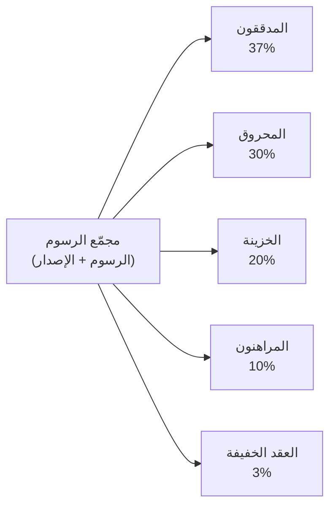

# اقتصاديات الرمز

يتمحور النموذج الاقتصادي لـ QoreChain حول رمز **QOR** الأصلي ويتبع **مسار معروض محدودًا ومسقوفًا**: معروض تأسيسي ثابت، وإصدار لمكافآت الـ staking يُسَكّ تحت سقف تراكمي صارم، ومحرك حرق متعدد القنوات يزيل الرموز نهائيًا. تصف هذه الصفحة كيف تعمل آليات المعروض والإصدار والحرق وتقسيم الرسوم، باستخدام أرقام مقروءة من السلسلة الحية.

---

## أساسيات الرمز

| الخاصية              | القيمة                                                    |
| --------------------- | -------------------------------------------------------- |
| **الرمز المعروض**     | QOR                                                      |
| **الفئة الأساسية** | uqor                                                     |
| **دقة الكسور العشرية** | 10^6 (1 QOR = 1,000,000 uqor)                            |
| **المعروض**      | التأسيسي 4,420,000,000 QOR؛ انظر [نموذج المعروض والإصدار](#supply-and-emission) |
| **معرّف السلسلة**          | `qorechain-vladi` (الشبكة الرئيسية، معرّف سلسلة EVM 9801)          |
| **بادئة Bech32**     | `qor` (الحسابات: `qor1...`، المدققون: `qorvaloper...`) |

:::note
تصف الأرقام في هذه الصفحة **الشبكة الرئيسية** (`qorechain-vladi`، معرّف سلسلة EVM **9801**)، الحيّة منذ 29 يونيو 2026 على الإصدار **v3.2.1**. وتشترك شبكة الاختبار **`qorechain-diana`** (معرّف سلسلة EVM **9800**) في معاملات الوحدات نفسها؛ لكن تاريخ المعروض والإصدار فيها يختلف (فمعروض شبكة الاختبار أعلى بكثير من معروض الشبكة الرئيسية، وإصدارها تجاوز السقف بالفعل)، لذا استخدم أرقام الشبكة الرئيسية.
:::

---

## نموذج المعروض والإصدار {#supply-and-emission}

تمتلك QoreChain **مسار معروض محدودًا ومسقوفًا**. كان المعروض التأسيسي **4,420,000,000 QOR** (كان المخطط 4,500,000,000 QOR؛ وتم حرق 80,000,000 QOR، أي 1.78%، عند حدث توليد الرمز قبل التكوين الأولي). وبعد التكوين الأولي لا يغيّر المعروض سوى أمرين:

* **الإصدار** — تسُكّ وحدة `x/inflation` مبلغًا ثابتًا في كل حقبة، تحت **سقف تراكمي صارم قدره 114,285,714 QOR**. وتدخل الرموز المسكوكة إلى مجمّع الرسوم وتمر بتقسيم الرسوم نفسه الذي تمر به رسوم المعاملات (انظر [توزيع الرسوم](#fee-distribution)).
* **الحرق** — تزيل وحدة `x/burn` نهائيًا حصة الحرق من كل ما في مجمّع الرسوم.

### الإصدار {#staking-reward-schedule}

| المعامل | القيمة |
| --- | --- |
| وضع الإصدار | `fixed` (منذ v3.1.94، الارتفاع 2,122,074 — 26 أغسطس 2026) |
| الإصدار لكل حقبة | 16,239 QOR |
| طول الحقبة | 43,200 كتلة (نحو 38.6 ساعة بزمن الكتلة الحالي ≈3.2 ثانية) |
| السقف التراكمي (`max_total_emission`) | 114,285,714 QOR |
| المسكوك حتى الآن (14 أكتوبر 2026، الحقبة 81) | 105,200,179 QOR (92.05% من السقف) |
| المتبقي تحت السقف | 9,085,535 QOR (نحو 559 حقبة بواقع 16,239 QOR لكل حقبة) |

بمجرد بلوغ السقف تتوقف الوحدة عن السك نهائيًا؛ وبعد ذلك تأتي المكافآت من رسوم المعاملات وحدها. وقد حدّد السقف اقتراح الحوكمة رقم 4 (الذي أُقرّ بتصويت كامل الحصة المرهونة لصالحه)، وحلّ محل الجدول المتناقص الأصلي الذي كان مُعايَرًا لشبكة ناضجة ومرهونة بالكامل، وكان يدفع بأسرع بكثير من المقصود قياسًا بالحصة المرهونة فعليًا. ولا تزال قيم الجدول (17.5%، 11%، 7%، 7%، 2% للسنوات 1–5) مخزّنة في معاملات الوحدة، لكنها غير مستخدمة في وضع `fixed`.

لا تتيح QoreChain رقمًا حيًّا لعائد الـ staking؛ لذا تعامل مع أي نسبة مئوية مذكورة على أنها غير موثَّقة. ويمكن قراءة الأرقام الحالية من حالة السلسلة: المعروض عند `GET /cosmos/bank/v1beta1/supply/by_denom?denom=uqor` وإجماليات الحرق عند `GET /qorechain/burn/v1/stats`.

---

## x/burn — محرك الحرق متعدد القنوات

تُعرّف وحدة `x/burn` **12 مصدرًا للحرق**. كل رمز يُحرق يُزال نهائيًا من المعروض. وعلى الشبكة الرئيسية لم تُسجَّل حتى الآن عمليات حرق إلا في `gas_fee` (31,560,093 QOR حتى 14 أكتوبر 2026)؛ أما البقية فهي معرَّفة لكنها لم تسجّل أي حرق.

### قنوات الحرق

| # | القناة            | المصدر                     | الوصف                                   |
| -- | ------------------ | -------------------------- | --------------------------------------------- |
| 1  | `gas_fee`          | رسوم المعاملات           | يُحرق 30% من إجمالي رسوم الغاز                |
| 2  | `contract_create`  | نشر العقود الذكية  | رسم ثابت قدره 100 QOR يُحرق لكل عملية إنشاء عقد |
| 3  | `ai_service`       | رسوم استخدام وحدة الذكاء الاصطناعي       | يُحرق 50% من رسوم خدمات الذكاء الاصطناعي                 |
| 4  | `bridge_fee`       | رسوم الجسر عبر السلاسل    | يُحرق 100% من رسوم الجسر                    |
| 5  | `treasury_buyback` | عمليات الخزينة        | إعادة شراء وحرق دورية من الخزينة       |
| 6  | `failed_tx`        | غاز المعاملات الفاشلة     | يُحرق 10% من غاز المعاملات الفاشلة (تطبّقه السلسلة منذ v3.2.2؛ على شبكة الاختبار فقط حتى الآن)    |
| 7  | `xqore_penalty`    | غرامات الخروج المبكر من xQORE | تُوجَّه مبالغ الغرامة عبر الحرق |
| 8  | `auto_buyback`     | برنامج إعادة الشراء التلقائي  | حرق تلقائي على مستوى البروتوكول |
| 9  | `tge`              | حدث توليد الرمز     | تم حرق 80,000,000 QOR الخاص بـ TGE قبل التكوين الأولي (المعروض التأسيسي هو 4,420,000,000 QOR)؛ هذه القناة محجوزة وتسجّل 0       |
| 10 | `rollup_create`    | نشر الـ rollup           | يُحرق 1% من رهن إنشاء الـ rollup             |
| 11 | `milestone`        | معالم عدد المعاملات | عمليات حرق مجدولة عند أعداد تراكمية ثابتة من المعاملات (لم يتم تفعيل أي منها بعد) |
| 12 | `amm`              | AMM                        | محجوزة لرسوم بروتوكول AMM (لم يُسجَّل أي منها) |

القنوات `contract_create` و`ai_service` و`bridge_fee` و`auto_buyback` غير نشطة اليوم: رفع CosmWasm مغلق، ورسوم خدمات الذكاء الاصطناعي والجسر غير مفعّلة.

### توزيع الرسوم {#fee-distribution}

يُقسَّم كل ما في مجمّع الرسوم على خمس جهات، كما هو موضح أدناه. ويحتوي مجمّع الرسوم على رسوم المعاملات وعلى إصدار الحقبة الذي تسكّه `x/inflation` معًا. وهذه الحصص مفروضة على مستوى السلسلة وتساوي دائمًا 100% بالمجموع.

الحصص هي:

| الجهة المستفيدة       | الحصة | الوصف                                                          |
| --------------- | ----- | ---------------------------------------------------------------------- |
| **المدققون**  | 37%   | تُوزَّع على مجموعة المدققين النشطين تناسبيًا مع الرهن        |
| **الحرق**      | 30%   | تُزال نهائيًا من المعروض عبر قناة الحرق `gas_fee`       |
| **الخزينة**    | 20%   | تُخصَّص لخزينة المجتمع لإنفاق موجّه بقرار الحوكمة |
| **المراهنون**     | 10%   | تُوزَّع على جميع مراهني QOR تناسبيًا مع التفويض        |
| **العقد الخفيفة** | 3%    | تُوزَّع على العقد الخفيفة مقابل تقديم بيانات الشبكة                  |

هذه الحصص مفروضة على مستوى السلسلة ويجب أن تساوي دائمًا 100% بالمجموع.

:::note ما الذي يمرّ فعليًا عبر التقسيم
ينطبق التقسيم على كل ما في مجمّع الرسوم، الذي يحتوي على رسوم المعاملات وعلى إصدار الحقبة الذي تسكّه `x/inflation` معًا. وعمليًا فإن معظمه اليوم تقريبًا إصدار: فمن أصل 105,200,179 QOR مسكوكة، تم حرق 31,560,093 QOR (30.0%)، ويقبع 3,156,009 QOR (3.0%) في احتياطي العقد الخفيفة. وحتى الترقية v3.2.0 (25 سبتمبر 2026، الارتفاع 2,981,742) كانت حصة المراهنين البالغة 10% تُنقل إلى رصيد وحدة التوزيع دون أن تغطي أي مطالبة، فكان المراهنون والمدققون يتلقون معًا 37%، لا 47%؛ ومنذ ذلك الارتفاع تُدفع حصة المراهنين كمكافأة staking عادية، أما المبلغ العالق بالفعل (6,693,045.92 QOR) فقد سُجّل ولا يمكن نقله إلا بتصويت حوكمة — انظر [حصة المراهنين العالقة واحتياطي العقد الخفيفة](#stranded-and-reserve).
:::

### معاملات الحرق

| المعامل              | القيمة الافتراضية                    | الوصف                              |
| ---------------------- | -------------------------- | ---------------------------------------- |
| `gas_burn_rate`        | 0.30                       | نسبة رسوم الغاز المحروقة (30%)        |
| `contract_create_fee`  | 100,000,000 uqor (100 QOR) | رسم حرق ثابت لإنشاء العقود      |
| `ai_service_burn_rate` | 0.50                       | نسبة رسوم خدمات الذكاء الاصطناعي المحروقة (50%) |
| `bridge_burn_rate`     | 1.00                       | نسبة رسوم الجسر المحروقة (100%)    |
| `failed_tx_burn_rate`  | 0.10                       | نسبة غاز المعاملات الفاشلة المحروقة (10%)   |
| `validator_share`      | 0.37                       | حصة مجمّع الرسوم للمدققين |
| `treasury_share`       | 0.20                       | الحصة المخصصة للخزينة |
| `staker_share`         | 0.10                       | الحصة المخصصة للمراهنين |
| `light_node_share`     | 0.03                       | الحصة المخصصة للعقد الخفيفة |
| `enabled`              | true                       | مفتاح تفعيل الوحدة |

يُسجَّل كل حدث حرق على السلسلة مع مصدره وقيمته وارتفاع الكتلة (block height) وتجزئة المعاملة المرتبطة به (transaction hash). ويمكن الاستعلام عن الإحصاءات الإجمالية لكل قناة وإجمالًا.

---

## حصة المراهنين العالقة واحتياطي العقد الخفيفة {#stranded-and-reserve}

تراكم مبلغان على الشبكة الرئيسية قبل الترقية v3.2.0 (25 سبتمبر 2026، الارتفاع 2,981,742) ويُحتفظ بهما الآن **مسجَّلين، خارج أي توزيع**. ولا يمكن نقل أيٍّ منهما إلا بتصويت حوكمة.

| السجل | المبلغ على الشبكة الرئيسية | الاستعلام | رسالة الحوكمة |
| --- | --- | --- | --- |
| **حصة المراهنين العالقة** — حصة المراهنين البالغة 10% التي أُودعت حيث لا تغطي أي مطالبة بمكافآت staking | 6,693,045.921330 QOR مسجّلة، 0 مُفرَج عنها | `GET /qorechain/burn/v1/stranded_rewards` | `MsgReleaseStrandedRewards` (سلطة الحوكمة؛ وجهة مسمّاة؛ لا يمكن أن يتجاوز السجل) |
| **احتياطي العقد الخفيفة** — حصة العقد الخفيفة البالغة 3% التي تراكمت بينما لم تكن أي عقدة خفيفة مؤهلة | 3,156,009.326407 QOR محجوزة، 0 مستحقة | `GET /qorechain/lightnode/v1/reward_pool` | `MsgReleaseLightNodeReserve` (سلطة الحوكمة) |

منذ ارتفاع الترقية تُدفع حصة المراهنين كمكافأة staking عادية، وتُدفع مكافآت العقد الخفيفة فقط مما تراكم منذ آخر دورة توزيع، مع حدّ أقصى لكل عقدة ولكل كتلة (`max_reward_per_block_per_node`، ‏1,713 uqor كما قُرئت في 14 أكتوبر 2026). تسجيل العقد الخفيفة مغلق حاليًا، فلا توجد عقدة مؤهلة وتستمر حصة الـ 3% في التراكم في الاحتياطي. ويُرفض أي إفراج يسبق لقطة الترقية، أو يتجاوز المبلغ المسجَّل، أو يتجه إلى وجهة غير صالحة.

---

## x/xqore — الرهن المقفل والحوكمة المضخَّمة {#x-xqore}

:::warning غير مفعّلة بعد
محاسبة وحدة xQORE موجودة ومفعّلة في التكوين الأولي، لكنها **غير قابلة للاستخدام بعد** على الشبكة الرئيسية (`qorechain-vladi`) أو شبكة الاختبار (`qorechain-diana`). فلا توجد في العقدة نقطة دخول لها سواء للمعاملات أو الاستعلامات أو CLI أو RPC، ولذلك لا تعمل `tx xqore lock` / `unlock` و`query xqore ...` ومسارات REST الخاصة بـ xQORE و`qor_getXQOREPosition`، ولا يملك أحد xQORE. وهي مخططة لإصدار مستقبلي للسلسلة، سيغيّر أيضًا طريقة إعادة توزيع غرامات الخروج بحيث يبقى فك القفل رخيصًا مهما بلغ عدد الحاملين. وسيُذكر الإصدار هنا عند صدوره.
:::

تُقدّم وحدة `x/xqore` عملة **xQORE**، وهي مشتق رهن مقفل غير قابل للتحويل. يقفل المستخدمون QOR لسك xQORE بنسبة 1:1. ويحصل حاملو xQORE على قوة تصويت حوكمة مضخَّمة وحصة من غرامات الخروج المعاد توزيعها.

### آلية القفل

* **القفل**: إرسال QOR إلى وحدة xQORE لسك xQORE بنسبة 1:1.
* **وزن الحوكمة**: يحصل حاملو xQORE على **ضعف قوة التصويت في الحوكمة** مقارنة بمراهني QOR العاديين.
* **غير قابل للتحويل**: لا يمكن إرسال xQORE بين الحسابات. فهو مرتبط بعنوان القفل.

### جدول غرامة الخروج

يترتب على السحب المبكر من xQORE غرامة تتناقص مع مدة القفل:

| مدة القفل  | معدّل الغرامة | الوصف                                |
| -------------- | ------------ | ------------------------------------------ |
| أقل من 30 يومًا   | **50%**      | يُصادَر نصف QOR المقفل            |
| 30 -- 90 يومًا  | **35%**      | غرامة كبيرة على الأقفال قصيرة الأجل   |
| 90 -- 180 يومًا | **15%**      | غرامة مخفَّضة للالتزام متوسط الأجل |
| أكثر من 180 يومًا     | **0%**       | سحب كامل بدون غرامة            |

### إعادة التوزيع بنموذج PvP Rebase

الغرامات المحصَّلة من الخروج المبكر لا تُتلف ببساطة. بل تتبع نموذج إعادة توازن PvP (لاعب ضد لاعب):

1. في إعدادات التكوين الأولي يُحرق **0%** من قيم الغرامة (`penalty_burn_rate = 0`؛ وتوجد قناة الحرق `xqore_penalty` في حال غيّرت الحوكمة ذلك).
2. تُعاد توزيع **100%** تناسبيًا على جميع حاملي xQORE المتبقين.

يخلق هذا ديناميكية موجبة المحصلة لصالح الحاملين على المدى الطويل: فكل خروج مبكر يزيد القيمة الفعلية لمراكز xQORE المتبقية. وتحدث عمليات إعادة التوازن كل **100 كتلة**.

### معاملات xQORE

| المعامل               | القيمة الافتراضية                | الوصف                               |
| ----------------------- | ---------------------- | ----------------------------------------- |
| `governance_multiplier` | 2.0                    | مضاعِف قوة التصويت لحاملي xQORE |
| `min_lock_amount`       | 1,000,000 uqor (1 QOR) | الحد الأدنى من QOR المطلوب للقفل              |
| `penalty_burn_rate`     | 0.00                   | نسبة غرامات الخروج المحروقة (الافتراضي في التكوين الأولي: تُعاد توزيع جميع الغرامات)   |
| `rebase_interval`       | 100 كتلة             | عدد الكتل بين أحداث إعادة توازن PvP           |
| `enabled`               | true                   | مفتاح تفعيل الوحدة                    |

---

## x/inflation — الإصدار المسقوف

تسُكّ وحدة `x/inflation` الإصدار لكل حقبة (16,239 QOR، ‏`emission_mode = fixed`) وترسله إلى مجمّع الرسوم، إلى أن يُبلَغ السقف التراكمي البالغ 114,285,714 QOR. وتمر تغييرات المعاملات عبر اقتراح معاملات حوكمة عادي (`MsgUpdateParams`، أُضيف في v3.1.94).

### آليات الحقبة (Epoch)

* **طول الحقبة**: 43,200 كتلة (نحو 38.6 ساعة بواقع ≈3.2 ثانية لكل كتلة).
* عند كل حدّ حقبة تسُكّ الوحدة إصدار الحقبة (أو المتبقي حتى السقف)، وتحدّث سجل الحقبة، وتتوقف عن السك بمجرد أن يبلغ `total_minted` السقف.

### المعاملات

| المعامل | القيمة (الشبكة الرئيسية) | الوصف |
| --- | --- | --- |
| `emission_mode` | `fixed` | `schedule` (قديم، بمعدلات مبنية على السنة) أو `fixed` |
| `fixed_epoch_emission` | 16,239,000,000 uqor | المسكوك لكل حقبة في الوضع الثابت |
| `max_total_emission` | 114,285,714,000,000 uqor | السقف التراكمي الصارم |
| `epoch_length` | 43,200 كتلة | عدد الكتل لكل حقبة إصدار |
| `schedule` | 17.5%، 11%، 7%، 7%، 2% (السنوات 1–5) | جدول قديم، غير مستخدم في الوضع الثابت |
| `enabled` | `true` | مفتاح تفعيل الوحدة |

على الشبكة الرئيسية لا تُعرض هذه القيم عبر مسار REST؛ ويمكن قراءتها من حالة السلسلة عبر واجهة المخزن الخام في RPC ‏`abci_query` (المخزن `inflation`، والمفتاحان `inflation/params` و`inflation/epoch`). وتوجد خدمة استعلام مخصصة لها على شبكة الاختبار فقط (v3.2.2).

---

## الحرق مقابل الإصدار

الإصدار مسقوف (114,285,714 QOR) وتنطبق حصة الحرق على كل ما يدخل مجمّع الرسوم، بما في ذلك الإصدار. وحتى اليوم تم حرق 31,560,093 QOR مقابل 105,200,179 QOR مسكوكة، ولذلك فإن المعروض الآن أعلى من مستواه التأسيسي. وبعد بلوغ السقف لا يمكن للمعروض إلا أن ينخفض، بمقدار ما يُحرق.

---

## ذات صلة

* [معاملات السلسلة](/appendix/chain-parameters) — القيم الافتراضية الاقتصادية ومعاملات الإجماع المرجعية.
* [الرهن والتفويض](/user-guide/staking-and-delegation) — فوِّض QOR واحصل على مكافآت الـ staking.
* [رهن xQORE](/user-guide/xqore-staking) — آلية رهن إعادة التوازن PvP.
* [مكافآت العقد الخفيفة](/light-node/rewards-and-monitoring) — حصة مكافآت العقد الخفيفة.
