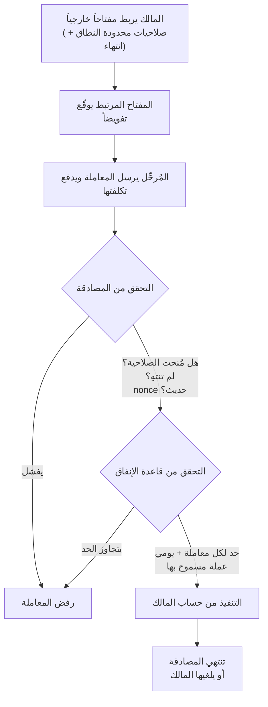

# تجريد الحسابات

توفر QoreChain **تجريد حسابات على مستوى البروتوكول** عبر الوحدة `x/abstractaccount`. تسجّل الوحدة حسابات مجرَّدة مع قواعد إنفاق، وتتيح لمالك الحساب ربط مفاتيح خارجية (**مصادقات**) يمكنها الإنفاق من الحساب ضمن حدود الصلاحيات وحدود الإنفاق، دون الحاجة إلى بنية تحتية خارجية من العقود الذكية.

:::danger غير مفعّلة على الشبكة الرئيسية ولا على شبكة الاختبار
وحدة الحسابات المجرَّدة **متوقفة** حالياً على الشبكتين: يُبلغ الأمر `qorechaind query abstractaccount config` (وكذلك `GET /qorechain/abstractaccount/v1/config`) عن `enabled: false` على `qorechain-vladi` و`qorechain-diana`. منذ إصدار السلسلة v3.2.0 يُفرض هذا العَلَم على كل مسار: ترفض السلسلة إنشاء الحسابات وتسجيل المصادقات ومساري التنفيذ كليهما (`MsgExecuteEVM` و`MsgExecuteCosmos`) برسالة `abstract accounts are disabled on this chain`. لا يمكن لأي معاملة تشغيل الوحدة، ولم تُدرَج أي معاملة حساب مجرَّد على الشبكة الرئيسية من قبل. كل ما يلي يصف واجهات الوحدة للرجوع إليها فقط. لا تبنِ تدفق مفتاح مرتبط أو إنفاق مفوَّض على الشبكتين الحيتين إلى أن تُفعَّل الوحدة، وتحقق من العَلَم أولاً.
:::

:::note
تستخدم الأوامر أدناه الشبكة الرئيسية **`qorechain-vladi`** (العاملة منذ 29 يونيو 2026)، التي تشغّل إصدار العقدة **v3.2.1** (قواعد الإجماع من v3.2.0). استبدل `--chain-id qorechain-diana` لاستخدام شبكة الاختبار، التي تشغّل v3.2.2.
:::

:::caution كل معاملة على مسار Cosmos تحتاج إلى التوقيع المشترك الهجين لما بعد الكم
تعرض أمثلة `qorechaind tx` في هذه الصفحة رايات الرسوم فقط. على الشبكتين الحيتين يجب أن تحمل كل معاملة على مسار Cosmos أيضاً التوقيع المشترك الهجين ML-DSA-87، لذا ابنِ المعاملة باستخدام `--generate-only` ووقّعها بالأمر `qorechaind tx pqc cosign` (أو استخدم QoreX أو حزمة SDK اللذين يقومان بذلك نيابةً عنك). لا يستطيع إصدار المجتمع من `qorechaind` إنتاج ذلك التوقيع؛ استخدم الملف التنفيذي للإصدار من [بيان التنزيل](/developer-guide/running-a-node#fetch-the-manifest). الحد الأدنى للرسوم هو **0.1 uqor لكل وحدة غاز**، لذا يتطلب `--gas 400000` ما لا يقل عن `--fees 40000uqor`. راجع [التوقيع ما بعد الكمّي](/developer-guide/post-quantum-signing).
:::

## نظرة عامة

تُدار حسابات البلوكتشين التقليدية بمفتاح خاص واحد. يفصل تجريد الحسابات مفهوم «من يمكنه اعتماد المعاملة» عن مفتاح تشفيري واحد. توفر الوحدة `x/abstractaccount`:

* **حسابات مجرَّدة** مع نوع حساب ومالك مسجَّلين
* **قواعد إنفاق** (حدود لكل معاملة ويومية، والعملات المسموح بها) تقيّد ما يمكن للمفاتيح المرتبطة إنفاقه
* **المصادقات**: مفاتيح خارجية (مفتاح ed25519 من Phantom أو عنوان secp256k1 من MetaMask) يربطها المالك بصلاحيات محدودة النطاق وتاريخ انتهاء، ويمكنه إلغاؤها في أي وقت

*تدفق مفتاح مرتبط (مصادقة): يوقّع المفتاح المرتبط تفويضاً، ويرسله مُرحِّل، وتتحقق الوحدة من الصلاحيات والانتهاء وقواعد الإنفاق، ثم تنفّذ من حساب المالك.*



## أنواع الحسابات

يسجّل `create` واحداً من ثلاثة أنواع حسابات. يُخزَّن النوع في الحساب وهو جزء من طريقة اشتقاق عنوانه؛ وليس لدى الوحدة معاملات خاصة بها للتوقيع المتعدد أو مفاتيح الجلسات أو الاسترداد (خدمة المعاملات هي `create` و`update-rules` و`register-authenticator` و`revoke-authenticator` و`execute-cosmos` و`execute-evm`).

| النوع              | الاستخدام المقصود                    |
| ----------------- | ------------------------------- |
| `multisig`        | خزائن DAO والمحافظ المشتركة  |
| `social_recovery` | محافظ المستهلكين وتهيئة المستخدمين الجدد    |
| `session_based`   | جلسات التطبيقات اللامركزية والمحافظ المحمولة   |

## إنشاء حساب مجرَّد

يأخذ `create` نوع الحساب كوسيط موضعي (`multisig` أو `social_recovery` أو `session_based`):

```bash
qorechaind tx abstractaccount create session_based \
  --from mykey \
  --gas 400000 --fees 40000uqor
```

ليس لدى الأمر رايات للموقِّعين أو العتبات أو الأوصياء.

## المصادقات (المفاتيح المرتبطة)

آلية المفاتيح المفوَّضة في الوحدة هي **المصادقة**، الموصوفة في [مصادقات المحافظ المرتبطة](#authenticators) أدناه: يربط المالك مفتاحاً خارجياً (ed25519 أو secp256k1) بمجموعة صلاحيات وتاريخ انتهاء، ويلغيه في أي وقت:

```bash
qorechaind tx abstractaccount register-authenticator <account-address> <scheme> <pubkey-base64> <permissions-csv> <expiry-unix> <label> \
  --from mykey --gas 400000 --fees 40000uqor
qorechaind tx abstractaccount revoke-authenticator <account-address> <scheme> <pubkey-base64> \
  --from mykey --gas 400000 --fees 40000uqor
```

`scheme` هو `ed25519` (مثل Phantom) أو `secp256k1` (مثل MetaMask). لا يوجد أمر `grant-session` ولا `revoke-session` ولا `query abstractaccount sessions`.

## قواعد الإنفاق

تضيف قواعد الإنفاق ضوابط مالية إلى الحسابات المجرَّدة:

| القاعدة             | الوصف                                           |
| ---------------- | ----------------------------------------------------- |
| `daily_limit`    | الحد الأقصى للإنفاق الإجمالي لكل يوم تقويمي بتوقيت UTC              |
| `per_tx_limit`   | الحد الأقصى للإنفاق لكل عملية تنفيذ مصرَّح بها     |
| `allowed_denoms` | تقييد العملات (denominations) التي يمكن إنفاقها       |

### تحديد قواعد الإنفاق

يستبدل `update-rules` قواعد الحساب بمصفوفة JSON من كائنات `SpendingRule` (JSON مضمَّن، وليس ملفاً ولا رايات):

```bash
qorechaind tx abstractaccount update-rules <account-address> \
  '[{"id":"daily","enabled":true,"daily_limit":1000000000,"per_tx_limit":100000000,"allowed_denoms":["uqor"]}]' \
  --from mykey --gas 400000 --fees 40000uqor
```

الحدود بالوحدة الأساسية (`uqor`) وتُحتسب لكل عملية تنفيذ مصرَّح بها؛ ويقيّد الحد اليومي الإجمالي لكل يوم تقويمي بتوقيت UTC. تستبدل القواعد المخزَّنة بالكامل، لذا يُحذف أي حقل تتركه.

### الاستعلام عن القواعد الحالية

يتضمن سجل الحساب قواعده وعدد المفاتيح المرتبطة:

```bash
qorechaind query abstractaccount account <account-address>
```

:::caution القاعدة تقيّد المفتاح فقط عندما توجد
تحسم السلسلة الحد بهذا الترتيب: قاعدة المصادقة نفسها إن كانت معيَّنة و`enabled`؛ وإلا فأول قاعدة `enabled` على الحساب؛ وإلا **فلا يوجد حد**. القاعدة المخزَّنة بـ `enabled: false` تعني عدم وجود حد، وليست حداً يساوي صفراً. لا تحمل `MsgRegisterAuthenticator` أي قاعدة، لذا فإن المفتاح المرتبط بتلك الرسالة وحدها لا يقيّده إلا قاعدة على مستوى الحساب. عيّن قاعدة عن قصد باستخدام `update-rules`، وسجّل فقط الصلاحيات التي يحتاجها المفتاح. الحد يقيّد الضرر الذي قد يسببه مفتاح مرتبط؛ لكنه لا يغني عن إلغاء المفتاح.
:::

## مصادقات المحافظ المرتبطة — إنفاق مفوَّض {#authenticators}

أُدخل تصميم المصادقات في إصدار السلسلة **v3.1.85** (بالبناء على نموذج الصلاحيات في v3.1.84). وهو **غير قابل للاستخدام على الشبكتين الحيتين ما دامت الوحدة معطّلة** (راجع مربع الحالة في أعلى هذه الصفحة). يمكن لـ**مفتاح محفظة خارجي مرتبط** — مفتاح Phantom (ed25519) أو حساب MetaMask (secp256k1) — أن **ينفق من الحساب الأساسي (canonical) المحمي بتوقيع ما بعد الكم** بشروط الحد الأدنى من الامتيازات، ومحدودة الإنفاق، وقابلة للإلغاء. لا ينتج المفتاح الخارجي أبداً توقيع ML-DSA؛ بل يقوم **مُرحِّل (relayer)** بإرسال ظرف المعاملة ودفع تكلفته (يفي توقيع PQC الهجين الخاص بالمُرحِّل بمتطلبات التوقيع الخاصة بالسلسلة)، بينما يكون توقيع المصادقة عبر **بايتات توقيع مفصولة النطاق ومرتبطة بمنع إعادة التشغيل** هو التفويض.

### تسجيل مصادقة {#register-authenticator}

يسجّل مالك الحساب المفتاح الخارجي باستخدام `MsgRegisterAuthenticator` (معاملة عادية بالمفتاح الجذر)، مع تحديد مخطط وصلاحيات وتاريخ انتهاء وحدود إنفاق اختيارية:

```js
import { registerEthAuthenticatorMsg } from "@qorechain/wallet-adapter";

// Link a MetaMask account by its 20-byte address (EIP-191 verification):
const msg = registerEthAuthenticatorMsg({
  owner: "qor1owner...",              // the canonical account (signs this message)
  ethAddress: "0xAbC...123",          // the MetaMask address to link
  permissions: ["evm"],               // least privilege — see the taxonomy below
  expiryUnix: Math.floor(Date.now() / 1000) + 30 * 24 * 3600, // absolute Unix seconds, ≤ 30 days recommended
  label: "metamask",
});
// Limits are a separate message (MsgUpdateSpendingRules), see "Spending Rules" above.
// Sign & broadcast this msg with the OWNER's normal hybrid-PQC signer.
```

يُسجَّل مفتاح Phantom بالطريقة نفسها بالمخطط `ed25519` والمفتاح العام لـ Phantom (`register-authenticator` في سطر الأوامر). يتم الإلغاء فوراً عبر `MsgRevokeAuthenticator`.

### تصنيف الصلاحيات {#permission-taxonomy}

تتحكم إحدى عشرة صلاحية معيارية فيما يُسمح للمصادقة المسجَّلة بفعله. الخريطة **مُغلقة افتراضياً (fail-closed)**: نوع الرسالة الذي لا يوجد له تعيين يُرفض.

| الصلاحية | تمنح |
| --- | --- |
| `send` | تحويلات البنك على المسار الأصلي |
| `delegate` / `withdraw` / `vote` | التخزين (Staking)، سحب المكافآت، الحوكمة |
| `evm` / `wasm` / `svm` | التنفيذ على مسار الآلة الافتراضية المقابلة |
| `amm` / `ibc` / `deploy` | عمليات AMM، تحويلات IBC، نشر العقود |
| `all` | أي رسالة *قابلة للتفويض* |

**رسائل إدارة المفاتيح غير قابلة للتفويض أبداً** — `MsgRegisterAuthenticator` و`MsgRevokeAuthenticator` وتسجيل/ترحيل مفاتيح PQC و`MsgRotatePQCKey` تتطلب دائماً المفتاح الجذر، لذا لا يمكن لمفتاح مرتبط أن يرفع امتيازاته بنفسه.

اقرأ التصنيف الحي (مع `schema_version` لاكتشاف الانحراف) بدلاً من ترميزه بشكل ثابت:

```bash
curl -s https://api.qore.host/qorechain/abstractaccount/v1/permission_schema | jq
# or: qorechaind query abstractaccount permission-schema
```

### الإنفاق عبر مفتاح مرتبط {#execute-messages}

رسالتان تحملان الإجراءات المخوَّلة عبر المصادقة. في كلتيهما، المُرحِّل هو موقّع المعاملة ودافع الرسوم؛ ويسافر توقيع المصادقة داخل الرسالة.

**`MsgExecuteEVM`** — استدعاء EVM أو تحويل **من عنوان `0x…` للحساب الأساسي**. توقّع المصادقة `sha256("qorechain-evm-auth-v1" ‖ chainId ‖ account ‖ pubkey ‖ to ‖ value ‖ data ‖ nonce)` (جميع الحقول مسبوقة بالطول). الحماية من إعادة التشغيل هي nonce الـ EVM الخاص بالحساب نفسه.

**`MsgExecuteCosmos`** — إرسال بنكي على المسار الأصلي من الحساب الأساسي. توقّع المصادقة `sha256("qorechain-cosmos-auth-v1" ‖ chainId ‖ account ‖ pubkey ‖ to ‖ amount ‖ nonce)`. الحماية من إعادة التشغيل هي **تسلسل لكل مصادقة** تحتفظ به الوحدة (الإرسال البنكي لا يزيد nonce الحساب). تُرفض عمليات الإرسال إلى النفس.

:::caution قواعد nonce
* `MsgExecuteEVM.nonce` = nonce الـ EVM **الحالي** للحساب (`eth_getTransactionCount(account0x, "latest")`). في بيئة الإنتاج يكون المُرحِّل حساباً *مختلفاً*، لذا **لا** تُضِف +1. توقيع nonce قديم يُرجع الرمز `11`.
* `MsgExecuteCosmos.nonce` = التسلسل الخاص بكل مصادقة (استعلم عن حالة مصادقات الحساب)، **وليس** تسلسل Cosmos الخاص بالحساب.
:::

**مثال Phantom** (المتصفح: Phantom يوقّع، والخادم الخلفي لديك يرحّل):

```js
import { buildPhantomExecuteCosmos } from "@qorechain/wallet-adapter";

// In the dApp: Phantom signs the digest with ed25519 signMessage.
const msg = await buildPhantomExecuteCosmos({
  wallet: window.solana,              // Phantom: { publicKey, signMessage }
  relayer: "qor1relayer...",          // submits the tx and pays the fee (a different account)
  chainId: "qorechain-vladi",
  account: "qor1owner...",            // canonical account being spent from
  to: "qor1recipient...",
  amount: "900000uqor",               // single-coin string
  nonce: authSequence,                // per-authenticator sequence
});
// Send `msg` to your relayer; the relayer wraps it in a tx it signs
// (hybrid PQC) and broadcasts. The transfer moves the OWNER's funds.
```

**مثال MetaMask** (`personal_sign` وفق EIP-191 من العنوان المرتبط ذي 20 بايت):

```js
import { buildMetaMaskExecuteEvm } from "@qorechain/wallet-adapter";

const msg = await buildMetaMaskExecuteEvm({
  provider: window.ethereum,          // MetaMask (EIP-1193)
  address: ethAddress,                // the linked 20-byte address
  relayer: "qor1relayer...",
  chainId: "qorechain-vladi",
  account: "qor1owner...",
  to: "0xRecipient...",
  value: (10n ** 16n).toString(),     // 0.01 QOR in wei (18-decimal EVM view), as a decimal string
  gasLimit: 100000,
  nonce: currentEvmNonce,             // eth_getTransactionCount(owner0x, "latest")
});
// Relay as above. The chain verifies the signature via EIP-191 + ecrecover
// against the registered 20-byte address.
```

توجد أدوات البناء نفسها في [حزمة تطوير QoreChain](/sdk/guides/authenticators) لجميع اللغات الخمس، إضافة إلى مكافئات سطر الأوامر:

```bash
# Generate an ed25519 authenticator key: the seed goes to a new 0600 file, only the public key is printed
qorechaind query abstractaccount auth-keygen --out authenticator.seed

# Sign the exact bytes the chain verifies (seed from --seed-file, "-" for stdin, QORE_AUTH_SEED, or a prompt)
qorechaind query abstractaccount auth-sign-cosmos <chain-id> <account> <to> <amount> <nonce> --seed-file authenticator.seed
qorechaind query abstractaccount auth-sign-evm <chain-id> <account> <to-0xhex> <value-wei> <data-hex> <nonce> --seed-file authenticator.seed

# Relay a pre-signed authorization (the relayer's --from key pays; cosign the envelope with `tx pqc cosign`)
qorechaind tx abstractaccount execute-cosmos <account> <to> <amount> <scheme> <pubkey-base64> <signature-base64> <nonce> --from relayer --generate-only > tx.json
qorechaind tx abstractaccount execute-evm <account> <to-0xhex> <value-wei> <data-hex> <gas-limit> <scheme> <pubkey-base64> <signature-base64> <nonce> --from relayer --generate-only > tx.json
```

المفاتيح والتواقيع في هذه الأوامر بصيغة base64. تقرأ مساعدات `auth-sign-*` البذرة (seed) من ملف أو من الإدخال القياسي أو من البيئة بدلاً من وسيط في سطر الأوامر (إصدار العقدة v3.2.1 وما بعده)، لذلك لا تظهر في سجل الصدفة (shell history). رايات التعامل مع البذرة (`--out` و`--seed-file`) موجودة فقط في الملفات التنفيذية v3.2.1 وما بعدها.

### رموز الأخطاء {#authenticator-errors}

تُرجع إخفاقات الإنفاذ رموزاً متمايزة (نطاق الكود `abstractaccount`) لكي تعرض المحافظ الرسالة الصحيحة:

| الرمز | المعنى | تجربة المحفظة |
| --- | --- | --- |
| `5` | تجاوز حد الإنفاق (لكل معاملة أو يومي) | عرض الرصيد المسموح المتبقي |
| `6` | انتهت صلاحية المصادقة | «انتهت الصلاحية — أعد ربط محفظتك» |
| `9` | الوحدة معطّلة (الحالة الحية على الشبكتين) | «المحافظ المرتبطة غير متاحة بعد» |
| `10` | رُفضت الصلاحية (النطاق أو رسالة غير قابلة للتفويض) | عرض الصلاحية الناقصة |
| `11` | رُفضت إعادة التشغيل (nonce/تسلسل قديم) | أعد الاستعلام عن nonce ووقّع من جديد |

(نطاق الكود `pqc` الرمز `21` = فشل التحقق من التوقيع الهجين — مشكلة توقيع من جهة المُرحِّل، وليست مشكلة تفويض.)

### استعلامات REST {#abstractaccount-rest}

تُقدَّم استعلامات القراءة الخاصة بالوحدة عبر REST (منذ **v3.1.85**):

```
GET /qorechain/abstractaccount/v1/config      # {"config":{"enabled":false,...}} on both networks today
GET /qorechain/abstractaccount/v1/accounts
GET /qorechain/abstractaccount/v1/accounts/{address}
GET /qorechain/abstractaccount/v1/permission_schema
```

## الاستعلام عن الحسابات المجرَّدة

### سطر الأوامر

```bash
# Module configuration (enabled flag and limits)
qorechaind query abstractaccount config

# Get full account configuration
qorechaind query abstractaccount account <address>

# List all abstract accounts (paginated)
qorechaind query abstractaccount accounts --page-limit 10
```

على الشبكة الرئيسية قائمة الحسابات فارغة؛ وتسرد شبكة الاختبار بضعة حسابات أُنشئت قبل أن يُفرض عَلَم التفعيل على كل مسار.

### JSON-RPC

> **غير مُقدَّم بعد:** لا يقدّم أي إصدار منشور للعقدة فضاء الأسماء `qor_` في JSON-RPC، لذا يُرجع `qor_getAbstractAccount` الرمز `-32601` (الطريقة غير موجودة) على كل نقطة نهاية عامة اليوم. استخدم مسارات REST أعلاه أو سطر الأوامر. راجع [فضاء الأسماء `qor_`](/api-reference/json-rpc-qor_-namespace).

### مثال على استجابة حساب

شكل سجل الحساب المجرَّد (قيم توضيحية):

```json
{
  "address": "qor1myaccount...",
  "account_type": "session_based",
  "owner": "qor1owner...",
  "spending_rules": [
    {
      "id": "daily",
      "enabled": true,
      "daily_limit": "1000000000",
      "per_tx_limit": "100000000",
      "allowed_denoms": ["uqor"]
    }
  ]
}
```

## الاسترداد الاجتماعي

`social_recovery` هو نوع حساب، لكن الوحدة لا تملك معاملات استرداد: لا يوجد أمر `initiate-recovery` ولا `approve-recovery` ولا رسالة استرداد في خدمة معاملات الوحدة. يتم استرداد مفاتيح حساب QoreChain بإعادة اشتقاق مفتاح ما بعد الكم للحساب من عبارته الاستعادية (mnemonic) باستخدام (`tx pqc recover-key`) ثم تدويره عند الحاجة (`tx pqc rotate-key`)؛ راجع [التوقيع ما بعد الكمّي](/developer-guide/post-quantum-signing).

## التكامل مع التطبيقات اللامركزية (dApps)

عند تفعيل الوحدة، يُقصد بالتفويض عبر المفاتيح المرتبطة أن يخدم تدفقات مثل:

* المحافظ المحمولة التي تكون فيها مطالبات القياسات الحيوية المتكررة مزعجة
* تطبيقات الألعاب اللامركزية التي تحتاج إلى توقيع سريع للمعاملات ضمن حد إنفاق محدود
* مستخدمو Phantom أو MetaMask الذين ينفقون من حساب QoreChain الخاص بهم عبر مُرحِّل

يعمل الخادم الخلفي للتطبيق اللامركزي كمُرحِّل: يستقبل التفويض الموقّع من المفتاح المرتبط، ويغلّفه في معاملة يوقّعها بنفسه، ثم يبثّها. يمكن إلغاء المفتاح المرتبط أو تنتهي صلاحيته في أي وقت. إلى أن تُفعَّل الوحدة على الشبكة التي تستهدفها، استخدم التوقيع العادي عبر [QoreX أو حزمة SDK](/sdk/overview).

## الخطوات التالية

* [تشغيل مُدقِّق](/developer-guide/running-a-validator) — إعداد عقدة مُدقِّق وتشغيلها
* [تطوير EVM](/developer-guide/evm-development) — أدوات EVM والحسابات ونافذة تفويض EVM
* [التشغيل البيني عبر الأجهزة الافتراضية](/developer-guide/cross-vm-interoperability) — المراسلة عبر الأجهزة الافتراضية
