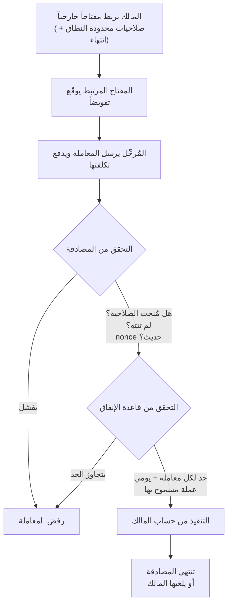

# تجريد الحسابات

توفر QoreChain **تجريد حسابات على مستوى البروتوكول** عبر الوحدة `x/abstractaccount`. تسجّل الوحدة حسابات مجرَّدة مع قواعد إنفاق، وتتيح لمالك الحساب ربط مفاتيح خارجية (**مصادقات**) يمكنها الإنفاق من الحساب ضمن حدود الصلاحيات وحدود الإنفاق، دون الحاجة إلى بنية تحتية خارجية من العقود الذكية.

:::danger غير مفعّلة على الشبكة الرئيسية؛ ومفعّلة على شبكة الاختبار
وحدة الحسابات المجرَّدة **متوقفة على الشبكة الرئيسية `qorechain-vladi`** وقت كتابة هذا النص (فُحصت في 27 أكتوبر 2026): يُبلغ الأمر `qorechaind query abstractaccount config` (وكذلك `GET /qorechain/abstractaccount/v1/config`) عن `enabled: false`. أما على **شبكة الاختبار `qorechain-diana`** فقد فُعّلت بقرار حوكمة (المقترح 18، أُقرّ في 27 أكتوبر 2026) وتُبلغ عن `enabled: true`. منذ إصدار السلسلة v3.2.0 يُفرض هذا العَلَم على كل مسار: حيثما تكون قيمته `false` ترفض السلسلة إنشاء الحسابات وتسجيل المصادقات ومساري التنفيذ كليهما (`MsgExecuteEVM` و`MsgExecuteCosmos`) برسالة `abstract accounts are disabled on this chain`. لا يمكن لأي معاملة عادية تشغيل الوحدة؛ ولا يتغير هذا الإعداد إلا بقرار حوكمة. ولم تُدرَج أي معاملة حساب مجرَّد على الشبكة الرئيسية من قبل. كل ما يلي يصف واجهات الوحدة؛ جرّبها على شبكة الاختبار، ولا تبنِ تدفق مفتاح مرتبط أو إنفاق مفوَّض للشبكة الرئيسية إلى أن تُفعَّل الوحدة هناك. وتحقق من العَلَم أولاً دائماً.
:::

:::note
تستخدم الأوامر أدناه الشبكة الرئيسية **`qorechain-vladi`** (العاملة منذ 7 يونيو 2026)، التي تشغّل إصدار العقدة **v3.2.7** (طُبّق عند الارتفاع 4,164,600 في 12 نوفمبر 2026، مقترح الحوكمة 16؛ وطُبّق v3.2.6 عند الارتفاع 4,020,000 في 4 نوفمبر 2026، المقترح 15؛ وطُبّق v3.2.5 عند الارتفاع 3,906,833 في 29 أكتوبر 2026، المقترح 14، وv3.2.4 عند الارتفاع 3,742,566 في 23 أكتوبر 2026). استبدل `--chain-id qorechain-diana` لاستخدام شبكة الاختبار، التي تشغّل v3.2.8 (منذ 12 نوفمبر 2026؛ وv3.2.4 منذ 19 أكتوبر 2026).
:::

:::caution كل معاملة على مسار Cosmos تحتاج إلى التوقيع المشترك الهجين لما بعد الكم
تعرض أمثلة `qorechaind tx` في هذه الصفحة رايات الرسوم فقط. على الشبكتين الحيتين يجب أن تحمل كل معاملة على مسار Cosmos أيضاً التوقيع المشترك الهجين ML-DSA-87، لذا ابنِ المعاملة باستخدام `--generate-only` ووقّعها بالأمر `qorechaind tx pqc cosign` (أو استخدم QoreX أو حزمة SDK اللذين يقومان بذلك نيابةً عنك). لا يستطيع إصدار المجتمع من `qorechaind` إنتاج ذلك التوقيع؛ استخدم الملف التنفيذي للإصدار من [بيان التنزيل](/developer-guide/running-a-node#fetch-the-manifest). الحد الأدنى للرسوم هو **0.1 uqor لكل وحدة غاز**، لذا يتطلب `--gas 400000` ما لا يقل عن `--fees 40000uqor`. راجع [التوقيع ما بعد الكمّي](/developer-guide/post-quantum-signing).
:::

## نظرة عامة

تُدار حسابات البلوكتشين التقليدية بمفتاح خاص واحد. يفصل تجريد الحسابات مفهوم «من يمكنه اعتماد المعاملة» عن مفتاح تشفيري واحد. توفر الوحدة `x/abstractaccount`:

* **حسابات مجرَّدة** مع نوع حساب ومالك مسجَّلين
* **قواعد إنفاق** (حدود لكل معاملة ويومية، والعملات المسموح بها) تقيّد ما يمكن للمفاتيح المرتبطة إنفاقه
* **المصادقات**: مفاتيح خارجية (مفتاح ed25519 من Phantom أو عنوان secp256k1 من MetaMask) يربطها المالك بصلاحيات محدودة النطاق وتاريخ انتهاء، ويمكنه إلغاؤها في أي وقت

*تدفق مفتاح مرتبط (مصادقة): يوقّع المفتاح المرتبط تفويضاً، ويرسله مُرحِّل، وتتحقق الوحدة من الصلاحيات والانتهاء وقواعد الإنفاق، ثم تنفّذ من حساب المالك.*



## أنواع الحسابات

يسجّل `create` واحداً من ثلاثة أنواع حسابات. يُخزَّن النوع في الحساب وهو جزء من طريقة اشتقاق عنوانه؛ وليس لدى الوحدة معاملات خاصة بها للتوقيع المتعدد أو مفاتيح الجلسات أو الاسترداد (خدمة المعاملات هي `create` و`update-rules` و`register-authenticator` و`revoke-authenticator` و`execute-cosmos` و`execute-evm`).

| النوع              | الاستخدام المقصود                    |
| ----------------- | ------------------------------- |
| `multisig`        | خزائن DAO والمحافظ المشتركة  |
| `social_recovery` | محافظ المستهلكين وتهيئة المستخدمين الجدد    |
| `session_based`   | جلسات التطبيقات اللامركزية والمحافظ المحمولة   |

## إنشاء حساب مجرَّد

يأخذ `create` نوع الحساب كوسيط موضعي (`multisig` أو `social_recovery` أو `session_based`):

```bash
qorechaind tx abstractaccount create session_based \
  --from mykey \
  --gas 400000 --fees 40000uqor
```

ليس لدى الأمر رايات للموقِّعين أو العتبات أو الأوصياء.

## المصادقات (المفاتيح المرتبطة)

آلية المفاتيح المفوَّضة في الوحدة هي **المصادقة**، الموصوفة في [مصادقات المحافظ المرتبطة](#authenticators) أدناه: يربط المالك مفتاحاً خارجياً (ed25519 أو secp256k1) بمجموعة صلاحيات وتاريخ انتهاء، ويلغيه في أي وقت:

```bash
qorechaind tx abstractaccount register-authenticator <account-address> <scheme> <pubkey-base64> <permissions-csv> <expiry-unix> <label> \
  --from mykey --gas 400000 --fees 40000uqor
qorechaind tx abstractaccount revoke-authenticator <account-address> <scheme> <pubkey-base64> \
  --from mykey --gas 400000 --fees 40000uqor
```

`scheme` هو `ed25519` (مثل Phantom) أو `secp256k1` (مثل MetaMask). لا يوجد أمر `grant-session` ولا `revoke-session` ولا `query abstractaccount sessions`.

## قواعد الإنفاق

تضيف قواعد الإنفاق ضوابط مالية للمصادِقات ومفاتيح الجلسة المرتبطة بحساب مجرَّد. ولا تقيّد قواعد الإنفاق إلا المصادِقات ومفاتيح الجلسة، لا مفتاح المالك نفسه؛ أما مفتاح المالك فتحدّه، على مسار EVM، [نافذة ترخيص EVM](/getting-started/first-transaction#evm-window).

حقول القاعدة:

| القاعدة             | الوصف                                           |
| ---------------- | ----------------------------------------------------- |
| `daily_limit`    | الحد الأقصى للإنفاق الإجمالي لكل يوم تقويمي بتوقيت UTC              |
| `per_tx_limit`   | الحد الأقصى للإنفاق لكل عملية تنفيذ مصرَّح بها     |
| `allowed_denoms` | تقييد العملات (denominations) التي يمكن إنفاقها (يُدرَج رمز ERC-20 بالشكل `erc20/<EIP-55 0x address>`، وهي كتابة قاعدة الإنفاق نفسها بشرطة مائلة؛ وتقارن السلسلة العنوان بصيغة EIP-55، ولذلك فإن حالة الأحرف التي تكتبها لا تنشئ رمزًا مختلفًا. وهذه ليست فئة bank لزوج رموز مسجَّل، التي تُكتب `erc20:<EIP-55 0x address>` بنقطتين رأسيتين وتراعي حالة الأحرف، راجع [تطوير EVM](/developer-guide/evm-development#fest-tokens)) |
| `denom_limits`   | حدود لكل عملة (denomination) كسلاسل عشرية (v3.2.2): `{"denom","per_tx_limit","daily_limit"}`؛ وهي تحلّ محل `per_tx_limit` و`daily_limit` بالنسبة إلى العملات التي تسمّيها، لذا يمكن وضع سقف لرمز ذي 18 منزلة عشرية |
| `allowed_evm_calls` | استدعاءات EVM التي يجوز لمفتاح مقيَّد بقاعدة إجراؤها **مع بيانات استدعاء (call data)** (v3.2.2)، بالشكل `0x<target>` (أي دالة في ذلك العقد) أو `0x<target>/0x<selector>` (تلك الدالة فقط). وبدون إدخال، لا يستطيع المفتاح المقيَّد بقاعدة سوى إرسال قيمة، والنشر (مع صلاحية `deploy`)، وتحريك رموز ERC-20 المدرجة في `allowed_denoms`. وإدراج هدف يعني الوثوق بكل وسيط في الاستدعاءات الموجَّهة إليه، بما في ذلك المستلمون |

### تحديد قواعد الإنفاق

يستبدل `update-rules` قواعد الحساب بمصفوفة JSON من كائنات `SpendingRule` (JSON مضمَّن، وليس ملفاً ولا رايات):

```bash
qorechaind tx abstractaccount update-rules <account-address> \
  '[{"id":"daily","enabled":true,"daily_limit":1000000000,"per_tx_limit":100000000,"allowed_denoms":["uqor"]}]' \
  --from mykey --gas 400000 --fees 40000uqor
```

الحدود بالوحدة الأساسية (`uqor`) وتُحتسب لكل عملية تنفيذ مصرَّح بها؛ ويقيّد الحد اليومي الإجمالي لكل يوم تقويمي بتوقيت UTC. تستبدل القواعد المخزَّنة بالكامل، لذا يُحذف أي حقل تتركه. منذ v3.2.2 يقيس مسار EVM ما ينقله الاستدعاء فعلياً (القيمة الأصلية، ونقصان الرصيد الأصلي للحساب، وعملات البنك المنفقة، وتغيّر رصيد أو إذن كل رمز ERC-20 مدرج) بدلاً من `msg.value` فقط، ويحتاج إنشاء العقود إلى صلاحية `deploy` المنفصلة. وفيما يلي مثال أغنى (رمز ERC-20 الظاهر هو رمز الاختبار fUSD على شبكة الاختبار؛ استخدم عنوان عقد رمزك أنت، وانتبه إلى الشرطة المائلة في `erc20/<address>` داخل القاعدة مقابل النقطتين الرأسيتين في فئة bank ‏`erc20:<address>`):

```bash
qorechaind tx abstractaccount update-rules <account-address> \
  '[{"id":"daily","enabled":true,"daily_limit":5000000,"allowed_denoms":["uqor","erc20/0x97143B771D34ddb9130b807b135Ae675A5a963CA"],"allowed_evm_calls":["0xROUTER/0x38ed1739"],"denom_limits":[{"denom":"erc20/0x97143B771D34ddb9130b807b135Ae675A5a963CA","per_tx_limit":"100000000000000000000","daily_limit":"500000000000000000000"}]}]' \
  --from mykey --gas 400000 --fees 40000uqor
```

### الاستعلام عن القواعد الحالية

يتضمن سجل الحساب قواعده وعدد المفاتيح المرتبطة:

```bash
qorechaind query abstractaccount account <account-address>
```

منذ v3.2.8 (على شبكة الاختبار فقط إلى حين ترقية لاحقة للشبكة الرئيسية) يُرفض المفتاح ذو صلاحيات القيمة عند التسجيل وعند التنفيذ ما لم تقيّده قاعدة، فلم تعد عبارة «لا يوجد حد» تنطبق على مثل هذه المفاتيح.

:::caution القاعدة تقيّد المفتاح فقط عندما توجد
تحسم السلسلة الحد بهذا الترتيب: قاعدة المصادقة نفسها إن كانت معيَّنة و`enabled`؛ وإلا فأول قاعدة `enabled` على الحساب؛ وإلا **فلا يوجد حد**. القاعدة المخزَّنة بـ `enabled: false` تعني عدم وجود حد، وليست حداً يساوي صفراً. لا تحمل `MsgRegisterAuthenticator` أي قاعدة، لذا فإن المفتاح المرتبط بتلك الرسالة وحدها لا يقيّده إلا قاعدة على مستوى الحساب. عيّن قاعدة عن قصد باستخدام `update-rules`، وسجّل فقط الصلاحيات التي يحتاجها المفتاح. الحد يقيّد الضرر الذي قد يسببه مفتاح مرتبط؛ لكنه لا يغني عن إلغاء المفتاح.
:::

## مصادقات المحافظ المرتبطة — إنفاق مفوَّض {#authenticators}

أُدخل تصميم المصادقات في إصدار السلسلة **v3.1.85** (بالبناء على نموذج الصلاحيات في v3.1.84). وهو **غير قابل للاستخدام على الشبكة الرئيسية ما دامت الوحدة معطّلة هناك**، ومتاح على شبكة الاختبار حيث الوحدة مفعّلة (راجع مربع الحالة في أعلى هذه الصفحة). يمكن لـ**مفتاح محفظة خارجي مرتبط** — مفتاح Phantom (ed25519) أو حساب MetaMask (secp256k1) — أن **ينفق من الحساب الأساسي (canonical) المحمي بتوقيع ما بعد الكم** بشروط الحد الأدنى من الامتيازات، ومحدودة الإنفاق، وقابلة للإلغاء. لا ينتج المفتاح الخارجي أبداً توقيع ML-DSA؛ بل يقوم **مُرحِّل (relayer)** بإرسال ظرف المعاملة ودفع تكلفته (يفي توقيع PQC الهجين الخاص بالمُرحِّل بمتطلبات التوقيع الخاصة بالسلسلة)، بينما يكون توقيع المصادقة عبر **بايتات توقيع مفصولة النطاق ومرتبطة بمنع إعادة التشغيل** هو التفويض.

### تسجيل مصادقة {#register-authenticator}

يسجّل مالك الحساب المفتاح الخارجي باستخدام `MsgRegisterAuthenticator` (معاملة عادية بالمفتاح الجذر)، مع تحديد مخطط وصلاحيات وتاريخ انتهاء وحدود إنفاق اختيارية:

```js
import { registerEthAuthenticatorMsg } from "@qorechain/wallet-adapter";

// Link a MetaMask account by its 20-byte address (EIP-191 verification):
const msg = registerEthAuthenticatorMsg({
  owner: "qor1owner...",              // the canonical account (signs this message)
  ethAddress: "0xAbC...123",          // the MetaMask address to link
  permissions: ["evm"],               // least privilege — see the taxonomy below
  expiryUnix: Math.floor(Date.now() / 1000) + 30 * 24 * 3600, // absolute Unix seconds, ≤ 30 days recommended
  label: "metamask",
});
// Limits are a separate message (MsgUpdateSpendingRules), see "Spending Rules" above.
// Sign & broadcast this msg with the OWNER's normal hybrid-PQC signer.
```

**منذ الإصدار v3.2.8 (على شبكة الاختبار فقط إلى حين ترقية لاحقة للشبكة الرئيسية) يتطلب التسجيل أمرين إضافيين.**

1. **إثبات الحيازة.** تحمل `MsgRegisterAuthenticator` حقلاً مطلوباً هو `possession_proof` (الحقل 8): توقيع من المفتاح الجاري ربطه، يثبت موافقته على الربط. يوقّع المفتاح هذا النص الصريح وفق مخططه الخاص، فتعرض محفظة المتصفح للمستخدم ما يوقّعه (Phantom `signMessage` وMetaMask `personal_sign`)؛ ويوقّع مفتاح secp256k1 من 33 بايتاً قيمة SHA-256 للنص:

   ```text
   QoreChain authenticator link v1
   chain: <chain-id>
   account: <bech32 account>
   scheme: <scheme>
   key: <lowercase hex of the public key, or of the 20-byte address>
   ```

   يسمّي النص السلسلة والحساب والمخطط والمفتاح، فلا يمكن إعادة استخدام الإثبات لسلسلة أخرى أو حساب آخر أو مفتاح آخر. ويُرفض التسجيل الذي لا يحمل إثباتاً صالحاً.
2. **قاعدة إنفاق لمفاتيح القيمة.** المفتاح الذي يمكن لصلاحياته نقل قيمة (`send` و`evm` و`svm` و`deploy` و`all`) يحتاج إلى قاعدة إنفاق تقيّد كل فئة عملة يستطيع إنفاقها، تُضبط بالرسالة `MsgUpdateSpendingRules` قبل الربط أو معه. وتُفرض القاعدة نفسها عند التنفيذ على المفاتيح المرتبطة قبل الترقية، فأضف قواعد لها أيضاً.

من الشيفرة، يوفّر SDK 0.14.0 المساعدات للأمرين (في TypeScript: `signAuthenticatorLinkPhantom` و`signAuthenticatorLinkMetaMask` و`signAuthenticatorLinkEd25519` و`signAuthenticatorLinkSecp256k1` و`signAuthenticatorLinkEip191` للإثبات؛ و`linkAuthenticatorMsgs` لقاعدة الإنفاق والربط في معاملة واحدة يوقّعها المالك)، ويوفّر `@qorechain/wallet-adapter` 0.6.0 الدوال `phantomPossessionProof` و`metaMaskPossessionProof` و`linkAuthenticatorMsgs`. راجع [الربط منذ سلسلة v3.2.8](/sdk/guides/authenticators#link-v328). أما في حالة التنفيذ الفاشل فتُطلق `assertAuthenticatorExecutionsSucceeded` خطأً عند `success=false`. شُغّلت `linkAuthenticatorMsgs` و`metaMaskPossessionProof` و`revokeAuthenticatorMsg` على شبكة الاختبار (انظر [ما جرى فحصه](#link-example-checks))؛ أما مساعدات Phantom وed25519 فلم تُشغَّل.

يُسجَّل مفتاح Phantom بالطريقة نفسها بالمخطط `ed25519` والمفتاح العام لـ Phantom (`register-authenticator` في سطر الأوامر). يتم الإلغاء فوراً عبر `MsgRevokeAuthenticator`.

**قد يفشل التنفيذ داخل معاملة ناجحة.** منذ v3.2.8 (على شبكة الاختبار فقط إلى حين ترقية لاحقة للشبكة الرئيسية) تُعيد `MsgExecuteEVM` أو `MsgExecuteCosmos` الفاشلة `success=false` في استجابتها مع رمز المعاملة 0، وتُصدر الحدث `abstractaccount_execution_failed` مع السبب، وتستهلك مع ذلك nonce المصادقة. والعميل الذي يفحص رمز المعاملة فقط سيُبلغ عن هذا الاستدعاء كأنه نجح: اقرأ الاستجابة أو الحدث.

### تصنيف الصلاحيات {#permission-taxonomy}

تتحكم إحدى عشرة صلاحية معيارية فيما يُسمح للمصادقة المسجَّلة بفعله. الخريطة **مُغلقة افتراضياً (fail-closed)**: نوع الرسالة الذي لا يوجد له تعيين يُرفض.

| الصلاحية | تمنح |
| --- | --- |
| `send` | تحويلات البنك على المسار الأصلي |
| `delegate` / `withdraw` / `vote` | التخزين (Staking)، سحب المكافآت، الحوكمة |
| `evm` / `wasm` / `svm` | التنفيذ على مسار الآلة الافتراضية المقابلة |
| `amm` / `ibc` / `deploy` | عمليات AMM، تحويلات IBC، نشر العقود |
| `all` | أي رسالة *قابلة للتفويض* |

**رسائل إدارة المفاتيح غير قابلة للتفويض أبداً** — `MsgRegisterAuthenticator` و`MsgRevokeAuthenticator` وتسجيل/ترحيل مفاتيح PQC و`MsgRotatePQCKey` تتطلب دائماً المفتاح الجذر، لذا لا يمكن لمفتاح مرتبط أن يرفع امتيازاته بنفسه. ويسرد المخطط (`schema_version` 2) أيضاً `lane_rules`: إنشاء عقد من عنوان الحساب، واستدعاء يزيد nonce الـ EVM للحساب، واستدعاء الحساب نفسه عندما تكون شيفرته تفويضاً وفق EIP-7702، وكلٌّ منها يحتاج إلى صلاحية `deploy` أو `all`. ومنذ v3.2.3 يرفض التسجيل سلاسل الصلاحيات غير المعروفة ومفاتيح secp256k1 ذات 65 بايت التي لا يمكنها أبداً أن يُتحقَّق منها.

اقرأ التصنيف الحي (مع `schema_version` لاكتشاف الانحراف) بدلاً من ترميزه بشكل ثابت:

```bash
curl -s https://api.qore.host/qorechain/abstractaccount/v1/permission_schema | jq
# or: qorechaind query abstractaccount permission-schema
```

### الإنفاق عبر مفتاح مرتبط {#execute-messages}

رسالتان تحملان الإجراءات المخوَّلة عبر المصادقة. في كلتيهما، المُرحِّل هو موقّع المعاملة ودافع الرسوم؛ ويسافر توقيع المصادقة داخل الرسالة.

**`MsgExecuteEVM`** — استدعاء EVM أو تحويل **من عنوان `0x…` للحساب الأساسي**. توقّع المصادقة `sha256("qorechain-evm-auth-v1" ‖ chainId ‖ account ‖ pubkey ‖ to ‖ value ‖ data ‖ nonce)` (جميع الحقول مسبوقة بالطول). ومنذ v3.2.3 (الميزة `abstractaccount-hardening`) تشترط السلسلة **الملخص v2**، أي `sha256("qorechain-evm-auth-v2" ‖ … ‖ nonce ‖ gasLimit)`، الذي يربط أيضاً حد غاز الاستدعاء (8 بايت big-endian) حتى لا يستطيع مُرحِّل إعادة تشغيل التوقيع بحد مختلف؛ ولا تقبل أي كتلة الصيغتين معاً. يقبل `qorechaind query abstractaccount auth-sign-evm` الراية `--gas-limit` لهذا الغرض، وتمرّر القيمة نفسها إلى `execute-evm`. الحماية من إعادة التشغيل هي nonce الـ EVM الخاص بالحساب نفسه.

**`MsgExecuteCosmos`** — إرسال بنكي على المسار الأصلي من الحساب الأساسي. توقّع المصادقة `sha256("qorechain-cosmos-auth-v1" ‖ chainId ‖ account ‖ pubkey ‖ to ‖ amount ‖ nonce)`. الحماية من إعادة التشغيل هي **تسلسل لكل مصادقة** تحتفظ به الوحدة (الإرسال البنكي لا يزيد nonce الحساب). تُرفض عمليات الإرسال إلى النفس.

:::caution قواعد nonce
* `MsgExecuteEVM.nonce` = nonce الـ EVM **الحالي** للحساب (`eth_getTransactionCount(account0x, "latest")`). في بيئة الإنتاج يكون المُرحِّل حساباً *مختلفاً*، لذا **لا** تُضِف +1. توقيع nonce قديم يُرجع الرمز `11`.
* `MsgExecuteCosmos.nonce` = التسلسل الخاص بكل مصادقة (استعلم عن حالة مصادقات الحساب)، **وليس** تسلسل Cosmos الخاص بالحساب. ومن v3.2.4 (شبكة الاختبار منذ 19 أكتوبر 2026، والشبكة الرئيسية منذ 23 أكتوبر 2026)، يُرجع `GET /qorechain/abstractaccount/v1/auth_nonce/{address}/{pubkey_hex}` ذلك التسلسل مباشرةً (`nonce` و`linked`).
:::

**مثال Phantom** (المتصفح: Phantom يوقّع، والخادم الخلفي لديك يرحّل):

```js
import { buildPhantomExecuteCosmos } from "@qorechain/wallet-adapter";

// In the dApp: Phantom signs the digest with ed25519 signMessage.
const msg = await buildPhantomExecuteCosmos({
  wallet: window.solana,              // Phantom: { publicKey, signMessage }
  relayer: "qor1relayer...",          // submits the tx and pays the fee (a different account)
  chainId: "qorechain-vladi",
  account: "qor1owner...",            // canonical account being spent from
  to: "qor1recipient...",
  amount: "900000uqor",               // single-coin string
  nonce: authSequence,                // per-authenticator sequence
});
// Send `msg` to your relayer; the relayer wraps it in a tx it signs
// (hybrid PQC) and broadcasts. The transfer moves the OWNER's funds.
```

**مثال MetaMask** (`personal_sign` وفق EIP-191 من العنوان المرتبط ذي 20 بايت):

```js
import { buildMetaMaskExecuteEvm } from "@qorechain/wallet-adapter";

const msg = await buildMetaMaskExecuteEvm({
  provider: window.ethereum,          // MetaMask (EIP-1193)
  address: ethAddress,                // the linked 20-byte address
  relayer: "qor1relayer...",
  chainId: "qorechain-vladi",
  account: "qor1owner...",
  to: "0xRecipient...",
  value: (10n ** 16n).toString(),     // 0.01 QOR in wei (18-decimal EVM view), as a decimal string
  gasLimit: 100000,
  nonce: currentEvmNonce,             // eth_getTransactionCount(owner0x, "latest")
});
// Relay as above. The chain verifies the signature via EIP-191 + ecrecover
// against the registered 20-byte address.
```

توجد أدوات البناء نفسها في [حزمة تطوير QoreChain](/sdk/guides/authenticators) لجميع اللغات الخمس، إضافة إلى مكافئات سطر الأوامر:

```bash
# Generate an ed25519 authenticator key: the seed goes to a new 0600 file, only the public key is printed
qorechaind query abstractaccount auth-keygen --out authenticator.seed

# Sign the exact bytes the chain verifies (seed from --seed-file, "-" for stdin, QORE_AUTH_SEED, or a prompt)
qorechaind query abstractaccount auth-sign-cosmos <chain-id> <account> <to> <amount> <nonce> --seed-file authenticator.seed
qorechaind query abstractaccount auth-sign-evm <chain-id> <account> <to-0xhex> <value-wei> <data-hex> <nonce> --seed-file authenticator.seed

# Relay a pre-signed authorization (the relayer's --from key pays; cosign the envelope with `tx pqc cosign`)
qorechaind tx abstractaccount execute-cosmos <account> <to> <amount> <scheme> <pubkey-base64> <signature-base64> <nonce> --from relayer --generate-only > tx.json
qorechaind tx abstractaccount execute-evm <account> <to-0xhex> <value-wei> <data-hex> <gas-limit> <scheme> <pubkey-base64> <signature-base64> <nonce> --from relayer --generate-only > tx.json
```

المفاتيح والتواقيع في هذه الأوامر بصيغة base64. تقرأ مساعدات `auth-sign-*` البذرة (seed) من ملف أو من الإدخال القياسي أو من البيئة بدلاً من وسيط في سطر الأوامر (إصدار العقدة v3.2.1 وما بعده)، لذلك لا تظهر في سجل الصدفة (shell history). رايات التعامل مع البذرة (`--out` و`--seed-file`) موجودة فقط في الملفات التنفيذية v3.2.1 وما بعدها.

### رموز الأخطاء {#authenticator-errors}

تُرجع إخفاقات الإنفاذ رموزاً متمايزة (نطاق الكود `abstractaccount`) لكي تعرض المحافظ الرسالة الصحيحة:

| الرمز | المعنى | تجربة المحفظة |
| --- | --- | --- |
| `5` | تجاوز حد الإنفاق (لكل معاملة أو يومي) | عرض الرصيد المسموح المتبقي |
| `6` | انتهت صلاحية المصادقة | «انتهت الصلاحية — أعد ربط محفظتك» |
| `9` | الوحدة معطّلة (الحالة الحية على الشبكة الرئيسية) | «المحافظ المرتبطة غير متاحة بعد» |
| `10` | رُفضت الصلاحية (النطاق أو رسالة غير قابلة للتفويض) | عرض الصلاحية الناقصة |
| `11` | رُفضت إعادة التشغيل (nonce/تسلسل قديم) | أعد الاستعلام عن nonce ووقّع من جديد |

(نطاق الكود `pqc` الرمز `21` = فشل التحقق من التوقيع الهجين — مشكلة توقيع من جهة المُرحِّل، وليست مشكلة تفويض.)

### استعلامات REST {#abstractaccount-rest}

تُقدَّم استعلامات القراءة الخاصة بالوحدة عبر REST (منذ **v3.1.85**):

```
GET /qorechain/abstractaccount/v1/config      # {"config":{"enabled":false,...}} on mainnet today; enabled: true on the testnet
GET /qorechain/abstractaccount/v1/accounts
GET /qorechain/abstractaccount/v1/accounts/{address}
GET /qorechain/abstractaccount/v1/permission_schema
```

## ربط مفتاح في v3.2.8: مثال تطبيقي {#link-example-v328}

يسير هذا القسم عبر ربط كامل واحد على شبكة اختبار **`qorechain-diana`**، التي تعمل بالإصدار v3.2.8 منذ 12 نوفمبر 2026. أما الشبكة الرئيسية فلا تعمل بـ v3.2.8 بعدُ، ووحدة الحساب المجرَّد فيها مطفأة، لذا لا ينطبق شيء من هذا عليها اليوم. باختصار: المفتاح الذي تربطه يجب أن يوقّع نصًا قصيرًا ليُظهر موافقته على الربط، والمفتاح الذي يستطيع نقل القيمة يحتاج إلى قاعدة إنفاق على الحساب، وحين ينفق مفتاح مرتبط لاحقًا يُبلَّغ عن الإنفاق الفاشل داخل معاملة ناجحة.

لماذا يهم هذا: ابتداءً من v3.2.8 يشارك حامل المفتاح في الربط، فلا يمكن ربط مفتاح إلا بيد من يحمله فعلًا، ويبقى أي مفتاح يستطيع نقل القيمة محدودًا دائمًا بحد على الحساب.

:::note ما الذي يمكنك تشغيله اليوم
يعمل نص الربط وأنظمة التوقيع الثلاثة أدناه بـ `node:crypto` و`@noble` العاديتين كما هو موضح. أما الحزم المنشورة (SDK 0.13.0 وwallet-adapter 0.5.0) فلا تستطيع بعدُ وضع الإثبات في `MsgRegisterAuthenticator`: فالدالتان `registerAuthenticator` و`registerEthAuthenticatorMsg` فيهما تبنيان الرسالة بلا حقل الإثبات، وترفضها شبكة اختبار v3.2.8. وستضيف إصدارة SDK وwallet-adapter لاحقة دوال مساعدة تبني نص الربط وتطلب من المحفظة توقيعه وتُلحق الإثبات؛ وإلى ذلك الحين استخدم سطر الأوامر (الخطوة 3) أو الرسالة الخام. و`qorechaind` هنا تعني واجهة سطر أوامر العقدة على Linux؛ ولا يوجد ملف ثنائي مُحزَّم لـ macOS.
:::

### 1. نص الربط وكيف يوقّعه كل نظام {#link-text}

يتألف النص من خمسة أسطر، يفصل بينها سطر جديد واحد، ومن دون سطر جديد في النهاية:

```text
QoreChain authenticator link v1
chain: qorechain-diana
account: qor1youraccount...
scheme: secp256k1
key: b31c9bca95fa18bc6bf5cbf748f73925e0e05913
```

`chain` هو معرّف السلسلة، و`account` هو حساب bech32 الذي يُربط المفتاح به، و`scheme` هو النظام الذي تمرّره إلى `register-authenticator`، و`key` هو الست عشري بأحرف صغيرة للمفتاح العام (32 بايتًا لـ ed25519، و33 بايتًا لمفتاح secp256k1 مضغوط) أو، لحساب MetaMask، لعنوان Ethereum ذي 20 بايتًا. والبايتات التي تتحقق منها السلسلة هي هذه الأحرف بالضبط، فمعرّف سلسلة أو حساب أو مفتاح مختلف يعطي إثباتًا لا يتحقق.

| المفتاح المرتبط | `scheme` | ما يحمله `key` | ما يُوقَّع | حجم الإثبات |
| --- | --- | --- | --- | --- |
| Phantom (ed25519) | `ed25519` | مفتاح عام من 32 بايتًا | بايتات UTF-8 للنص (`signMessage` في المحفظة) | 64 بايتًا |
| مفتاح secp256k1 مضغوط | `secp256k1` | مفتاح عام من 33 بايتًا | SHA-256 للنص، بصيغة compact: `r` ثم `s` | 64 بايتًا |
| عنوان Ethereum (MetaMask) | `secp256k1` | عنوان من 20 بايتًا | `personal_sign` وفق EIP-191 للنص | 65 بايتًا (`r` و`s` و`v` = 27 أو 28) |

تبني شيفرة TypeScript هذه النص وتوقّعه بثلاثة مفاتيح مؤقتة، باستخدام `node:crypto` و`@noble/curves` 2.x و`@noble/hashes` 1.8 (شغّلها على Node 20 أو أحدث؛ ولا تستخدم هذه المفاتيح لأي غرض آخر):

```ts
import { generateKeyPairSync, sign } from "node:crypto";
import { secp256k1 } from "@noble/curves/secp256k1.js";
import { sha256 } from "@noble/hashes/sha2.js";
import { keccak_256 } from "@noble/hashes/sha3.js";
import { bytesToHex, utf8ToBytes, concatBytes } from "@noble/hashes/utils.js";

const chainId = "qorechain-diana";
const account = "qor1youraccount..."; // the account the key is linked to

function linkText(scheme: string, key: Uint8Array): string {
  return [
    "QoreChain authenticator link v1",
    `chain: ${chainId}`,
    `account: ${account}`,
    `scheme: ${scheme}`,
    `key: ${bytesToHex(key)}`, // lowercase hex
  ].join("\n");
}

// ed25519 (what Phantom signMessage does): sign the text bytes.
const ed = generateKeyPairSync("ed25519");
const edPub = ed.publicKey.export({ format: "der", type: "spki" }).subarray(-32);
const edProof = sign(null, utf8ToBytes(linkText("ed25519", edPub)), ed.privateKey);

// 33-byte secp256k1 key: sign sha256(text), 64-byte r||s.
const sk = secp256k1.utils.randomSecretKey();
const pub33 = secp256k1.getPublicKey(sk, true);
const cosmosProof = secp256k1.sign(sha256(utf8ToBytes(linkText("secp256k1", pub33))), sk, { prehash: false });

// Ethereum address: EIP-191 personal_sign, key = the 20-byte address.
const ethSk = secp256k1.utils.randomSecretKey();
const addr = keccak_256(secp256k1.getPublicKey(ethSk, false).subarray(1)).subarray(-20);
const text = utf8ToBytes(linkText("secp256k1", addr));
const digest = keccak_256(concatBytes(utf8ToBytes(`\x19Ethereum Signed Message:\n${text.length}`), text));
const rec = secp256k1.sign(digest, ethSk, { prehash: false, format: "recovered" }); // recovery byte first
const ethProof = concatBytes(rec.subarray(1), Uint8Array.of(rec[0] + 27));          // r || s || v

// The CLI takes the proof as base64:
console.log(Buffer.from(edProof).toString("base64"));
```

في تطبيق dApp على المتصفح لا تحمل المفتاح بنفسك: مرّر النص نفسه إلى المحفظة (`signMessage` في Phantom مع بايتات UTF-8، و`personal_sign` في MetaMask مع النص) وحوّل الناتج إلى base64. وتعرض المحفظة للمستخدم الأسطر الخمسة، وهذا هو الغرض من استخدام نص عادي.

### 2. قاعدة الإنفاق {#link-spending-rule}

المفتاح الذي تستطيع صلاحياته نقل القيمة (`send` و`evm` و`svm` و`deploy` و`all`) يُرفض عند التسجيل ما لم يكن للحساب قاعدة مفعّلة تحدّ كل فئة عملة يستطيع إنفاقها. اضبط القاعدة أولًا، أو في المعاملة نفسها مع الربط. وتطبّق السلسلة **أول قاعدة مفعّلة** في الحساب على مفتاح لا قاعدة خاصة به. ويستبدل `update-rules` كل القواعد، فضمّن كل قاعدة يجب أن يحتفظ بها الحساب. من سطر الأوامر:

```bash
qorechaind tx abstractaccount update-rules <account-address> \
  '[{"id":"linked","enabled":true,"daily_limit":5000000,"per_tx_limit":1000000,"allowed_denoms":["uqor"]}]' \
  --chain-id qorechain-diana --from mykey --generate-only --gas 400000 --fees 40000uqor > rules.json
# cosign with `qorechaind tx pqc cosign`, then broadcast (see the caution at the top of this page)
```

في TypeScript مع SDK 0.13.0 المنشور يكون المُركِّب هو `msg.abstractaccount.updateSpendingRules`، الذي يتحقق من القاعدة محليًا أيضًا ويرفض قاعدة مفعّلة لا تحدّ شيئًا:

```ts
import { msg } from "@qorechain/sdk";

const rules = msg.abstractaccount.updateSpendingRules({
  owner: "qor1owner...",
  accountAddress: "qor1youraccount...",
  rules: [
    { id: "linked", enabled: true, dailyLimit: "5000000", perTxLimit: "1000000", allowedDenoms: ["uqor"] },
  ],
});
// Sign with the owner's hybrid signer and broadcast (see the SDK guide on authenticators).
```

المفتاح الذي له صلاحيات غير ناقلة للقيمة فقط (`vote` و`delegate` و`withdraw` و`amm` و`ibc` و`wasm`) لا يحتاج إلى قاعدة ليُربط. أما المفاتيح المربوطة قبل الترقية بصلاحيات ناقلة للقيمة فتخضع للقاعدة نفسها عند التنفيذ، فأضف قاعدة لها أيضًا.

### 3. الربط ثم الإلغاء {#link-revoke}

اطبع النص للمفتاح الذي تربطه (لا يقرأ شيئًا من السلسلة؛ ويأتي معرّف السلسلة من `--chain-id`)، ووقّعه كما في الخطوة 1، ثم سجّل مع الإثبات:

```bash
# Print the exact text the key must sign. The key argument is base64 (for an Ethereum address: the 20 address bytes).
qorechaind tx abstractaccount link-message <account-address> ed25519 <pubkey-base64> --chain-id qorechain-diana

# Register the key with its proof (base64 of the signature):
qorechaind tx abstractaccount register-authenticator <account-address> ed25519 <pubkey-base64> send <expiry-unix> phantom \
  --possession-proof <proof-base64> \
  --chain-id qorechain-diana --from mykey --generate-only --gas 400000 --fees 40000uqor > link.json
# cosign with `qorechaind tx pqc cosign`, then broadcast

# Check the result:
curl -s https://api-testnet.qore.host/qorechain/abstractaccount/v1/accounts/<account-address>/authenticators

# Revoke the key (no proof is needed; only the owner can revoke):
qorechaind tx abstractaccount revoke-authenticator <account-address> ed25519 <pubkey-base64> \
  --chain-id qorechain-diana --from mykey --generate-only --gas 400000 --fees 40000uqor > revoke.json
```

الإثبات هو الخيار `--possession-proof` في `register-authenticator`، فالوسائط الموضعية هي نفسها كما كانت. ويجب أن يكون التسجيل والإلغاء رسالتين من المالك نفسه، على المستوى الأعلى وموقّعتين؛ فلا يمكن تغليفهما في منحة authz ولا إرسالهما بالمفتاح المرتبط. ويسرد مسار authenticators المفتاح بالقيمة `revoked: true` حين يُدرج الإلغاء.

### 4. قراءة نتيجة التنفيذ {#link-execution-result}

حين ينفق مفتاح مرتبط عبر `MsgExecuteEVM` أو `MsgExecuteCosmos`، فإن الفشل بعد قبول التوقيع (مثل تجاوز حد أو استدعاء يرتد) لم يعد يُفشل المعاملة كلها. تُدرج المعاملة بالرمز `0`، وتحمل الاستجابة `success=false`، ويُستنفد nonce المفتاح، وتُصدر المعاملة حدثًا:

| الحدث | السمة | المعنى |
| --- | --- | --- |
| `abstractaccount_execution_failed` | `account` | الحساب الذي كان المفتاح ينفق منه |
| | `lane` | المسار الذي جرت محاولته (القيم الدقيقة غير مدرجة في وثائق العقدة) |
| | `nonce` | الـ nonce الذي استُهلك |
| | `reason` | سبب فشل التنفيذ |

اقرأه من REST بتجزئة المعاملة وانظر في أحداث `tx_response`:

```bash
curl -s https://api-testnet.qore.host/cosmos/tx/v1beta1/txs/<txhash> \
  | jq '.tx_response | {code, events: [.events[] | select(.type=="abstractaccount_execution_failed")]}'
```

وللعثور على التنفيذات الفاشلة دون تجزئة، ابحث بالحدث (يجيب المسار بـ `200`؛ والنتيجة الفارغة هي `"total":"0"`):

```bash
curl -s -g "https://api-testnet.qore.host/cosmos/tx/v1beta1/txs?query=abstractaccount_execution_failed.account%3D%27<account-address>%27&limit=10"
```

العميل الذي يفحص `code === 0` فقط يبلّغ عن مثل هذا الاستدعاء كأنه نجح. فتحقق من الحدث (أو فك ترميز `success` في استجابة الرسالة) قبل أن تخبر مستخدمًا بأن الإنفاق تم. ولأن الـ nonce استُهلك، اقرأ القيمة التالية من `GET /qorechain/abstractaccount/v1/auth_nonce/{address}/{pubkey_hex}` قبل التوقيع من جديد.

### 5. الأخطاء {#link-errors}

| أين | ما تراه | المعنى وما تفعله |
| --- | --- | --- |
| التسجيل | يُرفض بلا إثبات حيازة صالح | الإثبات مفقود أو بحجم خاطئ أو لا يتحقق لهذه السلسلة والحساب والنظام والمفتاح. أعد بناء النص من الأسطر الخمسة بدقة ووقّع من جديد. اختُبر على شبكة الاختبار في 12 نوفمبر 2026 (SDK 0.13.0، مفتاح رُبط بلا إثبات، بعد ضبط القاعدة؛ أما SDK 0.14.0 مع الإثبات من `metaMaskPossessionProof` فربط المفتاح بالرمز 0): codespace باسم `abstractaccount`، الرمز 10، `possession_proof is required: a signature by the linked key over the link message` |
| التسجيل | يُرفض لصلاحية ناقلة للقيمة بلا قاعدة | اضبط أولًا قاعدة تحدّ كل فئة عملة (الخطوة 2). اختُبر على شبكة الاختبار في 12 نوفمبر 2026: codespace باسم `abstractaccount`، الرمز 8، `a linked key with the send, evm, deploy, svm or all permission needs a spending rule on the account that bounds every denom it admits (a per_tx_limit or daily_limit, or an allowed_denoms list whose every denom has a denom_limits amount)` |
| الإلغاء (العميل) | تفشل `revokeAuthenticatorMsg` أو تبني رسالة خاطئة | تأخذ المفتاح العام بايتات. لعنوان Ethereum مرّر `Uint8Array.from(Buffer.from(pubkey_hex, "hex"))`، لا سلسلة `0x`. شُغّل على شبكة الاختبار في 12 نوفمبر 2026: نجح الإلغاء باستخدام 194,244 غاز |
| التسجيل | يُرفض لسلسلة صلاحية غير معروفة، أو مفتاح secp256k1 من 65 بايتًا | استخدم فقط الصلاحيات الإحدى عشرة في [التصنيف](#permission-taxonomy) ومفتاحًا من 33 بايتًا أو عنوانًا من 20 بايتًا |
| التسجيل أو التحديث | codespace باسم `abstractaccount` والرمز `8`، قاعدة إنفاق غير صالحة | قاعدة مفعّلة لا تحدّ شيئًا، أو فئة عملة لا يمكن تحليلها، أو مدخلات كثيرة. صحّح JSON القاعدة وأعد الإرسال |
| التسجيل أو الإلغاء أو التنفيذ | الرمز `9`، الوحدة معطّلة | الوحدة مطفأة على هذه الشبكة (وهي مطفأة على الشبكة الرئيسية اليوم) |
| التنفيذ | الرمز `10`، الإذن مرفوض | ينقص المفتاحَ الإذنُ لهذه الرسالة، أو الرسالة رسالة إدارة مفاتيح لا يستطيع مفتاح مرتبط إرسالها أبدًا |
| التنفيذ | الرمز `6`، انتهت صلاحية المصادِق | اربط المفتاح من جديد بانتهاء صلاحية أبعد |
| التنفيذ | الرمز `11`، رُفض لإعادة الاستخدام | nonce قديم: استعلم عن `auth_nonce` (أو nonce حساب EVM في مسار EVM) ووقّع من جديد |
| التنفيذ | الرمز `5`، تجاوز حد الإنفاق | فوق حد المعاملة أو الحد اليومي؛ انتظر يوم UTC التالي أو ارفع القاعدة |
| التنفيذ | الرمز `0` مع `success=false` والحدث `abstractaccount_execution_failed` | فشل بعد قبول التوقيع؛ والـ nonce استُهلك. اقرأ `reason` (القسم 4) |
| مظروف المُرحِّل | codespace باسم `pqc` والرمز `21` | فشل التوقيع الهجين للمُرحِّل نفسه؛ ولا علاقة له بالمفتاح المرتبط |

### ما جرى فحصه {#link-example-checks}

على شبكة الاختبار في 12 نوفمبر 2026 (الإصدار v3.2.8، SDK 0.13.0، توقيع هجين): نجحت `MsgUpdateSpendingRules` بقاعدة واحدة (حد يومي 1,000,000 uqor، وحد للمعاملة 100,000 uqor، و`uqor` فقط) بالرمز 0 واستخدام 186,319 غاز. ورُفضت `MsgRegisterAuthenticator` للصلاحية `evm` المرسلة قبل وجود القاعدة بالرمز 8، ورُفضت حين أُرسلت بعد القاعدة لكن بلا إثبات حيازة بالرمز 10، مع الرسائل في جدول الأخطاء. وليس في SDK 0.13.0 حقل إثبات حيازة في مُركِّبات التسجيل، فشُغّل الربط الناجح لاحقًا بحزم أحدث، كما يلي.

**شغّله كاتب الوثائق على شبكة الاختبار في 12 نوفمبر 2026، مع SDK 0.14.0 وwallet-adapter 0.6.0 (كلها بالرمز 0):**

* بنت `linkAuthenticatorMsgs` قاعدة الإنفاق (`MsgUpdateSpendingRules`) و`MsgRegisterAuthenticator` لعنوان Ethereum، مع إثبات الحيازة من `metaMaskPossessionProof` (وقّعه هنا مفتاح مؤقت عبر مزوّد يجيب على `personal_sign`). وذهبت الرسالتان في معاملة واحدة موقّعة من المالك: استُخدم 220,973 غاز بحد 600,000.
* ثم أظهر `GET /qorechain/abstractaccount/v1/accounts/{address}` القيمة `authenticators_count` ‏1، وسرد `GET .../authenticators` المفتاح: النظام `secp256k1`، و`pubkey_hex` العنوان ذو 20 بايتًا، والصلاحيات `evm`، و`revoked` خاطئة.
* ثم نجحت `revokeAuthenticatorMsg` باستخدام 194,244 غاز، وأظهرت القائمة `revoked` صحيحة. وتأخذ `revokeAuthenticatorMsg` المفتاح العام بايتات، فلعنوان Ethereum مرّر `Uint8Array.from(Buffer.from(pubkey_hex, "hex"))`، لا سلسلة `0x`.

لم تُشغَّل مساعدات Phantom وed25519 ولا بُناة Python وGo وRust وJava.

شُغّلت شيفرة التوقيع في الخطوة 1 بمفاتيح مؤقتة: يتحقق إثباتا ed25519 وsecp256k1 المضغوط من مفتاحيهما العامين، ويستعيد إثبات EIP-191 العنوان ذا 20 بايتًا الذي صُنع له. وأجابت على شبكة الاختبار مسارات القراءة `config` و`params` و`accounts` و`accounts/{address}` و`accounts/{address}/spending_rules` و`accounts/{address}/authenticators` و`permission_schema` و`auth_nonce/{address}/{pubkey_hex}` والبحث عن معاملة بتجزئتها (البحث عن تجزئة مجهولة يجيب بـ `404`). أما شكلا الأمرين `link-message` و`--possession-proof` فمأخوذان من مصدر عقدة v3.2.8 ولم يُشغَّلا هنا. وشُغّلت شيفرة التوقيع بمفاتيح مؤقتة؛ ولا يُعرض حدث `abstractaccount_execution_failed` حقيقي.

انظر أيضًا: [التوقيع ما بعد الكمومي](/developer-guide/post-quantum-signing)، و[نقاط نهاية REST وgRPC](/api-reference/rest-grpc-endpoints)، و[المصادِقات في SDK](/sdk/guides/authenticators)، و[نافذة تفويض EVM](/developer-guide/evm-window-reference).

## الاستعلام عن الحسابات المجرَّدة

### سطر الأوامر

```bash
# Module configuration (enabled flag and limits)
qorechaind query abstractaccount config

# Get full account configuration
qorechaind query abstractaccount account <address>

# List all abstract accounts (paginated)
qorechaind query abstractaccount accounts --page-limit 10
```

على الشبكة الرئيسية قائمة الحسابات فارغة. وتسرد شبكة الاختبار بضعة حسابات (أربعة في 27 أكتوبر 2026)، أُنشئ بعضها قبل أن يُفرض عَلَم التفعيل على كل مسار.

### JSON-RPC

> **غير مُقدَّم بعد:** لا يقدّم أي إصدار منشور للعقدة فضاء الأسماء `qor_` في JSON-RPC، لذا يُرجع `qor_getAbstractAccount` الرمز `-32601` (الطريقة غير موجودة) على كل نقطة نهاية عامة اليوم. استخدم مسارات REST أعلاه أو سطر الأوامر. راجع [فضاء الأسماء `qor_`](/api-reference/json-rpc-qor_-namespace).

### مثال على استجابة حساب

شكل سجل الحساب المجرَّد (قيم توضيحية):

```json
{
  "address": "qor1myaccount...",
  "account_type": "session_based",
  "owner": "qor1owner...",
  "spending_rules": [
    {
      "id": "daily",
      "enabled": true,
      "daily_limit": "1000000000",
      "per_tx_limit": "100000000",
      "allowed_denoms": ["uqor"]
    }
  ]
}
```

## الاسترداد الاجتماعي

`social_recovery` هو نوع حساب، لكن الوحدة لا تملك معاملات استرداد: لا يوجد أمر `initiate-recovery` ولا `approve-recovery` ولا رسالة استرداد في خدمة معاملات الوحدة. يتم استرداد مفاتيح حساب QoreChain بإعادة اشتقاق مفتاح ما بعد الكم للحساب من عبارته الاستعادية (mnemonic) باستخدام (`tx pqc recover-key`) ثم تدويره عند الحاجة (`tx pqc rotate-key`)؛ راجع [التوقيع ما بعد الكمّي](/developer-guide/post-quantum-signing).

## التكامل مع التطبيقات اللامركزية (dApps)

عند تفعيل الوحدة، يُقصد بالتفويض عبر المفاتيح المرتبطة أن يخدم تدفقات مثل:

* المحافظ المحمولة التي تكون فيها مطالبات القياسات الحيوية المتكررة مزعجة
* تطبيقات الألعاب اللامركزية التي تحتاج إلى توقيع سريع للمعاملات ضمن حد إنفاق محدود
* مستخدمو Phantom أو MetaMask الذين ينفقون من حساب QoreChain الخاص بهم عبر مُرحِّل

يعمل الخادم الخلفي للتطبيق اللامركزي كمُرحِّل: يستقبل التفويض الموقّع من المفتاح المرتبط، ويغلّفه في معاملة يوقّعها بنفسه، ثم يبثّها. يمكن إلغاء المفتاح المرتبط أو تنتهي صلاحيته في أي وقت. إلى أن تُفعَّل الوحدة على الشبكة التي تستهدفها، استخدم التوقيع العادي عبر [QoreX أو حزمة SDK](/sdk/overview).

## الخطوات التالية

* [تشغيل مُدقِّق](/developer-guide/running-a-validator) — إعداد عقدة مُدقِّق وتشغيلها
* [تطوير EVM](/developer-guide/evm-development) — أدوات EVM والحسابات ونافذة تفويض EVM
* [التشغيل البيني عبر الأجهزة الافتراضية](/developer-guide/cross-vm-interoperability) — المراسلة عبر الأجهزة الافتراضية
