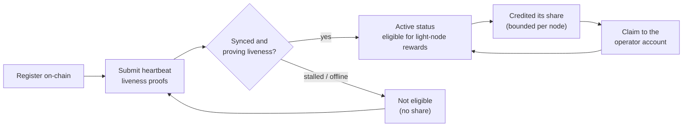

# المكافآت والمراقبة

تُنسَب إلى العقدة الخفيفة المسجَّلة حصة من مخصصات العقد الخفيفة و**تحتاج إلى البقاء بصحة جيدة** لتظل مؤهلة لها. تغطي هذه الصفحة حصة مكافأة العقدة الخفيفة البالغة 3%، وكيف تُنسَب المكافآت وتُطالَب بها، وما تفعله العقدة وما لا تفعله بالتفويضات، وكيفية مراقبة العقدة.

:::note لا شيء هنا وعدٌ بأرباح
التسجيل مفتوح على الشبكتين؛ راجع [حالة برنامج المكافآت](/light-node/overview#reward-program-status) لمعرفة الحالة الراهنة. يعتمد ما يُنسَب إلى العقدة على مخصصات العقد الخفيفة، وعدد العقد المؤهلة، والستيك الخاص بها ونسبة تشغيلها، والحد الأقصى لكل عقدة الموصوف أدناه.
:::

## حصة مكافأة الكتلة البالغة 3%

يحجز توزيع الرسوم في QoreChain **حصة ثابتة بنسبة 3% للعقد الخفيفة** التي تقدم بيانات الشبكة. هذه واحدة من الوجهات الخمس في تقسيم المكافآت في البروتوكول — المُدققون (37%)، المحروق (30%)، الخزينة (20%)، أصحاب الحصص (10%)، و**العقد الخفيفة (3%)** — مفروضةً على السلسلة. راجع [اقتصاد الرمز](/architecture/tokenomics) للتفصيل الكامل.

للمشاركة في هذه الحصة، تحتاج العقدة إلى ما يلي، ويتم التحقق منه على السلسلة لا بالتصريح الذاتي: ترخيص `lightnode_operator` نشط (يُفحص عند التسجيل)، وما لا يقل عن **1,000 QOR مفوَّضة إلى مُدققين مربوطين (bonded)** — تُحسب كإجمالي عبر جميع المُدققين الذين تفوِّض لهم، وليس لكل مُدقق على حدة؛ ولا تُحتسب التفويضات إلى مُدققين مسجونين (jailed) أو غير مربوطين؛ وهي مطلوبة عند التسجيل وتُعاد قراءتها من الستيكينغ في كل مرة تُنسَب فيها المكافآت — ورسم تسجيل قدره **1 QOR**، يُدفع مرة واحدة عند التسجيل. كما أن المشاركة محدودة على مستوى الشبكة بسقف **10,000 عقدة خفيفة**. راجع [التسجيل والترخيص](/light-node/registration-and-licensing) لمعرفة كيفية عمل التسجيل، وراجع [حالة برنامج المكافآت](/light-node/overview#reward-program-status) لمعرفة الحالة الراهنة.

نسبة 3% هي ما يتدفق إلى وحدة العقد الخفيفة، وليست استحقاقًا لكل عقدة: تُنسَب إلى كل عقدة مؤهلة حصتها الموزونة بالستيك مما تراكم، مقيَّدةً بحد أقصى لكل عقدة، وأي مبلغ لم يُكسب يذهب إلى احتياطي لا يمكن إطلاقه إلا بتصويت حوكمة. ومنذ إصدار السلسلة v3.2.3 أصبح الحد الأقصى لكل عقدة **2,000 QOR لكل 30 يومًا** (`max_reward_per_month_per_node`)، يُوزَّع تناسبيًا على زمن الكتل المنقضي بين التسويات ويُقيَّس بنسبة التشغيل (قاعدة `lightnode-monthly-cap`)؛ وهو يحل محل الحد السابق لكل كتلة (`max_reward_per_block_per_node`، أي `1713` uqor لكل كتلة). ومن v3.2.4 (الشبكة الرئيسية منذ 23 أكتوبر 2026، وشبكة الاختبار منذ 19 أكتوبر 2026) يبدأ الحد لكل عقدة من الأحدث بين التسوية السابقة وتسجيل العقدة نفسها، فلا تُمنح العقدة المسجَّلة حديثًا شيئًا عن الوقت السابق لتسجيلها. راجع [حصة مكافأة العقدة الخفيفة البالغة 3%](/light-node/overview#the-3-light-node-reward-share).

بمجرد التسجيل والتفويض، يصبح الحفاظ على الأهلية مسألة بقاء نشطًا. تحتاج العقدة إلى نسبة تشغيل لا تقل عن **80%**، ويجب أن تستمر في إرسال إثباتات استمرارية النشاط بنبضات القلب على فترة تبلغ **1,000 كتلة** (نحو 52 دقيقة على الشبكة الرئيسية عند متوسط زمن الكتلة المقيس البالغ نحو 3.1 ث؛ ونحو 22 دقيقة على الشبكة الاختبارية، بمعدل نحو 1.3 ث لكل كتلة).

**قواعد التوقيت.** ترفض السلسلة نبضة القلب المرسلة **بعد أقل من 1,000 كتلة من نبضتك السابقة** (`heartbeat submitted too early`)؛ أما أول نبضة قلب بعد التسجيل فليس لها حد أدنى كهذا. إذا لم تصل أي نبضة قلب خلال **1,000 + 100 كتلة** (أي `heartbeat_interval` بالإضافة إلى `heartbeat_grace_period`؛ على الشبكة الرئيسية نحو 52 دقيقة بالإضافة إلى مهلة تقارب 5 دقائق) من آخر نبضة لك — أو من التسجيل، إن لم ترسل أي نبضة — تُعلَّم العقدة غير نشطة وتتوقف عن احتساب المكافآت لها. وتظل نبضة القلب المرسلة لاحقًا مقبولة وتعيد تفعيلها. يرسل البرنامج الخلفي نبضة القلب التالية فور مرور 1,000 كتلة منذ `last_heartbeat` الخاصة بعقدتك كما تسجلها السلسلة نفسها، ويفحص ذلك كل 60 ثانية.

**تفويت النافذة يكلِّف نسبة التشغيل، لا التسجيل.** العقدة التي تفوِّت تُعلَّم غير نشطة وتتوقف عن الكسب، لكن أول نبضة قلب ناجحة تالية تعيد تفعيلها — دون حاجة لإعادة تسجيل. **نسبة التشغيل** لديك هي النسبة الجارية بين نبضات القلب المستلمة ونبضات القلب المتوقعة (واحدة لكل 1,000 كتلة) منذ الكتلة التي سجّلت فيها، بحد أقصى 1. دون عتبة `min_uptime_for_rewards` (`0.80`) لا تكسب العقدة شيئًا؛ وعند هذه العتبة أو فوقها، يُقيَّس السقف لكل عقدة بنسبة التشغيل لديك. لذلك يخفض الانقطاع الطويل هذه النسبة، ولا تتعافى إلا مع تراكم نبضات القلب في موعدها. تحقق من `status` إذا ظهرت عقدة غير نشطة: فهو يُبلِّغ عن حالة الموقِّع والترخيص والتسجيل.

:::note ما الذي تثبته نبضة القلب فعليًا
نبضة القلب الناجحة تثبت أن مفتاح المشغِّل وقَّع في الوقت المحدد — ولا تثبت أن العقدة تشغِّل البرنامج الكامل باستمرار. تعامل معها كتوقيع استمرارية نشاط، لا كـ"تحقُّق من عقدة نشطة".
:::

:::note `last_heartbeat` هو ارتفاع كتلة، لا طابع زمني
إذا استعلمت عن سجل العقدة على السلسلة مباشرة، فإن `last_heartbeat` هو ارتفاع كتلة، والقيمة `0` تعني أنه لم تُسجَّل أي نبضة قلب بعد — وعندها تقيس السلسلة مهلة الخمول انطلاقًا من ارتفاع `registered_at` الخاص بالعقدة. قراءة `0` كحساب ساذج لزمن منقضٍ يجعل عقدة مسجَّلة حديثًا تبدو متأخرة بملايين الكتل.
:::

*أهلية المكافأة: احتفظ بترخيص نشط على السلسلة والحد الأدنى من الحصة المفوَّضة، سجِّل، ثم استمر في إثبات النشاط عبر نبضات القلب للبقاء فوق حدَّي نسبة التشغيل وفترة نبضات القلب.*



## كيف تعمل المكافآت {#how-rewards-work}

### الإسناد

كل 100 كتلة تُسنِد السلسلة إلى كل عقدة مؤهلة (نشطة، ولديها الحد الأدنى من الستيك المفوَّض ونسبة التشغيل الدنيا على الأقل) حصتها مما تراكم، مقيَّدة لكل عقدة (بحد أقصى 2,000 QOR لكل 30 يومًا، موزَّعة تناسبيًا على الوقت المنقضي منذ التسوية السابقة) كما هو موصوف في [حصة مكافأة العقدة الخفيفة البالغة 3%](/light-node/overview#the-3-light-node-reward-share). يُضاف المبلغ إلى `accumulated_rewards` الخاصة بالعقدة. اقرأه بالأمر:

```bash
curl -s https://api.qore.host/qorechain/lightnode/v1/rewards/<operator-address>
# or: qorechaind query lightnode rewards <operator-address>
```

(استخدم `https://api-testnet.qore.host` للشبكة الاختبارية.)

### المطالبة

تبقى المكافآت المُسنَدة على سجل العقدة إلى أن تطالب بها. ويمكن للعقدة أن تطالب بها نيابةً عنك: اضبط `auto_claim = true` ضمن `[delegation]`، فيطالب البرنامج الخلفي بمكافآت العقدة الخفيفة المتراكمة إلى حساب المشغِّل بمجرد تجاوزها `min_reward_claim` (الافتراضي `1000000` uqor، أي 1 QOR)، ويفحص كل `compound_interval` (الافتراضي `1h`). ويوقّع المطالبة بالطريقة نفسها التي يوقّع بها نبضات القلب (توقيعًا أصليًا، أو عبر البديل الاحتياطي `qorechaind`). المطالبة التلقائية **معطّلة افتراضيًا**، وهي تطالب فقط: فالعقدة لا تعيد التفويض ولا تنقل الستيك أبدًا.

للمطالبة يدويًا باستخدام `qorechaind` (مع وجود مفتاح المشغِّل في حلقة مفاتيح `qorechaind`، وتصدير مفتاح ما بعد الكم بالأمر `lightnode-sx keys export <key-name> --out ~/.qorechaind/pqc/<key-name>.dilithium`)، استخدم زوج الأوامر "أنشئ ثم وقّع بالمشاركة":

```bash
qorechaind tx lightnode claim-rewards --from operator --chain-id <chain-id> --node https://rpc.qore.host --gas 300000 --fees 30000uqor --generate-only > claim.json
qorechaind tx pqc cosign claim.json --from operator --pqc-key <key-name> --chain-id <chain-id> --node https://rpc.qore.host
```

يزيل `qorechaind tx lightnode deregister` التسجيل ويصرف أي مبلغ لا يزال مُسنَدًا؛ ولا يُسترد رسم التسجيل.

### تتبع التفويضات وتنبيهات الستيك {#delegation-alerts}

تعكس العقدة تفويضات حساب المشغِّل من السلسلة عند بدء تشغيلها ثم كل خمس دقائق. وهي لا تنقل الستيك أبدًا: غيِّر التفويضات من محفظتك الخاصة. وما تحذّر منه يعتمد على إصدار العقدة الخفيفة:

- **3.1.11 وما بعده (مع `rebalance_enabled = true`، وهو الافتراضي).** تحذّر عندما يكون مُدقق تفوِّض له مسجونًا (jailed)، وعندما لا يكون ضمن المجموعة النشطة، وعندما ينخفض ستيكك المربوط عن `min_delegated_stake` (1,000 QOR). في الحالات الثلاث تتوقف السلسلة عن إسناد المكافآت إلى العقدة ولا تعطي أي رسالة. يُسجَّل تحذير عند ظهوره، ثم كل ساعة ما دام قائمًا، ومرة واحدة عند زواله.
- **درجة السمعة (3.1.12، على شبكة الاختبار فقط حاليًا).** تقرأ العقدة أيضًا درجة كل مُدقق مفوَّض إليه من `GET /qorechain/reputation/v1/validator/<valoper>` وتحذّر عندما تكون دون `min_reputation` (الافتراضي `0.5`). ويُتخطّى المُدقق الذي لم تمنحه السلسلة درجة بعد (`404`). تخدم شبكة الاختبار هذا المسار الآن؛ أما **الشبكة الرئيسية فلا تخدمه بعد، حتى بعد v3.2.5 (جرى التحقق في 30 أكتوبر 2026: يردّ المسار "Not Implemented")؛ وستخدمه اعتبارًا من إصدار لاحق للسلسلة**. وإلى أن يُخدَم المسار، تسجّل العقدة مرة واحدة أن الدرجات غير منشورة وتسأل من جديد كل ست ساعات.
- **3.1.10 وما قبله.** لم يعمل فحص السمعة قط: كان يسجّل "failed to check reputation" كل خمس دقائق ولا يُصدر أي تحذير. لا تعتمد على التنبيهات في تلك الإصدارات؛ ثبّت 3.1.12 يدويًا مرة واحدة (راجع [إصدار SX: التحديث](/light-node/sx-edition#updating)).

الخياران `validators` و`split_weights` في `[delegation]` مقبولان لكن لا يُعمل بهما حاليًا.

### فحص المكافآت والتفويضات

```bash
lightnode-sx validators   # the bonded validator set
lightnode-sx delegation   # the operator account's delegations, as mirrored by the running daemon
lightnode-sx rewards      # the operator account's pending staking rewards
```

منذ 3.1.6 تقرأ هذه الأوامر، وكذلك عرض **Delegation** في UX، الحساب الموجود في `operator_address`. يعرض `rewards` مكافآت **الستيكينغ** الناتجة عن تفويضاتك، لا مكافآت العقدة الخفيفة. ولقراءة كل شيء مباشرة من السلسلة:

```bash
curl -s https://api.qore.host/cosmos/staking/v1beta1/delegations/<operator-address>
curl -s https://api.qore.host/cosmos/distribution/v1beta1/delegators/<operator-address>/rewards
curl -s https://api.qore.host/qorechain/lightnode/v1/rewards/<operator-address>   # light-node rewards
```

## المراقبة

إبقاء العقدة بصحة جيدة هو ما يُبقيها مؤهلة للمكافآت. هناك ثلاثة أمور تستحق المراقبة.

### القياس عن بُعد (التيليمتري)

يغطي القياس عن بُعد في الوقت الفعلي المُدققين، والإجماع/الشبكة، والجسر، واقتصاد الرمز، يُحدَّث كل منها على فترته الخاصة (المهيَّأة تحت `[telemetry]` في `config.toml`). من سطر الأوامر:

```bash
lightnode-sx status    # node and light-client sync status
lightnode-sx network   # recent synced headers and latest height
```

يُظهر إصدار UX نفس البيانات حية عبر عروضه **Overview** و**Network** و**Bridge** و**Tokenomics** — راجع [إصدار UX](/light-node/ux-edition).

### صحة المزامنة ونبضات القلب

يبلِّغ أمر `status` عن معرّف السلسلة، وأحدث ارتفاع للكتل، وما إذا كانت السلسلة تلحق بالركب، وارتفاع العميل الخفيف المتزامن وحالة مزامنته، و`Signer` (أصلي، أو `qorechaind`، أو غير متاح مع ذكر السبب)، و— بمجرد ضبط `operator_address` — حالة `Licence` و`Registration` (بما في ذلك حالة العقدة وارتفاع آخر نبضة قلب). العقدة المسجَّلة والمتزامنة وقيد التشغيل تستمر في إرسال **إثباتات استمرارية النشاط بنبضات القلب** وبذلك تبقى مؤهلة للمكافآت. تُنتَج نبضات القلب هذه عبر **خط أنابيب معاملات موقَّع تشاركيًا بـ PQC** (هجين Dilithium-5 / ML-DSA-87)، متسقًا مع افتراض السلسلة القائم على اشتراط PQC — راجع [التسجيل والترخيص](/light-node/registration-and-licensing#pqc-cosigned-heartbeat-pipeline) لمعرفة كيف يعمل خط الأنابيب وكيف تختار العقدة موقِّعها. إذا أظهر `status` أن العقدة متوقفة أو لا تتزامن، فقد تكون عاجزة عن إثبات النشاط — حقِّق في الأمر قبل أن تتأثر الأهلية.

### صحة الاختبار الذاتي

إذا اشتبهت بوجود مشكلة في الحزمة التشفيرية، شغِّل الاختبار الذاتي لـ PQC في أي وقت:

```bash
lightnode-sx selftest
```

يشغِّل توليد المفاتيح ← التوقيع ← التحقق ← كشف العبث (خمسة فحوص) ويخرج بقيمة غير صفرية عند أي فشل. هذه أسرع طريقة لاستبعاد وجود مشكلة في حزمة التوقيع ما بعد الكمّي عند تشخيص مشكلات العقدة. راجع [إصدار SX](/light-node/sx-edition) لتفصيل الاختبار الذاتي الكامل.

### استعلامات السلسلة {#chain-queries}

عناوين URL الأساسية: `https://api.qore.host` (الشبكة الرئيسية) و`https://api-testnet.qore.host` (الشبكة الاختبارية).

| الاستعلام | ما يُرجعه |
| --- | --- |
| `GET /qorechain/lightnode/v1/params` | رسم التسجيل، وفترة نبضات القلب والمهلة، والحد الأدنى من الستيك المفوَّض، وحصة المكافأة، والحد الأدنى لنسبة التشغيل، وسقف العقد. |
| `GET /qorechain/lightnode/v1/stats` | أعداد العقد المسجَّلة والنشطة، وإجمالي المكافآت المُسنَدة. |
| `GET /qorechain/lightnode/v1/node/{address}` | سجل عقدة واحدة (`status` و`last_heartbeat` و`total_heartbeats` و`expected_heartbeats` و`accumulated_rewards`). |
| `GET /qorechain/lightnode/v1/rewards/{address}` | المكافآت المُسنَدة التي لم تُطالَب بعد. |
| `GET /qorechain/lightnode/v1/reward_pool` | كيف ينقسم رصيد الوحدة بين الاحتياطي والمكافآت المُسنَدة والدفعة التالية؛ ويتضمن الحدود القصوى لكل عقدة (`max_reward_per_month_per_node`، والحد السابق `max_reward_per_block_per_node`). |
| `GET /qorechain/license/v1/check/{address}/lightnode_operator` | ما إذا كان العنوان يحمل ترخيصًا نشطًا. |

## إلى أين تذهب بعد ذلك

- [التسجيل والترخيص](/light-node/registration-and-licensing) — سجِّل وابقَ نشطًا.
- [اقتصاد الرمز](/architecture/tokenomics) — نموذج المكافأة والحرق الكامل.
