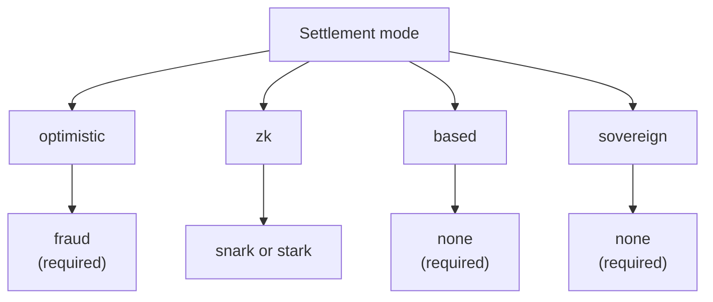

# نظرة عامة على التجميعات

تتيح **مجموعة تطوير التجميعات (Rollup Development Kit - RDK)** الخاصة بـ QoreChain — وحدة `x/rdk` — للمطورين إطلاق تجميعات (rollups) خاصة بتطبيقاتهم تتم تسويتها على QoreChain. كل تجميع هو بيئة تنفيذ مستقلة لها زمن كتلة خاص بها، وآلة افتراضية، ونموذج رسوم، وترتيب معاملات خاص بها، بينما ترث ضمانات الأمان والتشفير ما بعد الكمي وتوافر البيانات الخاصة بـ QoreChain.

:::caution قدرة في مرحلة مبكرة
إن RDK منشورة على الشبكتين، لكن **لم يُنشأ أي تجميع على أيٍّ منهما بعد** (جرى التحقق في 21 أكتوبر 2026)، ولذلك لم يجرّب أطراف خارجية التدفقات الموصوفة في هذا القسم. تعمل الشبكة الرئيسية (**`qorechain-vladi`**، معرّف سلسلة EVM **9801**، تعمل منذ 7 يونيو 2026) بإصدار السلسلة **v3.2.3** حتى الارتفاع 3,742,566 وبالإصدار **v3.2.4** من تلك الكتلة (مقترح الحوكمة 13)؛ بينما تعمل شبكة الاختبار (**`qorechain-diana`**، معرّف سلسلة EVM **9800**) بالإصدار **v3.2.4** منذ 19 أكتوبر 2026، ولذلك قد تختلف التفاصيل بين الشبكتين إلى أن يُبلغ ذلك الارتفاع. وحيثما يختلف الإصداران، يذكر هذا القسم أيهما ينطبق ومتى. تحقق من كل عملية نشر على شبكة الاختبار أولًا، واقرأ ملاحظات الحالة في كل صفحة: فعدة قدرات (التحقق بإثباتات ZK، وتوافر البيانات عبر Celestia، ومساعد QCAI، واستدعاءات الآلات الافتراضية المتقاطعة، وإيصالات التسوية) غير قابلة للاستخدام من البداية إلى النهاية اليوم، كما أن لعملاء RDK المنشورين حدودهم الخاصة (راجع [RDK 0.6.0: التغييرات والحدود](/rollups/deploying-a-rollup#rdk-050-limits)).
:::

## ما هو موجود اليوم {#what-exists-today}

| | الحالة |
|---|---|
| التجميعات المسجّلة (الشبكة الرئيسية وشبكة الاختبار) | لا يوجد |
| وحدة `x/rdk` ومعاملاتها | منشورة على الشبكتين؛ اقرأها باستخدام `qorechaind query rdk config` |
| استعلامات RDK | متاحة على الشبكتين عبر واجهة سطر الأوامر وgRPC وREST (`/qorechain/rdk/v1/…`)، ولذلك تعمل القراءات المعتمدة على REST مثل `rdk.params()` في TypeScript مقابل الشبكة الرئيسية |
| مراسي التسوية التي تكتبها RDK | لا يوجد. منذ v3.2.2 يمكن أن تحمل الدفعة الحقل `anchor_signature` وعندئذٍ تُرسَّخ في `x/multilayer` ضمن المعاملة نفسها؛ وبدونه تُسوَّى الدفعة غير مُرسَّخة. لا يوجد بعد أي تجميع أو طبقة أو مرساة. يرسل RDK بلغة TypeScript بالإصدار 0.6.0 الحقل حين يوقّع عميله توقيعًا هجينًا ويكون هو منشئ التجميع (لم يُختبر على الشبكة الحيّة)؛ أما عملاء Python وGo وRust وJava فلا يرسلونه |
| طبقات التجميعات المسجّلة في `x/multilayer` | لا يوجد |
| عمليات السحب | تُدفع من دفتر ضمان (escrow) خاص بكل تجميع منذ v3.2.3 (راجع [ZK / STARK وعمليات السحب](/rollups/zk-stark-withdrawals))؛ لم تُجرَ أي عملية سحب لأنه لا يوجد تجميع |

للحصول على مرجع الوحدة على المستوى الأدنى — معاملات الوحدة، وتفاصيل دورة الحياة الداخلية، وتكامل الحرق (burn)، والترسيخ متعدد الطبقات — راجع صفحة **[مجموعة تطوير التجميعات](/architecture/rollup-development-kit)** في قسم البنية المعمارية. هذا القسم الخاص بالتجميعات هو الدليل الإرشادي الموجّه للمطورين: ما هي RDK، وأي نموذج (paradigm) يجب اختياره، وكيفية النشر، وكيفية عمل توافر البيانات، وكيفية تسوية عمليات السحب من الطبقة الثانية (L2) عودةً إلى الطبقة الأولى (L1).

---

## ما الذي تقدمه لك RDK

يجمع التجميع الذي يتم إنشاؤه عبر RDK بين أربعة جوانب قابلة للتهيئة:

| الجانب | ما الذي يتحكم فيه | الخيارات |
| ------- | ---------------- | ------- |
| **وضع التسوية** | كيفية التحقق من انتقالات حالة التجميع وإنهائها على QoreChain | `optimistic`, `zk`, `based`, `sovereign` |
| **نظام الإثبات** | الآلية التشفيرية أو الاقتصادية الداعمة للتسوية | `fraud`, `snark`, `stark`, `none` |
| **وضع المرتِّب (Sequencer)** | من يتولى ترتيب المعاملات قبل تسويتها | `dedicated`, `shared`, `based` |
| **توافر البيانات** | أين يتم نشر بيانات المعاملات بحيث يمكن لأي شخص إعادة بناء الحالة | `native`, `celestia`, `both` |

يُسجَّل كل تجميع بمعرّف فريد `rollup-id`، مدعوم بسند حصة (stake bond) بعملة QOR، ويُخصَّص له حالة دورة حياة (`pending`، `active`، `paused`، `stopped`). راجع **[نشر تجميع](/rollups/deploying-a-rollup)** للاطلاع على تدفق الإنشاء ودورة الحياة الكاملة.

---

## ما الذي يميز RDK الخاصة بـ QoreChain

بالإضافة إلى الحد الأدنى المشترك بين أي مجموعة أدوات تجميعات، تتضمن RDK الخاصة بـ QoreChain ثلاث قدرات خاصة بـ QoreChain مبنية حول الطبقة الأولى (Layer 1) الخاصة بها — إضافة إلى نظام تحدٍّ تلقائي (watchtower auto-challenger). تختلف حالتها؛ ويوضح الجدول ما يعمل اليوم. تُشحن RDK بخمس لغات (TypeScript، Python، Go، Rust، Java). **الإصدار 0.6.0 منشور على السجلات الخمسة جميعها** (جرى التحقق في 21 أكتوبر 2026؛ npm: ‏`@qorechain/rdk` و`@qorechain/rdk-cli` و`create-qorechain-rollup`؛ PyPI: ‏`qorechain-rdk`؛ crates.io: ‏`qorechain-rdk`؛ Maven Central: ‏`io.github.qorechain:qorechain-rdk`؛ وحدة Go: ‏`v0.6.0`، ويجب أن تثبّتها لأن `@latest` في وكيل Go ظلّ يردّ بـ `v0.5.0`). ومن بين العملاء الخمسة، لا يوقّع توقيعًا هجينًا إلا عميل TypeScript. تأتي الإعدادات المسبقة `mainnet` و`testnet` مع نقاط النهاية العامة `qore.host` مضمّنة مسبقًا، بحيث لا تحتاج `createRdkClient({ network })` إلى أي تهيئة يدوية لنقطة النهاية، وتعمل قراءات REST الخاصة بها مقابل الشبكتين.

| العامل المميز | ما الذي يقوم به |
| -------------- | ------------ |
| **[إيصالات تسوية آمنة كمّيًا](/rollups/settlement-receipts)** | تحويل مرساة التسوية إلى إيصال قابل للنقل يحمل توقيعًا ما بعد الكمي (ML-DSA-87 / Dilithium-5). مرحلة مبكرة: لا توجد مراسٍ بعد، ولذلك لم يُتحقَّق من شيء مقابل مرساة حقيقية؛ والإيصال ادّعاء يجب التحقق منه مقابل حالة السلسلة، وهو ما يفعله المُتحقِّق في الإصدار 0.6.0. |
| **[مساعد QCAI للتجميعات](/rollups/qcai-copilot)** | مساعد استشاري للقراءة فقط لتجميع واحد (تقدير الرسوم، والتوصيات، وتحقيقات الاحتيال). الخدمات الاستشارية التي يقرأ منها غير معروضة على نقاط النهاية العامة بعد. |
| **[استدعاءات متعددة الآلات الافتراضية عبر VM](/rollups/multi-vm)** | أدوات لترميز استدعاء من EVM إلى QoreChain Native عبر العقد المُصرَّف مسبقًا العابر للآلات الافتراضية (`0x…0901`). لم يُفعَّل العقد المُصرَّف مسبقًا على الشبكات الحيّة، ولذلك لا يفعل الاستدعاء شيئًا؛ ويطابق المُرمِّز في الإصدار 0.6.0 التخطيط الذي تفكّ السلسلة ترميزه. |
| **[Watchtower](/rollups/watchtower)** | إطار عمل للتحدي التلقائي (auto-challenger) للتجميعات المتفائلة (optimistic) يعرض الدفعات الجديدة والمواعيد النهائية لنافذة التحدي ويطعن في الدفعات غير الصالحة استنادًا إلى محمول الصلاحية (validity predicate) الخاص بك. يقرأ عبر REST، الذي تخدّمه الشبكتان؛ ومنذ الإصدار 0.6.0 يحكم على نافذة كل دفعة بالطريقة نفسها التي تحكم بها السلسلة. |

راجع **[لماذا RDK الخاصة بـ QoreChain](/rollups/why)** للاطلاع على الأساس المنطقي الكامل وأمثلة الشيفرة.

---

## نماذج التسوية الأربعة

تدعم RDK الخاصة بـ QoreChain أربعة أوضاع تسوية مميزة، لكل منها افتراضات ثقة مختلفة، وخصائص نهائية مختلفة، ومتطلبات إثبات مختلفة. يتم التحقق من صحة الجمع بين وضع التسوية ونظام الإثبات على السلسلة — ويتم رفض أي إقران غير متوافق عند الإنشاء. يوضح المخطط أدناه كيفية ربط كل وضع تسوية بنظام الإثبات الصالح له.

### متفائل (Optimistic)

تفترض التجميعات المتفائلة (Optimistic) أن الدفعات المُرسلة صالحة افتراضيًا وتعتمد على **إثباتات الاحتيال (fraud proofs)** لحل النزاعات.

* **نظام الإثبات**: `fraud` — إثباتات احتيال تفاعلية
* **المرتِّب (Sequencer)**: `dedicated` أو `shared`
* **النهائية (Finality)**: تتأخر حتى تنتهي نافذة تحدٍّ قابلة للتهيئة دون أي تحدٍّ ناجح
* **النزاعات**: يمكن لأي شخص الطعن في دفعة مُرسلة خلال هذه النافذة بنشر سند وإثبات احتيال. يجمّد الطعن الدفعة؛ ثم يتولى منشئ التجميع حسمه، وتتحقق السلسلة من الإثبات بنفسها — فالاحتيال المثبت يرفض الدفعة ويدفع للطاعن، أما الطعن المرفوض فيعيد الدفعة إلى الحالة `submitted`. راجع [نشر تجميع](/rollups/deploying-a-rollup#challenge-a-batch-optimistic-rollups).
* **طول النافذة**: النافذة الافتراضية هي 604,800 "ثانية". **على الشبكة الرئيسية قبل الارتفاع 3,742,566 (v3.2.3)** تحوّلها السلسلة إلى كتل بمعدل ثابت قدره 6 ثوانٍ لكل كتلة — أي **100,800 كتلة** — ولذلك يتبع الزمن الفعلي المنقضي زمن الكتلة الحقيقي (نحو 3.7 أيام عند كتل الشبكة الرئيسية الحالية البالغة ≈3.2 ثانية)؛ فخطّط بالكتل لا بالأيام. **ابتداءً من v3.2.4**، تحصل الدفعة المُرسلة ابتداءً من ارتفاع الترقية على نافذة تُقاس بثواني زمن الكتلة (7 أيام كاملة)؛ أما الدفعات السابقة فتبقى على قاعدة عدد الكتل. ارتفاع الترقية هو 8,337,253 على شبكة الاختبار (منذ 19 أكتوبر 2026) و3,742,566 على الشبكة الرئيسية، وعليه تسري على الشبكة الرئيسية قاعدة عدد الكتل على كل دفعة تُرسل دون ذلك الارتفاع وقاعدة زمن الكتلة منه فصاعدًا.

### ZK (المعرفة الصفرية)

ترفق تجميعات ZK إثبات صلاحية تشفيري بكل دفعة، مما يثبت صحة انتقال الحالة دون الحاجة إلى إعادة التنفيذ.

* **نظام الإثبات**: `snark` (إثباتات موجزة) أو `stark` (إثباتات شفافة، دون إعداد موثوق)
* **المرتِّب (Sequencer)**: `dedicated` أو `shared`
* **النهائية (Finality)**: عند التحقق من صحة الإثبات — دون الحاجة إلى نافذة تحدٍّ
* **مستوى النضج**: يُتحقَّق من دفعات SNARK على السلسلة (Groth16 على BLS12-381) مقابل مفتاح تحقق مخزّن مع التجميع. لا يحمل التجميع المنشأ عبر `create-rollup` مفتاح تحقق حاليًا، ولذلك لا يمكن إنهاء دفعات ZK من البداية إلى النهاية بعد. أما التحقق بـ STARK فهو تجريبي: اختياري ويفحص دائرة توضيحية، لا انتقال الحالة الخاص بتجميعك. تعامل مع تسوية ZK على أنها غير جاهزة للإنتاج. راجع **[ZK / STARK وعمليات السحب](/rollups/zk-stark-withdrawals)**.

### Based (المستند إلى L1)

تُفوِّض تجميعات Based ترتيب المعاملات إلى مقترحي (proposers) QoreChain (L1)، لترث بذلك حيوية السلسلة المضيفة ومقاومتها للرقابة.

* **نظام الإثبات**: `none` — مقترحو L1 هم مصدر حقيقة الترتيب
* **المرتِّب (Sequencer)**: `based` (مطلوب — يُفرض عبر التحقق على السلسلة)
* **النهائية (Finality)**: تتبع تأكيد السلسلة المضيفة
* **المفاضلة**: أبسط نموذج تشغيلي، بما أن مدققي QoreChain يتولون الترتيب، وذلك على حساب التحكم في زمن الاستجابة الذي يوفره المرتِّب المخصص
* **الحالة اليوم**: يُسجَّل `based` في إعدادات التجميع، لكن QoreChain لا تقبل بعد مقترحي L1 كمُرسِلي دفعات — فمنشئ التجميع هو من يُرسل (راجع [أوضاع المرتِّب](#sequencer-modes))

### Sovereign (السيادي)

تُشغِّل تجميعات Sovereign إجماعها الخاص وتُرتِّب معاملاتها ذاتيًا. وهي تُرسِّخ حالتها في QoreChain لغرض إمكانية التحقق، لكنها لا تعتمد على السلسلة المضيفة لتحقيق النهائية.

* **نظام الإثبات**: `none`
* **المرتِّب (Sequencer)**: يُدار ذاتيًا بواسطة التجميع
* **النهائية (Finality)**: مستقلة — يحددها إجماع التجميع الخاص به
* **ترسيخ الحالة**: تُنشر جذور الحالة (state roots) في QoreChain من أجل الشفافية، لكن السلسلة المضيفة لا تفرضها

---

## توافق أنظمة الإثبات

يحدد وضع التسوية أنظمة الإثبات الصالحة. تُفرض هذه الإقرانات عند إنشاء التجميع.

| وضع التسوية | `fraud` | `snark` | `stark` | `none` |
| --------------- | :-----: | :-----: | :-----: | :----: |
| **optimistic**  | مطلوب | — | — | — |
| **zk**          | — | مدعوم | مدعوم | — |
| **based**       | — | — | — | مطلوب |
| **sovereign**   | — | — | — | مطلوب |

---

## أوضاع المرتِّب (Sequencer) {#sequencer-modes}

يحدد المرتِّب (Sequencer) الجهة التي ترتب المعاملات داخل كتلة التجميع قبل التسوية.

| الوضع | من يقوم بالترتيب | ملاحظات |
| ---- | ------------- | ----- |
| **`dedicated`** | عنوان مشغّل واحد مُعيَّن | أقل زمن استجابة؛ يتطلب الثقة بالمشغّل لضمان الحيوية والترتيب العادل |
| **`shared`** | مجموعة مرتِّبين مشتركة | يُوزَّع الترتيب عبر المجموعة؛ عبء تنسيق أعلى قليلًا |
| **`based`** | مقترحو (proposers) QoreChain L1 | يرث أمان مدققي السلسلة المضيفة ومقاومتها للرقابة؛ مطلوب لتسوية `based` |

:::note ما يُفرض اليوم
على السلسلة، لا يجوز إرسال دفعة إلا من عنوان المرتِّب المُهيَّأ للتجميع، أو من منشئه عندما لا يكون هناك عنوان مُعيَّن (وهذا حال كل الإعدادات المسبقة). يُسجَّل الوضعان `shared` و`based` في إعدادات التجميع، لكن QoreChain لا تقبل بعد قائمة مرتِّبين مشتركة ولا مقترحي L1 كمُرسِلي دفعات؛ وهذان الوضعان يصفان التصميم المقصود.
:::

---

## اختيار النموذج (Paradigm)

| إذا كنت تريد... | ففكّر في |
| -------------- | -------- |
| أبسط إعداد تشغيلي، مع قيام مدققي QoreChain بالترتيب | **based** |
| نهائية سريعة بضمانات تشفيرية (غير جاهزة للإنتاج بعد) | **zk** (`snark` / `stark`) |
| نموذج مفهوم جيدًا مع حل نزاعات اقتصادي | **optimistic** (`fraud`) |
| استقلالية كاملة بإجماعك الخاص، مُرسَّخة لإمكانية التحقق | **sovereign** |

لست متأكدًا من أين تبدأ؟ تُشحن RDK مع **ملفات تعريف مسبقة (preset profiles)** تجمع هذه الخيارات لفئات التطبيقات الشائعة — راجع **[ملفات التعريف المسبقة](/rollups/preset-profiles)** — وعندما تتوفر واجهة RPC الاستشارية، أداة مساعدة `suggest-profile` (وهي تُرجع حاليًا بديلًا ثابتًا هو `defi`، فاختر من جدول ملفات التعريف).

بالنسبة للمطورين، تُشحن RDK أيضًا كحزمة SDK عامة بلغة TypeScript باسم **`@qorechain/rdk`** إضافة إلى أداة البناء الأولي **`create-qorechain-rollup`**، واللتان تُشغِّلان نفس الوحدة على السلسلة انطلاقًا من الشيفرة — راجع **[نشر تجميع](/rollups/deploying-a-rollup#deploy-with-the-typescript-rdk-qorechainrdk)**.

## ذات صلة

* [نشر تجميع](/rollups/deploying-a-rollup) — إطلاق تجميع من واجهة سطر الأوامر (CLI) أو RDK الخاصة بـ TypeScript.
* [ملفات التعريف المسبقة](/rollups/preset-profiles) — حزم بنقرة واحدة لفئات التطبيقات الشائعة.
* [توافر البيانات](/rollups/data-availability) — موجّه توافر البيانات الأصلي (native DA) وتخزين الـ blob.
* [عمليات سحب ZK / STARK](/rollups/zk-stark-withdrawals) — تدفقات سحب مدعومة بالإثبات.
