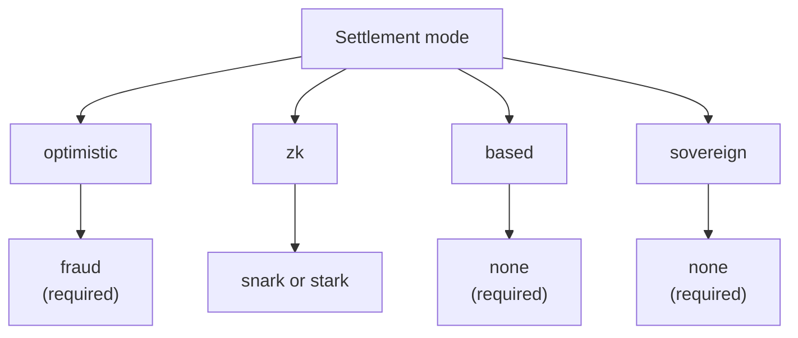

# نظرة عامة على التجميعات

إن **مجموعة تطوير التجميعات (Rollup Development Kit - RDK)** الخاصة بـ QoreChain هي مجموعة من مكتبات العميل (TypeScript وPython وGo وRust وJava) وأداة سطر أوامر للمشغّلين وقوالب بدء جاهزة لبناء تجميعات (rollups) خاصة بالتطبيقات تُسوَّى على QoreChain عبر وحدة `x/rdk` على السلسلة. بها تهيّئ تجميعًا، وتبني معاملاته وتوقّعها، وتقرأ حالته، وتتابع نوافذ التحدي الخاصة به، وتُصدر إيصالات التسوية وتتحقق منها، وتجمّع استدعاءات الآلات الافتراضية المتقاطعة وإثباتات السحب. كل تجميع هو بيئة تنفيذ مستقلة لها زمن كتلة خاص بها، وآلة افتراضية، ونموذج رسوم، وترتيب معاملات خاص بها، بينما ترث أمان QoreChain والتشفير ما بعد الكمي وتوافر البيانات. هذه الصفحة موجّهة إلى المطورين الذين يريدون إطلاق تجميع أو تشغيله، وإلى كل من يقرر ما إذا كانت RDK تناسب تطبيقه.

:::caution قدرة في مرحلة مبكرة
إن RDK منشورة على الشبكتين، لكن **لم يُنشأ أي تجميع على أيٍّ منهما بعد** (جرى التحقق في 27 أكتوبر 2026)، ولذلك لم يجرّب أطراف خارجية التدفقات الموصوفة في هذا القسم. **لا يمكن استخدام تسوية ZK (الملف التعريفي `defi` وقالب `defi-rollup` وكل تجميع من نوع `zk`) على أيٍّ من الشبكتين بعد:** ليس لدى السلسلة طريقة لتسجيل مفتاح تحقق، ولذلك تُرفض كل دفعة ZK بعد دفع رسومها. تسجيل المفاتيح مخطط له في إصدار السلسلة v3.2.7. استخدم تسوية `optimistic` إلى ذلك الحين.

تعمل الشبكة الرئيسية (**`qorechain-vladi`**، معرّف سلسلة EVM **9801**، تعمل منذ 7 يونيو 2026) بإصدار السلسلة **v3.2.4** (طُبّق عند الارتفاع 3,742,566 في 23 أكتوبر 2026، مقترح الحوكمة 13)؛ بينما تعمل شبكة الاختبار (**`qorechain-diana`**، معرّف سلسلة EVM **9800**) بالإصدار **v3.2.6** (وصلها v3.2.4 في 19 أكتوبر 2026، وv3.2.5 في 26 أكتوبر، وv3.2.6 في 27 أكتوبر). وكان مقترح الحوكمة 14 على الشبكة الرئيسية، الذي سيطبّق v3.2.5 عند الارتفاع 3,906,833، في فترة التصويت وقت كتابة هذا؛ وسيُوثَّق ما يغيّره v3.2.5 بالنسبة إلى التجميعات في اليوم الذي تطبّقه فيه الشبكة الرئيسية. وحيثما تغيّر السلوك بين v3.2.3 وv3.2.4، يذكر هذا القسم أيّ الإصدارين ينطبق. تحقق من كل عملية نشر على شبكة الاختبار أولًا، واقرأ ملاحظات الحالة في كل صفحة: فعدة قدرات (التحقق بإثباتات ZK، وتوافر البيانات عبر Celestia، ومساعد QCAI، واستدعاءات الآلات الافتراضية المتقاطعة، وإيصالات التسوية) غير قابلة للاستخدام من البداية إلى النهاية اليوم.
:::

## الابتكارات {#innovations}

* **إيصالات تسوية بتوقيع ما بعد كمي.** يُوقَّع مرساة حالة الدفعة بـ ML-DSA-87 بواسطة المفتاح المسجّل لمنشئ التجميع. تعيد `verifySettlementReceipt` قراءة كل حقل من حقول الإيصال من السلسلة (التجميع، والطبقة، وجذر الدفعة، والمرساة: جذر الحالة، وارتفاع الطبقة، وارتفاع السلسلة الرئيسية، ووقت المرساة، وبصمة مجموعة المدققين، وعدد المعاملات، والإثبات، والتوقيع). ويأتي مفتاح التحقق من السلسلة ولا يأتي أبدًا من الإيصال؛ ويجب أن يسمّي الإيصال الشبكة التي تستعلم عنها؛ ويُرفض أي إصدار إيصال غير معروف أو أي خوارزمية غير ML-DSA-87 قبل أي قراءة؛ ولا يُبلَّغ أبدًا عن فحص التوقيع وحده على أنه صالح. لرسالة المرساة صيغة أولى دون ارتفاع إصدار السلسلة v3.2.2 وصيغة ثانية، تربط أيضًا معرّف السلسلة، منه فصاعدًا؛ ويُختار الإصدار بحسب ارتفاع المرساة. راجع [إيصالات التسوية](/rollups/settlement-receipts).
* **توقيع هجين باشتقاقين للمفتاح.** تُوقَّع المعاملات بـ secp256k1 مع ML-DSA-87. يُشتق المفتاح ما بعد الكمي من العبارة السرية (mnemonic) بالطريقة القياسية (SHAKE-256 على `qorechain:pqc:v1|` والعنوان والعبارة السرية) وبالطريقة القديمة معًا، ويستخدم العميل أيَّ مفتاح سجّلته السلسلة للحساب. لا يوقّع توقيعًا هجينًا اليوم إلا عميل TypeScript.
* **جذر الانتقال القياسي.** تحسب `batchTransitionRoot` جذر الحالة الدقيق الذي تحكم السلسلة على أساسه في الدفعة المتفائلة (الصيغة التي تطبّقها الشبكة الرئيسية اليوم هي التزام SHAKE-256 بجذر الحالة السابق وبصمة البيانات وعدد المعاملات؛ وتختار `transitionRootVersionFor` الصيغة التي تطبّقها الشبكة المتصلة)، وتبني `fraudProof` إثبات الـ 64 بايت منه. جرى اختبار كليهما مقابل متجهات ولّدتها شيفرة السلسلة نفسها.
* **نوافذ تحدٍّ مطابقة للسلسلة تمامًا.** تحسب `batchChallengeWindow` نافذة الدفعة بالطريقة التي تحسبها بها السلسلة (قائمة على الزمن: مفتوحة ما دام زمن الكتلة أقل من وقت الإرسال زائد النافذة؛ وللدفعات الأقدم: النافذة مقسومة على ستة بالكتل ابتداءً من ارتفاع الإرسال) وتحكم عليها مقابل رأس السلسلة المقروء من RPC `/status` لا مقابل الساعة المحلية. يستخدمها [Watchtower](/rollups/watchtower) ومراقب الصحة.
* **فحوصات قبل دفع أي رسوم.** ترفض المجموعة معرّف تجميع خارج `^[a-z0-9][a-z0-9._-]{2,63}$`؛ وسحبًا ليس بعملة `uqor` أو مبلغه صفر أو يحمل إثباتًا أعمق من 64 مستوى من 32 بايت أو يسمّي عنوان bech32 غير صالح؛ وعندما تستطيع قراءة التجميع، دفعة تسمّي بصمة بيانات على تجميع توافر بياناته `native` أو `both`. كان كلٌّ من هذه سيُرفض لدى السلسلة بعد إنفاق الرسوم.
* **بيانات استدعاء عبر الآلات الافتراضية وفحص مباشر.** تبني `encodeCrossVmCalldata` بيانات الاستدعاء لـ `executeCrossVMCall(uint8,string,bytes)` (المحدِّد `0x3c11078c`، العقد المُصرَّف مسبقًا `0x...0901`)، وتقرأ `isCrossVmPrecompileActive` ما إذا كان العقد المُصرَّف مسبقًا مفعّلًا على الشبكة. راجع [الآلات الافتراضية المتعددة](/rollups/multi-vm).
* **مجموعة واحدة من متجهات الاختبار لخمس لغات.** تُفحص حزم TypeScript وPython وGo وRust وJava مقابل المجموعة المرجعية (golden fixture) نفسها (لحزمة Go ‏100 اختبار وحدة، ولـ Rust ‏77، ولـ Java ‏75).

## كيفية الاستخدام {#how-to-use}

القراءات لا تحتاج إلى مفتاح ولا إلى أموال. تقرأ المقتطفات أدناه معاملات وحدة `rdk` الحيّة وقائمة التجميعات على شبكة الاختبار العامة (`qorechain-diana`) وقد شُغّلت في 27 أكتوبر 2026 من الحزم المنشورة (مقتطفات المكتبات مع 0.6.1، وهو إصدار شيفرة المكتبة الذي يشحنه 0.6.2 أيضًا؛ وأداة سطر الأوامر مع 0.6.2). طبعت كلٌّ منها معاملات شبكة الاختبار (الحد الأقصى للتجميعات 200، والحد الأدنى للحصة 10,000 QOR، ومعدل الحرق عند الإنشاء 0.01، ونافذة التحدي الافتراضية 3,600 ثانية، والحد الأقصى لحجم blob توافر البيانات 2,097,152 بايت، ومدة الاحتفاظ بالـ blob 432,000 كتلة، وحد أقصى 10 دفعات لكل كتلة) و`0 rollups`.

### TypeScript (مُختبَر)

```bash
npm install @qorechain/rdk
```

```ts
import { createRdkClient } from "@qorechain/rdk";

// Public testnet (chain id qorechain-diana).
const rdk = createRdkClient({
  network: "testnet",
  endpoints: { rest: "https://api-testnet.qore.host" },
});

// Read the live rdk module parameters and the registered rollups.
const params = await rdk.params();
const rollups = await rdk.rest.listRollups();
console.log(rdk.network.chainId, params, `${rollups.length} rollups`);
```

تحمل الإعدادات المسبقة `mainnet` و`testnet` نقاط النهاية العامة `qore.host` مسبقًا، ولذلك تعمل `createRdkClient({ network: "testnet" })` دون الحقل `endpoints`؛ وهو معروض أعلاه لأن المقتطف المُختبَر مرّره. شغّله بـ Node 20 أو أحدث (استخدم الاختبار Node 26).

### Python (مُختبَر)

```bash
pip install qorechain-rdk
```

```python
from qorrdk import create_rdk_client

# Public testnet (chain id qorechain-diana).
rdk = create_rdk_client(network="testnet", endpoints={"rest": "https://api-testnet.qore.host"})

# Read the live rdk module parameters and the registered rollups.
params = rdk.params()
rollups = rdk.rest.list_rollups()
print(rdk.network.chain_id, params, f"{len(rollups)} rollups")
```

يتطلب Python 3.10 أو أحدث. تعتمد `qorechain-rdk` على `qorechain-pqc` التي تسحب `liboqs-python` وتحتاج إلى مكتبة `liboqs`؛ وعلى جهاز لا تتوفر فيه، يبنيها أول استيراد (يلزم git وCMake ومترجم C). اختُبرت في بيئة افتراضية جديدة على Python 3.12.

### Go (مُختبَر)

```bash
go get github.com/qorechain/qorechain-rdk/packages/go@v0.6.2
```

```go
package main

import (
	"context"
	"fmt"

	rdk "github.com/qorechain/qorechain-rdk/packages/go"
)

func main() {
	// Public testnet (chain id qorechain-diana).
	client := rdk.NewRdkClient(rdk.RdkClientOptions{
		Network:   "testnet",
		Endpoints: &rdk.Endpoints{Rest: "https://api-testnet.qore.host"},
	})
	ctx := context.Background()
	// Read the live rdk module parameters and the registered rollups.
	params, err := client.Params(ctx)
	if err != nil {
		panic(err)
	}
	rollups, _ := client.Rest.ListRollups(ctx)
	fmt.Printf("%s %+v %d rollups\n", client.Network.ChainID, params, len(rollups))
}
```

اختُبرت مع Go 1.26، مع جلب الوحدة من وكيل Go.

### Rust (مُختبَر)

```bash
cargo add qorechain-rdk
```

```rust
use qorechain_rdk::client::{RdkClient, RdkClientOptions};

fn main() -> Result<(), Box<dyn std::error::Error>> {
    // Public testnet (chain id qorechain-diana).
    let rdk = RdkClient::new(RdkClientOptions {
        rest_url: Some("https://api-testnet.qore.host".into()),
        ..Default::default()
    });

    // Read the live rdk module parameters and the registered rollups.
    let params = rdk.params()?;
    let rollups = rdk.rest.list_rollups()?;
    println!("{} {:?} {} rollups", rdk.network.chain_id, params, rollups.len());
    Ok(())
}
```

المكتبة هي `qorechain_rdk`. اختُبرت مع Rust 1.95، ومبنيّة مقابل crates.io.

### Java (مُختبَر)

```kotlin
// build.gradle.kts - Maven Central serves 0.6.1 until 0.6.2 is live there
implementation("io.github.qorechain:qorechain-rdk:0.6.1")
```

```java
import io.github.qorechain.rdk.client.RdkClient;
import io.github.qorechain.rdk.client.Views.ParamsView;
import io.github.qorechain.rdk.config.Networks;

public class RdkQuickstart {
    public static void main(String[] args) {
        // Public testnet (chain id qorechain-diana).
        RdkClient.Options options = new RdkClient.Options();
        options.network = "testnet";
        options.endpoints = new Networks.Endpoints();
        options.endpoints.rest = "https://api-testnet.qore.host";
        RdkClient rdk = new RdkClient(options);

        // Read the live rdk module parameters and the registered rollups.
        ParamsView params = rdk.params();
        int rollups = rdk.rest.listRollups().size();
        System.out.println(rdk.network.chainId + " maxRollups=" + params.maxRollups
                + " minStakeForRollup=" + params.minStakeForRollup + " " + rollups + " rollups");
    }
}
```

يتطلب JDK 17 أو أحدث؛ اختُبرت مع JDK 21 وGradle 9.6 مع الحل من Maven Central. يجب تسمية الملف `RdkQuickstart.java`. لا يتضمن 0.6.2 أي تغيير في Java، ولذلك فإن قطعة 0.6.1 هي المكتبة نفسها.

### سطر الأوامر (مُختبَر)

```bash
npm install -g @qorechain/rdk-cli
qorollup --version
qorollup params --network testnet
```

يطبع `qorollup --version` القيمة `0.6.2` ويطبع `qorollup params --network testnet` معاملات الوحدة الحيّة. **يعمل هذا ابتداءً من 0.6.2.** كانت الإصدارات 0.6.1 وما قبله تخرج بالرمز 0 ولا تطبع شيئًا عند تثبيتها من npm. ثبّت الاختبار `@qorechain/rdk-cli@0.6.2` في مشروع فارغ وشغّله عبر `node_modules/.bin/qorollup`؛ ويستخدم التثبيت العام و`npx` رابط bin نفسه. يلزم Node 20 أو أحدث.

### بناء هيكل مشروع (مُختبَر)

```bash
npx create-qorechain-rollup my-rollup --template nft-rollup --network testnet --yes
cd my-rollup && npm run doctor
```

القوالب هي `defi-rollup` و`gaming-rollup` و`nft-rollup` و`enterprise-rollup` و`custom-rollup` و`multivm-rollup`. يعتمد المشروع المُهيكَل على `@qorechain/rdk` بالإصدار `^0.6.1`، الذي يحله التثبيت الجديد إلى 0.6.2. أنتج بناء هيكل `nft-rollup` مشروعًا على `@qorechain/rdk` ‏0.6.1 ونجح `npm run doctor` فيه مقابل شبكة الاختبار (REST قابل للوصول، والمعاملات قابلة للقراءة، والشبكة `qorechain-diana`؛ ويحذّر من توافر البيانات عبر Celestia ومن غياب موقِّع)؛ ونجح بناء هيكل `defi-rollup` وتشغيل `npm run typecheck`. **لا تستخدم `defi-rollup` لإطلاق تجميع بعد** (راجع [الحدود](#limits)). لإنشاء تجميع وإرسال الدفعات، اتبع [نشر تجميع](/rollups/deploying-a-rollup)؛ تحتاج المعاملات إلى مفتاح ما بعد كمي مسجّل، وفي RDK إلى عميل TypeScript مزوَّد بـ `pqcKeypair`.

## كيفية الوصول {#how-to-access}

**الشبكات ونقاط النهاية.** تتحدث RDK مع نقاط النهاية العامة للشبكتين؛ وتحملها الإعدادات المسبقة `mainnet` و`testnet` مسبقًا.

| الشبكة | معرّف السلسلة | معرّف سلسلة EVM | نقطة نهاية REST | إصدار السلسلة |
| ------- | -------- | ------------ | ------------- | ------------- |
| الشبكة الرئيسية | `qorechain-vladi` | 9801 | `https://api.qore.host` | v3.2.4 |
| شبكة الاختبار | `qorechain-diana` | 9800 | `https://api-testnet.qore.host` | v3.2.6 |

تخدّم الشبكتان معًا استعلامات RDK (`/qorechain/rdk/v1/...`) عبر REST وgRPC وواجهة سطر الأوامر، ولذلك تعمل قراءات مثل `rdk.params()` مقابل أيٍّ منهما. شبكة الاختبار شبكة تجريبية لها معاملاتها الخاصة: نافذة التحدي الافتراضية 3,600 ثانية على شبكة الاختبار و604,800 على الشبكة الرئيسية، ويمكن أن يوجد 200 تجميع على الأكثر على شبكة الاختبار و100 على الشبكة الرئيسية، وتسمح وحدة multilayer بـ 64 طبقة جانبية على شبكة الاختبار و10 على الشبكة الرئيسية (جرى التحقق في 27 أكتوبر 2026). اقرأ `GET /qorechain/rdk/v1/params` على الشبكة التي تستهدفها.

**متطلبات إنشاء تجميع.**

| المتطلب | التفاصيل |
| ----------- | ------- |
| **حساب ممول** | حساب فيه ما يكفي من QOR للحصة وحصة الطبقة والرسوم. |
| **حصة مودعة في الضمان (escrow)** | يودع إنشاء تجميع `min_stake_for_rollup` في الضمان، أي **10,000 QOR** على الشبكتين. **يُحرق 1 % من الحصة (100 QOR)** عند الإنشاء؛ ويبقى الباقي في الضمان ويُعاد عند إيقاف التجميع. |
| **حصة الطبقة** | يسجّل الإنشاء أيضًا طبقة التجميع في وحدة multilayer (الحد الأدنى للحصة 1,000 QOR). إذا تعذّر تسجيل الطبقة، يُنشأ التجميع مع ذلك لكن دون طبقة حقيقية، فلا يمكن ترسيخ دفعاته ولا يمكن إصدار إيصالات. |
| **مفتاح ما بعد كمي مسجّل** | مفتاح ML-DSA-87 مسجّل للحساب. تُرفض معاملات المسار الأصلي الموقّعة بالمفتاح الكلاسيكي وحده. |
| **الرسوم** | الحد الأدنى للرسوم 0.1 uqor لكل وحدة غاز؛ اضبط حد الغاز والرسوم معًا. |
| **الأدوات** | Node 20 أو أحدث لأداة سطر الأوامر ومولّد الهياكل؛ وPython 3.10 أو أحدث (مع `liboqs`، انظر أعلاه) لعميل Python؛ وJDK 17 أو أحدث لـ Java؛ ووحدة Go ‏`github.com/qorechain/qorechain-rdk/packages/go`. |

قراءة الحالة لا تحتاج إلى أي من ذلك. ويمكنك أيضًا طلب تجميع عبر لوحة التحكم (Dashboard) (نموذج طلب، وليس معاملة على السلسلة) أو إنشاءه بواسطة واجهة سطر أوامر السلسلة؛ راجع [نشر تجميع](/rollups/deploying-a-rollup) للاطلاع على التدفق الكامل وأوامر سطر الأوامر ومسار التوقيع في TypeScript.

### ما هو موجود اليوم {#what-exists-today}

| | الحالة |
|---|---|
| التجميعات المسجّلة (الشبكة الرئيسية وشبكة الاختبار) | لا يوجد |
| وحدة `x/rdk` ومعاملاتها | منشورة على الشبكتين؛ اقرأها باستخدام `qorechaind query rdk config` |
| استعلامات RDK | متاحة على الشبكتين عبر واجهة سطر الأوامر وgRPC وREST (`/qorechain/rdk/v1/...`)، ولذلك تعمل القراءات المعتمدة على REST مثل `rdk.params()` في TypeScript مقابل الشبكة الرئيسية |
| مراسي التسوية التي تكتبها RDK | لا يوجد. منذ v3.2.2 يمكن أن تحمل الدفعة الحقل `anchor_signature` وعندئذٍ تُرسَّخ في `x/multilayer` ضمن المعاملة نفسها؛ وبدونه تُسوَّى الدفعة غير مُرسَّخة. لا يوجد بعد أي تجميع أو طبقة أو مرساة. يرسل RDK بلغة TypeScript (من 0.6.0 إلى 0.6.2) الحقل حين يوقّع عميله توقيعًا هجينًا ويكون هو منشئ التجميع (لم يُختبر على الشبكة الحيّة)؛ أما عملاء Python وGo وRust وJava فلا يرسلونه |
| طبقات التجميعات المسجّلة في `x/multilayer` | لا يوجد |
| تسوية ZK | لا يمكن استخدامها على أيٍّ من الشبكتين بعد (لا توجد طريقة لتسجيل مفتاح تحقق؛ مخطط لها في إصدار السلسلة v3.2.7) |
| عمليات السحب | تُدفع من دفتر ضمان (escrow) خاص بكل تجميع منذ v3.2.3 (راجع [ZK / STARK وعمليات السحب](/rollups/zk-stark-withdrawals))؛ لم تُجرَ أي عملية سحب لأنه لا يوجد تجميع |

للحصول على مرجع الوحدة على المستوى الأدنى (معاملات الوحدة، وتفاصيل دورة الحياة الداخلية، وتكامل الحرق، والترسيخ متعدد الطبقات) راجع صفحة **[مجموعة تطوير التجميعات](/architecture/rollup-development-kit)** في قسم البنية المعمارية. قسم التجميعات هذا هو الدليل الإرشادي الموجّه للمطورين.

## أين تُنشر {#where-published}

جرى التحقق من الإصدارات على السجلات في 27 أكتوبر 2026. جميع الحزم بترخيص Apache-2.0.

| السجل | الحزمة | الإصدار الحالي | الرابط |
| -------- | ------- | --------------- | ---- |
| npm | `@qorechain/rdk` (عميل TypeScript) | 0.6.2 | [npmjs.com](https://www.npmjs.com/package/@qorechain/rdk) |
| npm | `@qorechain/rdk-cli` (`qorollup`) | 0.6.2 | [npmjs.com](https://www.npmjs.com/package/@qorechain/rdk-cli) |
| npm | `create-qorechain-rollup` (مولّد الهياكل) | 0.6.2 | [npmjs.com](https://www.npmjs.com/package/create-qorechain-rollup) |
| PyPI | `qorechain-rdk` (الاستيراد `qorrdk`) | 0.6.2 | [pypi.org](https://pypi.org/project/qorechain-rdk/) |
| crates.io | `qorechain-rdk` (المكتبة `qorechain_rdk`) | 0.6.2 | [crates.io](https://crates.io/crates/qorechain-rdk) |
| وكيل وحدات Go | `github.com/qorechain/qorechain-rdk/packages/go` | v0.6.2 | [pkg.go.dev](https://pkg.go.dev/github.com/qorechain/qorechain-rdk/packages/go) |
| Maven Central | `io.github.qorechain:qorechain-rdk` | **0.6.1** (الإصدار 0.6.2 لم يصل إليه بعد) | [central.sonatype.com](https://central.sonatype.com/artifact/io.github.qorechain/qorechain-rdk) |

تخدّم Maven Central الإصدار 0.6.1 إلى أن يصبح 0.6.2 متاحًا فيها؛ ولا يتضمن 0.6.2 أي تغيير في Java. الشيفرة المصدرية عامة على [github.com/qorechain/qorechain-rdk](https://github.com/qorechain/qorechain-rdk)، وملاحظات الإصدار على [v0.6.2](https://github.com/qorechain/qorechain-rdk/releases/tag/v0.6.2)، ووثائق المجموعة نفسها على [qorechain.github.io/qorechain-rdk](https://qorechain.github.io/qorechain-rdk/). تعتمد حزمة TypeScript على `@qorechain/sdk` ‏`^0.9.0` و`@qorechain/evm` ‏`^0.8.0` (ولذلك يحصل تطبيق على SDK 0.10.0 على نسخة SDK 0.9.x ثانية متداخلة مع المجموعة)، وتعتمد حزمة Python على `qorechain-pqc` ‏0.2.x. أما منطق وحدة `x/rdk` على السلسلة نفسه فليس جزءًا من المجموعة العامة.

## الحدود والمشكلات المعروفة {#limits}

* **لا يمكن استخدام تسوية ZK على أيٍّ من الشبكتين بعد.** ويشمل ذلك الملف التعريفي `defi` وقالب `defi-rollup` وكل تجميع أُنشئ بتسوية `zk`. ليس لدى السلسلة طريقة لتسجيل مفتاح تحقق للتجميع، ولذلك تُرفض كل دفعة ZK بعد دفع رسومها. تسجيل المفاتيح مخطط له في إصدار السلسلة v3.2.7. استخدم تسوية `optimistic` إلى ذلك الحين (راجع [ZK / STARK وعمليات السحب](/rollups/zk-stark-withdrawals)).
* **لم يُنشأ أي تجميع على أيٍّ من الشبكتين.** مسارات الإنشاء والدفعات والتحدي والإيصالات والسحب مغطاة باختبارات الوحدة والمتجهات المشتركة، لكنها لم تُجرَّب على السلسلة.
* **يوقّع عميل TypeScript وحده المعاملات توقيعًا هجينًا.** مسارات المعاملات في Python وGo وRust وJava وأوامر المعاملات في `qorollup` (`create` و`pause` و`resume` و`stop` و`withdraw`) توقّع بالمفتاح الكلاسيكي فقط، وهو ما ترفضه الشبكتان. قراءاتها تعمل. وللمعاملات من هذه الأدوات، ابنِ الرسالة ووقّعها مشاركةً بواسطة واجهة سطر أوامر السلسلة، أو استخدم عميل TypeScript مع `pqcKeypair`.
* **(a) لم تكن أداة `qorollup` تطبع شيئًا عند تثبيتها من npm في 0.6.1 وما قبله.** تم **إصلاح هذا في 0.6.2**: بعد `npm i -g @qorechain/rdk-cli` تعمل `qorollup ...` ويطبع `qorollup --version` القيمة 0.6.2.
* **(b) تستخدم دوال Merkle المساعدة للسحب SHA-256 افتراضيًا بينما تستخدم السلسلة SHAKE-256.** لا يتحقق الإثبات المبني بالإعدادات الافتراضية؛ فبدّل دالة التجزئة وترميز الأوراق (راجع [ترميز الأوراق والعقد](/rollups/zk-stark-withdrawals#leaf-and-node-encoding)).
* **(c) تجزّئ `buildDaBlob` بـ SHA-256، بينما التزام الـ blob لدى السلسلة هو SHAKE-256.** لا أثر عملي له اليوم لأنه لا توجد معاملة تنشر blob؛ اترك `dataHash` فارغًا في توافر البيانات `native` و`both` (راجع [توافر البيانات](/rollups/data-availability)).
* **(d) لا تستطيع الدائرة التوضيحية في قالب `defi` التحقق.** إنها مضاعِف `snarkjs`، بينما تفحص السلسلة Groth16 على BLS12-381 مع جذر الحالة السابق وجذر الحالة وبصمة البيانات كمدخلات عامة، ولا تكشفها تلك الدائرة. وحتى بعد صدور تسجيل المفاتيح، تحتاج إلى دائرتك الخاصة.
* **على الشبكة الرئيسية لا يستطيع حسم التحدي إلا منشئ التجميع.** تتحقق السلسلة من إثبات الاحتيال بنفسها، لكن المنشئ هو من يرسل الحسم (راجع [المتفائل](#optimistic)).
* **غير قابل للاستخدام على الشبكات الحيّة:** توافر البيانات عبر Celestia (غير منفَّذ)، و[مساعد QCAI للتجميعات](/rollups/qcai-copilot) (خدماته الاستشارية غير موجودة على نقاط النهاية العامة)، واستدعاءات الآلات الافتراضية المتقاطعة (العقد المُصرَّف مسبقًا عند `0x...0901` غير مفعّل)، والمرتِّبون المشتركون والمستندون إلى L1 (لا تقبل السلسلة إلا المرتِّب المُهيَّأ أو، إذا لم يُعيَّن أحد، المنشئ)، و`suggest-profile` (يُرجع `defi` كبديل ثابت).
* **ملاحظات الإصدار.** تخدّم Maven Central الإصدار 0.6.1 إلى أن يصبح 0.6.2 متاحًا فيها. استخدم 0.6.2 أو أحدث للإيصالات وWatchtower وبيانات الاستدعاء عبر الآلات الافتراضية؛ ولا ينبغي استخدام 0.5.0 وما قبله لها. القائمة الكاملة بما غيّره كل إصدار في [RDK 0.6.2: التغييرات والحدود](/rollups/deploying-a-rollup#rdk-050-limits).

---

## مرجع: مما يتكوّن التجميع {#reference}

### ما الذي تقدمه لك RDK

يجمع التجميع الذي يتم إنشاؤه عبر RDK بين أربعة جوانب قابلة للتهيئة:

| الجانب | ما الذي يتحكم فيه | الخيارات |
| ------- | ---------------- | ------- |
| **وضع التسوية** | كيفية التحقق من انتقالات حالة التجميع وإنهائها على QoreChain | `optimistic`, `zk`, `based`, `sovereign` |
| **نظام الإثبات** | الآلية التشفيرية أو الاقتصادية الداعمة للتسوية | `fraud`, `snark`, `stark`, `none` |
| **وضع المرتِّب (Sequencer)** | من يتولى ترتيب المعاملات قبل تسويتها | `dedicated`, `shared`, `based` |
| **توافر البيانات** | أين يتم نشر بيانات المعاملات بحيث يمكن لأي شخص إعادة بناء الحالة | `native`, `celestia`, `both` |

يُسجَّل كل تجميع بمعرّف فريد `rollup-id`، مدعوم بسند حصة (stake bond) بعملة QOR، ويُخصَّص له حالة دورة حياة (`pending`، `active`، `paused`، `stopped`). راجع **[نشر تجميع](/rollups/deploying-a-rollup)** للاطلاع على تدفق الإنشاء ودورة الحياة الكاملة.

### قدرات خاصة بـ QoreChain وحالتها

بالإضافة إلى الحد الأدنى المشترك بين أي مجموعة أدوات تجميعات، تتضمن RDK ثلاث قدرات مبنية حول الطبقة الأولى (Layer 1) الخاصة بـ QoreChain، إضافة إلى نظام تحدٍّ تلقائي (watchtower auto-challenger). تختلف حالتها؛ ويوضح الجدول ما يعمل اليوم.

| القدرة | ما الذي تقوم به |
| ---------- | ------------ |
| **[إيصالات التسوية](/rollups/settlement-receipts)** | تحويل مرساة التسوية إلى إيصال قابل للنقل يحمل توقيعًا ما بعد كمي (ML-DSA-87 / Dilithium-5). مرحلة مبكرة: لا توجد مراسٍ بعد، ولذلك لم يُتحقَّق من شيء مقابل مرساة حقيقية؛ والإيصال ادّعاء يجب التحقق منه مقابل حالة السلسلة، وهو ما يفعله المُتحقِّق في الإصدار 0.6.2، حقلًا بحقل. |
| **[مساعد QCAI للتجميعات](/rollups/qcai-copilot)** | مساعد استشاري للقراءة فقط لتجميع واحد (تقدير الرسوم، والتوصيات، وتحقيقات الاحتيال). الخدمات الاستشارية التي يقرأ منها غير معروضة على نقاط النهاية العامة بعد. |
| **[استدعاءات الآلات الافتراضية المتعددة (Multi-VM)](/rollups/multi-vm)** | أدوات لترميز استدعاء من EVM إلى QoreChain Native عبر العقد المُصرَّف مسبقًا العابر للآلات الافتراضية (`0x...0901`). لم يُفعَّل العقد المُصرَّف مسبقًا على الشبكات الحيّة، ولذلك لا يفعل الاستدعاء شيئًا؛ ويطابق المُرمِّز منذ الإصدار 0.6.0 التخطيط الذي تفكّ السلسلة ترميزه. |
| **[Watchtower](/rollups/watchtower)** | إطار عمل للتحدي التلقائي (auto-challenger) للتجميعات المتفائلة (optimistic) يعرض الدفعات الجديدة والمواعيد النهائية لنافذة التحدي ويطعن في الدفعات غير الصالحة استنادًا إلى محمول الصلاحية (validity predicate) الخاص بك. يقرأ عبر REST، الذي تخدّمه الشبكتان؛ ومنذ الإصدار 0.6.0 يحكم على نافذة كل دفعة بالطريقة نفسها التي تحكم بها السلسلة (ويحافظ 0.6.2 على ذلك). |

راجع **[لماذا RDK الخاصة بـ QoreChain](/rollups/why)** للاطلاع على الأساس المنطقي الكامل وأمثلة الشيفرة.

### نماذج التسوية الأربعة {#settlement-paradigms}

تدعم RDK الخاصة بـ QoreChain أربعة أوضاع تسوية، لكل منها افتراضات ثقة مختلفة، وخصائص نهائية مختلفة، ومتطلبات إثبات مختلفة. يتم التحقق من صحة الجمع بين وضع التسوية ونظام الإثبات على السلسلة، ويُرفض أي إقران غير متوافق عند الإنشاء. يوضح المخطط كيفية ربط كل وضع تسوية بنظام الإثبات الصالح له.



#### متفائل (Optimistic) {#optimistic}

تفترض التجميعات المتفائلة (Optimistic) أن الدفعات المُرسلة صالحة افتراضيًا وتعتمد على **إثباتات الاحتيال (fraud proofs)** لحل النزاعات.

* **نظام الإثبات**: `fraud` (إثباتات احتيال تفاعلية).
* **المرتِّب (Sequencer)**: `dedicated` أو `shared`.
* **النهائية (Finality)**: تتأخر حتى تنتهي نافذة تحدٍّ قابلة للتهيئة دون أي تحدٍّ ناجح.
* **النزاعات**: يمكن لأي شخص الطعن في دفعة مُرسلة خلال هذه النافذة بنشر سند وإثبات احتيال. يجمّد الطعن الدفعة؛ وعلى الشبكة الرئيسية يتولى منشئ التجميع حسمه عندئذٍ، وتتحقق السلسلة من الإثبات بنفسها: فالاحتيال المثبت يرفض الدفعة ويدفع للطاعن، أما الطعن المرفوض فيعيد الدفعة إلى الحالة `submitted`. راجع [نشر تجميع](/rollups/deploying-a-rollup#challenge-a-batch-optimistic-rollups).
* **طول النافذة**: النافذة الافتراضية هي 604,800 "ثانية" على الشبكة الرئيسية (قيمة `default_challenge_window` في الوحدة؛ والافتراضي في شبكة الاختبار 3,600 ثانية، قُرئ في 27 أكتوبر 2026، ويمكن لكل تجميع ضبط نافذته الخاصة). **قبل v3.2.4 (على الشبكة الرئيسية، قبل الارتفاع 3,742,566)** تحوّلها السلسلة إلى كتل بمعدل ثابت قدره 6 ثوانٍ لكل كتلة، أي **100,800 كتلة**، ولذلك يتبع الزمن الفعلي المنقضي زمن الكتلة الحقيقي (نحو 3.7 أيام عند كتل الشبكة الرئيسية الحالية البالغة ≈3.1 ثانية)؛ فخطّط بالكتل لا بالأيام. **ابتداءً من v3.2.4**، تحصل الدفعة المُرسلة ابتداءً من ارتفاع الترقية على نافذة تُقاس بثواني زمن الكتلة (7 أيام كاملة)؛ أما الدفعات السابقة فتبقى على قاعدة عدد الكتل. ارتفاع الترقية هو 8,337,253 على شبكة الاختبار (منذ 19 أكتوبر 2026) و3,742,566 على الشبكة الرئيسية (23 أكتوبر 2026).

#### ZK (المعرفة الصفرية) {#zk}

ترفق تجميعات ZK إثبات صلاحية تشفيري بكل دفعة، مما يثبت صحة انتقال الحالة دون الحاجة إلى إعادة التنفيذ.

* **نظام الإثبات**: `snark` (إثباتات موجزة) أو `stark` (إثباتات شفافة، دون إعداد موثوق).
* **المرتِّب (Sequencer)**: `dedicated` أو `shared`.
* **النهائية (Finality)**: عند التحقق من صحة الإثبات، دون نافذة تحدٍّ.
* **مستوى النضج**: **لا يمكن استخدام تسوية ZK على أيٍّ من الشبكتين بعد.** يُقصد أن يُتحقَّق من دفعات SNARK على السلسلة (Groth16 على BLS12-381) مقابل مفتاح تحقق مخزّن مع التجميع، وليس لدى السلسلة بعد طريقة لتسجيله، ولذلك تُرفض كل دفعة ZK بعد دفع رسومها. تسجيل المفاتيح مخطط له في إصدار السلسلة v3.2.7. أما التحقق بـ STARK فهو تجريبي: اختياري ويفحص دائرة توضيحية، لا انتقال الحالة الخاص بتجميعك. راجع **[ZK / STARK وعمليات السحب](/rollups/zk-stark-withdrawals)**.

#### Based (المستند إلى L1) {#based}

تُفوِّض تجميعات Based ترتيب المعاملات إلى مقترحي (proposers) QoreChain (L1)، لترث بذلك حيوية السلسلة المضيفة ومقاومتها للرقابة.

* **نظام الإثبات**: `none` (مقترحو L1 هم مصدر حقيقة الترتيب).
* **المرتِّب (Sequencer)**: `based` (مطلوب، ويُفرض عبر التحقق على السلسلة).
* **النهائية (Finality)**: تتبع تأكيد السلسلة المضيفة.
* **المفاضلة**: أبسط نموذج تشغيلي، بما أن مدققي QoreChain يتولون الترتيب، وذلك على حساب التحكم في زمن الاستجابة الذي يوفره المرتِّب المخصص.
* **الحالة اليوم**: يُسجَّل `based` في إعدادات التجميع، لكن QoreChain لا تقبل بعد مقترحي L1 كمُرسِلي دفعات؛ فمنشئ التجميع هو من يُرسل (راجع [أوضاع المرتِّب](#sequencer-modes)).

#### Sovereign (السيادي) {#sovereign}

تُشغِّل تجميعات Sovereign إجماعها الخاص وتُرتِّب معاملاتها ذاتيًا. وهي تُرسِّخ حالتها في QoreChain لغرض إمكانية التحقق، لكنها لا تعتمد على السلسلة المضيفة لتحقيق النهائية.

* **نظام الإثبات**: `none`.
* **المرتِّب (Sequencer)**: يُدار ذاتيًا بواسطة التجميع.
* **النهائية (Finality)**: مستقلة، يحددها إجماع التجميع الخاص به.
* **ترسيخ الحالة**: تُنشر جذور الحالة (state roots) في QoreChain من أجل الشفافية، لكن السلسلة المضيفة لا تفرضها.

### توافق أنظمة الإثبات

يحدد وضع التسوية أنظمة الإثبات الصالحة. تُفرض هذه الإقرانات عند إنشاء التجميع.

| وضع التسوية | `fraud` | `snark` | `stark` | `none` |
| --------------- | :-----: | :-----: | :-----: | :----: |
| **optimistic**  | مطلوب | - | - | - |
| **zk**          | - | مدعوم | مدعوم | - |
| **based**       | - | - | - | مطلوب |
| **sovereign**   | - | - | - | مطلوب |

### أوضاع المرتِّب (Sequencer) {#sequencer-modes}

يحدد المرتِّب (Sequencer) الجهة التي ترتب المعاملات داخل كتلة التجميع قبل التسوية.

| الوضع | من يقوم بالترتيب | ملاحظات |
| ---- | ------------- | ----- |
| **`dedicated`** | عنوان مشغّل واحد مُعيَّن | أقل زمن استجابة؛ يتطلب الثقة بالمشغّل لضمان الحيوية والترتيب العادل |
| **`shared`** | مجموعة مرتِّبين مشتركة | يُوزَّع الترتيب عبر المجموعة؛ عبء تنسيق أعلى قليلًا |
| **`based`** | مقترحو (proposers) QoreChain L1 | يرث أمان مدققي السلسلة المضيفة ومقاومتها للرقابة؛ مطلوب لتسوية `based` |

:::note ما يُفرض اليوم
على السلسلة، لا يجوز إرسال دفعة إلا من عنوان المرتِّب المُهيَّأ للتجميع، أو من منشئه عندما لا يكون هناك عنوان مُعيَّن (وهذا حال كل الإعدادات المسبقة). يُسجَّل الوضعان `shared` و`based` في إعدادات التجميع، لكن QoreChain لا تقبل بعد قائمة مرتِّبين مشتركة ولا مقترحي L1 كمُرسِلي دفعات؛ وهذان الوضعان يصفان التصميم المقصود.
:::

### اختيار النموذج (Paradigm)

| إذا كنت تريد... | ففكّر في |
| -------------- | -------- |
| أبسط إعداد تشغيلي، مع قيام مدققي QoreChain بالترتيب | **based** |
| نهائية سريعة بضمانات تشفيرية (غير قابلة للاستخدام بعد) | **zk** (`snark` / `stark`) |
| نموذج مفهوم جيدًا مع حل نزاعات اقتصادي | **optimistic** (`fraud`) |
| استقلالية كاملة بإجماعك الخاص، مُرسَّخة لإمكانية التحقق | **sovereign** |

لست متأكدًا من أين تبدأ؟ تُشحن RDK مع **ملفات تعريف مسبقة (preset profiles)** تجمع هذه الخيارات لفئات التطبيقات الشائعة؛ راجع **[ملفات التعريف المسبقة](/rollups/preset-profiles)**. توجد أداة مساعدة `suggest-profile`، لكنها تُرجع حاليًا بديلًا ثابتًا هو `defi` (ولا يمكن استخدام `defi` بعد)، فاختر من جدول ملفات التعريف.

## ذات صلة

* [نشر تجميع](/rollups/deploying-a-rollup): إطلاق تجميع من واجهة سطر الأوامر (CLI) أو RDK الخاصة بـ TypeScript.
* [ملفات التعريف المسبقة](/rollups/preset-profiles): حزم لفئات التطبيقات الشائعة.
* [توافر البيانات](/rollups/data-availability): موجّه توافر البيانات الأصلي (native DA) وتخزين الـ blob.
* [عمليات سحب ZK / STARK](/rollups/zk-stark-withdrawals): تدفقات سحب مدعومة بالإثبات.
* [إيصالات التسوية](/rollups/settlement-receipts) و[Watchtower](/rollups/watchtower) و[الآلات الافتراضية المتعددة](/rollups/multi-vm) و[لماذا RDK الخاصة بـ QoreChain](/rollups/why).
