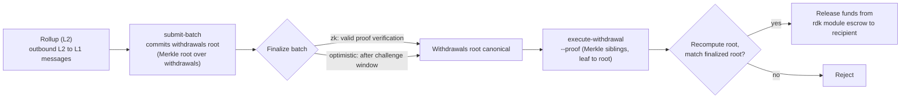

# ZK / STARK وعمليات السحب

تغطي هذه الصفحة موضوعين مترابطين: **أنظمة إثبات ZK** (`snark` و`stark`) المستخدمة من قبل رول-أب المُسوّاة بـ ZK، و**تدفّق السحب من L2 إلى L1** الذي ينقل الأموال من رول-أب عائدةً إلى QoreChain بمجرد أن تُنهى دُفعة ما.

:::caution قدرة في مرحلة مبكرة
لم يُنشأ أي رول-أب على أي من الشبكتين حتى الآن (جرى التحقق في 27 أكتوبر 2026)، لذلك لم يُختبر التحقق من الإثباتات ولا تدفّق السحب الموصوف هنا على رول-أب حي. يمكن أن تنجح عمليات السحب على الشبكة الرئيسية فقط منذ الإصدار v3.2.3 (الارتفاع 3,662,051، 20 أكتوبر 2026)، حين دخل دفتر الضمان الخاص بكل رول-أب حيّز العمل (راجع [مصدر الأموال](#where-the-funds-come-from))؛ وقبل ذلك كانت كل عملية سحب تفشل. **لا يمكن استخدام تسوية ZK على أي من الشبكتين بعد** (الملف الشخصي `defi` وكل رول-أب `zk`): فالسلسلة لا تملك طريقة لتسجيل مفتاح تحقق، لذلك تُرفض كل دُفعة ZK بعد دفع رسومها، ويُخطَّط لتسجيل المفاتيح في إصدار السلسلة v3.2.7. التحقق من STARK تجريبي. تحقّق على الشبكة التجريبية **`qorechain-diana`** ولا تفترض ضمانات مُصلّبة للإنتاج على الشبكة الرئيسية.
:::

---

## أنظمة إثبات ZK

تُرفق رول-أب المُسوّاة بـ ZK (وضع التسوية `zk`) إثبات صلاحية بكل دُفعة تسوية، مُثبتةً صحة انتقال الحالة دون إعادة تنفيذ معاملات رول-أب. تدعم تسوية ZK نظامي إثبات:

| نظام الإثبات | الخصائص |
| ------------ | --------------- |
| **`snark`** | إثباتات موجزة (Groth16 فوق BLS12-381)، يُتحقق منها على السلسلة مقابل مفتاح التحقق الخاص بالرول-أب |
| **`stark`** | إثباتات شفافة، دون إعداد موثوق — تجريبي؛ اختياري (opt-in) ومرتبط بدائرة عرض توضيحي |

يتطلب وضع التسوية `zk` أحد النظامين `snark` أو `stark`؛ ويُفرَض الاقتران على السلسلة عند إنشاء رول-أب. في المقابل، تستخدم التسوية `optimistic` نظام إثبات `fraud`، وتستخدم التسويتان `based` و`sovereign` القيمة `none`. راجع **[نظرة عامة على الرول-أب](/rollups/overview)** للاطلاع على مصفوفة التوافق الكاملة.

### النهائية

بخلاف رول-أب التفاؤلية — التي تنتظر انقضاء نافذة الطعن بإثبات الاحتيال — يمكن لدُفعة ZK أن تُنهى عند **التحقق الصالح من الإثبات**، دون نافذة نزاع. هذه هي المقايضة الجوهرية لتسوية ZK: نهائية أقوى وأسرع مقابل تكلفة وتعقيد توليد الإثباتات.

### النضج

**لا يمكن استخدام تسوية ZK على أي من الشبكتين بعد.** يُفترض أن يُتحقق من دُفعات SNARK على السلسلة (Groth16 فوق BLS12-381، بثلاثة مدخلات عامة: جذر الحالة السابقة وجذر الحالة الجديدة وتجزئة البيانات) مقابل مفتاح تحقق مخزّن مع الرول-أب. لا تملك السلسلة طريقة لتسجيل ذلك المفتاح، لذلك لا يملكه أي رول-أب أُنشئ بتسوية `zk`، بما في ذلك كل رول-أب من الملف الشخصي `defi` أو من القالب `defi-rollup`، وتُرفض كل دُفعة ZK يرسلها بعد دفع رسومها. يُخطَّط لتسجيل المفاتيح في إصدار السلسلة v3.2.7؛ وإلى أن يصدر، لا تنشئ رول-أب ZK ولا تموّل واحدًا. وعندما يصدر، تظل دائرة العرض التوضيحي في قالب `defi` (مُضاعِف `snarkjs`) عاجزة عن التحقق، لأنها لا تملك المدخلات العامة التي تفحصها السلسلة؛ وستحتاج إلى دائرتك الخاصة. التحقق من STARK تجريبي: فهو اختياري (opt-in) ويفحص دائرة عرض توضيحي، وليس انتقال الحالة الخاص برول-أب الخاص بك. وللتسوية التي يمكنك استخدامها اليوم، اختر `optimistic` (الملفان الشخصيان `nft` و`custom`).

---

## كيف تحمل الدُفعات عمليات السحب

عندما تُسوّي رول-أب دُفعة ما، يمكن لتلك الدُفعة أيضًا أن تُلزم رسائل رول-أب الصادرة عبر الطبقات — أي **عمليات السحب من L2 إلى L1** الخاصة بها. مفهوميًا:

* يمكن لدُفعة مُنهاة أن تحمل التزامًا بمجموعة عمليات السحب الخاصة بها (جذر Merkle فوق رسائل السحب الخاصة بالدُفعة).
* كل عملية سحب فردية هي ورقة (leaf) تحت ذلك الجذر، مُعرَّفة بفهرس دُفعتها وفهرس سحب.
* بمجرد إنهاء الدُفعة، يمكن لأي طرف أن يُثبت أن ورقة سحب محددة مُدرجة تحت الجذر المُلتزَم به، وأن يُطلق صرف الأموال.

لهذا السبب تعتمد عمليات السحب على التسوية: لا يمكن تنفيذ عملية سحب إلا مقابل دُفعة **مُنهاة**، لأن الإنهاء هو ما يجعل جذر عمليات السحب المُلتزَم به معياريًا.

للاطلاع على كيفية إرسال الدُفعات وإنهائها — بما في ذلك `submit-batch` ومسار النزاع `challenge-batch` لرول-أب التفاؤلية — راجع **[نشر رول-أب](/rollups/deploying-a-rollup)**.

---

## تنفيذ عملية سحب: `execute-withdrawal`

يُنهي الأمر `execute-withdrawal` عملية سحب من L2 إلى L1 مقابل جذر عمليات السحب الخاص بدُفعة مُنهاة. فهو يُثبت أن ورقة سحب مُلتزَم بها في ذلك الجذر ويدفع للمستلم من حساب ضمان وحدة rdk. هذا الإجراء **بلا أذونات (permissionless)** — يجوز لأي شخص إرسال إثبات صالح. وكأي معاملة في المسار الأصلي (native lane) فهو يحتاج إلى التوقيع المشترك الهجين ما بعد الكمومي، لذلك ابنِه باستخدام `--generate-only` ثم وقّعه بالتوقيع المشترك (cosign) (راجع [نشر رول-أب](/rollups/deploying-a-rollup)). لم تُختبر عمليات السحب على رول-أب حي بعد؛ تعامل مع التدفّق على أنه غير مُختبَر. تحقّق مما يلي قبل أن تدفع رسومًا، لأن السلسلة سترفض المعاملة بخلاف ذلك: يجب أن تكون الفئة `uqor` تمامًا، وأن يكون المبلغ موجبًا، وأن يضم الإثبات 64 مستوى على الأكثر وأن يكون كل شقيق بطول 32 بايت بالضبط، وأن يكون المُرسِل والمستلم عنوانين صالحين من الشكل `qor1…`، وأن تكون الدُفعة مُنهاة وقد التزمت بـ `withdrawals_root`، وألا يكون الرول-أب متوقفًا، وألا تكون ورقة السحب تلك قد دُفعت من قبل. ويجري `@qorechain/rdk` بلغة TypeScript (من 0.6.0 إلى 0.6.2) المجموعة الأولى من هذه الفحوص نيابةً عنك (`withdrawalErrors`: العناوين والفئة والمبلغ وعمق الإثبات وطول الشقيق)، وتُطلق `executeWithdrawal` استثناءً قبل البث إذا أخفق أي منها؛ أما شروط الدُفعة والرول-أب والسجل فتعتمد على حالة السلسلة، وهذا الفحص لا يقرؤها.

```bash
qorechaind tx rdk execute-withdrawal \
  [rollup-id] [batch-index] [withdrawal-index] [recipient] [denom] [amount] \
  --proof <sibling-hash-1>,<sibling-hash-2>,... \
  --from mykey \
  --chain-id qorechain-diana \
  --gas 400000 --fees 40000uqor \
  --generate-only > withdrawal.json
qorechaind tx pqc cosign withdrawal.json --from mykey --pqc-key mypqckey --chain-id qorechain-diana
```

**الوسائط الموضعية:**

| الوسيط | الوصف |
| -------- | ----------- |
| `rollup-id` | الرول-أب التي تنتمي إليها عملية السحب |
| `batch-index` | الدُفعة المُنهاة التي يُلزم جذر عمليات السحب الخاص بها هذه العملية |
| `withdrawal-index` | فهرس ورقة السحب ضمن تلك الدُفعة |
| `recipient` | العنوان الذي سيُصرف له |
| `denom` | الفئة المراد دفعها |
| `amount` | المبلغ المراد دفعه |

**العَلَم (Flag):**

| العَلَم | الوصف |
| ---- | ----------- |
| `--proof` | تجزئات Merkle الشقيقة بصيغة hex مفصولة بفواصل، مرتّبة من الورقة إلى الجذر، تُثبت أن ورقة السحب مُلتزَم بها في جذر عمليات السحب الخاص بالدُفعة |

قيمة `--proof` هي إثبات الإدراج: التجزئات الشقيقة على طول المسار من ورقة السحب صعودًا إلى جذر عمليات السحب المُلتزَم به الخاص بالدُفعة. تُعيد الوحدة حساب الجذر من الورقة والأشقاء المُقدَّمين وتتحقق منه مقابل الجذر المُلتزَم به للدُفعة المُنهاة قبل الدفع.

### ترميز الورقة والعقدة {#leaf-and-node-encoding}

* **الورقة** = SHAKE-256 (32 بايت) لـ `rollup_id`، ثم بايت `0x00`، ثم فهرس السحب (8 بايت، big-endian)، ثم سلسلة `recipient`، ثم `0x00`، ثم سلسلة `denom`، ثم `0x00`، ثم `amount` (8 بايت، big-endian).
* **الأب** = SHAKE-256 لـ `left || right`. في كل مستوى يحدد البت المقابل من فهرس السحب الجهة: القيمة `0` تعني أن الورقة (أو التجزئة الجارية) هي العقدة اليسرى.
* يجب أن تكون كل تجزئة شقيقة بطول 32 بايت بالضبط.

:::caution دوال Merkle العامة المساعدة لا تتطابق
تستخدم الدالتان العامتان `binaryMerkleRoot` / `binaryMerkleProof` في RDK (ومكافئاتهما في Python وGo وRust وJava) افتراضيًا SHA-256 مع تكرار العقد الفردية، بينما تستخدم السلسلة SHAKE-256 (جرى التحقق مقابل 0.6.2). استبدل التجزئة وترميز الورقة بالقواعد أعلاه، وإلا فلن يتحقق الإثبات على السلسلة.
:::

### مصدر الأموال {#where-the-funds-come-from}

تُدفع عملية السحب من **حصة الرول-أب نفسها المودعة في الضمان** (الحصة ناقص حرق الإنشاء بنسبة 1%). تقع ضمانات جميع الرول-أب في رصيد وحدة مجمَّع واحد، ومنذ الإصدار **v3.2.3** يكون **دفتر ضمان** خاص بكل رول-أب هو الحساب لما تحتفظ به كل رول-أب: يقيّد `create-rollup` فيه الضمان الذي تحتفظ به الرول-أب، وتُدفع منه عملية السحب أو مكافأة إثبات الاحتيال وتُخصم منه، وتُرفض عملية السحب الأكبر مما لا تزال الرول-أب تحتفظ به بخطأ ضمان غير كافٍ. ولا يردّ `stop-rollup` إلا ما تبقّى ويُصفّر الدفتر، ولا تدفع رول-أب متوقفة أي عمليات سحب أخرى. ولذلك لا يمكن دفع عملية سحب أُثبتت لرول-أب واحدة من حصة رول-أب أخرى. وتحمل استعلامات الرول-أب الحقل `escrow_balance` (مقدار uqor الذي لا يزال محتفظًا به لتلك الرول-أب). لا توجد في الوحدة رسالة إيداع من L1 إلى L2، لذلك فهذا ليس جسرًا لأموال المستخدمين.

---

## تدفّق السحب من البداية إلى النهاية

*المسار من L2 إلى L1: تُلزم دُفعة تسوية جذر عمليات سحب، ثم تُنهى الدُفعة، ثم يُحرّر إثبات إدراج بلا أذونات الأموالَ المُودعة في الضمان على QoreChain.*



1. **سوِّ دُفعة.** يُرسل مُشغّل رول-أب دُفعة تسوية باستخدام `submit-batch`. يمكن للدُفعة أن تُلزم جذر عمليات سحب فوق رسائلها الصادرة من L2 إلى L1.
2. **أنهِ.** تُنهى الدُفعة وفقًا لوضع تسوية رول-أب — عند التحقق الصالح من الإثبات بالنسبة لـ `zk`، أو بعد نافذة الطعن بالنسبة لـ `optimistic` (التي يمكن خلالها لـ `challenge-batch` الاعتراض عليها). تبلغ نافذة optimistic افتراضيًا 100,800 كتلة للدُفعة المُرسلة قبل ترقية v3.2.4؛ ومن v3.2.4 تُقاس بالثواني من زمن الكتلة للدُفعات المُرسلة ابتداءً من ارتفاع الترقية (شبكة الاختبار منذ الارتفاع 8,337,253 في 19 أكتوبر 2026، والشبكة الرئيسية منذ الارتفاع 3,742,566 في 23 أكتوبر 2026).
3. **أثبِت ونفّذ.** بمجرد الإنهاء، يُرسل أي شخص `execute-withdrawal` مع إثبات إدراج Merkle (`--proof`) لورقة السحب المحددة. تتحقق الوحدة من الإدراج مقابل جذر عمليات السحب الخاص بالدُفعة المُنهاة وتدفع للمستلم من الضمان.

ولأن الخطوة 3 بلا أذونات وقائمة على الإثبات، فإن عملية السحب لا تعتمد على تعاون مُشغّل رول-أب بمجرد إنهاء الدُفعة الحاملة لها.

---

## ذات صلة

* **[نظرة عامة على الرول-أب](/rollups/overview)** — نماذج التسوية ومصفوفة توافق نظام الإثبات.
* **[نشر رول-أب](/rollups/deploying-a-rollup)** — أوامر المُشغّل `submit-batch` و`challenge-batch`.
* **[مجموعة تطوير الرول-أب](/architecture/rollup-development-kit)** — المرجع منخفض المستوى للوحدة.
