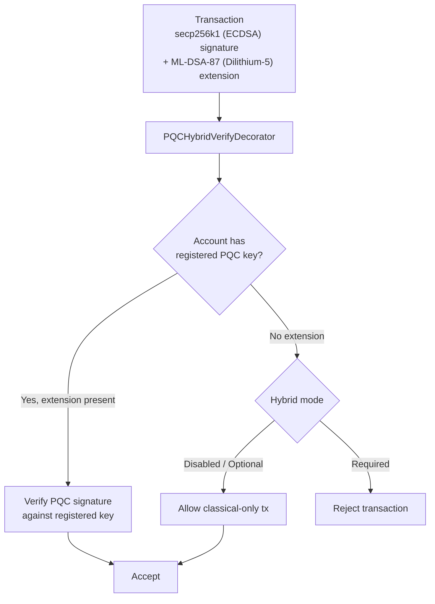

# Post-Quantum-Sicherheit

QoreChain ist **von Anfang an (at genesis) mit Post-Quantum-Kryptografie (PQC) gebaut** — nicht nachträglich als Upgrade ergänzt. Das Modul `x/pqc` stellt gitterbasierte digitale Signaturen und Schlüsselkapselung als primäre kryptografische Primitive bereit, ergänzt um ein per Governance gesteuertes Framework für Algorithmusagilität zur langfristigen Resilienz.

Die vollständige PQC-Baseline — **Dilithium-5 (Signaturen) + ML-KEM-1024 (KEM) + SHAKE-256 (Hash)** — ist nun vollständig und der Netzwerkstandard. In den Live-Netzwerken (v3.2.x) sind Hybridsignaturen auf dem Cosmos-Transaktionspfad **standardmäßig erforderlich**: `hybrid_signature_mode = required` und `allow_classical_fallback = false`. Jede Transaktion auf dem Cosmos-Pfad muss eine Dilithium-5-Signatur zusätzlich zu ihrer klassischen secp256k1-Signatur tragen; rein klassische Transaktionen von einem PQC-Konto werden abgelehnt, und der klassische Downgrade-Pfad ist geschlossen. Das Mainnet läuft auf v3.2.3 und das Testnet auf v3.2.4; was die Releases v3.2.2 und v3.2.3 zu den Post-Quantum-Regeln hinzugefügt haben (Schlüsselintegrität, optionaler Besitznachweis, eingegrenzte EVM-Fenster, EIP-7702-Zustimmung), ist unter [Regeln zur Schlüsselintegrität](#key-integrity), [Besitznachweis](#proof-of-possession) und [EIP-7702-Delegationen](#eip-7702) beschrieben.

## Designprinzipien

* **PQC standardmäßig erforderlich**: Post-Quantum-Signaturen sind auf dem Cosmos-Pfad verpflichtend. Klassische secp256k1-Signaturen allein genügen nicht mehr — `allow_classical_fallback = false`.
* **Hybrid als Standard**: Cosmos-Transaktionen tragen gleichzeitig sowohl eine klassische secp256k1-Signatur als auch eine Dilithium-5-PQC-Signatur. Der rein klassische Fallback ist geschlossen.
* **Algorithmusagilität**: Das Register der kryptografischen Algorithmen wird per Governance gesteuert, sodass das Netzwerk neue Algorithmen einführen oder kompromittierte ohne Hard Forks ausmustern kann.
* **Deterministische Verifizierung**: Die gesamte Signaturverifizierung ist deterministisch und über alle Validatorenknoten hinweg reproduzierbar.

## Unterstützte Algorithmen

| Algorithmus       | Standard             | Kategorie          | NIST-Level | Öffentlicher Schlüssel  | Privater Schlüssel | Signatur / Chiffrat | Geteiltes Geheimnis |
| --------------- | -------------------- | ----------------- | ---------- | ----------- | ----------- | ---------------------- | ------------- |
| **Dilithium-5** | ML-DSA-87 (FIPS 204) | Signatur         | 5          | 2,592 bytes | 4,896 bytes | 4,627 bytes            | --            |
| **ML-KEM-1024** | FIPS 203             | Schlüsselkapselung | 5          | 1,568 bytes | 3,168 bytes | 1,568 bytes            | 32 bytes      |

Beide Algorithmen arbeiten auf **NIST-Sicherheitslevel 5**, der höchsten standardisierten Sicherheitskategorie, und bieten einen Schutz, der gegen sowohl klassische als auch Quantenangreifer dem von AES-256 entspricht.

## Kryptografisches Backend

PQC-Operationen sind in einem performanten, speichersicheren kryptografischen Backend implementiert, das gitterbasiertes Signieren, Verifizieren und Schlüsselkapselung für die QoreChain-Laufzeitumgebung bereitstellt. Das Backend bietet:

Algorithmus-spezifische Operationen:

* Dilithium-5-Schlüsselerzeugung, -Signierung und -Verifizierung
* ML-KEM-1024-Schlüsselerzeugung, -Kapselung und -Entkapselung
* Deterministische Random-Beacon-Generierung (`seed`, `epoch`)

Algorithmus-bewusste Operationen:

* `Keygen(algorithmID)` — Schlüsselpaar für jeden registrierten Algorithmus erzeugen
* `Sign(algorithmID, privkey, message)` — Signatur erstellen
* `Verify(algorithmID, pubkey, message, signature)` — Signatur verifizieren
* `AlgorithmInfo(algorithmID)` — Schlüssel-/Ausgabegrößen abfragen
* `ListAlgorithms()` — Alle unterstützten Algorithmen auflisten

Alle Signier- und Verifizierungsoperationen sind deterministisch und erzeugen über jeden Validatorknoten und jede unterstützte Plattform hinweg identische Ergebnisse.

Dieselben Primitive — ML-DSA (FIPS-204), ML-KEM (FIPS-203) und SHAKE-256 (FIPS-202) — stehen Wallets und Integratoren über die quelloffene Bibliothek [**qorechain-pqc**](https://github.com/qorechain/qorechain-pqc) zur Verfügung, die eine konsistente, byte-kompatible API über sechs Sprachen (JavaScript/TypeScript, Rust, Go, C, Python, Java) bereitstellt. Siehe [Post-Quantum Signing](/developer-guide/post-quantum-signing).

## Schlüsselregistrierung {#key-registration}

Konten registrieren PQC-Schlüssel ausdrücklich über `MsgRegisterPQCKey` (Legacy, standardmäßig Dilithium-5) oder `MsgRegisterPQCKeyV2` (algorithmus-bewusst); die Chain registriert nie von sich aus einen Schlüssel, und der CLI-Ablauf lautet `qorechaind tx pqc gen-key <name>` gefolgt von `qorechaind tx pqc register-key <public_key_hex> hybrid --from <key>` (siehe [Erste Transaktion](/getting-started/first-transaction#register-pqc-key)). Jede Nachricht enthält:

* **Sender**: Die Kontoadresse, die den Schlüssel registriert.
* **PublicKey**: Die Bytes des öffentlichen PQC-Schlüssels.
* **AlgorithmID**: Die Kennung des PQC-Algorithmus (nur v2).
* **ProofOfPossession**: Optionale Signatur durch den neuen Schlüssel (nur v2, ab v3.2.3); siehe [Besitznachweis](#proof-of-possession).
* **KeyType**: Entweder `hybrid` oder `pqc_only` (ein dritter Wert, `classical_only`, existiert weiterhin im Schema, wird aber seit v3.2.3 abgelehnt):

| Schlüsseltyp         | Beschreibung                                                              |
| ---------------- | ------------------------------------------------------------------------ |
| `hybrid`         | Sowohl klassischer (ECDSA) als auch PQC-Schlüssel. Transaktionen tragen Doppelsignaturen. |
| `pqc_only`       | Wird wie `hybrid` registriert: Die klassische secp256k1-Signatur wird weiterhin von den Standard-Signaturprüfungen verifiziert, und zusätzlich ist die PQC-Signatur erforderlich. |
| `classical_only` | **Seit v3.2.3 abgelehnt.** Eine Registrierung mit diesem Schlüsseltyp erfasst keinen verwendbaren Post-Quantum-Schlüssel und würde das Konto am Signieren hindern, daher weist die Chain sie zurück. |

### Regeln zur Schlüsselintegrität (v3.2.3) {#key-integrity}

Seit dem Upgrade v3.2.3 (Mainnet-Höhe 3,662,051, 20. Oktober 2026; Testnet-Höhe 8,003,746) wendet die Chain diese Regeln auf Post-Quantum-Schlüssel an. Unterhalb dieser Höhe wurde keine davon durchgesetzt.

| Regel | Verhalten |
| --- | --- |
| Keine schwachen Schlüssel | Eine Registrierung wird abgelehnt, wenn der Schlüsseltyp `classical_only` ist, der Schlüssel leer ist oder der Schlüssel degeneriert ist: ein Schlüssel der richtigen Länge, dessen Struktur keinen Post-Quantum-Schutz bietet. Erzeugen Sie Schlüssel mit `tx pqc gen-key` oder der Bibliothek `qorechain-pqc` und registrieren Sie das, was diese ausgeben |
| Keine Schlüsselwiederverwendung | Eine Rotation oder Migration wird abgelehnt, wenn der neue Schlüssel einer ist, den das Konto zuvor schon verwendet hat. Die Chain merkt sich einen Hash jedes Schlüssels, von dem ein Konto weg rotiert oder migriert ist |
| Konten mit Schlüssel brauchen die Hybridsignatur | Ein Konto, das bereits einen verwendbaren Schlüssel besitzt, muss auch bei einer Register- oder Migrate-Transaktion seine Hybridsignatur tragen. Die Ausnahme für rein klassische Signaturen gilt nur noch für ein Konto **ohne** registrierten Schlüssel oder eines, dessen gespeicherter Eintrag keinen verwendbaren Schlüssel enthält (den `MsgRegisterPQCKeyV2` dann ersetzen darf) |
| Keine schlüssellose Erweiterung | Im Modus `required` kann ein Konto ohne registrierten Schlüssel nicht passieren, indem es eine Hybrid-Erweiterung anhängt, die nichts verifizieren kann; nur eine Registrierung darf ohne eine solche passieren |
| Eine Erweiterung | Eine Transaktion trägt höchstens eine Hybridsignatur-Erweiterung |
| Keine Schlüsselnachrichten über Authz | `MsgRegisterPQCKey`, `MsgRegisterPQCKeyV2`, `MsgRotatePQCKey` und `MsgMigratePQCKey` können nicht im Namen eines Kontos über `x/authz` ausgeführt werden; die eigene Signatur des Kontos ist erforderlich |
| Governance-Schutzmechanismen für Algorithmen | Das Ausmustern oder Deaktivieren eines Algorithmus darf die Chain nicht ohne aktiven Signaturalgorithmus zurücklassen, und der Ersatzalgorithmus muss signieren können |

v3.2.2 hat eine verwandte Prüfung hinzugefügt: Eine Registrierung validiert den klassischen `ecdsa_pubkey`, den sie trägt, und bindet ihn an das signierende Konto, sodass ein Konto keinen klassischen Schlüssel erfassen kann, der nicht sein eigener ist.

Nodes prüfen diese Fälle außerdem im Mempool, sodass eine Transaktion, die nur scheitern kann, nicht weitergeleitet wird und keine Gebühr kostet.

### Besitznachweis (optional) {#proof-of-possession}

`MsgRegisterPQCKeyV2` hat ein optionales Feld `proof_of_possession`. Ist es vorhanden, verifiziert die Chain es; fehlt es, läuft die Registrierung wie bisher ab (der Nachweis ist **nicht erforderlich**). Der Nachweis ist eine Signatur durch den zu registrierenden Schlüssel über

```text
qorechain-pqc-pop-v1|<chain-id>|<algorithm-id>|<account-address>|<hex(public-key)>
```

sodass ein Nachweis, der für ein Konto oder eine Chain erstellt wurde, auf einem anderen nichts beweist. Die CLI erstellt ihn für Sie, wenn Sie die lokale Schlüsseldatei benennen:

```bash
qorechaind tx pqc register-key-v2 dilithium5 <pubkey-hex> hybrid \
  --pqc-key mypqc --from mykey --chain-id qorechain-vladi --gas 600000 --fees 60000uqor
```

Die Registrierung ist nur für ein Konto ohne Schlüssel von der Hybrid-Anforderung ausgenommen, daher wird diese Transaktion allein mit dem klassischen Schlüssel des Kontos signiert. Ein fehlerhafter Nachweis wird mit `ErrInvalidProofOfPossession` (Code 231 im Modul `pqc`) abgelehnt.

**Ab v3.2.4 (Testnet seit dem 19. Oktober 2026; Mainnet ab Höhe 3.742.566):** Der Kontoeintrag erhält ein boolesches Feld `possession_proven`, das von `GET /qorechain/pqc/v1/account/{address}` zurückgegeben wird. Es ist `true`, wenn der aktuelle Schlüssel mit einem gültigen Nachweis registriert wurde oder über eine Rotation oder Migration kam (beide verifizieren eine Signatur des neuen Schlüssels über Bytes, die die Chain, das Konto und den Schlüssel benennen); eine Registrierung ohne Nachweis erfasst `false`, und ein Schlüssel, der sich ohne Nachweis ändert, löscht das Flag. Das Mainnet v3.2.3 meldet das Feld vor der Upgrade-Höhe nicht. Der Nachweis bleibt unter v3.2.4 für Kontoschlüssel optional.

## Hybridsignaturen {#hybrid-signatures}

Das Hybridsignatursystem verlangt, dass Cosmos-Pfad-Transaktionen gleichzeitig **sowohl** eine klassische Signatur als auch eine PQC-Signatur tragen. Dies bietet Defense-in-Depth: Selbst wenn ein Verfahren gebrochen wird, schützt das andere die Transaktion.

Mit dem Netzwerkstandard `hybrid_signature_mode = required` muss jede Cosmos-Pfad-Transaktion die Dilithium-5-Erweiterung zusätzlich zur secp256k1-Signatur enthalten. Die einzigen Ausnahmen (für das Bootstrapping) sind **Genesis-Gentxs (Höhe 0)**, die **PQC-Schlüsselregistrierung** (`MsgRegisterPQCKey`, `MsgRegisterPQCKeyV2`) von einem Konto, das keinen registrierten Schlüssel hat (oder dessen Eintrag keinen verwendbaren Schlüssel enthält), die rein klassisch sein darf, damit das Konto seinen ersten PQC-Schlüssel registrieren kann, sowie ein Unjail von einem Operatorkonto ohne registrierten Schlüssel. Seit v3.2.3 braucht eine Registrierung oder Migration von einem Konto, das bereits einen verwendbaren Schlüssel besitzt, wie jede andere Transaktion die Hybridsignatur (siehe [Regeln zur Schlüsselintegrität](#key-integrity)).

**Der EVM-Lane wird stattdessen durch ein Autorisierungsfenster geschützt.** Eine EVM-Transaktion kann keine zweite (ML-DSA-)Signatur tragen — Standard-Wallets erzeugen eine einzige secp256k1-Signatur über eine Ethereum-Transaktion und bieten keine Möglichkeit, eine weitere anzuhängen. Die Post-Quantum-Autorisierung läuft daher der Transaktion *voraus*: Das Konto öffnet mit einer Cosmos-Lane-Nachricht (`MsgOpenEVMWindow`), die die gewöhnliche Hybridsignatur trägt, ein begrenztes **EVM-Autorisierungsfenster**, und der EVM-Lane lässt dann nur Transaktionen zu, die von einem aktiven Fenster abgedeckt sind. Seit v3.2.0 wird eine EVM-Transaktion abgelehnt, sofern ihr Absender nicht (1) einen registrierten Post-Quantum-Schlüssel hat und (2) ein aktives Fenster mit verbleibenden Blöcken, Transaktionen und Wert besitzt. Innerhalb eines Fensters funktioniert eine gewöhnliche MetaMask-/ethers-/Hardhat-Transaktion unverändert, weil die Prüfung den Chain-Zustand liest, nicht die Transaktion. Siehe [EVM-Autorisierungsfenster](/getting-started/first-transaction#evm-window).

Seit v3.2.3 kann ein Fenster beim Öffnen außerdem **eingegrenzt** werden: `--native-only` beschränkt es auf einfache Transfers von nativem QOR (keine Calldata, keine Vertragserstellung, kein Empfänger, der Code trägt, keine EIP-7702-Autorisierung), und `--allowed-targets 0x…,0x…` lässt nur aufgelistete Empfänger zu und lehnt die Vertragserstellung ab. Ein Fenster, das ohne Eingrenzung geöffnet wird, lässt das zu, was es schon immer zugelassen hat. Die Eingrenzung ist Teil von `MsgOpenEVMWindow` (`native_only`, `allowed_targets`).

### EIP-7702-Delegationen {#eip-7702}

Ein EIP-7702-Autorisierungstupel installiert Code auf dem Konto, das es signiert hat, und diese Signatur ist eine klassische secp256k1-Signatur, die jeder in einer Typ-4-Transaktion mitführen kann. Ab v3.2.2 (Mainnet-Höhe 3,556,788) lässt der EVM-Lane daher eine Typ-4-Transaktion nur zu, wenn **jede Autorität, deren Tupel wirksam würde,** einen registrierten Post-Quantum-Schlüssel besitzt und mit einer hybrid signierten Cosmos-Lane-Nachricht genau der Delegation **zugestimmt** hat, die das Tupel installiert.

| Punkt | Detail |
| --- | --- |
| Zustimmung erteilen | `qorechaind tx pqc authorize-evm-delegation <delegate-0x-address> <blocks>` (`MsgAuthorizeEVMDelegation`): benennt die Delegate-Adresse, die das Tupel tragen muss, und wie lange die Zustimmung verwendbar bleibt (höchstens 17,280 Blöcke, dieselbe Grenze wie bei einem Fenster) |
| Eine Delegation löschen | Die Nulladresse als Delegate stimmt dem Löschen zu. `tx pqc clear-evm-delegation` (`MsgClearEVMDelegation`) löscht eine bestehende Delegation ohne jede EVM-Transaktion |
| Einmalige Verwendung | Eine Zustimmung wird von der Transaktion verbraucht, die die Delegation installiert, ersetzt jede frühere Zustimmung für das Konto und wird durch `MsgCloseEVMWindow` widerrufen |
| Abrufen | `qorechaind query pqc evm-delegation-consent <address>` oder `GET /qorechain/pqc/v1/evm_delegation_consent/{address}` (Felder `live`, `delegate`, `granted_height`, `expiry_height`, `current_delegate`, `nonce`) |
| Grenzen | Höchstens 8 Autorisierungen pro Typ-4-Transaktion. Wert, der ein delegiertes Konto verlässt, wird dessen eigenem Fenster belastet. Eine fehlgeschlagene Typ-4-Transaktion behält die Autorisierungen, die sie angewendet hat |
| Gesponserte Delegation | Funktioniert weiterhin: Der Sponsor zahlt aus seinem eigenen Fenster, und die Autorität stimmt vorab nur zu |

### Cosign-Ablauf

Um eine konforme Cosmos-Transaktion zu erzeugen, wird die klassische secp256k1-Signatur über die Standard-Sign-Bytes berechnet (die die PQC-Erweiterung ausschließen), und eine Dilithium-5-Signatur wird über die v2-Signierbytes berechnet (siehe [Signierte Bytes (v2)](#sign-bytes-v2) unten) und als Erweiterung `PQCHybridSignature` angehängt. Standardmäßiges CosmJS-/Relayer-Tooling muss diese Erweiterung erzeugen, um auf dem Cosmos-Pfad zu transagieren. Heute geschieht dies über:

* `qorechaind tx pqc gen-key <name>` — einen Dilithium-5-Schlüssel erzeugen.
* `qorechaind tx pqc cosign <unsigned_tx_file> --from <key> --pqc-key <name>` — die Dilithium-5-Cosignatur an eine mit `--generate-only` erstellte Transaktion anhängen.
* Das Hybrid-Signing des QoreChain SDK — `buildHybridTx`. Der Schlüssel des Kontos muss bereits mit `MsgRegisterPQCKey` registriert sein.
* [QoreX](/qorex/overview), das beides für Sie erledigt.

*Eine Transaktion, die mit secp256k1 (ECDSA) plus ML-DSA-87 (Dilithium-5) signiert und vom Ante-Handler im chainweiten Durchsetzungsmodus verifiziert wird.*



### Signierte Bytes (v2) {#sign-bytes-v2}

Die ML-DSA-Signatur deckt domänenmarkierte, an die Chain gebundene Bytes ab. Ab v3.2.0 verifiziert die Chain **ausschließlich** diese Form:

```text
"qorechain-pqc-hybrid-v2" ‖ BE64(len(chainID)) ‖ chainID ‖
BE32(len(B0)) ‖ B0 ‖ BE32(len(authInfo)) ‖ authInfo
```

Dabei ist `B0` der Transaktions-Body, serialisiert **ohne** die PQC-Erweiterung, und `authInfo` sind die AuthInfo-Bytes unverändert (`‖` ist Verkettung, Längen sind Big-Endian). Das Domänen-Tag verhindert, dass eine in einem anderen Kontext erzeugte Signatur (eine Login-Challenge, eine Nachrichtensignatur-Anfrage) als Transaktionssignatur gültig ist, und die Bindung der Chain-ID macht die Post-Quantum-Signatur selbst in jedem anderen Netzwerk ungültig. Die erste Form (`BE32(len(B0)) ‖ B0 ‖ BE32(len(authInfo)) ‖ authInfo`) wurde nur unterhalb der Upgrade-Höhe verifiziert; kein Block akzeptiert beide. Payloads für Schlüsselmigration und Bridge-Attestierungen wurden auf dasselbe domänenmarkierte, an die Chain gebundene Schema umgestellt.

**Welche Form verifiziert mein Netzwerk?** Fragen Sie den Knoten, ob das Upgrade angewendet wurde:

```bash
curl -s https://api.qore.host/cosmos/upgrade/v1beta1/applied_plan/v3.2.0         # height 2981742 on mainnet
curl -s https://api-testnet.qore.host/cosmos/upgrade/v1beta1/applied_plan/v3.2.0 # height 5920000 on testnet
```

(`"height":"0"` bedeutet nicht angewendet.) Beide Netzwerke haben die Änderung längst angewendet, daher signiert ein aktueller Client überall die v2-Form; die Prüfung ist relevant, wenn Sie alte Blöcke erneut abspielen oder verifizieren. Die CLI erledigt das mit `--sign-bytes auto`, und aktuelle Releases von SDK und wallet-adapter tun dasselbe. Ein Client mit der falschen Form erzeugt einen Digest, den die Chain ablehnt — er schlägt geschlossen fehl (fail closed).

### Format der TX-Erweiterung

PQC-Signaturen werden Transaktionen als **TX-Erweiterung** mit der Type-URL `/qorechain.pqc.v1.PQCHybridSignature` angehängt:

```text
{
  "algorithm_id": 1,
  "pqc_signature": "<4627 bytes for Dilithium-5>",
  "pqc_public_key": "<2592 bytes, optional>"
}
```

Das Feld `pqc_public_key` ist optional und rein informativ; Schlüssel werden ausschließlich durch eine ausdrückliche Registrierungsnachricht registriert (siehe [Schlüsselregistrierung](#key-registration)).

### PQCHybridVerifyDecorator

Der Ante-Handler `PQCHybridVerifyDecorator` verarbeitet Hybridsignaturen mit einer dreifachen Verifizierungslogik:

| Szenario | Konto hat PQC-Schlüssel | Erweiterung vorhanden | Öffentlicher Schlüssel in Erweiterung | Ergebnis                                              |
| -------- | ------------------- | ----------------- | ----------------------- | --------------------------------------------------- |
| Pfad 1   | Ja                 | Ja               | --                      | PQC-Signatur gegen registrierten Schlüssel verifizieren         |
| Pfad 3a  | Nein                  | Nein                | --                      | **Optional-Modus**: Rein klassische Transaktion zulassen |
| Pfad 3b  | Nein                  | Nein                | --                      | **Required-Modus**: Transaktion ablehnen               |
| Pfad 4   | Ja                 | Nein                | --                      | Wird vom Standard-PQCVerifyDecorator behandelt          |

Ein Schlüssel muss mit `MsgRegisterPQCKey` / `MsgRegisterPQCKeyV2` registriert sein, bevor das Konto hybrid signierte Transaktionen sendet; das Feld `pqc_public_key` der Erweiterung registriert nichts.

### Hybridsignatur-Modi

Das chainweite Hybrid-Durchsetzungslevel ist per Governance konfigurierbar. Der **aktuelle Netzwerkstandard ist `required`**:

| Modus         | ID | Standard | Verhalten                                                                                                          |
| ------------ | -- | ------- | ----------------------------------------------------------------------------------------------------------------- |
| **Disabled** | 0  | Nein      | Nur klassische Signaturen. PQC-Erweiterungen werden ignoriert.                                            |
| **Optional** | 1  | Nein      | PQC-Erweiterungen werden verifiziert, sofern vorhanden. Konten ohne PQC-Schlüssel dürfen nur mit klassischen Signaturen transagieren.    |
| **Required** | 2  | **Ja** | Alle Cosmos-Pfad-Transaktionen müssen sowohl klassische als auch PQC-Signaturen tragen. Transaktionen ohne PQC-Erweiterung werden abgelehnt. |

Das Netzwerk hat seine Migration abgeschlossen: **Optional** (Genesis) → **Required** (der aktuelle Standard seit v3.1.71, mit `allow_classical_fallback = false`). Die drei Modi bleiben per Governance gesteuert und können per Proposal angepasst werden.

## Framework für Algorithmusagilität

Das Framework für Algorithmusagilität stellt ein per Governance gesteuertes Register für PQC-Algorithmen bereit, das es dem Netzwerk ermöglicht, neue Algorithmen hinzuzufügen, anfällige auszumustern und Konten zu migrieren — alles ohne Hard Forks.

### Algorithmus-Lebenszyklus

Jeder registrierte Algorithmus hat einen Lebenszyklusstatus:

```
active --> migrating --> deprecated --> disabled
```

| Status         | Beschreibung                                                                                                                                 |
| -------------- | ------------------------------------------------------------------------------------------------------------------------------------------- |
| **Active**     | Voll funktionsfähig. Neue Schlüsselregistrierungen und Verifizierungen werden akzeptiert.                                                                    |
| **Migrating**  | Die Doppelsignaturphase ist aktiv. Konten werden ermutigt, zum Ersatzalgorithmus zu migrieren. Sowohl alte als auch neue Signaturen werden akzeptiert. |
| **Deprecated** | Bestehende Signaturen können weiterhin verifiziert werden, aber keine neuen Schlüsselregistrierungen werden akzeptiert.                                                       |
| **Disabled**   | Notfall-Kill-Switch. Der Algorithmus kann keine Signaturen verifizieren. Wird verwendet, wenn eine Schwachstelle entdeckt wird.                                 |

### Doppelsignatur-Migration

Wenn ein Algorithmus ausgemustert wird, beginnt eine **Migrationsperiode** (Standard: 1.000.000 Blöcke — etwa 37 Tage bei der aktuellen Blockzeit des Mainnets von ≈3,2 s). Während dieser Periode:

1. Konten mit Schlüsseln, die den ausgemusterten Algorithmus verwenden, müssen zum Ersatz migrieren.
2. Die Migration erfordert Doppelsignaturen (`MsgMigratePQCKey`): eine vom alten und eine vom neuen Schlüssel, die den Besitz beider nachweisen.
3. Während der gesamten Migrationsperiode werden beide Algorithmen zur Verifizierung akzeptiert.

### Nachrichten

| Nachricht                 | Beschreibung                                                                                                                                                       |
| ----------------------- | ----------------------------------------------------------------------------------------------------------------------------------------------------------------- |
| `MsgRegisterPQCKey` / `MsgRegisterPQCKeyV2` | Registriert den PQC-Schlüssel eines Kontos (siehe [Schlüsselregistrierung](#key-registration)). Darf klassisch signiert werden, damit ein neues Konto sich bootstrappen kann. |
| `MsgMigratePQCKey`      | Doppelt signierte Migration vom Schlüssel eines Algorithmus zu dem eines anderen während einer Migrationsperiode. Lehnt einen Schlüssel ab, den das Konto zuvor schon verwendet hat (v3.2.3). |
| `MsgRotatePQCKey`       | Rotiert den ML-DSA-87-Schlüssel des Kontos innerhalb desselben Algorithmus (doppelt signiert vom alten und vom neuen Schlüssel; `tx pqc rotate-key`). Lehnt einen Schlüssel ab, den das Konto zuvor schon verwendet hat (v3.2.3). |
| `MsgOpenEVMWindow` / `MsgCloseEVMWindow` | Öffnet oder schließt das EVM-Autorisierungsfenster (v3.2.0; optionale Eingrenzung ab v3.2.3); siehe [EVM-Autorisierungsfenster](/getting-started/first-transaction#evm-window). |
| `MsgAuthorizeEVMDelegation` / `MsgClearEVMDelegation` | Stimmt einer EIP-7702-Delegation des eigenen Kontos des Senders zu oder löscht sie (v3.2.2); siehe [EIP-7702-Delegationen](#eip-7702). |
| `MsgDeprecateAlgorithm` | Governance-Nachricht: Startet den Ausmusterungsprozess für einen Algorithmus. Gibt den Ersatzalgorithmus und die Migrationsperiode in Blöcken an. |
| `MsgDisableAlgorithm`   | Governance-Nachricht: Deaktiviert einen Algorithmus sofort im Notfall. Erfordert einen Begründungsstring. Wird verwendet, wenn eine kryptografische Schwachstelle entdeckt wird. |

`MsgDeprecateAlgorithm` und `MsgDisableAlgorithm` sind im Mainnet derzeit durch den Circuit Breaker abgeschaltet (siehe [Chain Parameters](/appendix/chain-parameters#circuit-breaker)); im Testnet sind sie nicht abgeschaltet. In beiden Netzwerken gelten seit v3.2.3 die Governance-Schutzmechanismen für Algorithmen aus den [Regeln zur Schlüsselintegrität](#key-integrity).

### Erweiterbarkeit

Das Hinzufügen eines Algorithmus erfordert ein Software-Release, das ihn hinter der einheitlichen Signier- und Verifizierungsschnittstelle implementiert; das Register und der Ausmusterungs-/Deaktivierungs-Lebenszyklus werden per Governance gesteuert.

## SHAKE-256-Hash

Ab v3.1.73 ist **SHAKE-256** (Extendable-Output-Funktion von SHA-3) der **Standard-Anwendungs-Hash** in QoreChain — bereitgestellt durch das Paket `qorehash` — und vervollständigt die quantenresistente kryptografische Baseline neben den Dilithium-5-Signaturen und der ML-KEM-1024-Schlüsselkapselung. Das Modul `x/pqc` stellt reine Go-SHAKE-256-Utilities bereit:

| Funktion                           | Beschreibung                       | Ausgabe           |
| ---------------------------------- | --------------------------------- | ---------------- |
| `SHAKE256Hash(data, outputLen)`    | SHAKE-256-Digest variabler Länge  | Beliebige Länge |
| `SHAKE256Hash32(data)`             | Standard-256-Bit-SHAKE-256-Digest | 32 bytes         |
| `SHAKE256ConcatHash(left, right)`  | Hash verketteter Eingaben       | 32 bytes         |
| `SHAKE256DomainHash(domain, data)` | Domänenseparierter Hash             | 32 bytes         |

Diese Utilities bilden die Grundlage des Standard-Anwendungs-Hashes und werden verwendet für:

* Hashing von Merkle-Tree-Knoten
* Hash-Commitments in ebenenübergreifenden Attestierungen
* Domänenseparierung für verschiedene Hash-Kontexte (z. B. `"leaf:"` vs. `"node:"`)

## Bridge-PQC

Alle Cross-Chain-Bridge-Attestierungen und State-Commitments verwenden **Dilithium-5**-Signaturen. Das Modul `x/multilayer` verlangt PQC-Aggregatsignaturen bei jeder `MsgAnchorState`-Übermittlung, und ML-KEM-Commitments sichern die Schlüsselaustauschkanäle zwischen Bridge-Relayern ab.

Dies stellt sicher, dass die Cross-Chain-Sicherheit nicht durch die Verwendung klassischer Kryptografie in der Bridge-Infrastruktur beeinträchtigt wird, und erhält die Quantenresistenz über den gesamten Protokoll-Stack hinweg. Keine Bridge-Route ist live (siehe [Bridge-Architektur](/architecture/bridge-architecture#current-status)); ab v3.2.4 (jetzt im Testnet; im Mainnet ab Höhe 3.742.566) erfordert die Registrierung eines Bridge-Validators zusätzlich einen Besitznachweis für dessen PQC-Schlüssel.

## Modulparameter

| Parameter                  | Typ                | Standard           | Beschreibung                                           |
| -------------------------- | ------------------- | ----------------- | ----------------------------------------------------- |
| `pqc_primary`              | bool                | `true`            | PQC ist das primäre Signaturverfahren                   |
| `allow_classical_fallback` | bool                | `false`           | Rein klassischer Fallback ist geschlossen; Cosmos-Txs müssen hybrid sein |
| `min_security_level`       | int32               | `5`               | Minimales NIST-Sicherheitslevel für akzeptierte Algorithmen   |
| `default_migration_blocks` | int64               | `1,000,000`       | Standard-Doppelsignatur-Migrationsperiode in Blöcken     |
| `default_signature_algo`   | AlgorithmID         | `1` (Dilithium-5) | Standard-Signaturalgorithmus für neue Schlüsselregistrierungen |
| `hybrid_signature_mode`    | HybridSignatureMode | `2` (Required)    | Chainweites Durchsetzungslevel für Hybridsignaturen         |

## Verwandt

* [Post-Quantum Signing](/developer-guide/post-quantum-signing) — die quelloffene Bibliothek `qorechain-pqc` (sechs Sprachen) für diese Primitive und das Hybrid-Signing.
* [Wallet Setup](/getting-started/wallet-setup) — PQC-gestützte Konten erstellen und verwalten.
* [SDK Accounts & PQC signing](/sdk/concepts/accounts-pqc) — Schlüssel und Post-Quantum-Signing aus dem Code.
* [Chain Parameters](/appendix/chain-parameters) — Standardalgorithmen und Migrationseinstellungen.
* [Bridge Architecture](/architecture/bridge-architecture) — PQC-Verifizierung auf Cross-Chain-Paketen.
