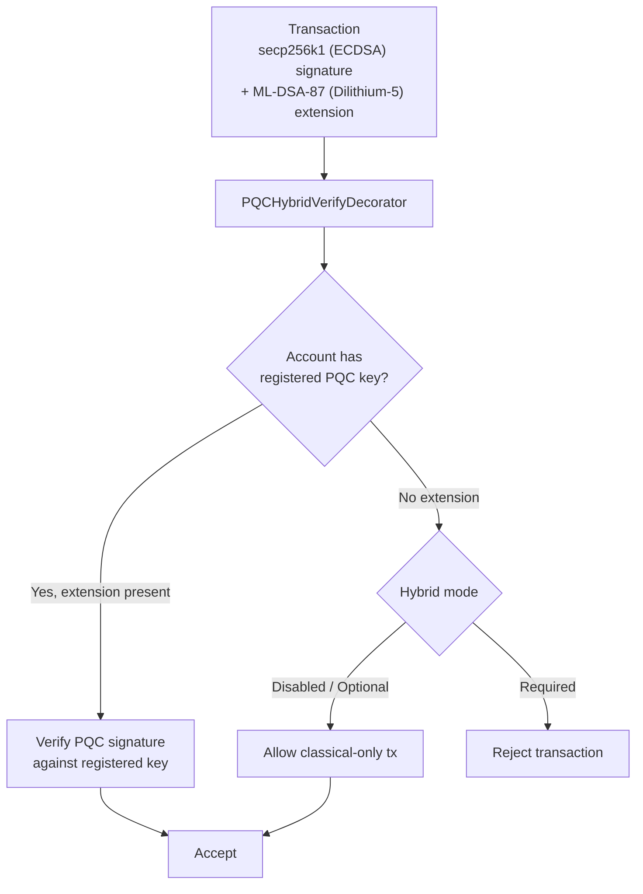

# Post-Quantum-Sicherheit

QoreChain ist **von Anfang an (at genesis) mit Post-Quantum-Kryptografie (PQC) gebaut** — nicht nachträglich als Upgrade ergänzt. Das Modul `x/pqc` stellt gitterbasierte digitale Signaturen und Schlüsselkapselung als primäre kryptografische Primitive bereit, ergänzt um ein per Governance gesteuertes Framework für Algorithmusagilität zur langfristigen Resilienz.

Die vollständige PQC-Baseline — **Dilithium-5 (Signaturen) + ML-KEM-1024 (KEM) + SHAKE-256 (Hash)** — ist nun vollständig und der Netzwerkstandard. In den Live-Netzwerken (v3.2.x) sind Hybridsignaturen auf dem Cosmos-Transaktionspfad **standardmäßig erforderlich**: `hybrid_signature_mode = required` und `allow_classical_fallback = false`. Jede Transaktion auf dem Cosmos-Pfad muss eine Dilithium-5-Signatur zusätzlich zu ihrer klassischen secp256k1-Signatur tragen; rein klassische Transaktionen von einem PQC-Konto werden abgelehnt, und der klassische Downgrade-Pfad ist geschlossen.

## Designprinzipien

* **PQC standardmäßig erforderlich**: Post-Quantum-Signaturen sind auf dem Cosmos-Pfad verpflichtend. Klassische secp256k1-Signaturen allein genügen nicht mehr — `allow_classical_fallback = false`.
* **Hybrid als Standard**: Cosmos-Transaktionen tragen gleichzeitig sowohl eine klassische secp256k1-Signatur als auch eine Dilithium-5-PQC-Signatur. Der rein klassische Fallback ist geschlossen.
* **Algorithmusagilität**: Das Register der kryptografischen Algorithmen wird per Governance gesteuert, sodass das Netzwerk neue Algorithmen einführen oder kompromittierte ohne Hard Forks ausmustern kann.
* **Deterministische Verifizierung**: Die gesamte Signaturverifizierung ist deterministisch und über alle Validatorenknoten hinweg reproduzierbar.

## Unterstützte Algorithmen

| Algorithmus       | Standard             | Kategorie          | NIST-Level | Öffentlicher Schlüssel  | Privater Schlüssel | Signatur / Chiffrat | Geteiltes Geheimnis |
| --------------- | -------------------- | ----------------- | ---------- | ----------- | ----------- | ---------------------- | ------------- |
| **Dilithium-5** | ML-DSA-87 (FIPS 204) | Signatur         | 5          | 2,592 bytes | 4,896 bytes | 4,627 bytes            | --            |
| **ML-KEM-1024** | FIPS 203             | Schlüsselkapselung | 5          | 1,568 bytes | 3,168 bytes | 1,568 bytes            | 32 bytes      |

Beide Algorithmen arbeiten auf **NIST-Sicherheitslevel 5**, der höchsten standardisierten Sicherheitskategorie, und bieten einen Schutz, der gegen sowohl klassische als auch Quantenangreifer dem von AES-256 entspricht.

## Kryptografisches Backend

PQC-Operationen sind in einem performanten, speichersicheren kryptografischen Backend implementiert, das gitterbasiertes Signieren, Verifizieren und Schlüsselkapselung für die QoreChain-Laufzeitumgebung bereitstellt. Das Backend bietet:

Algorithmus-spezifische Operationen:

* Dilithium-5-Schlüsselerzeugung, -Signierung und -Verifizierung
* ML-KEM-1024-Schlüsselerzeugung, -Kapselung und -Entkapselung
* Deterministische Random-Beacon-Generierung (`seed`, `epoch`)

Algorithmus-bewusste Operationen:

* `Keygen(algorithmID)` — Schlüsselpaar für jeden registrierten Algorithmus erzeugen
* `Sign(algorithmID, privkey, message)` — Signatur erstellen
* `Verify(algorithmID, pubkey, message, signature)` — Signatur verifizieren
* `AlgorithmInfo(algorithmID)` — Schlüssel-/Ausgabegrößen abfragen
* `ListAlgorithms()` — Alle unterstützten Algorithmen auflisten

Alle Signier- und Verifizierungsoperationen sind deterministisch und erzeugen über jeden Validatorknoten und jede unterstützte Plattform hinweg identische Ergebnisse.

Dieselben Primitive — ML-DSA (FIPS-204), ML-KEM (FIPS-203) und SHAKE-256 (FIPS-202) — stehen Wallets und Integratoren über die quelloffene Bibliothek [**qorechain-pqc**](https://github.com/qorechain/qorechain-pqc) zur Verfügung, die eine konsistente, byte-kompatible API über sechs Sprachen (JavaScript/TypeScript, Rust, Go, C, Python, Java) bereitstellt. Siehe [Post-Quantum Signing](/developer-guide/post-quantum-signing).

## Schlüsselregistrierung {#key-registration}

Konten registrieren PQC-Schlüssel ausdrücklich über `MsgRegisterPQCKey` (Legacy, standardmäßig Dilithium-5) oder `MsgRegisterPQCKeyV2` (algorithmus-bewusst); die Chain registriert nie von sich aus einen Schlüssel, und der CLI-Ablauf lautet `qorechaind tx pqc gen-key <name>` gefolgt von `qorechaind tx pqc register-key <public_key_hex> hybrid --from <key>` (siehe [Erste Transaktion](/getting-started/first-transaction#register-pqc-key)). Jede Nachricht enthält:

* **Sender**: Die Kontoadresse, die den Schlüssel registriert.
* **PublicKey**: Die Bytes des öffentlichen PQC-Schlüssels.
* **AlgorithmID**: Die Kennung des PQC-Algorithmus (nur v2).
* **KeyType**: Einer von drei Registrierungsmodi:

| Schlüsseltyp         | Beschreibung                                                              |
| ---------------- | ------------------------------------------------------------------------ |
| `hybrid`         | Sowohl klassischer (ECDSA) als auch PQC-Schlüssel. Transaktionen tragen Doppelsignaturen. |
| `pqc_only`       | Wird wie `hybrid` registriert: Die klassische secp256k1-Signatur wird weiterhin von den Standard-Signaturprüfungen verifiziert, und zusätzlich ist die PQC-Signatur erforderlich. |
| `classical_only` | Nur klassischer Schlüssel. Kein PQC-Schutz (nicht empfohlen).                 |

## Hybridsignaturen

Das Hybridsignatursystem verlangt, dass Cosmos-Pfad-Transaktionen gleichzeitig **sowohl** eine klassische Signatur als auch eine PQC-Signatur tragen. Dies bietet Defense-in-Depth: Selbst wenn ein Verfahren gebrochen wird, schützt das andere die Transaktion.

Mit dem Netzwerkstandard `hybrid_signature_mode = required` muss jede Cosmos-Pfad-Transaktion die Dilithium-5-Erweiterung zusätzlich zur secp256k1-Signatur enthalten. Die einzigen Ausnahmen (für das Bootstrapping) sind **Genesis-Gentxs (Höhe 0)** und **Transaktionen zur PQC-Schlüsselregistrierung/-migration** (`MsgRegisterPQCKey`, `MsgRegisterPQCKeyV2`, `MsgMigratePQCKey`), die rein klassisch sein dürfen, damit Konten ihren ersten PQC-Schlüssel registrieren können, sowie ein Unjail von einem Operatorkonto ohne registrierten Schlüssel.

**Der EVM-Lane wird stattdessen durch ein Autorisierungsfenster geschützt.** Eine EVM-Transaktion kann keine zweite (ML-DSA-)Signatur tragen — Standard-Wallets erzeugen eine einzige secp256k1-Signatur über eine Ethereum-Transaktion und bieten keine Möglichkeit, eine weitere anzuhängen. Die Post-Quantum-Autorisierung läuft daher der Transaktion *voraus*: Das Konto öffnet mit einer Cosmos-Lane-Nachricht (`MsgOpenEVMWindow`), die die gewöhnliche Hybridsignatur trägt, ein begrenztes **EVM-Autorisierungsfenster**, und der EVM-Lane lässt dann nur Transaktionen zu, die von einem aktiven Fenster abgedeckt sind. Seit v3.2.0 wird eine EVM-Transaktion abgelehnt, sofern ihr Absender nicht (1) einen registrierten Post-Quantum-Schlüssel hat und (2) ein aktives Fenster mit verbleibenden Blöcken, Transaktionen und Wert besitzt. Innerhalb eines Fensters funktioniert eine gewöhnliche MetaMask-/ethers-/Hardhat-Transaktion unverändert, weil die Prüfung den Chain-Zustand liest, nicht die Transaktion. Siehe [EVM-Autorisierungsfenster](/getting-started/first-transaction#evm-window).

### Cosign-Ablauf

Um eine konforme Cosmos-Transaktion zu erzeugen, wird die klassische secp256k1-Signatur über die Standard-Sign-Bytes berechnet (die die PQC-Erweiterung ausschließen), und eine Dilithium-5-Signatur wird über die v2-Signierbytes berechnet (siehe [Signierte Bytes (v2)](#sign-bytes-v2) unten) und als Erweiterung `PQCHybridSignature` angehängt. Standardmäßiges CosmJS-/Relayer-Tooling muss diese Erweiterung erzeugen, um auf dem Cosmos-Pfad zu transagieren. Heute geschieht dies über:

* `qorechaind tx pqc gen-key <name>` — einen Dilithium-5-Schlüssel erzeugen.
* `qorechaind tx pqc cosign <unsigned_tx_file> --from <key> --pqc-key <name>` — die Dilithium-5-Cosignatur an eine mit `--generate-only` erstellte Transaktion anhängen.
* Das Hybrid-Signing des QoreChain SDK — `buildHybridTx`. Der Schlüssel des Kontos muss bereits mit `MsgRegisterPQCKey` registriert sein.
* [QoreX](/qorex/overview), das beides für Sie erledigt.

*Eine Transaktion, die mit secp256k1 (ECDSA) plus ML-DSA-87 (Dilithium-5) signiert und vom Ante-Handler im chainweiten Durchsetzungsmodus verifiziert wird.*



### Signierte Bytes (v2) {#sign-bytes-v2}

Die ML-DSA-Signatur deckt domänenmarkierte, an die Chain gebundene Bytes ab. Ab v3.2.0 verifiziert die Chain **ausschließlich** diese Form:

```text
"qorechain-pqc-hybrid-v2" ‖ BE64(len(chainID)) ‖ chainID ‖
BE32(len(B0)) ‖ B0 ‖ BE32(len(authInfo)) ‖ authInfo
```

Dabei ist `B0` der Transaktions-Body, serialisiert **ohne** die PQC-Erweiterung, und `authInfo` sind die AuthInfo-Bytes unverändert (`‖` ist Verkettung, Längen sind Big-Endian). Das Domänen-Tag verhindert, dass eine in einem anderen Kontext erzeugte Signatur (eine Login-Challenge, eine Nachrichtensignatur-Anfrage) als Transaktionssignatur gültig ist, und die Bindung der Chain-ID macht die Post-Quantum-Signatur selbst in jedem anderen Netzwerk ungültig. Die erste Form (`BE32(len(B0)) ‖ B0 ‖ BE32(len(authInfo)) ‖ authInfo`) wurde nur unterhalb der Upgrade-Höhe verifiziert; kein Block akzeptiert beide. Payloads für Schlüsselmigration und Bridge-Attestierungen wurden auf dasselbe domänenmarkierte, an die Chain gebundene Schema umgestellt.

**Welche Form verifiziert mein Netzwerk?** Fragen Sie den Knoten, ob das Upgrade angewendet wurde:

```bash
curl -s https://api.qore.host/cosmos/upgrade/v1beta1/applied_plan/v3.2.0         # height 2981742 on mainnet
curl -s https://api-testnet.qore.host/cosmos/upgrade/v1beta1/applied_plan/v3.2.0 # height 5920000 on testnet
```

(`"height":"0"` bedeutet nicht angewendet.) Die CLI erledigt das mit `--sign-bytes auto`; SDK 0.8.x und wallet-adapter 0.2.x tun dasselbe und erkennen zusätzlich die frühere Vorschau der Änderung im Testnet. Ein Client mit der falschen Form erzeugt einen Digest, den die Chain ablehnt — er schlägt geschlossen fehl (fail closed).

### Format der TX-Erweiterung

PQC-Signaturen werden Transaktionen als **TX-Erweiterung** mit der Type-URL `/qorechain.pqc.v1.PQCHybridSignature` angehängt:

```text
{
  "algorithm_id": 1,
  "pqc_signature": "<4627 bytes for Dilithium-5>",
  "pqc_public_key": "<2592 bytes, optional>"
}
```

Das Feld `pqc_public_key` ist optional und rein informativ; Schlüssel werden ausschließlich durch eine ausdrückliche Registrierungsnachricht registriert (siehe [Schlüsselregistrierung](#key-registration)).

### PQCHybridVerifyDecorator

Der Ante-Handler `PQCHybridVerifyDecorator` verarbeitet Hybridsignaturen mit einer dreifachen Verifizierungslogik:

| Szenario | Konto hat PQC-Schlüssel | Erweiterung vorhanden | Öffentlicher Schlüssel in Erweiterung | Ergebnis                                              |
| -------- | ------------------- | ----------------- | ----------------------- | --------------------------------------------------- |
| Pfad 1   | Ja                 | Ja               | --                      | PQC-Signatur gegen registrierten Schlüssel verifizieren         |
| Pfad 3a  | Nein                  | Nein                | --                      | **Optional-Modus**: Rein klassische Transaktion zulassen |
| Pfad 3b  | Nein                  | Nein                | --                      | **Required-Modus**: Transaktion ablehnen               |
| Pfad 4   | Ja                 | Nein                | --                      | Wird vom Standard-PQCVerifyDecorator behandelt          |

Ein Schlüssel muss mit `MsgRegisterPQCKey` / `MsgRegisterPQCKeyV2` registriert sein, bevor das Konto hybrid signierte Transaktionen sendet; das Feld `pqc_public_key` der Erweiterung registriert nichts.

### Hybridsignatur-Modi

Das chainweite Hybrid-Durchsetzungslevel ist per Governance konfigurierbar. Der **aktuelle Netzwerkstandard ist `required`**:

| Modus         | ID | Standard | Verhalten                                                                                                          |
| ------------ | -- | ------- | ----------------------------------------------------------------------------------------------------------------- |
| **Disabled** | 0  | Nein      | Nur klassische Signaturen. PQC-Erweiterungen werden ignoriert.                                            |
| **Optional** | 1  | Nein      | PQC-Erweiterungen werden verifiziert, sofern vorhanden. Konten ohne PQC-Schlüssel dürfen nur mit klassischen Signaturen transagieren.    |
| **Required** | 2  | **Ja** | Alle Cosmos-Pfad-Transaktionen müssen sowohl klassische als auch PQC-Signaturen tragen. Transaktionen ohne PQC-Erweiterung werden abgelehnt. |

Das Netzwerk hat seine Migration abgeschlossen: **Optional** (Genesis) → **Required** (der aktuelle Standard seit v3.1.71, mit `allow_classical_fallback = false`). Die drei Modi bleiben per Governance gesteuert und können per Proposal angepasst werden.

## Framework für Algorithmusagilität

Das Framework für Algorithmusagilität stellt ein per Governance gesteuertes Register für PQC-Algorithmen bereit, das es dem Netzwerk ermöglicht, neue Algorithmen hinzuzufügen, anfällige auszumustern und Konten zu migrieren — alles ohne Hard Forks.

### Algorithmus-Lebenszyklus

Jeder registrierte Algorithmus hat einen Lebenszyklusstatus:

```
active --> migrating --> deprecated --> disabled
```

| Status         | Beschreibung                                                                                                                                 |
| -------------- | ------------------------------------------------------------------------------------------------------------------------------------------- |
| **Active**     | Voll funktionsfähig. Neue Schlüsselregistrierungen und Verifizierungen werden akzeptiert.                                                                    |
| **Migrating**  | Die Doppelsignaturphase ist aktiv. Konten werden ermutigt, zum Ersatzalgorithmus zu migrieren. Sowohl alte als auch neue Signaturen werden akzeptiert. |
| **Deprecated** | Bestehende Signaturen können weiterhin verifiziert werden, aber keine neuen Schlüsselregistrierungen werden akzeptiert.                                                       |
| **Disabled**   | Notfall-Kill-Switch. Der Algorithmus kann keine Signaturen verifizieren. Wird verwendet, wenn eine Schwachstelle entdeckt wird.                                 |

### Doppelsignatur-Migration

Wenn ein Algorithmus ausgemustert wird, beginnt eine **Migrationsperiode** (Standard: 1.000.000 Blöcke — etwa 37 Tage bei der aktuellen Blockzeit des Mainnets von ≈3,2 s). Während dieser Periode:

1. Konten mit Schlüsseln, die den ausgemusterten Algorithmus verwenden, müssen zum Ersatz migrieren.
2. Die Migration erfordert Doppelsignaturen (`MsgMigratePQCKey`): eine vom alten und eine vom neuen Schlüssel, die den Besitz beider nachweisen.
3. Während der gesamten Migrationsperiode werden beide Algorithmen zur Verifizierung akzeptiert.

### Nachrichten

| Nachricht                 | Beschreibung                                                                                                                                                       |
| ----------------------- | ----------------------------------------------------------------------------------------------------------------------------------------------------------------- |
| `MsgRegisterPQCKey` / `MsgRegisterPQCKeyV2` | Registriert den PQC-Schlüssel eines Kontos (siehe [Schlüsselregistrierung](#key-registration)). Darf klassisch signiert werden, damit ein neues Konto sich bootstrappen kann. |
| `MsgMigratePQCKey`      | Doppelt signierte Migration vom Schlüssel eines Algorithmus zu dem eines anderen während einer Migrationsperiode. |
| `MsgRotatePQCKey`       | Rotiert den ML-DSA-87-Schlüssel des Kontos innerhalb desselben Algorithmus (doppelt signiert vom alten und vom neuen Schlüssel; `tx pqc rotate-key`). |
| `MsgOpenEVMWindow` / `MsgCloseEVMWindow` | Öffnet oder schließt das EVM-Autorisierungsfenster (v3.2.0); siehe [EVM-Autorisierungsfenster](/getting-started/first-transaction#evm-window). |
| `MsgDeprecateAlgorithm` | Governance-Nachricht: Startet den Ausmusterungsprozess für einen Algorithmus. Gibt den Ersatzalgorithmus und die Migrationsperiode in Blöcken an. |
| `MsgDisableAlgorithm`   | Governance-Nachricht: Deaktiviert einen Algorithmus sofort im Notfall. Erfordert einen Begründungsstring. Wird verwendet, wenn eine kryptografische Schwachstelle entdeckt wird. |

`MsgDeprecateAlgorithm` und `MsgDisableAlgorithm` sind im Mainnet derzeit durch den Circuit Breaker abgeschaltet (siehe [Chain Parameters](/appendix/chain-parameters#circuit-breaker)).

### Erweiterbarkeit

Das Hinzufügen eines Algorithmus erfordert ein Software-Release, das ihn hinter der einheitlichen Signier- und Verifizierungsschnittstelle implementiert; das Register und der Ausmusterungs-/Deaktivierungs-Lebenszyklus werden per Governance gesteuert.

## SHAKE-256-Hash

Ab v3.1.73 ist **SHAKE-256** (Extendable-Output-Funktion von SHA-3) der **Standard-Anwendungs-Hash** in QoreChain — bereitgestellt durch das Paket `qorehash` — und vervollständigt die quantenresistente kryptografische Baseline neben den Dilithium-5-Signaturen und der ML-KEM-1024-Schlüsselkapselung. Das Modul `x/pqc` stellt reine Go-SHAKE-256-Utilities bereit:

| Funktion                           | Beschreibung                       | Ausgabe           |
| ---------------------------------- | --------------------------------- | ---------------- |
| `SHAKE256Hash(data, outputLen)`    | SHAKE-256-Digest variabler Länge  | Beliebige Länge |
| `SHAKE256Hash32(data)`             | Standard-256-Bit-SHAKE-256-Digest | 32 bytes         |
| `SHAKE256ConcatHash(left, right)`  | Hash verketteter Eingaben       | 32 bytes         |
| `SHAKE256DomainHash(domain, data)` | Domänenseparierter Hash             | 32 bytes         |

Diese Utilities bilden die Grundlage des Standard-Anwendungs-Hashes und werden verwendet für:

* Hashing von Merkle-Tree-Knoten
* Hash-Commitments in ebenenübergreifenden Attestierungen
* Domänenseparierung für verschiedene Hash-Kontexte (z. B. `"leaf:"` vs. `"node:"`)

## Bridge-PQC

Alle Cross-Chain-Bridge-Attestierungen und State-Commitments verwenden **Dilithium-5**-Signaturen. Das Modul `x/multilayer` verlangt PQC-Aggregatsignaturen bei jeder `MsgAnchorState`-Übermittlung, und ML-KEM-Commitments sichern die Schlüsselaustauschkanäle zwischen Bridge-Relayern ab.

Dies stellt sicher, dass die Cross-Chain-Sicherheit nicht durch die Verwendung klassischer Kryptografie in der Bridge-Infrastruktur beeinträchtigt wird, und erhält die Quantenresistenz über den gesamten Protokoll-Stack hinweg.

## Modulparameter

| Parameter                  | Typ                | Standard           | Beschreibung                                           |
| -------------------------- | ------------------- | ----------------- | ----------------------------------------------------- |
| `pqc_primary`              | bool                | `true`            | PQC ist das primäre Signaturverfahren                   |
| `allow_classical_fallback` | bool                | `false`           | Rein klassischer Fallback ist geschlossen; Cosmos-Txs müssen hybrid sein |
| `min_security_level`       | int32               | `5`               | Minimales NIST-Sicherheitslevel für akzeptierte Algorithmen   |
| `default_migration_blocks` | int64               | `1,000,000`       | Standard-Doppelsignatur-Migrationsperiode in Blöcken     |
| `default_signature_algo`   | AlgorithmID         | `1` (Dilithium-5) | Standard-Signaturalgorithmus für neue Schlüsselregistrierungen |
| `hybrid_signature_mode`    | HybridSignatureMode | `2` (Required)    | Chainweites Durchsetzungslevel für Hybridsignaturen         |

## Verwandt

* [Post-Quantum Signing](/developer-guide/post-quantum-signing) — die quelloffene Bibliothek `qorechain-pqc` (sechs Sprachen) für diese Primitive und das Hybrid-Signing.
* [Wallet Setup](/getting-started/wallet-setup) — PQC-gestützte Konten erstellen und verwalten.
* [SDK Accounts & PQC signing](/sdk/concepts/accounts-pqc) — Schlüssel und Post-Quantum-Signing aus dem Code.
* [Chain Parameters](/appendix/chain-parameters) — Standardalgorithmen und Migrationseinstellungen.
* [Bridge Architecture](/architecture/bridge-architecture) — PQC-Verifizierung auf Cross-Chain-Paketen.
