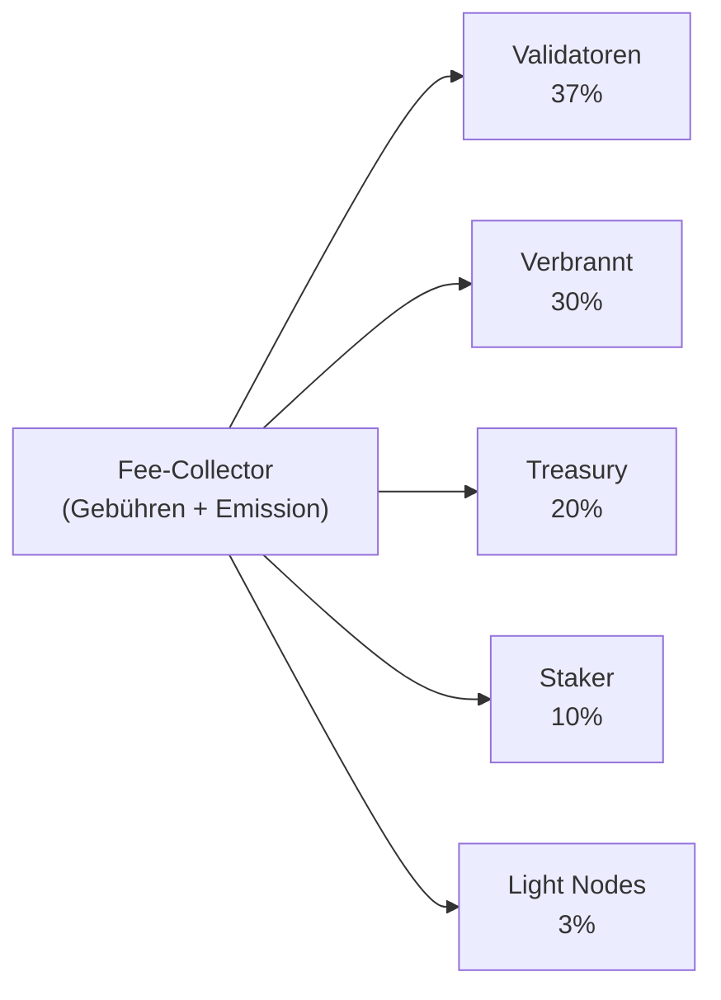

# Tokenomics

Das Wirtschaftsmodell von QoreChain basiert auf dem nativen **QOR**-Token und folgt einem **endlichen, gedeckelten Angebotspfad**: ein festes Genesis-Angebot, eine Staking-Belohnungs-Emission, die unter einer harten kumulativen Obergrenze geprägt wird, und eine mehrkanalige Burn-Engine, die Token dauerhaft entfernt. Diese Seite beschreibt, wie Angebot, Emission, Burns und die Gebührenaufteilung funktionieren, anhand von Zahlen, die von der Live-Chain gelesen wurden.

---

## Token-Grundlagen

| Eigenschaft            | Wert                                                      |
| ----------------------- | ---------------------------------------------------------- |
| **Anzeige-Token**       | QOR                                                        |
| **Basis-Denomination**  | uqor                                                       |
| **Dezimalpräzision**    | 10^6 (1 QOR = 1.000.000 uqor)                              |
| **Angebot**             | Genesis 4.420.000.000 QOR; siehe [Angebots- und Emissionsmodell](#supply-and-emission) |
| **Chain-ID**            | `qorechain-vladi` (Mainnet, EVM-Chain-ID 9801)             |
| **Bech32-Präfix**       | `qor` (Konten: `qor1...`, Validatoren: `qorvaloper...`)    |

:::note
Die Angaben auf dieser Seite beschreiben das **Mainnet** (`qorechain-vladi`, EVM-Chain-ID **9801**), live seit dem 7. Juni 2026 auf Release **v3.2.4** (angewendet bei Höhe 3.742.566 am 23. Oktober 2026). Das **`qorechain-diana`**-Testnet (EVM-Chain-ID **9800**, Release **v3.2.4** seit dem 19. Oktober 2026) hat einen eigenen Emissions- und Angebotsverlauf (das Testnet-Angebot liegt weit über dem des Mainnets, und seine Emission hat die Obergrenze bereits überschritten) — verwenden Sie daher die Mainnet-Zahlen. Beträge, die sich mit jedem Block ändern, sind mit dem Datum gekennzeichnet, an dem sie gelesen wurden (23. Oktober 2026).
:::

---

## Angebots- und Emissionsmodell {#supply-and-emission}

QoreChain hat einen **endlichen, gedeckelten Angebotspfad**. Das Genesis-Angebot betrug **4.420.000.000 QOR** (geplant waren 4.500.000.000 QOR; 80.000.000 QOR, 1,78 %, wurden beim Token Generation Event vor dem Genesis verbrannt). Nach dem Genesis verändert das Protokoll das Angebot über zwei Mechanismen:

* **Emission** — das `x/inflation`-Modul prägt in jeder Epoche einen festen Betrag, unter einer **harten kumulativen Obergrenze von 590.000.000 QOR**. Geprägte Token gelangen in den Fee-Collector und durchlaufen dieselbe Gebührenaufteilung wie Transaktionsgebühren (siehe [Gebührenverteilung](#fee-distribution)).
* **Burns** — das `x/burn`-Modul entfernt den Burn-Anteil von allem im Fee-Collector dauerhaft.

### Emission {#staking-reward-schedule}

| Parameter | Wert |
| --- | --- |
| Emissionsmodus | `fixed` (seit v3.1.94, Höhe 2.122.074 — 26. August 2026) |
| Emission pro Epoche | **86.000 QOR** (16.239 QOR bis Governance-Vorschlag 10; die erste Epoche mit 86.000 QOR beginnt bei Block 3.672.000) |
| Epochenlänge | 43.200 Blöcke (etwa 38,6 Stunden bei der aktuellen Blockzeit von ≈3,2 s) |
| Kumulative Obergrenze (`max_total_emission`) | **590.000.000 QOR** (bis Vorschlag 10: 114.285.714 QOR) |
| Bisher geprägt (23. Oktober 2026, Epoche 86) | 105.420.896,21 QOR (17,87 % der Obergrenze) |
| Verbleibend unter der Obergrenze | 484.579.103,79 QOR (etwa 5.635 Epochen bei 86.000 QOR pro Epoche; die letzte ist unvollständig) |

Sobald die Obergrenze erreicht ist, stellt das Modul das Prägen dauerhaft ein; danach stammen Belohnungen allein aus Transaktionsgebühren. Die Emissionswerte wurden per Governance festgelegt: Vorschlag #4 (26. August 2026) ersetzte den ursprünglichen abnehmenden Zeitplan durch einen festen Betrag unter einer harten Obergrenze, und Vorschlag #10 (angenommen am 19. Oktober 2026, wobei der gesamte gebondete Stake dafür stimmte) änderte diesen Betrag von 16.239 QOR auf 86.000 QOR pro Epoche und hob die Obergrenze von 114.285.714 QOR auf 590.000.000 QOR an. Die Epochenlänge blieb unverändert. Die Zeitplanwerte (17,5 %, 11 %, 7 %, 7 %, 2 % für die Jahre 1–5) bleiben in den Modulparametern gespeichert, werden im `fixed`-Modus jedoch nicht verwendet.

Die geprägte Gesamtmenge, der verbleibende Betrag und die Höhe der nächsten Epoche sind live unter `GET /qorechain/inflation/v1/epoch_info` abrufbar (sein Feld `current_inflation_rate` meldet den alten jahresbasierten Satz, den der `fixed`-Modus nicht verwendet).

QoreChain stellt keine Live-Zahl zur Staking-Rendite bereit; behandeln Sie jede genannte Prozentzahl als nicht verifiziert. Aktuelle Zahlen lassen sich aus dem Chain-Zustand lesen: das Angebot unter `GET /cosmos/bank/v1beta1/supply/by_denom?denom=uqor` (4.493.785.581,46 QOR am 23. Oktober 2026) und die Burn-Summen unter `GET /qorechain/burn/v1/stats`.

---

## x/burn — Mehrkanalige Burn-Engine

Das `x/burn`-Modul definiert heute auf dem Mainnet **12 Burn-Quellen**. Jeder verbrannte Token wird dauerhaft aus dem Angebot entfernt. Auf dem Mainnet haben bisher nur `gas_fee` (31.626.314,61 QOR Stand 23. Oktober 2026) und seit v3.2.2 `failed_tx` (0,1355 QOR) Burns verzeichnet; die übrigen sind definiert, haben aber keine verzeichnet. Ab v3.2.4 gibt es eine dreizehnte Quelle, `staking_tier_penalty`, die die Strafe erfasst, die beim vorzeitigen Entsperren einer zeitgesperrten Delegation verbrannt wird (live im Testnet seit dem 19. Oktober 2026 und im Mainnet seit dem 23. Oktober 2026; im Mainnet wurde noch kein vorzeitiges Entsperren verzeichnet; siehe [Staking und Delegation](/user-guide/staking-and-delegation#time-locked-staking)).

### Burn-Kanäle

| #  | Kanal              | Quelle                       | Beschreibung                                    |
| -- | ------------------- | ----------------------------- | ------------------------------------------------ |
| 1  | `gas_fee`           | Transaktionsgebühren          | 30 % aller Gas-Gebühren werden verbrannt          |
| 2  | `contract_create`   | Smart-Contract-Deployment     | Pauschale Gebühr von 100 QOR pro Contract-Erstellung wird verbrannt |
| 3  | `ai_service`        | Nutzungsgebühren des KI-Moduls | 50 % der KI-Servicegebühren werden verbrannt     |
| 4  | `bridge_fee`        | Cross-Chain-Bridge-Gebühren   | 100 % der Bridge-Gebühren werden verbrannt        |
| 5  | `treasury_buyback`  | Treasury-Operationen          | Periodischer Buyback-and-Burn aus der Treasury    |
| 6  | `failed_tx`         | Gas fehlgeschlagener Transaktionen | 10 % des Gas fehlgeschlagener Transaktionen werden verbrannt (von der Chain ab v3.2.2 angewendet) |
| 7  | `xqore_penalty`     | Strafen bei vorzeitigem xQORE-Ausstieg | Strafbeträge werden über den Burn-Mechanismus geleitet |
| 8  | `auto_buyback`      | Automatisiertes Buyback-Programm | Automatisierte Burns auf Protokollebene         |
| 9  | `tge`               | Token Generation Event        | Der TGE-Burn von 80.000.000 QOR erfolgte vor dem Genesis (das Genesis-Angebot beträgt 4.420.000.000 QOR); dieser Kanal ist reserviert und verzeichnet 0 |
| 10 | `rollup_create`     | Rollup-Deployment             | 1 % des Rollup-Erstellungs-Stakes wird verbrannt  |
| 11 | `milestone`         | Meilensteine der Transaktionsanzahl | Geplante Burns bei festen kumulativen Transaktionszahlen (bisher keiner ausgelöst) |
| 12 | `amm`               | AMM                           | Reserviert für AMM-Protokollgebühren (keine verzeichnet) |

Die Kanäle `contract_create`, `ai_service`, `bridge_fee` und `auto_buyback` sind derzeit inaktiv: Der QoreChain Native-Upload ist geschlossen, KI-Servicegebühren und die Bridge sind nicht live.

### Gebührenverteilung {#fee-distribution}

Alles im Fee-Collector wird auf fünf Empfänger aufgeteilt, wie unten dargestellt. Der Fee-Collector hält sowohl Transaktionsgebühren als auch die von `x/inflation` geprägte Epochen-Emission. Die Anteile werden on-chain erzwungen und ergeben immer exakt 100 %.

Die Anteile sind:

| Empfänger       | Anteil | Beschreibung                                                          |
| ---------------- | ------ | ----------------------------------------------------------------------- |
| **Validatoren**  | 37 %   | An das aktive Validator-Set proportional zum Stake verteilt             |
| **Verbrannt**    | 30 %   | Über den `gas_fee`-Burn-Kanal dauerhaft aus dem Angebot entfernt        |
| **Treasury**     | 20 %   | Der Community-Treasury für governance-gesteuerte Ausgaben zugewiesen    |
| **Staker**       | 10 %   | An alle QOR-Staker proportional zur Delegation verteilt                 |
| **Light Nodes**  | 3 %    | An Light Nodes für die Bereitstellung von Netzwerkdaten verteilt        |

Die Anteile werden on-chain erzwungen und müssen immer exakt 100 % ergeben.

:::note Was tatsächlich durch die Aufteilung fließt
Die Aufteilung gilt für alles im Fee-Collector, der sowohl Transaktionsgebühren als auch die von `x/inflation` geprägte Epochen-Emission hält. In der Praxis ist es heute fast ausschließlich Emission: Von 105.420.896 geprägten QOR wurden 31.626.315 QOR (30,0 %) über den Gas-Gebühren-Kanal verbrannt. Bis zum Upgrade auf v3.2.0 (25. September 2026, Höhe 2.981.742) wurde der 10-%-Staker-Anteil in den Bestand des Distribution-Moduls verschoben, ohne einen Anspruch zu decken — Staker und Validatoren erhielten daher zusammen 37 %, nicht 47 %; ab dieser Höhe wird der Staker-Anteil als normale Staking-Belohnung ausgezahlt. Der bereits gestrandete Betrag wurde on-chain verzeichnet und ist inzwischen durch Governance-Abstimmungen freigegeben worden — siehe [Gestrandeter Staker-Anteil und Light-Node-Reserve](#stranded-and-reserve).
:::

### Burn-Parameter

| Parameter              | Standard                    | Beschreibung                              |
| ----------------------- | --------------------------- | ------------------------------------------ |
| `gas_burn_rate`         | 0.30                        | Anteil der verbrannten Gas-Gebühren (30 %) |
| `contract_create_fee`   | 100.000.000 uqor (100 QOR)  | Pauschale Burn-Gebühr für Contract-Erstellung |
| `ai_service_burn_rate`  | 0.50                        | Anteil der verbrannten KI-Servicegebühren (50 %) |
| `bridge_burn_rate`      | 1.00                        | Anteil der verbrannten Bridge-Gebühren (100 %) |
| `failed_tx_burn_rate`   | 0.10                        | Anteil des verbrannten Gas fehlgeschlagener Transaktionen (10 %) |
| `validator_share`       | 0.37                        | Anteil des Fee-Collectors an die Validatoren |
| `treasury_share`        | 0.20                        | Anteil an die Treasury                    |
| `staker_share`          | 0.10                        | Anteil an die Staker                      |
| `light_node_share`      | 0.03                        | Anteil an die Light Nodes                 |
| `enabled`               | true                        | Flag zur Modulaktivierung                 |

Jedes Burn-Ereignis wird on-chain mit seiner Quelle, dem Betrag, der Blockhöhe und dem zugehörigen Transaktions-Hash aufgezeichnet. Aggregierte Statistiken sind pro Kanal und insgesamt abfragbar.

---

## Gestrandeter Staker-Anteil und Light-Node-Reserve {#stranded-and-reserve}

Zwei Beträge haben sich auf dem Mainnet vor dem Upgrade auf v3.2.0 (25. September 2026, Höhe 2.981.742) angesammelt. Das Upgrade hat sie **on-chain, außerhalb jeder Verteilung** verzeichnet und nur noch per Governance-Abstimmung bewegbar gemacht. Die Governance hat beide inzwischen im Oktober 2026 an die Foundation freigegeben:

| Datensatz | Freigabe | Betrag | Governance-Nachricht |
| --- | --- | --- | --- |
| **Gestrandeter Staker-Anteil** — der 10-%-Staker-Anteil, der dort hinterlegt wurde, wo er keinen Staking-Belohnungsanspruch deckte | Vorschlag 9 (angenommen am 19. Oktober 2026) | 6.693.045,921330 QOR freigegeben | `MsgReleaseStrandedRewards` (Governance-Autorität; benanntes Ziel; darf den Datensatz nicht übersteigen) |
| **Light-Node-Reserve** — der 3-%-Light-Node-Anteil, der sich ansammelte, während kein Light Node berechtigt war | Vorschlag 8 (angenommen am 19. Oktober 2026) | 3.156.983,796395 QOR freigegeben | `MsgReleaseLightNodeReserve` (Governance-Autorität) |

**Korrigierter Rest des gestrandeten Anteils.** Beim Upgrade auf v3.2.3 (Höhe 3.662.051, 20. Oktober 2026) hat die Chain den Datensatz des gestrandeten Anteils neu berechnet; er stand danach bei 3.807.496,785528 QOR (`reserved` in `GET /qorechain/burn/v1/stranded_rewards`, neben `released`, 6.693.045,921330 QOR). Governance-Vorschlag 12 hat diesen Rest, 3.807.496,785528 QOR, an die Foundation freigegeben: Er wurde angenommen (die Abstimmung endete am 21. Oktober 2026 um 20:01 UTC), und das gesamte abstimmende gebundene Stake stimmte dafür. Der Datensatz lässt sich unter `GET /qorechain/burn/v1/stranded_rewards` und der Vorschlag unter `GET /cosmos/gov/v1/proposals/12` prüfen.

**Der Light-Node-Pool jetzt.** Ab dem Upgrade auf v3.2.0 werden Light-Node-Belohnungen nur aus dem gezahlt, was seit dem vorherigen Verteilungslauf angefallen ist, mit einer Obergrenze pro Node. Seit v3.2.3 beträgt die Grenze **2.000 QOR pro Node und 30 Tage** (`max_reward_per_month_per_node`), anteilig nach Blockzeit und Uptime des Nodes; der Wert pro Block (`max_reward_per_block_per_node`, 1.713 uqor) wird weiterhin gemeldet, ist aber nicht mehr die maßgebliche Regel. Was nicht verdient wird, bleibt in der Reserve des Pools, die nur eine Governance-Abstimmung freigeben kann. Nach Vorschlag 8 füllt sich die Reserve wieder: Am 20. Oktober 2026 enthielt sie 487,2318 QOR (`reserved` in `GET /qorechain/lightnode/v1/reward_pool`), ohne ausstehende oder zahlbare Beträge, da sich noch kein Light Node registriert hat. Die Registrierung ist offen und lizenzgebunden (siehe [Light Node](/light-node/overview#reward-program-status)). Eine Freigabe vor dem Upgrade-Snapshot, über dem verzeichneten Betrag oder an ein ungültiges Ziel wird abgelehnt.

## x/xqore — Gesperrtes Staking und Governance-Verstärkung {#x-xqore}

:::warning Noch nicht live
Die Buchhaltung des xQORE-Moduls existiert und ist im Genesis aktiviert, aber sie ist auf dem Mainnet (`qorechain-vladi`) und dem Testnet (`qorechain-diana`) **noch nicht nutzbar**. Der Node hat keinen Transaktions-, Abfrage-, CLI- oder RPC-Einstiegspunkt dafür, daher funktionieren `tx xqore lock` / `unlock`, `query xqore ...`, die xQORE-REST-Routen und `qor_getXQOREPosition` nicht, und niemand hält xQORE. Es ist für ein künftiges Chain-Release geplant, das auch ändern wird, wie Ausstiegsstrafen umverteilt werden, sodass das Entsperren unabhängig von der Anzahl der Inhaber günstig bleibt. Das Release wird hier genannt, sobald es erscheint.
:::

Das `x/xqore`-Modul führt **xQORE** ein, ein nicht übertragbares Derivat für gesperrtes Staking. Nutzer sperren QOR, um xQORE im Verhältnis 1:1 zu prägen. xQORE-Inhaber erhalten verstärkte Governance-Macht und einen Anteil an umverteilten Ausstiegsstrafen.

### Sperrmechanismus

* **Sperren**: QOR an das xQORE-Modul senden, um xQORE im Verhältnis 1:1 zu prägen.
* **Governance-Gewicht**: xQORE-Inhaber erhalten im Vergleich zu Standard-QOR-Stakern **2-faches Governance-Stimmrecht**.
* **Nicht übertragbar**: xQORE kann nicht zwischen Konten gesendet werden. Es ist an die sperrende Adresse gebunden.

### Strafenzeitplan bei Ausstieg

Eine vorzeitige Auszahlung aus xQORE zieht eine Strafe nach sich, die mit der Sperrdauer abnimmt:

| Sperrdauer      | Strafsatz | Beschreibung                                |
| ---------------- | --------- | --------------------------------------------- |
| &lt; 30 Tage     | **50 %**  | Die Hälfte des gesperrten QOR verfällt         |
| 30 -- 90 Tage    | **35 %**  | Erhebliche Strafe bei kurzfristigen Sperren    |
| 90 -- 180 Tage   | **15 %**  | Reduzierte Strafe bei mittelfristigem Engagement |
| > 180 Tage       | **0 %**   | Vollständige Auszahlung ohne Strafe            |

### PvP-Rebase-Umverteilung

Bei vorzeitigem Ausstieg eingezogene Strafen werden nicht einfach vernichtet. Stattdessen folgen sie einem PvP-Rebase-Modell (Player-versus-Player):

1. In der Genesis-Konfiguration werden **0 %** der Strafbeträge verbrannt (`penalty_burn_rate = 0`; der Burn-Kanal `xqore_penalty` existiert, falls die Governance dies ändert).
2. **100 %** werden anteilig an alle verbleibenden xQORE-Inhaber umverteilt.

Dies erzeugt eine positiv-summige Dynamik für langfristige Inhaber: Jeder vorzeitige Ausstieg erhöht den effektiven Wert der verbleibenden xQORE-Positionen. Rebases erfolgen alle **100 Blöcke**.

### xQORE-Parameter

| Parameter                | Standard                | Beschreibung                                |
| ------------------------- | ------------------------ | --------------------------------------------- |
| `governance_multiplier`   | 2.0                      | Stimmrecht-Multiplikator für xQORE-Inhaber   |
| `min_lock_amount`         | 1.000.000 uqor (1 QOR)   | Mindestmenge an QOR zum Sperren               |
| `penalty_burn_rate`       | 0.00                     | Anteil der verbrannten Ausstiegsstrafen (Genesis-Standard: alle Strafen werden umverteilt) |
| `rebase_interval`         | 100 Blöcke               | Blöcke zwischen PvP-Rebase-Ereignissen        |
| `enabled`                 | true                     | Flag zur Modulaktivierung                     |

---

## x/inflation — Gedeckelte Emission

Das `x/inflation`-Modul prägt die Emission pro Epoche (86.000 QOR seit Vorschlag 10, `emission_mode = fixed`) und sendet sie an den Fee-Collector, bis die kumulative Obergrenze von 590.000.000 QOR erreicht ist. Parameteränderungen laufen über einen normalen Governance-Parametervorschlag (`MsgUpdateParams`, hinzugefügt in v3.1.94).

### Epochen-Mechanik

* **Epochenlänge**: 43.200 Blöcke (etwa 38,6 Stunden bei ≈3,2 s pro Block).
* An jeder Epochengrenze prägt das Modul die Epochen-Emission (oder den Rest bis zur Obergrenze), aktualisiert den Epochen-Datensatz und stellt das Prägen ein, sobald `total_minted` die Obergrenze erreicht.
* Seit v3.2.3 wird das Emissionsjahr aus der Epochenlänge abgeleitet statt aus einer festen Blockanzahl.

### Parameter

Live gelesen am 23. Oktober 2026 von `GET /qorechain/inflation/v1/params`:

| Parameter | Wert (Mainnet) | Beschreibung |
| --- | --- | --- |
| `emission_mode` | `fixed` | `schedule` (Legacy, jahresbasierte Sätze) oder `fixed`; v3.2.4 fügt einen dritten Modus hinzu, `target_apy` |
| `fixed_epoch_emission` | 86.000.000.000 uqor (86.000 QOR) | Pro Epoche im Fixed-Modus geprägt |
| `max_total_emission` | 590.000.000.000.000 uqor (590.000.000 QOR) | Harte kumulative Obergrenze |
| `epoch_length` | 43.200 Blöcke | Blöcke pro Emissionsepoche |
| `schedule` | 17,5 %, 11 %, 7 %, 7 %, 2 % (Jahre 1–5) | Legacy-Zeitplan, im Fixed-Modus ungenutzt |
| `enabled` | `true` | Flag zur Modulaktivierung |

Die Parameter und der Epochen-Datensatz des Moduls werden auf dem Mainnet seit v3.2.3 über REST bereitgestellt (`/qorechain/inflation/v1/params` und `/qorechain/inflation/v1/epoch_info`); sie lassen sich auch aus dem Chain-Zustand über die rohe Store-Schnittstelle des RPC `abci_query` lesen (Store `inflation`, Schlüssel `inflation/params` und `inflation/epoch`).

:::note v3.2.4 und die Emission des Testnets
Das `qorechain-diana`-Testnet behält seine früheren Emissionseinstellungen (16.239 QOR pro Epoche unter einer Obergrenze von 114.285.714 QOR, dort bereits erreicht); das Mainnet verwendet die oben genannten Werte. Das Release v3.2.4 fügt einen dritten Emissionsmodus hinzu, `target_apy`, mit einem Parameter `target_apy_bps`: im Testnet seit dem 19. Oktober 2026 und im Mainnet seit dem 23. Oktober 2026 (Governance-Vorschlag 13). Der Parameter ist in beiden Netzwerken `0` und steuert die Emission nicht. Das Umschalten eines Netzwerks auf diesen Modus ist eine eigene Governance-Abstimmung und wurde im Mainnet nicht vorgeschlagen; bis eine solche angenommen wird, bleibt das Mainnet im Modus `fixed` bei 86.000 QOR pro Epoche.
:::

---

## Burn gegenüber Emission

Die Emission ist gedeckelt (insgesamt 590.000.000 QOR), und der Burn-Anteil gilt für alles, was in den Fee-Collector gelangt, einschließlich der Emission. Bislang (23. Oktober 2026) wurden 31.626.315 QOR verbrannt, bei 105.420.896 QOR geprägt; das Angebot (4.493.785.581 QOR) liegt daher derzeit über seinem Genesis-Niveau. Nachdem die Obergrenze erreicht ist, kann das Angebot nur noch sinken, und zwar um den verbrannten Betrag.

---

## Verwandte Themen

* [Chain-Parameter](/appendix/chain-parameters) — kanonische ökonomische und Konsens-Standardwerte.
* [Staking und Delegation](/user-guide/staking-and-delegation) — QOR delegieren und Staking-Belohnungen erhalten.
* [xQORE Staking](/user-guide/xqore-staking) — der PvP-Rebase-Staking-Mechanismus.
* [Light-Node-Belohnungen](/light-node/rewards-and-monitoring) — der Belohnungsanteil der Light Nodes.
