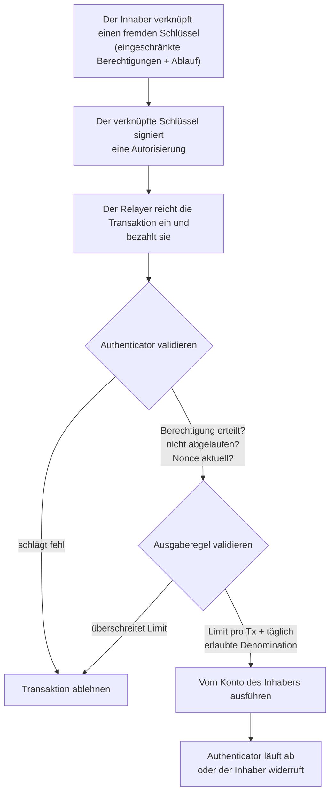

# Account Abstraction

QoreChain bietet **Account Abstraction auf Protokollebene** über das Modul `x/abstractaccount`. Das Modul erfasst Abstract Accounts mit Ausgaberegeln und lässt den Kontoinhaber fremde Schlüssel (**Authenticators**) verknüpfen, die innerhalb der Grenzen von Berechtigungen und Ausgabenlimits aus dem Konto ausgeben können — ganz ohne externe Smart-Contract-Infrastruktur.

:::danger Auf dem Mainnet nicht aktiviert; auf dem Testnet aktiviert
Das Abstract-Account-Modul ist zum Zeitpunkt der Erstellung **auf dem Mainnet `qorechain-vladi` abgeschaltet** (geprüft am 27. Oktober 2026): `qorechaind query abstractaccount config` (und `GET /qorechain/abstractaccount/v1/config`) melden `enabled: false`. Auf dem **Testnet `qorechain-diana`** wurde es durch eine Governance-Entscheidung (Vorschlag 18, angenommen am 27. Oktober 2026) eingeschaltet und meldet `enabled: true`. Ab Chain-Version v3.2.0 wird das Flag auf jedem Pfad durchgesetzt: Wo es `false` ist, lehnt die Chain Kontoerstellung, Authenticator-Registrierung und beide Execute-Lanes (`MsgExecuteEVM`, `MsgExecuteCosmos`) mit `abstract accounts are disabled on this chain` ab. Keine gewöhnliche Transaktion kann das Modul einschalten; die Einstellung ändert sich nur durch eine Governance-Entscheidung. Auf dem Mainnet wurde noch nie eine Abstract-Account-Transaktion aufgenommen. Alles Folgende beschreibt die Schnittstellen des Moduls; probieren Sie es auf dem Testnet aus, und bauen Sie für das Mainnet keinen Ablauf mit verknüpften Schlüsseln oder delegiertem Ausgeben, solange das Modul dort nicht aktiviert ist. Prüfen Sie immer zuerst das Flag.
:::

:::note
Die folgenden Befehle verwenden das **`qorechain-vladi`**-Mainnet (live seit dem 7. Juni 2026), das die Node-Version **v3.2.6** ausführt (angewendet bei Höhe 4.020.000 am 4. November 2026, Governance-Vorschlag 15; v3.2.5 wurde bei Höhe 3.906.833 am 29. Oktober 2026 angewendet, Vorschlag 14, und v3.2.4 bei Höhe 3.742.566 am 23. Oktober 2026). Ersetzen Sie für das Testnet, das v3.2.8 ausführt (seit dem 12. November 2026; v3.2.4 seit dem 19. Oktober 2026), `--chain-id qorechain-diana`.
:::

:::caution Jede Cosmos-Lane-Transaktion benötigt die hybride Post-Quantum-Mitsignatur
Die `qorechaind tx`-Beispiele auf dieser Seite zeigen nur die Gebühren-Flags. Auf den Live-Netzwerken muss jede Cosmos-Lane-Transaktion zusätzlich die hybride ML-DSA-87-Mitsignatur tragen. Erstellen Sie die Transaktion daher mit `--generate-only` und signieren Sie sie mit `qorechaind tx pqc cosign` (oder verwenden Sie QoreX bzw. das SDK, die das für Sie übernehmen). Der Community-Build von `qorechaind` kann diese Signatur nicht erzeugen; verwenden Sie die Release-Binärdatei aus dem [Download-Manifest](/developer-guide/running-a-node#fetch-the-manifest). Die Gebührenuntergrenze beträgt **0.1 uqor pro Gas-Einheit**, sodass `--gas 400000` mindestens `--fees 40000uqor` erfordert. Siehe [Post-Quantum-Signierung](/developer-guide/post-quantum-signing).
:::

## Überblick

Traditionelle Blockchain-Konten werden von einem einzigen privaten Schlüssel kontrolliert. Account Abstraction entkoppelt das Konzept „wer darf eine Transaktion autorisieren" von einem einzelnen kryptografischen Schlüssel. Das Modul `x/abstractaccount` bietet:

* **Abstract Accounts** mit einem erfassten Kontotyp und Inhaber
* **Ausgaberegeln** (Limits pro Transaktion und pro Tag, erlaubte Denominationen), die begrenzen, was verknüpfte Schlüssel (Authenticators und Sitzungsschlüssel) ausgeben können; sie begrenzen nicht den eigenen Schlüssel des Inhabers
* **Authenticators**: fremde Schlüssel (ein Phantom-ed25519-Schlüssel oder eine MetaMask-secp256k1-Adresse), die der Inhaber mit eingeschränkten Berechtigungen und einem Ablaufdatum verknüpft und jederzeit widerrufen kann

*Ein Ablauf mit verknüpftem Schlüssel (Authenticator): Der verknüpfte Schlüssel signiert eine Autorisierung, ein Relayer reicht sie ein, das Modul prüft Berechtigungen, Ablauf und Ausgaberegeln und führt dann vom Konto des Inhabers aus aus.*



## Kontotypen

`create` erfasst einen von drei Kontotypen. Der Typ wird im Konto gespeichert und ist Teil der Ableitung seiner Adresse; das Modul hat keine eigenen Multisig-, Session-Key- oder Recovery-Transaktionen (der Transaktionsdienst besteht aus `create`, `update-rules`, `register-authenticator`, `revoke-authenticator`, `execute-cosmos`, `execute-evm`).

| Typ               | Vorgesehener Einsatz                 |
| ----------------- | ------------------------------------ |
| `multisig`        | DAO-Treasuries, gemeinsame Wallets   |
| `social_recovery` | Consumer-Wallets, Onboarding         |
| `session_based`   | dApp-Sessions, mobile Wallets        |

## Ein Abstract Account erstellen

`create` erhält den Kontotyp als Positionsargument (`multisig`, `social_recovery` oder `session_based`):

```bash
qorechaind tx abstractaccount create session_based \
  --from mykey \
  --gas 400000 --fees 40000uqor
```

Der Befehl hat keine Flags für Signierer, Schwellenwerte oder Guardians.

## Authenticators (verknüpfte Schlüssel)

Der Delegationsmechanismus für Schlüssel des Moduls ist der **Authenticator**, der unten unter [Authenticators für verknüpfte Wallets](#authenticators) beschrieben wird: Der Inhaber verknüpft einen fremden Schlüssel (ed25519 oder secp256k1) mit einer Menge von Berechtigungen und einem Ablaufdatum und kann ihn jederzeit widerrufen:

```bash
qorechaind tx abstractaccount register-authenticator <account-address> <scheme> <pubkey-base64> <permissions-csv> <expiry-unix> <label> \
  --from mykey --gas 400000 --fees 40000uqor
qorechaind tx abstractaccount revoke-authenticator <account-address> <scheme> <pubkey-base64> \
  --from mykey --gas 400000 --fees 40000uqor
```

`scheme` ist `ed25519` (zum Beispiel Phantom) oder `secp256k1` (zum Beispiel MetaMask). Es gibt keinen Befehl `grant-session`, `revoke-session` oder `query abstractaccount sessions`.

## Ausgaberegeln

Ausgaberegeln fügen finanzielle Leitplanken für die Authenticators und Sitzungsschlüssel hinzu, die mit einem Abstract Account verknüpft sind. Ausgaberegeln binden nur Authenticators und Sitzungsschlüssel, nicht den eigenen Schlüssel des Inhabers; der Schlüssel des Inhabers wird auf der EVM-Lane durch das [EVM-Autorisierungsfenster](/getting-started/first-transaction#evm-window) begrenzt.

Die Regelfelder:

| Regel            | Beschreibung                                                          |
| ---------------- | --------------------------------------------------------------------- |
| `daily_limit`    | Maximale Gesamtausgaben pro UTC-Kalendertag                           |
| `per_tx_limit`   | Maximale Ausgaben pro einzelner autorisierter Ausführung              |
| `allowed_denoms` | Beschränkt, welche Token-Denominationen ausgegeben werden dürfen (ein ERC-20 wird als `erc20/<EIP-55 0x address>` aufgeführt, die eigene Schreibweise der Ausgaberegel mit Schrägstrich; die Chain vergleicht die Adresse in ihrer EIP-55-Form, sodass die von Ihnen getippte Groß-/Kleinschreibung keinen anderen Token erzeugt. Das ist nicht das Bank-Denom eines registrierten Token-Paars, das `erc20:<EIP-55 0x address>` mit Doppelpunkt geschrieben wird und zwischen Groß- und Kleinschreibung unterscheidet, siehe [EVM-Entwicklung](/developer-guide/evm-development#fest-tokens)) |
| `denom_limits`   | Limits pro Denomination als Dezimalzeichenketten (v3.2.2): `{"denom","per_tx_limit","daily_limit"}`; sie ersetzen `per_tx_limit` und `daily_limit` für die Denominationen, die sie nennen, sodass ein Token mit 18 Dezimalstellen begrenzt werden kann |
| `allowed_evm_calls` | EVM-Aufrufe, die ein regelgebundener Schlüssel **mit Call-Daten** ausführen darf (v3.2.2), als `0x<target>` (jede Funktion dieses Contracts) oder `0x<target>/0x<selector>` (nur diese Funktion). Ohne einen Eintrag kann ein regelgebundener Schlüssel nur Wert senden, deployen (mit der Berechtigung `deploy`) und die in `allowed_denoms` aufgeführten ERC-20-Token bewegen. Ein aufgeführtes Ziel vertraut jedem Argument der an es gerichteten Aufrufe, Empfänger eingeschlossen |

### Ausgaberegeln festlegen

`update-rules` ersetzt die Regeln des Kontos durch ein JSON-Array von `SpendingRule`-Objekten (Inline-JSON, keine Datei und keine Flags):

```bash
qorechaind tx abstractaccount update-rules <account-address> \
  '[{"id":"daily","enabled":true,"daily_limit":1000000000,"per_tx_limit":100000000,"allowed_denoms":["uqor"]}]' \
  --from mykey --gas 400000 --fees 40000uqor
```

Limits sind in der Basiseinheit (`uqor`) angegeben und zählen pro autorisierter Ausführung; das Tageslimit begrenzt die Gesamtsumme pro UTC-Kalendertag. Die Regeln ersetzen die gespeicherten als Ganzes, ein ausgelassenes Feld wird also entfernt. Seit v3.2.2 misst die EVM-Lane, was ein Aufruf tatsächlich bewegt (nativer Wert, die Abnahme des nativen Guthabens des Kontos, ausgegebene Bank-Coins sowie die Guthaben- oder Allowance-Änderung jedes aufgeführten ERC-20), statt nur `msg.value`, und die Contract-Erstellung benötigt die separate Berechtigung `deploy`. Ein ausführlicheres Beispiel (das gezeigte ERC-20 ist der Testnet-Testtoken fUSD; verwenden Sie die Contract-Adresse Ihres eigenen Tokens, und beachten Sie den Schrägstrich in `erc20/<address>` in einer Regel gegenüber dem Doppelpunkt im Bank-Denom `erc20:<address>`):

```bash
qorechaind tx abstractaccount update-rules <account-address> \
  '[{"id":"daily","enabled":true,"daily_limit":5000000,"allowed_denoms":["uqor","erc20/0x97143B771D34ddb9130b807b135Ae675A5a963CA"],"allowed_evm_calls":["0xROUTER/0x38ed1739"],"denom_limits":[{"denom":"erc20/0x97143B771D34ddb9130b807b135Ae675A5a963CA","per_tx_limit":"100000000000000000000","daily_limit":"500000000000000000000"}]}]' \
  --from mykey --gas 400000 --fees 40000uqor
```

### Aktuelle Regeln abfragen

Der Kontodatensatz enthält seine Regeln und die Anzahl der verknüpften Schlüssel:

```bash
qorechaind query abstractaccount account <account-address>
```

Ab v3.2.8 (nur Testnet, bis ein späteres Mainnet-Upgrade folgt) wird ein Schlüssel mit Wertberechtigungen bei der Registrierung und bei der Ausführung abgelehnt, sofern keine Regel ihn begrenzt; „kein Limit“ gilt für solche Schlüssel also nicht mehr.

:::caution Eine Regel begrenzt einen Schlüssel nur, wenn eine existiert
Die Chain ermittelt das Limit in dieser Reihenfolge: die eigene Regel des Authenticators, falls gesetzt und `enabled`; andernfalls die erste `enabled`-Regel des Kontos; andernfalls **gibt es kein Limit**. Eine mit `enabled: false` gespeicherte Regel bedeutet kein Limit, nicht ein Limit von null. `MsgRegisterAuthenticator` enthält keine Regel, ein allein mit dieser Nachricht verknüpfter Schlüssel wird also nur durch eine Regel auf Kontoebene begrenzt. Legen Sie mit `update-rules` bewusst eine Regel fest und registrieren Sie nur die Berechtigungen, die der Schlüssel benötigt. Ein Limit begrenzt den Schaden, den ein verknüpfter Schlüssel anrichten kann; es ersetzt nicht den Widerruf des Schlüssels.
:::

## Authenticators für verknüpfte Wallets — Delegiertes Ausgeben {#authenticators}

Das Authenticator-Design wurde in der Chain-Version **v3.1.85** eingeführt (aufbauend auf dem Berechtigungsmodell von v3.1.84). Es ist **auf dem Mainnet nicht nutzbar, solange das Modul dort deaktiviert ist**, und auf dem Testnet verfügbar, wo das Modul aktiviert ist (siehe den Statushinweis am Anfang dieser Seite). Ein **verknüpfter externer Wallet-Schlüssel** — ein Phantom-Schlüssel (ed25519) oder ein MetaMask-Konto (secp256k1) — kann **aus dem kanonischen Post-Quantum-Konto ausgeben**, und zwar unter Least-Privilege-Bedingungen, mit Ausgabenlimits und jederzeit widerrufbar. Der externe Schlüssel erzeugt niemals eine ML-DSA-Signatur; ein **Relayer** reicht den Transaktions-Envelope ein und bezahlt ihn (die eigene hybride PQC-Signatur des Relayers erfüllt die Signaturanforderungen der Chain), während die Signatur des Authenticators über **domain-separierte, replay-gebundene Sign-Bytes** die eigentliche Autorisierung darstellt.

### Einen Authenticator registrieren {#register-authenticator}

Der Kontoinhaber registriert den externen Schlüssel mit `MsgRegisterAuthenticator` (eine gewöhnliche Root-Key-Transaktion) und weist ihm dabei ein Schema, Berechtigungen, ein Ablaufdatum und optionale Ausgabenlimits zu:

```js
import { registerEthAuthenticatorMsg } from "@qorechain/wallet-adapter";

// Link a MetaMask account by its 20-byte address (EIP-191 verification):
const msg = registerEthAuthenticatorMsg({
  owner: "qor1owner...",              // the canonical account (signs this message)
  ethAddress: "0xAbC...123",          // the MetaMask address to link
  permissions: ["evm"],               // least privilege — see the taxonomy below
  expiryUnix: Math.floor(Date.now() / 1000) + 30 * 24 * 3600, // absolute Unix seconds, ≤ 30 days recommended
  label: "metamask",
});
// Limits are a separate message (MsgUpdateSpendingRules), see "Spending Rules" above.
// Sign & broadcast this msg with the OWNER's normal hybrid-PQC signer.
```

**Ab Release v3.2.8 (nur Testnet, bis ein späteres Mainnet-Upgrade folgt) braucht die Registrierung zwei weitere Dinge.**

1. **Einen Besitznachweis.** `MsgRegisterAuthenticator` hat ein Pflichtfeld `possession_proof` (Feld 8): eine Signatur des zu verknüpfenden Schlüssels, die belegt, dass er der Verknüpfung zustimmt. Der Schlüssel signiert diesen Klartext nach seinem eigenen Schema, sodass eine Browser-Wallet dem Nutzer zeigt, was er signiert (Phantom `signMessage`, MetaMask `personal_sign`); ein 33-Byte-secp256k1-Schlüssel signiert den SHA-256 des Textes:

   ```text
   QoreChain authenticator link v1
   chain: <chain-id>
   account: <bech32 account>
   scheme: <scheme>
   key: <lowercase hex of the public key, or of the 20-byte address>
   ```

   Der Text nennt die Chain, das Konto, das Schema und den Schlüssel, sodass ein Nachweis nicht für eine andere Chain, ein anderes Konto oder einen anderen Schlüssel wiederverwendet werden kann. Eine Registrierung ohne gültigen Nachweis wird abgelehnt.
2. **Eine Ausgabenregel für Wertschlüssel.** Ein Schlüssel, dessen Berechtigungen Wert bewegen können (`send`, `evm`, `svm`, `deploy`, `all`), braucht eine Ausgabenregel, die jede Denomination begrenzt, die er ausgeben kann; sie wird mit `MsgUpdateSpendingRules` vor oder zusammen mit der Verknüpfung gesetzt. Dieselbe Regel wird bei der Ausführung auch für Schlüssel durchgesetzt, die vor dem Upgrade verknüpft wurden, ergänzen Sie dort also ebenfalls Regeln.

Im Code hat SDK 0.14.0 die Helfer für beides (TypeScript: `signAuthenticatorLinkPhantom`, `signAuthenticatorLinkMetaMask`, `signAuthenticatorLinkEd25519`, `signAuthenticatorLinkSecp256k1`, `signAuthenticatorLinkEip191` für den Nachweis; `linkAuthenticatorMsgs` für die Ausgabenregel und die Verknüpfung in einer vom Eigentümer signierten Transaktion), und `@qorechain/wallet-adapter` 0.6.0 hat `phantomPossessionProof`, `metaMaskPossessionProof` und `linkAuthenticatorMsgs`. Siehe [Verknüpfen ab Chain v3.2.8](/sdk/guides/authenticators#link-v328). Für den Fall einer fehlgeschlagenen Ausführung wirft `assertAuthenticatorExecutionsSucceeded` bei `success=false` einen Fehler. `linkAuthenticatorMsgs`, `metaMaskPossessionProof` und `revokeAuthenticatorMsg` wurden im Testnet ausgeführt (siehe [Was geprüft wurde](#link-example-checks)); die Helfer für Phantom und ed25519 nicht.

Ein Phantom-Schlüssel wird auf dieselbe Weise registriert, mit dem Schema `ed25519` und dem öffentlichen Phantom-Schlüssel (`register-authenticator` in der CLI). Der Widerruf erfolgt sofort über `MsgRevokeAuthenticator`.

**Eine Ausführung kann innerhalb einer erfolgreichen Transaktion fehlschlagen.** Ab v3.2.8 (nur Testnet, bis ein späteres Mainnet-Upgrade folgt) liefert ein fehlgeschlagenes `MsgExecuteEVM` oder `MsgExecuteCosmos` in seiner Antwort `success=false` bei Transaktionscode 0, sendet das Event `abstractaccount_execution_failed` mit dem Grund und verbraucht trotzdem die Authenticator-Nonce. Ein Client, der nur den Transaktionscode prüft, meldet einen solchen Aufruf als Erfolg: Lesen Sie die Antwort oder das Event.

### Berechtigungstaxonomie {#permission-taxonomy}

Elf kanonische Berechtigungen steuern, was ein registrierter Authenticator tun darf. Die Zuordnung ist **fail-closed**: Ein Nachrichtentyp ohne Zuordnung wird abgelehnt.

| Berechtigung | Gewährt |
| --- | --- |
| `send` | Bank-Transfers auf der Native Lane |
| `delegate` / `withdraw` / `vote` | Staking, Auszahlung von Rewards, Governance |
| `evm` / `wasm` / `svm` | Ausführung auf der jeweiligen VM-Lane |
| `amm` / `ibc` / `deploy` | AMM-Operationen, IBC-Transfers, Contract-Deployment |
| `all` | Jede *delegierbare* Nachricht |

**Schlüsselverwaltungs-Nachrichten sind niemals delegierbar** — `MsgRegisterAuthenticator`, `MsgRevokeAuthenticator`, PQC-Schlüsselregistrierung/-migration und `MsgRotatePQCKey` erfordern immer den Root-Schlüssel; ein verknüpfter Schlüssel kann seine eigenen Privilegien also niemals erweitern. Das Schema (`schema_version` 2) listet außerdem `lane_rules`: Die Contract-Erstellung von der Adresse des Kontos aus, ein Aufruf, der die EVM-Nonce des Kontos erhöht, und ein Aufruf an das Konto selbst, wenn dessen Code eine EIP-7702-Delegation ist, benötigen jeweils die Berechtigung `deploy` oder `all`. Seit v3.2.3 lehnt die Registrierung unbekannte Berechtigungszeichenketten und 65-Byte-secp256k1-Schlüssel ab, die sich nie verifizieren ließen.

Lesen Sie die Live-Taxonomie (mit `schema_version` zur Drift-Erkennung), statt sie fest zu codieren:

```bash
curl -s https://api.qore.host/qorechain/abstractaccount/v1/permission_schema | jq
# or: qorechaind query abstractaccount permission-schema
```

### Über einen verknüpften Schlüssel ausgeben {#execute-messages}

Zwei Nachrichten transportieren authenticator-autorisierte Aktionen. In beiden Fällen ist der Relayer der Signierer und Fee-Payer der Transaktion; die Signatur des Authenticators reist innerhalb der Nachricht mit.

**`MsgExecuteEVM`** — ein EVM-Aufruf oder Transfer **von der `0x…`-Adresse des kanonischen Kontos**. Der Authenticator signiert `sha256("qorechain-evm-auth-v1" ‖ chainId ‖ account ‖ pubkey ‖ to ‖ value ‖ data ‖ nonce)` (alle Felder mit Längenpräfix). Ab v3.2.3 (das Feature `abstractaccount-hardening`) verlangt die Chain den **v2-Digest**, `sha256("qorechain-evm-auth-v2" ‖ … ‖ nonce ‖ gasLimit)`, der zusätzlich das Gas-Limit des Aufrufs bindet (8 Byte, Big-Endian), sodass ein Relayer die Signatur nicht mit einem anderen Limit wiederverwenden kann; kein Block akzeptiert beide Formen. `qorechaind query abstractaccount auth-sign-evm` nimmt dafür `--gas-limit` entgegen, und Sie übergeben denselben Wert an `execute-evm`. Der Replay-Schutz ist die eigene EVM-Nonce des Kontos.

**`MsgExecuteCosmos`** — ein Bank-Send auf der Native Lane vom kanonischen Konto. Der Authenticator signiert `sha256("qorechain-cosmos-auth-v1" ‖ chainId ‖ account ‖ pubkey ‖ to ‖ amount ‖ nonce)`. Der Replay-Schutz ist eine **pro Authenticator geführte Sequenz**, die das Modul verwaltet (ein Bank-Send erhöht die Konto-Nonce nicht). Sends an sich selbst werden abgelehnt.

:::caution Nonce-Regeln
* `MsgExecuteEVM.nonce` = die **aktuelle** EVM-Nonce des Kontos (`eth_getTransactionCount(account0x, "latest")`). In Produktion ist der Relayer ein *anderes* Konto, addieren Sie also **kein** +1. Das Signieren einer veralteten Nonce liefert Code `11`.
* `MsgExecuteCosmos.nonce` = die Pro-Authenticator-Sequenz (fragen Sie den Authenticator-Zustand des Kontos ab), **nicht** die Cosmos-Sequenz des Kontos. Ab v3.2.4 (Testnet seit dem 19. Oktober 2026, Mainnet seit dem 23. Oktober 2026) liefert `GET /qorechain/abstractaccount/v1/auth_nonce/{address}/{pubkey_hex}` diese Sequenz direkt (`nonce`, `linked`).
:::

**Phantom-Beispiel** (Browser: Phantom signiert, Ihr Backend relayt):

```js
import { buildPhantomExecuteCosmos } from "@qorechain/wallet-adapter";

// In the dApp: Phantom signs the digest with ed25519 signMessage.
const msg = await buildPhantomExecuteCosmos({
  wallet: window.solana,              // Phantom: { publicKey, signMessage }
  relayer: "qor1relayer...",          // submits the tx and pays the fee (a different account)
  chainId: "qorechain-vladi",
  account: "qor1owner...",            // canonical account being spent from
  to: "qor1recipient...",
  amount: "900000uqor",               // single-coin string
  nonce: authSequence,                // per-authenticator sequence
});
// Send `msg` to your relayer; the relayer wraps it in a tx it signs
// (hybrid PQC) and broadcasts. The transfer moves the OWNER's funds.
```

**MetaMask-Beispiel** (EIP-191 `personal_sign` von der verknüpften 20-Byte-Adresse):

```js
import { buildMetaMaskExecuteEvm } from "@qorechain/wallet-adapter";

const msg = await buildMetaMaskExecuteEvm({
  provider: window.ethereum,          // MetaMask (EIP-1193)
  address: ethAddress,                // the linked 20-byte address
  relayer: "qor1relayer...",
  chainId: "qorechain-vladi",
  account: "qor1owner...",
  to: "0xRecipient...",
  value: (10n ** 16n).toString(),     // 0.01 QOR in wei (18-decimal EVM view), as a decimal string
  gasLimit: 100000,
  nonce: currentEvmNonce,             // eth_getTransactionCount(owner0x, "latest")
});
// Relay as above. The chain verifies the signature via EIP-191 + ecrecover
// against the registered 20-byte address.
```

Dieselben Builder existieren im [QoreChain SDK](/sdk/guides/authenticators) für alle fünf Sprachen, dazu CLI-Äquivalente:

```bash
# Generate an ed25519 authenticator key: the seed goes to a new 0600 file, only the public key is printed
qorechaind query abstractaccount auth-keygen --out authenticator.seed

# Sign the exact bytes the chain verifies (seed from --seed-file, "-" for stdin, QORE_AUTH_SEED, or a prompt)
qorechaind query abstractaccount auth-sign-cosmos <chain-id> <account> <to> <amount> <nonce> --seed-file authenticator.seed
qorechaind query abstractaccount auth-sign-evm <chain-id> <account> <to-0xhex> <value-wei> <data-hex> <nonce> --seed-file authenticator.seed

# Relay a pre-signed authorization (the relayer's --from key pays; cosign the envelope with `tx pqc cosign`)
qorechaind tx abstractaccount execute-cosmos <account> <to> <amount> <scheme> <pubkey-base64> <signature-base64> <nonce> --from relayer --generate-only > tx.json
qorechaind tx abstractaccount execute-evm <account> <to-0xhex> <value-wei> <data-hex> <gas-limit> <scheme> <pubkey-base64> <signature-base64> <nonce> --from relayer --generate-only > tx.json
```

Schlüssel und Signaturen sind in diesen Befehlen base64-kodiert. Die `auth-sign-*`-Helfer lesen den Seed aus einer Datei, von stdin oder aus der Umgebung statt aus einem Kommandozeilenargument (Node-Version v3.2.1 und neuer), sodass er nicht in der Shell-History erscheint. Die Flags zur Seed-Behandlung (`--out`, `--seed-file`) existieren nur in Binärdateien ab v3.2.1.

### Fehlercodes {#authenticator-errors}

Enforcement-Fehler liefern eindeutige Codes (Codespace `abstractaccount`), damit Wallets die richtige Meldung anzeigen können:

| Code | Bedeutung | Wallet-UX |
| --- | --- | --- |
| `5` | Ausgabenlimit überschritten (pro Transaktion oder täglich) | Verbleibendes Kontingent anzeigen |
| `6` | Authenticator abgelaufen | „Abgelaufen — Wallet erneut verknüpfen" |
| `9` | Modul deaktiviert (der Live-Zustand auf dem Mainnet) | „Verknüpfte Wallets sind noch nicht verfügbar" |
| `10` | Berechtigung verweigert (Scope oder nicht delegierbare Nachricht) | Fehlende Berechtigung anzeigen |
| `11` | Replay abgelehnt (veraltete Nonce/Sequenz) | Nonce erneut abfragen und neu signieren |

(Codespace `pqc`, Code `21` = Verifikation der hybriden Signatur fehlgeschlagen — ein Signierproblem auf Relayer-Seite, kein Autorisierungsproblem.)

### REST-Abfragen {#abstractaccount-rest}

Die Leseabfragen des Moduls werden über REST bereitgestellt (seit **v3.1.85**):

```
GET /qorechain/abstractaccount/v1/config      # {"config":{"enabled":false,...}} on mainnet today; enabled: true on the testnet
GET /qorechain/abstractaccount/v1/accounts
GET /qorechain/abstractaccount/v1/accounts/{address}
GET /qorechain/abstractaccount/v1/permission_schema
```

## Einen Schlüssel in v3.2.8 verknüpfen: durchgespieltes Beispiel {#link-example-v328}

Dieser Abschnitt führt eine vollständige Verknüpfung im **Testnet `qorechain-diana`** durch, das seit dem 12. November 2026 mit v3.2.8 läuft. Das Mainnet läuft noch nicht mit v3.2.8, und sein Abstract-Account-Modul ist abgeschaltet, daher gilt nichts davon dort heute. Kurz gesagt: Der Schlüssel, den Sie verknüpfen, muss einen kurzen Text signieren, um zu zeigen, dass er der Verknüpfung zustimmt, ein Schlüssel, der Wert bewegen kann, braucht eine Ausgabenregel auf dem Konto, und wenn ein verknüpfter Schlüssel später ausgibt, wird eine fehlgeschlagene Ausgabe innerhalb einer erfolgreichen Transaktion gemeldet.

Warum das wichtig ist: Ab v3.2.8 wirkt der Inhaber des Schlüssels an der Verknüpfung mit, sodass ein Schlüssel nur von jemandem verknüpft werden kann, der ihn tatsächlich hält, und ein Schlüssel, der Wert bewegen kann, immer durch ein Limit auf dem Konto begrenzt ist.

:::note Was Sie heute ausführen können
Der Verknüpfungstext und die drei Signaturverfahren unten funktionieren wie gezeigt mit einfachem `node:crypto` und `@noble`. Die veröffentlichten Pakete (SDK 0.13.0 und wallet-adapter 0.5.0) können den Nachweis noch nicht in `MsgRegisterAuthenticator` einfügen: Ihre Funktionen `registerAuthenticator` und `registerEthAuthenticatorMsg` bauen die Nachricht ohne das Nachweisfeld, was das v3.2.8-Testnet ablehnt. Ein späteres SDK- und wallet-adapter-Release ergänzt Helfer, die den Verknüpfungstext bauen, das Wallet um die Signatur bitten und den Nachweis anhängen; verwenden Sie bis dahin die Kommandozeile (Schritt 3) oder die rohe Nachricht. `qorechaind` meint hier die Linux-Knoten-CLI; es gibt keine paketierte macOS-Binärdatei.
:::

### 1. Der Verknüpfungstext und wie jedes Verfahren ihn signiert {#link-text}

Der Text hat fünf Zeilen, verbunden durch genau einen Zeilenumbruch, ohne abschließenden Zeilenumbruch:

```text
QoreChain authenticator link v1
chain: qorechain-diana
account: qor1youraccount...
scheme: secp256k1
key: b31c9bca95fa18bc6bf5cbf748f73925e0e05913
```

`chain` ist die Chain-ID, `account` ist das bech32-Konto, mit dem der Schlüssel verknüpft wird, `scheme` ist das Verfahren, das Sie an `register-authenticator` übergeben, und `key` ist der kleingeschriebene Hex-Wert des öffentlichen Schlüssels (32 Bytes für ed25519, 33 Bytes für einen komprimierten secp256k1-Schlüssel) oder, bei einem MetaMask-Konto, der 20-Byte-Ethereum-Adresse. Die Bytes, die die Chain prüft, sind genau diese Zeichen, daher ergibt eine andere Chain-ID, ein anderes Konto oder ein anderer Schlüssel einen Nachweis, der nicht verifiziert.

| Verknüpfter Schlüssel | `scheme` | Was `key` enthält | Was signiert wird | Größe des Nachweises |
| --- | --- | --- | --- | --- |
| Phantom (ed25519) | `ed25519` | 32-Byte-Public-Key | die UTF-8-Bytes des Textes (Wallet `signMessage`) | 64 Bytes |
| Komprimierter secp256k1-Schlüssel | `secp256k1` | 33-Byte-Public-Key | SHA-256 des Textes, kompaktes `r` dann `s` | 64 Bytes |
| Ethereum-Adresse (MetaMask) | `secp256k1` | 20-Byte-Adresse | EIP-191 `personal_sign` des Textes | 65 Bytes (`r`, `s`, `v` = 27 oder 28) |

Dieser TypeScript-Code baut den Text und signiert ihn mit drei Wegwerfschlüsseln, mit `node:crypto`, `@noble/curves` 2.x und `@noble/hashes` 1.8 (ausführen mit Node 20 oder neuer; verwenden Sie diese Schlüssel nie für etwas anderes):

```ts
import { generateKeyPairSync, sign } from "node:crypto";
import { secp256k1 } from "@noble/curves/secp256k1.js";
import { sha256 } from "@noble/hashes/sha2.js";
import { keccak_256 } from "@noble/hashes/sha3.js";
import { bytesToHex, utf8ToBytes, concatBytes } from "@noble/hashes/utils.js";

const chainId = "qorechain-diana";
const account = "qor1youraccount..."; // the account the key is linked to

function linkText(scheme: string, key: Uint8Array): string {
  return [
    "QoreChain authenticator link v1",
    `chain: ${chainId}`,
    `account: ${account}`,
    `scheme: ${scheme}`,
    `key: ${bytesToHex(key)}`, // lowercase hex
  ].join("\n");
}

// ed25519 (what Phantom signMessage does): sign the text bytes.
const ed = generateKeyPairSync("ed25519");
const edPub = ed.publicKey.export({ format: "der", type: "spki" }).subarray(-32);
const edProof = sign(null, utf8ToBytes(linkText("ed25519", edPub)), ed.privateKey);

// 33-byte secp256k1 key: sign sha256(text), 64-byte r||s.
const sk = secp256k1.utils.randomSecretKey();
const pub33 = secp256k1.getPublicKey(sk, true);
const cosmosProof = secp256k1.sign(sha256(utf8ToBytes(linkText("secp256k1", pub33))), sk, { prehash: false });

// Ethereum address: EIP-191 personal_sign, key = the 20-byte address.
const ethSk = secp256k1.utils.randomSecretKey();
const addr = keccak_256(secp256k1.getPublicKey(ethSk, false).subarray(1)).subarray(-20);
const text = utf8ToBytes(linkText("secp256k1", addr));
const digest = keccak_256(concatBytes(utf8ToBytes(`\x19Ethereum Signed Message:\n${text.length}`), text));
const rec = secp256k1.sign(digest, ethSk, { prehash: false, format: "recovered" }); // recovery byte first
const ethProof = concatBytes(rec.subarray(1), Uint8Array.of(rec[0] + 27));          // r || s || v

// The CLI takes the proof as base64:
console.log(Buffer.from(edProof).toString("base64"));
```

In einer Browser-dApp halten Sie den Schlüssel nicht selbst: Übergeben Sie denselben Text an das Wallet (Phantom `signMessage` mit den UTF-8-Bytes, MetaMask `personal_sign` mit dem Text) und kodieren Sie das Ergebnis in base64. Das Wallet zeigt dem Nutzer die fünf Zeilen, und genau darum geht es bei der Verwendung von einfachem Text.

### 2. Die Ausgabenregel {#link-spending-rule}

Ein Schlüssel, dessen Berechtigungen Wert bewegen können (`send`, `evm`, `svm`, `deploy`, `all`), wird bei der Registrierung abgelehnt, es sei denn, das Konto hat bereits eine aktivierte Regel, die jede Denomination begrenzt, die der Schlüssel ausgeben kann. Setzen Sie die Regel zuerst oder in derselben Transaktion wie die Verknüpfung. Die Chain wendet die **erste aktivierte Regel** des Kontos auf einen Schlüssel an, der keine eigene hat. `update-rules` ersetzt alle Regeln, nehmen Sie also jede Regel auf, die das Konto behalten soll. Über die Kommandozeile:

```bash
qorechaind tx abstractaccount update-rules <account-address> \
  '[{"id":"linked","enabled":true,"daily_limit":5000000,"per_tx_limit":1000000,"allowed_denoms":["uqor"]}]' \
  --chain-id qorechain-diana --from mykey --generate-only --gas 400000 --fees 40000uqor > rules.json
# cosign with `qorechaind tx pqc cosign`, then broadcast (see the caution at the top of this page)
```

In TypeScript mit dem veröffentlichten SDK 0.13.0 ist der Composer `msg.abstractaccount.updateSpendingRules`, der die Regel außerdem lokal prüft und eine aktivierte Regel ablehnt, die nichts begrenzt:

```ts
import { msg } from "@qorechain/sdk";

const rules = msg.abstractaccount.updateSpendingRules({
  owner: "qor1owner...",
  accountAddress: "qor1youraccount...",
  rules: [
    { id: "linked", enabled: true, dailyLimit: "5000000", perTxLimit: "1000000", allowedDenoms: ["uqor"] },
  ],
});
// Sign with the owner's hybrid signer and broadcast (see the SDK guide on authenticators).
```

Ein Schlüssel mit nur Berechtigungen ohne Wertbewegung (`vote`, `delegate`, `withdraw`, `amm`, `ibc`, `wasm`) braucht zum Verknüpfen keine Regel. Vor dem Upgrade verknüpfte Schlüssel mit Wertberechtigungen unterliegen bei der Ausführung derselben Regel, fügen Sie daher auch für sie eine Regel hinzu.

### 3. Verknüpfen, dann widerrufen {#link-revoke}

Geben Sie den Text für den Schlüssel aus, den Sie verknüpfen (er liest nichts von der Chain; die Chain-ID kommt aus `--chain-id`), signieren Sie ihn wie in Schritt 1 und registrieren Sie dann mit dem Nachweis:

```bash
# Print the exact text the key must sign. The key argument is base64 (for an Ethereum address: the 20 address bytes).
qorechaind tx abstractaccount link-message <account-address> ed25519 <pubkey-base64> --chain-id qorechain-diana

# Register the key with its proof (base64 of the signature):
qorechaind tx abstractaccount register-authenticator <account-address> ed25519 <pubkey-base64> send <expiry-unix> phantom \
  --possession-proof <proof-base64> \
  --chain-id qorechain-diana --from mykey --generate-only --gas 400000 --fees 40000uqor > link.json
# cosign with `qorechaind tx pqc cosign`, then broadcast

# Check the result:
curl -s https://api-testnet.qore.host/qorechain/abstractaccount/v1/accounts/<account-address>/authenticators

# Revoke the key (no proof is needed; only the owner can revoke):
qorechaind tx abstractaccount revoke-authenticator <account-address> ed25519 <pubkey-base64> \
  --chain-id qorechain-diana --from mykey --generate-only --gas 400000 --fees 40000uqor > revoke.json
```

Der Nachweis ist das Flag `--possession-proof` von `register-authenticator`, die Positionsargumente bleiben also dieselben wie zuvor. Registrierung und Widerruf müssen eigene, signierte Top-Level-Nachrichten des Eigentümers sein; sie können nicht in einen Authz-Grant eingewickelt oder vom verknüpften Schlüssel gesendet werden. Die Route authenticators listet den Schlüssel mit `revoked: true`, sobald der Widerruf aufgenommen ist.

### 4. Das Ergebnis einer Ausführung lesen {#link-execution-result}

Wenn ein verknüpfter Schlüssel über `MsgExecuteEVM` oder `MsgExecuteCosmos` ausgibt, lässt ein Fehler nach der Annahme der Signatur (zum Beispiel ein überschrittenes Limit oder ein Aufruf, der zurückgesetzt wird) nicht mehr die gesamte Transaktion fehlschlagen. Die Transaktion wird mit Code `0` aufgenommen, die Antwort trägt `success=false`, die Nonce des Schlüssels ist verbraucht, und die Transaktion gibt ein Ereignis aus:

| Ereignis | Attribut | Bedeutung |
| --- | --- | --- |
| `abstractaccount_execution_failed` | `account` | das Konto, aus dem der Schlüssel ausgeben wollte |
| | `lane` | die versuchte Lane (die genauen Werte sind in der Knotendokumentation nicht aufgeführt) |
| | `nonce` | die verbrauchte Nonce |
| | `reason` | warum die Ausführung fehlschlug |

Lesen Sie es über REST anhand des Transaktions-Hashs und sehen Sie sich die Ereignisse von `tx_response` an:

```bash
curl -s https://api-testnet.qore.host/cosmos/tx/v1beta1/txs/<txhash> \
  | jq '.tx_response | {code, events: [.events[] | select(.type=="abstractaccount_execution_failed")]}'
```

Um fehlgeschlagene Ausführungen ohne Hash zu finden, suchen Sie nach dem Ereignis (die Route antwortet mit `200`; ein leeres Ergebnis ist `"total":"0"`):

```bash
curl -s -g "https://api-testnet.qore.host/cosmos/tx/v1beta1/txs?query=abstractaccount_execution_failed.account%3D%27<account-address>%27&limit=10"
```

Ein Client, der nur `code === 0` prüft, meldet einen solchen Aufruf als Erfolg. Prüfen Sie auf das Ereignis (oder dekodieren Sie `success` in der Nachrichtenantwort), bevor Sie einem Nutzer sagen, dass eine Ausgabe durchgegangen ist. Da die Nonce verbraucht ist, lesen Sie den nächsten Wert aus `GET /qorechain/abstractaccount/v1/auth_nonce/{address}/{pubkey_hex}`, bevor Sie erneut signieren.

### 5. Fehler {#link-errors}

| Wo | Was Sie sehen | Bedeutung und was zu tun ist |
| --- | --- | --- |
| Registrierung | abgelehnt ohne gültigen Besitznachweis | Der Nachweis fehlt, hat die falsche Größe oder verifiziert nicht für diese Chain, dieses Konto, dieses Verfahren und diesen Schlüssel. Bauen Sie den Text aus den exakten fünf Zeilen neu und signieren Sie erneut. Am 12. November 2026 im Testnet getestet (SDK 0.13.0, Schlüssel ohne Nachweis verknüpft, nachdem die Regel gesetzt war; SDK 0.14.0 mit dem Nachweis aus `metaMaskPossessionProof` verknüpfte den Schlüssel mit Code 0): Codespace `abstractaccount`, Code 10, `possession_proof is required: a signature by the linked key over the link message` |
| Registrierung | abgelehnt für eine Wertberechtigung ohne Regel | Setzen Sie zuerst eine Regel, die jede Denomination begrenzt (Schritt 2). Am 12. November 2026 im Testnet getestet: Codespace `abstractaccount`, Code 8, `a linked key with the send, evm, deploy, svm or all permission needs a spending rule on the account that bounds every denom it admits (a per_tx_limit or daily_limit, or an allowed_denoms list whose every denom has a denom_limits amount)` |
| Widerruf (Client) | `revokeAuthenticatorMsg` schlägt fehl oder baut eine falsche Nachricht | Es nimmt den öffentlichen Schlüssel als Bytes. Übergeben Sie für eine Ethereum-Adresse `Uint8Array.from(Buffer.from(pubkey_hex, "hex"))`, keinen `0x`-String. Am 12. November 2026 im Testnet ausgeführt: Der Widerruf gelang mit 194,244 verbrauchtem Gas |
| Registrierung | abgelehnt für eine unbekannte Berechtigungszeichenkette oder einen 65-Byte-secp256k1-Schlüssel | Verwenden Sie nur die elf Berechtigungen der [Taxonomie](#permission-taxonomy) und einen 33-Byte-Schlüssel oder eine 20-Byte-Adresse |
| Registrierung oder Aktualisierung | Codespace `abstractaccount` Code `8`, ungültige Ausgabenregel | Eine aktivierte Regel, die nichts begrenzt, eine nicht parsbare Denomination oder zu viele Einträge. Korrigieren Sie das Regel-JSON und senden Sie erneut |
| Registrierung, Widerruf, Ausführung | Code `9`, Modul deaktiviert | Das Modul ist in diesem Netzwerk aus (im Mainnet ist es heute aus) |
| Ausführung | Code `10`, Berechtigung verweigert | Dem Schlüssel fehlt die Berechtigung für diese Nachricht, oder die Nachricht ist eine Schlüsselverwaltungs-Nachricht, die ein verknüpfter Schlüssel nie senden kann |
| Ausführung | Code `6`, Authenticator abgelaufen | Verknüpfen Sie den Schlüssel erneut mit einem späteren Ablaufdatum |
| Ausführung | Code `11`, Replay abgelehnt | Veraltete Nonce: Fragen Sie `auth_nonce` ab (oder die EVM-Nonce des Kontos auf der EVM-Lane) und signieren Sie erneut |
| Ausführung | Code `5`, Ausgabenlimit überschritten | Über dem Limit pro Transaktion oder dem Tageslimit; warten Sie auf den nächsten UTC-Tag oder erhöhen Sie die Regel |
| Ausführung | Code `0` mit `success=false` und dem Ereignis `abstractaccount_execution_failed` | Nach der Annahme der Signatur fehlgeschlagen; die Nonce ist verbraucht. Lesen Sie `reason` (Abschnitt 4) |
| Relayer-Envelope | Codespace `pqc` Code `21` | Die eigene hybride Signatur des Relayers ist fehlgeschlagen; unabhängig vom verknüpften Schlüssel |

### Was geprüft wurde {#link-example-checks}

Am 12. November 2026 im Testnet (Release v3.2.8, SDK 0.13.0, hybrides Signieren): `MsgUpdateSpendingRules` mit einer Regel (Tageslimit 1,000,000 uqor, Limit pro Transaktion 100,000 uqor, nur `uqor`) gelang mit Code 0 und 186,319 verbrauchtem Gas. Ein `MsgRegisterAuthenticator` für die Berechtigung `evm`, gesendet bevor die Regel existierte, wurde mit Code 8 abgelehnt, und gesendet nach der Regel, aber ohne Besitznachweis, mit Code 10 abgelehnt, mit den Meldungen in der Fehlertabelle. SDK 0.13.0 hat in seinen Register-Composern kein Feld für den Besitznachweis, daher wurde die erfolgreiche Verknüpfung anschließend mit neueren Paketen ausgeführt, wie als Nächstes beschrieben.

**Vom Autor der Dokumentation am 12. November 2026 im Testnet ausgeführt, mit SDK 0.14.0 und wallet-adapter 0.6.0 (alles Code 0):**

* `linkAuthenticatorMsgs` baute die Ausgabenregel (`MsgUpdateSpendingRules`) und `MsgRegisterAuthenticator` für eine Ethereum-Adresse, mit dem Besitznachweis aus `metaMaskPossessionProof` (hier von einem Wegwerfschlüssel über einen Provider signiert, der `personal_sign` beantwortet). Beide Nachrichten gingen in EINER vom Eigentümer signierten Transaktion: 220,973 Gas verbraucht bei einem Limit von 600,000.
* `GET /qorechain/abstractaccount/v1/accounts/{address}` zeigte danach `authenticators_count` 1, und `GET .../authenticators` listete den Schlüssel: Verfahren `secp256k1`, `pubkey_hex` die 20-Byte-Adresse, Berechtigungen `evm`, `revoked` false.
* `revokeAuthenticatorMsg` gelang danach mit 194,244 verbrauchtem Gas, und die Liste zeigte `revoked` true. `revokeAuthenticatorMsg` nimmt den öffentlichen Schlüssel als Bytes, übergeben Sie also für eine Ethereum-Adresse `Uint8Array.from(Buffer.from(pubkey_hex, "hex"))`, keinen `0x`-String.

Die Helfer für Phantom und ed25519 sowie die Builder für Python, Go, Rust und Java wurden nicht ausgeführt.

Der Signaturcode in Schritt 1 wurde mit Wegwerfschlüsseln ausgeführt: Die Nachweise für ed25519 und den komprimierten secp256k1-Schlüssel verifizieren gegen ihre öffentlichen Schlüssel, und der EIP-191-Nachweis stellt die 20-Byte-Adresse wieder her, für die er erstellt wurde. Die Leserouten `config`, `params`, `accounts`, `accounts/{address}`, `accounts/{address}/spending_rules`, `accounts/{address}/authenticators`, `permission_schema`, `auth_nonce/{address}/{pubkey_hex}` und eine Abfrage einer Transaktion per Hash antworteten alle im Testnet (die Abfrage eines unbekannten Hashs antwortet mit `404`). Die Befehlsformen `link-message` und `--possession-proof` stammen aus dem v3.2.8-Knotenquelltext und wurden hier nicht ausgeführt. Der Signaturcode wurde mit Wegwerfschlüsseln ausgeführt; ein echtes Ereignis `abstractaccount_execution_failed` wird nicht gezeigt.

Siehe auch: [Post-Quanten-Signierung](/developer-guide/post-quantum-signing), [REST- und gRPC-Endpunkte](/api-reference/rest-grpc-endpoints), [Authenticators im SDK](/sdk/guides/authenticators), [EVM-Autorisierungsfenster](/developer-guide/evm-window-reference).

## Abstract Accounts abfragen

### CLI

```bash
# Module configuration (enabled flag and limits)
qorechaind query abstractaccount config

# Get full account configuration
qorechaind query abstractaccount account <address>

# List all abstract accounts (paginated)
qorechaind query abstractaccount accounts --page-limit 10
```

Auf dem Mainnet ist die Kontoliste leer. Das Testnet listet einige Konten auf (vier am 27. Oktober 2026), von denen einige erstellt wurden, bevor das Enabled-Flag auf jedem Pfad durchgesetzt wurde.

### JSON-RPC

> **Noch nicht bereitgestellt:** Kein veröffentlichter Node-Build stellt den JSON-RPC-Namespace `qor_` bereit, daher liefert `qor_getAbstractAccount` heute auf jedem öffentlichen Endpunkt `-32601` (Methode nicht gefunden). Verwenden Sie die REST-Routen oben oder die CLI. Siehe [den `qor_`-Namespace](/api-reference/json-rpc-qor_-namespace).

### Beispiel einer Kontoantwort

Die Form eines Abstract-Account-Datensatzes (Beispielwerte):

```json
{
  "address": "qor1myaccount...",
  "account_type": "session_based",
  "owner": "qor1owner...",
  "spending_rules": [
    {
      "id": "daily",
      "enabled": true,
      "daily_limit": "1000000000",
      "per_tx_limit": "100000000",
      "allowed_denoms": ["uqor"]
    }
  ]
}
```

## Social Recovery

`social_recovery` ist ein Kontotyp, aber das Modul hat keine Recovery-Transaktionen: Es gibt keinen Befehl `initiate-recovery` oder `approve-recovery` und keine Recovery-Nachricht im Transaktionsdienst des Moduls. Die Schlüsselwiederherstellung für ein QoreChain-Konto erfolgt durch die erneute Ableitung des Post-Quantum-Schlüssels des Kontos aus seiner Mnemonic (`tx pqc recover-key`) und, falls nötig, dessen Rotation (`tx pqc rotate-key`); siehe [Post-Quantum-Signierung](/developer-guide/post-quantum-signing).

## Integration mit dApps

Wenn das Modul aktiviert ist, ist die Autorisierung über verknüpfte Schlüssel für Abläufe wie diese gedacht:

* Mobile Wallets, bei denen wiederholte biometrische Abfragen störend sind
* Gaming-dApps, die schnelles Transaktions-Signieren innerhalb eines begrenzten Kontingents benötigen
* Phantom- oder MetaMask-Nutzer, die über einen Relayer aus ihrem QoreChain-Konto ausgeben

Ein dApp-Backend fungiert als Relayer: Es empfängt die signierte Autorisierung des verknüpften Schlüssels, verpackt sie in eine Transaktion, die es selbst signiert, und sendet sie. Der verknüpfte Schlüssel kann jederzeit widerrufen werden oder ablaufen. Solange das Modul auf dem Zielnetzwerk nicht aktiviert ist, verwenden Sie gewöhnliches Signieren über [QoreX oder das SDK](/sdk/overview).

## Nächste Schritte

* [Einen Validator betreiben](/developer-guide/running-a-validator) — Einen Validator-Node einrichten und betreiben
* [EVM-Entwicklung](/developer-guide/evm-development) — EVM-Tooling, Konten und das EVM-Autorisierungsfenster
* [Cross-VM-Interoperabilität](/developer-guide/cross-vm-interoperability) — Cross-VM-Messaging
