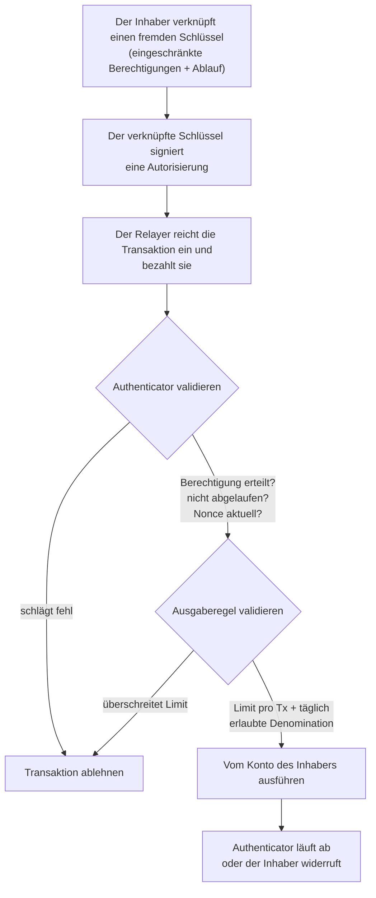

# Account Abstraction

QoreChain bietet **Account Abstraction auf Protokollebene** über das Modul `x/abstractaccount`. Das Modul erfasst Abstract Accounts mit Ausgaberegeln und lässt den Kontoinhaber fremde Schlüssel (**Authenticators**) verknüpfen, die innerhalb der Grenzen von Berechtigungen und Ausgabenlimits aus dem Konto ausgeben können — ganz ohne externe Smart-Contract-Infrastruktur.

:::danger Weder auf Mainnet noch auf Testnet aktiviert
Das Abstract-Account-Modul ist derzeit auf beiden Netzwerken **abgeschaltet**: `qorechaind query abstractaccount config` (und `GET /qorechain/abstractaccount/v1/config`) melden auf `qorechain-vladi` und `qorechain-diana` `enabled: false`. Ab Chain-Version v3.2.0 wird das Flag auf jedem Pfad durchgesetzt: Die Chain lehnt Kontoerstellung, Authenticator-Registrierung und beide Execute-Lanes (`MsgExecuteEVM`, `MsgExecuteCosmos`) mit `abstract accounts are disabled on this chain` ab. Keine Transaktion kann das Modul einschalten, und auf dem Mainnet wurde noch nie eine Abstract-Account-Transaktion aufgenommen. Alles Folgende beschreibt die Schnittstellen des Moduls zu Referenzzwecken. Bauen Sie auf den Live-Netzwerken keinen Ablauf mit verknüpften Schlüsseln oder delegiertem Ausgeben, solange das Modul nicht aktiviert ist, und prüfen Sie zuerst das Flag.
:::

:::note
Die folgenden Befehle verwenden das **`qorechain-vladi`**-Mainnet (live seit dem 7. Juni 2026), das die Node-Version **v3.2.3** ausführt. Ersetzen Sie für das Testnet, das v3.2.4 ausführt (nur Testnet), `--chain-id qorechain-diana`.
:::

:::caution Jede Cosmos-Lane-Transaktion benötigt die hybride Post-Quantum-Mitsignatur
Die `qorechaind tx`-Beispiele auf dieser Seite zeigen nur die Gebühren-Flags. Auf den Live-Netzwerken muss jede Cosmos-Lane-Transaktion zusätzlich die hybride ML-DSA-87-Mitsignatur tragen. Erstellen Sie die Transaktion daher mit `--generate-only` und signieren Sie sie mit `qorechaind tx pqc cosign` (oder verwenden Sie QoreX bzw. das SDK, die das für Sie übernehmen). Der Community-Build von `qorechaind` kann diese Signatur nicht erzeugen; verwenden Sie die Release-Binärdatei aus dem [Download-Manifest](/developer-guide/running-a-node#fetch-the-manifest). Die Gebührenuntergrenze beträgt **0.1 uqor pro Gas-Einheit**, sodass `--gas 400000` mindestens `--fees 40000uqor` erfordert. Siehe [Post-Quantum-Signierung](/developer-guide/post-quantum-signing).
:::

## Überblick

Traditionelle Blockchain-Konten werden von einem einzigen privaten Schlüssel kontrolliert. Account Abstraction entkoppelt das Konzept „wer darf eine Transaktion autorisieren" von einem einzelnen kryptografischen Schlüssel. Das Modul `x/abstractaccount` bietet:

* **Abstract Accounts** mit einem erfassten Kontotyp und Inhaber
* **Ausgaberegeln** (Limits pro Transaktion und pro Tag, erlaubte Denominationen), die begrenzen, was verknüpfte Schlüssel ausgeben können
* **Authenticators**: fremde Schlüssel (ein Phantom-ed25519-Schlüssel oder eine MetaMask-secp256k1-Adresse), die der Inhaber mit eingeschränkten Berechtigungen und einem Ablaufdatum verknüpft und jederzeit widerrufen kann

*Ein Ablauf mit verknüpftem Schlüssel (Authenticator): Der verknüpfte Schlüssel signiert eine Autorisierung, ein Relayer reicht sie ein, das Modul prüft Berechtigungen, Ablauf und Ausgaberegeln und führt dann vom Konto des Inhabers aus aus.*



## Kontotypen

`create` erfasst einen von drei Kontotypen. Der Typ wird im Konto gespeichert und ist Teil der Ableitung seiner Adresse; das Modul hat keine eigenen Multisig-, Session-Key- oder Recovery-Transaktionen (der Transaktionsdienst besteht aus `create`, `update-rules`, `register-authenticator`, `revoke-authenticator`, `execute-cosmos`, `execute-evm`).

| Typ               | Vorgesehener Einsatz                 |
| ----------------- | ------------------------------------ |
| `multisig`        | DAO-Treasuries, gemeinsame Wallets   |
| `social_recovery` | Consumer-Wallets, Onboarding         |
| `session_based`   | dApp-Sessions, mobile Wallets        |

## Ein Abstract Account erstellen

`create` erhält den Kontotyp als Positionsargument (`multisig`, `social_recovery` oder `session_based`):

```bash
qorechaind tx abstractaccount create session_based \
  --from mykey \
  --gas 400000 --fees 40000uqor
```

Der Befehl hat keine Flags für Signierer, Schwellenwerte oder Guardians.

## Authenticators (verknüpfte Schlüssel)

Der Delegationsmechanismus für Schlüssel des Moduls ist der **Authenticator**, der unten unter [Authenticators für verknüpfte Wallets](#authenticators) beschrieben wird: Der Inhaber verknüpft einen fremden Schlüssel (ed25519 oder secp256k1) mit einer Menge von Berechtigungen und einem Ablaufdatum und kann ihn jederzeit widerrufen:

```bash
qorechaind tx abstractaccount register-authenticator <account-address> <scheme> <pubkey-base64> <permissions-csv> <expiry-unix> <label> \
  --from mykey --gas 400000 --fees 40000uqor
qorechaind tx abstractaccount revoke-authenticator <account-address> <scheme> <pubkey-base64> \
  --from mykey --gas 400000 --fees 40000uqor
```

`scheme` ist `ed25519` (zum Beispiel Phantom) oder `secp256k1` (zum Beispiel MetaMask). Es gibt keinen Befehl `grant-session`, `revoke-session` oder `query abstractaccount sessions`.

## Ausgaberegeln

Ausgaberegeln fügen Abstract Accounts finanzielle Leitplanken hinzu:

| Regel            | Beschreibung                                                          |
| ---------------- | --------------------------------------------------------------------- |
| `daily_limit`    | Maximale Gesamtausgaben pro UTC-Kalendertag                           |
| `per_tx_limit`   | Maximale Ausgaben pro einzelner autorisierter Ausführung              |
| `allowed_denoms` | Beschränkt, welche Token-Denominationen ausgegeben werden dürfen (ein ERC-20 wird als `erc20/<contract>` aufgeführt) |
| `denom_limits`   | Limits pro Denomination als Dezimalzeichenketten (v3.2.2): `{"denom","per_tx_limit","daily_limit"}`; sie ersetzen `per_tx_limit` und `daily_limit` für die Denominationen, die sie nennen, sodass ein Token mit 18 Dezimalstellen begrenzt werden kann |
| `allowed_evm_calls` | EVM-Aufrufe, die ein regelgebundener Schlüssel **mit Call-Daten** ausführen darf (v3.2.2), als `0x<target>` (jede Funktion dieses Contracts) oder `0x<target>/0x<selector>` (nur diese Funktion). Ohne einen Eintrag kann ein regelgebundener Schlüssel nur Wert senden, deployen (mit der Berechtigung `deploy`) und die in `allowed_denoms` aufgeführten ERC-20-Token bewegen. Ein aufgeführtes Ziel vertraut jedem Argument der an es gerichteten Aufrufe, Empfänger eingeschlossen |

### Ausgaberegeln festlegen

`update-rules` ersetzt die Regeln des Kontos durch ein JSON-Array von `SpendingRule`-Objekten (Inline-JSON, keine Datei und keine Flags):

```bash
qorechaind tx abstractaccount update-rules <account-address> \
  '[{"id":"daily","enabled":true,"daily_limit":1000000000,"per_tx_limit":100000000,"allowed_denoms":["uqor"]}]' \
  --from mykey --gas 400000 --fees 40000uqor
```

Limits sind in der Basiseinheit (`uqor`) angegeben und zählen pro autorisierter Ausführung; das Tageslimit begrenzt die Gesamtsumme pro UTC-Kalendertag. Die Regeln ersetzen die gespeicherten als Ganzes, ein ausgelassenes Feld wird also entfernt. Seit v3.2.2 misst die EVM-Lane, was ein Aufruf tatsächlich bewegt (nativer Wert, die Abnahme des nativen Guthabens des Kontos, ausgegebene Bank-Coins sowie die Guthaben- oder Allowance-Änderung jedes aufgeführten ERC-20), statt nur `msg.value`, und die Contract-Erstellung benötigt die separate Berechtigung `deploy`. Ein ausführlicheres Beispiel:

```bash
qorechaind tx abstractaccount update-rules <account-address> \
  '[{"id":"daily","enabled":true,"daily_limit":5000000,"allowed_denoms":["uqor","erc20/0xTOKEN"],"allowed_evm_calls":["0xROUTER/0x38ed1739"],"denom_limits":[{"denom":"erc20/0xTOKEN","per_tx_limit":"100000000000000000000","daily_limit":"500000000000000000000"}]}]' \
  --from mykey --gas 400000 --fees 40000uqor
```

### Aktuelle Regeln abfragen

Der Kontodatensatz enthält seine Regeln und die Anzahl der verknüpften Schlüssel:

```bash
qorechaind query abstractaccount account <account-address>
```

:::caution Eine Regel begrenzt einen Schlüssel nur, wenn eine existiert
Die Chain ermittelt das Limit in dieser Reihenfolge: die eigene Regel des Authenticators, falls gesetzt und `enabled`; andernfalls die erste `enabled`-Regel des Kontos; andernfalls **gibt es kein Limit**. Eine mit `enabled: false` gespeicherte Regel bedeutet kein Limit, nicht ein Limit von null. `MsgRegisterAuthenticator` enthält keine Regel, ein allein mit dieser Nachricht verknüpfter Schlüssel wird also nur durch eine Regel auf Kontoebene begrenzt. Legen Sie mit `update-rules` bewusst eine Regel fest und registrieren Sie nur die Berechtigungen, die der Schlüssel benötigt. Ein Limit begrenzt den Schaden, den ein verknüpfter Schlüssel anrichten kann; es ersetzt nicht den Widerruf des Schlüssels.
:::

## Authenticators für verknüpfte Wallets — Delegiertes Ausgeben {#authenticators}

Das Authenticator-Design wurde in der Chain-Version **v3.1.85** eingeführt (aufbauend auf dem Berechtigungsmodell von v3.1.84). Es ist **auf den Live-Netzwerken nicht nutzbar, solange das Modul deaktiviert ist** (siehe den Statushinweis am Anfang dieser Seite). Ein **verknüpfter externer Wallet-Schlüssel** — ein Phantom-Schlüssel (ed25519) oder ein MetaMask-Konto (secp256k1) — kann **aus dem kanonischen Post-Quantum-Konto ausgeben**, und zwar unter Least-Privilege-Bedingungen, mit Ausgabenlimits und jederzeit widerrufbar. Der externe Schlüssel erzeugt niemals eine ML-DSA-Signatur; ein **Relayer** reicht den Transaktions-Envelope ein und bezahlt ihn (die eigene hybride PQC-Signatur des Relayers erfüllt die Signaturanforderungen der Chain), während die Signatur des Authenticators über **domain-separierte, replay-gebundene Sign-Bytes** die eigentliche Autorisierung darstellt.

### Einen Authenticator registrieren {#register-authenticator}

Der Kontoinhaber registriert den externen Schlüssel mit `MsgRegisterAuthenticator` (eine gewöhnliche Root-Key-Transaktion) und weist ihm dabei ein Schema, Berechtigungen, ein Ablaufdatum und optionale Ausgabenlimits zu:

```js
import { registerEthAuthenticatorMsg } from "@qorechain/wallet-adapter";

// Link a MetaMask account by its 20-byte address (EIP-191 verification):
const msg = registerEthAuthenticatorMsg({
  owner: "qor1owner...",              // the canonical account (signs this message)
  ethAddress: "0xAbC...123",          // the MetaMask address to link
  permissions: ["evm"],               // least privilege — see the taxonomy below
  expiryUnix: Math.floor(Date.now() / 1000) + 30 * 24 * 3600, // absolute Unix seconds, ≤ 30 days recommended
  label: "metamask",
});
// Limits are a separate message (MsgUpdateSpendingRules), see "Spending Rules" above.
// Sign & broadcast this msg with the OWNER's normal hybrid-PQC signer.
```

Ein Phantom-Schlüssel wird auf dieselbe Weise registriert, mit dem Schema `ed25519` und dem öffentlichen Phantom-Schlüssel (`register-authenticator` in der CLI). Der Widerruf erfolgt sofort über `MsgRevokeAuthenticator`.

### Berechtigungstaxonomie {#permission-taxonomy}

Elf kanonische Berechtigungen steuern, was ein registrierter Authenticator tun darf. Die Zuordnung ist **fail-closed**: Ein Nachrichtentyp ohne Zuordnung wird abgelehnt.

| Berechtigung | Gewährt |
| --- | --- |
| `send` | Bank-Transfers auf der Native Lane |
| `delegate` / `withdraw` / `vote` | Staking, Auszahlung von Rewards, Governance |
| `evm` / `wasm` / `svm` | Ausführung auf der jeweiligen VM-Lane |
| `amm` / `ibc` / `deploy` | AMM-Operationen, IBC-Transfers, Contract-Deployment |
| `all` | Jede *delegierbare* Nachricht |

**Schlüsselverwaltungs-Nachrichten sind niemals delegierbar** — `MsgRegisterAuthenticator`, `MsgRevokeAuthenticator`, PQC-Schlüsselregistrierung/-migration und `MsgRotatePQCKey` erfordern immer den Root-Schlüssel; ein verknüpfter Schlüssel kann seine eigenen Privilegien also niemals erweitern. Das Schema (`schema_version` 2) listet außerdem `lane_rules`: Die Contract-Erstellung von der Adresse des Kontos aus, ein Aufruf, der die EVM-Nonce des Kontos erhöht, und ein Aufruf an das Konto selbst, wenn dessen Code eine EIP-7702-Delegation ist, benötigen jeweils die Berechtigung `deploy` oder `all`. Seit v3.2.3 lehnt die Registrierung unbekannte Berechtigungszeichenketten und 65-Byte-secp256k1-Schlüssel ab, die sich nie verifizieren ließen.

Lesen Sie die Live-Taxonomie (mit `schema_version` zur Drift-Erkennung), statt sie fest zu codieren:

```bash
curl -s https://api.qore.host/qorechain/abstractaccount/v1/permission_schema | jq
# or: qorechaind query abstractaccount permission-schema
```

### Über einen verknüpften Schlüssel ausgeben {#execute-messages}

Zwei Nachrichten transportieren authenticator-autorisierte Aktionen. In beiden Fällen ist der Relayer der Signierer und Fee-Payer der Transaktion; die Signatur des Authenticators reist innerhalb der Nachricht mit.

**`MsgExecuteEVM`** — ein EVM-Aufruf oder Transfer **von der `0x…`-Adresse des kanonischen Kontos**. Der Authenticator signiert `sha256("qorechain-evm-auth-v1" ‖ chainId ‖ account ‖ pubkey ‖ to ‖ value ‖ data ‖ nonce)` (alle Felder mit Längenpräfix). Ab v3.2.3 (das Feature `abstractaccount-hardening`) verlangt die Chain den **v2-Digest**, `sha256("qorechain-evm-auth-v2" ‖ … ‖ nonce ‖ gasLimit)`, der zusätzlich das Gas-Limit des Aufrufs bindet (8 Byte, Big-Endian), sodass ein Relayer die Signatur nicht mit einem anderen Limit wiederverwenden kann; kein Block akzeptiert beide Formen. `qorechaind query abstractaccount auth-sign-evm` nimmt dafür `--gas-limit` entgegen, und Sie übergeben denselben Wert an `execute-evm`. Der Replay-Schutz ist die eigene EVM-Nonce des Kontos.

**`MsgExecuteCosmos`** — ein Bank-Send auf der Native Lane vom kanonischen Konto. Der Authenticator signiert `sha256("qorechain-cosmos-auth-v1" ‖ chainId ‖ account ‖ pubkey ‖ to ‖ amount ‖ nonce)`. Der Replay-Schutz ist eine **pro Authenticator geführte Sequenz**, die das Modul verwaltet (ein Bank-Send erhöht die Konto-Nonce nicht). Sends an sich selbst werden abgelehnt.

:::caution Nonce-Regeln
* `MsgExecuteEVM.nonce` = die **aktuelle** EVM-Nonce des Kontos (`eth_getTransactionCount(account0x, "latest")`). In Produktion ist der Relayer ein *anderes* Konto, addieren Sie also **kein** +1. Das Signieren einer veralteten Nonce liefert Code `11`.
* `MsgExecuteCosmos.nonce` = die Pro-Authenticator-Sequenz (fragen Sie den Authenticator-Zustand des Kontos ab), **nicht** die Cosmos-Sequenz des Kontos. Nur im Testnet (v3.2.4) liefert `GET /qorechain/abstractaccount/v1/auth_nonce/{address}/{pubkey_hex}` diese Sequenz direkt (`nonce`, `linked`).
:::

**Phantom-Beispiel** (Browser: Phantom signiert, Ihr Backend relayt):

```js
import { buildPhantomExecuteCosmos } from "@qorechain/wallet-adapter";

// In the dApp: Phantom signs the digest with ed25519 signMessage.
const msg = await buildPhantomExecuteCosmos({
  wallet: window.solana,              // Phantom: { publicKey, signMessage }
  relayer: "qor1relayer...",          // submits the tx and pays the fee (a different account)
  chainId: "qorechain-vladi",
  account: "qor1owner...",            // canonical account being spent from
  to: "qor1recipient...",
  amount: "900000uqor",               // single-coin string
  nonce: authSequence,                // per-authenticator sequence
});
// Send `msg` to your relayer; the relayer wraps it in a tx it signs
// (hybrid PQC) and broadcasts. The transfer moves the OWNER's funds.
```

**MetaMask-Beispiel** (EIP-191 `personal_sign` von der verknüpften 20-Byte-Adresse):

```js
import { buildMetaMaskExecuteEvm } from "@qorechain/wallet-adapter";

const msg = await buildMetaMaskExecuteEvm({
  provider: window.ethereum,          // MetaMask (EIP-1193)
  address: ethAddress,                // the linked 20-byte address
  relayer: "qor1relayer...",
  chainId: "qorechain-vladi",
  account: "qor1owner...",
  to: "0xRecipient...",
  value: (10n ** 16n).toString(),     // 0.01 QOR in wei (18-decimal EVM view), as a decimal string
  gasLimit: 100000,
  nonce: currentEvmNonce,             // eth_getTransactionCount(owner0x, "latest")
});
// Relay as above. The chain verifies the signature via EIP-191 + ecrecover
// against the registered 20-byte address.
```

Dieselben Builder existieren im [QoreChain SDK](/sdk/guides/authenticators) für alle fünf Sprachen, dazu CLI-Äquivalente:

```bash
# Generate an ed25519 authenticator key: the seed goes to a new 0600 file, only the public key is printed
qorechaind query abstractaccount auth-keygen --out authenticator.seed

# Sign the exact bytes the chain verifies (seed from --seed-file, "-" for stdin, QORE_AUTH_SEED, or a prompt)
qorechaind query abstractaccount auth-sign-cosmos <chain-id> <account> <to> <amount> <nonce> --seed-file authenticator.seed
qorechaind query abstractaccount auth-sign-evm <chain-id> <account> <to-0xhex> <value-wei> <data-hex> <nonce> --seed-file authenticator.seed

# Relay a pre-signed authorization (the relayer's --from key pays; cosign the envelope with `tx pqc cosign`)
qorechaind tx abstractaccount execute-cosmos <account> <to> <amount> <scheme> <pubkey-base64> <signature-base64> <nonce> --from relayer --generate-only > tx.json
qorechaind tx abstractaccount execute-evm <account> <to-0xhex> <value-wei> <data-hex> <gas-limit> <scheme> <pubkey-base64> <signature-base64> <nonce> --from relayer --generate-only > tx.json
```

Schlüssel und Signaturen sind in diesen Befehlen base64-kodiert. Die `auth-sign-*`-Helfer lesen den Seed aus einer Datei, von stdin oder aus der Umgebung statt aus einem Kommandozeilenargument (Node-Version v3.2.1 und neuer), sodass er nicht in der Shell-History erscheint. Die Flags zur Seed-Behandlung (`--out`, `--seed-file`) existieren nur in Binärdateien ab v3.2.1.

### Fehlercodes {#authenticator-errors}

Enforcement-Fehler liefern eindeutige Codes (Codespace `abstractaccount`), damit Wallets die richtige Meldung anzeigen können:

| Code | Bedeutung | Wallet-UX |
| --- | --- | --- |
| `5` | Ausgabenlimit überschritten (pro Transaktion oder täglich) | Verbleibendes Kontingent anzeigen |
| `6` | Authenticator abgelaufen | „Abgelaufen — Wallet erneut verknüpfen" |
| `9` | Modul deaktiviert (der Live-Zustand auf beiden Netzwerken) | „Verknüpfte Wallets sind noch nicht verfügbar" |
| `10` | Berechtigung verweigert (Scope oder nicht delegierbare Nachricht) | Fehlende Berechtigung anzeigen |
| `11` | Replay abgelehnt (veraltete Nonce/Sequenz) | Nonce erneut abfragen und neu signieren |

(Codespace `pqc`, Code `21` = Verifikation der hybriden Signatur fehlgeschlagen — ein Signierproblem auf Relayer-Seite, kein Autorisierungsproblem.)

### REST-Abfragen {#abstractaccount-rest}

Die Leseabfragen des Moduls werden über REST bereitgestellt (seit **v3.1.85**):

```
GET /qorechain/abstractaccount/v1/config      # {"config":{"enabled":false,...}} on both networks today
GET /qorechain/abstractaccount/v1/accounts
GET /qorechain/abstractaccount/v1/accounts/{address}
GET /qorechain/abstractaccount/v1/permission_schema
```

## Abstract Accounts abfragen

### CLI

```bash
# Module configuration (enabled flag and limits)
qorechaind query abstractaccount config

# Get full account configuration
qorechaind query abstractaccount account <address>

# List all abstract accounts (paginated)
qorechaind query abstractaccount accounts --page-limit 10
```

Auf dem Mainnet ist die Kontoliste leer; das Testnet listet einige Konten auf, die erstellt wurden, bevor das Enabled-Flag auf jedem Pfad durchgesetzt wurde.

### JSON-RPC

> **Noch nicht bereitgestellt:** Kein veröffentlichter Node-Build stellt den JSON-RPC-Namespace `qor_` bereit, daher liefert `qor_getAbstractAccount` heute auf jedem öffentlichen Endpunkt `-32601` (Methode nicht gefunden). Verwenden Sie die REST-Routen oben oder die CLI. Siehe [den `qor_`-Namespace](/api-reference/json-rpc-qor_-namespace).

### Beispiel einer Kontoantwort

Die Form eines Abstract-Account-Datensatzes (Beispielwerte):

```json
{
  "address": "qor1myaccount...",
  "account_type": "session_based",
  "owner": "qor1owner...",
  "spending_rules": [
    {
      "id": "daily",
      "enabled": true,
      "daily_limit": "1000000000",
      "per_tx_limit": "100000000",
      "allowed_denoms": ["uqor"]
    }
  ]
}
```

## Social Recovery

`social_recovery` ist ein Kontotyp, aber das Modul hat keine Recovery-Transaktionen: Es gibt keinen Befehl `initiate-recovery` oder `approve-recovery` und keine Recovery-Nachricht im Transaktionsdienst des Moduls. Die Schlüsselwiederherstellung für ein QoreChain-Konto erfolgt durch die erneute Ableitung des Post-Quantum-Schlüssels des Kontos aus seiner Mnemonic (`tx pqc recover-key`) und, falls nötig, dessen Rotation (`tx pqc rotate-key`); siehe [Post-Quantum-Signierung](/developer-guide/post-quantum-signing).

## Integration mit dApps

Wenn das Modul aktiviert ist, ist die Autorisierung über verknüpfte Schlüssel für Abläufe wie diese gedacht:

* Mobile Wallets, bei denen wiederholte biometrische Abfragen störend sind
* Gaming-dApps, die schnelles Transaktions-Signieren innerhalb eines begrenzten Kontingents benötigen
* Phantom- oder MetaMask-Nutzer, die über einen Relayer aus ihrem QoreChain-Konto ausgeben

Ein dApp-Backend fungiert als Relayer: Es empfängt die signierte Autorisierung des verknüpften Schlüssels, verpackt sie in eine Transaktion, die es selbst signiert, und sendet sie. Der verknüpfte Schlüssel kann jederzeit widerrufen werden oder ablaufen. Solange das Modul auf dem Zielnetzwerk nicht aktiviert ist, verwenden Sie gewöhnliches Signieren über [QoreX oder das SDK](/sdk/overview).

## Nächste Schritte

* [Einen Validator betreiben](/developer-guide/running-a-validator) — Einen Validator-Node einrichten und betreiben
* [EVM-Entwicklung](/developer-guide/evm-development) — EVM-Tooling, Konten und das EVM-Autorisierungsfenster
* [Cross-VM-Interoperabilität](/developer-guide/cross-vm-interoperability) — Cross-VM-Messaging
