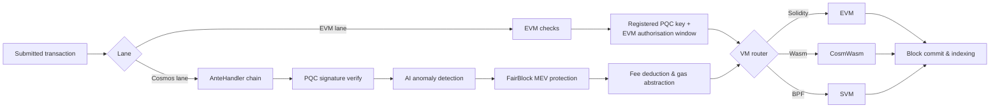

# Architektur-Überblick

QoreChain ist ein modularer Blockchain-Node, der aus drei primären Prozessen besteht — dem Chain-Node, dem AI-Sidecar und dem Block-Indexer — abgesichert durch eine Postgres-Datenbank und überwacht mittels Prometheus und Grafana. Das Mainnet (`qorechain-vladi`, EVM-Chain-ID **9801**) läuft seit dem 29. Juni 2026 live, auf Release **v3.2.1** (Konsensregeln von v3.2.0), mit einem parallelen Testnet (`qorechain-diana`, EVM-Chain-ID **9800**). Die Chain basiert auf dem Cosmos SDK v0.53. Das folgende Diagramm zeigt den Aufbau der Komponenten auf hoher Ebene.

Der nachfolgende Transaktions-Lebenszyklus fasst zusammen, wie eine übermittelte Transaktion durch den Node läuft — von der AnteHandler-Decorator-Kette (Sicherheits- und Gebührenprüfungen) über die VM-Ausführung bis zur On-Chain-Abwicklung:



```
┌────────────────────────────────────────────────────────────────────────────┐
│                            QoreChain Node                                  │
│                                                                            │
│  ┌──────────────────── Virtual Machines ──────────────────────┐           │
│  │  ┌───────┐    ┌──────────┐    ┌───────┐                   │           │
│  │  │  EVM  │    │ CosmWasm │    │  SVM  │                   │           │
│  │  │(Sol.) │◄──►│ (Wasm)   │◄──►│ (BPF) │                   │           │
│  │  └───┬───┘    └────┬─────┘    └───┬───┘                   │           │
│  │      └─────────┬───┘──────────────┘                       │           │
│  │           x/crossvm (bridge)                               │           │
│  └────────────────────────────────────────────────────────────┘           │
│                                                                            │
│  ┌────────────────────── Tokenomics ─────────────────────────┐           │
│  │  ┌──────┐   ┌───────┐   ┌───────────┐                    │           │
│  │  │x/burn│   │x/xqore│   │x/inflation│                    │           │
│  │  │12 src│   │lock/  │   │capped     │                    │           │
│  │  │37/30/│   │unlock │   │emission   │                    │           │
│  │  │20/10/│   │PvP    │   │emission   │                    │           │
│  │  │3     │   │       │   │114.3M cap │                    │           │
│  │  └──────┘   └───────┘   └───────────┘                    │           │
│  └────────────────────────────────────────────────────────────┘           │
│                                                                            │
│  ┌──────────── IBC / Bridges ────────────────────────────────┐           │
│  │  ┌──────────┐  ┌──────────┐  ┌───────────┐  ┌──────────┐ │           │
│  │  │x/bridge  │  │x/babylon │  │x/abstract │  │x/gas     │ │           │
│  │  │37 QCB    │  │BTC re-   │  │ account   │  │abstract. │ │           │
│  │  │configs   │  │staking   │  │session key│  │multi-tok │ │           │
│  │  └────┬─────┘  └────┬─────┘  └───────────┘  └──────────┘ │           │
│  │  QCB Bridge     Babylon IBC   ERC-4337-like   ibc/USDC    │           │
│  │  PQC-signed     BTC finality  social recov.   ibc/ATOM    │           │
│  │  36 ext chains  checkpoint    spending rules  fee convert  │           │
│  │  ┌──────────┐                                              │           │
│  │  │x/fair    │  Lane config (not enforced): PQC|MEV|AI|... │           │
│  │  │ block    │  tIBE encrypted mempool framework           │           │
│  │  └──────────┘                                              │           │
│  └────────────────────────────────────────────────────────────┘           │
│                                                                            │
│  ┌──── Rollup Development Kit ───────────────────────────────┐           │
│  │  ┌──────────┐  ┌──────────┐  ┌───────────┐  ┌──────────┐ │           │
│  │  │ x/rdk    │  │Settlement│  │ DA Router │  │ Profiles │ │           │
│  │  │ 4 modes: │  │Optimistic│  │ Native    │  │ defi     │ │           │
│  │  │ opt/zk/  │  │ZK/Based/ │  │ Celestia* │  │ gaming   │ │           │
│  │  │ based/   │  │Sovereign │  │ Both      │  │ nft      │ │           │
│  │  │ sovereign│  │          │  │           │  │ social/  │ │           │
│  │  │          │  │          │  │           │  │ general  │ │           │
│  │  └────┬─────┘  └────┬─────┘  └───────────┘  └──────────┘ │           │
│  │  Bank escrow    Auto-finalize  SHAKE-256 commit AI-assisted │           │
│  │  Burn on create EndBlocker     Blob pruning    PRISM sugg. │           │
│  │  → x/multilayer (RegisterSidechain + AnchorState)          │           │
│  └────────────────────────────────────────────────────────────┘           │
│                                                                            │
│  ┌──────────────┐ ┌──────┐ ┌────────────┐ ┌─────┐                       │
│  │x/rlconsensus │ │ x/ai │ │x/reputation│ │x/qca│                       │
│  │  PRISM (RL)  │ │      │ │            │ │     │                       │
│  └──────┬───────┘ └──┬───┘ └────┬──────┘ └──┬──┘                       │
│   PPO MLP         AI Engine   Scoring    CPoS Pools                      │
│   Obs/Action      Fraud Det.  Decay      Bonding                         │
│   Circuit Brk     Fee Opt.    Sigmoid    Slashing                        │
│   Rollup Adv.     TEE/FL                 QDRW Gov                        │
│                                                                            │
│  ┌──────┐ ┌──────────┐                                                   │
│  │x/pqc │ │ x/multi  │                                                   │
│  └──┬───┘ └────┬─────┘                                                   │
│  Dilithium    Layer Router                                                │
│  ML-KEM       Sidechains                                                  │
│  Hybrid Sig   + Rollups                                                   │
│  SHAKE-256                                                                │
│                                                                            │
│  ┌──────┐ ┌───────┐                                                      │
│  │x/svm │ │x/cross│                                                      │
│  └──┬───┘ └───┬───┘                                                      │
│  BPF Exec   CrossVM Msg                                                   │
└────────┬──────┬───────────────────────────────────────┬───────────────────┘
         │      │                                       │
   ┌─────┴─────┐│                              ┌───────┴──────┐
   │libqorepqc ││                              │  Indexer     │
   │(Rust PQC) ││                              │  (Postgres)  │
   └───────────┘│                              └──────────────┘
   ┌───────────┐│  ┌──────────┐
   │libqoresvm ││  │AI Sidecar│
   │(Rust BPF) │└──│ (gRPC)   │
   └───────────┘   └──────────┘
```

## Node-Komponenten

QoreChain läuft als drei zusammenarbeitende Prozesse, jeder mit eigenem Go-Modul und eigener Binary:

| Komponente          | Beschreibung                                                                                                                                                                                                                                                                                          | Ort                  |
| ------------------ | ---------------------------------------------------------------------------------------------------------------------------------------------------------------------------------------------------------------------------------------------------------------------------------------------------------------------------------------------------------------------------------------------------------- | ------------------------- |
| **qorechain-node** | Der zentrale Blockchain-Node. Betreibt die QoreChain Consensus Engine, führt alle Custom-Module aus, verwaltet alle drei VM-Laufzeiten und stellt RPC-, REST-, gRPC- und JSON-RPC-Endpunkte bereit.                                                                                                                      | `qorechain-core/`         |
| **ai-sidecar**     | Ein gRPC-Dienst, der erweiterte KI-Inferenz-Fähigkeiten bereitstellt, gestützt durch das QCAI-Backend. Der Sidecar behandelt Inferenz-Anfragen, die über den Umfang des On-Chain-RL-Agenten hinausgehen, etwa Analyse natürlicher Sprache und komplexe Mustererkennung. Kommuniziert mit dem Node per gRPC auf Port 50051. | `qorechain-core/sidecar/` |
| **block-indexer**  | Ein WebSocket-Listener, der neue Blöcke und Transaktionen vom RPC-Endpunkt des Nodes abonniert, Events parst und strukturierte Daten in eine Postgres-Datenbank schreibt, für schnelle Abfragen durch Explorer und APIs.                                                                                                          | `qorechain-core/indexer/` |

## Ports

| Port  | Protokoll       | Dienst                                                                           |
| ----- | -------------- | --------------------------------------------------------------------------------- |
| 26657 | HTTP/WebSocket | QoreChain Consensus Engine RPC (Blöcke, Transaktionen, Konsensstatus)            |
| 1317  | HTTP           | REST-API (Abfrage-Endpunkte, Transaktions-Broadcast)                                 |
| 9090  | gRPC           | gRPC-Abfrage- und Transaktions-Endpunkte                                              |
| 8545  | HTTP           | EVM JSON-RPC (Namespaces `eth_`, `web3_`, `net_`, `txpool_`)                      |
| 8546  | WebSocket      | EVM JSON-RPC (WebSocket-Subscriptions)                                            |
| 8899  | HTTP           | SVM JSON-RPC (Solana-kompatibel: `getAccountInfo`, `getBalance`, `getSlot`, usw.) |
| 50051 | gRPC           | AI-Sidecar (Inferenz-Anfragen vom Node)                                     |
| 5432  | TCP            | Postgres (Speicher des Block-Indexers)                                                  |
| 26660 | HTTP           | Prometheus-Metrik-Endpunkt des Nodes                                                |
| 9091  | HTTP           | Prometheus-Server (Host-Port im Docker-Compose-Stack)                         |
| 3001  | HTTP           | Grafana-Dashboards (Host-Port im Docker-Compose-Stack; Container-Port 3000)   |

## Modul-Übersicht

QoreChain registriert **48 Genesis-Module, davon 20 QoreChain-spezifische**, gruppiert nach Funktion:

**Sicherheit**

* `x/pqc` — Post-Quanten-Kryptografie: Dilithium-5, ML-KEM-1024, hybrides secp256k1 (ECDSA) + ML-DSA-87, SHAKE-256, Algorithmus-Agilität

**KI und Machine Learning**

* `x/ai` — Transaktions-Routing, Anomalieerkennung, Betrugserkennung, Gebührenoptimierung, TEE-Attestierung, föderiertes Lernen
* `x/reputation` — Multi-Faktor-Reputationsbewertung für Validatoren mit zeitlichem Abklingen
* `x/rlconsensus` — On-Chain-RL-Agent (PPO MLP), Design zur Konsens-Feinabstimmung, Circuit Breaker, Rollup-Beratung — die PRISM-Optimierungsschicht (in den Live-Netzwerken nur Beobachtung: es ist keine Policy geladen)

**Konsens**

* `x/qca` — Triple-Pool Composite PoS (RPoS/DPoS/PoS) als Design, eigene Bonding-Curve, progressives Slashing, QDRW-Governance — implementiert, aber noch nicht in Blockproduktion, Belohnungen, Slashing oder die Governance-Auszählung eingebunden

**Virtuelle Maschinen**

* `x/vm` — VM-Routing und Lifecycle-Management
* `x/svm` — SVM-Laufzeit: BPF-Deployment/-Ausführung, Rent-Erhebung, Solana-kompatible RPC
* `x/crossvm` — Cross-VM-Kommunikation: EVM-CosmWasm-Precompile + asynchrone SVM-Events

**Tokenomics und Liquidität**

* `x/burn` — 12 Burn-Quellen, EndBlocker-Gebührenverteilung (37/30/20/10/3-Split)
* `x/xqore` — Design für Governance-verstärktes Staking: Lock/Unlock, gestaffelte Ausstiegsstrafen, PvP-Rebase (nur Buchführung; Lock- und Unlock-Transaktionen sind in den Live-Netzwerken noch nicht eingebunden)
* `x/inflation` — Begrenzte Emission: pro Epoche wird ein fester Betrag geprägt, bis eine harte kumulative Obergrenze (114.285.714 QOR) erreicht ist
* `x/amm` — On-Chain-Liquidität / automatisierter Market Maker

**Bridges und Interoperabilität**

* `x/bridge` — 37 Chain-Konfigurationen (36 externe Chains plus Injective über IBC) über jeden wichtigen Chain-Typ hinweg, PQC-signierte Attestierungen, Circuit Breaker (alle Konfigurationen `pending`; nicht live)
* `x/babylon` — BTC-Restaking über Babylon Protocol, Epochen-Checkpoints (Designphase; keine Transaktionen aktiviert)
* `x/multilayer` — Verwaltung der Sidechain-/Paychain-/Rollup-Schicht, State-Anchoring

**Governance- und Lizenz-Erweiterungen**

* `x/abstractaccount` — Smart Accounts: Multisig, Social Recovery, Session Keys, Spending Rules (in beiden Netzwerken abgeschaltet: `enabled = false`)
* `x/fairblock` — MEV-Schutz: Threshold-IBE-verschlüsseltes Mempool-Framework (in beiden Netzwerken deaktiviert)
* `x/gasabstraction` — Design für Gebührenzahlung mit mehreren Token: ibc/USDC-, ibc/ATOM-Gebührenkonvertierung (es ist noch kein IBC-Kanal offen, daher werden Gebühren in QOR bezahlt)
* `x/license` — Chain-Lizenzierung

**Rollups**

* `x/rdk` — Rollup Development Kit: 4 Settlement-Modi (optimistic, zk, based, sovereign), vorgefertigte Profile, native DA, Bank-Escrow

## AnteHandler-Kette

Jede Transaktion durchläuft vor der Ausführung eine Decorator-Kette; jeder Decorator kann sie ablehnen. Es gibt zwei Ketten.

**Cosmos-Lane** (der Reihe nach): `RejectMessages` (kein `MsgEthereumTx` auf dieser Lane) → `AuthzLimiter` (keine EVM- oder Vesting-Erstellungsnachrichten innerhalb von authz) → `SetUpContext` → Mempool- und Multisig-Tiefen-Guards → CosmWasm-Simulations-Gas-, Tx-Zähler-, Gas-Register- und Contracts-Decorators → `CircuitBreaker` → Extension-Option-Prüfung → `ValidateBasic` → `TxTimeout` → `Memo` → Validator-Lizenz-Gate (`MsgCreateValidator`) → `PQCVerify` → `PQCHybridVerify` → `PQCReplayGuard` → `AIAnomaly` (enthält das Ratenlimit pro Absender) → `FairBlock` → `SVMComputeBudget` → `SVMDeductFee` → `MinGasPrice` → `ConsumeTxSize` → `GasAbstraction` → `DeductFee` → `SetPubKey` → `ValidateSigCount` → `SigGasConsume` → `SigVerify` → `IncrementSequence` → Burn-Transaktionszähler → IBC-Redundant-Relay-Prüfung → Tracking des angeforderten Gas.

**EVM-Lane** (Transaktionen mit der Ethereum-Extension-Option): `CircuitBreaker` → der EVM-Mono-Decorator (Signatur-, Nonce-, Gebühren- und Guthabenprüfungen) → `EVMWindowDecorator` (registrierter Post-Quanten-Schlüssel und ein aktives Autorisierungsfenster; siehe [EVM-Autorisierungsfenster](/getting-started/first-transaction#evm-window)).

Wichtige Decorators auf der Cosmos-Lane:

1. **PQCVerify** — Modul `x/pqc`. Verifiziert Dilithium-5-Signaturen bei PQC-gekennzeichneten Transaktionen.
2. **PQCHybridVerify** — Modul `x/pqc`. Verifiziert duale secp256k1 (ECDSA) + ML-DSA-87 Hybrid-Signaturen.
3. **AIAnomaly** — Modul `x/ai`. Führt Isolation-Forest-Anomalieerkennung und Risikobewertung durch und erzwingt das Transaktionslimit pro Absender.
4. **FairBlock** — Modul `x/fairblock`. Verarbeitet tIBE-verschlüsselte Transaktionen zum MEV-Schutz (in den Live-Netzwerken deaktiviert).
5. **SVMComputeBudget** — Modul `x/svm`. Validiert und reserviert Compute-Units für SVM-Programme.
6. **SVMDeductFee** — Modul `x/svm`. Zieht SVM-spezifische Ausführungsgebühren ab.
7. **GasAbstraction** — Modul `x/gasabstraction`. Konvertiert nicht-native Gebühren-Token vor dem Abzug (Gebühren werden derzeit in QOR bezahlt).

## Docker-Compose-Stack

Der vollständige Entwicklungs-Stack läuft als sechs-teiliges Docker-Compose-Deployment auf einem gemeinsamen Bridge-Netzwerk (`qorechain-net`):

| Dienst          | Image                      | Zweck                                             |
| ---------------- | -------------------------- | --------------------------------------------------- |
| `qorechain-node` | `qorechain-core:latest` (lokal aus dem Dockerfile gebaut; es gibt kein veröffentlichtes Node-Image) | Chain-Node mit allen Modulen, VMs und RPC-Endpunkten |
| `ai-sidecar`     | `ghcr.io/qorechain/ai-sidecar:latest` | KI-Inferenzdienst (gRPC + QCAI-Backend)          |
| `block-indexer`  | `ghcr.io/qorechain/block-indexer:latest` | Block-/Transaktions-Indexer (WebSocket + Postgres)    |
| `postgres`       | `postgres:16-alpine`       | Datenbank für den Block-Indexer                      |
| `prometheus`     | `prom/prometheus:v3.10.0`  | Metrikerfassung und -speicherung                      |
| `grafana`        | `grafana/grafana:12.4.1`   | Monitoring-Dashboards und Alerting                  |

Den vollständigen Stack starten:

```bash
docker compose up -d
```

Kopiere vor dem ersten Start `.env.example` nach `.env` und `.env.sidecar.example` nach `.env.sidecar` und setze `GRAFANA_PASSWORD` (Compose startet ohne diese Variable nicht).

Alle persistenten Daten werden in benannten Docker-Volumes gespeichert: `node-data`, `postgres-data`, `prometheus-data` und `grafana-data`.

## Siehe auch

* [Multilayer-Architektur](/architecture/multilayer-architecture) — Sidechain-Registrierung und State-Anchoring.
* [Konsensmechanismus](/architecture/consensus-mechanism) — Blockproduktion, Finalität und Slashing.
* [PRISM Consensus Engine](/architecture/prism-consensus-engine) — KI-gesteuerte Parameteroptimierung.
* [Post-Quanten-Sicherheit](/architecture/post-quantum-security) — Dilithium-5-Signaturen im gesamten Stack.
