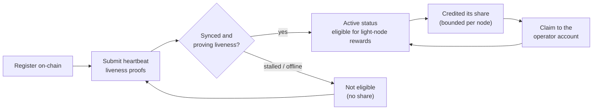

# Belohnungen und Überwachung

Einem registrierten Light Node wird ein Anteil der Light-Node-Zuteilung gutgeschrieben, und er **muss gesund bleiben**, um dafür weiterhin berechtigt zu sein. Diese Seite behandelt den 3%-Belohnungsanteil für Light Nodes, wie Belohnungen gutgeschrieben und eingefordert werden, was der Node mit Delegationen tut und was nicht, und wie man den Node überwacht.

:::note Nichts hier ist ein Ertragsversprechen
Die Registrierung ist auf beiden Netzwerken offen; den aktuellen Stand findest du unter [Status des Belohnungsprogramms](/light-node/overview#reward-program-status). Was einem Node gutgeschrieben wird, hängt von der Light-Node-Zuteilung, der Anzahl berechtigter Nodes, deren Stake und Uptime sowie der unten beschriebenen Obergrenze pro Node ab.
:::

## Der 3%-Anteil an den Blockbelohnungen

Die Gebührenverteilung von QoreChain reserviert einen festen **3%-Anteil für Light Nodes**, die Netzwerkdaten bereitstellen. Dies ist eines der fünf Ziele in der Belohnungsaufteilung des Protokolls — Validatoren (37%), verbrannt (30%), Treasury (20%), Staker (10%) und **Light Nodes (3%)** — on-chain erzwungen. Siehe [Tokenomics](/architecture/tokenomics) für die vollständige Aufschlüsselung.

Um an diesem Anteil teilzunehmen, benötigt ein Node Folgendes, on-chain geprüft statt nur selbst angegeben: eine aktive `lightnode_operator`-Lizenz (wird bei der Registrierung geprüft), mindestens **1.000 QOR, die an gebondete Validatoren delegiert sind** — gezählt als deine Gesamtsumme über alle Validatoren, an die du delegierst, nicht pro Validator; Delegationen an gejailte oder ungebondete Validatoren zählen nicht; bei der Registrierung erforderlich und bei jeder Gutschrift von Belohnungen erneut aus dem Staking gelesen — und eine Registrierungsgebühr von **1 QOR**, die einmalig bei der Registrierung gezahlt wird. Die Teilnahme ist netzwerkweit auf **10.000 Light Nodes** begrenzt. Siehe [Registrierung und Lizenzierung](/light-node/registration-and-licensing) dazu, wie die Registrierung funktioniert, und [Status des Belohnungsprogramms](/light-node/overview#reward-program-status) für den aktuellen Stand.

Die 3% sind das, was in das Light-Node-Modul fließt, kein Anspruch pro Node: Jedem berechtigten Node wird sein stakegewichteter Anteil des Angesammelten gutgeschrieben, pro Node begrenzt, und alles Nichtverdiente fließt in eine Reserve, die nur eine Governance-Abstimmung freigeben kann. Seit Chain v3.2.3 liegt die Grenze pro Node bei **2.000 QOR pro 30 Tage** (`max_reward_per_month_per_node`), anteilig über die zwischen den Abrechnungen verstrichene Blockzeit berechnet und mit der Uptime skaliert (die Regel `lightnode-monthly-cap`); sie ersetzt die frühere Grenze pro Block (`max_reward_per_block_per_node`, `1713` uqor pro Block). Ab v3.2.4 (Mainnet seit dem 23. Oktober 2026, Testnet seit dem 19. Oktober 2026) beginnt die Grenze für einen Node beim späteren von vorheriger Abrechnung und eigener Registrierung des Nodes, sodass einem neu registrierten Node keine Zeit vor seiner Registrierung gutgeschrieben wird. Siehe [den 3%-Belohnungsanteil für Light Nodes](/light-node/overview#the-3-light-node-reward-share).

Sobald registriert und delegiert, ist aktiv zu bleiben, was über die weitere Berechtigung entscheidet. Ein Node benötigt mindestens **80% Uptime** und muss weiterhin Heartbeat-Liveness-Nachweise in einem Intervall von **1.000 Blöcken** einreichen (etwa 52 Minuten auf dem Mainnet bei der gemessenen durchschnittlichen Blockzeit von rund 3,1 s; etwa 22 Minuten auf dem Testnet bei rund 1,3 s pro Block).

**Die Zeitregeln.** Die Chain lehnt einen Heartbeat ab, der **weniger als 1.000 Blöcke nach deinem vorherigen** gesendet wird (`heartbeat submitted too early`); dein erster Heartbeat nach der Registrierung hat keine solche Untergrenze. Trifft innerhalb von **1.000 + 100 Blöcken** (`heartbeat_interval` plus `heartbeat_grace_period`; auf dem Mainnet etwa 52 Minuten plus eine Karenzzeit von rund 5 Minuten) nach deinem letzten Heartbeat — oder nach der Registrierung, falls du noch keinen gesendet hast — kein Heartbeat ein, wird der Node als inaktiv markiert und erhält keine Gutschriften mehr. Ein später gesendeter Heartbeat wird weiterhin akzeptiert und reaktiviert ihn. Der Daemon sendet den nächsten Heartbeat, sobald seit dem `last_heartbeat` deines Nodes auf der Chain 1.000 Blöcke vergangen sind, und prüft dies alle 60 Sekunden.

**Ein verpasstes Fenster kostet Uptime, nicht deine Registrierung.** Ein Node, der das Fenster verpasst, wird als inaktiv markiert und verdient nichts mehr, aber schon der nächste erfolgreiche Heartbeat reaktiviert ihn — eine erneute Registrierung ist nicht nötig. Deine **Uptime** ist das laufende Verhältnis von empfangenen zu erwarteten Heartbeats (einer pro 1.000 Blöcke) seit dem Block deiner Registrierung, begrenzt auf 1. Unterhalb des Schwellenwerts `min_uptime_for_rewards` (`0.80`) verdient ein Node nichts; bei oder über diesem Wert wird die Obergrenze pro Node mit deiner Uptime skaliert. Ein langer Ausfall senkt daher das Verhältnis, und es erholt sich nur, wenn sich rechtzeitige Heartbeats ansammeln. Prüfe `status`, wenn ein Node als inaktiv angezeigt wird: Er meldet den Zustand von Signierer, Lizenz und Registrierung.

:::note Was ein Heartbeat tatsächlich beweist
Ein erfolgreicher Heartbeat beweist, dass der Schlüssel des Betreibers rechtzeitig signiert hat — er beweist nicht, dass ein Node durchgehend die vollständige Software ausführt. Behandle ihn als Liveness-Signatur, nicht als „verifiziert als aktiver Node".
:::

:::note `last_heartbeat` ist eine Blockhöhe, keine Zeitangabe
Fragst du den On-Chain-Datensatz eines Nodes direkt ab, ist `last_heartbeat` eine Blockhöhe, und ein Wert von `0` bedeutet, dass noch kein Heartbeat erfasst wurde — die Chain misst die Inaktivitätsfrist in diesem Fall ab der `registered_at`-Höhe des Nodes. Liest man `0` als naive Berechnung der verstrichenen Zeit, wirkt ein frisch registrierter Node so, als sei er um Millionen Blöcke überfällig.
:::

*Belohnungsberechtigung: eine aktive On-Chain-Lizenz und den minimal gebundenen Stake halten, registrieren und dann die Aktivität fortlaufend über Heartbeats nachweisen, um über den Uptime- und Heartbeat-Intervall-Schwellenwerten zu bleiben.*



## Wie Belohnungen funktionieren {#how-rewards-work}

### Gutschrift

Alle 100 Blöcke schreibt die Chain jedem berechtigten Node (aktiv, mit mindestens dem minimal delegierten Stake und mindestens der Mindest-Uptime) seinen Anteil des Angesammelten gut, pro Node begrenzt (höchstens 2.000 QOR pro 30 Tage, anteilig über die Zeit seit der vorherigen Abrechnung), wie unter [den 3%-Belohnungsanteil für Light Nodes](/light-node/overview#the-3-light-node-reward-share) beschrieben. Der Betrag wird zu `accumulated_rewards` des Nodes addiert. Lies ihn aus mit:

```bash
curl -s https://api.qore.host/qorechain/lightnode/v1/rewards/<operator-address>
# or: qorechaind query lightnode rewards <operator-address>
```

(Verwende `https://api-testnet.qore.host` für das Testnet.)

### Einfordern

Gutgeschriebene Belohnungen bleiben im Node-Datensatz, bis du sie einforderst. Der Node kann sie für dich einfordern: Setze `auto_claim = true` unter `[delegation]`, und der Daemon fordert angesammelte Light-Node-Belohnungen auf das Betreiberkonto ein, sobald sie `min_reward_claim` überschreiten (Standard `1000000` uqor, 1 QOR), und prüft dies alle `compound_interval` (Standard `1h`). Er signiert die Anforderung auf dieselbe Weise wie Heartbeats (nativ oder über den `qorechaind`-Fallback). Auto-Claim ist **standardmäßig aus**, und er fordert nur ein: Der Node delegiert nie neu und bewegt keinen Stake.

Um von Hand mit `qorechaind` einzufordern (der Operator-Schlüssel in einem `qorechaind`-Keyring und der Post-Quantum-Schlüssel exportiert mit `lightnode-sx keys export <key-name> --out ~/.qorechaind/pqc/<key-name>.dilithium`), verwende ein Generate-then-Cosign-Paar:

```bash
qorechaind tx lightnode claim-rewards --from operator --chain-id <chain-id> --node https://rpc.qore.host --gas 300000 --fees 30000uqor --generate-only > claim.json
qorechaind tx pqc cosign claim.json --from operator --pqc-key <key-name> --chain-id <chain-id> --node https://rpc.qore.host
```

`qorechaind tx lightnode deregister` entfernt die Registrierung und zahlt alles noch Gutgeschriebene aus; die Registrierungsgebühr wird nicht erstattet.

### Delegationsverfolgung und Stake-Warnungen {#delegation-alerts}

Der Node spiegelt die Delegationen des Betreiberkontos beim Start und danach alle fünf Minuten von der Chain. Er bewegt nie Stake: Ändere Delegationen aus deiner eigenen Wallet. Wovor er warnt, hängt von der Version des Light Nodes ab:

- **3.1.11 und neuer (mit `rebalance_enabled = true`, dem Standard).** Er warnt, wenn ein Validator, an den du delegierst, gejailt ist, wenn er nicht im aktiven Set ist und wenn dein gebondeter Stake unter `min_delegated_stake` (1.000 QOR) fällt. In allen drei Fällen hört die Chain auf, dem Node Belohnungen gutzuschreiben, und gibt keine Meldung aus. Eine Warnung wird protokolliert, wenn sie auftritt, stündlich, solange sie besteht, und einmal, wenn sie behoben ist.
- **Reputationswert (3.1.12, vorerst nur Testnet).** Der Node liest außerdem den Wert jedes delegierten Validators von `GET /qorechain/reputation/v1/validator/<valoper>` und warnt, wenn er unter `min_reputation` (Standard `0.5`) liegt. Ein Validator, den die Chain noch nicht bewertet hat (`404`), wird übersprungen. Das Testnet stellt diese Route jetzt bereit; das **Mainnet tut es ab einem Chain-Release nach v3.2.5**. Solange die Route nicht bereitgestellt wird, vermerkt der Node einmalig, dass keine Werte veröffentlicht sind, und fragt alle sechs Stunden erneut an.
- **3.1.10 und früher.** Die Reputationsprüfung hat nie funktioniert: Sie protokollierte alle fünf Minuten „failed to check reputation" und löste keine Warnung aus. Verlasse dich bei diesen Versionen nicht auf Warnungen; installiere 3.1.12 einmal von Hand (siehe [SX-Edition: Aktualisieren](/light-node/sx-edition#updating)).

Die Optionen `validators` und `split_weights` in `[delegation]` werden akzeptiert, aber derzeit nicht ausgewertet.

### Belohnungen und Delegationen einsehen

```bash
lightnode-sx validators   # the bonded validator set
lightnode-sx delegation   # the operator account's delegations, as mirrored by the running daemon
lightnode-sx rewards      # the operator account's pending staking rewards
```

Seit 3.1.6 lesen diese Befehle sowie die UX-Ansicht **Delegation** das Konto in `operator_address`. `rewards` zeigt die **Staking**-Belohnungen aus deinen Delegationen, nicht die Light-Node-Belohnungen. Um alles direkt von der Chain zu lesen:

```bash
curl -s https://api.qore.host/cosmos/staking/v1beta1/delegations/<operator-address>
curl -s https://api.qore.host/cosmos/distribution/v1beta1/delegators/<operator-address>/rewards
curl -s https://api.qore.host/qorechain/lightnode/v1/rewards/<operator-address>   # light-node rewards
```

## Überwachung

Den Node gesund zu halten, ist das, was ihn für Belohnungen berechtigt hält. Es gibt drei Dinge, die es wert sind, beobachtet zu werden.

### Telemetrie

Die Echtzeit-Telemetrie umfasst Validatoren, Konsens/Netzwerk, die Bridge und Tokenomics, jeweils in einem eigenen Intervall aktualisiert (konfiguriert unter `[telemetry]` in `config.toml`). Über die CLI:

```bash
lightnode-sx status    # node and light-client sync status
lightnode-sx network   # recent synced headers and latest height
```

Die UX-Edition zeigt dieselben Daten live über ihre Ansichten **Overview**, **Network**, **Bridge** und **Tokenomics** — siehe [UX-Edition](/light-node/ux-edition).

### Sync- und Heartbeat-Zustand

Der Befehl `status` meldet die Chain-ID, die neueste Blockhöhe, ob die Chain aufholt (catching up), die synchronisierte Höhe und den Sync-Zustand des Light Clients, den `Signer` (nativ, `qorechaind` oder nicht verfügbar mit Angabe des Grundes) sowie — sobald `operator_address` gesetzt ist — den Zustand von `Licence` und `Registration` (einschließlich des Status des Nodes und der Höhe des letzten Heartbeats). Ein Node, der registriert, synchronisiert ist und läuft, reicht weiterhin **Heartbeat-Liveness-Nachweise** ein und bleibt so für Belohnungen berechtigt. Diese Heartbeats werden über eine **PQC-mitsignierte Transaktions-Pipeline** (hybrid Dilithium-5 / ML-DSA-87) erzeugt, konsistent mit dem standardmäßig PQC-erforderlichen Verhalten der Chain — siehe [Registrierung und Lizenzierung](/light-node/registration-and-licensing#pqc-cosigned-heartbeat-pipeline) dazu, wie die Pipeline funktioniert und wie der Node seinen Signierer wählt. Wenn `status` anzeigt, dass der Node hängt oder nicht synchronisiert, könnte er seine Aktivität nicht nachweisen — untersuche dies, bevor die Berechtigung beeinträchtigt wird.

### Selbsttest-Zustand

Wenn du ein Problem mit dem kryptografischen Stack vermutest, führe den PQC-Selbsttest jederzeit aus:

```bash
lightnode-sx selftest
```

Er führt Keygen → Sign → Verify → Manipulationserkennung aus (fünf Prüfungen) und beendet sich bei jedem Fehler mit einem Exit-Code ungleich null. Dies ist der schnellste Weg, ein Problem mit dem Post-Quantum-Signaturstack bei der Diagnose von Node-Problemen auszuschließen. Siehe [SX-Edition](/light-node/sx-edition) für die vollständige Aufschlüsselung des Selbsttests.

### Chain-Abfragen {#chain-queries}

Basis-URLs: `https://api.qore.host` (Mainnet) und `https://api-testnet.qore.host` (Testnet).

| Abfrage | Liefert |
| --- | --- |
| `GET /qorechain/lightnode/v1/params` | Registrierungsgebühr, Heartbeat-Intervall und Karenzzeit, minimal delegierter Stake, Belohnungsanteil, Mindest-Uptime, Node-Obergrenze. |
| `GET /qorechain/lightnode/v1/stats` | Anzahl registrierter und aktiver Nodes, insgesamt gutgeschriebene Belohnungen. |
| `GET /qorechain/lightnode/v1/node/{address}` | Datensatz eines Nodes (`status`, `last_heartbeat`, `total_heartbeats`, `expected_heartbeats`, `accumulated_rewards`). |
| `GET /qorechain/lightnode/v1/rewards/{address}` | Gutgeschriebene, noch nicht eingeforderte Belohnungen. |
| `GET /qorechain/lightnode/v1/reward_pool` | Wie sich das Modul-Guthaben auf Reserve, gutgeschriebene Belohnungen und die nächste Auszahlung verteilt; enthält die Obergrenzen pro Node (`max_reward_per_month_per_node` und das frühere `max_reward_per_block_per_node`). |
| `GET /qorechain/license/v1/check/{address}/lightnode_operator` | Ob eine Adresse eine aktive Lizenz besitzt. |

## Wie es weitergeht

- [Registrierung und Lizenzierung](/light-node/registration-and-licensing) — registrieren lassen und aktiv bleiben.
- [Tokenomics](/architecture/tokenomics) — das vollständige Belohnungs- und Burn-Modell.
