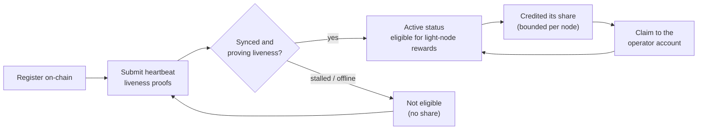

# Belohnungen und Überwachung

Einem registrierten Light Node wird ein Anteil der Light-Node-Zuteilung gutgeschrieben, und er **muss gesund bleiben**, um dafür weiterhin berechtigt zu sein. Diese Seite behandelt den 3%-Belohnungsanteil für Light Nodes, wie Belohnungen gutgeschrieben und eingefordert werden, was der Node mit Delegationen tut und was nicht, und wie man den Node überwacht.

:::note Die Registrierung für das Belohnungsprogramm ist noch nicht geöffnet
Auf keinem der beiden Netzwerke ist bisher ein Light Node registriert, da die Registrierung eine `lightnode_operator`-Lizenz erfordert und noch keine vergeben wurde. Die hier beschriebene Belohnungsabrechnung ist on-chain live, aber heute wird an Nodes nichts ausgezahlt, und nichts auf dieser Seite ist ein Ertragsversprechen. Siehe [Status des Belohnungsprogramms](/light-node/overview#reward-program-status).
:::

## Der 3%-Anteil an den Blockbelohnungen

Die Gebührenverteilung von QoreChain reserviert einen festen **3%-Anteil für Light Nodes**, die Netzwerkdaten bereitstellen. Dies ist eines der fünf Ziele in der Belohnungsaufteilung des Protokolls — Validatoren (37%), verbrannt (30%), Treasury (20%), Staker (10%) und **Light Nodes (3%)** — on-chain erzwungen. Siehe [Tokenomics](/architecture/tokenomics) für die vollständige Aufschlüsselung.

Um an diesem Anteil teilzunehmen, benötigt ein Node Folgendes, on-chain geprüft statt nur selbst angegeben: eine aktive `lightnode_operator`-Lizenz (wird bei der Registrierung geprüft), mindestens **1.000 QOR gebunden** — gezählt als deine Gesamtsumme über alle Validatoren, an die du delegierst, nicht pro Validator, bei der Registrierung erforderlich und bei jeder Gutschrift von Belohnungen erneut aus dem Staking gelesen — und eine Registrierungsgebühr von **1 QOR**, die einmalig bei der Registrierung gezahlt wird. Die Teilnahme ist netzwerkweit auf **10.000 Light Nodes** begrenzt. Siehe [Registrierung und Lizenzierung](/light-node/registration-and-licensing) dazu, wie die Registrierung funktioniert, und [Status des Belohnungsprogramms](/light-node/overview#reward-program-status), ob die Anmeldung geöffnet ist.

Die 3% sind das, was in das Light-Node-Modul fließt, kein Anspruch pro Node: Jedem berechtigten Node wird sein stakegewichteter Anteil des Angesammelten gutgeschrieben, pro Node begrenzt durch `max_reward_per_block_per_node` (derzeit `1713` uqor pro Block, skaliert mit der Uptime), und alles Nichtverdiente fließt in eine Reserve, die nur eine Governance-Abstimmung freigeben kann. Siehe [den 3%-Belohnungsanteil für Light Nodes](/light-node/overview#the-3-light-node-reward-share).

Sobald registriert und delegiert, ist aktiv zu bleiben, was über die weitere Berechtigung entscheidet. Ein Node benötigt mindestens **80% Uptime** und muss weiterhin Heartbeat-Liveness-Nachweise in einem Intervall von **1.000 Blöcken** einreichen (etwa 54 Minuten auf dem Mainnet bei der gemessenen durchschnittlichen Blockzeit von rund 3,2 s; etwa 17 Minuten auf dem Testnet, das etwa einen Block pro Sekunde erzeugt).

**Die Zeitregeln.** Die Chain lehnt einen Heartbeat ab, der **weniger als 1.000 Blöcke nach deinem vorherigen** gesendet wird (`heartbeat submitted too early`); dein erster Heartbeat nach der Registrierung hat keine solche Untergrenze. Trifft innerhalb von **1.000 + 100 Blöcken** (`heartbeat_interval` plus `heartbeat_grace_period`; auf dem Mainnet etwa 54 Minuten plus eine Karenzzeit von rund 5 Minuten) nach deinem letzten Heartbeat — oder nach der Registrierung, falls du noch keinen gesendet hast — kein Heartbeat ein, wird der Node als inaktiv markiert und erhält keine Gutschriften mehr. Ein später gesendeter Heartbeat wird weiterhin akzeptiert und reaktiviert ihn. Der Daemon sendet den nächsten Heartbeat, sobald seit dem `last_heartbeat` deines Nodes auf der Chain 1.000 Blöcke vergangen sind, und prüft dies alle 60 Sekunden.

**Ein verpasstes Fenster kostet Uptime, nicht deine Registrierung.** Ein Node, der das Fenster verpasst, wird als inaktiv markiert und verdient nichts mehr, aber schon der nächste erfolgreiche Heartbeat reaktiviert ihn — eine erneute Registrierung ist nicht nötig. Deine **Uptime** ist das laufende Verhältnis von empfangenen zu erwarteten Heartbeats (einer pro 1.000 Blöcke) seit dem Block deiner Registrierung, begrenzt auf 1. Unterhalb des Schwellenwerts `min_uptime_for_rewards` (`0.80`) verdient ein Node nichts; bei oder über diesem Wert wird die Obergrenze pro Node mit deiner Uptime skaliert. Ein langer Ausfall senkt daher das Verhältnis, und es erholt sich nur, wenn sich rechtzeitige Heartbeats ansammeln. Prüfe `status`, wenn ein Node als inaktiv angezeigt wird: Er meldet den Zustand von Signierer, Lizenz und Registrierung.

:::note Was ein Heartbeat tatsächlich beweist
Ein erfolgreicher Heartbeat beweist, dass der Schlüssel des Betreibers rechtzeitig signiert hat — er beweist nicht, dass ein Node durchgehend die vollständige Software ausführt. Behandle ihn als Liveness-Signatur, nicht als „verifiziert als aktiver Node".
:::

:::note `last_heartbeat` ist eine Blockhöhe, keine Zeitangabe
Fragst du den On-Chain-Datensatz eines Nodes direkt ab, ist `last_heartbeat` eine Blockhöhe, und ein Wert von `0` bedeutet, dass noch kein Heartbeat erfasst wurde — die Chain misst die Inaktivitätsfrist in diesem Fall ab der `registered_at`-Höhe des Nodes. Liest man `0` als naive Berechnung der verstrichenen Zeit, wirkt ein frisch registrierter Node so, als sei er um Millionen Blöcke überfällig.
:::

*Belohnungsberechtigung: eine aktive On-Chain-Lizenz und den minimal gebundenen Stake halten, registrieren und dann die Aktivität fortlaufend über Heartbeats nachweisen, um über den Uptime- und Heartbeat-Intervall-Schwellenwerten zu bleiben.*



## Wie Belohnungen funktionieren {#how-rewards-work}

### Gutschrift

Alle 100 Blöcke schreibt die Chain jedem berechtigten Node (aktiv, mit mindestens dem minimal gebundenen Stake und mindestens der Mindest-Uptime) seinen Anteil des Angesammelten gut, pro Node begrenzt wie unter [den 3%-Belohnungsanteil für Light Nodes](/light-node/overview#the-3-light-node-reward-share) beschrieben. Der Betrag wird zu `accumulated_rewards` des Nodes addiert. Lies ihn aus mit:

```bash
curl -s https://api.qore.host/qorechain/lightnode/v1/rewards/<operator-address>
# or: qorechaind query lightnode rewards <operator-address>
```

(Verwende `https://api-testnet.qore.host` für das Testnet.)

### Einfordern

Gutgeschriebene Belohnungen bleiben im Node-Datensatz, bis du sie einforderst. Fordere sie mit demselben Generate-then-Cosign-Paar ein, das auch für die Registrierung verwendet wird:

```bash
qorechaind tx lightnode claim-rewards --from operator --chain-id <chain-id> --gas 300000 --fees 30000uqor --generate-only > claim.json
qorechaind tx pqc cosign claim.json --from operator --pqc-key <node-key-name> --chain-id <chain-id>
```

Alternativ setzt du `auto_claim = true` unter `[delegation]`: Der Daemon fordert dann angesammelte Light-Node-Belohnungen über den Signierer auf das Betreiberkonto ein, sobald sie `min_reward_claim` überschreiten (Standard `1000000` uqor, 1 QOR), und prüft dies alle `compound_interval` (Standard `1h`). Auto-Claim ist **standardmäßig aus**, und er fordert nur ein: Der Node delegiert nie neu und bewegt keinen Stake. `qorechaind tx lightnode deregister` entfernt die Registrierung und zahlt alles noch Gutgeschriebene aus; die Registrierungsgebühr wird nicht erstattet.

### Delegationsverfolgung und Reputationswarnungen

Der Node spiegelt die Delegationen des Betreiberkontos alle fünf Minuten von der Chain. Ist `rebalance_enabled` aktiv (der Standard), prüft er außerdem den Reputationswert jedes Validators, an den du delegierst, und protokolliert eine Warnung für jeden Wert unter `min_reputation` (Standard `0.5`). Er bewegt keinen Stake: Ändere Delegationen aus deiner eigenen Wallet. (Die Optionen `validators` und `split_weights` in `[delegation]` werden akzeptiert, aber derzeit nicht ausgewertet.)

### Belohnungen und Delegationen einsehen

```bash
lightnode-sx validators   # the bonded validator set
```

:::caution Bekannte Einschränkung in v3.1.3 / v3.1.4
`lightnode-sx delegation`, `lightnode-sx rewards` und die Ansicht **Delegation** der UX schlagen die vom Node-Schlüssel abgeleitete Adresse nach. Ein Post-Quantum-Node-Schlüssel hat keine Adresse, daher zeigen diese derzeit nichts an (`rewards` meldet `chain REST endpoint not available`). Verwende stattdessen die Chain-Abfragen:

```bash
curl -s https://api.qore.host/cosmos/staking/v1beta1/delegations/<operator-address>
curl -s https://api.qore.host/cosmos/distribution/v1beta1/delegators/<operator-address>/rewards
curl -s https://api.qore.host/qorechain/lightnode/v1/rewards/<operator-address>
```
:::

## Überwachung

Den Node gesund zu halten, ist das, was ihn für Belohnungen berechtigt hält. Es gibt drei Dinge, die es wert sind, beobachtet zu werden.

### Telemetrie

Die Echtzeit-Telemetrie umfasst Validatoren, Konsens/Netzwerk, die Bridge und Tokenomics, jeweils in einem eigenen Intervall aktualisiert (konfiguriert unter `[telemetry]` in `config.toml`). Über die CLI:

```bash
lightnode-sx status    # node and light-client sync status
lightnode-sx network   # recent synced headers and latest height
```

Die UX-Edition zeigt dieselben Daten live über ihre Ansichten **Overview**, **Network**, **Bridge** und **Tokenomics** — siehe [UX-Edition](/light-node/ux-edition).

### Sync- und Heartbeat-Zustand

Der Befehl `status` meldet die Chain-ID, die neueste Blockhöhe, ob die Chain aufholt (catching up), die synchronisierte Höhe und den Sync-Zustand des Light Clients sowie — sobald `operator_address` gesetzt ist — den Zustand von `Signer`, `Licence` und `Registration` (einschließlich des Status des Nodes und der Höhe des letzten Heartbeats). Ein Node, der registriert, synchronisiert ist und läuft, reicht weiterhin **Heartbeat-Liveness-Nachweise** ein und bleibt so für Belohnungen berechtigt. Diese Heartbeats werden über eine **PQC-mitsignierte Transaktions-Pipeline** (hybrid Dilithium-5 / ML-DSA-87) erzeugt, konsistent mit dem standardmäßig PQC-erforderlichen Verhalten der Chain — siehe [Registrierung und Lizenzierung](/light-node/registration-and-licensing#pqc-cosigned-heartbeat-pipeline) dazu, wie die Pipeline funktioniert und wie man On-Chain-Heartbeats aktiviert. Wenn `status` anzeigt, dass der Node hängt oder nicht synchronisiert, könnte er seine Aktivität nicht nachweisen — untersuche dies, bevor die Berechtigung beeinträchtigt wird.

### Selbsttest-Zustand

Wenn du ein Problem mit dem kryptografischen Stack vermutest, führe den PQC-Selbsttest jederzeit aus:

```bash
lightnode-sx selftest
```

Er führt Keygen → Sign → Verify → Manipulationserkennung aus (fünf Prüfungen) und beendet sich bei jedem Fehler mit einem Exit-Code ungleich null. Dies ist der schnellste Weg, ein Problem mit dem Post-Quantum-Signaturstack bei der Diagnose von Node-Problemen auszuschließen. Siehe [SX-Edition](/light-node/sx-edition) für die vollständige Aufschlüsselung des Selbsttests.

### Chain-Abfragen {#chain-queries}

Basis-URLs: `https://api.qore.host` (Mainnet) und `https://api-testnet.qore.host` (Testnet).

| Abfrage | Liefert |
| --- | --- |
| `GET /qorechain/lightnode/v1/params` | Registrierungsgebühr, Heartbeat-Intervall und Karenzzeit, minimal delegierter Stake, Belohnungsanteil, Mindest-Uptime, Node-Obergrenze. |
| `GET /qorechain/lightnode/v1/stats` | Anzahl registrierter und aktiver Nodes, insgesamt gutgeschriebene Belohnungen. |
| `GET /qorechain/lightnode/v1/node/{address}` | Datensatz eines Nodes (`status`, `last_heartbeat`, `total_heartbeats`, `expected_heartbeats`, `accumulated_rewards`). |
| `GET /qorechain/lightnode/v1/rewards/{address}` | Gutgeschriebene, noch nicht eingeforderte Belohnungen. |
| `GET /qorechain/lightnode/v1/reward_pool` | Wie sich das Modul-Guthaben auf Reserve, gutgeschriebene Belohnungen und die nächste Auszahlung verteilt; enthält die Obergrenze pro Node. |
| `GET /qorechain/license/v1/check/{address}/lightnode_operator` | Ob eine Adresse eine aktive Lizenz besitzt. |

## Wie es weitergeht

- [Registrierung und Lizenzierung](/light-node/registration-and-licensing) — registrieren lassen und aktiv bleiben.
- [Tokenomics](/architecture/tokenomics) — das vollständige Belohnungs- und Burn-Modell.
