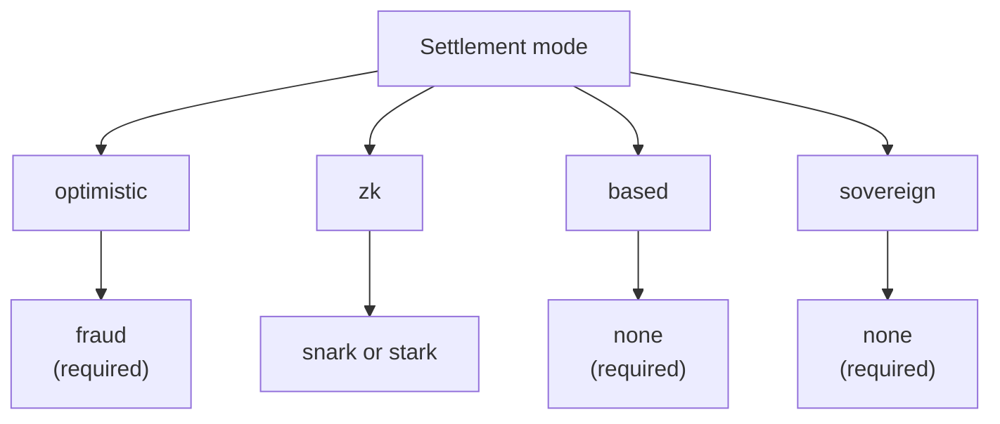

# Rollups-Überblick

Das QoreChain **Rollup Development Kit (RDK)** ist eine Sammlung von Client-Bibliotheken (TypeScript, Python, Go, Rust und Java), ein Kommandozeilenwerkzeug für Betreiber und Starter-Templates, um anwendungsspezifische Rollups zu bauen, die über das On-Chain-Modul `x/rdk` auf QoreChain abgewickelt werden. Damit konfigurieren Sie ein Rollup, bauen und signieren seine Transaktionen, lesen seinen Zustand, verfolgen seine Challenge-Fenster, stellen Settlement-Quittungen aus und verifizieren sie und stellen Cross-VM-Aufrufe und Abhebungsbeweise zusammen. Jedes Rollup ist eine unabhängige Ausführungsumgebung mit eigener Blockzeit, eigener virtueller Maschine, eigenem Gebührenmodell und eigener Sequenzierung, erbt dabei jedoch die Sicherheit, die Post-Quanten-Kryptographie und die Datenverfügbarkeit von QoreChain. Diese Seite richtet sich an Entwickler, die ein Rollup starten oder betreiben möchten, und an alle, die entscheiden wollen, ob das RDK zu ihrer Anwendung passt.

:::caution Funktion in einem frühen Stadium
Das RDK ist auf beiden Netzwerken bereitgestellt, aber **bislang wurde auf keinem von beiden ein Rollup erstellt** (geprüft am 27. Oktober 2026), sodass die in diesem Abschnitt beschriebenen Abläufe von Dritten noch nicht erprobt wurden. **ZK-Settlement (das Profil `defi`, das Template `defi-rollup` und jedes `zk`-Rollup) kann auf keinem der beiden Netzwerke bisher genutzt werden:** Die Chain hat keine Möglichkeit, einen Verifikationsschlüssel zu registrieren, sodass jeder ZK-Batch abgelehnt wird, nachdem seine Gebühr bezahlt wurde. Die Schlüsselregistrierung ist für Chain v3.2.7 geplant. Verwenden Sie bis dahin `optimistic`-Settlement.

Das Mainnet (**`qorechain-vladi`**, EVM-Chain-ID **9801**, live seit dem 7. Juni 2026) läuft mit der Chain-Version **v3.2.4** (angewendet auf Höhe 3.742.566 am 23. Oktober 2026, Governance-Vorschlag 13); das Testnet (**`qorechain-diana`**, EVM-Chain-ID **9800**) läuft mit **v3.2.6** (v3.2.4 erreichte es am 19. Oktober 2026, v3.2.5 am 26. Oktober und v3.2.6 am 27. Oktober). Der Mainnet-Governance-Vorschlag 14 würde v3.2.5 auf Höhe 3.906.833 anwenden und befand sich zum Zeitpunkt der Erstellung in der Abstimmungsphase; was v3.2.5 für Rollups ändert, ist unter [Verhalten von Chain v3.2.5](#v325) aufgeführt, gekennzeichnet als jetzt im Testnet und nach dem Upgrade im Mainnet. Wo sich das Verhalten zwischen v3.2.3 und v3.2.4 geändert hat, nennt dieser Abschnitt, welches Release gilt. Validieren Sie jedes Deployment zuerst im Testnet und lesen Sie die Statushinweise auf jeder Seite: Mehrere Funktionen (ZK-Verifikation, Celestia-Datenverfügbarkeit, der QCAI Copilot, Cross-VM-Aufrufe, Settlement-Quittungen) sind heute nicht durchgängig nutzbar.
:::

## Innovationen {#innovations}

* **Post-Quanten-Settlement-Quittungen.** Der State Anchor eines Batches wird mit ML-DSA-87 durch den registrierten Schlüssel des Rollup-Erstellers signiert. `verifySettlementReceipt` liest jedes Feld der Quittung erneut von der Chain (Rollup, Layer, Batch-Root und den Anker: State Root, Layer-Höhe, Höhe der Main Chain, Ankerzeit, Hash des Validator-Sets, Transaktionsanzahl, Beweis, Signatur). Der verifizierende Schlüssel stammt von der Chain und nie aus der Quittung; die Quittung muss das Netzwerk nennen, das Sie abfragen; eine unbekannte Quittungsversion oder ein anderer Algorithmus als ML-DSA-87 wird vor jedem Lesezugriff abgelehnt; und eine reine Signaturprüfung wird nie als gültig gemeldet. Die Ankernachricht hat unterhalb der Höhe von Chain v3.2.2 eine erste Form und ab dieser Höhe eine zweite Form, die zusätzlich die Chain-ID bindet; die Version wird anhand der Höhe des Ankers gewählt. Siehe [Settlement-Quittungen](/rollups/settlement-receipts).
* **Hybrides Signieren mit zwei Schlüsselableitungen.** Transaktionen werden mit secp256k1 plus ML-DSA-87 signiert. Der Post-Quanten-Schlüssel wird aus der Mnemonic sowohl auf kanonische Weise (SHAKE-256 über `qorechain:pqc:v1|`, die Adresse und die Mnemonic) als auch auf die Legacy-Weise abgeleitet, und der Client verwendet denjenigen Schlüssel, den die Chain für das Konto registriert hat. Heute signiert nur der TypeScript-Client hybrid.
* **Abhebungsbeweise, gebaut wie die Chain sie baut.** `withdrawalsTree` (0.7.0, alle fünf Sprachen) baut die Abhebungs-Root eines Batches und jeden Beweis genau so wie die Chain: Die Blattposition ist der Abhebungsindex, die Knoten werden mit SHAKE-256 gehasht, und Batches ab Chain v3.2.5 verwenden Blätter der zweiten Form, die zusätzlich die Chain-ID nennen. Es wurde gegen Vektoren getestet, die vom eigenen Code der Chain erzeugt wurden, und jeder Beweis in diesen Vektoren wird vom Verifizierer der Chain akzeptiert. `qorollup withdraw` bricht vor dem Bezahlen einer Gebühr ab, wenn sein Ergebnis nicht dem On-Chain-Wert `withdrawals_root` des Batches entspricht.
* **Kanonische Transition Root.** `batchTransitionRoot` berechnet exakt die State Root, nach der die Chain einen optimistischen Batch beurteilt (die heute im Mainnet angewendete Form ist eine SHAKE-256-Verpflichtung auf die vorherige State Root, den Daten-Hash und die Transaktionsanzahl; `transitionRootVersionFor` wählt die Form, die das verbundene Netzwerk anwendet), und `fraudProof` baut daraus den 64-Byte-Beweis. Beides wurde gegen Vektoren getestet, die vom eigenen Code der Chain erzeugt wurden.
* **Chain-exakte Challenge-Fenster.** `batchChallengeWindow` berechnet das Fenster eines Batches so, wie es die Chain tut (zeitbasiert: offen, solange die Blockzeit unter der Einreichungszeit plus Fenster liegt; bei älteren Batches das Fenster geteilt durch sechs, in Blöcken ab der Einreichungshöhe), und beurteilt es gegen die Chain-Spitze aus dem RPC `/status`, nicht gegen die lokale Uhr. Der [Watchtower](/rollups/watchtower) und der Health-Monitor verwenden es. Ab 0.7.0 meldet `getRollupHealth` zusätzlich `heldBackBy`, wenn die Finalität in Reihenfolge der Chain (jetzt im Testnet, siehe [Verhalten von Chain v3.2.5](#v325)) einen Batch zurückhält, und `qorollup watchtower --canonical` meldet die Batches, bei denen eine Anfechtung gewinnen würde.
* **Prüfungen, bevor eine Gebühr bezahlt wird.** Das Kit lehnt eine Rollup-ID außerhalb von `^[a-z0-9][a-z0-9._-]{2,63}$` ab; eine Abhebung, die nicht in `uqor` lautet, einen Betrag von null hat, einen Beweis mit mehr als 64 Ebenen zu je 32 Byte trägt oder eine ungültige bech32-Adresse nennt; eine Abhebungs-Root, die weder leer noch genau 32 Byte lang ist; ein Stoppen des Rollups, das die Chain ablehnen wird (jetzt im Testnet); und, wenn es das Rollup lesen kann, einen Batch, der bei einem Rollup mit Datenverfügbarkeit `native` oder `both` einen Daten-Hash nennt. Jedes davon würde sonst von der Chain abgelehnt, nachdem die Gebühr ausgegeben wurde.
* **Cross-VM-Calldata und eine Live-Prüfung.** `encodeCrossVmCalldata` baut Calldata für `executeCrossVMCall(uint8,string,bytes)` (Selektor `0x3c11078c`, Precompile `0x...0901`), und `isCrossVmPrecompileActive` liest, ob das Precompile im Netzwerk aktiv ist. Ab 0.7.0 decken `getCrossVmParams`, `crossVmTargetReady`, `decodeCrossVmResult` und `decodeRevertReason` die Allowlist und die Antwortformate von Chain v3.2.5 ab (jetzt im Testnet). Siehe [Multi-VM](/rollups/multi-vm).
* **Ein Satz Testvektoren für fünf Sprachen.** Die Pakete für TypeScript, Python, Go, Rust und Java werden gegen dieselbe Golden Fixture geprüft (das Go-Paket hat 100 Unit-Tests, Rust 77 und Java 75).

## Anwendung {#how-to-use}

Lesezugriffe brauchen weder einen Schlüssel noch Guthaben. Die folgenden Snippets lesen die Live-Parameter des Moduls `rdk` und die Liste der Rollups im öffentlichen Testnet (`qorechain-diana`) und wurden am 27. Oktober 2026 aus den veröffentlichten Paketen ausgeführt (die aktuelle Version ist 0.7.0; das TypeScript-Snippet und die Kommandozeile wurden mit 0.7.0 aus npm erneut ausgeführt, und der Developer Hub verzeichnet die Snippets für Python, Rust, Go und Java als bestanden gegen dasselbe Release). Jedes gab die Testnet-Parameter aus (maximale Rollups 200, Mindest-Stake 10.000 QOR, Burn-Rate bei der Erstellung 0,01, Standard-Challenge-Fenster 3.600 Sekunden, maximale DA-Blob-Größe 2.097.152 Byte, Blob-Aufbewahrung 432.000 Blöcke, höchstens 10 Batches pro Block) und `0 rollups`.

### TypeScript (getestet)

```bash
npm install @qorechain/rdk
```

```ts
import { createRdkClient } from "@qorechain/rdk";

// Public testnet (chain id qorechain-diana).
const rdk = createRdkClient({
  network: "testnet",
  endpoints: { rest: "https://api-testnet.qore.host" },
});

// Read the live rdk module parameters and the registered rollups.
const params = await rdk.params();
const rollups = await rdk.rest.listRollups();
console.log(rdk.network.chainId, params, `${rollups.length} rollups`);
```

Die Presets `mainnet` und `testnet` bringen die öffentlichen `qore.host`-Endpunkte bereits mit, sodass `createRdkClient({ network: "testnet" })` auch ohne das Feld `endpoints` funktioniert; es ist oben gezeigt, weil das getestete Snippet es übergeben hat. Ausführen mit Node 20 oder neuer (der Test verwendete Node 26).

### Python (getestet)

```bash
pip install qorechain-rdk
```

```python
from qorrdk import create_rdk_client

# Public testnet (chain id qorechain-diana).
rdk = create_rdk_client(network="testnet", endpoints={"rest": "https://api-testnet.qore.host"})

# Read the live rdk module parameters and the registered rollups.
params = rdk.params()
rollups = rdk.rest.list_rollups()
print(rdk.network.chain_id, params, f"{len(rollups)} rollups")
```

Python 3.10 oder neuer. `qorechain-rdk` hängt von `qorechain-pqc` ab, das `liboqs-python` nachzieht und die Bibliothek `liboqs` benötigt; auf einer Maschine ohne sie baut der erste Import sie (git, CMake und ein C-Compiler werden benötigt). Getestet in einer frischen virtuellen Umgebung mit Python 3.12.

### Go (getestet)

```bash
go get github.com/qorechain/qorechain-rdk/packages/go@v0.7.0
```

```go
package main

import (
	"context"
	"fmt"

	rdk "github.com/qorechain/qorechain-rdk/packages/go"
)

func main() {
	// Public testnet (chain id qorechain-diana).
	client := rdk.NewRdkClient(rdk.RdkClientOptions{
		Network:   "testnet",
		Endpoints: &rdk.Endpoints{Rest: "https://api-testnet.qore.host"},
	})
	ctx := context.Background()
	// Read the live rdk module parameters and the registered rollups.
	params, err := client.Params(ctx)
	if err != nil {
		panic(err)
	}
	rollups, _ := client.Rest.ListRollups(ctx)
	fmt.Printf("%s %+v %d rollups\n", client.Network.ChainID, params, len(rollups))
}
```

Getestet mit Go 1.26, mit dem vom Go-Proxy geholten Modul.

### Rust (getestet)

```bash
cargo add qorechain-rdk
```

```rust
use qorechain_rdk::client::{RdkClient, RdkClientOptions};

fn main() -> Result<(), Box<dyn std::error::Error>> {
    // Public testnet (chain id qorechain-diana).
    let rdk = RdkClient::new(RdkClientOptions {
        rest_url: Some("https://api-testnet.qore.host".into()),
        ..Default::default()
    });

    // Read the live rdk module parameters and the registered rollups.
    let params = rdk.params()?;
    let rollups = rdk.rest.list_rollups()?;
    println!("{} {:?} {} rollups", rdk.network.chain_id, params, rollups.len());
    Ok(())
}
```

Die Bibliothek heißt `qorechain_rdk`. Getestet mit Rust 1.95, gebaut gegen crates.io.

### Java (getestet)

```kotlin
// build.gradle.kts
implementation("io.github.qorechain:qorechain-rdk:0.7.0")
```

```java
import io.github.qorechain.rdk.client.RdkClient;
import io.github.qorechain.rdk.client.Views.ParamsView;
import io.github.qorechain.rdk.config.Networks;

public class RdkQuickstart {
    public static void main(String[] args) {
        // Public testnet (chain id qorechain-diana).
        RdkClient.Options options = new RdkClient.Options();
        options.network = "testnet";
        options.endpoints = new Networks.Endpoints();
        options.endpoints.rest = "https://api-testnet.qore.host";
        RdkClient rdk = new RdkClient(options);

        // Read the live rdk module parameters and the registered rollups.
        ParamsView params = rdk.params();
        int rollups = rdk.rest.listRollups().size();
        System.out.println(rdk.network.chainId + " maxRollups=" + params.maxRollups
                + " minStakeForRollup=" + params.minStakeForRollup + " " + rollups + " rollups");
    }
}
```

JDK 17 oder neuer; getestet mit JDK 21 und Gradle 9.6, aufgelöst aus Maven Central. Die Datei muss `RdkQuickstart.java` heißen. Maven Central liefert 0.6.2 und 0.7.0 aus (geprüft am 27. Oktober 2026).

### Kommandozeile (getestet)

```bash
npm install -g @qorechain/rdk-cli
qorollup --version
qorollup params --network testnet
```

`qorollup --version` gibt `0.7.0` aus, und `qorollup params --network testnet` gibt die Live-Modulparameter aus. **Das funktioniert ab 0.6.2.** Die Releases 0.6.1 und früher beendeten sich mit Code 0 und gaben nichts aus, wenn sie aus npm installiert wurden. Der Test installierte `@qorechain/rdk-cli@0.7.0` in einem leeren Projekt und führte es über `node_modules/.bin/qorollup` aus; eine globale Installation und `npx` verwenden denselben Bin-Link. Node 20 oder neuer ist erforderlich.

### Ein Projekt aufsetzen (getestet)

```bash
npx create-qorechain-rollup my-rollup --template nft-rollup --network testnet --yes
cd my-rollup && npm run doctor
```

Die Templates sind `defi-rollup`, `gaming-rollup`, `nft-rollup`, `enterprise-rollup`, `custom-rollup` und `multivm-rollup`. Das aufgesetzte Projekt hängt von `@qorechain/rdk` `^0.7.0` ab. Das Aufsetzen von `nft-rollup` mit dem Scaffolder 0.6.1 erzeugte ein Projekt, dessen `npm run doctor` gegen das Testnet durchlief (REST erreichbar, Parameter lesbar, Netzwerk `qorechain-diana`; es warnt vor Celestia-Datenverfügbarkeit und einem fehlenden Signer); das Aufsetzen von `defi-rollup` und `npm run typecheck` liefen am 27. Oktober 2026 mit dem aktuellen Release erneut durch. **Verwenden Sie `defi-rollup` noch nicht, um ein Rollup zu starten** (siehe [Einschränkungen](#limits)). Um ein Rollup zu erstellen und Batches einzureichen, folgen Sie [Ein Rollup deployen](/rollups/deploying-a-rollup); Transaktionen benötigen einen registrierten Post-Quanten-Schlüssel und im RDK den TypeScript-Client mit einem `pqcKeypair`.

## Zugang {#how-to-access}

**Netzwerke und Endpunkte.** Das RDK spricht mit den öffentlichen Endpunkten der beiden Netzwerke; die Presets `mainnet` und `testnet` bringen sie bereits mit.

| Netzwerk | Chain-ID | EVM-Chain-ID | REST-Endpunkt | Chain-Version |
| ------- | -------- | ------------ | ------------- | ------------- |
| Mainnet | `qorechain-vladi` | 9801 | `https://api.qore.host` | v3.2.4 |
| Testnet | `qorechain-diana` | 9800 | `https://api-testnet.qore.host` | v3.2.6 |

Beide Netzwerke bedienen die RDK-Abfragen (`/qorechain/rdk/v1/...`) über REST, gRPC und die CLI, sodass Lesezugriffe wie `rdk.params()` gegen beide funktionieren. Das Testnet ist ein Staging-Netzwerk mit eigenen Parametern: Das Standard-Challenge-Fenster beträgt 3.600 Sekunden im Testnet und 604.800 im Mainnet, im Testnet können höchstens 200 Rollups existieren und im Mainnet 100, und das Multilayer-Modul erlaubt 64 Sidechain-Layer im Testnet und 10 im Mainnet (geprüft am 27. Oktober 2026). Lesen Sie `GET /qorechain/rdk/v1/params` auf dem Netzwerk, das Sie anpeilen.

**Voraussetzungen, um ein Rollup zu erstellen.**

| Anforderung | Details |
| ----------- | ------- |
| **Finanziertes Konto** | Ein Konto mit genügend QOR für den Stake, den Layer-Stake und die Gebühren. |
| **Hinterlegter Stake** | Das Erstellen eines Rollups hinterlegt `min_stake_for_rollup` im Escrow, auf beiden Netzwerken **10.000 QOR**. **1 % des Stakes (100 QOR) werden bei der Erstellung verbrannt**; der Rest bleibt im Escrow und wird zurückgegeben, wenn das Rollup gestoppt wird. |
| **Layer-Stake** | Die Erstellung registriert außerdem den Layer des Rollups im Multilayer-Modul (Mindest-Stake 1.000 QOR). Kann der Layer nicht registriert werden, wird das Rollup dennoch erstellt, hat aber keinen echten Layer, sodass seine Batches nicht verankert und keine Quittungen ausgestellt werden können. |
| **Registrierter Post-Quanten-Schlüssel** | Ein für das Konto registrierter ML-DSA-87-Schlüssel. Transaktionen auf der nativen Lane, die nur mit dem klassischen Schlüssel signiert sind, werden abgelehnt. |
| **Gebühren** | Die Gebührenuntergrenze beträgt 0,1 uqor pro Gas-Einheit; setzen Sie Gaslimit und Gebühr gemeinsam. |
| **Tooling** | Node 20 oder neuer für die CLI und den Scaffolder; Python 3.10 oder neuer (mit `liboqs`, siehe oben) für den Python-Client; JDK 17 oder neuer für Java; das Go-Modul `github.com/qorechain/qorechain-rdk/packages/go`. |

Für Lesezugriffe braucht man nichts davon. Sie können ein Rollup auch über das Dashboard anfordern (ein Anfrageformular, keine On-Chain-Transaktion) oder mit der Chain-CLI erstellen; den vollständigen Ablauf, die CLI-Befehle und den TypeScript-Signierpfad finden Sie unter [Ein Rollup deployen](/rollups/deploying-a-rollup).

### Verhalten von Chain v3.2.5: jetzt im Testnet, nach dem Upgrade im Mainnet {#v325}

Das Testnet läuft mit Chain v3.2.6, die v3.2.5 enthält. **Das Mainnet läuft mit v3.2.4, bis der Governance-Vorschlag 14 v3.2.5 anwendet** (erwartet um den 29. Oktober 2026). RDK 0.7.0 unterstützt beide. Die Unterschiede, auf die ein Rollup-Entwickler trifft:

| Verhalten | Testnet (v3.2.6) | Mainnet (v3.2.4, bis zum Upgrade) |
| --------- | ---------------- | ----------------------------------- |
| Wer eine Anfechtung auflösen kann | Jedes Konto | Nur der Ersteller des Rollups |
| Nach einem bestätigten Betrug | Der Batch und jeder spätere nicht finalisierte Batch werden verworfen; der Sequencer reicht ab der letzten guten Root unter denselben Indizes erneut ein | Der angefochtene Batch wird verworfen (die Regel von v3.2.4) |
| Finalitätsreihenfolge | Batches werden in Indexreihenfolge finalisiert | Keine Regel von v3.2.4 |
| Ausstehende optimistische Batches | Höchstens 4.096 pro Rollup | Keine Regel von v3.2.4 |
| Ein Rollup stoppen | Abgelehnt, solange der letzte Batch `submitted` oder `challenged` ist; ein gestopptes Rollup gibt seinen Platz frei | Keine Regel von v3.2.4 |
| `withdrawals_root` | Leer oder genau 32 Byte; Abhebungsblätter der zweiten Form nennen die Chain-ID | Keine Regel von v3.2.4; Blätter der ersten Form |
| Cross-VM-Brücke | `GET /qorechain/crossvm/v1/params` liefert die Allowlist (leer); das Precompile gibt `abi.encode(bytes)` zurück und lehnt mit `Error(string)` ab | Die Rohantwort des Ziels, wie auf der Multi-VM-Seite beschrieben |
| Cross-VM-Precompile `0x...0901` | Weiterhin nicht aktiv | Nicht aktiv |

### Was heute existiert {#what-exists-today}

| | Status |
|---|---|
| Registrierte Rollups (Mainnet und Testnet) | Keine |
| Modul `x/rdk` und seine Parameter | Auf beiden Netzwerken bereitgestellt; lesen Sie sie mit `qorechaind query rdk config` |
| RDK-Abfragen | Auf beiden Netzwerken über die CLI, gRPC und REST (`/qorechain/rdk/v1/...`) verfügbar, sodass REST-basierte Lesezugriffe wie das TypeScript-`rdk.params()` gegen das Mainnet funktionieren |
| Vom RDK geschriebene Settlement-Anker | Keine. Seit v3.2.2 kann ein Batch eine `anchor_signature` tragen und wird dann in derselben Transaktion in `x/multilayer` verankert; ohne sie wird der Batch unverankert abgewickelt. Es existiert noch kein Rollup, kein Layer und kein Anker. Das TypeScript-RDK (0.6.0 bis 0.7.0) sendet das Feld, wenn sein Client hybrid signiert und der Ersteller des Rollups ist (live nicht getestet); die Clients für Python, Go, Rust und Java senden es nicht |
| In `x/multilayer` registrierte Rollup-Layer | Keine |
| ZK-Settlement | Kann auf keinem der beiden Netzwerke bisher genutzt werden (keine Möglichkeit, einen Verifikationsschlüssel zu registrieren; für Chain v3.2.7 geplant) |
| Abhebungen | Werden seit v3.2.3 aus einem Escrow-Ledger je Rollup ausgezahlt (siehe [ZK / STARK & Abhebungen](/rollups/zk-stark-withdrawals)); es wurde keine vorgenommen, da kein Rollup existiert |

Für die tiefergehende Modulreferenz (Modulparameter, Lifecycle-Interna, Burn-Integration und Multilayer-Verankerung) siehe die Seite **[Rollup Development Kit](/architecture/rollup-development-kit)** im Architektur-Abschnitt. Dieser Rollups-Abschnitt ist die entwicklerorientierte Anleitung.

## Wo es veröffentlicht ist {#where-published}

Versionen auf den Registries am 27. Oktober 2026 geprüft. Alle Pakete stehen unter Apache-2.0.

| Registry | Paket | Aktuelle Version | Link |
| -------- | ------- | --------------- | ---- |
| npm | `@qorechain/rdk` (TypeScript-Client) | 0.7.0 | [npmjs.com](https://www.npmjs.com/package/@qorechain/rdk) |
| npm | `@qorechain/rdk-cli` (`qorollup`) | 0.7.0 | [npmjs.com](https://www.npmjs.com/package/@qorechain/rdk-cli) |
| npm | `create-qorechain-rollup` (Scaffolder) | 0.7.0 | [npmjs.com](https://www.npmjs.com/package/create-qorechain-rollup) |
| PyPI | `qorechain-rdk` (Import `qorrdk`) | 0.7.0 | [pypi.org](https://pypi.org/project/qorechain-rdk/) |
| crates.io | `qorechain-rdk` (Bibliothek `qorechain_rdk`) | 0.7.0 | [crates.io](https://crates.io/crates/qorechain-rdk) |
| Go-Modul-Proxy | `github.com/qorechain/qorechain-rdk/packages/go` | v0.7.0 | [pkg.go.dev](https://pkg.go.dev/github.com/qorechain/qorechain-rdk/packages/go) |
| Maven Central | `io.github.qorechain:qorechain-rdk` | 0.7.0 | [central.sonatype.com](https://central.sonatype.com/artifact/io.github.qorechain/qorechain-rdk) |

Maven Central liefert 0.6.2 und 0.7.0 sowie frühere Versionen aus, und das `@latest` des Go-Proxys kann einem neuen Tag hinterherhinken, daher sollten Sie die Go-Version festlegen. Der Quellcode ist öffentlich unter [github.com/qorechain/qorechain-rdk](https://github.com/qorechain/qorechain-rdk), die Release-Hinweise stehen unter [v0.7.0](https://github.com/qorechain/qorechain-rdk/releases/tag/v0.7.0), und die eigene Dokumentation des Kits befindet sich unter [qorechain.github.io/qorechain-rdk](https://qorechain.github.io/qorechain-rdk/). Das TypeScript-Paket hängt von `@qorechain/sdk` `^0.10.0` (ab 0.7.0; 0.6.x verwendete `^0.9.0`) und `@qorechain/evm` `^0.8.0` ab, und das Python-Paket von `qorechain-pqc` 0.2.x. Die Modullogik `x/rdk` der Chain selbst ist nicht Teil des öffentlichen Kits.

## Einschränkungen und bekannte Probleme {#limits}

* **ZK-Settlement kann auf keinem der beiden Netzwerke bisher genutzt werden.** Das betrifft das Profil `defi`, das Template `defi-rollup` und jedes mit `zk`-Settlement erstellte Rollup. Die Chain hat keine Möglichkeit, einen Verifikationsschlüssel für ein Rollup zu registrieren, sodass jeder ZK-Batch abgelehnt wird, nachdem seine Gebühr bezahlt wurde. Die Schlüsselregistrierung ist für Chain v3.2.7 geplant. Verwenden Sie bis dahin `optimistic`-Settlement (siehe [ZK / STARK & Abhebungen](/rollups/zk-stark-withdrawals)).
* **Auf keinem Netzwerk wurde ein Rollup erstellt.** Die Pfade für Erstellen, Batch, Challenge, Quittung und Abhebung sind durch Unit-Tests und gemeinsame Vektoren abgedeckt, wurden aber on-chain nicht erprobt.
* **Nur der TypeScript-Client signiert hybride Transaktionen.** Die Transaktionspfade für Python, Go, Rust und Java sowie die Transaktionsbefehle von `qorollup` (`create`, `pause`, `resume`, `stop`, `withdraw`) signieren nur klassisch, was beide Netzwerke ablehnen. Ihre Lesezugriffe funktionieren. Für Transaktionen aus diesen Clients bauen Sie die Nachricht und signieren sie gemeinsam mit der Chain-CLI, oder verwenden Sie den TypeScript-Client mit einem `pqcKeypair`.
* **(a) Die CLI `qorollup` gab in 0.6.1 und früher nichts aus, wenn sie aus npm installiert wurde.** Das ist **in 0.6.2 behoben**: Nach `npm i -g @qorechain/rdk-cli` funktioniert `qorollup ...`, und `qorollup --version` gibt 0.6.2 aus.
* **(b) Die Merkle-Helfer für Abhebungen verwendeten in 0.6.2 und früher standardmäßig SHA-256, während die Chain SHAKE-256 verwendet.** Ein mit diesen Standardwerten gebauter Beweis wurde on-chain nie verifiziert. **In 0.7.0 behoben:** `withdrawalsTree` baut den exakten Baum der Chain und wurde gegen den eigenen Verifizierer der Chain geprüft (siehe [Blatt- und Knoten-Kodierung](/rollups/zk-stark-withdrawals#leaf-and-node-encoding)). Aktualisieren Sie; Code, der sich auf die SHA-256-Standardwerte stützte, muss jetzt `hash` ausdrücklich übergeben.
* **(c) `buildDaBlob` hashte in 0.6.2 und früher mit SHA-256, während die Blob-Verpflichtung der Chain SHAKE-256 ist.** **In 0.7.0 behoben**, wo seine Verpflichtung die der Chain ist. Es hatte nie eine praktische Wirkung, da keine Transaktion einen Blob veröffentlicht; lassen Sie `dataHash` bei `native` und `both` Datenverfügbarkeit leer (siehe [Datenverfügbarkeit](/rollups/data-availability)).
* **(d) Die Demo-Schaltung des Templates `defi` kann nicht verifizieren.** Es ist ein `snarkjs`-Multiplikator, und die Chain prüft Groth16 über BLS12-381 mit der vorherigen State Root, der State Root und dem Daten-Hash als öffentlichen Eingaben, die diese Schaltung nicht bereitstellt. Selbst nachdem die Schlüsselregistrierung ausgeliefert ist, benötigen Sie Ihre eigene Schaltung.
* **Im Mainnet (v3.2.4) kann nur der Ersteller des Rollups eine Anfechtung auflösen.** Die Chain prüft den Fraud Proof selbst, aber der Ersteller reicht die Auflösung ein. Das Testnet lässt bereits jedes Konto auflösen; das Mainnet erhält das, wenn der Vorschlag 14 v3.2.5 anwendet (siehe [Verhalten von Chain v3.2.5](#v325) und [Optimistic](#optimistic)).
* **Auf den Live-Netzwerken nicht nutzbar:** Celestia-Datenverfügbarkeit (nicht implementiert), der [QCAI Rollup Copilot](/rollups/qcai-copilot) (seine Beratungsdienste sind auf den öffentlichen Endpunkten nicht verfügbar), Cross-VM-Aufrufe (das Precompile unter `0x...0901` ist nicht aktiv), gemeinsame und Based-Sequencer (die Chain lässt nur den konfigurierten Sequencer zu oder, wenn keiner gesetzt ist, den Ersteller) und `suggest-profile` (es liefert `defi` als festen Fallback).
* **Versionshinweise.** Verwenden Sie 0.7.0 für alles: 0.6.2 und früher bauen Abhebungsbeweise, die on-chain nie verifiziert werden, und 0.6.1 und früher geben nichts aus `qorollup` aus, wenn es aus npm installiert wurde. 0.5.0 und früher sollten nicht für Quittungen, den Watchtower oder Cross-VM-Calldata verwendet werden. Die vollständige Liste dessen, was jedes Release geändert hat, steht unter [RDK 0.7.0: Änderungen und Einschränkungen](/rollups/deploying-a-rollup#rdk-050-limits).

---

## Referenz: woraus ein Rollup besteht {#reference}

### Was das RDK Ihnen bietet

Ein über das RDK erstelltes Rollup bündelt vier konfigurierbare Aspekte:

| Aspekt | Was er steuert | Optionen |
| ------- | ---------------- | ------- |
| **Settlement-Modus** | Wie die Zustandsübergänge des Rollups auf QoreChain verifiziert und finalisiert werden | `optimistic`, `zk`, `based`, `sovereign` |
| **Beweissystem** | Der kryptographische oder ökonomische Mechanismus, der das Settlement absichert | `fraud`, `snark`, `stark`, `none` |
| **Sequencer-Modus** | Wer Transaktionen ordnet, bevor sie abgewickelt werden | `dedicated`, `shared`, `based` |
| **Datenverfügbarkeit** | Wo Transaktionsdaten veröffentlicht werden, damit jeder den Zustand rekonstruieren kann | `native`, `celestia`, `both` |

Jedes Rollup wird mit einer eindeutigen `rollup-id` registriert, durch einen Stake-Bond in QOR abgesichert und erhält einen Lifecycle-Status (`pending`, `active`, `paused`, `stopped`). Siehe **[Ein Rollup deployen](/rollups/deploying-a-rollup)** für den vollständigen Erstellungs- und Lifecycle-Ablauf.

### QoreChain-spezifische Fähigkeiten und ihr Status

Über die Grundausstattung jedes Rollup-Kits hinaus enthält das RDK drei Fähigkeiten, die um die Layer 1 von QoreChain herum aufgebaut sind, plus einen Watchtower-Auto-Challenger. Ihr Status unterscheidet sich; die Tabelle nennt, was heute funktioniert.

| Fähigkeit | Was sie tut |
| ---------- | ------------ |
| **[Settlement-Quittungen](/rollups/settlement-receipts)** | Verpacken einen Settlement-Anker als portable Quittung, die eine Post-Quanten-Signatur (ML-DSA-87 / Dilithium-5) trägt. Frühes Stadium: Es existieren noch keine Anker, daher wurde nichts gegen einen echten Anker verifiziert; eine Quittung ist eine Behauptung, die gegen den Chain-Zustand geprüft werden muss, was der Verifizierer in 0.7.0 tut, Feld für Feld. |
| **[QCAI Rollup Copilot](/rollups/qcai-copilot)** | Ein schreibgeschützter Beratungshelfer für ein Rollup (Gebührenschätzung, Empfehlungen, Betrugsuntersuchungen). Die Beratungsdienste, aus denen er liest, sind auf den öffentlichen Endpunkten noch nicht verfügbar. |
| **[Multi-VM Cross-VM-Aufrufe](/rollups/multi-vm)** | Tooling zum Kodieren eines EVM-zu-QoreChain-Native-Aufrufs über das Cross-VM-Precompile (`0x...0901`). Das Precompile ist auf den Live-Netzwerken nicht aktiviert, ein Aufruf bewirkt also nichts; der Encoder seit 0.6.0 entspricht dem Layout, das die Chain dekodiert. |
| **[Watchtower](/rollups/watchtower)** | Ein Auto-Challenger-Framework für optimistische Rollups, das neue Batches und Fristen des Challenge-Fensters sichtbar macht und ungültige Batches gegen Ihr Gültigkeitsprädikat anficht. Es liest über REST, das beide Netzwerke bereitstellen; seit 0.6.0 beurteilt es das Fenster jedes Batches so, wie es die Chain tut (spätere Releases behalten das bei). |

Siehe **[Warum das QoreChain RDK](/rollups/why)** für die vollständige Begründung samt Codebeispielen.

### Die vier Settlement-Paradigmen {#settlement-paradigms}

Das QoreChain RDK unterstützt vier Settlement-Modi, jeweils mit unterschiedlichen Vertrauensannahmen, Finalitätsmerkmalen und Beweisanforderungen. Die Kombination aus Settlement-Modus und Beweissystem wird on-chain validiert, und eine inkompatible Paarung wird bei der Erstellung abgelehnt. Das Diagramm ordnet jedem Settlement-Modus sein gültiges Beweissystem zu.



#### Optimistic {#optimistic}

Optimistische Rollups gehen standardmäßig davon aus, dass eingereichte Batches gültig sind, und stützen sich zur Streitbeilegung auf **Fraud Proofs**.

* **Beweissystem**: `fraud` (interaktive Fraud Proofs).
* **Sequencer**: `dedicated` oder `shared`.
* **Finalität**: Verzögert, bis ein konfigurierbares Challenge-Fenster ohne erfolgreiche Anfechtung abläuft.
* **Anfechtungen**: Jeder kann einen eingereichten Batch innerhalb des Fensters anfechten, indem er eine Kaution und einen Fraud Proof hinterlegt. Eine Anfechtung friert den Batch ein; im Mainnet (v3.2.4) löst anschließend der Ersteller des Rollups sie auf, im Testnet (v3.2.5 und später) kann es jedes Konto, und das Mainnet folgt, sobald der Vorschlag 14 v3.2.5 anwendet. Die Chain prüft den Beweis selbst: Ein bestätigter Betrug verwirft den Batch und zahlt den Anfechtenden aus, eine abgewiesene Anfechtung setzt den Batch zurück auf `submitted`. Im Testnet verwirft ein bestätigter Betrug zusätzlich jeden späteren nicht finalisierten Batch, den der Sequencer ab der letzten guten Root unter denselben Indizes erneut einreicht (siehe [Verhalten von Chain v3.2.5](#v325)). Siehe [Ein Rollup deployen](/rollups/deploying-a-rollup#challenge-a-batch-optimistic-rollups).
* **Fensterlänge**: Das Standardfenster beträgt im Mainnet 604.800 „Sekunden“ (der `default_challenge_window` des Moduls; der Standard des Testnets beträgt 3.600 Sekunden, gelesen am 27. Oktober 2026, und ein Rollup kann ein eigenes festlegen). **Vor v3.2.4 (im Mainnet vor Höhe 3.742.566)** rechnet die Chain dies mit festen 6 Sekunden pro Block in Blöcke um, das sind **100.800 Blöcke**, sodass die tatsächlich verstrichene Zeit der realen Blockzeit folgt (etwa 3,7 Tage bei den aktuellen ≈3,1-s-Blöcken des Mainnets); planen Sie also in Blöcken, nicht in Tagen. **Ab v3.2.4** erhält ein Batch, der ab der Upgrade-Höhe eingereicht wird, ein in Sekunden Blockzeit gemessenes Fenster (volle 7 Tage); frühere Batches behalten die Regel nach Blockanzahl. Die Upgrade-Höhe ist 8.337.253 auf dem Testnet (seit dem 19. Oktober 2026) und 3.742.566 auf dem Mainnet (23. Oktober 2026).

#### ZK (Zero-Knowledge) {#zk}

ZK-Rollups fügen jedem Batch einen kryptographischen Gültigkeitsbeweis bei, der die Korrektheit des Zustandsübergangs ohne erneute Ausführung belegt.

* **Beweissystem**: `snark` (kompakte Beweise) oder `stark` (transparente Beweise, kein Trusted Setup).
* **Sequencer**: `dedicated` oder `shared`.
* **Finalität**: Bei erfolgreicher Beweisverifikation, ohne Challenge-Fenster.
* **Reifegrad**: **ZK-Settlement kann auf keinem der beiden Netzwerke bisher genutzt werden.** SNARK-Batches sollen on-chain verifiziert werden (Groth16 über BLS12-381), und zwar gegen einen zusammen mit dem Rollup gespeicherten Verifikationsschlüssel; die Chain hat bisher keine Möglichkeit, einen zu registrieren, sodass jeder ZK-Batch abgelehnt wird, nachdem seine Gebühr bezahlt wurde. Die Schlüsselregistrierung ist für Chain v3.2.7 geplant. Die STARK-Verifikation ist experimentell: Sie ist optional und prüft eine Demonstrationsschaltung, nicht den Zustandsübergang Ihres eigenen Rollups. Siehe **[ZK / STARK & Abhebungen](/rollups/zk-stark-withdrawals)**.

#### Based {#based}

Based-Rollups delegieren die Transaktionssequenzierung an die Proposer von QoreChain (L1) und erben so die Liveness und Zensurresistenz der Host-Chain.

* **Beweissystem**: `none` (L1-Proposer sind die maßgebliche Quelle der Reihenfolge).
* **Sequencer**: `based` (erforderlich, durch On-Chain-Validierung erzwungen).
* **Finalität**: Folgt der Bestätigung der Host-Chain.
* **Kompromiss**: Das einfachste Betriebsmodell, da die QoreChain-Validatoren die Sequenzierung übernehmen, um den Preis der Latenzkontrolle eines dedizierten Sequencers.
* **Status heute**: `based` wird in der Rollup-Konfiguration festgehalten, aber QoreChain lässt L1-Proposer noch nicht als Batch-Einreicher zu; der Ersteller des Rollups reicht ein (siehe [Sequencer-Modi](#sequencer-modes)).

#### Sovereign {#sovereign}

Sovereign-Rollups betreiben ihren eigenen Konsens und sequenzieren selbst. Sie verankern ihren Zustand zur Verifizierbarkeit auf QoreChain, sind für die Finalität jedoch nicht von der Host-Chain abhängig.

* **Beweissystem**: `none`.
* **Sequencer**: vom Rollup selbst verwaltet.
* **Finalität**: Unabhängig, bestimmt durch den eigenen Konsens des Rollups.
* **Zustandsverankerung**: State Roots werden zur Transparenz auf QoreChain veröffentlicht, aber die Host-Chain erzwingt sie nicht.

### Beweissystem-Kompatibilität

Der Settlement-Modus schränkt ein, welche Beweissysteme gültig sind. Diese Paarungen werden bei der Erstellung eines Rollups erzwungen.

| Settlement-Modus | `fraud` | `snark` | `stark` | `none` |
| --------------- | :-----: | :-----: | :-----: | :----: |
| **optimistic**  | Erforderlich | - | - | - |
| **zk**          | - | Unterstützt | Unterstützt | - |
| **based**       | - | - | - | Erforderlich |
| **sovereign**   | - | - | - | Erforderlich |

### Sequencer-Modi {#sequencer-modes}

Der Sequencer bestimmt, wer Transaktionen innerhalb eines Rollup-Blocks vor dem Settlement ordnet.

| Modus | Wer sequenziert | Hinweise |
| ---- | ------------- | ----- |
| **`dedicated`** | Eine einzelne designierte Operator-Adresse | Geringste Latenz; erfordert Vertrauen in den Operator hinsichtlich Liveness und fairer Reihenfolge |
| **`shared`** | Ein gemeinsam genutztes Sequencer-Set | Reihenfolge über das Set verteilt; etwas höherer Koordinationsaufwand |
| **`based`** | QoreChain-L1-Proposer | Erbt die Validator-Sicherheit und Zensurresistenz der Host-Chain; erforderlich für `based`-Settlement |

:::note Was heute erzwungen wird
On-Chain darf ein Batch nur von der konfigurierten Sequencer-Adresse des Rollups oder, wenn keine gesetzt ist (bei jedem Preset), von seinem Ersteller eingereicht werden. Die Modi `shared` und `based` werden in der Rollup-Konfiguration festgehalten, aber QoreChain lässt noch kein gemeinsames Sequencer-Roster und keine L1-Proposer als Batch-Einreicher zu; diese Modi beschreiben das beabsichtigte Design.
:::

### Ein Paradigma wählen

| Wenn Sie ... möchten | Erwägen Sie |
| -------------- | -------- |
| Das einfachste Betriebsmodell, bei dem QoreChain-Validatoren sequenzieren | **based** |
| Schnelle Finalität mit kryptographischen Garantien (noch nicht nutzbar) | **zk** (`snark` / `stark`) |
| Ein bewährtes Modell mit ökonomischer Streitbeilegung | **optimistic** (`fraud`) |
| Volle Unabhängigkeit mit eigenem Konsens, verankert zur Verifizierbarkeit | **sovereign** |

Nicht sicher, wo Sie anfangen sollen? Das RDK liefert **Preset-Profile** mit, die diese Entscheidungen für gängige Anwendungskategorien bündeln; siehe **[Preset-Profile](/rollups/preset-profiles)**. Ein Helfer `suggest-profile` existiert, liefert derzeit aber einen festen Fallback `defi` (und `defi` kann noch nicht genutzt werden), wählen Sie also anhand der Profiltabelle.

## Verwandte Themen

* [Ein Rollup deployen](/rollups/deploying-a-rollup): ein Rollup über die CLI oder das TypeScript-RDK starten.
* [Preset-Profile](/rollups/preset-profiles): Bundles für gängige Anwendungskategorien.
* [Datenverfügbarkeit](/rollups/data-availability): der native DA-Router und Blob-Speicher.
* [ZK / STARK Abhebungen](/rollups/zk-stark-withdrawals): beweisgestützte Abhebungsabläufe.
* [Settlement-Quittungen](/rollups/settlement-receipts), [Watchtower](/rollups/watchtower), [Multi-VM](/rollups/multi-vm) und [Warum das QoreChain RDK](/rollups/why).
