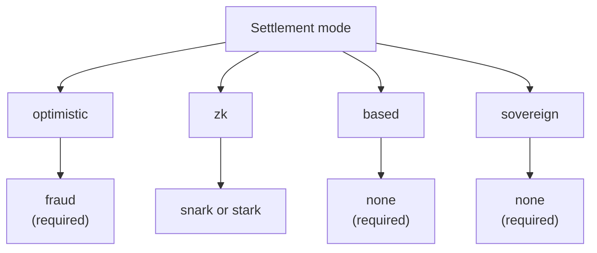

# Rollups – Überblick

Das QoreChain **Rollup Development Kit (RDK)** — das Modul `x/rdk` — ermöglicht es Entwicklern, anwendungsspezifische Rollups zu starten, die auf QoreChain abgewickelt werden. Jedes Rollup ist eine unabhängige Ausführungsumgebung mit eigener Blockzeit, eigener virtueller Maschine, eigenem Gebührenmodell und eigener Sequenzierung, erbt dabei jedoch die Sicherheits-, Post-Quanten-Kryptographie- und Datenverfügbarkeitsgarantien von QoreChain.

:::caution Funktion in einem frühen Stadium
Das RDK ist auf beiden Netzwerken bereitgestellt, aber **bislang wurde auf keinem von beiden ein Rollup erstellt** (geprüft am 20. Oktober 2026), sodass die in diesem Abschnitt beschriebenen Abläufe von Dritten noch nicht erprobt wurden. Das Mainnet (**`qorechain-vladi`**, EVM-Chain-ID **9801**, live seit dem 7. Juni 2026) läuft mit der Chain-Version **v3.2.3**; das Testnet (**`qorechain-diana`**, EVM-Chain-ID **9800**) läuft mit **v3.2.4**, das im Mainnet noch nicht angewendet ist (der Governance-Vorschlag 13 würde es bei Höhe 3,742,566 anwenden), sodass sich dort Details unterscheiden können. Dieser Abschnitt beschreibt das Verhalten des Mainnets. Validieren Sie jedes Deployment zuerst im Testnet und lesen Sie die Statushinweise auf jeder Seite: Mehrere Funktionen (ZK-Verifikation, Celestia-Datenverfügbarkeit, der QCAI Copilot, Cross-VM-Aufrufe, Settlement-Quittungen) sind heute nicht durchgängig nutzbar, und die veröffentlichten RDK-Clients haben eigene Einschränkungen (siehe [Einschränkungen von RDK 0.5.0](/rollups/deploying-a-rollup#rdk-050-limits)).
:::

## Was heute existiert {#what-exists-today}

| | Status |
|---|---|
| Registrierte Rollups (Mainnet und Testnet) | Keine |
| Modul `x/rdk` und seine Parameter | Auf beiden Netzwerken bereitgestellt; lesen Sie sie mit `qorechaind query rdk config` |
| RDK-Abfragen | Auf beiden Netzwerken über die CLI, gRPC und REST (`/qorechain/rdk/v1/…`) verfügbar, sodass REST-basierte Lesezugriffe wie das TypeScript-`rdk.params()` gegen das Mainnet funktionieren |
| Vom RDK geschriebene Settlement-Anker | Keine. Seit v3.2.2 kann ein Batch eine `anchor_signature` tragen und wird dann in derselben Transaktion in `x/multilayer` verankert; ohne sie wird der Batch unverankert abgewickelt. Es existiert noch kein Rollup, kein Layer und kein Anker, und die veröffentlichten RDK-Clients senden das Feld nicht |
| In `x/multilayer` registrierte Rollup-Layer | Keine |
| Abhebungen | Werden seit v3.2.3 aus einem Escrow-Ledger je Rollup ausgezahlt (siehe [ZK / STARK & Abhebungen](/rollups/zk-stark-withdrawals)); es wurde keine vorgenommen, da kein Rollup existiert |

Für die tiefergehende Modulreferenz — Modulparameter, Lifecycle-Interna, Burn-Integration und Multilayer-Verankerung — siehe die Seite **[Rollup Development Kit](/architecture/rollup-development-kit)** im Architektur-Abschnitt. Dieser Rollups-Abschnitt ist die entwicklerorientierte Anleitung: was das RDK ist, welches Paradigma zu wählen ist, wie man deployt, wie Datenverfügbarkeit funktioniert und wie Abhebungen von L2 zurück auf L1 abgewickelt werden.

---

## Was das RDK Ihnen bietet

Ein über das RDK erstelltes Rollup bündelt vier konfigurierbare Aspekte:

| Aspekt | Was er steuert | Optionen |
| ------- | ---------------- | ------- |
| **Settlement-Modus** | Wie die Zustandsübergänge des Rollups auf QoreChain verifiziert und finalisiert werden | `optimistic`, `zk`, `based`, `sovereign` |
| **Beweissystem** | Der kryptographische oder ökonomische Mechanismus, der das Settlement absichert | `fraud`, `snark`, `stark`, `none` |
| **Sequencer-Modus** | Wer Transaktionen ordnet, bevor sie abgewickelt werden | `dedicated`, `shared`, `based` |
| **Datenverfügbarkeit** | Wo Transaktionsdaten veröffentlicht werden, damit jeder den Zustand rekonstruieren kann | `native`, `celestia`, `both` |

Jedes Rollup wird mit einer eindeutigen `rollup-id` registriert, durch einen Stake-Bond in QOR abgesichert und erhält einen Lifecycle-Status (`pending`, `active`, `paused`, `stopped`). Siehe **[Ein Rollup deployen](/rollups/deploying-a-rollup)** für den vollständigen Erstellungs- und Lifecycle-Ablauf.

---

## Was das QoreChain RDK anders macht

Über die Grundausstattung jedes Rollup-Kits hinaus enthält das QoreChain RDK drei QoreChain-spezifische Fähigkeiten, die um die Layer 1 von QoreChain herum aufgebaut sind — plus einen Watchtower-Auto-Challenger. Ihr Status unterscheidet sich; die Tabelle nennt, was heute funktioniert. Das RDK erscheint in fünf Sprachen (TypeScript, Python, Go, Rust, Java). **Version 0.5.0 ist auf allen fünf Registries veröffentlicht** (npm `@qorechain/rdk`, `@qorechain/rdk-cli` und `create-qorechain-rollup`; PyPI `qorechain-rdk`; crates.io `qorechain-rdk`; Maven Central `io.github.qorechain:qorechain-rdk`; Go-Modul `v0.5.0`). Die Presets `mainnet` und `testnet` bringen die öffentlichen `qore.host`-Endpunkte fest eingebaut mit, sodass `createRdkClient({ network })` keine manuelle Endpunkt-Konfiguration benötigt und seine REST-Lesezugriffe gegen beide Netzwerke funktionieren.

| Unterscheidungsmerkmal | Was es tut |
| -------------- | ------------ |
| **[Quantensichere Settlement-Quittungen](/rollups/settlement-receipts)** | Verpacken einen Settlement-Anker als portable Quittung, die eine Post-Quanten-Signatur (ML-DSA-87 / Dilithium-5) trägt. Frühes Stadium: Es existieren noch keine Anker, eine Quittung ist eine Behauptung, die gegen den Chain-Zustand geprüft werden muss, und der Verifizierer in 0.5.0 kann diese Prüfung gegen die Live-Netzwerke noch nicht abschließen. |
| **[QCAI Rollup Copilot](/rollups/qcai-copilot)** | Ein schreibgeschützter Beratungshelfer für ein Rollup (Gebührenschätzung, Empfehlungen, Betrugsuntersuchungen). Die Beratungsdienste, aus denen er liest, sind auf den öffentlichen Endpunkten noch nicht verfügbar. |
| **[Multi-VM Cross-VM-Aufrufe](/rollups/multi-vm)** | Tooling zum Kodieren eines EVM → CosmWasm-Aufrufs über das Cross-VM-Precompile (`0x…0901`). Das Precompile ist auf den Live-Netzwerken nicht aktiviert, und der Encoder in 0.5.0 entspricht nicht dem Layout, das die Chain dekodiert. |
| **[Watchtower](/rollups/watchtower)** | Ein Auto-Challenger-Framework für optimistische Rollups, das neue Batches und Fristen des Challenge-Fensters sichtbar macht und ungültige Batches gegen Ihr Gültigkeitsprädikat anficht. Es liest über REST, das beide Netzwerke bereitstellen; seine Fristen-Warnungen sind in 0.5.0 fehlerhaft. |

Siehe **[Warum das QoreChain RDK](/rollups/why)** für die vollständige Begründung samt Codebeispielen.

---

## Die vier Settlement-Paradigmen

Das QoreChain RDK unterstützt vier verschiedene Settlement-Modi, jeweils mit unterschiedlichen Vertrauensannahmen, Finalitätsmerkmalen und Beweisanforderungen. Die Kombination aus Settlement-Modus und Beweissystem wird on-chain validiert — eine inkompatible Paarung wird bei der Erstellung abgelehnt. Das folgende Diagramm ordnet jedem Settlement-Modus sein gültiges Beweissystem zu.

### Optimistic

Optimistische Rollups gehen standardmäßig davon aus, dass eingereichte Batches gültig sind, und stützen sich zur Streitbeilegung auf **Fraud Proofs**.

* **Beweissystem**: `fraud` — interaktive Fraud Proofs
* **Sequencer**: `dedicated` oder `shared`
* **Finalität**: Verzögert, bis ein konfigurierbares Challenge-Fenster ohne erfolgreiche Anfechtung abläuft
* **Anfechtungen**: Jeder kann einen eingereichten Batch innerhalb des Fensters anfechten, indem er eine Kaution und einen Fraud Proof hinterlegt. Eine Anfechtung friert den Batch ein; der Ersteller des Rollups löst sie anschließend auf, und die Chain prüft den Beweis selbst — ein bestätigter Betrug verwirft den Batch und zahlt den Anfechtenden aus, eine abgewiesene Anfechtung setzt den Batch zurück auf `submitted`. Siehe [Ein Rollup deployen](/rollups/deploying-a-rollup#challenge-a-batch-optimistic-rollups).
* **Fensterlänge**: Das Standardfenster beträgt 604.800 „Sekunden“. **Im Mainnet (v3.2.3)** rechnet die Chain dies mit festen 6 Sekunden pro Block in Blöcke um — **100.800 Blöcke** —, sodass die tatsächlich verstrichene Zeit der realen Blockzeit folgt (etwa 3,7 Tage bei den aktuellen ≈3,2-s-Blöcken des Mainnets); planen Sie also in Blöcken, nicht in Tagen. **Nur im Testnet (v3.2.4)** erhält ein Batch, der ab Höhe 8.337.253 eingereicht wird, ein in Sekunden Blockzeit gemessenes Fenster (volle 7 Tage); frühere Batches behalten die Regel nach Blockanzahl. Im Mainnet würde diese Änderung erst mit v3.2.4 wirksam (der Governance-Vorschlag 13 würde sie bei Höhe 3,742,566 anwenden).

### ZK (Zero-Knowledge)

ZK-Rollups fügen jedem Batch einen kryptographischen Gültigkeitsbeweis bei, der die Korrektheit des Zustandsübergangs ohne erneute Ausführung belegt.

* **Beweissystem**: `snark` (kompakte Beweise) oder `stark` (transparente Beweise, kein Trusted Setup)
* **Sequencer**: `dedicated` oder `shared`
* **Finalität**: Bei erfolgreicher Beweisverifikation — kein Challenge-Fenster erforderlich
* **Reifegrad**: SNARK-Batches werden on-chain verifiziert (Groth16 über BLS12-381), und zwar gegen einen zusammen mit dem Rollup gespeicherten Verifikationsschlüssel. Ein über `create-rollup` erstelltes Rollup trägt derzeit keinen Verifikationsschlüssel, sodass ZK-Batches noch nicht durchgängig finalisiert werden können. Die STARK-Verifikation ist experimentell: Sie ist optional und prüft eine Demonstrationsschaltung, nicht den Zustandsübergang Ihres eigenen Rollups. Betrachten Sie ZK-Settlement als nicht produktionsreif. Siehe **[ZK / STARK & Abhebungen](/rollups/zk-stark-withdrawals)**.

### Based

Based-Rollups delegieren die Transaktionssequenzierung an die Proposer von QoreChain (L1) und erben so die Liveness und Zensurresistenz der Host-Chain.

* **Beweissystem**: `none` — L1-Proposer sind die maßgebliche Quelle der Reihenfolge
* **Sequencer**: `based` (erforderlich — durch On-Chain-Validierung erzwungen)
* **Finalität**: Folgt der Bestätigung der Host-Chain
* **Kompromiss**: Einfachstes Betriebsmodell, da die QoreChain-Validatoren die Sequenzierung übernehmen — um den Preis der Latenzkontrolle eines dedizierten Sequencers
* **Status heute**: `based` wird in der Rollup-Konfiguration festgehalten, aber QoreChain lässt L1-Proposer noch nicht als Batch-Einreicher zu — der Ersteller des Rollups reicht ein (siehe [Sequencer-Modi](#sequencer-modes))

### Sovereign

Sovereign-Rollups betreiben ihren eigenen Konsens und sequenzieren selbst. Sie verankern ihren Zustand zur Verifizierbarkeit auf QoreChain, sind für die Finalität jedoch nicht von der Host-Chain abhängig.

* **Beweissystem**: `none`
* **Sequencer**: vom Rollup selbst verwaltet
* **Finalität**: Unabhängig — bestimmt durch den eigenen Konsens des Rollups
* **Zustandsverankerung**: State Roots werden zur Transparenz auf QoreChain veröffentlicht, aber die Host-Chain erzwingt sie nicht

---

## Beweissystem-Kompatibilität

Der Settlement-Modus schränkt ein, welche Beweissysteme gültig sind. Diese Paarungen werden bei der Erstellung eines Rollups erzwungen.

| Settlement-Modus | `fraud` | `snark` | `stark` | `none` |
| --------------- | :-----: | :-----: | :-----: | :----: |
| **optimistic**  | Erforderlich | — | — | — |
| **zk**          | — | Unterstützt | Unterstützt | — |
| **based**       | — | — | — | Erforderlich |
| **sovereign**   | — | — | — | Erforderlich |

---

## Sequencer-Modi {#sequencer-modes}

Der Sequencer bestimmt, wer Transaktionen innerhalb eines Rollup-Blocks vor dem Settlement ordnet.

| Modus | Wer sequenziert | Hinweise |
| ---- | ------------- | ----- |
| **`dedicated`** | Eine einzelne designierte Operator-Adresse | Geringste Latenz; erfordert Vertrauen in den Operator hinsichtlich Liveness und fairer Reihenfolge |
| **`shared`** | Ein gemeinsam genutztes Sequencer-Set | Reihenfolge über das Set verteilt; etwas höherer Koordinationsaufwand |
| **`based`** | QoreChain-L1-Proposer | Erbt die Validator-Sicherheit und Zensurresistenz der Host-Chain; erforderlich für `based`-Settlement |

:::note Was heute erzwungen wird
On-Chain darf ein Batch nur von der konfigurierten Sequencer-Adresse des Rollups oder, wenn keine gesetzt ist (bei jedem Preset), von seinem Ersteller eingereicht werden. Die Modi `shared` und `based` werden in der Rollup-Konfiguration festgehalten, aber QoreChain lässt noch kein gemeinsames Sequencer-Roster und keine L1-Proposer als Batch-Einreicher zu; diese Modi beschreiben das beabsichtigte Design.
:::

---

## Ein Paradigma wählen

| Wenn Sie ... möchten | Erwägen Sie |
| -------------- | -------- |
| Das einfachste Betriebsmodell, bei dem QoreChain-Validatoren sequenzieren | **based** |
| Schnelle Finalität mit kryptographischen Garantien (noch nicht produktionsreif) | **zk** (`snark` / `stark`) |
| Ein bewährtes Modell mit ökonomischer Streitbeilegung | **optimistic** (`fraud`) |
| Volle Unabhängigkeit mit eigenem Konsens, verankert zur Verifizierbarkeit | **sovereign** |

Nicht sicher, wo Sie anfangen sollen? Das RDK liefert **Preset-Profile** mit, die diese Entscheidungen für gängige Anwendungskategorien bündeln — siehe **[Preset-Profile](/rollups/preset-profiles)** — und, sobald die beratende RPC verfügbar ist, einen `suggest-profile`-Helfer (derzeit liefert er einen festen Fallback `defi`, wählen Sie also anhand der Profiltabelle).

Für Entwickler erscheint das RDK außerdem als öffentliches TypeScript-SDK **`@qorechain/rdk`** plus dem Scaffolder **`create-qorechain-rollup`**, die dasselbe On-Chain-Modul aus Code heraus ansteuern — siehe **[Ein Rollup deployen](/rollups/deploying-a-rollup#deploy-with-the-typescript-rdk-qorechainrdk)**.

## Verwandte Themen

* [Ein Rollup deployen](/rollups/deploying-a-rollup) — ein Rollup über die CLI oder das TypeScript-RDK starten.
* [Preset-Profile](/rollups/preset-profiles) — Ein-Klick-Bundles für gängige Anwendungskategorien.
* [Datenverfügbarkeit](/rollups/data-availability) — der native DA-Router und Blob-Speicher.
* [ZK / STARK Abhebungen](/rollups/zk-stark-withdrawals) — beweisgestützte Abhebungsabläufe.
