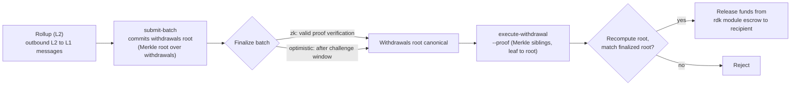

# ZK / STARK & Auszahlungen

Diese Seite behandelt zwei verwandte Themen: die **ZK-Beweissysteme** (`snark` und `stark`), die von ZK-gesettelten Rollups verwendet werden, und den **L2 → L1-Auszahlungsablauf**, der Gelder von einem Rollup zurück auf QoreChain bewegt, sobald ein Batch finalisiert ist.

:::caution Fähigkeit in früher Phase
Bisher wurde auf keinem der beiden Netzwerke ein Rollup erstellt (geprüft am 27. Oktober 2026), daher wurden weder die Beweisverifikation noch der hier beschriebene Auszahlungsablauf auf einem Live-Rollup erprobt. Auszahlungen können im Mainnet erst ab v3.2.3 (Höhe 3,662,051, 20. Oktober 2026) gelingen, als das Escrow-Ledger je Rollup live ging (siehe [Woher die Gelder stammen](#where-the-funds-come-from)); davor schlug jede Auszahlung fehl. Die SNARK-Verifikation existiert, aber ein über `create-rollup` erstelltes Rollup kann noch keinen ZK-Batch finalisieren, und die STARK-Verifikation ist experimentell. Validieren Sie im **`qorechain-diana`**-Testnet und gehen Sie im Mainnet nicht von produktionsgehärteten Garantien aus.
:::

---

## ZK-Beweissysteme

Ein ZK-gesetteltes Rollup (Settlement-Modus `zk`) hängt an jeden Settlement-Batch einen Gültigkeitsbeweis an, der die Korrektheit des State-Übergangs nachweist, ohne die Transaktionen des Rollups erneut auszuführen. ZK-Settlement unterstützt zwei Beweissysteme:

| Beweissystem | Eigenschaften |
| ------------ | --------------- |
| **`snark`** | Prägnante Beweise (Groth16 über BLS12-381), on-chain gegen den Verifying Key des Rollups verifiziert |
| **`stark`** | Transparente Beweise, kein Trusted Setup — experimentell; Opt-in und an eine Demonstrationsschaltung gebunden |

Der Settlement-Modus `zk` erfordert eines von `snark` oder `stark`; die Paarung wird on-chain erzwungen, wenn das Rollup erstellt wird. Im Gegensatz dazu nutzt `optimistic`-Settlement das Beweissystem `fraud`, und `based`- sowie `sovereign`-Settlement nutzen `none`. Siehe **[Rollups-Überblick](/rollups/overview)** für die vollständige Kompatibilitätsmatrix.

### Finalität

Anders als Optimistic Rollups — die ein Fraud-Proof-Challenge-Window abwarten — kann ein ZK-Batch bei **erfolgreicher Beweisverifikation** finalisieren, ohne ein Disput-Fenster. Das ist der zentrale Trade-off von ZK-Settlement: stärkere, schnellere Finalität im Tausch gegen die Kosten und Komplexität der Beweiserzeugung.

### Reifegrad

SNARK-Batches werden on-chain (Groth16 über BLS12-381) gegen einen mit dem Rollup gespeicherten Verifying Key verifiziert. Ein über `create-rollup` erstelltes Rollup trägt derzeit keinen Verifying Key, daher können ZK-Batches noch nicht Ende-zu-Ende finalisiert werden. Die STARK-Verifikation ist experimentell: Sie ist Opt-in und prüft eine Demonstrationsschaltung, nicht den eigenen State-Übergang Ihres Rollups. Behandeln Sie ZK-Settlement als nicht produktionsreif und verfolgen Sie die Release Notes des RDK, bevor Sie sich für wertbehaftete Mainnet-Rollups darauf verlassen.

---

## Wie Batches Auszahlungen tragen

Wenn ein Rollup einen Batch settlet, kann dieser Batch auch die ausgehenden Cross-Layer-Nachrichten des Rollups committen — seine **L2 → L1-Auszahlungen**. Konzeptionell:

* Ein finalisierter Batch kann ein Commitment zu seiner Menge an Auszahlungen tragen (eine Merkle-Root über die Auszahlungsnachrichten des Batches).
* Jede einzelne Auszahlung ist ein Blatt unter dieser Root, identifiziert durch ihren Batch-Index und einen Auszahlungs-Index.
* Sobald der Batch finalisiert ist, kann jede Partei beweisen, dass ein bestimmtes Auszahlungs-Blatt unter der committeten Root enthalten ist, und die Auszahlung auslösen.

Deshalb hängen Auszahlungen vom Settlement ab: Eine Auszahlung kann nur gegen einen **finalisierten** Batch ausgeführt werden, denn erst die Finalisierung macht die committete Auszahlungs-Root kanonisch.

Wie Batches eingereicht und finalisiert werden — einschließlich `submit-batch` und des `challenge-batch`-Disputpfads für Optimistic Rollups — siehe **[Ein Rollup bereitstellen](/rollups/deploying-a-rollup)**.

---

## Eine Auszahlung ausführen: `execute-withdrawal`

Der Befehl `execute-withdrawal` finalisiert eine L2 → L1-Auszahlung gegen die Auszahlungs-Root eines finalisierten Batches. Er beweist, dass ein Auszahlungs-Blatt in dieser Root committet ist, und zahlt den Empfänger aus dem Escrow des rdk-Moduls aus. Die Aktion ist **permissionless** — jeder kann einen gültigen Beweis einreichen. Wie jede Transaktion auf der Native-Lane benötigt sie die hybride Post-Quanten-Mitsignatur, bauen Sie sie also mit `--generate-only` und signieren Sie sie mit cosign mit (siehe [Ein Rollup bereitstellen](/rollups/deploying-a-rollup)). Auszahlungen wurden auf einem Live-Rollup noch nicht erprobt; behandeln Sie den Ablauf als ungetestet. Prüfen Sie Folgendes, bevor Sie eine Gebühr zahlen, denn andernfalls lehnt die Chain die Transaktion ab: Die Denom muss genau `uqor` lauten, der Betrag muss positiv sein, der Beweis hat höchstens 64 Ebenen und jedes Geschwister ist genau 32 Bytes lang, Einreicher und Empfänger sind gültige `qor1…`-Adressen, der Batch ist finalisiert und hat eine `withdrawals_root` committet, das Rollup ist nicht gestoppt, und dieses Auszahlungs-Blatt wurde noch nie ausgezahlt. Das TypeScript-Paket `@qorechain/rdk` (0.6.0 und 0.6.1) führt die erste Gruppe dieser Prüfungen für Sie aus (`withdrawalErrors`: Adressen, Denom, Betrag, Beweistiefe und Länge der Geschwister), und `executeWithdrawal` wirft eine Ausnahme, bevor es sendet, wenn eine davon fehlschlägt; die Bedingungen zu Batch, Rollup und Ledger hängen vom Chain-Zustand ab, den diese Prüfung nicht liest.

```bash
qorechaind tx rdk execute-withdrawal \
  [rollup-id] [batch-index] [withdrawal-index] [recipient] [denom] [amount] \
  --proof <sibling-hash-1>,<sibling-hash-2>,... \
  --from mykey \
  --chain-id qorechain-diana \
  --gas 400000 --fees 40000uqor \
  --generate-only > withdrawal.json
qorechaind tx pqc cosign withdrawal.json --from mykey --pqc-key mypqckey --chain-id qorechain-diana
```

**Positionsargumente:**

| Argument | Beschreibung |
| -------- | ----------- |
| `rollup-id` | Das Rollup, zu dem die Auszahlung gehört |
| `batch-index` | Der finalisierte Batch, dessen Auszahlungs-Root diese Auszahlung committet |
| `withdrawal-index` | Der Index des Auszahlungs-Blatts innerhalb dieses Batches |
| `recipient` | Die Adresse, an die ausgezahlt wird |
| `denom` | Die auszuzahlende Denomination |
| `amount` | Der auszuzahlende Betrag |

**Flag:**

| Flag | Beschreibung |
| ---- | ----------- |
| `--proof` | Kommagetrennte Hex-Merkle-Geschwister-Hashes, geordnet von Blatt zu Root, die beweisen, dass das Auszahlungs-Blatt in der Auszahlungs-Root des Batches committet ist |

Der `--proof`-Wert ist der Inklusionsbeweis: die Geschwister-Hashes entlang des Pfades vom Auszahlungs-Blatt hinauf zur committeten Auszahlungs-Root des Batches. Das Modul berechnet die Root aus dem Blatt und den gelieferten Geschwistern neu und prüft sie gegen die committete Root des finalisierten Batches, bevor es auszahlt.

### Blatt- und Knoten-Kodierung {#leaf-and-node-encoding}

* **Blatt** = SHAKE-256 (32 Bytes) aus `rollup_id`, einem `0x00`-Byte, dem Auszahlungs-Index (8 Bytes, Big-Endian), dem `recipient`-String, `0x00`, dem `denom`-String, `0x00` und dem `amount` (8 Bytes, Big-Endian).
* **Elternknoten** = SHAKE-256 aus `left || right`. Auf jeder Ebene entscheidet das entsprechende Bit des Auszahlungs-Index über die Seite: `0` bedeutet, dass das Blatt (oder der laufende Hash) der linke Knoten ist.
* Jeder Geschwister-Hash muss genau 32 Bytes lang sein.

:::caution Generische Merkle-Helfer passen nicht
Die generischen Helfer `binaryMerkleRoot` / `binaryMerkleProof` des RDK verwenden standardmäßig SHA-256 mit duplizierten ungeraden Knoten. Überschreiben Sie Hash und Blatt-Kodierung mit den obigen Regeln, sonst wird der Beweis on-chain nicht verifiziert.
:::

### Woher die Gelder stammen {#where-the-funds-come-from}

Eine Auszahlung wird aus dem **eigenen hinterlegten Stake des Rollups** bezahlt (der Stake abzüglich des Erstellungs-Burns von 1 %). Der Escrow aller Rollups liegt in einem gemeinsamen Modulguthaben, und seit **v3.2.3** ist ein **Escrow-Ledger** je Rollup die Buchführung darüber, was jedes Rollup hält: `create-rollup` schreibt ihm den Escrow gut, den das Rollup behält, eine Auszahlung oder eine Fraud-Proof-Belohnung wird daraus bezahlt und davon abgebucht, und eine Auszahlung, die größer ist als das, was das Rollup noch hält, wird mit einem Fehler wegen unzureichendem Escrow abgelehnt. `stop-rollup` erstattet nur das, was übrig ist, und setzt das Ledger auf null, und ein gestopptes Rollup zahlt keine weiteren Auszahlungen aus. Eine für ein Rollup bewiesene Auszahlung kann daher nicht aus dem Stake eines anderen Rollups bezahlt werden. Die Rollup-Abfragen enthalten `escrow_balance` (uqor, das für dieses Rollup noch gehalten wird). Das Modul kennt keine L1 → L2-Einzahlungsnachricht, dies ist also keine Bridge für Nutzergelder.

---

## End-to-End-Auszahlungsablauf

*Der Weg von L2 nach L1: Ein Settlement-Batch committet eine Auszahlungs-Root, der Batch finalisiert, dann gibt ein permissionless Inklusionsbeweis die hinterlegten Gelder auf QoreChain frei.*



1. **Einen Batch settlen.** Der Rollup-Operator reicht mit `submit-batch` einen Settlement-Batch ein. Der Batch kann eine Auszahlungs-Root über seine ausgehenden L2 → L1-Nachrichten committen.
2. **Finalisieren.** Der Batch finalisiert gemäß dem Settlement-Modus des Rollups — bei erfolgreicher Beweisverifikation für `zk` oder nach dem Challenge-Window für `optimistic` (während dessen `challenge-batch` ihn bestreiten kann). Das optimistische Fenster beträgt für einen Batch, der vor dem Upgrade auf v3.2.4 eingereicht wird, standardmäßig 100,800 Blöcke; ab v3.2.4 wird es für Batches, die ab der Upgrade-Höhe eingereicht werden, in Sekunden Blockzeit gemessen (im Testnet seit Höhe 8,337,253 am 19. Oktober 2026, im Mainnet seit Höhe 3,742,566 am 23. Oktober 2026).
3. **Beweisen und ausführen.** Sobald finalisiert, reicht jeder `execute-withdrawal` mit dem Merkle-Inklusionsbeweis (`--proof`) für das bestimmte Auszahlungs-Blatt ein. Das Modul verifiziert die Inklusion gegen die Auszahlungs-Root des finalisierten Batches und zahlt den Empfänger aus dem Escrow aus.

Da Schritt 3 permissionless und beweisbasiert ist, hängt eine Auszahlung nicht von der Kooperation des Rollup-Operators ab, sobald der sie tragende Batch finalisiert ist.

---

## Verwandt

* **[Rollups-Überblick](/rollups/overview)** — Settlement-Paradigmen und die Kompatibilitätsmatrix der Beweissysteme.
* **[Ein Rollup bereitstellen](/rollups/deploying-a-rollup)** — `submit-batch`- und `challenge-batch`-Operator-Befehle.
* **[Rollup Development Kit](/architecture/rollup-development-kit)** — die Modulreferenz auf niedrigerer Ebene.
