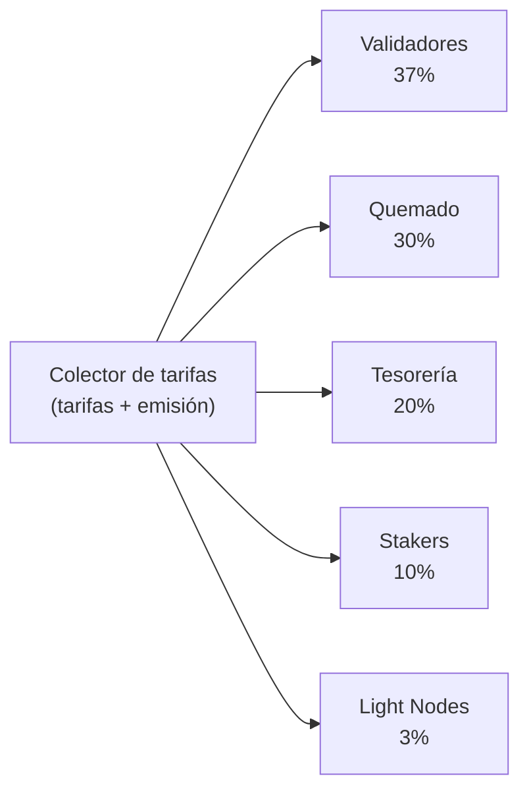

# Tokenómica

El modelo económico de QoreChain se centra en el token nativo **QOR** y sigue una **trayectoria de suministro finita y con tope**: un suministro de génesis fijo, una emisión de recompensas de staking acuñada bajo un límite acumulado estricto y un motor de quema multicanal que elimina tokens de forma permanente. Esta página describe cómo funcionan el suministro, la emisión, las quemas y el reparto de tarifas, usando cifras leídas de la cadena en vivo.

---

## Conceptos básicos del token

| Propiedad              | Valor                                                    |
| --------------------- | -------------------------------------------------------- |
| **Token de visualización** | QOR                                                 |
| **Denominación base** | uqor                                                     |
| **Precisión decimal** | 10^6 (1 QOR = 1.000.000 uqor)                            |
| **Suministro**        | Génesis 4.420.000.000 QOR; consulta el [Modelo de suministro y emisión](#supply-and-emission) |
| **Chain ID**          | `qorechain-vladi` (mainnet, EVM chain ID 9801)          |
| **Prefijo Bech32**    | `qor` (cuentas: `qor1...`, validadores: `qorvaloper...`) |

:::note
Las cifras de esta página describen la **mainnet** (`qorechain-vladi`, EVM chain ID **9801**), en vivo desde el 29 de junio de 2026 en la versión **v3.2.1**. La testnet **`qorechain-diana`** (EVM chain ID **9800**) comparte los mismos parámetros de módulo; su historial de suministro y emisión difiere (el suministro de la testnet es muy superior al de la mainnet y su emisión ya superó el tope), así que usa las cifras de la mainnet.
:::

---

## Modelo de suministro y emisión {#supply-and-emission}

QoreChain tiene una **trayectoria de suministro finita y con tope**. El suministro de génesis fue de **4.420.000.000 QOR** (estaban previstos 4.500.000.000 QOR; 80.000.000 QOR, el 1,78%, se quemaron en el Token Generation Event antes del génesis). Después del génesis solo dos cosas modifican el suministro:

* **Emisión** — el módulo `x/inflation` acuña una cantidad fija en cada época, bajo un **límite acumulado estricto de 114.285.714 QOR**. Los tokens acuñados entran en el colector de tarifas y pasan por el mismo reparto que las tarifas de transacción (consulta [Distribución de tarifas](#fee-distribution)).
* **Quemas** — el módulo `x/burn` elimina de forma permanente la parte de quema de todo lo que hay en el colector de tarifas.

### Emisión {#staking-reward-schedule}

| Parámetro | Valor |
| --- | --- |
| Modo de emisión | `fixed` (desde v3.1.94, altura 2.122.074 — 26 de agosto de 2026) |
| Emisión por época | 16.239 QOR |
| Duración de la época | 43.200 bloques (unas 38,6 horas con el tiempo de bloque actual de ≈3,2 s) |
| Límite acumulado (`max_total_emission`) | 114.285.714 QOR |
| Acuñado hasta ahora (14 de octubre de 2026, época 81) | 105.200.179 QOR (92,05% del límite) |
| Restante bajo el límite | 9.085.535 QOR (unas 559 épocas a 16.239 QOR por época) |

Una vez alcanzado el límite, el módulo deja de acuñar de forma permanente; a partir de entonces, las recompensas provienen únicamente de las tarifas de transacción. El límite lo fijó la propuesta de gobernanza n.º 4 (aprobada con todo el stake en staking votando a favor) y sustituyó al calendario decreciente original, que había sido calibrado para una red madura y totalmente en staking y que pagaba mucho más rápido de lo previsto frente al stake realmente en staking. Los valores del calendario (17,5%, 11%, 7%, 7%, 2% para los años 1–5) siguen almacenados en los parámetros del módulo, pero no se usan en el modo `fixed`.

QoreChain no expone una cifra de retorno de staking en vivo; trata cualquier porcentaje citado como no verificado. Las cifras actuales pueden leerse del estado de la cadena: el suministro en `GET /cosmos/bank/v1beta1/supply/by_denom?denom=uqor` y los totales de quema en `GET /qorechain/burn/v1/stats`.

---

## x/burn — Motor de quema multicanal

El módulo `x/burn` define **12 orígenes de quema**. Cada token quemado se elimina permanentemente del suministro. En la mainnet, hasta ahora solo `gas_fee` tiene quemas registradas (31.560.093 QOR a 14 de octubre de 2026); los demás están definidos pero no han registrado ninguna.

### Canales de quema

| #  | Canal              | Origen                     | Descripción                                   |
| -- | ------------------ | -------------------------- | --------------------------------------------- |
| 1  | `gas_fee`          | Tarifas de transacción     | Se quema el 30% de todas las tarifas de gas   |
| 2  | `contract_create`  | Despliegue de smart contracts | Tarifa fija de 100 QOR quemada por creación de contrato |
| 3  | `ai_service`       | Tarifas de uso del módulo de IA | Se quema el 50% de las tarifas de servicios de IA |
| 4  | `bridge_fee`       | Tarifas de bridge entre cadenas | Se quema el 100% de las tarifas de bridge   |
| 5  | `treasury_buyback` | Operaciones de tesorería   | Recompra y quema periódica desde la tesorería |
| 6  | `failed_tx`        | Gas de transacciones fallidas | Se quema el 10% del gas de transacciones fallidas (aplicado por la cadena desde v3.2.2; hasta ahora solo en la testnet) |
| 7  | `xqore_penalty`    | Penalizaciones por salida anticipada de xQORE | Los montos de penalización se enrutan a través de la quema |
| 8  | `auto_buyback`     | Programa de recompra automatizado | Quemas automatizadas a nivel de protocolo |
| 9  | `tge`              | Token generation event     | La quema de 80.000.000 QOR del TGE ocurrió antes del génesis (el suministro de génesis es de 4.420.000.000 QOR); este canal está reservado y registra 0 |
| 10 | `rollup_create`    | Despliegue de rollup       | Se quema el 1% del stake de creación del rollup |
| 11 | `milestone`        | Hitos de recuento de transacciones | Quemas programadas en recuentos acumulados fijos de transacciones (ninguna activada todavía) |
| 12 | `amm`              | AMM                        | Reservado para las tarifas de protocolo del AMM (ninguna registrada) |

Los canales `contract_create`, `ai_service`, `bridge_fee` y `auto_buyback` están inactivos hoy: la carga de CosmWasm está cerrada, y las tarifas de servicios de IA y el bridge no están en vivo.

### Distribución de tarifas {#fee-distribution}

Todo lo que hay en el colector de tarifas se reparte entre cinco destinos, como se muestra a continuación. El colector de tarifas contiene tanto las tarifas de transacción como la emisión de la época acuñada por `x/inflation`. Los porcentajes se imponen on-chain y siempre suman exactamente el 100%.

Los porcentajes son:

| Destinatario    | Porcentaje | Descripción                                                  |
| --------------- | ----- | -------------------------------------------------------------------- |
| **Validadores** | 37%   | Distribuido al conjunto de validadores activos en proporción al stake |
| **Quemado**     | 30%   | Eliminado permanentemente del suministro vía el canal de quema `gas_fee` |
| **Tesorería**   | 20%   | Asignado a la tesorería comunitaria para gasto dirigido por la gobernanza |
| **Stakers**     | 10%   | Distribuido a todos los stakers de QOR en proporción a la delegación |
| **Light Nodes** | 3%    | Distribuido a los light nodes por servir datos de la red             |

Los porcentajes se imponen on-chain y siempre deben sumar exactamente el 100%.

:::note Lo que realmente fluye por el reparto
El reparto se aplica a todo lo que hay en el colector de tarifas, que contiene tanto las tarifas de transacción como la emisión de la época acuñada por `x/inflation`. En la práctica, hoy casi todo es emisión: de los 105.200.179 QOR acuñados, se han quemado 31.560.093 QOR (30,0%) y 3.156.009 QOR (3,0%) están en la reserva de light nodes. Hasta la actualización a v3.2.0 (25 de septiembre de 2026, altura 2.981.742), la parte del 10% de los stakers se movía al saldo del módulo de distribución sin respaldar ninguna reclamación, por lo que stakers y validadores juntos recibían el 37%, no el 47%; desde esa altura la parte de los stakers se paga como una recompensa de staking normal, y la cantidad ya varada (6.693.045,92 QOR) quedó registrada y solo puede moverse mediante una votación de gobernanza — consulta [Parte de stakers varada y reserva de light nodes](#stranded-and-reserve).
:::

### Parámetros de quema

| Parámetro              | Por defecto                | Descripción                              |
| ---------------------- | -------------------------- | ---------------------------------------- |
| `gas_burn_rate`        | 0.30                       | Fracción de tarifas de gas quemada (30%) |
| `contract_create_fee`  | 100.000.000 uqor (100 QOR) | Tarifa fija de quema por creación de contrato |
| `ai_service_burn_rate` | 0.50                       | Fracción de tarifas de servicios de IA quemada (50%) |
| `bridge_burn_rate`     | 1.00                       | Fracción de tarifas de bridge quemada (100%) |
| `failed_tx_burn_rate`  | 0.10                       | Fracción del gas de TX fallidas quemada (10%) |
| `validator_share`      | 0.37                       | Parte del colector de tarifas para los validadores |
| `treasury_share`       | 0.20                       | Parte para la tesorería |
| `staker_share`         | 0.10                       | Parte para los stakers |
| `light_node_share`     | 0.03                       | Parte para los light nodes |
| `enabled`              | true                       | Indicador de activación del módulo |

Cada evento de quema se registra on-chain con su origen, monto, altura de bloque y hash de transacción asociado. Las estadísticas agregadas se pueden consultar por canal y en total.

---

## Parte de stakers varada y reserva de light nodes {#stranded-and-reserve}

Dos cantidades se acumularon en la mainnet antes de la actualización a v3.2.0 (25 de septiembre de 2026, altura 2.981.742) y ahora se mantienen **registradas, fuera de cualquier distribución**. Ambas solo pueden moverse mediante una votación de gobernanza.

| Registro | Cantidad en la mainnet | Consulta | Mensaje de gobernanza |
| --- | --- | --- | --- |
| **Parte de stakers varada** — la parte del 10% de los stakers que se depositó donde no respaldaba ninguna reclamación de recompensas de staking | 6.693.045,921330 QOR registrados, 0 liberados | `GET /qorechain/burn/v1/stranded_rewards` | `MsgReleaseStrandedRewards` (autoridad de gobernanza; destino nombrado; no puede superar el registro) |
| **Reserva de light nodes** — la parte del 3% de los light nodes que se acumuló mientras ningún light node era elegible | 3.156.009,326407 QOR reservados, 0 pendientes | `GET /qorechain/lightnode/v1/reward_pool` | `MsgReleaseLightNodeReserve` (autoridad de gobernanza) |

Desde la altura de la actualización, la parte de los stakers se paga como una recompensa de staking normal y las recompensas de los light nodes se pagan únicamente de lo acumulado desde la ejecución de distribución anterior, con un techo por nodo y por bloque (`max_reward_per_block_per_node`, 1.713 uqor según lectura del 14 de octubre de 2026). El registro de light nodes está actualmente cerrado, por lo que ningún nodo es elegible y la parte del 3% sigue acumulándose en la reserva. Se rechaza una liberación anterior a la instantánea de la actualización, superior a la cantidad registrada o dirigida a un destino no válido.

---

## x/xqore — Staking bloqueado y amplificación de gobernanza {#x-xqore}

:::warning Aún no está en vivo
La contabilidad del módulo xQORE existe y está activada en el génesis, pero **todavía no se puede usar** en la mainnet (`qorechain-vladi`) ni en la testnet (`qorechain-diana`). El nodo no tiene ningún punto de entrada de transacción, consulta, CLI o RPC para él, por lo que `tx xqore lock` / `unlock`, `query xqore ...`, las rutas REST de xQORE y `qor_getXQOREPosition` no funcionan, y nadie posee xQORE. Está previsto para una versión futura de la cadena, que también cambiará cómo se redistribuyen las penalizaciones por salida para que desbloquear siga siendo barato sin importar cuántos poseedores haya. La versión se indicará aquí cuando se publique.
:::

El módulo `x/xqore` introduce **xQORE**, un derivado de staking bloqueado no transferible. Los usuarios bloquean QOR para acuñar xQORE en una proporción 1:1. Los poseedores de xQORE reciben un poder de gobernanza amplificado y una parte de las penalizaciones por salida redistribuidas.

### Mecanismo de bloqueo

* **Bloqueo**: enviar QOR al módulo xQORE para acuñar xQORE en una proporción 1:1.
* **Peso de gobernanza**: los poseedores de xQORE reciben **2x de poder de voto en gobernanza** en comparación con los stakers estándar de QOR.
* **No transferible**: el xQORE no puede enviarse entre cuentas. Está vinculado a la dirección de bloqueo.

### Calendario de penalizaciones por salida

El retiro anticipado de xQORE incurre en una penalización que disminuye con la duración del bloqueo:

| Duración del bloqueo | Tasa de penalización | Descripción                                |
| -------------- | ------------ | ------------------------------------------ |
| &lt; 30 días   | **50%**      | Se pierde la mitad del QOR bloqueado       |
| 30 -- 90 días  | **35%**      | Penalización significativa para bloqueos a corto plazo |
| 90 -- 180 días | **15%**      | Penalización reducida para compromiso a medio plazo |
| > 180 días     | **0%**       | Retiro completo sin penalización           |

### Redistribución por rebase PvP

Las penalizaciones recaudadas de las salidas anticipadas no se destruyen simplemente. En cambio, siguen un modelo de rebase PvP (player-versus-player):

1. En la configuración de génesis se quema el **0%** de los montos de penalización (`penalty_burn_rate = 0`; el canal de quema `xqore_penalty` existe por si la gobernanza lo cambia).
2. El **100%** se redistribuye a prorrata a todos los poseedores de xQORE restantes.

Esto crea una dinámica de suma positiva para los poseedores a largo plazo: cada salida anticipada aumenta el valor efectivo de las posiciones de xQORE restantes. Los rebases ocurren cada **100 bloques**.

### Parámetros de xQORE

| Parámetro               | Por defecto            | Descripción                               |
| ----------------------- | ---------------------- | ------------------------------------------ |
| `governance_multiplier` | 2.0                    | Multiplicador de poder de voto para poseedores de xQORE |
| `min_lock_amount`       | 1.000.000 uqor (1 QOR) | QOR mínimo requerido para bloquear        |
| `penalty_burn_rate`     | 0.00                   | Fracción de penalizaciones por salida quemada (valor de génesis por defecto: todas las penalizaciones se redistribuyen) |
| `rebase_interval`       | 100 bloques            | Bloques entre eventos de rebase PvP       |
| `enabled`               | true                   | Indicador de activación del módulo        |

---

## x/inflation — Emisión con tope

El módulo `x/inflation` acuña la emisión por época (16.239 QOR, `emission_mode = fixed`) y la envía al colector de tarifas, hasta que se alcanza el límite acumulado de 114.285.714 QOR. Los cambios de parámetros pasan por una propuesta de parámetros de gobernanza normal (`MsgUpdateParams`, añadido en v3.1.94).

### Mecánica de épocas

* **Duración de la época**: 43.200 bloques (unas 38,6 horas a ≈3,2 s por bloque).
* En cada límite de época el módulo acuña la emisión de la época (o el remanente hasta el límite), actualiza el registro de la época y deja de acuñar cuando `total_minted` alcanza el límite.

### Parámetros

| Parámetro | Valor (mainnet) | Descripción |
| --- | --- | --- |
| `emission_mode` | `fixed` | `schedule` (heredado, tasas por año) o `fixed` |
| `fixed_epoch_emission` | 16.239.000.000 uqor | Acuñado por época en modo fijo |
| `max_total_emission` | 114.285.714.000.000 uqor | Techo acumulado estricto |
| `epoch_length` | 43.200 bloques | Bloques por época de emisión |
| `schedule` | 17,5%, 11%, 7%, 7%, 2% (años 1–5) | Calendario heredado, sin uso en modo fijo |
| `enabled` | `true` | Indicador de activación del módulo |

En la mainnet estos valores no se exponen mediante una ruta REST; pueden leerse del estado de la cadena con la interfaz de almacén en bruto de la RPC `abci_query` (almacén `inflation`, claves `inflation/params` y `inflation/epoch`). Existe un servicio de consulta dedicado para ellos solo en la testnet (v3.2.2).

---

## Quema frente a emisión

La emisión tiene tope (114.285.714 QOR) y la parte de quema se aplica a todo lo que entra en el colector de tarifas, emisión incluida. Hasta la fecha se han quemado 31.560.093 QOR frente a 105.200.179 QOR acuñados, por lo que el suministro está actualmente por encima de su nivel de génesis. Una vez alcanzado el límite, el suministro solo puede disminuir, en la cantidad quemada.

---

## Relacionado

* [Parámetros de la cadena](/appendix/chain-parameters) — valores por defecto canónicos económicos y de consenso.
* [Staking y delegación](/user-guide/staking-and-delegation) — delegar QOR y recibir recompensas de staking.
* [Staking de xQORE](/user-guide/xqore-staking) — el mecanismo de staking con rebase PvP.
* [Recompensas de Light Node](/light-node/rewards-and-monitoring) — la parte de recompensa de los light nodes.
