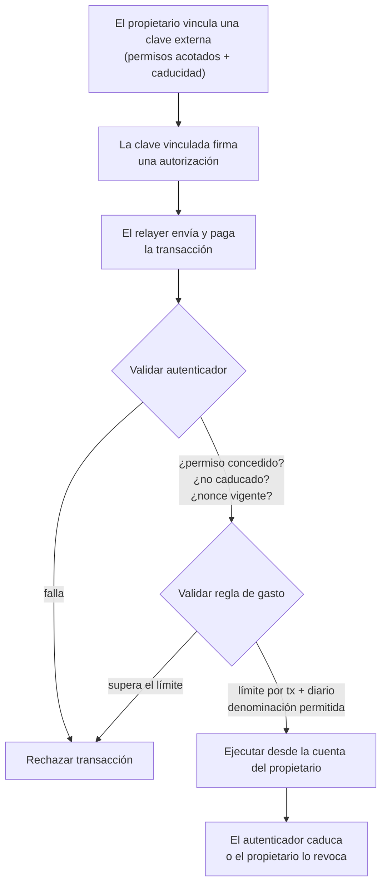

# Abstracción de cuentas

QoreChain ofrece **abstracción de cuentas a nivel de protocolo** mediante el módulo `x/abstractaccount`. El módulo registra cuentas abstractas con reglas de gasto y permite al propietario de la cuenta vincular claves externas (**autenticadores**) que pueden gastar desde la cuenta dentro de los límites de permisos y de gasto, sin infraestructura externa de contratos inteligentes.

:::danger No habilitado en mainnet ni en testnet
El módulo de cuentas abstractas está actualmente **desactivado** en ambas redes: `qorechaind query abstractaccount config` (y `GET /qorechain/abstractaccount/v1/config`) informan `enabled: false` en `qorechain-vladi` y `qorechain-diana`. Desde la versión de cadena v3.2.0 el indicador se aplica en todas las rutas: la cadena rechaza la creación de cuentas, el registro de autenticadores y ambas vías de ejecución (`MsgExecuteEVM`, `MsgExecuteCosmos`) con `abstract accounts are disabled on this chain`. Ninguna transacción puede activar el módulo, y nunca se ha incluido en mainnet ninguna transacción de cuenta abstracta. Todo lo que sigue describe las interfaces del módulo a modo de referencia. No construyas un flujo de claves vinculadas o de gasto delegado en las redes en vivo hasta que el módulo esté habilitado, y comprueba primero el indicador.
:::

:::note
Los comandos siguientes usan la mainnet **`qorechain-vladi`** (en funcionamiento desde el 29 de junio de 2026), que ejecuta la versión de nodo **v3.2.1** (reglas de consenso de v3.2.0). Sustituye por `--chain-id qorechain-diana` para la testnet, que ejecuta v3.2.2.
:::

:::caution Toda transacción de la vía Cosmos necesita la cofirma post-cuántica híbrida
Los ejemplos de `qorechaind tx` de esta página muestran solo los flags de comisión. En las redes en vivo, toda transacción de la vía Cosmos debe llevar además la cofirma híbrida ML-DSA-87, así que construye la transacción con `--generate-only` y fírmala con `qorechaind tx pqc cosign` (o usa QoreX o el SDK, que lo hacen por ti). La compilación comunitaria de `qorechaind` no puede producir esa firma; usa el binario de la versión del [manifiesto de descargas](/developer-guide/running-a-node#fetch-the-manifest). El mínimo de comisión es de **0.1 uqor por unidad de gas**, por lo que `--gas 400000` requiere al menos `--fees 40000uqor`. Consulta [Firma post-cuántica](/developer-guide/post-quantum-signing).
:::

## Visión general

Las cuentas blockchain tradicionales están controladas por una única clave privada. La abstracción de cuentas desacopla el concepto de "quién puede autorizar una transacción" de una única clave criptográfica. El módulo `x/abstractaccount` proporciona:

* **Cuentas abstractas** con un tipo de cuenta y un propietario registrados
* **Reglas de gasto** (límites por transacción y diarios, denominaciones permitidas) que acotan lo que pueden gastar las claves vinculadas
* **Autenticadores**: claves externas (una clave ed25519 de Phantom o una dirección secp256k1 de MetaMask) que el propietario vincula con permisos acotados y una caducidad, y que puede revocar en cualquier momento

*Un flujo de clave vinculada (autenticador): la clave vinculada firma una autorización, un relayer la envía, el módulo comprueba permisos, caducidad y reglas de gasto, y luego ejecuta desde la cuenta del propietario.*



## Tipos de cuenta

`create` registra uno de tres tipos de cuenta. El tipo se almacena en la cuenta y forma parte de cómo se deriva su dirección; el módulo no tiene transacciones propias de multifirma, claves de sesión ni recuperación (el servicio de transacciones es `create`, `update-rules`, `register-authenticator`, `revoke-authenticator`, `execute-cosmos`, `execute-evm`).

| Tipo              | Uso previsto                                   |
| ----------------- | ---------------------------------------------- |
| `multisig`        | Tesorerías de DAO, carteras compartidas        |
| `social_recovery` | Carteras de consumo, incorporación de usuarios |
| `session_based`   | Sesiones de dApp, carteras móviles             |

## Crear una cuenta abstracta

`create` recibe el tipo de cuenta como argumento posicional (`multisig`, `social_recovery` o `session_based`):

```bash
qorechaind tx abstractaccount create session_based \
  --from mykey \
  --gas 400000 --fees 40000uqor
```

El comando no tiene flags para firmantes, umbrales ni guardianes.

## Autenticadores (claves vinculadas)

El mecanismo de claves delegadas del módulo es el **autenticador**, descrito más abajo en [Autenticadores de carteras vinculadas](#authenticators): el propietario vincula una clave externa (ed25519 o secp256k1) con un conjunto de permisos y una caducidad, y la revoca en cualquier momento:

```bash
qorechaind tx abstractaccount register-authenticator <account-address> <scheme> <pubkey-base64> <permissions-csv> <expiry-unix> <label> \
  --from mykey --gas 400000 --fees 40000uqor
qorechaind tx abstractaccount revoke-authenticator <account-address> <scheme> <pubkey-base64> \
  --from mykey --gas 400000 --fees 40000uqor
```

`scheme` es `ed25519` (por ejemplo Phantom) o `secp256k1` (por ejemplo MetaMask). No existe ningún comando `grant-session`, `revoke-session` ni `query abstractaccount sessions`.

## Reglas de gasto

Las reglas de gasto añaden barreras financieras a las cuentas abstractas:

| Regla            | Descripción                                                     |
| ---------------- | --------------------------------------------------------------- |
| `daily_limit`    | Gasto total máximo por día natural UTC                          |
| `per_tx_limit`   | Gasto máximo por cada ejecución autorizada                      |
| `allowed_denoms` | Restringe qué denominaciones de token pueden gastarse           |

### Establecer reglas de gasto

`update-rules` sustituye las reglas de la cuenta por un array JSON de objetos `SpendingRule` (JSON en línea, no un archivo ni flags):

```bash
qorechaind tx abstractaccount update-rules <account-address> \
  '[{"id":"daily","enabled":true,"daily_limit":1000000000,"per_tx_limit":100000000,"allowed_denoms":["uqor"]}]' \
  --from mykey --gas 400000 --fees 40000uqor
```

Los límites están en la unidad base (`uqor`) y cuentan por cada ejecución autorizada; el límite diario acota el total por día natural UTC. Las reglas sustituyen a las almacenadas en su conjunto, así que un campo que omitas se elimina.

### Consultar las reglas actuales

El registro de la cuenta incluye sus reglas y el número de claves vinculadas:

```bash
qorechaind query abstractaccount account <account-address>
```

:::caution Una regla acota una clave solo cuando existe
La cadena resuelve el límite en este orden: la regla propia del autenticador si está definida y `enabled`; en caso contrario, la primera regla `enabled` de la cuenta; en caso contrario, **no hay límite**. Una regla almacenada con `enabled: false` significa que no hay límite, no un límite cero. `MsgRegisterAuthenticator` no lleva ninguna regla, por lo que una clave vinculada solo con ese mensaje queda acotada únicamente por una regla a nivel de cuenta. Define una regla de forma deliberada con `update-rules` y registra solo los permisos que la clave necesita. Un límite acota el daño que puede causar una clave vinculada; no sustituye a revocar la clave.
:::

## Autenticadores de carteras vinculadas — Gasto delegado {#authenticators}

El diseño de autenticadores se introdujo en la versión de cadena **v3.1.85** (apoyándose en el modelo de permisos de la v3.1.84). **No se puede usar en las redes en vivo mientras el módulo esté desactivado** (consulta el recuadro de estado al principio de esta página). Una **clave de cartera externa vinculada** — una clave de Phantom (ed25519) o una cuenta de MetaMask (secp256k1) — puede **gastar desde la cuenta post-cuántica canónica** bajo condiciones de mínimo privilegio, con límites de gasto y revocables. La clave externa nunca produce una firma ML-DSA; un **relayer** envía y paga el sobre de la transacción (la propia firma PQC híbrida del relayer satisface los requisitos de firma de la cadena), mientras que la firma del autenticador sobre **sign bytes con separación de dominio y protección contra repetición** constituye la autorización.

### Registrar un autenticador {#register-authenticator}

El propietario de la cuenta registra la clave externa con `MsgRegisterAuthenticator` (una transacción ordinaria con la clave raíz), asignándole un esquema, permisos, una caducidad y límites de gasto opcionales:

```js
import { registerEthAuthenticatorMsg } from "@qorechain/wallet-adapter";

// Link a MetaMask account by its 20-byte address (EIP-191 verification):
const msg = registerEthAuthenticatorMsg({
  owner: "qor1owner...",              // the canonical account (signs this message)
  ethAddress: "0xAbC...123",          // the MetaMask address to link
  permissions: ["evm"],               // least privilege — see the taxonomy below
  expiryUnix: Math.floor(Date.now() / 1000) + 30 * 24 * 3600, // absolute Unix seconds, ≤ 30 days recommended
  label: "metamask",
});
// Limits are a separate message (MsgUpdateSpendingRules), see "Spending Rules" above.
// Sign & broadcast this msg with the OWNER's normal hybrid-PQC signer.
```

Una clave de Phantom se registra de la misma manera con el esquema `ed25519` y la clave pública de Phantom (`register-authenticator` en la CLI). La revocación es instantánea mediante `MsgRevokeAuthenticator`.

### Taxonomía de permisos {#permission-taxonomy}

Once permisos canónicos controlan lo que un autenticador registrado puede hacer. El mapa es de **cierre por defecto (fail-closed)**: un tipo de mensaje sin correspondencia es denegado.

| Permiso | Concede |
| --- | --- |
| `send` | Transferencias bancarias en la vía nativa |
| `delegate` / `withdraw` / `vote` | Staking, retirada de recompensas, gobernanza |
| `evm` / `wasm` / `svm` | Ejecución en la vía de la VM correspondiente |
| `amm` / `ibc` / `deploy` | Operaciones AMM, transferencias IBC, despliegue de contratos |
| `all` | Cualquier mensaje *delegable* |

**Los mensajes de gestión de claves nunca son delegables** — `MsgRegisterAuthenticator`, `MsgRevokeAuthenticator`, el registro/migración de claves PQC y `MsgRotatePQCKey` siempre requieren la clave raíz, de modo que una clave vinculada nunca puede escalar sus propios privilegios.

Lee la taxonomía en vivo (con `schema_version` para detectar desviaciones) en lugar de codificarla de forma fija:

```bash
curl -s https://api.qore.host/qorechain/abstractaccount/v1/permission_schema | jq
# or: qorechaind query abstractaccount permission-schema
```

### Gastar mediante una clave vinculada {#execute-messages}

Dos mensajes transportan acciones autorizadas por un autenticador. En ambos, el relayer es el firmante/pagador de comisiones de la transacción; la firma del autenticador viaja dentro del mensaje.

**`MsgExecuteEVM`** — una llamada o transferencia EVM **desde la dirección `0x…` de la cuenta canónica**. El autenticador firma `sha256("qorechain-evm-auth-v1" ‖ chainId ‖ account ‖ pubkey ‖ to ‖ value ‖ data ‖ nonce)` (todos los campos con prefijo de longitud). La protección contra repetición es el propio nonce EVM de la cuenta.

**`MsgExecuteCosmos`** — un envío bancario en la vía nativa desde la cuenta canónica. El autenticador firma `sha256("qorechain-cosmos-auth-v1" ‖ chainId ‖ account ‖ pubkey ‖ to ‖ amount ‖ nonce)`. La protección contra repetición es una **secuencia por autenticador** que mantiene el módulo (un envío bancario no incrementa el nonce de la cuenta). Los envíos a uno mismo se rechazan.

:::caution Reglas del nonce
* `MsgExecuteEVM.nonce` = el nonce EVM **actual** de la cuenta (`eth_getTransactionCount(account0x, "latest")`). En producción el relayer es una cuenta *distinta*, así que **no** sumes +1. Firmar un nonce obsoleto devuelve el código `11`.
* `MsgExecuteCosmos.nonce` = la secuencia por autenticador (consulta el estado de autenticadores de la cuenta), **no** la secuencia Cosmos de la cuenta.
:::

**Ejemplo con Phantom** (navegador: Phantom firma, tu backend actúa como relayer):

```js
import { buildPhantomExecuteCosmos } from "@qorechain/wallet-adapter";

// In the dApp: Phantom signs the digest with ed25519 signMessage.
const msg = await buildPhantomExecuteCosmos({
  wallet: window.solana,              // Phantom: { publicKey, signMessage }
  relayer: "qor1relayer...",          // submits the tx and pays the fee (a different account)
  chainId: "qorechain-vladi",
  account: "qor1owner...",            // canonical account being spent from
  to: "qor1recipient...",
  amount: "900000uqor",               // single-coin string
  nonce: authSequence,                // per-authenticator sequence
});
// Send `msg` to your relayer; the relayer wraps it in a tx it signs
// (hybrid PQC) and broadcasts. The transfer moves the OWNER's funds.
```

**Ejemplo con MetaMask** (`personal_sign` EIP-191 desde la dirección vinculada de 20 bytes):

```js
import { buildMetaMaskExecuteEvm } from "@qorechain/wallet-adapter";

const msg = await buildMetaMaskExecuteEvm({
  provider: window.ethereum,          // MetaMask (EIP-1193)
  address: ethAddress,                // the linked 20-byte address
  relayer: "qor1relayer...",
  chainId: "qorechain-vladi",
  account: "qor1owner...",
  to: "0xRecipient...",
  value: (10n ** 16n).toString(),     // 0.01 QOR in wei (18-decimal EVM view), as a decimal string
  gasLimit: 100000,
  nonce: currentEvmNonce,             // eth_getTransactionCount(owner0x, "latest")
});
// Relay as above. The chain verifies the signature via EIP-191 + ecrecover
// against the registered 20-byte address.
```

Los mismos constructores existen en el [SDK de QoreChain](/sdk/guides/authenticators) para los cinco lenguajes, además de equivalentes de CLI:

```bash
# Generate an ed25519 authenticator key: the seed goes to a new 0600 file, only the public key is printed
qorechaind query abstractaccount auth-keygen --out authenticator.seed

# Sign the exact bytes the chain verifies (seed from --seed-file, "-" for stdin, QORE_AUTH_SEED, or a prompt)
qorechaind query abstractaccount auth-sign-cosmos <chain-id> <account> <to> <amount> <nonce> --seed-file authenticator.seed
qorechaind query abstractaccount auth-sign-evm <chain-id> <account> <to-0xhex> <value-wei> <data-hex> <nonce> --seed-file authenticator.seed

# Relay a pre-signed authorization (the relayer's --from key pays; cosign the envelope with `tx pqc cosign`)
qorechaind tx abstractaccount execute-cosmos <account> <to> <amount> <scheme> <pubkey-base64> <signature-base64> <nonce> --from relayer --generate-only > tx.json
qorechaind tx abstractaccount execute-evm <account> <to-0xhex> <value-wei> <data-hex> <gas-limit> <scheme> <pubkey-base64> <signature-base64> <nonce> --from relayer --generate-only > tx.json
```

Las claves y las firmas de estos comandos están en base64. Los asistentes `auth-sign-*` leen la semilla desde un archivo, la entrada estándar o el entorno en lugar de un argumento de línea de comandos (versión de nodo v3.2.1 y posteriores), por lo que no aparece en el historial del shell. Los flags de gestión de la semilla (`--out`, `--seed-file`) solo existen en binarios v3.2.1 y posteriores.

### Códigos de error {#authenticator-errors}

Los fallos de aplicación devuelven códigos distintos (codespace `abstractaccount`) para que las carteras puedan mostrar el mensaje correcto:

| Código | Significado | UX de la cartera |
| --- | --- | --- |
| `5` | Límite de gasto superado (por tx o diario) | Mostrar la asignación restante |
| `6` | Autenticador caducado | "Caducado — vuelve a vincular tu cartera" |
| `9` | Módulo desactivado (el estado en vivo en ambas redes) | "Las carteras vinculadas aún no están disponibles" |
| `10` | Permiso denegado (alcance o mensaje no delegable) | Mostrar el permiso que falta |
| `11` | Repetición rechazada (nonce/secuencia obsoletos) | Volver a consultar el nonce y firmar de nuevo |

(Codespace `pqc`, código `21` = falló la verificación de la firma híbrida — un problema de firma del lado del relayer, no de autorización.)

### Consultas REST {#abstractaccount-rest}

Las consultas de lectura del módulo se sirven por REST (desde **v3.1.85**):

```
GET /qorechain/abstractaccount/v1/config      # {"config":{"enabled":false,...}} on both networks today
GET /qorechain/abstractaccount/v1/accounts
GET /qorechain/abstractaccount/v1/accounts/{address}
GET /qorechain/abstractaccount/v1/permission_schema
```

## Consultar cuentas abstractas

### CLI

```bash
# Module configuration (enabled flag and limits)
qorechaind query abstractaccount config

# Get full account configuration
qorechaind query abstractaccount account <address>

# List all abstract accounts (paginated)
qorechaind query abstractaccount accounts --page-limit 10
```

En mainnet la lista de cuentas está vacía; la testnet lista algunas cuentas creadas antes de que el indicador de habilitación se aplicara en todas las rutas.

### JSON-RPC

> **Aún no se sirve:** ninguna compilación de nodo publicada sirve el espacio de nombres JSON-RPC `qor_`, por lo que `qor_getAbstractAccount` devuelve `-32601` (método no encontrado) en todos los endpoints públicos hoy. Usa las rutas REST anteriores o la CLI. Consulta [el espacio de nombres `qor_`](/api-reference/json-rpc-qor_-namespace).

### Ejemplo de respuesta de cuenta

La forma de un registro de cuenta abstracta (valores ilustrativos):

```json
{
  "address": "qor1myaccount...",
  "account_type": "session_based",
  "owner": "qor1owner...",
  "spending_rules": [
    {
      "id": "daily",
      "enabled": true,
      "daily_limit": "1000000000",
      "per_tx_limit": "100000000",
      "allowed_denoms": ["uqor"]
    }
  ]
}
```

## Recuperación social

`social_recovery` es un tipo de cuenta, pero el módulo no tiene transacciones de recuperación: no existe ningún comando `initiate-recovery` ni `approve-recovery`, ni ningún mensaje de recuperación en el servicio de transacciones del módulo. La recuperación de claves de una cuenta de QoreChain se hace volviendo a derivar la clave post-cuántica de la cuenta a partir de su mnemónico (`tx pqc recover-key`) y, si es necesario, rotándola (`tx pqc rotate-key`); consulta [Firma post-cuántica](/developer-guide/post-quantum-signing).

## Integración con dApps

Cuando el módulo está habilitado, la autorización mediante claves vinculadas está pensada para flujos como:

* Carteras móviles donde los avisos biométricos repetidos resultan molestos
* dApps de juegos que necesitan firmar transacciones con rapidez dentro de una asignación acotada
* Usuarios de Phantom o MetaMask que gastan desde su cuenta de QoreChain a través de un relayer

El backend de una dApp actúa como relayer: recibe la autorización firmada de la clave vinculada, la envuelve en una transacción que firma él mismo y la difunde. La clave vinculada puede revocarse, o caducar, en cualquier momento. Hasta que el módulo esté habilitado en la red a la que te diriges, usa la firma ordinaria mediante [QoreX o el SDK](/sdk/overview).

## Siguientes pasos

* [Ejecutar un validador](/developer-guide/running-a-validator) — Configura y opera un nodo validador
* [Desarrollo EVM](/developer-guide/evm-development) — Herramientas EVM, cuentas y la ventana de autorización EVM
* [Interoperabilidad entre VMs](/developer-guide/cross-vm-interoperability) — Mensajería entre VMs
