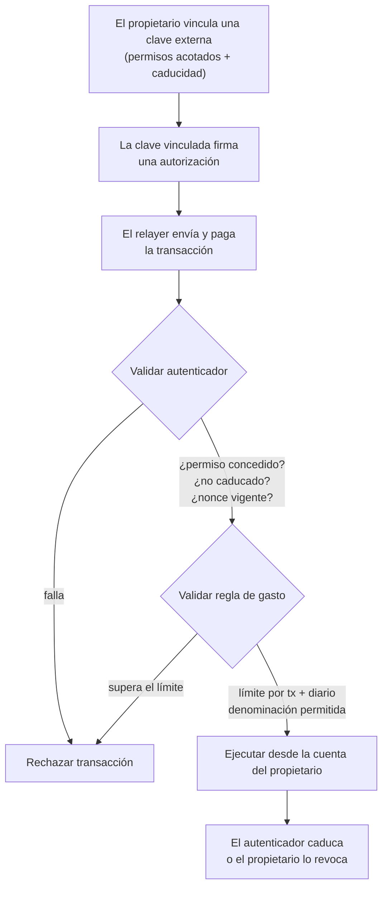

# Abstracción de cuentas

QoreChain ofrece **abstracción de cuentas a nivel de protocolo** mediante el módulo `x/abstractaccount`. El módulo registra cuentas abstractas con reglas de gasto y permite al propietario de la cuenta vincular claves externas (**autenticadores**) que pueden gastar desde la cuenta dentro de los límites de permisos y de gasto, sin infraestructura externa de contratos inteligentes.

:::danger No habilitado en mainnet; habilitado en testnet
El módulo de cuentas abstractas está **desactivado en la mainnet `qorechain-vladi`** en el momento de escribir esto (comprobado el 27 de octubre de 2026): `qorechaind query abstractaccount config` (y `GET /qorechain/abstractaccount/v1/config`) informan `enabled: false`. En la **testnet `qorechain-diana`** se activó mediante una decisión de gobernanza (propuesta 18, aprobada el 27 de octubre de 2026) e informa `enabled: true`. Desde la versión de cadena v3.2.0 el indicador se aplica en todas las rutas: donde es `false`, la cadena rechaza la creación de cuentas, el registro de autenticadores y ambas vías de ejecución (`MsgExecuteEVM`, `MsgExecuteCosmos`) con `abstract accounts are disabled on this chain`. Ninguna transacción ordinaria puede activar el módulo; el ajuste solo cambia mediante una decisión de gobernanza. Nunca se ha incluido en mainnet ninguna transacción de cuenta abstracta. Todo lo que sigue describe las interfaces del módulo; pruébalo en la testnet, y no construyas un flujo de claves vinculadas o de gasto delegado para mainnet hasta que el módulo esté habilitado allí. Comprueba siempre primero el indicador.
:::

:::note
Los comandos siguientes usan la mainnet **`qorechain-vladi`** (en funcionamiento desde el 7 de junio de 2026), que ejecuta la versión de nodo **v3.2.6** (aplicada en la altura 4,020,000 el 4 de noviembre de 2026, propuesta de gobernanza 15; la v3.2.5 se aplicó en la altura 3,906,833 el 29 de octubre de 2026, propuesta 14, y la v3.2.4 se aplicó en la altura 3,742,566 el 23 de octubre de 2026). Sustituye por `--chain-id qorechain-diana` para la testnet, que ejecuta v3.2.8 (desde el 12 de noviembre de 2026; v3.2.4 desde el 19 de octubre de 2026).
:::

:::caution Toda transacción de la vía Cosmos necesita la cofirma post-cuántica híbrida
Los ejemplos de `qorechaind tx` de esta página muestran solo los flags de comisión. En las redes en vivo, toda transacción de la vía Cosmos debe llevar además la cofirma híbrida ML-DSA-87, así que construye la transacción con `--generate-only` y fírmala con `qorechaind tx pqc cosign` (o usa QoreX o el SDK, que lo hacen por ti). La compilación comunitaria de `qorechaind` no puede producir esa firma; usa el binario de la versión del [manifiesto de descargas](/developer-guide/running-a-node#fetch-the-manifest). El mínimo de comisión es de **0.1 uqor por unidad de gas**, por lo que `--gas 400000` requiere al menos `--fees 40000uqor`. Consulta [Firma post-cuántica](/developer-guide/post-quantum-signing).
:::

## Visión general

Las cuentas blockchain tradicionales están controladas por una única clave privada. La abstracción de cuentas desacopla el concepto de "quién puede autorizar una transacción" de una única clave criptográfica. El módulo `x/abstractaccount` proporciona:

* **Cuentas abstractas** con un tipo de cuenta y un propietario registrados
* **Reglas de gasto** (límites por transacción y diarios, denominaciones permitidas) que acotan lo que pueden gastar las claves vinculadas (autenticadores y claves de sesión); no limitan la clave propia del propietario
* **Autenticadores**: claves externas (una clave ed25519 de Phantom o una dirección secp256k1 de MetaMask) que el propietario vincula con permisos acotados y una caducidad, y que puede revocar en cualquier momento

*Un flujo de clave vinculada (autenticador): la clave vinculada firma una autorización, un relayer la envía, el módulo comprueba permisos, caducidad y reglas de gasto, y luego ejecuta desde la cuenta del propietario.*



## Tipos de cuenta

`create` registra uno de tres tipos de cuenta. El tipo se almacena en la cuenta y forma parte de cómo se deriva su dirección; el módulo no tiene transacciones propias de multifirma, claves de sesión ni recuperación (el servicio de transacciones es `create`, `update-rules`, `register-authenticator`, `revoke-authenticator`, `execute-cosmos`, `execute-evm`).

| Tipo              | Uso previsto                                   |
| ----------------- | ---------------------------------------------- |
| `multisig`        | Tesorerías de DAO, carteras compartidas        |
| `social_recovery` | Carteras de consumo, incorporación de usuarios |
| `session_based`   | Sesiones de dApp, carteras móviles             |

## Crear una cuenta abstracta

`create` recibe el tipo de cuenta como argumento posicional (`multisig`, `social_recovery` o `session_based`):

```bash
qorechaind tx abstractaccount create session_based \
  --from mykey \
  --gas 400000 --fees 40000uqor
```

El comando no tiene flags para firmantes, umbrales ni guardianes.

## Autenticadores (claves vinculadas)

El mecanismo de claves delegadas del módulo es el **autenticador**, descrito más abajo en [Autenticadores de carteras vinculadas](#authenticators): el propietario vincula una clave externa (ed25519 o secp256k1) con un conjunto de permisos y una caducidad, y la revoca en cualquier momento:

```bash
qorechaind tx abstractaccount register-authenticator <account-address> <scheme> <pubkey-base64> <permissions-csv> <expiry-unix> <label> \
  --from mykey --gas 400000 --fees 40000uqor
qorechaind tx abstractaccount revoke-authenticator <account-address> <scheme> <pubkey-base64> \
  --from mykey --gas 400000 --fees 40000uqor
```

`scheme` es `ed25519` (por ejemplo Phantom) o `secp256k1` (por ejemplo MetaMask). No existe ningún comando `grant-session`, `revoke-session` ni `query abstractaccount sessions`.

## Reglas de gasto

Las reglas de gasto añaden barreras financieras para los autenticadores y las claves de sesión vinculados a una cuenta abstracta. Las reglas de gasto acotan solo a los autenticadores y a las claves de sesión, no la clave propia del propietario; la clave del propietario está limitada, en el carril EVM, por la [ventana de autorización EVM](/getting-started/first-transaction#evm-window).

Los campos de la regla:

| Regla            | Descripción                                                     |
| ---------------- | --------------------------------------------------------------- |
| `daily_limit`    | Gasto total máximo por día natural UTC                          |
| `per_tx_limit`   | Gasto máximo por cada ejecución autorizada                      |
| `allowed_denoms` | Restringe qué denominaciones de token pueden gastarse (un ERC-20 se indica como `erc20/<EIP-55 0x address>`, la grafía propia de la regla de gasto con barra; la cadena compara la dirección en su forma EIP-55, de modo que la combinación de mayúsculas y minúsculas que escribas no crea un token distinto. No es la denominación de bank de un par de tokens registrado, que se escribe `erc20:<EIP-55 0x address>` con dos puntos y distingue mayúsculas de minúsculas, consulta [Desarrollo EVM](/developer-guide/evm-development#fest-tokens)) |
| `denom_limits`   | Límites por denominación como cadenas decimales (v3.2.2): `{"denom","per_tx_limit","daily_limit"}`; sustituyen a `per_tx_limit` y `daily_limit` para las denominaciones que nombran, de modo que se puede limitar un token de 18 decimales |
| `allowed_evm_calls` | Llamadas EVM que una clave sujeta a reglas puede hacer **con datos de llamada** (v3.2.2), como `0x<target>` (cualquier función de ese contrato) o `0x<target>/0x<selector>` (solo esa función). Sin una entrada, una clave sujeta a reglas solo puede enviar valor, desplegar (con el permiso `deploy`) y mover los tokens ERC-20 listados en `allowed_denoms`. Incluir un destino en la lista implica confiar en todos los argumentos de las llamadas que se le hagan, destinatarios incluidos |

### Establecer reglas de gasto

`update-rules` sustituye las reglas de la cuenta por un array JSON de objetos `SpendingRule` (JSON en línea, no un archivo ni flags):

```bash
qorechaind tx abstractaccount update-rules <account-address> \
  '[{"id":"daily","enabled":true,"daily_limit":1000000000,"per_tx_limit":100000000,"allowed_denoms":["uqor"]}]' \
  --from mykey --gas 400000 --fees 40000uqor
```

Los límites están en la unidad base (`uqor`) y cuentan por cada ejecución autorizada; el límite diario acota el total por día natural UTC. Las reglas sustituyen a las almacenadas en su conjunto, así que un campo que omitas se elimina. Desde v3.2.2, la vía EVM mide lo que una llamada realmente mueve (valor nativo, la disminución del saldo nativo de la cuenta, las monedas del banco gastadas y el cambio de saldo o de allowance de cada ERC-20 listado) en lugar de solo `msg.value`, y la creación de contratos necesita el permiso `deploy` por separado. Un ejemplo más completo (el ERC-20 mostrado es el token de prueba fUSD de la testnet; usa la dirección de contrato de tu propio token, y fíjate en la barra de `erc20/<address>` en una regla frente a los dos puntos de la denominación de bank `erc20:<address>`):

```bash
qorechaind tx abstractaccount update-rules <account-address> \
  '[{"id":"daily","enabled":true,"daily_limit":5000000,"allowed_denoms":["uqor","erc20/0x97143B771D34ddb9130b807b135Ae675A5a963CA"],"allowed_evm_calls":["0xROUTER/0x38ed1739"],"denom_limits":[{"denom":"erc20/0x97143B771D34ddb9130b807b135Ae675A5a963CA","per_tx_limit":"100000000000000000000","daily_limit":"500000000000000000000"}]}]' \
  --from mykey --gas 400000 --fees 40000uqor
```

### Consultar las reglas actuales

El registro de la cuenta incluye sus reglas y el número de claves vinculadas:

```bash
qorechaind query abstractaccount account <account-address>
```

Desde v3.2.8 (solo testnet hasta una actualización posterior de mainnet) una clave con permisos de valor se rechaza en el registro y en la ejecución salvo que una regla la acote, así que "sin límite" ya no se aplica a esas claves.

:::caution Una regla acota una clave solo cuando existe
La cadena resuelve el límite en este orden: la regla propia del autenticador si está definida y `enabled`; en caso contrario, la primera regla `enabled` de la cuenta; en caso contrario, **no hay límite**. Una regla almacenada con `enabled: false` significa que no hay límite, no un límite cero. `MsgRegisterAuthenticator` no lleva ninguna regla, por lo que una clave vinculada solo con ese mensaje queda acotada únicamente por una regla a nivel de cuenta. Define una regla de forma deliberada con `update-rules` y registra solo los permisos que la clave necesita. Un límite acota el daño que puede causar una clave vinculada; no sustituye a revocar la clave.
:::

## Autenticadores de carteras vinculadas — Gasto delegado {#authenticators}

El diseño de autenticadores se introdujo en la versión de cadena **v3.1.85** (apoyándose en el modelo de permisos de la v3.1.84). **No se puede usar en mainnet mientras el módulo esté desactivado allí**, y está disponible en la testnet, donde el módulo está habilitado (consulta el recuadro de estado al principio de esta página). Una **clave de cartera externa vinculada** — una clave de Phantom (ed25519) o una cuenta de MetaMask (secp256k1) — puede **gastar desde la cuenta post-cuántica canónica** bajo condiciones de mínimo privilegio, con límites de gasto y revocables. La clave externa nunca produce una firma ML-DSA; un **relayer** envía y paga el sobre de la transacción (la propia firma PQC híbrida del relayer satisface los requisitos de firma de la cadena), mientras que la firma del autenticador sobre **sign bytes con separación de dominio y protección contra repetición** constituye la autorización.

### Registrar un autenticador {#register-authenticator}

El propietario de la cuenta registra la clave externa con `MsgRegisterAuthenticator` (una transacción ordinaria con la clave raíz), asignándole un esquema, permisos, una caducidad y límites de gasto opcionales:

```js
import { registerEthAuthenticatorMsg } from "@qorechain/wallet-adapter";

// Link a MetaMask account by its 20-byte address (EIP-191 verification):
const msg = registerEthAuthenticatorMsg({
  owner: "qor1owner...",              // the canonical account (signs this message)
  ethAddress: "0xAbC...123",          // the MetaMask address to link
  permissions: ["evm"],               // least privilege — see the taxonomy below
  expiryUnix: Math.floor(Date.now() / 1000) + 30 * 24 * 3600, // absolute Unix seconds, ≤ 30 days recommended
  label: "metamask",
});
// Limits are a separate message (MsgUpdateSpendingRules), see "Spending Rules" above.
// Sign & broadcast this msg with the OWNER's normal hybrid-PQC signer.
```

**Desde la versión v3.2.8 (solo testnet hasta una actualización posterior de mainnet) el registro exige dos cosas más.**

1. **Una prueba de posesión.** `MsgRegisterAuthenticator` tiene un campo obligatorio `possession_proof` (campo 8): una firma de la clave que se vincula, que demuestra que acepta el vínculo. La clave firma este texto plano con su propio esquema, de modo que una cartera de navegador muestra al usuario lo que firma (Phantom `signMessage`, MetaMask `personal_sign`); una clave secp256k1 de 33 bytes firma el SHA-256 del texto:

   ```text
   QoreChain authenticator link v1
   chain: <chain-id>
   account: <bech32 account>
   scheme: <scheme>
   key: <lowercase hex of the public key, or of the 20-byte address>
   ```

   El texto nombra la cadena, la cuenta, el esquema y la clave, así que una prueba no puede reutilizarse para otra cadena, cuenta o clave. Un registro sin una prueba válida se rechaza.
2. **Una regla de gasto para las claves de valor.** Una clave cuyos permisos pueden mover valor (`send`, `evm`, `svm`, `deploy`, `all`) necesita una regla de gasto que acote cada denominación que pueda gastar, definida con `MsgUpdateSpendingRules` antes del vínculo o junto con él. La misma regla se aplica en la ejecución para las claves vinculadas antes de la actualización, así que añade reglas también para ellas.

Desde código, el SDK 0.14.0 tiene los ayudantes para ambas cosas (TypeScript: `signAuthenticatorLinkPhantom`, `signAuthenticatorLinkMetaMask`, `signAuthenticatorLinkEd25519`, `signAuthenticatorLinkSecp256k1`, `signAuthenticatorLinkEip191` para la prueba; `linkAuthenticatorMsgs` para la regla de gasto y el vínculo en una sola transacción firmada por el propietario), y `@qorechain/wallet-adapter` 0.6.0 tiene `phantomPossessionProof`, `metaMaskPossessionProof` y `linkAuthenticatorMsgs`. Consulta [Vincular desde la cadena v3.2.8](/sdk/guides/authenticators#link-v328). Para el caso de la ejecución fallida, `assertAuthenticatorExecutionsSucceeded` lanza un error con `success=false`. `linkAuthenticatorMsgs`, `metaMaskPossessionProof` y `revokeAuthenticatorMsg` se ejecutaron en la testnet (véase [Qué se comprobó](#link-example-checks)); los ayudantes de Phantom y ed25519 no.

Una clave de Phantom se registra de la misma manera con el esquema `ed25519` y la clave pública de Phantom (`register-authenticator` en la CLI). La revocación es instantánea mediante `MsgRevokeAuthenticator`.

**Una ejecución puede fallar dentro de una transacción exitosa.** Desde v3.2.8 (solo testnet hasta una actualización posterior de mainnet) un `MsgExecuteEVM` o `MsgExecuteCosmos` fallido devuelve `success=false` en su respuesta con código de transacción 0, emite el evento `abstractaccount_execution_failed` con el motivo y aun así consume el nonce del autenticador. Un cliente que solo compruebe el código de la transacción informará de esa llamada como un éxito: lee la respuesta o el evento.

### Taxonomía de permisos {#permission-taxonomy}

Once permisos canónicos controlan lo que un autenticador registrado puede hacer. El mapa es de **cierre por defecto (fail-closed)**: un tipo de mensaje sin correspondencia es denegado.

| Permiso | Concede |
| --- | --- |
| `send` | Transferencias bancarias en la vía nativa |
| `delegate` / `withdraw` / `vote` | Staking, retirada de recompensas, gobernanza |
| `evm` / `wasm` / `svm` | Ejecución en la vía de la VM correspondiente |
| `amm` / `ibc` / `deploy` | Operaciones AMM, transferencias IBC, despliegue de contratos |
| `all` | Cualquier mensaje *delegable* |

**Los mensajes de gestión de claves nunca son delegables** — `MsgRegisterAuthenticator`, `MsgRevokeAuthenticator`, el registro/migración de claves PQC y `MsgRotatePQCKey` siempre requieren la clave raíz, de modo que una clave vinculada nunca puede escalar sus propios privilegios. El esquema (`schema_version` 2) también lista `lane_rules`: la creación de un contrato desde la dirección de la cuenta, una llamada que avanza el nonce EVM de la cuenta y una llamada a la propia cuenta cuando su código es una delegación EIP-7702 necesitan cada una el permiso `deploy` o `all`. Desde v3.2.3, el registro rechaza cadenas de permiso desconocidas y claves secp256k1 de 65 bytes que nunca podrían verificarse.

Lee la taxonomía en vivo (con `schema_version` para detectar desviaciones) en lugar de codificarla de forma fija:

```bash
curl -s https://api.qore.host/qorechain/abstractaccount/v1/permission_schema | jq
# or: qorechaind query abstractaccount permission-schema
```

### Gastar mediante una clave vinculada {#execute-messages}

Dos mensajes transportan acciones autorizadas por un autenticador. En ambos, el relayer es el firmante/pagador de comisiones de la transacción; la firma del autenticador viaja dentro del mensaje.

**`MsgExecuteEVM`** — una llamada o transferencia EVM **desde la dirección `0x…` de la cuenta canónica**. El autenticador firma `sha256("qorechain-evm-auth-v1" ‖ chainId ‖ account ‖ pubkey ‖ to ‖ value ‖ data ‖ nonce)` (todos los campos con prefijo de longitud). Desde v3.2.3 (la función `abstractaccount-hardening`), la cadena exige el **digest v2**, `sha256("qorechain-evm-auth-v2" ‖ … ‖ nonce ‖ gasLimit)`, que además vincula el límite de gas de la llamada (8 bytes big-endian) para que un relayer no pueda repetir la firma con un límite distinto; ningún bloque acepta ambas formas. `qorechaind query abstractaccount auth-sign-evm` admite `--gas-limit` para esto, y pasas el mismo valor a `execute-evm`. La protección contra repetición es el propio nonce EVM de la cuenta.

**`MsgExecuteCosmos`** — un envío bancario en la vía nativa desde la cuenta canónica. El autenticador firma `sha256("qorechain-cosmos-auth-v1" ‖ chainId ‖ account ‖ pubkey ‖ to ‖ amount ‖ nonce)`. La protección contra repetición es una **secuencia por autenticador** que mantiene el módulo (un envío bancario no incrementa el nonce de la cuenta). Los envíos a uno mismo se rechazan.

:::caution Reglas del nonce
* `MsgExecuteEVM.nonce` = el nonce EVM **actual** de la cuenta (`eth_getTransactionCount(account0x, "latest")`). En producción el relayer es una cuenta *distinta*, así que **no** sumes +1. Firmar un nonce obsoleto devuelve el código `11`.
* `MsgExecuteCosmos.nonce` = la secuencia por autenticador (consulta el estado de autenticadores de la cuenta), **no** la secuencia Cosmos de la cuenta. Desde v3.2.4 (testnet desde el 19 de octubre de 2026, mainnet desde el 23 de octubre de 2026), `GET /qorechain/abstractaccount/v1/auth_nonce/{address}/{pubkey_hex}` devuelve directamente esa secuencia (`nonce`, `linked`).
:::

**Ejemplo con Phantom** (navegador: Phantom firma, tu backend actúa como relayer):

```js
import { buildPhantomExecuteCosmos } from "@qorechain/wallet-adapter";

// In the dApp: Phantom signs the digest with ed25519 signMessage.
const msg = await buildPhantomExecuteCosmos({
  wallet: window.solana,              // Phantom: { publicKey, signMessage }
  relayer: "qor1relayer...",          // submits the tx and pays the fee (a different account)
  chainId: "qorechain-vladi",
  account: "qor1owner...",            // canonical account being spent from
  to: "qor1recipient...",
  amount: "900000uqor",               // single-coin string
  nonce: authSequence,                // per-authenticator sequence
});
// Send `msg` to your relayer; the relayer wraps it in a tx it signs
// (hybrid PQC) and broadcasts. The transfer moves the OWNER's funds.
```

**Ejemplo con MetaMask** (`personal_sign` EIP-191 desde la dirección vinculada de 20 bytes):

```js
import { buildMetaMaskExecuteEvm } from "@qorechain/wallet-adapter";

const msg = await buildMetaMaskExecuteEvm({
  provider: window.ethereum,          // MetaMask (EIP-1193)
  address: ethAddress,                // the linked 20-byte address
  relayer: "qor1relayer...",
  chainId: "qorechain-vladi",
  account: "qor1owner...",
  to: "0xRecipient...",
  value: (10n ** 16n).toString(),     // 0.01 QOR in wei (18-decimal EVM view), as a decimal string
  gasLimit: 100000,
  nonce: currentEvmNonce,             // eth_getTransactionCount(owner0x, "latest")
});
// Relay as above. The chain verifies the signature via EIP-191 + ecrecover
// against the registered 20-byte address.
```

Los mismos constructores existen en el [SDK de QoreChain](/sdk/guides/authenticators) para los cinco lenguajes, además de equivalentes de CLI:

```bash
# Generate an ed25519 authenticator key: the seed goes to a new 0600 file, only the public key is printed
qorechaind query abstractaccount auth-keygen --out authenticator.seed

# Sign the exact bytes the chain verifies (seed from --seed-file, "-" for stdin, QORE_AUTH_SEED, or a prompt)
qorechaind query abstractaccount auth-sign-cosmos <chain-id> <account> <to> <amount> <nonce> --seed-file authenticator.seed
qorechaind query abstractaccount auth-sign-evm <chain-id> <account> <to-0xhex> <value-wei> <data-hex> <nonce> --seed-file authenticator.seed

# Relay a pre-signed authorization (the relayer's --from key pays; cosign the envelope with `tx pqc cosign`)
qorechaind tx abstractaccount execute-cosmos <account> <to> <amount> <scheme> <pubkey-base64> <signature-base64> <nonce> --from relayer --generate-only > tx.json
qorechaind tx abstractaccount execute-evm <account> <to-0xhex> <value-wei> <data-hex> <gas-limit> <scheme> <pubkey-base64> <signature-base64> <nonce> --from relayer --generate-only > tx.json
```

Las claves y las firmas de estos comandos están en base64. Los asistentes `auth-sign-*` leen la semilla desde un archivo, la entrada estándar o el entorno en lugar de un argumento de línea de comandos (versión de nodo v3.2.1 y posteriores), por lo que no aparece en el historial del shell. Los flags de gestión de la semilla (`--out`, `--seed-file`) solo existen en binarios v3.2.1 y posteriores.

### Códigos de error {#authenticator-errors}

Los fallos de aplicación devuelven códigos distintos (codespace `abstractaccount`) para que las carteras puedan mostrar el mensaje correcto:

| Código | Significado | UX de la cartera |
| --- | --- | --- |
| `5` | Límite de gasto superado (por tx o diario) | Mostrar la asignación restante |
| `6` | Autenticador caducado | "Caducado — vuelve a vincular tu cartera" |
| `9` | Módulo desactivado (el estado en vivo en mainnet) | "Las carteras vinculadas aún no están disponibles" |
| `10` | Permiso denegado (alcance o mensaje no delegable) | Mostrar el permiso que falta |
| `11` | Repetición rechazada (nonce/secuencia obsoletos) | Volver a consultar el nonce y firmar de nuevo |

(Codespace `pqc`, código `21` = falló la verificación de la firma híbrida — un problema de firma del lado del relayer, no de autorización.)

### Consultas REST {#abstractaccount-rest}

Las consultas de lectura del módulo se sirven por REST (desde **v3.1.85**):

```
GET /qorechain/abstractaccount/v1/config      # {"config":{"enabled":false,...}} on mainnet today; enabled: true on the testnet
GET /qorechain/abstractaccount/v1/accounts
GET /qorechain/abstractaccount/v1/accounts/{address}
GET /qorechain/abstractaccount/v1/permission_schema
```

## Vincular una clave en v3.2.8: ejemplo completo {#link-example-v328}

Esta sección recorre un vínculo completo en la testnet **`qorechain-diana`**, que ejecuta v3.2.8 desde el 12 de noviembre de 2026. La mainnet todavía no ejecuta v3.2.8 y su módulo de cuentas abstractas está desactivado, así que nada de esto se aplica allí hoy. En resumen: la clave que vinculas tiene que firmar un texto corto para demostrar que acepta ser vinculada, una clave que puede mover valor necesita una regla de gasto en la cuenta, y cuando una clave vinculada gasta más tarde, un gasto fallido se informa dentro de una transacción exitosa.

Por qué importa: desde v3.2.8 el titular de la clave participa en el vínculo, así que una clave solo puede ser vinculada por quien realmente la posee, y una clave que puede mover valor siempre está acotada por un límite en la cuenta.

:::note Qué puedes ejecutar hoy
El texto del vínculo y los tres esquemas de firma de abajo funcionan con `node:crypto` y `@noble` simples, como se muestra. Los paquetes publicados (SDK 0.13.0 y wallet-adapter 0.5.0) todavía no pueden poner la prueba en `MsgRegisterAuthenticator`: sus `registerAuthenticator` y `registerEthAuthenticatorMsg` construyen el mensaje sin el campo de la prueba, y la testnet v3.2.8 lo rechaza. Una versión posterior del SDK y del wallet-adapter añade ayudantes que construyen el texto del vínculo, piden a la cartera que lo firme y adjuntan la prueba; hasta entonces usa la línea de comandos (paso 3) o el mensaje en bruto. Aquí `qorechaind` significa la CLI de nodo para Linux; no hay un binario empaquetado para macOS.
:::

### 1. El texto del vínculo y cómo lo firma cada esquema {#link-text}

El texto tiene cinco líneas, unidas por un único salto de línea, sin salto de línea final:

```text
QoreChain authenticator link v1
chain: qorechain-diana
account: qor1youraccount...
scheme: secp256k1
key: b31c9bca95fa18bc6bf5cbf748f73925e0e05913
```

`chain` es el id de la cadena, `account` es la cuenta bech32 a la que se vincula la clave, `scheme` es el esquema que pasas a `register-authenticator`, y `key` es el hexadecimal en minúsculas de la clave pública (32 bytes para ed25519, 33 bytes para una clave secp256k1 comprimida) o, para una cuenta de MetaMask, de la dirección Ethereum de 20 bytes. Los bytes que comprueba la cadena son exactamente estos caracteres, así que un id de cadena, una cuenta o una clave distintos dan una prueba que no se verifica.

| Clave vinculada | `scheme` | Qué contiene `key` | Qué se firma | Tamaño de la prueba |
| --- | --- | --- | --- | --- |
| Phantom (ed25519) | `ed25519` | clave pública de 32 bytes | los bytes UTF-8 del texto (`signMessage` de la cartera) | 64 bytes |
| Clave secp256k1 comprimida | `secp256k1` | clave pública de 33 bytes | SHA-256 del texto, `r` compacto y luego `s` | 64 bytes |
| Dirección Ethereum (MetaMask) | `secp256k1` | dirección de 20 bytes | `personal_sign` EIP-191 del texto | 65 bytes (`r`, `s`, `v` = 27 o 28) |

Este TypeScript construye el texto y lo firma con tres claves desechables, usando `node:crypto`, `@noble/curves` 2.x y `@noble/hashes` 1.8 (ejecútalo en Node 20 o posterior; no uses nunca estas claves para otra cosa):

```ts
import { generateKeyPairSync, sign } from "node:crypto";
import { secp256k1 } from "@noble/curves/secp256k1.js";
import { sha256 } from "@noble/hashes/sha2.js";
import { keccak_256 } from "@noble/hashes/sha3.js";
import { bytesToHex, utf8ToBytes, concatBytes } from "@noble/hashes/utils.js";

const chainId = "qorechain-diana";
const account = "qor1youraccount..."; // the account the key is linked to

function linkText(scheme: string, key: Uint8Array): string {
  return [
    "QoreChain authenticator link v1",
    `chain: ${chainId}`,
    `account: ${account}`,
    `scheme: ${scheme}`,
    `key: ${bytesToHex(key)}`, // lowercase hex
  ].join("\n");
}

// ed25519 (what Phantom signMessage does): sign the text bytes.
const ed = generateKeyPairSync("ed25519");
const edPub = ed.publicKey.export({ format: "der", type: "spki" }).subarray(-32);
const edProof = sign(null, utf8ToBytes(linkText("ed25519", edPub)), ed.privateKey);

// 33-byte secp256k1 key: sign sha256(text), 64-byte r||s.
const sk = secp256k1.utils.randomSecretKey();
const pub33 = secp256k1.getPublicKey(sk, true);
const cosmosProof = secp256k1.sign(sha256(utf8ToBytes(linkText("secp256k1", pub33))), sk, { prehash: false });

// Ethereum address: EIP-191 personal_sign, key = the 20-byte address.
const ethSk = secp256k1.utils.randomSecretKey();
const addr = keccak_256(secp256k1.getPublicKey(ethSk, false).subarray(1)).subarray(-20);
const text = utf8ToBytes(linkText("secp256k1", addr));
const digest = keccak_256(concatBytes(utf8ToBytes(`\x19Ethereum Signed Message:\n${text.length}`), text));
const rec = secp256k1.sign(digest, ethSk, { prehash: false, format: "recovered" }); // recovery byte first
const ethProof = concatBytes(rec.subarray(1), Uint8Array.of(rec[0] + 27));          // r || s || v

// The CLI takes the proof as base64:
console.log(Buffer.from(edProof).toString("base64"));
```

En una dApp de navegador no tienes la clave: pasa el mismo texto a la cartera (`signMessage` de Phantom con los bytes UTF-8, `personal_sign` de MetaMask con el texto) y codifica en base64 lo que devuelva. La cartera muestra al usuario las cinco líneas, que es justo la razón de usar texto simple.

### 2. La regla de gasto {#link-spending-rule}

Una clave cuyos permisos pueden mover valor (`send`, `evm`, `svm`, `deploy`, `all`) se rechaza en el registro a menos que la cuenta ya tenga una regla habilitada que acote cada denominación que la clave pueda gastar. Fija primero la regla, o en la misma transacción que el vínculo. La cadena aplica la **primera regla habilitada** de la cuenta a una clave que no tenga una propia. `update-rules` sustituye todas las reglas, así que incluye cada regla que la cuenta deba conservar. Desde la línea de comandos:

```bash
qorechaind tx abstractaccount update-rules <account-address> \
  '[{"id":"linked","enabled":true,"daily_limit":5000000,"per_tx_limit":1000000,"allowed_denoms":["uqor"]}]' \
  --chain-id qorechain-diana --from mykey --generate-only --gas 400000 --fees 40000uqor > rules.json
# cosign with `qorechaind tx pqc cosign`, then broadcast (see the caution at the top of this page)
```

En TypeScript con el SDK 0.13.0 publicado, el compositor es `msg.abstractaccount.updateSpendingRules`, que además comprueba la regla localmente y rechaza una regla habilitada que no acote nada:

```ts
import { msg } from "@qorechain/sdk";

const rules = msg.abstractaccount.updateSpendingRules({
  owner: "qor1owner...",
  accountAddress: "qor1youraccount...",
  rules: [
    { id: "linked", enabled: true, dailyLimit: "5000000", perTxLimit: "1000000", allowedDenoms: ["uqor"] },
  ],
});
// Sign with the owner's hybrid signer and broadcast (see the SDK guide on authenticators).
```

Una clave con solo permisos que no mueven valor (`vote`, `delegate`, `withdraw`, `amm`, `ibc`, `wasm`) no necesita una regla para ser vinculada. Las claves vinculadas antes de la actualización con permisos de valor quedan sujetas a la misma regla cuando ejecutan, así que añade también una regla para ellas.

### 3. Vincular y luego revocar {#link-revoke}

Imprime el texto de la clave que vas a vincular (no lee nada de la cadena; el id de la cadena viene de `--chain-id`), fírmalo como en el paso 1 y luego regístrala con la prueba:

```bash
# Print the exact text the key must sign. The key argument is base64 (for an Ethereum address: the 20 address bytes).
qorechaind tx abstractaccount link-message <account-address> ed25519 <pubkey-base64> --chain-id qorechain-diana

# Register the key with its proof (base64 of the signature):
qorechaind tx abstractaccount register-authenticator <account-address> ed25519 <pubkey-base64> send <expiry-unix> phantom \
  --possession-proof <proof-base64> \
  --chain-id qorechain-diana --from mykey --generate-only --gas 400000 --fees 40000uqor > link.json
# cosign with `qorechaind tx pqc cosign`, then broadcast

# Check the result:
curl -s https://api-testnet.qore.host/qorechain/abstractaccount/v1/accounts/<account-address>/authenticators

# Revoke the key (no proof is needed; only the owner can revoke):
qorechaind tx abstractaccount revoke-authenticator <account-address> ed25519 <pubkey-base64> \
  --chain-id qorechain-diana --from mykey --generate-only --gas 400000 --fees 40000uqor > revoke.json
```

La prueba es la opción `--possession-proof` de `register-authenticator`, así que los argumentos posicionales son los mismos de antes. El registro y la revocación deben ser mensajes firmados de nivel superior del propio propietario; no se pueden envolver en una concesión authz ni enviar desde la clave vinculada. La ruta de autenticadores lista la clave con `revoked: true` una vez incluida la revocación.

### 4. Leer el resultado de una ejecución {#link-execution-result}

Cuando una clave vinculada gasta mediante `MsgExecuteEVM` o `MsgExecuteCosmos`, un fallo posterior a la aceptación de la firma (por ejemplo un límite superado o una llamada que revierte) ya no hace fallar toda la transacción. La transacción se incluye con código `0`, la respuesta lleva `success=false`, el nonce de la clave queda consumido y la transacción emite un evento:

| Evento | Atributo | Significado |
| --- | --- | --- |
| `abstractaccount_execution_failed` | `account` | la cuenta desde la que gastaba la clave |
| | `lane` | el carril que se intentó (los valores exactos no figuran en la documentación del nodo) |
| | `nonce` | el nonce que se consumió |
| | `reason` | por qué falló la ejecución |

Léelo por REST con el hash de la transacción y mira los eventos de `tx_response`:

```bash
curl -s https://api-testnet.qore.host/cosmos/tx/v1beta1/txs/<txhash> \
  | jq '.tx_response | {code, events: [.events[] | select(.type=="abstractaccount_execution_failed")]}'
```

Para encontrar ejecuciones fallidas sin un hash, busca por evento (la ruta responde `200`; un resultado vacío es `"total":"0"`):

```bash
curl -s -g "https://api-testnet.qore.host/cosmos/tx/v1beta1/txs?query=abstractaccount_execution_failed.account%3D%27<account-address>%27&limit=10"
```

Un cliente que solo compruebe `code === 0` informa de esa llamada como un éxito. Comprueba el evento (o decodifica `success` en la respuesta del mensaje) antes de decirle a un usuario que un gasto se realizó. Como el nonce se consume, lee el valor siguiente de `GET /qorechain/abstractaccount/v1/auth_nonce/{address}/{pubkey_hex}` antes de volver a firmar.

### 5. Errores {#link-errors}

| Dónde | Qué ves | Significado y qué hacer |
| --- | --- | --- |
| Registro | rechazado sin una prueba de posesión válida | La prueba falta, tiene el tamaño equivocado o no se verifica para esta cadena, cuenta, esquema y clave. Reconstruye el texto con las cinco líneas exactas y firma de nuevo. Probado en la testnet el 12 de noviembre de 2026 (SDK 0.13.0, clave vinculada sin prueba, tras fijar la regla; el SDK 0.14.0 con la prueba de `metaMaskPossessionProof` vinculó la clave con código 0): codespace `abstractaccount`, código 10, `possession_proof is required: a signature by the linked key over the link message` |
| Registro | rechazado para un permiso de valor sin regla | Fija antes una regla que acote cada denominación (paso 2). Probado en la testnet el 12 de noviembre de 2026: codespace `abstractaccount`, código 8, `a linked key with the send, evm, deploy, svm or all permission needs a spending rule on the account that bounds every denom it admits (a per_tx_limit or daily_limit, or an allowed_denoms list whose every denom has a denom_limits amount)` |
| Revocar (cliente) | `revokeAuthenticatorMsg` falla o construye un mensaje erróneo | Recibe la clave pública como bytes. Para una dirección Ethereum pasa `Uint8Array.from(Buffer.from(pubkey_hex, "hex"))`, no una cadena `0x`. Ejecutado en la testnet el 12 de noviembre de 2026: la revocación tuvo éxito con 194,244 de gas usado |
| Registro | rechazado por una cadena de permiso desconocida, o por una clave secp256k1 de 65 bytes | Usa solo los once permisos de la [taxonomía](#permission-taxonomy) y una clave de 33 bytes o una dirección de 20 bytes |
| Registro o actualización | codespace `abstractaccount` código `8`, regla de gasto inválida | Una regla habilitada que no acota nada, un denom que no se puede interpretar o demasiadas entradas. Corrige el JSON de la regla y reenvía |
| Registro, revocación, ejecución | código `9`, módulo desactivado | El módulo está apagado en esta red (hoy lo está en la mainnet) |
| Ejecución | código `10`, permiso denegado | La clave no tiene el permiso para este mensaje, o el mensaje es de gestión de claves, que una clave vinculada nunca puede enviar |
| Ejecución | código `6`, autenticador caducado | Vincula la clave de nuevo con una caducidad posterior |
| Ejecución | código `11`, repetición rechazada | Nonce obsoleto: consulta `auth_nonce` (o el nonce EVM de la cuenta en el carril EVM) y firma de nuevo |
| Ejecución | código `5`, límite de gasto superado | Por encima del límite por transacción o diario; espera al siguiente día UTC o sube la regla |
| Ejecución | código `0` con `success=false` y el evento `abstractaccount_execution_failed` | Falló tras aceptarse la firma; el nonce está usado. Lee `reason` (sección 4) |
| Sobre del relayer | codespace `pqc` código `21` | Falló la propia firma híbrida del relayer; no tiene relación con la clave vinculada |

### Qué se comprobó {#link-example-checks}

En la testnet el 12 de noviembre de 2026 (versión v3.2.8, SDK 0.13.0, firma híbrida): `MsgUpdateSpendingRules` con una regla (límite diario de 1,000,000 uqor, límite por transacción de 100,000 uqor, solo `uqor`) tuvo éxito con código 0 y 186,319 de gas usado. Un `MsgRegisterAuthenticator` para el permiso `evm` enviado antes de que existiera la regla fue rechazado con código 8, y enviado después de la regla pero sin prueba de posesión fue rechazado con código 10, con los mensajes en la tabla de errores. El SDK 0.13.0 no tiene campo de prueba de posesión en sus compositores de registro, así que el vínculo exitoso se ejecutó después con paquetes más nuevos, como se describe a continuación.

**Ejecutado por el autor de la documentación en la testnet el 12 de noviembre de 2026, con el SDK 0.14.0 y el wallet-adapter 0.6.0 (todo con código 0):**

* `linkAuthenticatorMsgs` construyó la regla de gasto (`MsgUpdateSpendingRules`) y `MsgRegisterAuthenticator` para una dirección Ethereum, con la prueba de posesión de `metaMaskPossessionProof` (firmada aquí por una clave desechable mediante un proveedor que responde a `personal_sign`). Ambos mensajes fueron en UNA sola transacción firmada por el propietario: 220,973 de gas usado con un límite de 600,000.
* `GET /qorechain/abstractaccount/v1/accounts/{address}` mostró entonces `authenticators_count` 1, y `GET .../authenticators` listó la clave: esquema `secp256k1`, `pubkey_hex` la dirección de 20 bytes, permisos `evm`, `revoked` false.
* `revokeAuthenticatorMsg` tuvo entonces éxito con 194,244 de gas usado, y la lista mostró `revoked` true. `revokeAuthenticatorMsg` recibe la clave pública como bytes, así que para una dirección Ethereum pasa `Uint8Array.from(Buffer.from(pubkey_hex, "hex"))`, no una cadena `0x`.

Los ayudantes de Phantom y ed25519 y los constructores de Python, Go, Rust y Java no se ejecutaron.

El código de firma del paso 1 se ejecutó con claves desechables: las pruebas ed25519 y secp256k1 comprimida se verifican contra sus claves públicas y la prueba EIP-191 recupera la dirección de 20 bytes para la que se hizo. Las rutas de lectura `config`, `params`, `accounts`, `accounts/{address}`, `accounts/{address}/spending_rules`, `accounts/{address}/authenticators`, `permission_schema`, `auth_nonce/{address}/{pubkey_hex}` y una consulta de transacción por hash respondieron todas en la testnet (la consulta de un hash desconocido responde `404`). Las formas de los comandos `link-message` y `--possession-proof` están tomadas del código fuente del nodo v3.2.8 y no se han ejecutado aquí, y no se ejecutaron aquí. El código de firma se ejecutó con claves desechables; no se muestra un evento `abstractaccount_execution_failed` real.

Véase también: [Firma poscuántica](/developer-guide/post-quantum-signing), [Endpoints REST y gRPC](/api-reference/rest-grpc-endpoints), [Autenticadores en el SDK](/sdk/guides/authenticators), [Ventana de autorización EVM](/developer-guide/evm-window-reference).

## Consultar cuentas abstractas

### CLI

```bash
# Module configuration (enabled flag and limits)
qorechaind query abstractaccount config

# Get full account configuration
qorechaind query abstractaccount account <address>

# List all abstract accounts (paginated)
qorechaind query abstractaccount accounts --page-limit 10
```

En mainnet la lista de cuentas está vacía. La testnet lista algunas cuentas (cuatro el 27 de octubre de 2026), algunas creadas antes de que el indicador de habilitación se aplicara en todas las rutas.

### JSON-RPC

> **Aún no se sirve:** ninguna compilación de nodo publicada sirve el espacio de nombres JSON-RPC `qor_`, por lo que `qor_getAbstractAccount` devuelve `-32601` (método no encontrado) en todos los endpoints públicos hoy. Usa las rutas REST anteriores o la CLI. Consulta [el espacio de nombres `qor_`](/api-reference/json-rpc-qor_-namespace).

### Ejemplo de respuesta de cuenta

La forma de un registro de cuenta abstracta (valores ilustrativos):

```json
{
  "address": "qor1myaccount...",
  "account_type": "session_based",
  "owner": "qor1owner...",
  "spending_rules": [
    {
      "id": "daily",
      "enabled": true,
      "daily_limit": "1000000000",
      "per_tx_limit": "100000000",
      "allowed_denoms": ["uqor"]
    }
  ]
}
```

## Recuperación social

`social_recovery` es un tipo de cuenta, pero el módulo no tiene transacciones de recuperación: no existe ningún comando `initiate-recovery` ni `approve-recovery`, ni ningún mensaje de recuperación en el servicio de transacciones del módulo. La recuperación de claves de una cuenta de QoreChain se hace volviendo a derivar la clave post-cuántica de la cuenta a partir de su mnemónico (`tx pqc recover-key`) y, si es necesario, rotándola (`tx pqc rotate-key`); consulta [Firma post-cuántica](/developer-guide/post-quantum-signing).

## Integración con dApps

Cuando el módulo está habilitado, la autorización mediante claves vinculadas está pensada para flujos como:

* Carteras móviles donde los avisos biométricos repetidos resultan molestos
* dApps de juegos que necesitan firmar transacciones con rapidez dentro de una asignación acotada
* Usuarios de Phantom o MetaMask que gastan desde su cuenta de QoreChain a través de un relayer

El backend de una dApp actúa como relayer: recibe la autorización firmada de la clave vinculada, la envuelve en una transacción que firma él mismo y la difunde. La clave vinculada puede revocarse, o caducar, en cualquier momento. Hasta que el módulo esté habilitado en la red a la que te diriges, usa la firma ordinaria mediante [QoreX o el SDK](/sdk/overview).

## Siguientes pasos

* [Ejecutar un validador](/developer-guide/running-a-validator) — Configura y opera un nodo validador
* [Desarrollo EVM](/developer-guide/evm-development) — Herramientas EVM, cuentas y la ventana de autorización EVM
* [Interoperabilidad entre VMs](/developer-guide/cross-vm-interoperability) — Mensajería entre VMs
