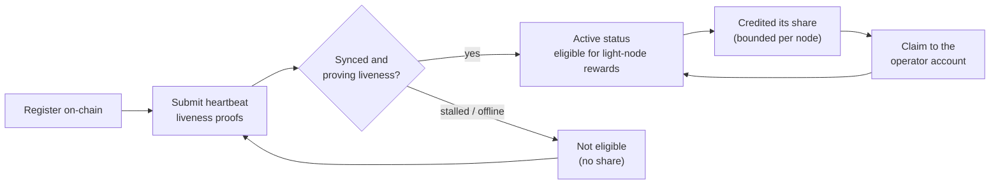

# Recompensas y monitoreo

A un nodo ligero registrado se le acredita una parte de la asignación para nodos ligeros y **necesita mantenerse en buen estado** para seguir siendo elegible. Esta página cubre la participación del 3 % de recompensa para nodos ligeros, cómo se acreditan y se reclaman las recompensas, qué hace y qué no hace el nodo con las delegaciones, y cómo monitorear el nodo.

:::note La inscripción en el programa de recompensas aún no está abierta
Todavía no hay ningún nodo ligero registrado en ninguna de las dos redes, porque el registro requiere una licencia `lightnode_operator` y no se ha concedido ninguna. La contabilidad de recompensas descrita aquí está activa en la cadena, pero hoy no se paga nada a los nodos y nada en esta página es una promesa de ganancias. Consulta [Estado del programa de recompensas](/light-node/overview#reward-program-status).
:::

## La participación del 3 % de la recompensa por bloque

La distribución de comisiones de QoreChain reserva una **participación fija del 3 % para los nodos ligeros** que sirven datos de la red. Este es uno de los cinco destinos en el reparto de recompensas del protocolo — validadores (37 %), quemado (30 %), tesorería (20 %), stakers (10 %) y **nodos ligeros (3 %)** — aplicado en la cadena. Consulta [Tokenómica](/architecture/tokenomics) para el desglose completo.

Para participar en esta porción, un nodo necesita lo siguiente, verificado en la cadena y no autodeclarado: una licencia `lightnode_operator` activa (se comprueba al registrarte), un mínimo de **1,000 QOR en bonding** — contados como tu total en todos los validadores a los que delegas, no por validador, exigidos al registrarte y releídos desde el staking cada vez que se acreditan recompensas — y una tarifa de registro de **1 QOR**, que se paga una sola vez al registrarte. La participación también tiene un límite a nivel de red de **10,000 nodos ligeros**. Consulta [Registro y licencias](/light-node/registration-and-licensing) para ver cómo funciona el registro y [Estado del programa de recompensas](/light-node/overview#reward-program-status) para saber si la inscripción está abierta.

El 3 % es lo que fluye al módulo de nodos ligeros, no un derecho por nodo: a cada nodo elegible se le acredita su parte ponderada por stake de lo acumulado, acotada por nodo mediante `max_reward_per_block_per_node` (actualmente `1713` uqor por bloque, escalado por el tiempo de actividad), y todo lo no ganado va a una reserva que solo una votación de gobernanza puede liberar. Consulta [la participación del 3 % de recompensa para nodos ligeros](/light-node/overview#the-3-light-node-reward-share).

Una vez registrado y delegado, mantener la elegibilidad es cuestión de seguir activo. Un nodo necesita al menos un **80 % de tiempo de actividad**, y debe seguir enviando pruebas de actividad por heartbeat en un intervalo de **1,000 bloques** (unos 54 minutos en mainnet con el tiempo medio de bloque medido de aproximadamente 3.2 s; unos 17 minutos en testnet, que produce bloques aproximadamente una vez por segundo).

**Las reglas de temporización.** La cadena rechaza un heartbeat enviado **menos de 1,000 bloques después del anterior** (`heartbeat submitted too early`); tu primer heartbeat tras registrarte no tiene ese límite inferior. Si no llega ningún heartbeat dentro de **1,000 + 100 bloques** (el `heartbeat_interval` más el `heartbeat_grace_period`; en mainnet unos 54 minutos más una gracia de aproximadamente 5 minutos) desde el último — o desde el registro, si no has enviado ninguno — el nodo se marca como inactivo y deja de acreditársele. Un heartbeat enviado más tarde se sigue aceptando y lo reactiva. El daemon envía el siguiente heartbeat en cuanto han pasado 1,000 bloques desde el `last_heartbeat` de tu nodo según la propia cadena, comprobándolo cada 60 segundos.

**Perder la ventana cuesta tiempo de actividad, no tu registro.** Un nodo que la pierde se marca como inactivo y deja de ganar, pero el siguiente heartbeat exitoso lo reactiva — no hay que volver a registrarse. Tu **tiempo de actividad** es la proporción acumulada de heartbeats recibidos respecto a los esperados (uno por cada 1,000 bloques) desde el bloque en que te registraste, con un tope de 1. Por debajo del umbral `min_uptime_for_rewards` (`0.80`) un nodo no gana nada; en o por encima de él, el techo por nodo se escala según tu tiempo de actividad. Por lo tanto, una interrupción larga reduce la proporción, y esta solo se recupera a medida que se acumulan heartbeats puntuales. Comprueba `status` si un nodo aparece como inactivo: informa del estado del firmante, la licencia y el registro.

:::note Lo que realmente demuestra un heartbeat
Un heartbeat exitoso demuestra que la clave del operador firmó a tiempo — no demuestra que un nodo esté ejecutando continuamente el software completo. Trátalo como una firma de actividad, no como "verificado como nodo activo".
:::

:::note `last_heartbeat` es una altura de bloque, no una marca de tiempo
Si consultas directamente el registro en la cadena de un nodo, `last_heartbeat` es una altura de bloque, y un valor de `0` significa que todavía no se ha registrado ningún heartbeat — la cadena entonces mide el plazo de inactividad desde la altura `registered_at` del nodo. Leer `0` como un cálculo ingenuo de tiempo transcurrido hace que un nodo recién registrado parezca tener un retraso de millones de bloques.
:::

*Elegibilidad para recompensas: mantén una licencia activa en la cadena y el stake mínimo en bonding, regístrate y luego sigue demostrando actividad mediante heartbeats para mantenerte por encima de los umbrales de tiempo de actividad e intervalo de heartbeat.*



## Cómo funcionan las recompensas {#how-rewards-work}

### Acreditación

Cada 100 bloques la cadena acredita a cada nodo elegible (activo, con al menos el stake mínimo en bonding y al menos el tiempo de actividad mínimo) su parte de lo acumulado, acotada por nodo como se describe en [la participación del 3 % de recompensa para nodos ligeros](/light-node/overview#the-3-light-node-reward-share). El importe se suma a `accumulated_rewards` del nodo. Léelo con:

```bash
curl -s https://api.qore.host/qorechain/lightnode/v1/rewards/<operator-address>
# or: qorechaind query lightnode rewards <operator-address>
```

(Usa `https://api-testnet.qore.host` para la testnet.)

### Reclamación

Las recompensas acreditadas permanecen en el registro del nodo hasta que las reclames. Reclámalas con el mismo par de generar y cofirmar usado para el registro:

```bash
qorechaind tx lightnode claim-rewards --from operator --chain-id <chain-id> --gas 300000 --fees 30000uqor --generate-only > claim.json
qorechaind tx pqc cosign claim.json --from operator --pqc-key <node-key-name> --chain-id <chain-id>
```

Como alternativa, establece `auto_claim = true` en `[delegation]`: el daemon entonces reclama las recompensas de nodo ligero acumuladas hacia la cuenta del operador a través del firmante en cuanto superan `min_reward_claim` (por defecto `1000000` uqor, 1 QOR), comprobándolo cada `compound_interval` (por defecto `1h`). La reclamación automática está **desactivada por defecto**, y solo reclama: el nodo nunca vuelve a delegar ni mueve stake. `qorechaind tx lightnode deregister` elimina el registro y paga todo lo que aún esté acreditado; la tarifa de registro no se reembolsa.

### Seguimiento de delegaciones y alertas de reputación

El nodo replica desde la cadena las delegaciones de la cuenta del operador cada cinco minutos. Cuando `rebalance_enabled` está activado (el valor por defecto), también comprueba la puntuación de reputación de cada validador al que delegas y registra una advertencia por cada uno que esté por debajo de `min_reputation` (por defecto `0.5`). No mueve stake: cambia las delegaciones desde tu propia billetera. (Las opciones `validators` y `split_weights` de `[delegation]` se aceptan pero actualmente no se aplican.)

### Inspeccionar recompensas y delegaciones

```bash
lightnode-sx validators   # the bonded validator set
```

:::caution Limitación conocida en v3.1.3 / v3.1.4
`lightnode-sx delegation`, `lightnode-sx rewards` y la vista **Delegation** de UX buscan la dirección derivada de la clave del nodo. Una clave de nodo poscuántica no tiene dirección, así que por ahora no muestran nada (`rewards` informa `chain REST endpoint not available`). Usa en su lugar las consultas de la cadena:

```bash
curl -s https://api.qore.host/cosmos/staking/v1beta1/delegations/<operator-address>
curl -s https://api.qore.host/cosmos/distribution/v1beta1/delegators/<operator-address>/rewards
curl -s https://api.qore.host/qorechain/lightnode/v1/rewards/<operator-address>
```
:::

## Monitoreo

Mantener el nodo en buen estado es lo que lo mantiene elegible para recompensas. Hay tres cosas que vale la pena vigilar.

### Telemetría

La telemetría en tiempo real cubre validadores, consenso/red, el puente y la tokenómica, cada una actualizada en su propio intervalo (configurado bajo `[telemetry]` en `config.toml`). Desde la CLI:

```bash
lightnode-sx status    # node and light-client sync status
lightnode-sx network   # recent synced headers and latest height
```

La edición UX muestra los mismos datos en vivo en sus vistas **Overview**, **Network**, **Bridge** y **Tokenomics** — consulta [Edición UX](/light-node/ux-edition).

### Estado de sincronización y heartbeat

El comando `status` informa el ID de cadena, la altura del último bloque, si la cadena está poniéndose al día, la altura sincronizada del cliente ligero y su estado de sincronización y — una vez establecido `operator_address` — el estado de `Signer`, `Licence` y `Registration` (incluido el estado del nodo y la altura del último heartbeat). Un nodo que está registrado, sincronizado y en funcionamiento continúa enviando **pruebas de actividad por heartbeat** y, por lo tanto, se mantiene elegible para recompensas. Estos heartbeats se producen mediante un **canal de transacción cofirmado con PQC** (híbrido Dilithium-5 / ML-DSA-87), coherente con el valor por defecto que exige PQC en la cadena — consulta [Registro y licencias](/light-node/registration-and-licensing#pqc-cosigned-heartbeat-pipeline) para ver cómo funciona el canal y cómo habilitar los heartbeats en la cadena. Si `status` muestra que el nodo está estancado o no está sincronizando, puede estar fallando en demostrar su actividad — investiga antes de que se vea afectada la elegibilidad.

### Estado del autotest

Si sospechas que hay un problema con el stack criptográfico, ejecuta el autotest PQC en cualquier momento:

```bash
lightnode-sx selftest
```

Ejecuta keygen → firma → verificación → detección de manipulación (cinco comprobaciones) y sale con un código distinto de cero ante cualquier fallo. Esta es la forma más rápida de descartar un problema en el stack de firma post-cuántica al diagnosticar problemas del nodo. Consulta [Edición SX](/light-node/sx-edition) para el desglose completo del autotest.

### Consultas a la cadena {#chain-queries}

URL base: `https://api.qore.host` (mainnet) y `https://api-testnet.qore.host` (testnet).

| Consulta | Devuelve |
| --- | --- |
| `GET /qorechain/lightnode/v1/params` | Tarifa de registro, intervalo de heartbeat y gracia, stake delegado mínimo, participación de recompensa, tiempo de actividad mínimo, límite de nodos. |
| `GET /qorechain/lightnode/v1/stats` | Recuentos de nodos registrados y activos, total de recompensas acreditadas. |
| `GET /qorechain/lightnode/v1/node/{address}` | El registro de un nodo (`status`, `last_heartbeat`, `total_heartbeats`, `expected_heartbeats`, `accumulated_rewards`). |
| `GET /qorechain/lightnode/v1/rewards/{address}` | Recompensas acreditadas y aún no reclamadas. |
| `GET /qorechain/lightnode/v1/reward_pool` | Cómo se divide el saldo del módulo entre reserva, recompensas acreditadas y el siguiente pago; incluye el límite por nodo. |
| `GET /qorechain/license/v1/check/{address}/lightnode_operator` | Si una dirección posee una licencia activa. |

## A dónde ir después

- [Registro y licencias](/light-node/registration-and-licensing) — regístrate y mantente activo.
- [Tokenómica](/architecture/tokenomics) — el modelo completo de recompensas y quemado.
