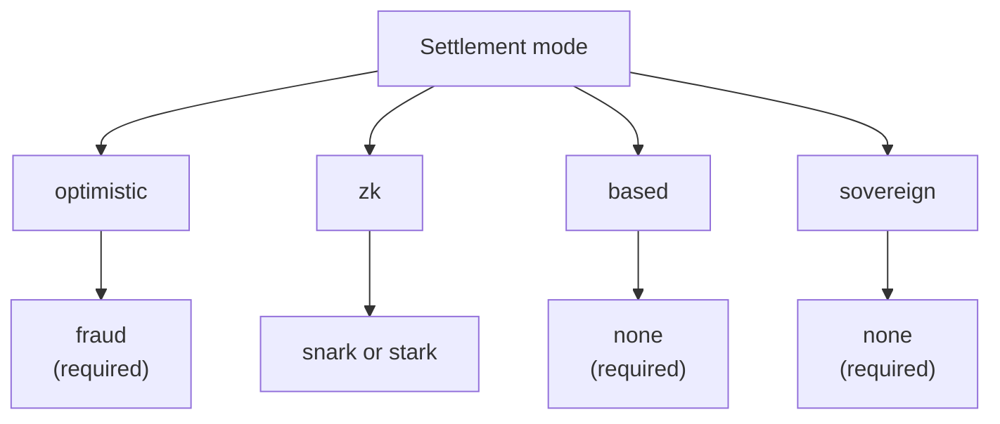

# Visión general de los Rollups

El **Rollup Development Kit (RDK)** de QoreChain es un conjunto de bibliotecas cliente (TypeScript, Python, Go, Rust y Java), una herramienta de línea de comandos para operadores y plantillas iniciales para construir rollups específicos de aplicación que se liquidan en QoreChain a través del módulo on-chain `x/rdk`. Con él puede configurar un rollup, construir y firmar sus transacciones, leer su estado, seguir sus ventanas de impugnación, emitir y verificar recibos de liquidación, y montar llamadas entre VMs y pruebas de retiro. Cada rollup es un entorno de ejecución independiente con su propio tiempo de bloque, máquina virtual, modelo de comisiones y secuenciación, al tiempo que hereda la seguridad, la criptografía poscuántica y la disponibilidad de datos de QoreChain. Esta página está dirigida a los desarrolladores que quieran lanzar u operar un rollup, y a quien deba decidir si el RDK encaja con su aplicación.

:::caution Capacidad en fase temprana
El RDK está desplegado en ambas redes, pero **todavía no se ha creado ningún rollup en ninguna de ellas** (comprobado el 27 de octubre de 2026), por lo que terceros no han puesto a prueba los flujos descritos en esta sección. **La liquidación ZK (el perfil `defi`, la plantilla `defi-rollup` y todo rollup `zk`) todavía no puede usarse en ninguna de las dos redes:** la cadena no tiene forma de registrar una clave de verificación, así que todo lote ZK se rechaza después de pagar su comisión. El registro de claves está previsto para la v3.2.7 de la cadena. Hasta entonces, use la liquidación `optimistic`.

La mainnet (**`qorechain-vladi`**, chain ID de EVM **9801**, en producción desde el 7 de junio de 2026) ejecuta la versión de la cadena **v3.2.4** (aplicada en la altura 3,742,566 el 23 de octubre de 2026, propuesta de gobernanza 13); la testnet (**`qorechain-diana`**, chain ID de EVM **9800**) ejecuta la **v3.2.6** (la v3.2.4 llegó el 19 de octubre de 2026, la v3.2.5 el 26 de octubre y la v3.2.6 el 27 de octubre). La propuesta de gobernanza 14 de la mainnet aplicaría la v3.2.5 en la altura 3,906,833 y estaba en su periodo de votación en el momento de redactar esto; lo que la v3.2.5 cambia para los rollups se documentará el día en que la mainnet la aplique. Donde el comportamiento cambió entre v3.2.3 y v3.2.4, esta sección indica qué versión se aplica. Valide cada despliegue primero en la testnet y lea las notas de estado de cada página: varias capacidades (verificación ZK, disponibilidad de datos con Celestia, el QCAI Copilot, las llamadas entre VMs, los recibos de liquidación) no son utilizables de extremo a extremo hoy.
:::

## Innovaciones {#innovations}

* **Recibos de liquidación poscuánticos.** El ancla de estado de un lote se firma con ML-DSA-87 con la clave registrada del creador del rollup. `verifySettlementReceipt` vuelve a leer de la cadena cada campo del recibo (rollup, capa, raíz del lote y el ancla: raíz de estado, altura de la capa, altura de la cadena principal, hora del ancla, hash del conjunto de validadores, número de transacciones, prueba, firma). La clave de verificación procede de la cadena y nunca del recibo; el recibo debe nombrar la red que usted consulta; una versión de recibo desconocida o un algoritmo distinto de ML-DSA-87 se rechaza antes de cualquier lectura; y una comprobación solo de firma nunca se notifica como válida. El mensaje del ancla tiene una primera forma por debajo de la altura de la v3.2.2 de la cadena y una segunda forma, que además vincula el chain id, a partir de ella; la versión se elige según la altura del ancla. Consulte [Recibos de liquidación](/rollups/settlement-receipts).
* **Firma híbrida con dos derivaciones de clave.** Las transacciones se firman con secp256k1 más ML-DSA-87. La clave poscuántica se deriva de la mnemónica tanto de forma canónica (SHAKE-256 sobre `qorechain:pqc:v1|`, la dirección y la mnemónica) como de forma heredada, y el cliente usa la clave que la cadena tenga registrada para la cuenta. Hoy solo el cliente de TypeScript firma en modo híbrido.
* **Raíz de transición canónica.** `batchTransitionRoot` calcula la raíz de estado exacta con la que la cadena juzga un lote optimista (la forma que la mainnet aplica hoy es un compromiso SHAKE-256 de la raíz de estado anterior, el hash de datos y el número de transacciones; `transitionRootVersionFor` selecciona la forma que aplica la red conectada), y `fraudProof` construye a partir de ella la prueba de 64 bytes. Ambas se probaron con vectores generados por el propio código de la cadena.
* **Ventanas de impugnación exactas a la cadena.** `batchChallengeWindow` calcula la ventana de un lote como lo hace la cadena (basada en el tiempo: abierta mientras el tiempo de bloque sea inferior al momento de envío más la ventana; para lotes más antiguos, la ventana dividida entre seis en bloques desde la altura de envío) y la juzga frente a la punta de la cadena leída del RPC `/status`, no frente al reloj local. El [Watchtower](/rollups/watchtower) y el monitor de salud la usan.
* **Comprobaciones antes de pagar ninguna comisión.** El kit rechaza un id de rollup fuera de `^[a-z0-9][a-z0-9._-]{2,63}$`; un retiro que no esté en `uqor`, tenga un monto cero, lleve una prueba de más de 64 niveles de 32 bytes o nombre una dirección bech32 inválida; y, cuando puede leer el rollup, un lote que nombre un hash de datos en un rollup de disponibilidad de datos `native` o `both`. Cada una de estas cosas, de otro modo, sería rechazada por la cadena una vez gastada la comisión.
* **Calldata entre VMs y una comprobación en vivo.** `encodeCrossVmCalldata` construye el calldata de `executeCrossVMCall(uint8,string,bytes)` (selector `0x3c11078c`, precompilado `0x...0901`), e `isCrossVmPrecompileActive` lee si el precompilado está activo en la red. Consulte [Multi-VM](/rollups/multi-vm).
* **Un único conjunto de vectores de prueba para cinco lenguajes.** Los paquetes de TypeScript, Python, Go, Rust y Java se comprueban contra el mismo fixture de referencia (el paquete de Go tiene 100 pruebas unitarias, el de Rust 77 y el de Java 75).

## Cómo usarlo {#how-to-use}

Las lecturas no necesitan clave ni fondos. Los fragmentos de abajo leen los parámetros en vivo del módulo `rdk` y la lista de rollups en la testnet pública (`qorechain-diana`) y se ejecutaron el 27 de octubre de 2026 desde los paquetes publicados (los fragmentos de biblioteca con la 0.6.1, la versión del código de biblioteca que la 0.6.2 también incluye; la CLI con la 0.6.2). Cada uno imprimió los parámetros de la testnet (máximo de rollups 200, stake mínimo 10,000 QOR, tasa de quema en la creación 0.01, ventana de impugnación por defecto 3,600 segundos, tamaño máximo de blob de DA 2,097,152 bytes, retención de blobs 432,000 bloques, máximo 10 lotes por bloque) y `0 rollups`.

### TypeScript (probado)

```bash
npm install @qorechain/rdk
```

```ts
import { createRdkClient } from "@qorechain/rdk";

// Public testnet (chain id qorechain-diana).
const rdk = createRdkClient({
  network: "testnet",
  endpoints: { rest: "https://api-testnet.qore.host" },
});

// Read the live rdk module parameters and the registered rollups.
const params = await rdk.params();
const rollups = await rdk.rest.listRollups();
console.log(rdk.network.chainId, params, `${rollups.length} rollups`);
```

Los presets `mainnet` y `testnet` ya incluyen los endpoints públicos de `qore.host`, por lo que `createRdkClient({ network: "testnet" })` funciona sin el campo `endpoints`; se muestra arriba porque el fragmento probado lo pasaba. Ejecute con Node 20 o posterior (la prueba usó Node 26).

### Python (probado)

```bash
pip install qorechain-rdk
```

```python
from qorrdk import create_rdk_client

# Public testnet (chain id qorechain-diana).
rdk = create_rdk_client(network="testnet", endpoints={"rest": "https://api-testnet.qore.host"})

# Read the live rdk module parameters and the registered rollups.
params = rdk.params()
rollups = rdk.rest.list_rollups()
print(rdk.network.chain_id, params, f"{len(rollups)} rollups")
```

Python 3.10 o posterior. `qorechain-rdk` depende de `qorechain-pqc`, que incorpora `liboqs-python` y necesita la biblioteca `liboqs`; en una máquina que no la tenga, la primera importación la compila (hacen falta git, CMake y un compilador de C). Probado en un entorno virtual nuevo con Python 3.12.

### Go (probado)

```bash
go get github.com/qorechain/qorechain-rdk/packages/go@v0.6.2
```

```go
package main

import (
	"context"
	"fmt"

	rdk "github.com/qorechain/qorechain-rdk/packages/go"
)

func main() {
	// Public testnet (chain id qorechain-diana).
	client := rdk.NewRdkClient(rdk.RdkClientOptions{
		Network:   "testnet",
		Endpoints: &rdk.Endpoints{Rest: "https://api-testnet.qore.host"},
	})
	ctx := context.Background()
	// Read the live rdk module parameters and the registered rollups.
	params, err := client.Params(ctx)
	if err != nil {
		panic(err)
	}
	rollups, _ := client.Rest.ListRollups(ctx)
	fmt.Printf("%s %+v %d rollups\n", client.Network.ChainID, params, len(rollups))
}
```

Probado con Go 1.26, con el módulo obtenido del proxy de Go.

### Rust (probado)

```bash
cargo add qorechain-rdk
```

```rust
use qorechain_rdk::client::{RdkClient, RdkClientOptions};

fn main() -> Result<(), Box<dyn std::error::Error>> {
    // Public testnet (chain id qorechain-diana).
    let rdk = RdkClient::new(RdkClientOptions {
        rest_url: Some("https://api-testnet.qore.host".into()),
        ..Default::default()
    });

    // Read the live rdk module parameters and the registered rollups.
    let params = rdk.params()?;
    let rollups = rdk.rest.list_rollups()?;
    println!("{} {:?} {} rollups", rdk.network.chain_id, params, rollups.len());
    Ok(())
}
```

La biblioteca es `qorechain_rdk`. Probado con Rust 1.95, compilado contra crates.io.

### Java (probado)

```kotlin
// build.gradle.kts - Maven Central serves 0.6.1 until 0.6.2 is live there
implementation("io.github.qorechain:qorechain-rdk:0.6.1")
```

```java
import io.github.qorechain.rdk.client.RdkClient;
import io.github.qorechain.rdk.client.Views.ParamsView;
import io.github.qorechain.rdk.config.Networks;

public class RdkQuickstart {
    public static void main(String[] args) {
        // Public testnet (chain id qorechain-diana).
        RdkClient.Options options = new RdkClient.Options();
        options.network = "testnet";
        options.endpoints = new Networks.Endpoints();
        options.endpoints.rest = "https://api-testnet.qore.host";
        RdkClient rdk = new RdkClient(options);

        // Read the live rdk module parameters and the registered rollups.
        ParamsView params = rdk.params();
        int rollups = rdk.rest.listRollups().size();
        System.out.println(rdk.network.chainId + " maxRollups=" + params.maxRollups
                + " minStakeForRollup=" + params.minStakeForRollup + " " + rollups + " rollups");
    }
}
```

JDK 17 o posterior; probado con JDK 21 y Gradle 9.6 resolviendo desde Maven Central. El archivo debe llamarse `RdkQuickstart.java`. La 0.6.2 no contiene ningún cambio de Java, por lo que el artefacto 0.6.1 es la misma biblioteca.

### Línea de comandos (probado)

```bash
npm install -g @qorechain/rdk-cli
qorollup --version
qorollup params --network testnet
```

`qorollup --version` imprime `0.6.2` y `qorollup params --network testnet` imprime los parámetros en vivo del módulo. **Esto funciona desde la 0.6.2.** Las versiones 0.6.1 y anteriores terminaban con código 0 y no imprimían nada al instalarse desde npm. La prueba instaló `@qorechain/rdk-cli@0.6.2` en un proyecto vacío y lo ejecutó mediante `node_modules/.bin/qorollup`; una instalación global y `npx` usan el mismo enlace bin. Se requiere Node 20 o posterior.

### Crear la estructura de un proyecto (probado)

```bash
npx create-qorechain-rollup my-rollup --template nft-rollup --network testnet --yes
cd my-rollup && npm run doctor
```

Las plantillas son `defi-rollup`, `gaming-rollup`, `nft-rollup`, `enterprise-rollup`, `custom-rollup` y `multivm-rollup`. El proyecto generado depende de `@qorechain/rdk` `^0.6.1`, que una instalación nueva resuelve a la 0.6.2. Al generar `nft-rollup` se obtuvo un proyecto con `@qorechain/rdk` 0.6.1 y su `npm run doctor` pasó contra la testnet (REST accesible, parámetros legibles, red `qorechain-diana`; avisa sobre la disponibilidad de datos con Celestia y sobre la falta de un firmante); al generar `defi-rollup` y ejecutar `npm run typecheck`, pasó. **No use `defi-rollup` para lanzar un rollup todavía** (consulte [Límites](#limits)). Para crear un rollup y enviar lotes, siga [Desplegar un Rollup](/rollups/deploying-a-rollup); las transacciones necesitan una clave poscuántica registrada y, en el RDK, el cliente de TypeScript con un `pqcKeypair`.

## Cómo acceder {#how-to-access}

**Redes y endpoints.** El RDK se comunica con los endpoints públicos de las dos redes; los presets `mainnet` y `testnet` ya los incluyen.

| Red | Chain id | Chain ID de EVM | Endpoint REST | Versión de la cadena |
| ------- | -------- | ------------ | ------------- | ------------- |
| Mainnet | `qorechain-vladi` | 9801 | `https://api.qore.host` | v3.2.4 |
| Testnet | `qorechain-diana` | 9800 | `https://api-testnet.qore.host` | v3.2.6 |

Ambas redes sirven las consultas del RDK (`/qorechain/rdk/v1/...`) mediante REST, gRPC y la CLI, por lo que lecturas como `rdk.params()` funcionan contra cualquiera de ellas. La testnet es una red de staging con sus propios parámetros: la ventana de impugnación por defecto es de 3,600 segundos en la testnet y de 604,800 en la mainnet, pueden existir como máximo 200 rollups en la testnet y 100 en la mainnet, y el módulo multicapa admite 64 capas sidechain en la testnet y 10 en la mainnet (comprobado el 27 de octubre de 2026). Lea `GET /qorechain/rdk/v1/params` en la red a la que se dirija.

**Requisitos previos para crear un rollup.**

| Requisito | Detalles |
| ----------- | ------- |
| **Cuenta con fondos** | Una cuenta con QOR suficiente para el stake, el stake de la capa y las comisiones. |
| **Stake en custodia (escrow)** | Crear un rollup deposita en custodia `min_stake_for_rollup`, **10,000 QOR** en ambas redes. **Se quema el 1 % del stake (100 QOR)** al crearlo; el resto permanece en custodia y se devuelve cuando el rollup se detiene. |
| **Stake de la capa** | La creación también registra la capa del rollup en el módulo multicapa (stake mínimo 1,000 QOR). Si la capa no puede registrarse, el rollup se crea de todos modos pero no tiene una capa real, de modo que sus lotes no pueden anclarse y no se pueden emitir recibos. |
| **Clave poscuántica registrada** | Una clave ML-DSA-87 registrada para la cuenta. Las transacciones de la vía nativa firmadas solo con la clave clásica se rechazan. |
| **Comisiones** | El mínimo de comisión es de 0.1 uqor por unidad de gas; fije el límite de gas y la comisión a la vez. |
| **Herramientas** | Node 20 o posterior para la CLI y el generador de proyectos; Python 3.10 o posterior (con `liboqs`, véase arriba) para el cliente de Python; JDK 17 o posterior para Java; el módulo de Go `github.com/qorechain/qorechain-rdk/packages/go`. |

Leer el estado no necesita nada de esto. También puede solicitar un rollup a través del Dashboard (un formulario de solicitud, no una transacción on-chain) o crearlo con la CLI de la cadena; consulte [Desplegar un Rollup](/rollups/deploying-a-rollup) para el flujo completo, los comandos de la CLI y la vía de firma con TypeScript.

### Lo que existe hoy {#what-exists-today}

| | Estado |
|---|---|
| Rollups registrados (mainnet y testnet) | Ninguno |
| Módulo `x/rdk` y sus parámetros | Desplegado en ambas redes; léalos con `qorechaind query rdk config` |
| Consultas del RDK | Disponibles en ambas redes mediante la CLI, gRPC y REST (`/qorechain/rdk/v1/...`), por lo que las lecturas basadas en REST, como `rdk.params()` de TypeScript, funcionan contra la mainnet |
| Anclas de liquidación escritas por el RDK | Ninguna. Desde la v3.2.2 un lote puede llevar un `anchor_signature` y entonces se ancla en `x/multilayer` en la misma transacción; sin él, el lote se liquida sin anclar. Todavía no existe ningún rollup, capa ni ancla. El RDK de TypeScript (0.6.0 a 0.6.2) envía el campo cuando su cliente firma en modo híbrido y es el creador del rollup (no probado en vivo); los clientes de Python, Go, Rust y Java no lo envían |
| Capas de rollup registradas en `x/multilayer` | Ninguna |
| Liquidación ZK | No puede usarse todavía en ninguna de las dos redes (no hay forma de registrar una clave de verificación; previsto para la v3.2.7 de la cadena) |
| Retiros | Se pagan desde un libro de custodia (escrow) por rollup desde la v3.2.3 (consulte [ZK / STARK y Retiros](/rollups/zk-stark-withdrawals)); no se ha hecho ninguno, porque no existe ningún rollup |

Para la referencia del módulo de bajo nivel (parámetros del módulo, detalles internos del ciclo de vida, integración de quema y anclaje multicapa) consulte la página **[Rollup Development Kit](/architecture/rollup-development-kit)** en la sección de Arquitectura. Esta sección de Rollups es la guía práctica orientada al desarrollador.

## Dónde se publica {#where-published}

Versiones comprobadas en los registros el 27 de octubre de 2026. Todos los paquetes son Apache-2.0.

| Registro | Paquete | Versión actual | Enlace |
| -------- | ------- | --------------- | ---- |
| npm | `@qorechain/rdk` (cliente de TypeScript) | 0.6.2 | [npmjs.com](https://www.npmjs.com/package/@qorechain/rdk) |
| npm | `@qorechain/rdk-cli` (`qorollup`) | 0.6.2 | [npmjs.com](https://www.npmjs.com/package/@qorechain/rdk-cli) |
| npm | `create-qorechain-rollup` (generador de proyectos) | 0.6.2 | [npmjs.com](https://www.npmjs.com/package/create-qorechain-rollup) |
| PyPI | `qorechain-rdk` (import `qorrdk`) | 0.6.2 | [pypi.org](https://pypi.org/project/qorechain-rdk/) |
| crates.io | `qorechain-rdk` (biblioteca `qorechain_rdk`) | 0.6.2 | [crates.io](https://crates.io/crates/qorechain-rdk) |
| Proxy de módulos de Go | `github.com/qorechain/qorechain-rdk/packages/go` | v0.6.2 | [pkg.go.dev](https://pkg.go.dev/github.com/qorechain/qorechain-rdk/packages/go) |
| Maven Central | `io.github.qorechain:qorechain-rdk` | **0.6.1** (la 0.6.2 todavía no está disponible allí) | [central.sonatype.com](https://central.sonatype.com/artifact/io.github.qorechain/qorechain-rdk) |

Maven Central sirve la 0.6.1 hasta que la 0.6.2 esté disponible allí; la 0.6.2 no contiene ningún cambio de Java. El código fuente es público en [github.com/qorechain/qorechain-rdk](https://github.com/qorechain/qorechain-rdk), las notas de la versión están en [v0.6.2](https://github.com/qorechain/qorechain-rdk/releases/tag/v0.6.2) y la documentación propia del kit está en [qorechain.github.io/qorechain-rdk](https://qorechain.github.io/qorechain-rdk/). El paquete de TypeScript depende de `@qorechain/sdk` `^0.9.0` y `@qorechain/evm` `^0.8.0` (por lo que una aplicación con el SDK 0.10.0 obtiene junto con el kit una segunda copia anidada del SDK 0.9.x), y el paquete de Python de `qorechain-pqc` 0.2.x. La lógica del módulo `x/rdk` de la cadena no forma parte del kit público.

## Límites y problemas conocidos {#limits}

* **La liquidación ZK no puede usarse todavía en ninguna de las dos redes.** Esto abarca el perfil `defi`, la plantilla `defi-rollup` y todo rollup creado con liquidación `zk`. La cadena no tiene forma de registrar una clave de verificación para un rollup, así que todo lote ZK se rechaza después de pagar su comisión. El registro de claves está previsto para la v3.2.7 de la cadena. Hasta entonces, use la liquidación `optimistic` (consulte [ZK / STARK y Retiros](/rollups/zk-stark-withdrawals)).
* **No se ha creado ningún rollup en ninguna de las dos redes.** Las rutas de creación, lotes, impugnación, recibos y retiros están cubiertas por pruebas unitarias y vectores compartidos, pero no se han ejercitado on-chain.
* **Solo el cliente de TypeScript firma transacciones híbridas.** Las rutas de transacción de Python, Go, Rust y Java y los comandos de transacción de `qorollup` (`create`, `pause`, `resume`, `stop`, `withdraw`) firman solo de forma clásica, y ambas redes lo rechazan. Sus lecturas funcionan. Para transacciones desde ellos, construya el mensaje y cofírmelo con la CLI de la cadena, o use el cliente de TypeScript con un `pqcKeypair`.
* **(a) La CLI `qorollup` no imprimía nada al instalarse desde npm en la 0.6.1 y anteriores.** Esto está **corregido en la 0.6.2**: tras `npm i -g @qorechain/rdk-cli`, `qorollup ...` funciona y `qorollup --version` imprime 0.6.2.
* **(b) Los ayudantes Merkle de retiro usan SHA-256 por defecto, mientras que la cadena usa SHAKE-256.** Una prueba construida con los valores por defecto no se verifica; sobrescriba el hash y la codificación de hojas (consulte [Codificación de hojas y nodos](/rollups/zk-stark-withdrawals#leaf-and-node-encoding)).
* **(c) `buildDaBlob` calcula el hash con SHA-256, mientras que el compromiso de blob de la cadena es SHAKE-256.** Hoy no tiene efecto práctico, porque ninguna transacción publica un blob; deje `dataHash` vacío con disponibilidad de datos `native` y `both` (consulte [Disponibilidad de datos](/rollups/data-availability)).
* **(d) El circuito de demostración de la plantilla `defi` no puede verificarse.** Es un multiplicador de `snarkjs`, y la cadena comprueba Groth16 sobre BLS12-381 con la raíz de estado anterior, la raíz de estado y el hash de datos como entradas públicas, que ese circuito no expone. Incluso cuando se publique el registro de claves, necesitará su propio circuito.
* **En la mainnet solo el creador del rollup puede resolver una impugnación.** La cadena comprueba por sí misma la prueba de fraude, pero el creador envía la resolución (consulte [Optimistic](#optimistic)).
* **No utilizable en las redes en vivo:** la disponibilidad de datos con Celestia (no implementada), el [QCAI Rollup Copilot](/rollups/qcai-copilot) (sus servicios de asesoramiento no están en los endpoints públicos), las llamadas entre VMs (el precompilado en `0x...0901` no está activo), los secuenciadores compartidos y based (la cadena solo admite al secuenciador configurado o, cuando no hay ninguno, al creador) y `suggest-profile` (devuelve `defi` como valor de respaldo fijo).
* **Notas de versión.** Maven Central sirve la 0.6.1 hasta que la 0.6.2 esté disponible allí. Use la 0.6.2 o posterior para los recibos, el Watchtower y el calldata entre VMs; la 0.5.0 y anteriores no deben usarse para ello. La lista completa de lo que cambió cada versión está en [RDK 0.6.2: cambios y límites](/rollups/deploying-a-rollup#rdk-050-limits).

---

## Referencia: de qué se compone un rollup {#reference}

### Lo que le ofrece el RDK

Un rollup creado a través del RDK agrupa cuatro aspectos configurables:

| Aspecto | Qué controla | Opciones |
| ------- | ------------ | -------- |
| **Modo de liquidación** | Cómo se verifican y finalizan en QoreChain las transiciones de estado del rollup | `optimistic`, `zk`, `based`, `sovereign` |
| **Sistema de prueba** | El mecanismo criptográfico o económico que respalda la liquidación | `fraud`, `snark`, `stark`, `none` |
| **Modo de secuenciador** | Quién ordena las transacciones antes de que se liquiden | `dedicated`, `shared`, `based` |
| **Disponibilidad de datos** | Dónde se publican los datos de las transacciones para que cualquiera pueda reconstruir el estado | `native`, `celestia`, `both` |

Cada rollup se registra con un `rollup-id` único, respaldado por un bono de stake en QOR, y se le asigna un estado de ciclo de vida (`pending`, `active`, `paused`, `stopped`). Consulte **[Desplegar un Rollup](/rollups/deploying-a-rollup)** para el flujo completo de creación y ciclo de vida.

### Capacidades específicas de QoreChain y su estado

Más allá de lo básico de cualquier kit de rollups, el RDK incluye tres capacidades construidas en torno a la Capa 1 de QoreChain, además de un auto-desafiador de tipo watchtower. Su estado difiere; la tabla indica qué funciona hoy.

| Capacidad | Qué hace |
| ---------- | ------------ |
| **[Recibos de liquidación](/rollups/settlement-receipts)** | Empaquetan un ancla de liquidación como un recibo portátil que lleva una firma poscuántica (ML-DSA-87 / Dilithium-5). Fase temprana: todavía no existen anclas, así que nada se ha verificado contra un ancla real; un recibo es una afirmación que debe contrastarse con el estado de la cadena, cosa que hace el verificador de la 0.6.2, campo por campo. |
| **[QCAI Rollup Copilot](/rollups/qcai-copilot)** | Un asistente de asesoramiento de solo lectura para un rollup (estimación de comisiones, recomendaciones, investigaciones de fraude). Los servicios de asesoramiento que lee todavía no están expuestos en los endpoints públicos. |
| **[Llamadas entre VMs (Multi-VM)](/rollups/multi-vm)** | Herramientas para codificar una llamada de EVM a QoreChain Native a través del precompilado cross-VM (`0x...0901`). El precompilado no está activado en las redes en vivo, por lo que una llamada no hace nada; el codificador desde la 0.6.0 coincide con el formato que decodifica la cadena. |
| **[Watchtower](/rollups/watchtower)** | Un framework de auto-desafío para rollups optimistas que muestra los nuevos lotes y los plazos de la ventana de impugnación, y desafía los lotes inválidos según su predicado de validez. Lee mediante REST, que ambas redes sirven; desde la 0.6.0 juzga la ventana de cada lote como lo hace la cadena (la 0.6.2 lo mantiene). |

Consulte **[Por qué el RDK de QoreChain](/rollups/why)** para la justificación completa y ejemplos de código.

### Los cuatro paradigmas de liquidación {#settlement-paradigms}

El RDK de QoreChain admite cuatro modos de liquidación, cada uno con diferentes supuestos de confianza, características de finalidad y requisitos de prueba. La combinación de modo de liquidación y sistema de prueba se valida on-chain, y un emparejamiento incompatible se rechaza en el momento de la creación. El diagrama asocia cada modo de liquidación con su sistema de prueba válido.



#### Optimistic {#optimistic}

Los rollups optimistas asumen que los lotes enviados son válidos por defecto y se apoyan en **pruebas de fraude** para la resolución de disputas.

* **Sistema de prueba**: `fraud` (pruebas de fraude interactivas).
* **Secuenciador**: `dedicated` o `shared`.
* **Finalidad**: Diferida hasta que expire una ventana de impugnación configurable sin ninguna impugnación exitosa.
* **Disputas**: Cualquiera puede impugnar un lote enviado dentro de la ventana publicando un bono y una prueba de fraude. Una impugnación congela el lote; en la mainnet el creador del rollup la resuelve después, y la cadena comprueba la prueba por sí misma: un fraude confirmado rechaza el lote y paga al impugnador, mientras que una impugnación desestimada devuelve el lote a `submitted`. Consulte [Desplegar un Rollup](/rollups/deploying-a-rollup#challenge-a-batch-optimistic-rollups).
* **Duración de la ventana**: la ventana por defecto es de 604,800 «segundos» en la mainnet (el `default_challenge_window` del módulo; el valor por defecto de la testnet es de 3,600 segundos, leído el 27 de octubre de 2026, y un rollup puede fijar el suyo). **Antes de la v3.2.4 (en la mainnet, antes de la altura 3,742,566)** la cadena lo convierte en bloques a razón fija de 6 segundos por bloque, que son **100,800 bloques**, de modo que el tiempo real transcurrido sigue el tiempo de bloque efectivo (unos 3.7 días con los bloques actuales de ≈3.1 s de la mainnet); planifique en bloques, no en días. **Desde la v3.2.4**, un lote enviado a partir de la altura de la actualización obtiene una ventana medida en segundos de tiempo de bloque (7 días completos); los lotes anteriores conservan la regla del recuento de bloques. La altura de la actualización es 8,337,253 en la testnet (desde el 19 de octubre de 2026) y 3,742,566 en la mainnet (23 de octubre de 2026).

#### ZK (conocimiento cero) {#zk}

Los rollups ZK adjuntan una prueba criptográfica de validez a cada lote, demostrando la corrección de la transición de estado sin re-ejecución.

* **Sistema de prueba**: `snark` (pruebas sucintas) o `stark` (pruebas transparentes, sin configuración de confianza).
* **Secuenciador**: `dedicated` o `shared`.
* **Finalidad**: Al verificarse una prueba válida, sin ventana de impugnación.
* **Madurez**: **La liquidación ZK no puede usarse todavía en ninguna de las dos redes.** Los lotes SNARK están pensados para verificarse on-chain (Groth16 sobre BLS12-381) frente a una clave de verificación almacenada junto con el rollup, y la cadena todavía no tiene forma de registrar una, así que todo lote ZK se rechaza después de pagar su comisión. El registro de claves está previsto para la v3.2.7 de la cadena. La verificación STARK es experimental: es opcional y comprueba un circuito de demostración, no la transición de estado de su propio rollup. Consulte **[ZK / STARK y Retiros](/rollups/zk-stark-withdrawals)**.

#### Based {#based}

Los rollups based delegan la secuenciación de transacciones a los proposers de QoreChain (L1), heredando la vivacidad y la resistencia a la censura de la cadena anfitriona.

* **Sistema de prueba**: `none` (los proposers de L1 son la fuente de verdad del ordenamiento).
* **Secuenciador**: `based` (obligatorio, aplicado mediante validación on-chain).
* **Finalidad**: Sigue la confirmación de la cadena anfitriona.
* **Contrapartida**: El modelo operativo más simple, ya que los validadores de QoreChain gestionan la secuenciación, a costa del control de latencia de un secuenciador dedicado.
* **Estado hoy**: `based` se registra en la configuración del rollup, pero QoreChain todavía no admite a los proposers de L1 como remitentes de lotes; el creador del rollup es quien envía (consulte [Modos de secuenciador](#sequencer-modes)).

#### Sovereign {#sovereign}

Los rollups soberanos ejecutan su propio consenso y se autosecuencian. Anclan su estado a QoreChain para la verificabilidad, pero no dependen de la cadena anfitriona para la finalidad.

* **Sistema de prueba**: `none`.
* **Secuenciador**: autogestionado por el rollup.
* **Finalidad**: Independiente, determinada por el propio consenso del rollup.
* **Anclaje de estado**: Las raíces de estado se publican en QoreChain por transparencia, pero la cadena anfitriona no las hace cumplir.

### Compatibilidad de sistemas de prueba

El modo de liquidación restringe qué sistemas de prueba son válidos. Estos emparejamientos se aplican cuando se crea un rollup.

| Modo de liquidación | `fraud` | `snark` | `stark` | `none` |
| --------------- | :-----: | :-----: | :-----: | :----: |
| **optimistic**  | Obligatorio | - | - | - |
| **zk**          | - | Admitido | Admitido | - |
| **based**       | - | - | - | Obligatorio |
| **sovereign**   | - | - | - | Obligatorio |

### Modos de secuenciador {#sequencer-modes}

El secuenciador determina quién ordena las transacciones dentro de un bloque del rollup antes de la liquidación.

| Modo | Quién secuencia | Notas |
| ---- | ------------- | ----- |
| **`dedicated`** | Una única dirección de operador designada | Latencia mínima; requiere confianza en el operador para la vivacidad y el ordenamiento justo |
| **`shared`** | Un conjunto de secuenciadores compartido | Ordenamiento distribuido entre el conjunto; sobrecarga de coordinación ligeramente mayor |
| **`based`** | Los proposers L1 de QoreChain | Hereda la seguridad de los validadores y la resistencia a la censura de la cadena anfitriona; obligatorio para la liquidación `based` |

:::note Qué se aplica hoy
On-chain, un lote solo puede ser enviado por la dirección de secuenciador configurada del rollup o, cuando no hay ninguna (en todos los presets), por su creador. Los modos `shared` y `based` se registran en la configuración del rollup, pero QoreChain todavía no admite una lista de secuenciadores compartida ni a los proposers de L1 como remitentes de lotes; esos modos describen el diseño previsto.
:::

### Elegir un paradigma

| Si desea... | Considere |
| -------------- | -------- |
| La configuración operativa más simple, con los validadores de QoreChain secuenciando | **based** |
| Finalidad rápida con garantías criptográficas (todavía no utilizable) | **zk** (`snark` / `stark`) |
| Un modelo bien entendido con resolución económica de disputas | **optimistic** (`fraud`) |
| Independencia total con su propio consenso, anclado para la verificabilidad | **sovereign** |

¿No sabe por dónde empezar? El RDK incluye **perfiles preconfigurados** que agrupan estas elecciones para categorías de aplicación comunes; consulte **[Perfiles preconfigurados](/rollups/preset-profiles)**. Existe un ayudante `suggest-profile`, pero actualmente devuelve un valor de respaldo fijo `defi` (y `defi` todavía no puede usarse), así que elija a partir de la tabla de perfiles.

## Relacionado

* [Desplegar un Rollup](/rollups/deploying-a-rollup): lance un rollup desde la CLI o el RDK de TypeScript.
* [Perfiles preconfigurados](/rollups/preset-profiles): paquetes para categorías de aplicación comunes.
* [Disponibilidad de datos](/rollups/data-availability): el enrutador de DA nativo y el almacenamiento de blobs.
* [Retiros ZK / STARK](/rollups/zk-stark-withdrawals): flujos de retiro respaldados por pruebas.
* [Recibos de liquidación](/rollups/settlement-receipts), [Watchtower](/rollups/watchtower), [Multi-VM](/rollups/multi-vm) y [Por qué el RDK de QoreChain](/rollups/why).
