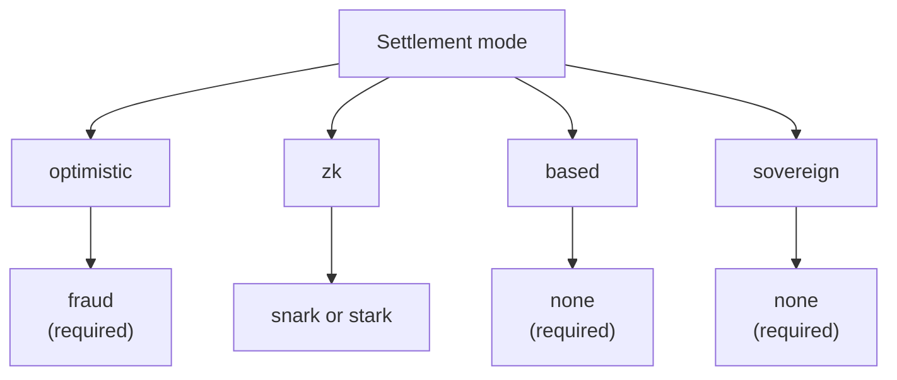

# Visión general de los Rollups

El **Rollup Development Kit (RDK)** de QoreChain — el módulo `x/rdk` — permite a los desarrolladores lanzar rollups específicos de aplicación que liquidan en QoreChain. Cada rollup es un entorno de ejecución independiente con su propio tiempo de bloque, máquina virtual, modelo de comisiones y secuenciación, al tiempo que hereda las garantías de seguridad, criptografía poscuántica y disponibilidad de datos de QoreChain.

:::caution Capacidad en fase temprana
El RDK está desplegado en ambas redes, pero **todavía no se ha creado ningún rollup en ninguna de ellas**, por lo que terceros no han puesto a prueba los flujos descritos en esta sección. La mainnet (**`qorechain-vladi`**, chain ID de EVM **9801**) ejecuta la versión de la cadena **v3.2.1**; la testnet (**`qorechain-diana`**, chain ID de EVM **9800**) ejecuta una versión más reciente (**v3.2.2**), por lo que allí los detalles pueden diferir. Esta sección describe el comportamiento de la mainnet. Valide cada despliegue primero en la testnet y lea las notas de estado de cada página: varias capacidades (verificación ZK, disponibilidad de datos con Celestia, el QCAI Copilot, las llamadas entre VMs, los recibos de liquidación) no son utilizables de extremo a extremo hoy.
:::

## Lo que existe hoy {#what-exists-today}

| | Estado |
|---|---|
| Rollups registrados (mainnet y testnet) | Ninguno |
| Módulo `x/rdk` y sus parámetros | Desplegado en ambas redes; léalos con `qorechaind query rdk config` |
| Consultas del RDK | Disponibles mediante la CLI y gRPC. Las rutas REST `/qorechain/rdk/v1/…` no se sirven en la mainnet, por lo que las lecturas basadas en REST (incluido `rdk.params()` de TypeScript) no funcionan contra la mainnet |
| Anclas de liquidación escritas por el RDK | Ninguna. Los lotes de liquidación se registran, pero el RDK todavía no escribe anclas en `x/multilayer` en la mainnet |
| Capas de rollup registradas en `x/multilayer` | Ninguna |

Para la referencia del módulo de bajo nivel — parámetros del módulo, detalles internos del ciclo de vida, integración de quema y anclaje multicapa — consulte la página **[Rollup Development Kit](/architecture/rollup-development-kit)** en la sección de Arquitectura. Esta sección de Rollups es la guía práctica orientada al desarrollador: qué es el RDK, qué paradigma elegir, cómo desplegar, cómo funciona la disponibilidad de datos y cómo se liquidan los retiros de L2 de vuelta a L1.

---

## Lo que le ofrece el RDK

Un rollup creado a través del RDK agrupa cuatro aspectos configurables:

| Aspecto | Qué controla | Opciones |
| ------- | ------------ | -------- |
| **Modo de liquidación** | Cómo se verifican y finalizan en QoreChain las transiciones de estado del rollup | `optimistic`, `zk`, `based`, `sovereign` |
| **Sistema de prueba** | El mecanismo criptográfico o económico que respalda la liquidación | `fraud`, `snark`, `stark`, `none` |
| **Modo de secuenciador** | Quién ordena las transacciones antes de que se liquiden | `dedicated`, `shared`, `based` |
| **Disponibilidad de datos** | Dónde se publican los datos de las transacciones para que cualquiera pueda reconstruir el estado | `native`, `celestia`, `both` |

Cada rollup se registra con un `rollup-id` único, respaldado por un bono de stake en QOR, y se le asigna un estado de ciclo de vida (`pending`, `active`, `paused`, `stopped`). Consulte **[Desplegar un Rollup](/rollups/deploying-a-rollup)** para el flujo completo de creación y ciclo de vida.

---

## Qué diferencia al RDK de QoreChain

Más allá de lo básico de cualquier kit de rollups, el RDK de QoreChain incluye tres capacidades específicas de QoreChain construidas en torno a la Capa 1 de QoreChain — además de un auto-desafiador de tipo watchtower. Su estado difiere; la tabla indica qué funciona hoy. El RDK se distribuye en cinco lenguajes (TypeScript, Python, Go, Rust, Java). Versiones publicadas actuales: npm **0.4.4**, PyPI **0.5.0**, Go **v0.5.0**, crates.io **0.4.4**, Maven Central **0.4.4**. Desde la v0.4.2 los presets `mainnet` y `testnet` incluyen de serie los endpoints públicos de `qore.host`, de modo que `createRdkClient({ network })` no necesita configuración manual de endpoints (tenga en cuenta que sus lecturas REST solo funcionan donde se sirven las rutas REST del RDK; la mainnet no las sirve hoy).

| Diferenciador | Qué hace |
| ------------- | -------- |
| **[Recibos de liquidación resistentes a computación cuántica](/rollups/settlement-receipts)** | Empaquetan un ancla de liquidación como un recibo portátil que lleva una firma poscuántica (ML-DSA-87 / Dilithium-5). Fase temprana: todavía no existen anclas, y un recibo es una afirmación que debe contrastarse con el estado de la cadena. |
| **[QCAI Rollup Copilot](/rollups/qcai-copilot)** | Un asistente de asesoramiento de solo lectura para un rollup (estimación de comisiones, recomendaciones, investigaciones de fraude). Los servicios de asesoramiento que lee todavía no están expuestos en los endpoints públicos. |
| **[Llamadas multi-VM entre VMs](/rollups/multi-vm)** | Herramientas para codificar una llamada EVM → CosmWasm a través del precompilado cross-VM (`0x…0901`). El precompilado todavía no está activado en las redes en vivo. |
| **[Watchtower](/rollups/watchtower)** | Un framework de auto-desafío para rollups optimistas que muestra los nuevos lotes y los plazos de la ventana de impugnación, y desafía los lotes inválidos según su predicado de validez. Necesita las rutas REST del RDK, que la mainnet no sirve hoy. |

Consulte **[Por qué el RDK de QoreChain](/rollups/why)** para la justificación completa y ejemplos de código.

---

## Los cuatro paradigmas de liquidación

El RDK de QoreChain admite cuatro modos de liquidación distintos, cada uno con diferentes supuestos de confianza, características de finalidad y requisitos de prueba. La combinación de modo de liquidación y sistema de prueba se valida on-chain — un emparejamiento incompatible se rechaza en el momento de la creación. El diagrama siguiente asocia cada modo de liquidación con su sistema de prueba válido.

### Optimistic

Los rollups optimistas asumen que los lotes enviados son válidos por defecto y se apoyan en **pruebas de fraude** para la resolución de disputas.

* **Sistema de prueba**: `fraud` — pruebas de fraude interactivas
* **Secuenciador**: `dedicated` o `shared`
* **Finalidad**: Diferida hasta que expire una ventana de impugnación configurable sin ninguna impugnación exitosa
* **Disputas**: Cualquiera puede impugnar un lote enviado dentro de la ventana publicando un bono y una prueba de fraude. Una impugnación congela el lote; el creador del rollup la resuelve después, y la cadena comprueba la prueba por sí misma: un fraude confirmado rechaza el lote y paga al impugnador, mientras que una impugnación desestimada devuelve el lote a `submitted`. Consulte [Desplegar un Rollup](/rollups/deploying-a-rollup#challenge-a-batch-optimistic-rollups).
* **Duración de la ventana**: la ventana por defecto es de 604.800 «segundos», que la cadena convierte en bloques a razón fija de 6 segundos por bloque — **100.800 bloques**. El tiempo real transcurrido sigue el tiempo de bloque efectivo (unos 3,7 días con los bloques actuales de ≈3,2 s de la mainnet), así que planifique en bloques, no en días.

### ZK (Conocimiento cero)

Los rollups ZK adjuntan una prueba criptográfica de validez a cada lote, demostrando la corrección de la transición de estado sin re-ejecución.

* **Sistema de prueba**: `snark` (pruebas sucintas) o `stark` (pruebas transparentes, sin configuración de confianza)
* **Secuenciador**: `dedicated` o `shared`
* **Finalidad**: Al verificarse una prueba válida — no se requiere ventana de impugnación
* **Madurez**: Los lotes SNARK se verifican on-chain (Groth16 sobre BLS12-381) frente a una clave de verificación almacenada junto con el rollup. Un rollup creado mediante `create-rollup` no incluye actualmente una clave de verificación, por lo que los lotes ZK todavía no pueden finalizarse de extremo a extremo. La verificación STARK es experimental: es opcional y comprueba un circuito de demostración, no la transición de estado de su propio rollup. Trate la liquidación ZK como no apta para producción. Consulte **[ZK / STARK y Retiros](/rollups/zk-stark-withdrawals)**.

### Based

Los rollups based delegan la secuenciación de transacciones a los proposers de QoreChain (L1), heredando la vivacidad y la resistencia a la censura de la cadena anfitriona.

* **Sistema de prueba**: `none` — los proposers de L1 son la fuente de verdad del ordenamiento
* **Secuenciador**: `based` (obligatorio — aplicado mediante validación on-chain)
* **Finalidad**: Sigue la confirmación de la cadena anfitriona
* **Contrapartida**: El modelo operativo más simple, ya que los validadores de QoreChain gestionan la secuenciación, a costa del control de latencia de un secuenciador dedicado
* **Estado hoy**: `based` se registra en la configuración del rollup, pero QoreChain todavía no admite a los proposers de L1 como remitentes de lotes — el creador del rollup es quien envía (consulte [Modos de secuenciador](#sequencer-modes))

### Sovereign

Los rollups soberanos ejecutan su propio consenso y se autosecuencian. Anclan su estado a QoreChain para la verificabilidad, pero no dependen de la cadena anfitriona para la finalidad.

* **Sistema de prueba**: `none`
* **Secuenciador**: autogestionado por el rollup
* **Finalidad**: Independiente — determinada por el propio consenso del rollup
* **Anclaje de estado**: Las raíces de estado se publican en QoreChain por transparencia, pero la cadena anfitriona no las hace cumplir

---

## Compatibilidad de sistemas de prueba

El modo de liquidación restringe qué sistemas de prueba son válidos. Estos emparejamientos se aplican cuando se crea un rollup.

| Modo de liquidación | `fraud` | `snark` | `stark` | `none` |
| --------------- | :-----: | :-----: | :-----: | :----: |
| **optimistic**  | Obligatorio | — | — | — |
| **zk**          | — | Admitido | Admitido | — |
| **based**       | — | — | — | Obligatorio |
| **sovereign**   | — | — | — | Obligatorio |

---

## Modos de secuenciador {#sequencer-modes}

El secuenciador determina quién ordena las transacciones dentro de un bloque del rollup antes de la liquidación.

| Modo | Quién secuencia | Notas |
| ---- | ------------- | ----- |
| **`dedicated`** | Una única dirección de operador designada | Latencia mínima; requiere confianza en el operador para la vivacidad y el ordenamiento justo |
| **`shared`** | Un conjunto de secuenciadores compartido | Ordenamiento distribuido entre el conjunto; sobrecarga de coordinación ligeramente mayor |
| **`based`** | Los proposers L1 de QoreChain | Hereda la seguridad de los validadores y la resistencia a la censura de la cadena anfitriona; obligatorio para la liquidación `based` |

:::note Qué se aplica hoy
On-chain, un lote solo puede ser enviado por la dirección de secuenciador configurada del rollup o, cuando no hay ninguna (en todos los presets), por su creador. Los modos `shared` y `based` se registran en la configuración del rollup, pero QoreChain todavía no admite una lista de secuenciadores compartida ni a los proposers de L1 como remitentes de lotes; esos modos describen el diseño previsto.
:::

---

## Elegir un paradigma

| Si desea... | Considere |
| -------------- | -------- |
| La configuración operativa más simple, con los validadores de QoreChain secuenciando | **based** |
| Finalidad rápida con garantías criptográficas (todavía no apta para producción) | **zk** (`snark` / `stark`) |
| Un modelo bien entendido con resolución económica de disputas | **optimistic** (`fraud`) |
| Independencia total con su propio consenso, anclado para la verificabilidad | **sovereign** |

¿No sabe por dónde empezar? El RDK incluye **perfiles preconfigurados** que agrupan estas elecciones para categorías de aplicación comunes — consulte **[Perfiles preconfigurados](/rollups/preset-profiles)** — y, cuando el RPC de asesoramiento esté disponible, un ayudante `suggest-profile` (actualmente devuelve un valor de respaldo fijo `defi`, así que elija a partir de la tabla de perfiles).

Para los desarrolladores, el RDK también se distribuye como el SDK público de TypeScript **`@qorechain/rdk`** junto con el scaffolder **`create-qorechain-rollup`**, que operan el mismo módulo on-chain desde código — consulte **[Desplegar un Rollup](/rollups/deploying-a-rollup#deploy-with-the-typescript-rdk-qorechainrdk)**.

## Relacionado

* [Desplegar un Rollup](/rollups/deploying-a-rollup) — lance un rollup desde la CLI o el RDK de TypeScript.
* [Perfiles preconfigurados](/rollups/preset-profiles) — paquetes de un clic para categorías de aplicación comunes.
* [Disponibilidad de datos](/rollups/data-availability) — el enrutador de DA nativo y el almacenamiento de blobs.
* [Retiros ZK / STARK](/rollups/zk-stark-withdrawals) — flujos de retiro respaldados por pruebas.
