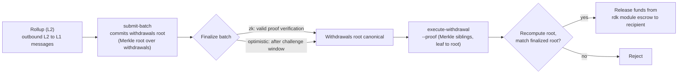

# ZK / STARK y Retiros

Esta página cubre dos temas relacionados: los **sistemas de pruebas ZK** (`snark` y `stark`) utilizados por los rollups liquidados con ZK, y el **flujo de retiro L2 → L1** que mueve fondos desde un rollup de vuelta a QoreChain una vez que un lote se finaliza.

:::caution Capacidad en etapa temprana
Todavía no se ha creado ningún rollup en ninguna de las dos redes, por lo que ni la verificación de pruebas ni el flujo de retiro descritos aquí se han ejercitado en un rollup en vivo. La verificación SNARK existe, pero un rollup creado mediante `create-rollup` todavía no puede finalizar un lote ZK, y la verificación STARK es experimental. Valida en la testnet **`qorechain-diana`** y no asumas garantías reforzadas para producción en mainnet.
:::

---

## Sistemas de pruebas ZK

Un rollup liquidado con ZK (modo de liquidación `zk`) adjunta una prueba de validez a cada lote de liquidación, demostrando que la transición de estado es correcta sin volver a ejecutar las transacciones del rollup. La liquidación ZK admite dos sistemas de pruebas:

| Sistema de pruebas | Características |
| ------------ | --------------- |
| **`snark`** | Pruebas sucintas (Groth16 sobre BLS12-381), verificadas on-chain contra la verifying key del rollup |
| **`stark`** | Pruebas transparentes, sin configuración de confianza (trusted setup) — experimental; opt-in y ligado a un circuito de demostración |

El modo de liquidación `zk` requiere `snark` o `stark`; el emparejamiento se aplica on-chain cuando se crea el rollup. En cambio, la liquidación `optimistic` usa el sistema de pruebas `fraud`, y las liquidaciones `based` y `sovereign` usan `none`. Consulta **[Visión general de Rollups](/rollups/overview)** para ver la matriz de compatibilidad completa.

### Finalidad

A diferencia de los rollups optimistas —que esperan a que transcurra una ventana de impugnación de prueba de fraude— un lote ZK puede finalizarse con la **verificación de una prueba válida**, sin una ventana de disputa. Esta es la compensación central de la liquidación ZK: una finalidad más fuerte y rápida a cambio del coste y la complejidad de generar pruebas.

### Madurez

Los lotes SNARK se verifican on-chain (Groth16 sobre BLS12-381) contra una verifying key almacenada con el rollup. Un rollup creado mediante `create-rollup` actualmente no incluye una verifying key, por lo que los lotes ZK todavía no pueden finalizarse de extremo a extremo. La verificación STARK es experimental: es opt-in y comprueba un circuito de demostración, no la transición de estado propia de tu rollup. Trata la liquidación ZK como no lista para producción, y sigue las notas de versión del RDK antes de confiar en ella para rollups de mainnet que manejen valor.

---

## Cómo los lotes transportan los retiros

Cuando un rollup liquida un lote, ese lote también puede comprometer los mensajes salientes entre capas del rollup: sus **retiros L2 → L1**. Conceptualmente:

* Un lote finalizado puede transportar un compromiso de su conjunto de retiros (una raíz de Merkle sobre los mensajes de retiro del lote).
* Cada retiro individual es una hoja bajo esa raíz, identificada por su índice de lote y un índice de retiro.
* Una vez que el lote se finaliza, cualquier parte puede demostrar que una hoja de retiro específica está incluida bajo la raíz comprometida y activar el pago.

Por eso los retiros dependen de la liquidación: un retiro solo puede ejecutarse contra un lote **finalizado**, porque es la finalización lo que hace canónica la raíz de retiros comprometida.

Para saber cómo se envían y finalizan los lotes —incluyendo `submit-batch` y la ruta de disputa `challenge-batch` para rollups optimistas— consulta **[Desplegar un Rollup](/rollups/deploying-a-rollup)**.

---

## Ejecutar un retiro: `execute-withdrawal`

El comando `execute-withdrawal` finaliza un retiro L2 → L1 contra la raíz de retiros de un lote finalizado. Demuestra que una hoja de retiro está comprometida en esa raíz y paga al destinatario desde el escrow del módulo rdk. La acción es **sin permisos**: cualquiera puede enviar una prueba válida. Como toda transacción de la lane nativa, necesita la cofirma híbrida post-cuántica, así que constrúyela con `--generate-only` y cofírmala (consulta [Desplegar un Rollup](/rollups/deploying-a-rollup)). Los retiros todavía no se han ejercitado en un rollup en vivo; trata el flujo como no probado.

```bash
qorechaind tx rdk execute-withdrawal \
  [rollup-id] [batch-index] [withdrawal-index] [recipient] [denom] [amount] \
  --proof <sibling-hash-1>,<sibling-hash-2>,... \
  --from mykey \
  --chain-id qorechain-diana \
  --gas 400000 --fees 40000uqor \
  --generate-only > withdrawal.json
qorechaind tx pqc cosign withdrawal.json --from mykey --pqc-key mypqckey --chain-id qorechain-diana
```

**Argumentos posicionales:**

| Argumento | Descripción |
| -------- | ----------- |
| `rollup-id` | El rollup al que pertenece el retiro |
| `batch-index` | El lote finalizado cuya raíz de retiros compromete este retiro |
| `withdrawal-index` | El índice de la hoja de retiro dentro de ese lote |
| `recipient` | La dirección a la que pagar |
| `denom` | La denominación a pagar |
| `amount` | La cantidad a pagar |

**Flag:**

| Flag | Descripción |
| ---- | ----------- |
| `--proof` | Hashes hermanos de Merkle en hexadecimal separados por comas, ordenados de la hoja a la raíz, que demuestran que la hoja de retiro está comprometida en la raíz de retiros del lote |

El valor de `--proof` es la prueba de inclusión: los hashes hermanos a lo largo del camino desde la hoja de retiro hasta la raíz de retiros comprometida del lote. El módulo recalcula la raíz a partir de la hoja y los hermanos proporcionados y la compara con la raíz comprometida del lote finalizado antes de pagar.

### Codificación de hojas y nodos {#leaf-and-node-encoding}

* **Hoja** = SHAKE-256 (32 bytes) de `rollup_id`, un byte `0x00`, el índice de retiro (8 bytes, big-endian), la cadena `recipient`, `0x00`, la cadena `denom`, `0x00` y el `amount` (8 bytes, big-endian).
* **Padre** = SHAKE-256 de `left || right`. En cada nivel, el bit correspondiente del índice de retiro decide el lado: `0` significa que la hoja (o el hash acumulado) es el nodo izquierdo.
* Cada hash hermano debe tener exactamente 32 bytes.

:::caution Los helpers genéricos de Merkle no coinciden
Los helpers genéricos `binaryMerkleRoot` / `binaryMerkleProof` del RDK usan por defecto SHA-256 con nodos impares duplicados. Sobrescribe el hash y la codificación de hojas con las reglas anteriores, o la prueba no se verificará on-chain.
:::

### De dónde salen los fondos {#where-the-funds-come-from}

Un retiro se paga desde el **stake en escrow propio del rollup** (el stake menos la quema de creación). El módulo mantiene un libro mayor por rollup, de modo que un retiro demostrado para un rollup no pueda pagarse con el stake de otro rollup. El módulo no tiene ningún mensaje de depósito L1 → L2, por lo que esto no es un bridge de fondos de usuarios.

---

## Flujo de retiro de extremo a extremo

*La ruta de L2 a L1: un lote de liquidación compromete una raíz de retiros, el lote se finaliza, y luego una prueba de inclusión sin permisos libera los fondos en escrow en QoreChain.*



1. **Liquidar un lote.** El operador del rollup envía un lote de liquidación con `submit-batch`. El lote puede comprometer una raíz de retiros sobre sus mensajes salientes L2 → L1.
2. **Finalizar.** El lote se finaliza según el modo de liquidación del rollup: con la verificación de una prueba válida para `zk`, o tras la ventana de impugnación para `optimistic` (durante la cual `challenge-batch` puede disputarlo).
3. **Demostrar y ejecutar.** Una vez finalizado, cualquiera envía `execute-withdrawal` con la prueba de inclusión de Merkle (`--proof`) para la hoja de retiro específica. El módulo verifica la inclusión contra la raíz de retiros del lote finalizado y paga al destinatario desde el escrow.

Como el paso 3 es sin permisos y basado en pruebas, un retiro no depende de la cooperación del operador del rollup una vez que el lote que lo transporta está finalizado.

---

## Relacionado

* **[Visión general de Rollups](/rollups/overview)** — paradigmas de liquidación y la matriz de compatibilidad de sistemas de pruebas.
* **[Desplegar un Rollup](/rollups/deploying-a-rollup)** — comandos de operador `submit-batch` y `challenge-batch`.
* **[Rollup Development Kit](/architecture/rollup-development-kit)** — la referencia del módulo de más bajo nivel.
