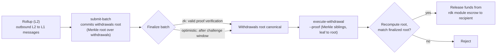

# ZK / STARK y Retiros

Esta página cubre dos temas relacionados: los **sistemas de pruebas ZK** (`snark` y `stark`) utilizados por los rollups liquidados con ZK, y el **flujo de retiro L2 → L1** que mueve fondos desde un rollup de vuelta a QoreChain una vez que un lote se finaliza.

:::caution Capacidad en etapa temprana
Todavía no se ha creado ningún rollup en ninguna de las dos redes (comprobado el 27 de octubre de 2026), por lo que ni la verificación de pruebas ni el flujo de retiro descritos aquí se han ejercitado en un rollup en vivo. Los retiros solo pueden tener éxito en mainnet desde v3.2.3 (altura 3,662,051, 20 de octubre de 2026), cuando entró en servicio el libro mayor de escrow por rollup (consulta [De dónde salen los fondos](#where-the-funds-come-from)); antes de eso, todos los retiros fallaban. **La liquidación ZK todavía no puede usarse en ninguna de las dos redes** (el perfil `defi` y todo rollup `zk`): la cadena no tiene forma de registrar una verification key, así que todo lote ZK se rechaza después de pagar su comisión, y el registro de claves está previsto para la v3.2.7 de la cadena. La verificación STARK es experimental. Valida en la testnet **`qorechain-diana`** y no asumas garantías reforzadas para producción en mainnet.
:::

---

## Sistemas de pruebas ZK

Un rollup liquidado con ZK (modo de liquidación `zk`) adjunta una prueba de validez a cada lote de liquidación, demostrando que la transición de estado es correcta sin volver a ejecutar las transacciones del rollup. La liquidación ZK admite dos sistemas de pruebas:

| Sistema de pruebas | Características |
| ------------ | --------------- |
| **`snark`** | Pruebas sucintas (Groth16 sobre BLS12-381), verificadas on-chain contra la verifying key del rollup |
| **`stark`** | Pruebas transparentes, sin configuración de confianza (trusted setup) — experimental; opt-in y ligado a un circuito de demostración |

El modo de liquidación `zk` requiere `snark` o `stark`; el emparejamiento se aplica on-chain cuando se crea el rollup. En cambio, la liquidación `optimistic` usa el sistema de pruebas `fraud`, y las liquidaciones `based` y `sovereign` usan `none`. Consulta **[Visión general de Rollups](/rollups/overview)** para ver la matriz de compatibilidad completa.

### Finalidad

A diferencia de los rollups optimistas —que esperan a que transcurra una ventana de impugnación de prueba de fraude— un lote ZK puede finalizarse con la **verificación de una prueba válida**, sin una ventana de disputa. Esta es la compensación central de la liquidación ZK: una finalidad más fuerte y rápida a cambio del coste y la complejidad de generar pruebas.

### Madurez

**La liquidación ZK todavía no puede usarse en ninguna de las dos redes.** Los lotes SNARK están pensados para verificarse on-chain (Groth16 sobre BLS12-381, con tres entradas públicas: la raíz de estado anterior, la raíz de estado nueva y el hash de los datos) contra una verification key almacenada con el rollup. La cadena no tiene forma de registrar esa clave, así que un rollup creado con liquidación `zk`, incluido todo rollup del perfil `defi` o de la plantilla `defi-rollup`, no tiene ninguna, y todo lote ZK que envía se rechaza después de pagar su comisión. El registro de claves está previsto para la v3.2.7 de la cadena; hasta que llegue, no crees un rollup ZK ni lo fondees. Cuando llegue, el circuito de demostración de la plantilla `defi` (un multiplicador de `snarkjs`) seguirá sin poder verificarse, porque no tiene las entradas públicas que comprueba la cadena; necesitarás tu propio circuito. Desde el RDK 0.7.0 la plantilla `defi-rollup` se detiene antes de enviar un lote, así que ya no gasta una comisión en uno que la cadena rechaza siempre. La verificación STARK es experimental: es opt-in y comprueba un circuito de demostración, no la transición de estado propia de tu rollup. Para una liquidación que puedas usar hoy, elige `optimistic` (los perfiles `nft` y `custom`).

---

## Cómo los lotes transportan los retiros

Cuando un rollup liquida un lote, ese lote también puede comprometer los mensajes salientes entre capas del rollup: sus **retiros L2 → L1**. Conceptualmente:

* Un lote finalizado puede transportar un compromiso de su conjunto de retiros (una raíz de Merkle sobre los mensajes de retiro del lote).
* Cada retiro individual es una hoja bajo esa raíz, identificada por su índice de lote y un índice de retiro.
* Una vez que el lote se finaliza, cualquier parte puede demostrar que una hoja de retiro específica está incluida bajo la raíz comprometida y activar el pago.

Por eso los retiros dependen de la liquidación: un retiro solo puede ejecutarse contra un lote **finalizado**, porque es la finalización lo que hace canónica la raíz de retiros comprometida.

Para saber cómo se envían y finalizan los lotes —incluyendo `submit-batch` y la ruta de disputa `challenge-batch` para rollups optimistas— consulta **[Desplegar un Rollup](/rollups/deploying-a-rollup)**.

---

## Ejecutar un retiro: `execute-withdrawal`

El comando `execute-withdrawal` finaliza un retiro L2 → L1 contra la raíz de retiros de un lote finalizado. Demuestra que una hoja de retiro está comprometida en esa raíz y paga al destinatario desde el escrow del módulo rdk. La acción es **sin permisos**: cualquiera puede enviar una prueba válida. Como toda transacción de la lane nativa, necesita la cofirma híbrida post-cuántica, así que constrúyela con `--generate-only` y cofírmala (consulta [Desplegar un Rollup](/rollups/deploying-a-rollup)). Los retiros todavía no se han ejercitado en un rollup en vivo; trata el flujo como no probado. Comprueba esto antes de pagar una comisión, porque de lo contrario la cadena rechaza la transacción: el denom debe ser exactamente `uqor`, la cantidad debe ser positiva, la prueba tiene como máximo 64 niveles y cada hermano mide exactamente 32 bytes, el remitente y el destinatario son direcciones `qor1…` válidas, el lote está finalizado y comprometió un `withdrawals_root`, el rollup no está detenido, y esa hoja de retiro no se ha pagado antes. El `@qorechain/rdk` de TypeScript (0.6.0 y posteriores) ejecuta por ti el primer grupo de estas comprobaciones (`withdrawalErrors`: direcciones, denom, cantidad, profundidad de la prueba y longitud de los hermanos), y `executeWithdrawal` lanza un error antes de difundir cuando alguna falla; desde la 0.7.0, `qorollup withdraw --file withdrawal.json [--dry-run]` también construye la prueba a partir de los retiros del lote y se niega, antes de pagar una comisión, cuando el resultado no es el `withdrawals_root` del lote on-chain; las condiciones del lote, del rollup y del libro mayor dependen del estado de la cadena, que esta comprobación no lee.

```bash
qorechaind tx rdk execute-withdrawal \
  [rollup-id] [batch-index] [withdrawal-index] [recipient] [denom] [amount] \
  --proof <sibling-hash-1>,<sibling-hash-2>,... \
  --from mykey \
  --chain-id qorechain-diana \
  --gas 400000 --fees 40000uqor \
  --generate-only > withdrawal.json
qorechaind tx pqc cosign withdrawal.json --from mykey --pqc-key mypqckey --chain-id qorechain-diana
```

**Argumentos posicionales:**

| Argumento | Descripción |
| -------- | ----------- |
| `rollup-id` | El rollup al que pertenece el retiro |
| `batch-index` | El lote finalizado cuya raíz de retiros compromete este retiro |
| `withdrawal-index` | El índice de la hoja de retiro dentro de ese lote |
| `recipient` | La dirección a la que pagar |
| `denom` | La denominación a pagar |
| `amount` | La cantidad a pagar |

**Flag:**

| Flag | Descripción |
| ---- | ----------- |
| `--proof` | Hashes hermanos de Merkle en hexadecimal separados por comas, ordenados de la hoja a la raíz, que demuestran que la hoja de retiro está comprometida en la raíz de retiros del lote |

El valor de `--proof` es la prueba de inclusión: los hashes hermanos a lo largo del camino desde la hoja de retiro hasta la raíz de retiros comprometida del lote. El módulo recalcula la raíz a partir de la hoja y los hermanos proporcionados y la compara con la raíz comprometida del lote finalizado antes de pagar.

### Codificación de hojas y nodos {#leaf-and-node-encoding}

* **Hoja (primera forma, la regla de la mainnet hoy)** = SHAKE-256 (32 bytes) de `rollup_id`, un byte `0x00`, el índice de retiro (8 bytes, big-endian), la cadena `recipient`, `0x00`, la cadena `denom`, `0x00` y el `amount` (8 bytes, big-endian).
* **Hoja (segunda forma, testnet ahora, mainnet tras la actualización a la v3.2.5)**: para los lotes de la v3.2.5 de la cadena la hoja también nombra el chain id. El RDK construye ambas formas (`withdrawalLeafV1`, `withdrawalLeafV2`).
* **Padre** = SHAKE-256 de `left || right`. En cada nivel, el bit correspondiente del índice de retiro decide el lado: `0` significa que la hoja (o el hash acumulado) es el nodo izquierdo, de modo que la posición de la hoja en el árbol es su índice de retiro.
* Cada hash hermano debe tener exactamente 32 bytes.
* **Raíz de retiros (testnet ahora, mainnet tras la actualización):** desde la v3.2.5 de la cadena, el `withdrawals_root` de un lote está vacío o mide exactamente 32 bytes; en la mainnet (v3.2.4) esa regla de longitud todavía no se aplica.

No construyas este árbol a mano. `withdrawalsTree` en `@qorechain/rdk` 0.7.0 (y sus equivalentes en Python, Go, Rust y Java) construye la raíz de retiros de un lote y cada prueba exactamente como lo hace la cadena, y se comprobó contra el propio verificador de la cadena; `assembleWithdrawalProof` construye por defecto el árbol de la cadena, y los helpers genéricos de Merkle ahora usan SHAKE-256 por defecto.

:::caution Versiones anteriores a la 0.7.0
En `@qorechain/rdk` 0.6.2 y anteriores, los helpers genéricos `binaryMerkleRoot` / `binaryMerkleProof` (y sus equivalentes en Python, Go, Rust y Java) usaban por defecto SHA-256 con nodos impares duplicados y volvían a calcular el hash de cada hoja, mientras que la cadena usa SHAKE-256 y construye sus hojas a partir del retiro, así que una prueba construida con esos valores por defecto nunca se verificó on-chain. Actualiza a la 0.7.0, o sobrescribe el hash y la codificación de hojas con las reglas anteriores, o la prueba no se verificará on-chain.
:::

### De dónde salen los fondos {#where-the-funds-come-from}

Un retiro se paga desde el **stake en escrow propio del rollup** (el stake menos la quema de creación del 1%). El escrow de todos los rollups está en un único saldo agrupado del módulo, y desde **v3.2.3** un **libro mayor de escrow** por rollup es la cuenta de lo que tiene cada rollup: `create-rollup` lo acredita con el escrow que conserva el rollup, un retiro o una recompensa de prueba de fraude se paga desde él y se debita de él, y un retiro mayor que lo que el rollup aún conserva se rechaza con un error de escrow insuficiente. `stop-rollup` reembolsa solo lo que queda y deja el libro mayor a cero, y un rollup detenido no paga más retiros. Por tanto, un retiro demostrado para un rollup no puede pagarse con el stake de otro rollup. Las consultas del rollup incluyen `escrow_balance` (uqor que aún se conservan para ese rollup). El módulo no tiene ningún mensaje de depósito L1 → L2, por lo que esto no es un bridge de fondos de usuarios.

---

## Flujo de retiro de extremo a extremo

*La ruta de L2 a L1: un lote de liquidación compromete una raíz de retiros, el lote se finaliza, y luego una prueba de inclusión sin permisos libera los fondos en escrow en QoreChain.*



1. **Liquidar un lote.** El operador del rollup envía un lote de liquidación con `submit-batch`. El lote puede comprometer una raíz de retiros sobre sus mensajes salientes L2 → L1.
2. **Finalizar.** El lote se finaliza según el modo de liquidación del rollup: con la verificación de una prueba válida para `zk`, o tras la ventana de impugnación para `optimistic` (durante la cual `challenge-batch` puede disputarlo). En la testnet desde la v3.2.5 de la cadena (mainnet tras la actualización), los lotes también se finalizan estrictamente en orden de índice, así que un lote espera a cualquier lote anterior que siga en `submitted` o `challenged`. La ventana optimista es de 100,800 bloques por defecto para un lote enviado antes de la actualización v3.2.4; desde v3.2.4 se mide en segundos de tiempo de bloque para los lotes enviados a partir de la altura de la actualización (testnet desde la altura 8,337,253, el 19 de octubre de 2026; mainnet desde la altura 3,742,566, el 23 de octubre de 2026).
3. **Demostrar y ejecutar.** Una vez finalizado, cualquiera envía `execute-withdrawal` con la prueba de inclusión de Merkle (`--proof`) para la hoja de retiro específica. El módulo verifica la inclusión contra la raíz de retiros del lote finalizado y paga al destinatario desde el escrow.

Como el paso 3 es sin permisos y basado en pruebas, un retiro no depende de la cooperación del operador del rollup una vez que el lote que lo transporta está finalizado.

---

## Relacionado

* **[Visión general de Rollups](/rollups/overview)** — paradigmas de liquidación y la matriz de compatibilidad de sistemas de pruebas.
* **[Desplegar un Rollup](/rollups/deploying-a-rollup)** — comandos de operador `submit-batch` y `challenge-batch`.
* **[Rollup Development Kit](/architecture/rollup-development-kit)** — la referencia del módulo de más bajo nivel.
