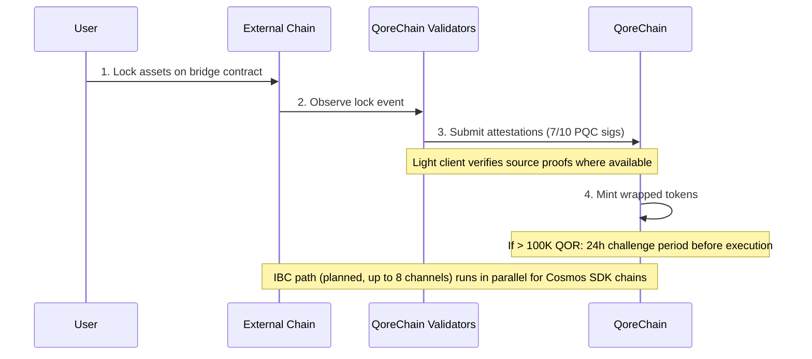

# Architecture du pont

Le module `x/bridge` est conçu pour connecter QoreChain à l'écosystème blockchain au sens large via **37 configurations de chaîne (36 chaînes externes plus Injective, atteinte via IBC) et jusqu'à 8 contreparties IBC (Inter-Blockchain Communication)**. Chaque opération de pont est conçue pour être sécurisée par la cryptographie post-quantique.

:::caution Pas en service sur l'un ni l'autre réseau
Le module de pont est déployé sur le mainnet et le testnet, mais **aucune route de pont n'est active** : les 37 configurations de chaîne sont au statut `pending` sans contrat de pont défini, aucun validateur de pont n'est enregistré, aucune opération de pont n'a jamais été créée, et aucun canal IBC n'existe sur le mainnet (le testnet a un unique canal de test ICS-20 vers une chaîne d'ID `provider`, aucun vers les contreparties ci-dessous). Tout ce qui suit décrit la conception prévue. N'envoyez pas d'actifs en vous attendant à ce qu'ils transitent par le pont.
:::

## État actuel {#current-status}

| | Mainnet | Testnet |
|---|---|---|
| Module de pont | activé | activé |
| Configurations de chaîne | 37, toutes `pending` | 37, toutes `pending` |
| Validateurs de pont enregistrés | 0 | 0 |
| Opérations de pont | 0 | 0 |
| Canaux / clients IBC | 0 / 0 | 1 / 1 (un canal de test vers le testnet du Cosmos Hub) |

(Vérifié le 27 octobre 2026 sur le mainnet (v3.2.4 ; v3.2.5 depuis le 29 octobre 2026) et le testnet (v3.2.6). Lisez les valeurs en direct avec `qorechaind query bridge chains` et `qorechaind query bridge validators`, ou via REST à `/qorechain/bridge/v1/chains` et `/qorechain/bridge/v1/validators`.) La configuration du module est identique sur les deux réseaux : `min_validators` 10, `attestation_threshold` 7, `challenge_period_secs` 86,400 et `large_transfer_threshold` 100 000 QOR (`100000000000` uqor). La pile IBC que le module utiliserait est ibc-go v10.7 (depuis v3.2.2), mais aucun client ni canal n'a été créé sur le mainnet (le testnet a un client et un canal de test, voir ci-dessus).

## Vue d'ensemble des connexions

QoreChain est conçue pour prendre en charge deux protocoles de pont fonctionnant en parallèle :

| Protocole | Connexions           | Modèle de sécurité                   | Cas d'usage                             |
| --------- | -------------------- | ------------------------------------ | --------------------------------------- |
| **IBC**   | jusqu'à 8 canaux (aucun ouvert)  | IBC standard (ICS-20) | Chaînes compatibles Cosmos SDK      |
| **QCB**   | 37 configs de chaîne (toutes en attente) | Multisig Dilithium-5 7-sur-10        | Chaînes non-IBC (EVM, Solana, TON, etc.) |

Les **37 configurations de chaîne** sont les **36 chaînes externes** listées ci-dessous plus **Injective**, qui est configurée comme une chaîne de type IBC. Il n'existe aucune configuration loopback de QoreChain. Les canaux IBC prévus se connectent aux chaînes compatibles Cosmos SDK.

## Canaux IBC

QoreChain est conçue pour maintenir des connexions IBC vers les 8 chaînes suivantes, relayées par un relayeur IBC. **Aucune de ces contreparties n'est encore connectée** (le mainnet n'a ni canal ni client IBC ; le testnet a un unique canal de test ICS-20 vers une chaîne d'ID `provider`, vérifié le 27 octobre 2026), ce tableau ne liste donc que des contreparties prévues :

| Chaîne     | Description                    |
| ---------- | ------------------------------ |
| Cosmos Hub | Connexion au hub principal     |
| Osmosis    | Routage de la liquidité DEX    |
| Noble      | Émission native d'USDC         |
| Celestia   | Couche de disponibilité des données |
| Stride     | Staking liquide                |
| Akash      | Calcul décentralisé            |
| Babylon    | Protocole de restaking BTC     |
| Injective  | Interopérabilité DeFi / carnet d'ordres |

### Relayeur IBC {#ibc-relayer}

Les paquets IBC et les mises à jour de client sont acheminés entre les chaînes par un relayeur, un programme distinct qui surveille les deux chaînes et soumet les paquets, les preuves et les mises à jour de client. Le relayeur ne fait pas partie de la chaîne, et ce manuel ne promet aucun service de relayeur exploité par QoreChain. QoreChain maintient un relayeur open source nommé QORel (un fork de Hermes qui ajoute la signature hybride ML-DSA-87 que QoreChain exige sur chaque transaction) ; la version 0.1.0 est publiée en préversion. Voir [QORel](/qorel/overview) pour l'installer et l'exécuter.

* **Les mises à jour de client, la surveillance des comportements malveillants et l'effacement des paquets** sont des réglages du relayeur que l'opérateur exécute, pas des paramètres de la chaîne. Par exemple, un relayeur peut rafraîchir automatiquement les clients légers, surveiller les équivocations et effacer périodiquement les paquets en attente.
* **Signatures post-quantiques.** Les transactions que QoreChain accepte sur son lane natif portent une signature hybride secp256k1 + ML-DSA-87 (FIPS 204), y compris les transactions qu'un relayeur lui soumet ; voir [Sécurité post-quantique](/architecture/post-quantum-security). Le format des paquets IBC lui-même est le format standard, et ce manuel n'affirme pas que les paquets portent une signature supplémentaire que d'autres chaînes vérifieraient.

## Protocole QCB (QoreChain Bridge)

Le protocole QCB utilise une architecture en étoile (hub-and-spoke) sécurisée par la cryptographie post-quantique. QoreChain agit comme le hub, avec une configuration en rayon pour chaque chaîne externe.

### Configurations de chaînes externes (36)

Le protocole QCB est conçu pour cibler les 36 chaînes externes suivantes. Combinées à Injective (une configuration de type IBC), cela donne **37 configurations de chaîne au total**, toutes actuellement au statut `pending`.

**Chaînes de base (10)**

Ethereum, Solana, TON, BSC, Avalanche, Polygon, Arbitrum, Optimism, Base, Sui.

**Chaînes de la famille EVM (14)**

zkSync Era, Linea, Scroll, Blast, Mantle, Hyperliquid, Berachain, Sonic, Sei, Monad, Plasma, Filecoin FVM, Cronos, Kaia.

**Chaînes non-EVM (5)**

Starknet, XRP Ledger, Stellar, Hedera, Algorand.

**Autres chaînes (7)**

NEAR, Bitcoin, Cardano, Polkadot, Tezos, Tron, Aptos.

:::note
Vérification du décompte : 10 de base + 14 famille EVM + 5 non-EVM + 7 autres = **36 chaînes externes**. En ajoutant Injective (IBC), on obtient **37 configurations de chaîne**.
:::

### Formats d'adresse

Le protocole QCB classe les chaînes par type afin de valider les adresses de destination :

| Type de chaîne | Exemples de chaînes                                                     | Format d'adresse                                   |
| ------------ | ----------------------------------------------------------------------- | -------------------------------------------------- |
| `evm`        | Ethereum, BSC, Avalanche, Polygon, Arbitrum, Optimism, Base             | `0x` + 40 caractères hexadécimaux                  |
| `solana`     | Solana                                                                  | Base58, 32-44 caractères                           |
| `ton`        | TON                                                                     | `EQ` + encodage base64                             |
| `sui_move`   | Sui                                                                     | `0x` + 64 caractères hexadécimaux                  |
| `aptos_move` | Aptos                                                                   | `0x` + 64 caractères hexadécimaux                  |
| `bitcoin`    | Bitcoin                                                                 | Bech32 (`bc1`), P2SH (`3...`), ou hérité (`1...`)  |
| `near`       | NEAR Protocol                                                           | Suffixe `.near` ou implicite                       |
| `cardano`    | Cardano                                                                 | `addr1` (paiement) ou `stake1` (staking)           |
| `polkadot`   | Polkadot                                                                | Encodage SS58                                      |
| `tezos`      | Tezos                                                                   | `tz1`/`tz2`/`tz3` (implicite) ou `KT1` (originé)   |
| `tron`       | TRON                                                                    | `T` + base58, 34 caractères                        |

## Clients légers

Pour vérifier les événements des chaînes externes sans confiance, le pont est conçu pour exécuter des clients légers on-chain adaptés au consensus et au système de preuves de chaque chaîne source. Ces clients légers permettent à QoreChain de valider les dépôts et les retraits sans dépendre uniquement des attestations des validateurs.

| Client léger            | Chaîne source       | Primitives de vérification                                          |
| ----------------------- | ------------------- | ------------------------------------------------------------------- |
| **Client léger Ethereum** | Ethereum / EVM L1 | Vérification de signature BLS12-381, sérialisation SSZ, preuves d'état MPT |
| **Bitcoin SPV**         | Bitcoin             | Simplified Payment Verification par rapport aux en-têtes de blocs   |
| **Starknet STARK**      | Starknet            | Vérification de preuve STARK des transitions d'état Starknet        |
| **Sui BLS**             | Sui                 | Vérification de signature agrégée BLS des checkpoints Sui           |
| **Wormhole / Solana VAA** | Solana (via Wormhole) | Vérification de signature de gardien Verified Action Approval (VAA) |

## Flux de dépôt (de l'externe vers QoreChain)

La séquence ci-dessous illustre le dépôt QCB tel qu'il est conçu : les actifs sont verrouillés sur une chaîne externe, les validateurs QoreChain soumettent des attestations signées par PQC (7-sur-10 Dilithium-5) et des jetons enveloppés (wrapped) sont émis. Les chaînes compatibles Cosmos SDK utiliseraient plutôt le chemin IBC parallèle (jusqu'à 8 canaux, acheminés par un relayeur IBC). Aucun des deux chemins n'est actif ; aucun dépôt n'a jamais été effectué.



```
External Chain          QoreChain Validators           QoreChain
     |                         |                          |
     | 1. Lock assets on       |                          |
     |    bridge contract      |                          |
     |------------------------>|                          |
     |                         | 2. Observe & attest      |
     |                         |    (7/10 PQC sigs)       |
     |                         |------------------------->|
     |                         |                          | 3. Mint wrapped
     |                         |                          |    tokens
     |                         |                          |
     |                         |    [If > 100K QOR]       |
     |                         |    24h challenge period   |
     |                         |    before execution       |
```

1. **Verrouillage** — L'utilisateur verrouille des actifs dans le contrat de pont sur la chaîne externe.
2. **Attestation** — Les validateurs du pont observent la transaction de verrouillage et soumettent des attestations signées Dilithium-5. Un minimum de **7 sur 10** attestations de validateurs est requis. Lorsqu'un client léger est disponible pour la chaîne source, l'événement de verrouillage est en outre vérifié par rapport aux preuves propres à la chaîne.
3. **Émission** — Une fois le seuil d'attestation atteint, des jetons enveloppés sont émis sur QoreChain.
4. **Période de contestation** — Pour les transferts dépassant l'équivalent de 100 000 QOR, une **période de contestation de 24 heures** s'applique avant l'exécution. Pendant cette fenêtre, les validateurs peuvent signaler toute activité suspecte.

## Flux de retrait (de QoreChain vers l'externe)

```
QoreChain               QoreChain Validators           External Chain
     |                         |                          |
     | 1. Burn wrapped tokens  |                          |
     |------------------------>|                          |
     |                         | 2. Attest burn           |
     |                         |    (7/10 PQC sigs)       |
     |                         |------------------------->|
     |                         |                          | 3. Unlock original
     |                         |                          |    assets
```

1. **Brûlage** — L'utilisateur brûle les jetons enveloppés sur QoreChain.
2. **Attestation** — Les validateurs attestent de l'événement de brûlage avec des signatures Dilithium-5 (seuil 7/10).
3. **Déverrouillage** — Une fois le seuil atteint, les actifs originaux sont déverrouillés sur la chaîne externe.

Tous les frais de pont collectés lors des retraits sont acheminés vers le module `x/burn` via le canal de brûlage `bridge_fee` (100 % des frais de pont sont brûlés).

### Retraits L2 → L1 (rollups)

Les retraits de rollup n'utilisent pas le pont. Ils sont payés par le module `x/rdk` avec `execute-withdrawal` sur la racine des retraits d'un lot finalisé — voir [ZK / STARK et retraits](/rollups/zk-stark-withdrawals).

## Architecture de sécurité

### Multisig PQC

Toutes les opérations de pont QCB requièrent un **seuil de 7-sur-10** signatures post-quantiques Dilithium-5 provenant de validateurs de pont enregistrés. Chaque validateur de pont s'enregistre avec :

* Une adresse de validateur QoreChain
* Une clé publique Dilithium-5 (2 592 octets)
* Une liste des chaînes prises en charge
* Un score de réputation (maintenu par `x/reputation`)

Depuis v3.2.2, le module valide de manière cohérente les montants nuls et sa configuration sur chaque chemin. **À partir de v3.2.4 (mainnet depuis le 23 octobre 2026, testnet depuis le 19 octobre 2026) :** l'enregistrement d'un validateur de pont exige aussi une preuve de possession de la clé Dilithium-5 (le même format `proof_of_possession` que l'enregistrement de clé PQC, voir [Sécurité post-quantique](/architecture/post-quantum-security#proof-of-possession)) et refuse une clé qu'un autre validateur de pont utilise déjà. Les versions antérieures n'ont pas cette vérification, et aucun validateur de pont n'est enregistré sur l'un ou l'autre réseau.

### Disjoncteurs

Chaque chaîne connectée dispose de protections par disjoncteur indépendantes :

| Protection                | Description                                                                          |
| ------------------------- | ------------------------------------------------------------------------------------ |
| **Limite par transfert unique** | Montant maximum pour toute opération de pont individuelle par chaîne          |
| **Limite agrégée quotidienne** | Plafond de volume total par chaîne par fenêtre de 24 heures                    |
| **Pause manuelle**        | Arrêt d'urgence déclenché par la gouvernance ou un validateur, par chaîne            |
| **Détection d'anomalie**  | Pause automatique si >50 opérations dans une courte fenêtre ou si le volume dépasse 5x la limite quotidienne |

L'état du disjoncteur est suivi par chaîne et inclut : le transfert unique maximum, la limite quotidienne, l'utilisation quotidienne actuelle, la hauteur de la dernière réinitialisation et le statut de pause avec le motif.

### Période de contestation

Pour les transferts importants (>100 000 équivalent QOR, configurable via `large_transfer_threshold`) :

* Une **période de contestation de 24 heures** (86 400 secondes) s'applique après l'atteinte du seuil d'attestation.
* Pendant cette fenêtre, les validateurs sont conçus pour pouvoir signaler l'opération.
* Si elle n'est pas contestée, l'opération s'exécute automatiquement après l'expiration de la période.
* Les opérations contestées sont gelées en vue d'un examen par la gouvernance.

### Optimisation de chemin par l'IA

Le module de pont s'intègre au sous-système d'IA pour l'optimisation des routes (non exposé via REST). Pour les transferts pouvant emprunter plusieurs chemins (par exemple, de la chaîne A à la chaîne B via un intermédiaire), l'optimiseur de chemin évalue :

* Les frais estimés sur les différentes routes
* Le temps d'achèvement estimé
* Le score de sécurité par chemin
* Le niveau de confiance de l'estimation

## Administration du pont

### Activation de chaîne après déploiement (sans gouvernance)

À partir de la version de chaîne **v3.1.78**, une chaîne de pont peut être activée et reconfigurée après le déploiement avec une seule transaction signée — sans proposition de gouvernance et sans mise à niveau de la chaîne. Une clé `bridge_admin` (définie dans `BridgeConfig.BridgeAdmin` au genesis) ou un détenteur d'une licence `qcb_bridge` peut :

* **`tx bridge update-chain-config`** — définir l'adresse du contrat, le nombre de confirmations, l'architecture et le statut d'une chaîne (`MsgUpdateChainConfig`).
* **`tx bridge set-verifier-bootstrap`** — sélectionner le vérificateur actif pour une chaîne et installer sa racine de confiance (`MsgSetVerifierBootstrap`).

Cela permet à un opérateur de mettre en ligne le pont d'une chaîne connectée — ou de faire tourner son vérificateur — directement, l'autorisation étant vérifiée par rapport à la clé d'administration du pont. À partir de la version de chaîne **v3.2.0**, le module de pont dispose également de son propre compte de module (les versions antérieures n'en avaient pas, de sorte que le premier dépôt sur une route activée aurait échoué).

Les licences telles que `qcb_bridge` sont accordées par le compte d'autorité des licences. Depuis v3.2.3 (mainnet), la gouvernance peut remplacer ce compte par une proposition `MsgUpdateAuthority` ; le module lui-même est décrit dans [Licences de chaîne](/architecture/chain-licensing).

### Validation des réseaux connectés

À partir de la version de chaîne **v3.1.79**, un validateur qui détient la licence `validator_<chain>` correspondante (ou `qcb_bridge`) peut exécuter le client du réseau externe sur le même nœud, provisionné automatiquement sous l'orchestration de QoreChain une fois la licence activée. Des pilotes sont fournis pour les 37 réseaux de pont, classés par modèle de participation (validateur sans permission, plafonné/élu/admission, nœud complet L2, et sans staking/liste de confiance). La participation (stake) et les clés de signature du réseau externe sont fournies par l'opérateur pour chaque réseau. Voir [Exécuter un validateur](/developer-guide/running-a-validator#connected-networks) pour les étapes opérateur. Comme toutes les configurations de chaîne sont `pending`, aucun réseau connecté n'est validé via le pont aujourd'hui.

## Points de terminaison de l'API REST {#rest-api-endpoints}

L'état du pont est interrogeable **en lecture seule via REST** au moyen de grpc-gateway sous le préfixe `/qorechain/bridge/v1/...`. Ces points servent du JSON on-chain réel via HTTP pour les explorateurs et la télémétrie des nœuds légers. Voir [Points de terminaison REST / gRPC](/api-reference/rest-grpc-endpoints#bridge-module) pour la liste complète.

| Méthode | Point de terminaison                      | Description                                                                                                         |
| ------ | ----------------------------------------- | ------------------------------------------------------------------------------------------------------------------- |
| GET    | `/qorechain/bridge/v1/config`             | Configuration du module de pont (`min_validators`, `attestation_threshold`, `challenge_period_secs`, `large_transfer_threshold`, `enabled`) |
| GET    | `/qorechain/bridge/v1/chains`             | Toutes les configurations de chaîne et leur statut                                                                  |
| GET    | `/qorechain/bridge/v1/chains/{chain_id}`  | Une configuration de chaîne                                                                                         |
| GET    | `/qorechain/bridge/v1/validators`         | Validateurs de pont enregistrés                                                                                     |
| GET    | `/qorechain/bridge/v1/validators/{address}` | Un validateur de pont                                                                                             |
| GET    | `/qorechain/bridge/v1/operations`         | Opérations de pont                                                                                                  |
| GET    | `/qorechain/bridge/v1/operations/{id}`    | Une opération de pont                                                                                               |

Les montants verrouillés, l'état des disjoncteurs et les estimations de route n'ont aucune route de requête aujourd'hui.

## Événements du pont

Le module de pont émet les événements on-chain suivants :

| Type d'événement              | Description                                     |
| ----------------------------- | ----------------------------------------------- |
| `bridge_deposit`              | Nouvelle opération de dépôt créée               |
| `bridge_withdraw`             | Nouvelle opération de retrait créée             |
| `bridge_attestation`          | Attestation de validateur soumise               |
| `bridge_operation_executed`   | Opération finalisée et exécutée                 |
| `bridge_circuit_breaker_trip` | Disjoncteur activé ou désactivé                 |
| `bridge_validator_registered` | Nouveau validateur de pont enregistré           |
| `bridge_pqc_verification`     | Résultat de vérification de signature PQC (paquets IBC) |

## Connexes

* [Transfert d'actifs par pont](/user-guide/bridging-assets) — déplacer des actifs entre chaînes étape par étape.
* [Restaking BTC via Babylon](/architecture/btc-restaking-babylon) — sécurité adossée au Bitcoin.
* [Sécurité post-quantique](/architecture/post-quantum-security) — vérification PQC sur les paquets IBC.
