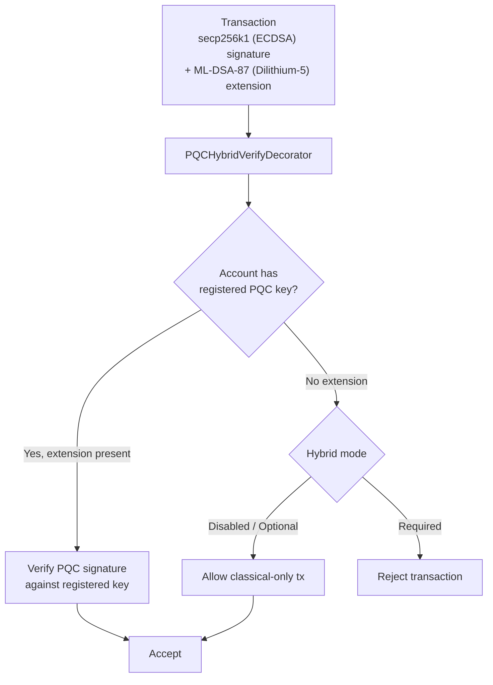

# Sécurité post-quantique

QoreChain est conçue avec la **cryptographie post-quantique (PQC) dès le genesis** — et non ajoutée a posteriori sous forme de mise à niveau. Le module `x/pqc` fournit des signatures numériques fondées sur les réseaux euclidiens (lattices) et l'encapsulation de clés comme primitives cryptographiques principales, avec un cadre d'agilité algorithmique contrôlé par la gouvernance pour une résilience à long terme.

La base PQC complète — **Dilithium-5 (signatures) + ML-KEM-1024 (KEM) + SHAKE-256 (hachage)** — est désormais achevée et constitue la valeur par défaut du réseau. Sur les réseaux en production (v3.2.x), les signatures hybrides sont **requises par défaut** sur le chemin de transaction cosmos : `hybrid_signature_mode = required` et `allow_classical_fallback = false`. Chaque transaction du chemin cosmos doit porter une signature Dilithium-5 aux côtés de sa signature classique secp256k1 ; les transactions purement classiques émises depuis un compte PQC sont rejetées, et le chemin de rétrogradation classique est fermé. Le mainnet et le testnet exécutent tous deux la v3.2.4 ; ce que les versions v3.2.2 et v3.2.3 ont ajouté aux règles post-quantiques (intégrité des clés, preuve de possession optionnelle, fenêtres EVM à portée limitée, consentement EIP-7702) est décrit dans [Règles d'intégrité des clés](#key-integrity), [Preuve de possession](#proof-of-possession) et [Délégations EIP-7702](#eip-7702).

## Principes de conception

* **PQC requise par défaut** : Les signatures post-quantiques sont obligatoires sur le chemin cosmos. Les signatures classiques secp256k1 seules ne suffisent plus — `allow_classical_fallback = false`.
* **Hybride par défaut** : Les transactions cosmos portent simultanément une signature classique secp256k1 et une signature PQC Dilithium-5. Le repli purement classique est fermé.
* **Agilité algorithmique** : Le registre des algorithmes cryptographiques est contrôlé par la gouvernance, ce qui permet au réseau d'adopter de nouveaux algorithmes ou de déprécier ceux qui sont compromis sans hard fork.
* **Vérification déterministe** : Toute vérification de signature est déterministe et reproductible sur l'ensemble des nœuds validateurs.

## Algorithmes pris en charge

| Algorithme      | Standard             | Catégorie            | Niveau NIST | Clé publique | Clé privée  | Signature / Chiffré | Secret partagé |
| --------------- | -------------------- | -------------------- | ----------- | ------------ | ----------- | ------------------- | -------------- |
| **Dilithium-5** | ML-DSA-87 (FIPS 204) | Signature            | 5           | 2,592 bytes  | 4,896 bytes | 4,627 bytes         | --             |
| **ML-KEM-1024** | FIPS 203             | Encapsulation de clés | 5          | 1,568 bytes  | 3,168 bytes | 1,568 bytes         | 32 bytes       |

Les deux algorithmes opèrent au **niveau de sécurité NIST 5**, la catégorie de sécurité standardisée la plus élevée, offrant une protection équivalente à AES-256 contre les adversaires classiques comme quantiques.

## Backend cryptographique

Les opérations PQC sont implémentées dans un backend cryptographique haute performance et à mémoire sûre (memory-safe) qui expose la signature, la vérification et l'encapsulation de clés fondées sur les réseaux euclidiens au runtime de QoreChain. Le backend fournit :

Opérations spécifiques aux algorithmes :

* Génération de clés, signature et vérification Dilithium-5
* Génération de clés, encapsulation et décapsulation ML-KEM-1024
* Génération de balise aléatoire déterministe (`seed`, `epoch`)

Opérations agnostiques à l'algorithme :

* `Keygen(algorithmID)` — Générer une paire de clés pour tout algorithme enregistré
* `Sign(algorithmID, privkey, message)` — Créer une signature
* `Verify(algorithmID, pubkey, message, signature)` — Vérifier une signature
* `AlgorithmInfo(algorithmID)` — Interroger les tailles de clé/sortie
* `ListAlgorithms()` — Énumérer tous les algorithmes pris en charge

Toutes les opérations de signature et de vérification sont déterministes et produisent des résultats identiques sur chaque nœud validateur et chaque plateforme prise en charge.

Ces mêmes primitives — ML-DSA (FIPS-204), ML-KEM (FIPS-203) et SHAKE-256 (FIPS-202) — sont disponibles pour les portefeuilles et les intégrateurs via la bibliothèque open source [**qorechain-pqc**](https://github.com/qorechain/qorechain-pqc), qui fournit une API unique, cohérente et compatible octet par octet à travers six langages (JavaScript/TypeScript, Rust, Go, C, Python, Java). Voir [Signature post-quantique](/developer-guide/post-quantum-signing).

## Enregistrement des clés {#key-registration}

Les comptes enregistrent explicitement leurs clés PQC via `MsgRegisterPQCKey` (legacy, par défaut Dilithium-5) ou `MsgRegisterPQCKeyV2` (agnostique à l'algorithme) ; la chaîne n'enregistre jamais une clé de sa propre initiative, et le flux CLI est `qorechaind tx pqc gen-key <name>` suivi de `qorechaind tx pqc register-key <public_key_hex> hybrid --from <key>` (voir [Première transaction](/getting-started/first-transaction#register-pqc-key)). Chaque message comprend :

* **Sender** : L'adresse du compte qui enregistre la clé.
* **PublicKey** : Les octets de la clé publique PQC.
* **AlgorithmID** : L'identifiant de l'algorithme PQC (v2 uniquement).
* **ProofOfPossession** : Signature optionnelle par la nouvelle clé (v2 uniquement, depuis la v3.2.3) ; voir [Preuve de possession](#proof-of-possession).
* **KeyType** : L'une des valeurs `hybrid` ou `pqc_only` (une troisième valeur, `classical_only`, existe encore dans le schéma mais est refusée depuis la v3.2.3) :

| Type de clé      | Description                                                              |
| ---------------- | ------------------------------------------------------------------------ |
| `hybrid`         | Clés classique (ECDSA) et PQC. Les transactions portent des doubles signatures. |
| `pqc_only`       | Enregistrée comme `hybrid` : la signature classique secp256k1 est toujours vérifiée par les contrôles de signature standard, et la signature PQC est également requise. |
| `classical_only` | **Refusée depuis la v3.2.3.** Un enregistrement avec ce type de clé n'enregistre aucune clé post-quantique utilisable et laisserait le compte incapable de signer ; la chaîne le rejette donc. |

### Règles d'intégrité des clés (v3.2.3) {#key-integrity}

Depuis la mise à niveau v3.2.3 (hauteur mainnet 3,662,051, 20 octobre 2026 ; hauteur testnet 8,003,746), la chaîne applique ces règles aux clés post-quantiques. En dessous de cette hauteur, aucune d'entre elles n'était appliquée.

| Règle | Comportement |
| --- | --- |
| Pas de clés faibles | Un enregistrement est refusé si le type de clé est `classical_only`, si la clé est vide, ou si la clé est dégénérée : une clé de la bonne longueur dont la structure n'offre aucune protection post-quantique. Générez les clés avec `tx pqc gen-key` ou la bibliothèque `qorechain-pqc` et enregistrez ce qu'elles affichent |
| Pas de réutilisation de clé | Une rotation ou une migration est refusée si la nouvelle clé est une clé que le compte a déjà utilisée. La chaîne mémorise un hachage de chaque clé que le compte a abandonnée par rotation ou migration |
| Les comptes avec clé exigent la signature hybride | Un compte qui détient déjà une clé utilisable doit aussi porter sa signature hybride sur une transaction d'enregistrement ou de migration. L'exemption purement classique ne couvre désormais que les comptes **sans** clé enregistrée, ou dont l'enregistrement stocké ne contient aucune clé utilisable (que `MsgRegisterPQCKeyV2` peut alors remplacer) |
| Pas d'extension sans clé | En mode `required`, un compte sans clé enregistrée ne peut pas passer en joignant une extension hybride que rien ne peut vérifier ; seul un enregistrement peut passer sans extension |
| Une seule extension | Une transaction porte au plus une extension de signature hybride |
| Pas de messages de clé via authz | `MsgRegisterPQCKey`, `MsgRegisterPQCKeyV2`, `MsgRotatePQCKey` et `MsgMigratePQCKey` ne peuvent pas être exécutés pour le compte d'un autre via `x/authz` ; la signature propre du compte est requise |
| Garde-fous de gouvernance des algorithmes | Déprécier ou désactiver un algorithme ne peut pas laisser la chaîne sans algorithme de signature actif, et l'algorithme de remplacement doit être capable de signer |

La v3.2.2 a ajouté un contrôle apparenté : un enregistrement valide la clé classique `ecdsa_pubkey` qu'il porte et la lie au compte signataire, de sorte qu'un compte ne peut pas enregistrer une clé classique qui n'est pas la sienne.

Les nœuds filtrent aussi ces cas dans le mempool, de sorte qu'une transaction qui ne peut qu'échouer n'est pas relayée et ne coûte aucuns frais.

### Preuve de possession (optionnelle) {#proof-of-possession}

`MsgRegisterPQCKeyV2` possède un champ optionnel `proof_of_possession`. Lorsqu'il est présent, la chaîne le vérifie ; lorsqu'il est absent, l'enregistrement se déroule comme avant (la preuve n'est **pas requise**). La preuve est une signature, par la clé en cours d'enregistrement, sur

```text
qorechain-pqc-pop-v1|<chain-id>|<algorithm-id>|<account-address>|<hex(public-key)>
```

de sorte qu'une preuve établie pour un compte ou une chaîne ne prouve rien sur un autre. La CLI la construit pour vous lorsque vous nommez le fichier de clé local :

```bash
qorechaind tx pqc register-key-v2 dilithium5 <pubkey-hex> hybrid \
  --pqc-key mypqc --from mykey --chain-id qorechain-vladi --gas 600000 --fees 60000uqor
```

L'enregistrement n'est exempté de l'exigence hybride que pour un compte sans clé ; cette transaction est donc signée avec la seule clé classique du compte. Une preuve mal formée est refusée avec `ErrInvalidProofOfPossession` (code 231 dans le module `pqc`).

**À partir de la v3.2.4 (mainnet depuis le 23 octobre 2026, testnet depuis le 19 octobre 2026) :** l'enregistrement du compte gagne un booléen `possession_proven`, renvoyé par `GET /qorechain/pqc/v1/account/{address}`. Il vaut `true` lorsque la clé actuelle a été enregistrée avec une preuve valide, ou est arrivée par une rotation ou une migration (qui vérifient toutes deux une signature par la nouvelle clé sur des octets nommant la chaîne, le compte et la clé) ; un enregistrement sans preuve enregistre `false`, et une clé qui change sans preuve efface l'indicateur. La preuve reste optionnelle pour les clés de compte sous la v3.2.4.

## Signatures hybrides {#hybrid-signatures}

Le système de signatures hybrides exige que les transactions du chemin cosmos portent **à la fois** une signature classique et une signature PQC simultanément. Cela offre une défense en profondeur : même si l'un des schémas est cassé, l'autre protège la transaction.

Avec la valeur par défaut du réseau `hybrid_signature_mode = required`, chaque transaction du chemin cosmos doit inclure l'extension Dilithium-5 aux côtés de la signature secp256k1. Les seules exemptions (pour le bootstrap) sont les **gentxs de genesis (hauteur 0)**, l'**enregistrement de clé PQC** (`MsgRegisterPQCKey`, `MsgRegisterPQCKeyV2`) depuis un compte qui n'a aucune clé enregistrée (ou dont l'enregistrement ne contient aucune clé utilisable), qui est autorisé à être purement classique afin que le compte puisse enregistrer sa première clé PQC, ainsi qu'un unjail depuis un compte opérateur qui n'a aucune clé enregistrée. Depuis la v3.2.3, un enregistrement ou une migration depuis un compte qui détient déjà une clé utilisable exige la signature hybride comme toute autre transaction (voir [Règles d'intégrité des clés](#key-integrity)).

**La voie EVM est protégée par une fenêtre d'autorisation à la place.** Une transaction EVM ne peut pas porter de seconde signature (ML-DSA) — les portefeuilles standard produisent une seule signature secp256k1 sur une transaction Ethereum et n'offrent aucun moyen d'en joindre une autre. L'autorisation post-quantique voyage donc *en amont* de la transaction : le compte ouvre une **fenêtre d'autorisation EVM** bornée au moyen d'un message de la voie Cosmos (`MsgOpenEVMWindow`), qui porte la signature hybride ordinaire, et la voie EVM n'admet alors que les transactions couvertes par une fenêtre active. Depuis v3.2.0, une transaction EVM est refusée sauf si son expéditeur (1) possède une clé post-quantique enregistrée et (2) dispose d'une fenêtre active avec des blocs, des transactions et de la valeur restants. À l'intérieur d'une fenêtre, une transaction MetaMask/ethers/Hardhat ordinaire fonctionne sans modification, car le contrôle lit l'état de la chaîne, et non la transaction. Voir [Fenêtre d'autorisation EVM](/getting-started/first-transaction#evm-window).

Depuis la v3.2.3, une fenêtre peut aussi être **à portée limitée** lors de son ouverture : `--native-only` la restreint aux simples transferts de QOR natif (sans calldata, sans création de contrat, sans destinataire qui porte du code, sans autorisation EIP-7702), et `--allowed-targets 0x…,0x…` n'admet que les destinataires listés et refuse la création de contrat. Une fenêtre ouverte sans portée admet ce qu'elle a toujours admis. La portée fait partie de `MsgOpenEVMWindow` (`native_only`, `allowed_targets`).

### Délégations EIP-7702 {#eip-7702}

Un tuple d'autorisation EIP-7702 installe du code sur le compte qui l'a signé, et cette signature est une signature classique secp256k1 que n'importe qui peut transporter dans une transaction de type 4. À partir de la v3.2.2 (hauteur mainnet 3,556,788), la voie EVM n'admet donc une transaction de type 4 que si **chaque autorité dont le tuple prendrait effet** détient une clé post-quantique enregistrée et a **consenti**, au moyen d'un message de la voie Cosmos signé en hybride, exactement à la délégation que le tuple installe.

| Élément | Détail |
| --- | --- |
| Donner son consentement | `qorechaind tx pqc authorize-evm-delegation <delegate-0x-address> <blocks>` (`MsgAuthorizeEVMDelegation`) : nomme l'adresse du délégué que le tuple doit porter et la durée pendant laquelle le consentement reste utilisable (au plus 17,280 blocs, la même borne qu'une fenêtre) |
| Effacer une délégation | L'adresse zéro comme délégué consent à l'effacement. `tx pqc clear-evm-delegation` (`MsgClearEVMDelegation`) efface une délégation existante sans aucune transaction EVM |
| Usage unique | Un consentement est consommé par la transaction qui installe la délégation, remplace tout consentement antérieur du compte, et est révoqué par `MsgCloseEVMWindow` |
| Le lire | `qorechaind query pqc evm-delegation-consent <address>`, ou `GET /qorechain/pqc/v1/evm_delegation_consent/{address}` (champs `live`, `delegate`, `granted_height`, `expiry_height`, `current_delegate`, `nonce`) |
| Limites | Au plus 8 autorisations par transaction de type 4. La valeur qui quitte un compte délégué est imputée à sa propre fenêtre. Une transaction de type 4 qui échoue conserve les autorisations qu'elle a appliquées |
| Délégation sponsorisée | Fonctionne toujours : le sponsor paie depuis sa propre fenêtre, et l'autorité ne fait que consentir au préalable |

### Flux de cosignature

Pour produire une transaction cosmos conforme, la signature classique secp256k1 est calculée sur les sign bytes standard (qui excluent l'extension PQC), et une signature Dilithium-5 est calculée sur les octets signés v2 (voir [Octets signés (v2)](#sign-bytes-v2) ci-dessous) puis attachée comme extension `PQCHybridSignature`. Les outils standard CosmJS / relayer doivent produire cette extension pour transiger sur le chemin cosmos. Aujourd'hui, cela se fait via :

* `qorechaind tx pqc gen-key <name>` — générer une clé Dilithium-5.
* `qorechaind tx pqc cosign <unsigned_tx_file> --from <key> --pqc-key <name>` — attacher la cosignature Dilithium-5 à une transaction construite avec `--generate-only`.
* La signature hybride du SDK QoreChain — `buildHybridTx`. La clé du compte doit déjà être enregistrée avec `MsgRegisterPQCKey`.
* [QoreX](/qorex/overview), qui fait les deux à votre place.

*Une transaction signée avec secp256k1 (ECDSA) plus ML-DSA-87 (Dilithium-5), vérifiée par l'ante handler sous le mode d'application à l'échelle de la chaîne.*



### Octets signés (v2) {#sign-bytes-v2}

La signature ML-DSA couvre des octets balisés par domaine et liés à la chaîne. Depuis v3.2.0, la chaîne vérifie **uniquement** cette forme :

```text
"qorechain-pqc-hybrid-v2" ‖ BE64(len(chainID)) ‖ chainID ‖
BE32(len(B0)) ‖ B0 ‖ BE32(len(authInfo)) ‖ authInfo
```

où `B0` est le corps de la transaction sérialisé **sans** l'extension PQC et `authInfo` correspond aux octets AuthInfo tels quels (`‖` désigne la concaténation, les longueurs sont en big-endian). Le tag de domaine empêche qu'une signature produite dans un autre contexte (un challenge de connexion, une demande de signature de message) soit valide comme signature de transaction, et la liaison à l'ID de chaîne rend la signature post-quantique elle-même invalide sur tout autre réseau. La première forme (`BE32(len(B0)) ‖ B0 ‖ BE32(len(authInfo)) ‖ authInfo`) n'était vérifiée qu'en dessous de la hauteur de mise à niveau ; aucun bloc n'accepte les deux. Les charges utiles de migration de clé et d'attestation de bridge sont passées au même schéma balisé par domaine et lié à la chaîne.

**Quelle forme mon réseau vérifie-t-il ?** Demandez au nœud si la mise à niveau a été appliquée :

```bash
curl -s https://api.qore.host/cosmos/upgrade/v1beta1/applied_plan/v3.2.0         # height 2981742 on mainnet
curl -s https://api-testnet.qore.host/cosmos/upgrade/v1beta1/applied_plan/v3.2.0 # height 5920000 on testnet
```

(`"height":"0"` signifie non appliquée.) Les deux réseaux ont appliqué ce changement depuis longtemps ; un client actuel signe donc partout la forme v2, et la vérification n'importe que si vous rejouez ou vérifiez d'anciens blocs. La CLI le fait avec `--sign-bytes auto`, et les versions actuelles du SDK et de wallet-adapter font de même. Un client sur la mauvaise forme produit un condensat que la chaîne rejette — il échoue en mode fermé.

### Format de l'extension de TX

Les signatures PQC sont attachées aux transactions comme une **extension de TX** avec le type URL `/qorechain.pqc.v1.PQCHybridSignature` :

```text
{
  "algorithm_id": 1,
  "pqc_signature": "<4627 bytes for Dilithium-5>",
  "pqc_public_key": "<2592 bytes, optional>"
}
```

Le champ `pqc_public_key` est optionnel et purement informatif ; les clés ne sont enregistrées que par un message d'enregistrement explicite (voir [Enregistrement des clés](#key-registration)).

### PQCHybridVerifyDecorator

L'ante handler `PQCHybridVerifyDecorator` traite les signatures hybrides avec une logique de vérification à trois voies :

| Scénario | Le compte a une clé PQC | Extension présente | Clé publique dans l'extension | Résultat                                            |
| -------- | ----------------------- | ------------------ | ----------------------------- | --------------------------------------------------- |
| Path 1   | Oui                     | Oui                | --                            | Vérifie la signature PQC contre la clé enregistrée  |
| Path 3a  | Non                     | Non                | --                            | **Mode Optional** : Autorise une transaction purement classique |
| Path 3b  | Non                     | Non                | --                            | **Mode Required** : Rejette la transaction          |
| Path 4   | Oui                     | Non                | --                            | Géré par le PQCVerifyDecorator standard             |

Une clé doit être enregistrée avec `MsgRegisterPQCKey` / `MsgRegisterPQCKeyV2` avant que le compte n'envoie des transactions signées en hybride ; le champ `pqc_public_key` de l'extension n'enregistre rien.

### Modes de signature hybride

Le niveau d'application hybride à l'échelle de la chaîne est configurable par gouvernance. La **valeur par défaut actuelle du réseau est `required`** :

| Mode         | ID | Défaut | Comportement                                                                                                    |
| ------------ | -- | ------ | --------------------------------------------------------------------------------------------------------------- |
| **Disabled** | 0  | Non    | Signatures classiques uniquement. Les extensions PQC sont ignorées.                                            |
| **Optional** | 1  | Non    | Les extensions PQC sont vérifiées si présentes. Les comptes sans clé PQC peuvent transiger avec des signatures classiques uniquement. |
| **Required** | 2  | **Oui** | Toutes les transactions du chemin cosmos doivent porter à la fois des signatures classiques et PQC. Les transactions sans extension PQC sont rejetées. |

Le réseau a achevé sa migration : **Optional** (genesis) → **Required** (la valeur par défaut actuelle depuis v3.1.71, avec `allow_classical_fallback = false`). Les trois modes restent contrôlés par la gouvernance et peuvent être ajustés par proposition.

## Cadre d'agilité algorithmique

Le cadre d'agilité algorithmique fournit un registre contrôlé par la gouvernance pour les algorithmes PQC, permettant au réseau d'ajouter de nouveaux algorithmes, de déprécier les vulnérables et de migrer les comptes — le tout sans hard fork.

### Cycle de vie d'un algorithme

Chaque algorithme enregistré possède un statut de cycle de vie :

```
active --> migrating --> deprecated --> disabled
```

| Statut         | Description                                                                                                                                 |
| -------------- | ------------------------------------------------------------------------------------------------------------------------------------------- |
| **Active**     | Pleinement opérationnel. Les nouveaux enregistrements de clés et les vérifications sont acceptés.                                           |
| **Migrating**  | La période de double signature est active. Les comptes sont encouragés à migrer vers l'algorithme de remplacement. Les anciennes et nouvelles signatures sont acceptées. |
| **Deprecated** | Les signatures existantes peuvent encore être vérifiées, mais aucun nouvel enregistrement de clé n'est accepté.                            |
| **Disabled**   | Interrupteur d'arrêt d'urgence. L'algorithme ne peut vérifier aucune signature. Utilisé lorsqu'une vulnérabilité est découverte.            |

### Migration par double signature

Lorsqu'un algorithme est déprécié, une **période de migration** commence (par défaut : 1,000,000 blocs — environ 37 jours avec le temps de bloc actuel du mainnet, ≈3,2 s). Pendant cette période :

1. Les comptes dont les clés utilisent l'algorithme déprécié doivent migrer vers le remplacement.
2. La migration requiert des doubles signatures (`MsgMigratePQCKey`) : une de l'ancienne clé et une de la nouvelle clé, prouvant la possession des deux.
3. Les deux algorithmes sont acceptés pour la vérification tout au long de la période de migration.

### Messages

| Message                 | Description                                                                                                                                                       |
| ----------------------- | ----------------------------------------------------------------------------------------------------------------------------------------------------------------- |
| `MsgRegisterPQCKey` / `MsgRegisterPQCKeyV2` | Enregistre la clé PQC d'un compte (voir [Enregistrement des clés](#key-registration)). Peut être signé de façon classique afin qu'un nouveau compte puisse s'amorcer. |
| `MsgMigratePQCKey`      | Migration à double signature d'une clé d'un algorithme vers celle d'un autre pendant une période de migration. Refuse une clé que le compte a déjà utilisée (v3.2.3). |
| `MsgRotatePQCKey`       | Fait pivoter la clé ML-DSA-87 du compte au sein du même algorithme (double signature par l'ancienne et la nouvelle clé ; `tx pqc rotate-key`). Refuse une clé que le compte a déjà utilisée (v3.2.3). |
| `MsgOpenEVMWindow` / `MsgCloseEVMWindow` | Ouvre ou ferme la fenêtre d'autorisation EVM (v3.2.0 ; portée optionnelle depuis la v3.2.3) ; voir [Fenêtre d'autorisation EVM](/getting-started/first-transaction#evm-window). |
| `MsgAuthorizeEVMDelegation` / `MsgClearEVMDelegation` | Consent à une délégation EIP-7702 du propre compte de l'expéditeur, ou l'efface (v3.2.2) ; voir [Délégations EIP-7702](#eip-7702). |
| `MsgDeprecateAlgorithm` | Message de gouvernance : démarre le processus de dépréciation d'un algorithme. Spécifie l'algorithme de remplacement et la période de migration en blocs.         |
| `MsgDisableAlgorithm`   | Message de gouvernance : désactive un algorithme immédiatement en urgence. Requiert une chaîne de motif. Utilisé lorsqu'une vulnérabilité cryptographique est découverte. |

`MsgDeprecateAlgorithm` et `MsgDisableAlgorithm` sont actuellement désactivés sur le mainnet par le disjoncteur (voir [Paramètres de la chaîne](/appendix/chain-parameters#circuit-breaker)) ; ils ne sont pas désactivés sur le testnet. Sur les deux réseaux, depuis la v3.2.3, les garde-fous de gouvernance des algorithmes décrits dans [Règles d'intégrité des clés](#key-integrity) s'appliquent.

### Extensibilité

L'ajout d'un algorithme requiert une version logicielle qui l'implémente derrière l'interface unifiée de signature et de vérification ; le registre et le cycle de vie de dépréciation/désactivation sont contrôlés par la gouvernance.

## Hachage SHAKE-256

Depuis v3.1.73, **SHAKE-256** (fonction à sortie extensible de SHA-3) est le **hachage applicatif par défaut** à travers QoreChain — fourni par le package `qorehash` — complétant la base cryptographique résistante au quantique aux côtés des signatures Dilithium-5 et de l'encapsulation de clés ML-KEM-1024. Le module `x/pqc` fournit des utilitaires SHAKE-256 en pur Go :

| Fonction                           | Description                       | Sortie           |
| ---------------------------------- | --------------------------------- | ---------------- |
| `SHAKE256Hash(data, outputLen)`    | Empreinte SHAKE-256 à longueur variable | Longueur arbitraire |
| `SHAKE256Hash32(data)`             | Empreinte SHAKE-256 standard de 256 bits | 32 bytes       |
| `SHAKE256ConcatHash(left, right)`  | Hachage d'entrées concaténées     | 32 bytes         |
| `SHAKE256DomainHash(domain, data)` | Hachage à séparation de domaine   | 32 bytes         |

Ces utilitaires sous-tendent le hachage applicatif par défaut et sont utilisés pour :

* Le hachage des nœuds d'arbres de Merkle
* Les engagements de hachage dans les attestations inter-couches
* La séparation de domaine pour différents contextes de hachage (p. ex. `"leaf:"` vs `"node:"`)

## PQC du bridge

Les attestations de bridge sont conçues pour utiliser des signatures **Dilithium-5** (ML-DSA-87), afin que la sécurité inter-chaînes ne soit pas dégradée par l'usage de cryptographie classique dans l'infrastructure de bridge. Il s'agit d'une intention de conception : cela décrit comment les validateurs de bridge sont censés attester, et non un comportement que vous pouvez exercer aujourd'hui sur un réseau en production. Aucune route de bridge n'est active (voir [Architecture du bridge](/architecture/bridge-architecture#current-status)) ; à partir de la v3.2.4 (mainnet depuis le 23 octobre 2026, testnet depuis le 19 octobre 2026), l'enregistrement d'un validateur de bridge exige aussi une preuve de possession de sa clé PQC.

## Paramètres du module

| Paramètre                  | Type                | Défaut            | Description                                           |
| -------------------------- | ------------------- | ----------------- | ----------------------------------------------------- |
| `pqc_primary`              | bool                | `true`            | La PQC est le schéma de signature principal           |
| `allow_classical_fallback` | bool                | `false`           | Le repli purement classique est fermé ; les txs cosmos doivent être hybrides |
| `min_security_level`       | int32               | `5`               | Niveau de sécurité NIST minimal pour les algorithmes acceptés |
| `default_migration_blocks` | int64               | `1,000,000`       | Période de migration par double signature par défaut en blocs |
| `default_signature_algo`   | AlgorithmID         | `1` (Dilithium-5) | Algorithme de signature par défaut pour les nouveaux enregistrements de clé |
| `hybrid_signature_mode`    | HybridSignatureMode | `2` (Required)    | Niveau d'application des signatures hybrides à l'échelle de la chaîne |

Le testnet renvoie ces mêmes valeurs (vérifié le 27 octobre 2026). Depuis la v3.2.6, le testnet les sert aussi en REST à `GET /qorechain/pqc/v1/params` ; sur le mainnet, cette route répond 501 (non implémentée) et les paramètres se lisent avec `qorechaind query pqc params`.

## Pour aller plus loin

* [Signature post-quantique](/developer-guide/post-quantum-signing) — la bibliothèque open source `qorechain-pqc` (six langages) pour ces primitives et la signature hybride.
* [Configuration du portefeuille](/getting-started/wallet-setup) — créer et gérer des comptes adossés à la PQC.
* [Comptes du SDK & signature PQC](/sdk/concepts/accounts-pqc) — clés et signature post-quantique depuis le code.
* [Paramètres de la chaîne](/appendix/chain-parameters) — algorithmes par défaut et réglages de migration.
* [Architecture du bridge](/architecture/bridge-architecture) — vérification PQC sur les paquets inter-chaînes.
