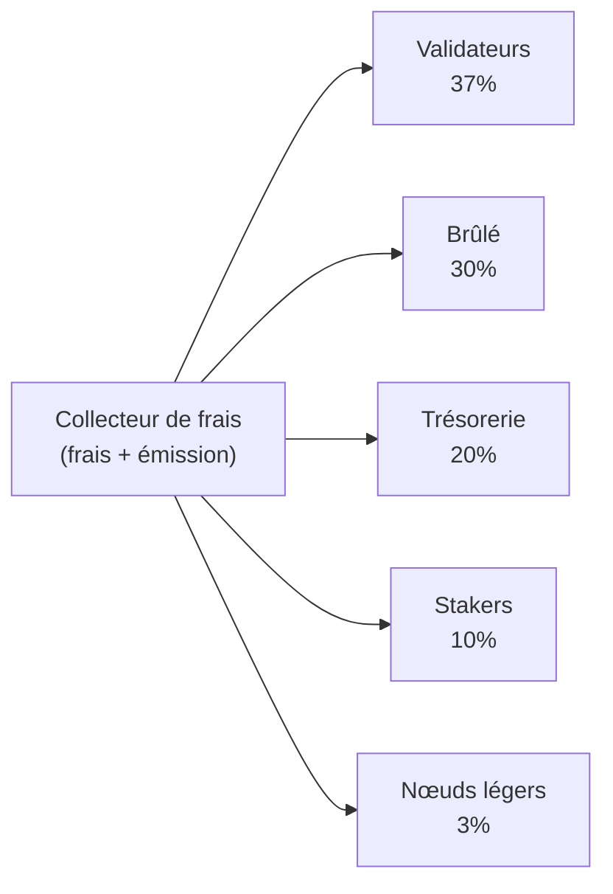

# Tokenomics

Le modèle économique de QoreChain est centré sur le jeton natif **QOR** et suit une **trajectoire d'offre finie et plafonnée** : une offre de genèse fixe, une émission de récompenses de staking frappée sous un plafond cumulatif strict, et un moteur de burn multicanal qui retire définitivement des jetons. Cette page décrit le fonctionnement de l'offre, de l'émission, des burns et de la répartition des frais, à partir de chiffres lus sur la chaîne en production.

---

## Notions de base sur le jeton

| Propriété              | Valeur                                                    |
| --------------------- | -------------------------------------------------------- |
| **Jeton affiché**     | QOR                                                      |
| **Dénomination de base** | uqor                                                     |
| **Précision décimale** | 10^6 (1 QOR = 1 000 000 uqor)                            |
| **Offre**             | Genèse : 4 420 000 000 QOR ; voir [Modèle d'offre et d'émission](#supply-and-emission) |
| **ID de chaîne**          | `qorechain-vladi` (mainnet, ID de chaîne EVM 9801)          |
| **Préfixe Bech32**     | `qor` (comptes : `qor1...`, validateurs : `qorvaloper...`) |

:::note
Les chiffres de cette page décrivent le **mainnet** (`qorechain-vladi`, ID de chaîne EVM **9801**), actif depuis le 7 juin 2026 sur la version **v3.2.4** (appliquée à la hauteur 3 742 566 le 23 octobre 2026). Le testnet **`qorechain-diana`** (ID de chaîne EVM **9800**, version **v3.2.4** depuis le 19 octobre 2026) a son propre historique d'offre et d'émission (l'offre du testnet est très supérieure à celle du mainnet et son émission a déjà dépassé le plafond), utilisez donc les chiffres du mainnet. Les montants qui évoluent à chaque bloc sont accompagnés de la date à laquelle ils ont été lus (23 octobre 2026).
:::

---

## Modèle d'offre et d'émission {#supply-and-emission}

QoreChain suit une **trajectoire d'offre finie et plafonnée**. L'offre de genèse était de **4 420 000 000 QOR** (4 500 000 000 QOR prévus ; 80 000 000 QOR, soit 1,78 %, ont été brûlés lors du Token Generation Event avant la genèse). Après la genèse, le protocole modifie l'offre par deux mécanismes :

* **Émission** — le module `x/inflation` frappe un montant fixe à chaque époque, sous un **plafond cumulatif strict de 590 000 000 QOR**. Les jetons frappés entrent dans le collecteur de frais et passent par la même répartition que les frais de transaction (voir [Répartition des frais](#fee-distribution)).
* **Burns** — le module `x/burn` retire définitivement la part de burn de tout ce que contient le collecteur de frais.

### Émission {#staking-reward-schedule}

| Paramètre | Valeur |
| --- | --- |
| Mode d'émission | `fixed` (depuis v3.1.94, hauteur 2 122 074 — 26 août 2026) |
| Émission par époque | **86 000 QOR** (16 239 QOR jusqu'à la proposition de gouvernance 10 ; la première époque à 86 000 QOR commence au bloc 3 672 000) |
| Longueur d'une époque | 43 200 blocs (environ 38,6 heures avec le temps de bloc actuel d'environ 3,2 s) |
| Plafond cumulatif (`max_total_emission`) | **590 000 000 QOR** (114 285 714 QOR jusqu'à la proposition 10) |
| Frappé à ce jour (23 octobre 2026, époque 86) | 105 420 896,21 QOR (17,87 % du plafond) |
| Restant sous le plafond | 484 579 103,79 QOR (environ 5 635 époques à 86 000 QOR par époque ; la dernière est partielle) |

Une fois le plafond atteint, le module cesse définitivement de frapper ; ensuite, les récompenses proviennent uniquement des frais de transaction. Les chiffres d'émission ont été fixés par la gouvernance : la proposition n°4 (26 août 2026) a remplacé le barème dégressif d'origine par un montant fixe sous un plafond strict, et la proposition n°10 (adoptée le 19 octobre 2026 avec toute la mise bondée votant pour) a fait passer ce montant de 16 239 QOR à 86 000 QOR par époque et relevé le plafond de 114 285 714 QOR à 590 000 000 QOR. La longueur d'une époque n'a pas changé. Les valeurs du barème (17,5 %, 11 %, 7 %, 7 %, 2 % pour les années 1 à 5) restent stockées dans les paramètres du module mais ne sont pas utilisées en mode `fixed`.

Le total frappé, le montant restant et la hauteur de la prochaine époque sont disponibles en direct à `GET /qorechain/inflation/v1/epoch_info` (son champ `current_inflation_rate` indique le taux hérité par année, que le mode `fixed` n'utilise pas).

QoreChain n'expose aucun chiffre de rendement de staking en direct ; considérez tout pourcentage cité comme invérifié. Les chiffres actuels peuvent être lus dans l'état de la chaîne : l'offre se trouve à `GET /cosmos/bank/v1beta1/supply/by_denom?denom=uqor` (4 493 785 581,46 QOR le 23 octobre 2026) et les totaux de burn à `GET /qorechain/burn/v1/stats`.

---

## x/burn — Moteur de burn multicanal

Le module `x/burn` définit aujourd'hui **12 sources de burn** sur le mainnet. Chaque jeton brûlé est retiré définitivement de l'offre. Sur le mainnet, seuls `gas_fee` (31 626 314,61 QOR au 23 octobre 2026) et, depuis v3.2.2, `failed_tx` (0,1355 QOR) ont enregistré des burns ; les autres sont définis mais n'en ont enregistré aucun. À partir de la v3.2.4, il existe une treizième source, `staking_tier_penalty`, qui enregistre la pénalité brûlée lorsqu'une délégation verrouillée dans le temps est déverrouillée de façon anticipée (actif sur le testnet depuis le 19 octobre 2026 et sur le mainnet depuis le 23 octobre 2026 ; aucun déverrouillage anticipé n'a encore été enregistré sur le mainnet ; voir [Staking et délégation](/user-guide/staking-and-delegation#time-locked-staking)).

### Canaux de burn

| #  | Canal            | Source                     | Description                                   |
| -- | ------------------ | -------------------------- | --------------------------------------------- |
| 1  | `gas_fee`          | Frais de transaction           | 30 % de tous les frais de gas sont brûlés                |
| 2  | `contract_create`  | Déploiement de smart contract  | Frais fixe de 100 QOR brûlé par création de contrat |
| 3  | `ai_service`       | Frais d'utilisation du module IA       | 50 % des frais de service IA brûlés                 |
| 4  | `bridge_fee`       | Frais du pont interchaînes    | 100 % des frais de pont brûlés                    |
| 5  | `treasury_buyback` | Opérations de trésorerie        | Rachat-et-burn périodique depuis la trésorerie       |
| 6  | `failed_tx`        | Gas des transactions échouées     | 10 % du gas des transactions échouées brûlé (appliqué par la chaîne depuis v3.2.2)    |
| 7  | `xqore_penalty`    | Pénalités de sortie anticipée xQORE | Montants des pénalités acheminés vers le burn |
| 8  | `auto_buyback`     | Programme de rachat automatisé  | Burns automatisés au niveau du protocole |
| 9  | `tge`              | Token generation event     | Le burn TGE de 80 000 000 QOR a eu lieu avant la genèse (l'offre de genèse est de 4 420 000 000 QOR) ; ce canal est réservé et enregistre 0       |
| 10 | `rollup_create`    | Déploiement de rollup          | 1 % de la mise de création de rollup brûlée            |
| 11 | `milestone`        | Jalons du nombre de transactions | Burns programmés à des nombres cumulés de transactions fixes (aucun déclenché pour l'instant) |
| 12 | `amm`              | AMM                        | Réservé aux frais de protocole de l'AMM (aucun enregistré) |

Les canaux `contract_create`, `ai_service`, `bridge_fee` et `auto_buyback` sont inactifs aujourd'hui : le téléversement QoreChain Native est fermé, et les frais de service IA ainsi que le pont ne sont pas en production.

### Répartition des frais {#fee-distribution}

Tout ce que contient le collecteur de frais est réparti entre cinq destinations, comme indiqué ci-dessous. Le collecteur de frais contient à la fois les frais de transaction et l'émission d'époque frappée par `x/inflation`. Les parts sont appliquées on-chain et totalisent toujours exactement 100 %.

Les parts sont les suivantes :

| Destinataire       | Part | Description                                                          |
| --------------- | ----- | -------------------------------------------------------------------- |
| **Validateurs**  | 37 %   | Distribués à l'ensemble des validateurs actifs proportionnellement à leur mise        |
| **Brûlé**      | 30 %   | Retiré définitivement de l'offre via le canal de burn `gas_fee`       |
| **Trésorerie**    | 20 %   | Alloué à la trésorerie communautaire pour des dépenses décidées par la gouvernance |
| **Stakers**     | 10 %   | Distribués à tous les stakers de QOR proportionnellement à leur délégation            |
| **Nœuds légers** | 3 %    | Distribués aux nœuds légers pour la mise à disposition des données du réseau                  |

Les parts sont appliquées on-chain et doivent toujours totaliser exactement 100 %.

:::note Ce qui transite réellement par la répartition
La répartition s'applique à tout ce que contient le collecteur de frais, qui contient à la fois les frais de transaction et l'émission d'époque frappée par `x/inflation`. En pratique, la quasi-totalité de ce montant est aujourd'hui de l'émission : sur 105 420 896 QOR frappés, 31 626 315 QOR (30,0 %) ont été brûlés via le canal de frais de gas. Jusqu'à la mise à niveau v3.2.0 (25 septembre 2026, hauteur 2 981 742), la part de 10 % des stakers était déplacée vers le solde du module de distribution sans adosser aucune créance, de sorte que stakers et validateurs ensemble recevaient 37 %, et non 47 % ; à partir de cette hauteur, la part des stakers est versée comme une récompense de staking normale. Le montant déjà bloqué a été enregistré on-chain et a depuis été libéré par des votes de gouvernance — voir [Part des stakers bloquée et réserve des nœuds légers](#stranded-and-reserve).
:::

### Paramètres de burn

| Paramètre              | Valeur par défaut                    | Description                              |
| ---------------------- | -------------------------- | ---------------------------------------- |
| `gas_burn_rate`        | 0.30                       | Fraction des frais de gas brûlée (30 %)        |
| `contract_create_fee`  | 100 000 000 uqor (100 QOR) | Frais fixe de burn pour la création de contrat      |
| `ai_service_burn_rate` | 0.50                       | Fraction des frais de service IA brûlée (50 %) |
| `bridge_burn_rate`     | 1.00                       | Fraction des frais de pont brûlée (100 %)    |
| `failed_tx_burn_rate`  | 0.10                       | Fraction du gas des TX échouées brûlée (10 %)   |
| `validator_share`      | 0.37                       | Part du collecteur de frais pour les validateurs |
| `treasury_share`       | 0.20                       | Part pour la trésorerie                    |
| `staker_share`         | 0.10                       | Part pour les stakers                         |
| `light_node_share`     | 0.03                       | Part pour les nœuds légers                    |
| `enabled`              | true                       | Indicateur d'activation du module                 |

Chaque événement de burn est enregistré on-chain avec sa source, son montant, sa hauteur de bloc et le hash de transaction associé. Des statistiques agrégées sont interrogeables par canal et au total.

---

## Part des stakers bloquée et réserve des nœuds légers {#stranded-and-reserve}

Deux montants se sont accumulés sur le mainnet avant la mise à niveau v3.2.0 (25 septembre 2026, hauteur 2 981 742). La mise à niveau les a enregistrés **on-chain, en dehors de toute distribution**, et ne les a rendus déplaçables que par un vote de gouvernance. La gouvernance a depuis libéré les deux vers la fondation, en octobre 2026 :

| Enregistrement | Libération | Montant | Message de gouvernance |
| --- | --- | --- | --- |
| **Part des stakers bloquée** — la part de 10 % des stakers qui avait été déposée à un endroit où elle n'adossait aucune créance de récompense de staking | Proposition 9 (adoptée le 19 octobre 2026) | 6 693 045,921330 QOR libérés | `MsgReleaseStrandedRewards` (autorité de gouvernance ; destination nommée ; ne peut pas dépasser l'enregistrement) |
| **Réserve des nœuds légers** — la part de 3 % des nœuds légers qui s'est accumulée alors qu'aucun nœud léger n'était éligible | Proposition 8 (adoptée le 19 octobre 2026) | 3 156 983,796395 QOR libérés | `MsgReleaseLightNodeReserve` (autorité de gouvernance) |

**Reliquat corrigé de la part bloquée.** Lors de la mise à niveau v3.2.3 (hauteur 3 662 051, 20 octobre 2026), la chaîne a recalculé l'enregistrement de la part bloquée, qui s'élevait alors à 3 807 496,785528 QOR (`reserved` dans `GET /qorechain/burn/v1/stranded_rewards`, à côté de `released`, 6 693 045,921330 QOR). La proposition de gouvernance 12 a libéré ce reliquat, 3 807 496,785528 QOR, vers la fondation : elle a été adoptée (le vote s'est terminé le 21 octobre 2026 à 20:01 UTC) avec tout le stake lié ayant voté en sa faveur. L'enregistrement peut être consulté à `GET /qorechain/burn/v1/stranded_rewards` et la proposition à `GET /cosmos/gov/v1/proposals/12`.

**Le pool des nœuds légers aujourd'hui.** À partir de la mise à niveau v3.2.0, les récompenses des nœuds légers ne sont versées qu'à partir de ce qui s'est accumulé depuis la précédente exécution de distribution, avec un plafond par nœud. Depuis v3.2.3, le plafond est de **2 000 QOR par nœud par 30 jours** (`max_reward_per_month_per_node`), au prorata du temps de bloc et de la disponibilité du nœud ; la valeur par bloc (`max_reward_per_block_per_node`, 1 713 uqor) est toujours indiquée mais n'est plus la règle. Tout ce qui n'est pas gagné reste dans la réserve du pool, que seul un vote de gouvernance peut libérer. Après la proposition 8, la réserve s'accumule de nouveau : le 20 octobre 2026, elle contenait 487,2318 QOR (`reserved` dans `GET /qorechain/lightnode/v1/reward_pool`) sans aucun montant en attente ni payable, car aucun nœud léger ne s'est encore enregistré. L'enregistrement est ouvert et soumis à licence (voir [Nœud léger](/light-node/overview#reward-program-status)). Une libération antérieure à l'instantané de la mise à niveau, supérieure au montant enregistré ou vers une destination invalide est refusée.

## x/xqore — Staking verrouillé et amplification de la gouvernance {#x-xqore}

:::warning Pas encore en production
La comptabilité du module xQORE existe et le module est activé dans la genèse, mais il **n'est pas encore utilisable** sur le mainnet (`qorechain-vladi`) ni sur le testnet (`qorechain-diana`). Le nœud n'a aucun point d'entrée de transaction, de requête, de CLI ou de RPC pour lui ; ainsi `tx xqore lock` / `unlock`, `query xqore ...`, les routes REST xQORE et `qor_getXQOREPosition` ne fonctionnent pas, et personne ne détient de xQORE. Il est prévu pour une prochaine version de la chaîne, qui modifiera aussi la façon dont les pénalités de sortie sont redistribuées afin que le déverrouillage reste peu coûteux quel que soit le nombre de détenteurs. La version sera nommée ici lors de sa publication.
:::

Le module `x/xqore` introduit **xQORE**, un dérivé de staking verrouillé et non transférable. Les utilisateurs verrouillent du QOR pour frapper du xQORE dans un ratio de 1:1. Les détenteurs de xQORE reçoivent un pouvoir de gouvernance amplifié et une part des pénalités de sortie redistribuées.

### Mécanisme de verrouillage

* **Verrouillage** : envoyer du QOR au module xQORE pour frapper du xQORE dans un ratio de 1:1.
* **Poids de gouvernance** : les détenteurs de xQORE reçoivent un **pouvoir de vote de gouvernance 2x** par rapport aux stakers QOR standards.
* **Non transférable** : le xQORE ne peut pas être envoyé entre comptes. Il est lié à l'adresse de verrouillage.

### Barème de pénalité de sortie

Un retrait anticipé depuis xQORE entraîne une pénalité qui diminue avec la durée de verrouillage :

| Durée de verrouillage  | Taux de pénalité | Description                                |
| -------------- | ------------ | ------------------------------------------ |
| &lt; 30 jours   | **50 %**      | La moitié du QOR verrouillé est confisquée            |
| 30 -- 90 jours  | **35 %**      | Pénalité importante pour les verrouillages de courte durée   |
| 90 -- 180 jours | **15 %**      | Pénalité réduite pour un engagement de moyen terme |
| > 180 jours     | **0 %**       | Retrait intégral sans pénalité            |

### Redistribution par rebase PvP

Les pénalités collectées lors des sorties anticipées ne sont pas simplement détruites. Elles suivent plutôt un modèle de rebase PvP (player-versus-player) :

1. Dans la configuration de genèse, **0 %** des montants de pénalité sont brûlés (`penalty_burn_rate = 0` ; le canal de burn `xqore_penalty` existe si la gouvernance le modifie).
2. **100 %** sont redistribués au prorata à tous les détenteurs de xQORE restants.

Cela crée une dynamique à somme positive pour les détenteurs de long terme : chaque sortie anticipée augmente la valeur effective des positions xQORE restantes. Les rebases surviennent tous les **100 blocs**.

### Paramètres xQORE

| Paramètre               | Valeur par défaut                | Description                               |
| ----------------------- | ---------------------- | ------------------------------------------ |
| `governance_multiplier` | 2.0                    | Multiplicateur de pouvoir de vote pour les détenteurs de xQORE |
| `min_lock_amount`       | 1 000 000 uqor (1 QOR) | QOR minimum requis pour verrouiller              |
| `penalty_burn_rate`     | 0.00                   | Fraction des pénalités de sortie brûlée (valeur par défaut de la genèse : toutes les pénalités sont redistribuées) |
| `rebase_interval`       | 100 blocs             | Blocs entre les événements de rebase PvP          |
| `enabled`               | true                   | Indicateur d'activation du module                    |

---

## x/inflation — Émission plafonnée

Le module `x/inflation` frappe l'émission par époque (86 000 QOR depuis la proposition 10, `emission_mode = fixed`) et l'envoie au collecteur de frais, jusqu'à ce que le plafond cumulatif de 590 000 000 QOR soit atteint. Les changements de paramètres passent par une proposition de gouvernance de paramètres normale (`MsgUpdateParams`, ajouté dans v3.1.94).

### Mécanique des époques

* **Longueur d'une époque** : 43 200 blocs (environ 38,6 heures à ≈3,2 s par bloc).
* À chaque limite d'époque, le module frappe l'émission de l'époque (ou le reliquat jusqu'au plafond), met à jour l'enregistrement d'époque et cesse de frapper une fois que `total_minted` atteint le plafond.
* Depuis v3.2.3, l'année d'émission est dérivée de la longueur d'époque plutôt que d'un nombre de blocs fixe.

### Paramètres

Lus en direct le 23 octobre 2026 à `GET /qorechain/inflation/v1/params` :

| Paramètre | Valeur (mainnet) | Description |
| --- | --- | --- |
| `emission_mode` | `fixed` | `schedule` (hérité, taux par année) ou `fixed` ; la v3.2.4 ajoute un troisième mode, `target_apy` |
| `fixed_epoch_emission` | 86 000 000 000 uqor (86 000 QOR) | Frappé par époque en mode fixe |
| `max_total_emission` | 590 000 000 000 000 uqor (590 000 000 QOR) | Plafond cumulatif strict |
| `epoch_length` | 43 200 blocs | Blocs par époque d'émission |
| `schedule` | 17,5 %, 11 %, 7 %, 7 %, 2 % (années 1 à 5) | Barème hérité, inutilisé en mode fixe |
| `enabled` | `true` | Indicateur d'activation du module |

Les paramètres du module et l'enregistrement d'époque sont exposés via REST sur le mainnet depuis v3.2.3 (`/qorechain/inflation/v1/params` et `/qorechain/inflation/v1/epoch_info`) ; ils peuvent aussi être lus dans l'état de la chaîne avec l'interface de store brut RPC `abci_query` (store `inflation`, clés `inflation/params` et `inflation/epoch`).

:::note v3.2.4 et l'émission du testnet
Le testnet `qorechain-diana` conserve ses paramètres d'émission antérieurs (16 239 QOR par époque sous un plafond de 114 285 714 QOR, déjà atteint là-bas) ; le mainnet utilise les valeurs ci-dessus. La version v3.2.4 ajoute un troisième mode d'émission, `target_apy`, avec un paramètre `target_apy_bps` : sur le testnet depuis le 19 octobre 2026 et sur le mainnet depuis le 23 octobre 2026 (proposition de gouvernance 13). Le paramètre vaut `0` sur les deux réseaux et ne pilote pas l'émission. Faire passer un réseau à ce mode relève d'un vote de gouvernance distinct, qui n'a pas été proposé sur le mainnet ; tant qu'aucun n'est adopté, le mainnet reste en mode `fixed` à 86 000 QOR par époque.
:::

---

## Burn et émission

L'émission est plafonnée (590 000 000 QOR au total) et la part de burn s'applique à tout ce qui entre dans le collecteur de frais, émission comprise. À ce jour (23 octobre 2026), 31 626 315 QOR ont été brûlés pour 105 420 896 QOR frappés, de sorte que l'offre (4 493 785 581 QOR) est actuellement supérieure à son niveau de genèse. Une fois le plafond atteint, l'offre ne peut plus que diminuer, du montant brûlé.

---

## Voir aussi

* [Paramètres de la chaîne](/appendix/chain-parameters) — valeurs par défaut économiques et de consensus canoniques.
* [Staking et délégation](/user-guide/staking-and-delegation) — déléguer du QOR et gagner des récompenses.
* [Staking xQORE](/user-guide/xqore-staking) — le mécanisme de staking à rebase PvP.
* [Récompenses des nœuds légers](/light-node/rewards-and-monitoring) — la part de récompense des nœuds légers.
