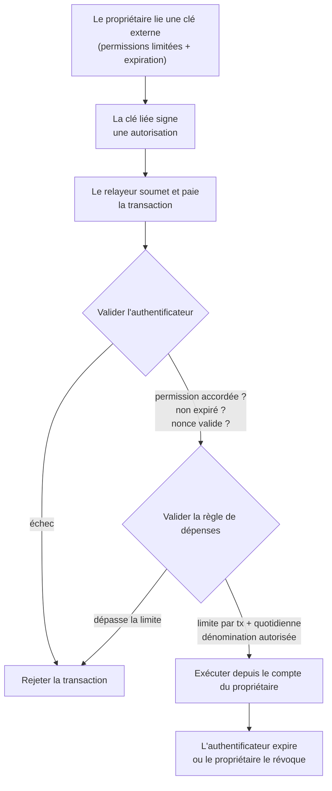

# Abstraction de compte

QoreChain fournit une **abstraction de compte au niveau du protocole** via le module `x/abstractaccount`. Le module enregistre des comptes abstraits assortis de règles de dépenses et permet au propriétaire du compte de lier des clés externes (**authentificateurs**) qui peuvent dépenser depuis le compte dans les limites de permissions et de dépenses définies, sans infrastructure externe de contrats intelligents.

:::danger Non activé sur le mainnet ; activé sur le testnet
Le module d'abstraction de compte est **désactivé sur le mainnet `qorechain-vladi`** au moment de la rédaction (vérifié le 27 octobre 2026) : `qorechaind query abstractaccount config` (et `GET /qorechain/abstractaccount/v1/config`) renvoient `enabled: false`. Sur le **testnet `qorechain-diana`**, il a été activé par une décision de gouvernance (proposition 18, adoptée le 27 octobre 2026) et renvoie `enabled: true`. À partir de la version de chaîne v3.2.0, ce paramètre est appliqué sur chaque chemin : lorsqu'il vaut `false`, la chaîne refuse la création de compte, l'enregistrement d'authentificateurs et les deux voies d'exécution (`MsgExecuteEVM`, `MsgExecuteCosmos`) avec `abstract accounts are disabled on this chain`. Aucune transaction ordinaire ne peut activer le module ; le paramètre ne change que par une décision de gouvernance. Aucune transaction de compte abstrait n'a jamais été incluse sur le mainnet. Tout ce qui suit décrit les interfaces du module ; essayez-le sur le testnet, et ne construisez pas de flux de clé liée ou de dépenses déléguées pour le mainnet tant que le module n'y est pas activé. Vérifiez toujours d'abord ce paramètre.
:::

:::note
Les commandes ci-dessous utilisent le mainnet **`qorechain-vladi`** (en production depuis le 7 juin 2026), qui exécute la version de nœud **v3.2.7** (appliquée à la hauteur 4 164 600 le 12 novembre 2026, proposition de gouvernance 16 ; la v3.2.6 a été appliquée à la hauteur 4 020 000 le 4 novembre 2026, proposition 15 ; la v3.2.5 a été appliquée à la hauteur 3 906 833 le 29 octobre 2026, proposition 14, et la v3.2.4 à la hauteur 3 742 566 le 23 octobre 2026). Remplacez par `--chain-id qorechain-diana` pour le testnet, qui exécute la v3.2.8 (depuis le 12 novembre 2026 ; v3.2.4 depuis le 19 octobre 2026).
:::

:::caution Toute transaction sur la voie Cosmos exige la co-signature post-quantique hybride
Les exemples `qorechaind tx` de cette page ne montrent que les indicateurs de frais. Sur les réseaux en production, toute transaction sur la voie Cosmos doit aussi porter la co-signature hybride ML-DSA-87 ; construisez donc la transaction avec `--generate-only` et signez-la avec `qorechaind tx pqc cosign` (ou utilisez QoreX ou le SDK, qui s'en chargent pour vous). La version communautaire de `qorechaind` ne peut pas produire cette signature ; utilisez le binaire de la release issu du [manifeste de téléchargement](/developer-guide/running-a-node#fetch-the-manifest). Le plancher de frais est de **0,1 uqor par unité de gaz**, donc `--gas 400000` exige au moins `--fees 40000uqor`. Voir [Signature post-quantique](/developer-guide/post-quantum-signing).
:::

## Vue d'ensemble

Les comptes blockchain traditionnels sont contrôlés par une seule clé privée. L'abstraction de compte dissocie la notion de « qui peut autoriser une transaction » d'une clé cryptographique unique. Le module `x/abstractaccount` fournit :

* Des **comptes abstraits** avec un type de compte et un propriétaire enregistrés
* Des **règles de dépenses** (limites par transaction et quotidiennes, dénominations autorisées) qui bornent ce que les clés liées (authentificateurs et clés de session) peuvent dépenser ; elles ne limitent pas la clé propre du propriétaire
* Des **authentificateurs** : des clés externes (une clé ed25519 Phantom ou une adresse secp256k1 MetaMask) que le propriétaire lie avec des permissions limitées et une expiration, et qu'il peut révoquer à tout moment

*Un flux avec clé liée (authentificateur) : la clé liée signe une autorisation, un relayeur la soumet, le module vérifie les permissions, l'expiration et les règles de dépenses, puis exécute depuis le compte du propriétaire.*



## Types de comptes

`create` enregistre l'un des trois types de comptes. Le type est stocké sur le compte et participe à la dérivation de son adresse ; le module n'a ni transactions multisig, ni clés de session, ni récupération qui lui soient propres (le service de transactions comprend `create`, `update-rules`, `register-authenticator`, `revoke-authenticator`, `execute-cosmos`, `execute-evm`).

| Type              | Cas d'usage prévu                       |
| ----------------- | --------------------------------------- |
| `multisig`        | Trésoreries de DAO, portefeuilles partagés |
| `social_recovery` | Portefeuilles grand public, onboarding  |
| `session_based`   | Sessions dApp, portefeuilles mobiles    |

## Créer un compte abstrait

`create` prend le type de compte comme argument positionnel (`multisig`, `social_recovery` ou `session_based`) :

```bash
qorechaind tx abstractaccount create session_based \
  --from mykey \
  --gas 400000 --fees 40000uqor
```

La commande n'a aucun indicateur pour les signataires, les seuils ou les gardiens.

## Authentificateurs (clés liées)

Le mécanisme de clé déléguée du module est l'**authentificateur**, décrit dans [Authentificateurs de portefeuilles liés](#authenticators) ci-dessous : le propriétaire lie une clé externe (ed25519 ou secp256k1) avec un ensemble de permissions et une expiration, et la révoque à tout moment :

```bash
qorechaind tx abstractaccount register-authenticator <account-address> <scheme> <pubkey-base64> <permissions-csv> <expiry-unix> <label> \
  --from mykey --gas 400000 --fees 40000uqor
qorechaind tx abstractaccount revoke-authenticator <account-address> <scheme> <pubkey-base64> \
  --from mykey --gas 400000 --fees 40000uqor
```

`scheme` vaut `ed25519` (par exemple Phantom) ou `secp256k1` (par exemple MetaMask). Il n'existe aucune commande `grant-session`, `revoke-session` ni `query abstractaccount sessions`.

## Règles de dépenses

Les règles de dépenses ajoutent des garde-fous financiers pour les authentificateurs et les clés de session liés à un compte abstrait. Les règles de dépenses ne lient que les authentificateurs et les clés de session, pas la clé propre du propriétaire ; celle-ci est limitée, sur la voie EVM, par la [fenêtre d'autorisation EVM](/getting-started/first-transaction#evm-window).

Les champs de la règle :

| Règle            | Description                                           |
| ---------------- | ----------------------------------------------------- |
| `daily_limit`    | Dépense totale maximale par jour calendaire UTC       |
| `per_tx_limit`   | Dépense maximale par exécution autorisée individuelle |
| `allowed_denoms` | Restreint les dénominations de jetons pouvant être dépensées (un ERC-20 est listé sous la forme `erc20/<adresse 0x EIP-55>`, l'écriture propre à la règle de dépense avec une barre oblique ; la chaîne compare l'adresse sous sa forme EIP-55, donc la casse que vous saisissez ne crée pas un autre token. Ce n'est pas le denom bank d'une paire de tokens enregistrée, qui s'écrit `erc20:<adresse 0x EIP-55>` avec deux-points et est sensible à la casse, voir [Développement EVM](/developer-guide/evm-development#fest-tokens)) |
| `denom_limits`   | Limites par dénomination sous forme de chaînes décimales (v3.2.2) : `{"denom","per_tx_limit","daily_limit"}` ; elles remplacent `per_tx_limit` et `daily_limit` pour les dénominations qu'elles nomment, de sorte qu'un token à 18 décimales peut être plafonné |
| `allowed_evm_calls` | Appels EVM qu'une clé liée à une règle peut effectuer **avec des données d'appel** (v3.2.2), sous la forme `0x<target>` (n'importe quelle fonction de ce contrat) ou `0x<target>/0x<selector>` (cette fonction uniquement). Sans entrée, une clé liée à une règle ne peut qu'envoyer de la valeur, déployer (avec la permission `deploy`) et déplacer les tokens ERC-20 listés dans `allowed_denoms`. Lister une cible fait confiance à tous les arguments des appels qui lui sont adressés, destinataires compris |

### Définir les règles de dépenses

`update-rules` remplace les règles du compte par un tableau JSON d'objets `SpendingRule` (JSON en ligne, pas un fichier et pas des indicateurs) :

```bash
qorechaind tx abstractaccount update-rules <account-address> \
  '[{"id":"daily","enabled":true,"daily_limit":1000000000,"per_tx_limit":100000000,"allowed_denoms":["uqor"]}]' \
  --from mykey --gas 400000 --fees 40000uqor
```

Les limites sont exprimées dans l'unité de base (`uqor`) et comptent par exécution autorisée ; la limite quotidienne borne le total par jour calendaire UTC. Les règles remplacent d'un bloc celles qui sont stockées, donc un champ que vous omettez est supprimé. Depuis la v3.2.2, la voie EVM mesure ce qu'un appel déplace réellement (valeur native, diminution du solde natif du compte, coins bancaires dépensés, et variation du solde ou de l'allowance de chaque ERC-20 listé) au lieu de se limiter à `msg.value`, et la création de contrat exige la permission distincte `deploy`. Un exemple plus riche (l'ERC-20 montré est le token de test fUSD du testnet ; utilisez l'adresse de contrat de votre propre token, et notez la barre oblique dans `erc20/<address>` dans une règle par opposition aux deux-points dans le denom bank `erc20:<address>`) :

```bash
qorechaind tx abstractaccount update-rules <account-address> \
  '[{"id":"daily","enabled":true,"daily_limit":5000000,"allowed_denoms":["uqor","erc20/0x97143B771D34ddb9130b807b135Ae675A5a963CA"],"allowed_evm_calls":["0xROUTER/0x38ed1739"],"denom_limits":[{"denom":"erc20/0x97143B771D34ddb9130b807b135Ae675A5a963CA","per_tx_limit":"100000000000000000000","daily_limit":"500000000000000000000"}]}]' \
  --from mykey --gas 400000 --fees 40000uqor
```

### Interroger les règles actuelles

L'enregistrement du compte inclut ses règles et le nombre de clés liées :

```bash
qorechaind query abstractaccount account <account-address>
```

À partir de la v3.2.8 (testnet uniquement jusqu'à une mise à niveau ultérieure du mainnet), une clé dotée de permissions de valeur est refusée à l'enregistrement comme à l'exécution si aucune règle ne la borne : « aucune limite » ne s'applique donc plus à ces clés.

:::caution Une règle ne borne une clé que si elle existe
La chaîne résout la limite dans cet ordre : la règle propre à l'authentificateur si elle est définie et `enabled` ; sinon la première règle `enabled` du compte ; sinon **il n'y a aucune limite**. Une règle stockée avec `enabled: false` signifie aucune limite, et non une limite nulle. `MsgRegisterAuthenticator` ne porte aucune règle, donc une clé liée par ce seul message n'est bornée que par une règle au niveau du compte. Définissez une règle délibérément avec `update-rules`, et n'enregistrez que les permissions dont la clé a besoin. Une limite borne les dégâts qu'une clé liée peut causer ; elle ne remplace pas la révocation de la clé.
:::

## Authentificateurs de portefeuilles liés — dépenses déléguées {#authenticators}

La conception des authentificateurs a été introduite dans la version de chaîne **v3.1.85** (qui s'appuie sur le modèle de permissions de la v3.1.84). Elle n'est **pas utilisable sur le mainnet tant que le module y est désactivé**, et elle est disponible sur le testnet, où le module est activé (voir l'encadré d'état en haut de cette page). Une **clé de portefeuille externe liée** — une clé Phantom (ed25519) ou un compte MetaMask (secp256k1) — peut **dépenser depuis le compte post-quantique canonique** selon des conditions révocables, à moindre privilège et à dépenses limitées. La clé externe ne produit jamais de signature ML-DSA ; un **relayeur** soumet et paie l'enveloppe de transaction (la propre signature PQC hybride du relayeur satisfait les exigences de signature de la chaîne), tandis que la signature de l'authentificateur sur des **octets de signature séparés par domaine et protégés contre le rejeu** constitue l'autorisation.

### Enregistrer un authentificateur {#register-authenticator}

Le propriétaire du compte enregistre la clé externe avec `MsgRegisterAuthenticator` (une transaction ordinaire signée par la clé racine), en lui attribuant un schéma, des permissions, une expiration et des limites de dépenses optionnelles :

```js
import { registerEthAuthenticatorMsg } from "@qorechain/wallet-adapter";

// Link a MetaMask account by its 20-byte address (EIP-191 verification):
const msg = registerEthAuthenticatorMsg({
  owner: "qor1owner...",              // the canonical account (signs this message)
  ethAddress: "0xAbC...123",          // the MetaMask address to link
  permissions: ["evm"],               // least privilege — see the taxonomy below
  expiryUnix: Math.floor(Date.now() / 1000) + 30 * 24 * 3600, // absolute Unix seconds, ≤ 30 days recommended
  label: "metamask",
});
// Limits are a separate message (MsgUpdateSpendingRules), see "Spending Rules" above.
// Sign & broadcast this msg with the OWNER's normal hybrid-PQC signer.
```

**À partir de la version v3.2.8 (testnet uniquement jusqu'à une mise à niveau ultérieure du mainnet), l'enregistrement demande deux éléments de plus.**

1. **Une preuve de possession.** `MsgRegisterAuthenticator` a un champ obligatoire `possession_proof` (champ 8) : une signature par la clé liée, prouvant qu'elle consent au lien. La clé signe ce texte brut selon son propre schéma, de sorte qu'un portefeuille de navigateur montre à l'utilisateur ce qu'il signe (Phantom `signMessage`, MetaMask `personal_sign`) ; une clé secp256k1 de 33 octets signe le SHA-256 du texte :

   ```text
   QoreChain authenticator link v1
   chain: <chain-id>
   account: <bech32 account>
   scheme: <scheme>
   key: <lowercase hex of the public key, or of the 20-byte address>
   ```

   Le texte nomme la chaîne, le compte, le schéma et la clé, si bien qu'une preuve ne peut pas être réutilisée pour une autre chaîne, un autre compte ou une autre clé. Un enregistrement sans preuve valide est refusé.
2. **Une règle de dépense pour les clés de valeur.** Une clé dont les permissions peuvent déplacer de la valeur (`send`, `evm`, `svm`, `deploy`, `all`) a besoin d'une règle de dépense qui borne chaque dénomination qu'elle peut dépenser, définie avec `MsgUpdateSpendingRules` avant le lien ou en même temps. La même règle est appliquée à l'exécution pour les clés liées avant la mise à niveau : ajoutez donc aussi des règles pour elles.

À partir du code, le SDK 0.14.0 fournit les assistants pour les deux (TypeScript : `signAuthenticatorLinkPhantom`, `signAuthenticatorLinkMetaMask`, `signAuthenticatorLinkEd25519`, `signAuthenticatorLinkSecp256k1`, `signAuthenticatorLinkEip191` pour la preuve ; `linkAuthenticatorMsgs` pour la règle de dépense et le lien dans une seule transaction signée par le propriétaire), et `@qorechain/wallet-adapter` 0.6.0 fournit `phantomPossessionProof`, `metaMaskPossessionProof` et `linkAuthenticatorMsgs`. Voir [Lier une clé à partir de la chaîne v3.2.8](/sdk/guides/authenticators#link-v328). Pour le cas d'une exécution échouée, `assertAuthenticatorExecutionsSucceeded` lève une erreur sur `success=false`. `linkAuthenticatorMsgs`, `metaMaskPossessionProof` et `revokeAuthenticatorMsg` ont été exécutés sur le testnet (voir [Ce qui a été vérifié](#link-example-checks)) ; les assistants Phantom et ed25519 ne l'ont pas été.

Une clé Phantom s'enregistre de la même manière avec le schéma `ed25519` et la clé publique Phantom (`register-authenticator` en CLI). La révocation est instantanée via `MsgRevokeAuthenticator`.

**Une exécution peut échouer à l'intérieur d'une transaction réussie.** À partir de la v3.2.8 (testnet uniquement jusqu'à une mise à niveau ultérieure du mainnet), un `MsgExecuteEVM` ou `MsgExecuteCosmos` en échec renvoie `success=false` dans sa réponse avec le code de transaction 0, émet l'événement `abstractaccount_execution_failed` avec la raison, et consomme quand même le nonce de l'authentificateur. Un client qui ne vérifie que le code de transaction signalera un tel appel comme un succès : lisez la réponse ou l'événement.

### Taxonomie des permissions {#permission-taxonomy}

Onze permissions canoniques encadrent ce qu'un authentificateur enregistré peut faire. La table de correspondance est **fermée par défaut (fail-closed)** : un type de message sans correspondance est refusé.

| Permission | Accorde |
| --- | --- |
| `send` | Transferts bancaires sur la voie native |
| `delegate` / `withdraw` / `vote` | Staking, retrait des récompenses, gouvernance |
| `evm` / `wasm` / `svm` | Exécution sur la voie de VM correspondante |
| `amm` / `ibc` / `deploy` | Opérations AMM, transferts IBC, déploiement de contrats |
| `all` | Tout message *délégable* |

**Les messages de gestion des clés ne sont jamais délégables** — `MsgRegisterAuthenticator`, `MsgRevokeAuthenticator`, l'enregistrement/la migration de clés PQC et `MsgRotatePQCKey` exigent toujours la clé racine, de sorte qu'une clé liée ne peut jamais élever ses propres privilèges. Le schéma (`schema_version` 2) liste aussi des `lane_rules` : la création de contrat depuis l'adresse du compte, un appel qui fait avancer le nonce EVM du compte, et un appel au compte lui-même lorsque son code est une délégation EIP-7702 exigent chacun la permission `deploy` ou `all`. Depuis la v3.2.3, l'enregistrement refuse les chaînes de permission inconnues et les clés secp256k1 de 65 octets qui ne pourraient jamais être vérifiées.

Lisez la taxonomie en direct (avec `schema_version` pour détecter les dérives) au lieu de la coder en dur :

```bash
curl -s https://api.qore.host/qorechain/abstractaccount/v1/permission_schema | jq
# or: qorechaind query abstractaccount permission-schema
```

### Dépenser via une clé liée {#execute-messages}

Deux messages transportent les actions autorisées par un authentificateur. Dans les deux cas, le relayeur est le signataire/payeur de frais de la transaction ; la signature de l'authentificateur voyage à l'intérieur du message.

**`MsgExecuteEVM`** — un appel ou un transfert EVM **depuis l'adresse `0x…` du compte canonique**. L'authentificateur signe `sha256("qorechain-evm-auth-v1" ‖ chainId ‖ account ‖ pubkey ‖ to ‖ value ‖ data ‖ nonce)` (tous les champs sont préfixés par leur longueur). À partir de la v3.2.3 (la fonctionnalité `abstractaccount-hardening`), la chaîne exige le **condensat v2**, `sha256("qorechain-evm-auth-v2" ‖ … ‖ nonce ‖ gasLimit)`, qui lie aussi la limite de gas de l'appel (8 octets, big-endian) afin qu'un relayeur ne puisse pas rejouer la signature avec une autre limite ; aucun bloc n'accepte les deux formes. `qorechaind query abstractaccount auth-sign-evm` prend `--gas-limit` pour cela, et vous passez la même valeur à `execute-evm`. La protection anti-rejeu est le propre nonce EVM du compte.

**`MsgExecuteCosmos`** — un envoi bancaire sur la voie native depuis le compte canonique. L'authentificateur signe `sha256("qorechain-cosmos-auth-v1" ‖ chainId ‖ account ‖ pubkey ‖ to ‖ amount ‖ nonce)`. La protection anti-rejeu est une **séquence par authentificateur** tenue par le module (un envoi bancaire n'incrémente pas le nonce du compte). Les envois vers soi-même sont rejetés.

:::caution Règles de nonce
* `MsgExecuteEVM.nonce` = le nonce EVM **actuel** du compte (`eth_getTransactionCount(account0x, "latest")`). En production, le relayeur est un compte *différent*, donc n'ajoutez **pas** +1. Signer un nonce périmé renvoie le code `11`.
* `MsgExecuteCosmos.nonce` = la séquence par authentificateur (interrogez l'état d'authentificateur du compte), et **non** la séquence Cosmos du compte. À partir de la v3.2.4 (testnet depuis le 19 octobre 2026, mainnet depuis le 23 octobre 2026), `GET /qorechain/abstractaccount/v1/auth_nonce/{address}/{pubkey_hex}` renvoie directement cette séquence (`nonce`, `linked`).
:::

**Exemple Phantom** (navigateur : Phantom signe, votre backend relaie) :

```js
import { buildPhantomExecuteCosmos } from "@qorechain/wallet-adapter";

// In the dApp: Phantom signs the digest with ed25519 signMessage.
const msg = await buildPhantomExecuteCosmos({
  wallet: window.solana,              // Phantom: { publicKey, signMessage }
  relayer: "qor1relayer...",          // submits the tx and pays the fee (a different account)
  chainId: "qorechain-vladi",
  account: "qor1owner...",            // canonical account being spent from
  to: "qor1recipient...",
  amount: "900000uqor",               // single-coin string
  nonce: authSequence,                // per-authenticator sequence
});
// Send `msg` to your relayer; the relayer wraps it in a tx it signs
// (hybrid PQC) and broadcasts. The transfer moves the OWNER's funds.
```

**Exemple MetaMask** (`personal_sign` EIP-191 depuis l'adresse liée de 20 octets) :

```js
import { buildMetaMaskExecuteEvm } from "@qorechain/wallet-adapter";

const msg = await buildMetaMaskExecuteEvm({
  provider: window.ethereum,          // MetaMask (EIP-1193)
  address: ethAddress,                // the linked 20-byte address
  relayer: "qor1relayer...",
  chainId: "qorechain-vladi",
  account: "qor1owner...",
  to: "0xRecipient...",
  value: (10n ** 16n).toString(),     // 0.01 QOR in wei (18-decimal EVM view), as a decimal string
  gasLimit: 100000,
  nonce: currentEvmNonce,             // eth_getTransactionCount(owner0x, "latest")
});
// Relay as above. The chain verifies the signature via EIP-191 + ecrecover
// against the registered 20-byte address.
```

Les mêmes constructeurs existent dans le [SDK QoreChain](/sdk/guides/authenticators) pour les cinq langages, ainsi que des équivalents CLI :

```bash
# Generate an ed25519 authenticator key: the seed goes to a new 0600 file, only the public key is printed
qorechaind query abstractaccount auth-keygen --out authenticator.seed

# Sign the exact bytes the chain verifies (seed from --seed-file, "-" for stdin, QORE_AUTH_SEED, or a prompt)
qorechaind query abstractaccount auth-sign-cosmos <chain-id> <account> <to> <amount> <nonce> --seed-file authenticator.seed
qorechaind query abstractaccount auth-sign-evm <chain-id> <account> <to-0xhex> <value-wei> <data-hex> <nonce> --seed-file authenticator.seed

# Relay a pre-signed authorization (the relayer's --from key pays; cosign the envelope with `tx pqc cosign`)
qorechaind tx abstractaccount execute-cosmos <account> <to> <amount> <scheme> <pubkey-base64> <signature-base64> <nonce> --from relayer --generate-only > tx.json
qorechaind tx abstractaccount execute-evm <account> <to-0xhex> <value-wei> <data-hex> <gas-limit> <scheme> <pubkey-base64> <signature-base64> <nonce> --from relayer --generate-only > tx.json
```

Les clés et les signatures de ces commandes sont en base64. Les utilitaires `auth-sign-*` lisent la graine depuis un fichier, l'entrée standard ou l'environnement plutôt que depuis un argument de ligne de commande (version de nœud v3.2.1 et ultérieures), de sorte qu'elle n'apparaît pas dans l'historique du shell. Les indicateurs de gestion de la graine (`--out`, `--seed-file`) n'existent que dans les binaires v3.2.1 et ultérieurs.

### Codes d'erreur {#authenticator-errors}

Les échecs d'application des règles renvoient des codes distincts (codespace `abstractaccount`) afin que les portefeuilles puissent afficher le bon message :

| Code | Signification | UX du portefeuille |
| --- | --- | --- |
| `5` | Limite de dépenses dépassée (par transaction ou quotidienne) | Afficher l'allocation restante |
| `6` | Authentificateur expiré | « Expiré — reliez à nouveau votre portefeuille » |
| `9` | Module désactivé (l'état actuel sur le mainnet) | « Les portefeuilles liés ne sont pas encore disponibles » |
| `10` | Permission refusée (portée ou message non délégable) | Afficher la permission manquante |
| `11` | Rejeu refusé (nonce/séquence périmé) | Réinterroger le nonce et signer à nouveau |

(Codespace `pqc` code `21` = échec de la vérification de la signature hybride — un problème de signature côté relayeur, pas un problème d'autorisation.)

### Requêtes REST {#abstractaccount-rest}

Les requêtes en lecture du module sont servies via REST (depuis la **v3.1.85**) :

```
GET /qorechain/abstractaccount/v1/config      # {"config":{"enabled":false,...}} on mainnet today; enabled: true on the testnet
GET /qorechain/abstractaccount/v1/accounts
GET /qorechain/abstractaccount/v1/accounts/{address}
GET /qorechain/abstractaccount/v1/permission_schema
```

## Lier une clé en v3.2.8 : exemple détaillé {#link-example-v328}

Cette section décrit pas à pas un lien complet sur le testnet **`qorechain-diana`**, qui exécute la v3.2.8 depuis le 12 novembre 2026. Le mainnet n'exécute pas encore la v3.2.8, et son module de compte abstrait est désactivé : rien de tout cela ne s'y applique donc aujourd'hui. En bref : la clé que vous liez doit signer un court texte pour montrer qu'elle consent à être liée, une clé qui peut déplacer de la valeur a besoin d'une règle de dépense sur le compte, et lorsqu'une clé liée dépense ensuite, une dépense échouée est signalée à l'intérieur d'une transaction réussie.

Pourquoi c'est important : à partir de la v3.2.8, le détenteur de la clé participe au lien ; une clé ne peut donc être liée que par quelqu'un qui la détient réellement, et une clé qui peut déplacer de la valeur est toujours bornée par une limite sur le compte.

:::note Ce que vous pouvez exécuter aujourd'hui
Le texte du lien et les trois schémas de signature ci-dessous fonctionnent avec `node:crypto` et `@noble` simples, comme indiqué. Les paquets publiés (SDK 0.13.0 et wallet-adapter 0.5.0) ne peuvent pas encore placer la preuve dans `MsgRegisterAuthenticator` : leurs `registerAuthenticator` et `registerEthAuthenticatorMsg` construisent le message sans le champ de preuve, ce que le testnet v3.2.8 refuse. Une prochaine version du SDK et de wallet-adapter ajoutera des assistants qui construisent le texte du lien, demandent au portefeuille de le signer et joignent la preuve ; d'ici là, utilisez la ligne de commande (étape 3) ou le message brut. `qorechaind` désigne ici la CLI de nœud Linux ; il n'existe pas de binaire macOS empaqueté.
:::

### 1. Le texte du lien et la façon dont chaque schéma le signe {#link-text}

Le texte comporte cinq lignes, jointes par un seul saut de ligne, sans saut de ligne final :

```text
QoreChain authenticator link v1
chain: qorechain-diana
account: qor1youraccount...
scheme: secp256k1
key: b31c9bca95fa18bc6bf5cbf748f73925e0e05913
```

`chain` est l'identifiant de chaîne, `account` est le compte bech32 auquel la clé est liée, `scheme` est le schéma que vous passez à `register-authenticator`, et `key` est l'hexadécimal en minuscules de la clé publique (32 octets pour ed25519, 33 octets pour une clé secp256k1 compressée) ou, pour un compte MetaMask, de l'adresse Ethereum de 20 octets. Les octets que la chaîne vérifie sont exactement ces caractères : un identifiant de chaîne, un compte ou une clé différent donne une preuve qui ne se vérifie pas.

| Clé liée | `scheme` | Ce que contient `key` | Ce qui est signé | Taille de la preuve |
| --- | --- | --- | --- | --- |
| Phantom (ed25519) | `ed25519` | clé publique de 32 octets | les octets UTF-8 du texte (`signMessage` du portefeuille) | 64 octets |
| Clé secp256k1 compressée | `secp256k1` | clé publique de 33 octets | SHA-256 du texte, `r` puis `s` en forme compacte | 64 octets |
| Adresse Ethereum (MetaMask) | `secp256k1` | adresse de 20 octets | `personal_sign` EIP-191 du texte | 65 octets (`r`, `s`, `v` = 27 ou 28) |

Ce TypeScript construit le texte et le signe avec trois clés jetables, en utilisant `node:crypto`, `@noble/curves` 2.x et `@noble/hashes` 1.8 (à exécuter sur Node 20 ou ultérieur ; n'utilisez jamais ces clés pour autre chose) :

```ts
import { generateKeyPairSync, sign } from "node:crypto";
import { secp256k1 } from "@noble/curves/secp256k1.js";
import { sha256 } from "@noble/hashes/sha2.js";
import { keccak_256 } from "@noble/hashes/sha3.js";
import { bytesToHex, utf8ToBytes, concatBytes } from "@noble/hashes/utils.js";

const chainId = "qorechain-diana";
const account = "qor1youraccount..."; // the account the key is linked to

function linkText(scheme: string, key: Uint8Array): string {
  return [
    "QoreChain authenticator link v1",
    `chain: ${chainId}`,
    `account: ${account}`,
    `scheme: ${scheme}`,
    `key: ${bytesToHex(key)}`, // lowercase hex
  ].join("\n");
}

// ed25519 (what Phantom signMessage does): sign the text bytes.
const ed = generateKeyPairSync("ed25519");
const edPub = ed.publicKey.export({ format: "der", type: "spki" }).subarray(-32);
const edProof = sign(null, utf8ToBytes(linkText("ed25519", edPub)), ed.privateKey);

// 33-byte secp256k1 key: sign sha256(text), 64-byte r||s.
const sk = secp256k1.utils.randomSecretKey();
const pub33 = secp256k1.getPublicKey(sk, true);
const cosmosProof = secp256k1.sign(sha256(utf8ToBytes(linkText("secp256k1", pub33))), sk, { prehash: false });

// Ethereum address: EIP-191 personal_sign, key = the 20-byte address.
const ethSk = secp256k1.utils.randomSecretKey();
const addr = keccak_256(secp256k1.getPublicKey(ethSk, false).subarray(1)).subarray(-20);
const text = utf8ToBytes(linkText("secp256k1", addr));
const digest = keccak_256(concatBytes(utf8ToBytes(`\x19Ethereum Signed Message:\n${text.length}`), text));
const rec = secp256k1.sign(digest, ethSk, { prehash: false, format: "recovered" }); // recovery byte first
const ethProof = concatBytes(rec.subarray(1), Uint8Array.of(rec[0] + 27));          // r || s || v

// The CLI takes the proof as base64:
console.log(Buffer.from(edProof).toString("base64"));
```

Dans une dApp de navigateur, vous ne détenez pas la clé : passez le même texte au portefeuille (Phantom `signMessage` avec les octets UTF-8, MetaMask `personal_sign` avec le texte) et encodez en base64 ce qui revient. Le portefeuille montre à l'utilisateur les cinq lignes, ce qui est tout l'intérêt d'un texte brut.

### 2. La règle de dépense {#link-spending-rule}

Une clé dont les permissions peuvent déplacer de la valeur (`send`, `evm`, `svm`, `deploy`, `all`) est refusée à l'enregistrement, sauf si le compte a déjà une règle activée qui borne chaque dénomination que la clé peut dépenser. Définissez d'abord la règle, ou dans la même transaction que le lien. La chaîne applique la **première règle activée** du compte à une clé qui n'en a pas en propre. `update-rules` remplace toutes les règles : incluez donc chaque règle que le compte doit conserver. En ligne de commande :

```bash
qorechaind tx abstractaccount update-rules <account-address> \
  '[{"id":"linked","enabled":true,"daily_limit":5000000,"per_tx_limit":1000000,"allowed_denoms":["uqor"]}]' \
  --chain-id qorechain-diana --from mykey --generate-only --gas 400000 --fees 40000uqor > rules.json
# cosign with `qorechaind tx pqc cosign`, then broadcast (see the caution at the top of this page)
```

En TypeScript avec le SDK publié 0.13.0, le compositeur est `msg.abstractaccount.updateSpendingRules`, qui vérifie aussi la règle localement et refuse une règle activée qui ne borne rien :

```ts
import { msg } from "@qorechain/sdk";

const rules = msg.abstractaccount.updateSpendingRules({
  owner: "qor1owner...",
  accountAddress: "qor1youraccount...",
  rules: [
    { id: "linked", enabled: true, dailyLimit: "5000000", perTxLimit: "1000000", allowedDenoms: ["uqor"] },
  ],
});
// Sign with the owner's hybrid signer and broadcast (see the SDK guide on authenticators).
```

Une clé qui n'a que des permissions sans valeur (`vote`, `delegate`, `withdraw`, `amm`, `ibc`, `wasm`) n'a pas besoin de règle pour être liée. Les clés liées avant la mise à niveau avec des permissions de valeur sont soumises à la même règle lorsqu'elles s'exécutent : ajoutez donc aussi une règle pour elles.

### 3. Lier, puis révoquer {#link-revoke}

Affichez le texte de la clé que vous liez (cela ne lit rien sur la chaîne ; l'identifiant de chaîne vient de `--chain-id`), signez-le comme à l'étape 1, puis enregistrez avec la preuve :

```bash
# Print the exact text the key must sign. The key argument is base64 (for an Ethereum address: the 20 address bytes).
qorechaind tx abstractaccount link-message <account-address> ed25519 <pubkey-base64> --chain-id qorechain-diana

# Register the key with its proof (base64 of the signature):
qorechaind tx abstractaccount register-authenticator <account-address> ed25519 <pubkey-base64> send <expiry-unix> phantom \
  --possession-proof <proof-base64> \
  --chain-id qorechain-diana --from mykey --generate-only --gas 400000 --fees 40000uqor > link.json
# cosign with `qorechaind tx pqc cosign`, then broadcast

# Check the result:
curl -s https://api-testnet.qore.host/qorechain/abstractaccount/v1/accounts/<account-address>/authenticators

# Revoke the key (no proof is needed; only the owner can revoke):
qorechaind tx abstractaccount revoke-authenticator <account-address> ed25519 <pubkey-base64> \
  --chain-id qorechain-diana --from mykey --generate-only --gas 400000 --fees 40000uqor > revoke.json
```

La preuve est le drapeau `--possession-proof` de `register-authenticator` : les arguments positionnels sont donc les mêmes qu'avant. L'enregistrement et la révocation doivent être des messages de premier niveau, signés par le propriétaire lui-même ; ils ne peuvent pas être enveloppés dans un octroi authz ni envoyés par la clé liée. La route des authentificateurs liste la clé avec `revoked: true` une fois la révocation incluse.

### 4. Lire le résultat d'une exécution {#link-execution-result}

Lorsqu'une clé liée dépense via `MsgExecuteEVM` ou `MsgExecuteCosmos`, un échec survenu après l'acceptation de la signature (par exemple une limite dépassée ou un appel qui est annulé) ne fait plus échouer toute la transaction. La transaction est incluse avec le code `0`, la réponse porte `success=false`, le nonce de la clé est consommé, et la transaction émet un événement :

| Événement | Attribut | Signification |
| --- | --- | --- |
| `abstractaccount_execution_failed` | `account` | le compte sur lequel la clé dépensait |
| | `lane` | la lane qui a été tentée (les valeurs exactes ne sont pas listées dans la documentation du nœud) |
| | `nonce` | le nonce qui a été consommé |
| | `reason` | pourquoi l'exécution a échoué |

Lisez-le via REST par hash de transaction et regardez les événements de `tx_response` :

```bash
curl -s https://api-testnet.qore.host/cosmos/tx/v1beta1/txs/<txhash> \
  | jq '.tx_response | {code, events: [.events[] | select(.type=="abstractaccount_execution_failed")]}'
```

Pour trouver les exécutions échouées sans hash, cherchez par événement (la route répond `200` ; un résultat vide est `"total":"0"`) :

```bash
curl -s -g "https://api-testnet.qore.host/cosmos/tx/v1beta1/txs?query=abstractaccount_execution_failed.account%3D%27<account-address>%27&limit=10"
```

Un client qui ne vérifie que `code === 0` signale un tel appel comme un succès. Vérifiez l'événement (ou décodez `success` dans la réponse du message) avant de dire à un utilisateur qu'une dépense est passée. Comme le nonce est consommé, lisez la valeur suivante dans `GET /qorechain/abstractaccount/v1/auth_nonce/{address}/{pubkey_hex}` avant de signer de nouveau.

### 5. Erreurs {#link-errors}

| Où | Ce que vous voyez | Signification et que faire |
| --- | --- | --- |
| Enregistrement | refusé sans preuve de possession valide | La preuve est absente, a la mauvaise taille, ou ne se vérifie pas pour cette chaîne, ce compte, ce schéma et cette clé. Reconstruisez le texte à partir des cinq lignes exactes et signez de nouveau. Testé sur le testnet le 12 novembre 2026 (SDK 0.13.0, clé liée sans preuve, après que la règle a été définie ; le SDK 0.14.0 avec la preuve de `metaMaskPossessionProof` a lié la clé avec le code 0) : codespace `abstractaccount`, code 10, `possession_proof is required: a signature by the linked key over the link message` |
| Enregistrement | refusé pour une permission de valeur sans règle | Définissez d'abord une règle qui borne chaque dénomination (étape 2). Testé sur le testnet le 12 novembre 2026 : codespace `abstractaccount`, code 8, `a linked key with the send, evm, deploy, svm or all permission needs a spending rule on the account that bounds every denom it admits (a per_tx_limit or daily_limit, or an allowed_denoms list whose every denom has a denom_limits amount)` |
| Révocation (client) | `revokeAuthenticatorMsg` échoue ou construit un mauvais message | Il prend la clé publique sous forme d'octets. Pour une adresse Ethereum, passez `Uint8Array.from(Buffer.from(pubkey_hex, "hex"))`, et non une chaîne `0x`. Exécuté sur le testnet le 12 novembre 2026 : la révocation a réussi avec 194 244 gas utilisés |
| Enregistrement | refusé pour une chaîne de permission inconnue, ou une clé secp256k1 de 65 octets | N'utilisez que les onze permissions de la [taxonomie](#permission-taxonomy) et une clé de 33 octets ou une adresse de 20 octets |
| Enregistrement ou mise à jour | codespace `abstractaccount` code `8`, règle de dépense invalide | Une règle activée qui ne borne rien, une dénomination non analysable ou trop d'entrées. Corrigez le JSON de la règle et renvoyez |
| Enregistrement, révocation, exécution | code `9`, module désactivé | Le module est désactivé sur ce réseau (il l'est aujourd'hui sur le mainnet) |
| Exécution | code `10`, permission refusée | La clé n'a pas la permission pour ce message, ou le message est un message de gestion de clés qu'une clé liée ne peut jamais envoyer |
| Exécution | code `6`, authentificateur expiré | Liez de nouveau la clé avec une expiration plus tardive |
| Exécution | code `11`, rejeu rejeté | Nonce périmé : interrogez `auth_nonce` (ou le nonce EVM du compte sur la lane EVM) et signez de nouveau |
| Exécution | code `5`, limite de dépense dépassée | Au-delà de la limite par transaction ou quotidienne ; attendez le prochain jour UTC ou relevez la règle |
| Exécution | code `0` avec `success=false` et l'événement `abstractaccount_execution_failed` | Échec après l'acceptation de la signature ; le nonce est consommé. Lisez `reason` (section 4) |
| Enveloppe du relayeur | codespace `pqc` code `21` | La propre signature hybride du relayeur a échoué ; sans rapport avec la clé liée |

### Ce qui a été vérifié {#link-example-checks}

Sur le testnet le 12 novembre 2026 (version v3.2.8, SDK 0.13.0, signature hybride) : `MsgUpdateSpendingRules` avec une règle (limite quotidienne de 1 000 000 uqor, limite par transaction de 100 000 uqor, `uqor` uniquement) a réussi avec le code 0 et 186 319 gas utilisés. Un `MsgRegisterAuthenticator` pour la permission `evm` envoyé avant que la règle n'existe a été refusé avec le code 8, et envoyé après la règle mais sans preuve de possession, il a été refusé avec le code 10, avec les messages du tableau des erreurs. Le SDK 0.13.0 n'a pas de champ de preuve de possession dans ses compositeurs d'enregistrement : le lien réussi a donc été exécuté ensuite avec des paquets plus récents, comme décrit ci-après.

**Exécuté par l'auteur de la documentation sur le testnet le 12 novembre 2026, avec le SDK 0.14.0 et wallet-adapter 0.6.0 (tous en code 0) :**

* `linkAuthenticatorMsgs` a construit la règle de dépense (`MsgUpdateSpendingRules`) et `MsgRegisterAuthenticator` pour une adresse Ethereum, avec la preuve de possession de `metaMaskPossessionProof` (signée ici par une clé jetable via un fournisseur qui répond à `personal_sign`). Les deux messages sont passés dans UNE seule transaction signée par le propriétaire : 220 973 gas utilisés pour une limite de 600 000.
* `GET /qorechain/abstractaccount/v1/accounts/{address}` a alors montré `authenticators_count` 1, et `GET .../authenticators` a listé la clé : schéma `secp256k1`, `pubkey_hex` l'adresse de 20 octets, permissions `evm`, `revoked` false.
* `revokeAuthenticatorMsg` a ensuite réussi avec 194 244 gas utilisés, et la liste a montré `revoked` true. `revokeAuthenticatorMsg` prend la clé publique sous forme d'octets : pour une adresse Ethereum, passez donc `Uint8Array.from(Buffer.from(pubkey_hex, "hex"))`, et non une chaîne `0x`.

Les assistants Phantom et ed25519 ainsi que les constructeurs Python, Go, Rust et Java n'ont pas été exécutés.

Le code de signature de l'étape 1 a été exécuté avec des clés jetables : les preuves ed25519 et secp256k1 compressée se vérifient par rapport à leurs clés publiques et la preuve EIP-191 retrouve l'adresse de 20 octets pour laquelle elle a été faite. Les routes de lecture `config`, `params`, `accounts`, `accounts/{address}`, `accounts/{address}/spending_rules`, `accounts/{address}/authenticators`, `permission_schema`, `auth_nonce/{address}/{pubkey_hex}` et une recherche de transaction par hash ont toutes répondu sur le testnet (la recherche d'un hash inconnu répond `404`). Les formes de commande `link-message` et `--possession-proof` sont tirées du code source du nœud v3.2.8 et n'ont pas été exécutées ici. Le code de signature a été exécuté avec des clés jetables ; un véritable événement `abstractaccount_execution_failed` n'est pas montré.

Voir aussi : [Signature post-quantique](/developer-guide/post-quantum-signing), [Points de terminaison REST et gRPC](/api-reference/rest-grpc-endpoints), [Authentificateurs dans le SDK](/sdk/guides/authenticators), [Fenêtre d'autorisation EVM](/developer-guide/evm-window-reference).

## Interroger les comptes abstraits

### CLI

```bash
# Module configuration (enabled flag and limits)
qorechaind query abstractaccount config

# Get full account configuration
qorechaind query abstractaccount account <address>

# List all abstract accounts (paginated)
qorechaind query abstractaccount accounts --page-limit 10
```

Sur le mainnet, la liste des comptes est vide. Le testnet liste quelques comptes (quatre le 27 octobre 2026), dont certains créés avant que le paramètre d'activation ne soit appliqué sur chaque chemin.

### JSON-RPC

> **Pas encore servi :** aucune version publiée du nœud ne sert l'espace de noms JSON-RPC `qor_`, donc `qor_getAbstractAccount` renvoie `-32601` (méthode introuvable) sur tous les points d'accès publics aujourd'hui. Utilisez les routes REST ci-dessus ou la CLI. Voir [l'espace de noms `qor_`](/api-reference/json-rpc-qor_-namespace).

### Exemple de réponse de compte

La forme d'un enregistrement de compte abstrait (valeurs illustratives) :

```json
{
  "address": "qor1myaccount...",
  "account_type": "session_based",
  "owner": "qor1owner...",
  "spending_rules": [
    {
      "id": "daily",
      "enabled": true,
      "daily_limit": "1000000000",
      "per_tx_limit": "100000000",
      "allowed_denoms": ["uqor"]
    }
  ]
}
```

## Récupération sociale

`social_recovery` est un type de compte, mais le module n'a aucune transaction de récupération : il n'existe aucune commande `initiate-recovery` ni `approve-recovery`, et aucun message de récupération dans le service de transactions du module. La récupération de clé d'un compte QoreChain s'effectue en redérivant la clé post-quantique du compte à partir de sa phrase mnémonique (`tx pqc recover-key`) et, si nécessaire, en la faisant pivoter (`tx pqc rotate-key`) ; voir [Signature post-quantique](/developer-guide/post-quantum-signing).

## Intégration avec les dApps

Lorsque le module est activé, l'autorisation par clé liée est destinée à des flux tels que :

* Les portefeuilles mobiles où les invites biométriques répétées sont gênantes
* Les dApps de jeu qui nécessitent une signature rapide des transactions dans les limites d'une allocation bornée
* Les utilisateurs de Phantom ou MetaMask qui dépensent depuis leur compte QoreChain via un relayeur

Le backend d'une dApp joue le rôle de relayeur : il reçoit l'autorisation signée de la clé liée, l'enveloppe dans une transaction qu'il signe lui-même et la diffuse. La clé liée peut être révoquée, ou peut expirer, à tout moment. Tant que le module n'est pas activé sur le réseau que vous ciblez, utilisez la signature ordinaire via [QoreX ou le SDK](/sdk/overview).

## Prochaines étapes

* [Exploiter un validateur](/developer-guide/running-a-validator) — Mettre en place et exploiter un nœud de validation
* [Développement EVM](/developer-guide/evm-development) — Outils EVM, comptes et fenêtre d'autorisation EVM
* [Interopérabilité inter-VM](/developer-guide/cross-vm-interoperability) — Messagerie inter-VM
