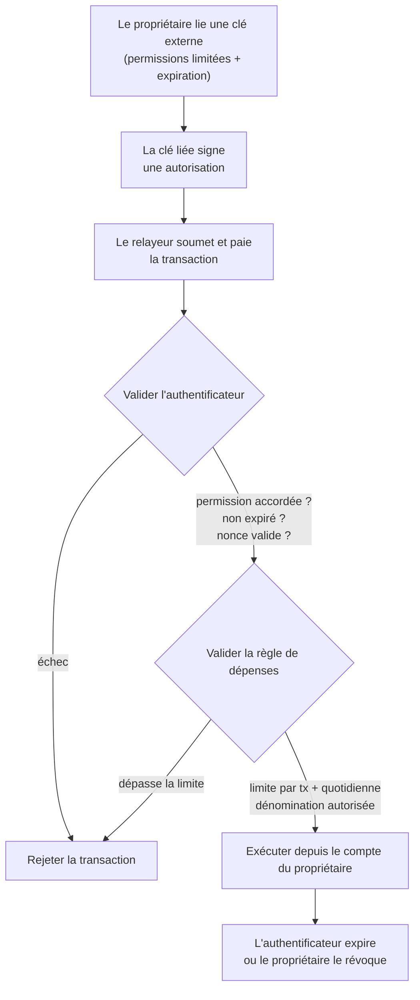

# Abstraction de compte

QoreChain fournit une **abstraction de compte au niveau du protocole** via le module `x/abstractaccount`. Le module enregistre des comptes abstraits assortis de règles de dépenses et permet au propriétaire du compte de lier des clés externes (**authentificateurs**) qui peuvent dépenser depuis le compte dans les limites de permissions et de dépenses définies, sans infrastructure externe de contrats intelligents.

:::danger Non activé sur le mainnet ni sur le testnet
Le module d'abstraction de compte est actuellement **désactivé** sur les deux réseaux : `qorechaind query abstractaccount config` (et `GET /qorechain/abstractaccount/v1/config`) renvoient `enabled: false` sur `qorechain-vladi` et `qorechain-diana`. À partir de la version de chaîne v3.2.0, ce paramètre est appliqué sur chaque chemin : la chaîne refuse la création de compte, l'enregistrement d'authentificateurs et les deux voies d'exécution (`MsgExecuteEVM`, `MsgExecuteCosmos`) avec `abstract accounts are disabled on this chain`. Aucune transaction ne peut activer le module, et aucune transaction de compte abstrait n'a jamais été incluse sur le mainnet. Tout ce qui suit décrit les interfaces du module à titre de référence. Ne construisez pas de flux de clé liée ou de dépenses déléguées sur les réseaux en production tant que le module n'est pas activé, et vérifiez d'abord ce paramètre.
:::

:::note
Les commandes ci-dessous utilisent le mainnet **`qorechain-vladi`** (en production depuis le 7 juin 2026), qui exécute la version de nœud **v3.2.4** (appliquée à la hauteur 3 742 566 le 23 octobre 2026, proposition de gouvernance 13). Remplacez par `--chain-id qorechain-diana` pour le testnet, qui exécute la v3.2.4 depuis le 19 octobre 2026.
:::

:::caution Toute transaction sur la voie Cosmos exige la co-signature post-quantique hybride
Les exemples `qorechaind tx` de cette page ne montrent que les indicateurs de frais. Sur les réseaux en production, toute transaction sur la voie Cosmos doit aussi porter la co-signature hybride ML-DSA-87 ; construisez donc la transaction avec `--generate-only` et signez-la avec `qorechaind tx pqc cosign` (ou utilisez QoreX ou le SDK, qui s'en chargent pour vous). La version communautaire de `qorechaind` ne peut pas produire cette signature ; utilisez le binaire de la release issu du [manifeste de téléchargement](/developer-guide/running-a-node#fetch-the-manifest). Le plancher de frais est de **0,1 uqor par unité de gaz**, donc `--gas 400000` exige au moins `--fees 40000uqor`. Voir [Signature post-quantique](/developer-guide/post-quantum-signing).
:::

## Vue d'ensemble

Les comptes blockchain traditionnels sont contrôlés par une seule clé privée. L'abstraction de compte dissocie la notion de « qui peut autoriser une transaction » d'une clé cryptographique unique. Le module `x/abstractaccount` fournit :

* Des **comptes abstraits** avec un type de compte et un propriétaire enregistrés
* Des **règles de dépenses** (limites par transaction et quotidiennes, dénominations autorisées) qui bornent ce que les clés liées peuvent dépenser
* Des **authentificateurs** : des clés externes (une clé ed25519 Phantom ou une adresse secp256k1 MetaMask) que le propriétaire lie avec des permissions limitées et une expiration, et qu'il peut révoquer à tout moment

*Un flux avec clé liée (authentificateur) : la clé liée signe une autorisation, un relayeur la soumet, le module vérifie les permissions, l'expiration et les règles de dépenses, puis exécute depuis le compte du propriétaire.*



## Types de comptes

`create` enregistre l'un des trois types de comptes. Le type est stocké sur le compte et participe à la dérivation de son adresse ; le module n'a ni transactions multisig, ni clés de session, ni récupération qui lui soient propres (le service de transactions comprend `create`, `update-rules`, `register-authenticator`, `revoke-authenticator`, `execute-cosmos`, `execute-evm`).

| Type              | Cas d'usage prévu                       |
| ----------------- | --------------------------------------- |
| `multisig`        | Trésoreries de DAO, portefeuilles partagés |
| `social_recovery` | Portefeuilles grand public, onboarding  |
| `session_based`   | Sessions dApp, portefeuilles mobiles    |

## Créer un compte abstrait

`create` prend le type de compte comme argument positionnel (`multisig`, `social_recovery` ou `session_based`) :

```bash
qorechaind tx abstractaccount create session_based \
  --from mykey \
  --gas 400000 --fees 40000uqor
```

La commande n'a aucun indicateur pour les signataires, les seuils ou les gardiens.

## Authentificateurs (clés liées)

Le mécanisme de clé déléguée du module est l'**authentificateur**, décrit dans [Authentificateurs de portefeuilles liés](#authenticators) ci-dessous : le propriétaire lie une clé externe (ed25519 ou secp256k1) avec un ensemble de permissions et une expiration, et la révoque à tout moment :

```bash
qorechaind tx abstractaccount register-authenticator <account-address> <scheme> <pubkey-base64> <permissions-csv> <expiry-unix> <label> \
  --from mykey --gas 400000 --fees 40000uqor
qorechaind tx abstractaccount revoke-authenticator <account-address> <scheme> <pubkey-base64> \
  --from mykey --gas 400000 --fees 40000uqor
```

`scheme` vaut `ed25519` (par exemple Phantom) ou `secp256k1` (par exemple MetaMask). Il n'existe aucune commande `grant-session`, `revoke-session` ni `query abstractaccount sessions`.

## Règles de dépenses

Les règles de dépenses ajoutent des garde-fous financiers aux comptes abstraits :

| Règle            | Description                                           |
| ---------------- | ----------------------------------------------------- |
| `daily_limit`    | Dépense totale maximale par jour calendaire UTC       |
| `per_tx_limit`   | Dépense maximale par exécution autorisée individuelle |
| `allowed_denoms` | Restreint les dénominations de jetons pouvant être dépensées (un ERC-20 est listé sous la forme `erc20/<contract>`) |
| `denom_limits`   | Limites par dénomination sous forme de chaînes décimales (v3.2.2) : `{"denom","per_tx_limit","daily_limit"}` ; elles remplacent `per_tx_limit` et `daily_limit` pour les dénominations qu'elles nomment, de sorte qu'un token à 18 décimales peut être plafonné |
| `allowed_evm_calls` | Appels EVM qu'une clé liée à une règle peut effectuer **avec des données d'appel** (v3.2.2), sous la forme `0x<target>` (n'importe quelle fonction de ce contrat) ou `0x<target>/0x<selector>` (cette fonction uniquement). Sans entrée, une clé liée à une règle ne peut qu'envoyer de la valeur, déployer (avec la permission `deploy`) et déplacer les tokens ERC-20 listés dans `allowed_denoms`. Lister une cible fait confiance à tous les arguments des appels qui lui sont adressés, destinataires compris |

### Définir les règles de dépenses

`update-rules` remplace les règles du compte par un tableau JSON d'objets `SpendingRule` (JSON en ligne, pas un fichier et pas des indicateurs) :

```bash
qorechaind tx abstractaccount update-rules <account-address> \
  '[{"id":"daily","enabled":true,"daily_limit":1000000000,"per_tx_limit":100000000,"allowed_denoms":["uqor"]}]' \
  --from mykey --gas 400000 --fees 40000uqor
```

Les limites sont exprimées dans l'unité de base (`uqor`) et comptent par exécution autorisée ; la limite quotidienne borne le total par jour calendaire UTC. Les règles remplacent d'un bloc celles qui sont stockées, donc un champ que vous omettez est supprimé. Depuis la v3.2.2, la voie EVM mesure ce qu'un appel déplace réellement (valeur native, diminution du solde natif du compte, coins bancaires dépensés, et variation du solde ou de l'allowance de chaque ERC-20 listé) au lieu de se limiter à `msg.value`, et la création de contrat exige la permission distincte `deploy`. Un exemple plus riche :

```bash
qorechaind tx abstractaccount update-rules <account-address> \
  '[{"id":"daily","enabled":true,"daily_limit":5000000,"allowed_denoms":["uqor","erc20/0xTOKEN"],"allowed_evm_calls":["0xROUTER/0x38ed1739"],"denom_limits":[{"denom":"erc20/0xTOKEN","per_tx_limit":"100000000000000000000","daily_limit":"500000000000000000000"}]}]' \
  --from mykey --gas 400000 --fees 40000uqor
```

### Interroger les règles actuelles

L'enregistrement du compte inclut ses règles et le nombre de clés liées :

```bash
qorechaind query abstractaccount account <account-address>
```

:::caution Une règle ne borne une clé que si elle existe
La chaîne résout la limite dans cet ordre : la règle propre à l'authentificateur si elle est définie et `enabled` ; sinon la première règle `enabled` du compte ; sinon **il n'y a aucune limite**. Une règle stockée avec `enabled: false` signifie aucune limite, et non une limite nulle. `MsgRegisterAuthenticator` ne porte aucune règle, donc une clé liée par ce seul message n'est bornée que par une règle au niveau du compte. Définissez une règle délibérément avec `update-rules`, et n'enregistrez que les permissions dont la clé a besoin. Une limite borne les dégâts qu'une clé liée peut causer ; elle ne remplace pas la révocation de la clé.
:::

## Authentificateurs de portefeuilles liés — dépenses déléguées {#authenticators}

La conception des authentificateurs a été introduite dans la version de chaîne **v3.1.85** (qui s'appuie sur le modèle de permissions de la v3.1.84). Elle n'est **pas utilisable sur les réseaux en production tant que le module est désactivé** (voir l'encadré d'état en haut de cette page). Une **clé de portefeuille externe liée** — une clé Phantom (ed25519) ou un compte MetaMask (secp256k1) — peut **dépenser depuis le compte post-quantique canonique** selon des conditions révocables, à moindre privilège et à dépenses limitées. La clé externe ne produit jamais de signature ML-DSA ; un **relayeur** soumet et paie l'enveloppe de transaction (la propre signature PQC hybride du relayeur satisfait les exigences de signature de la chaîne), tandis que la signature de l'authentificateur sur des **octets de signature séparés par domaine et protégés contre le rejeu** constitue l'autorisation.

### Enregistrer un authentificateur {#register-authenticator}

Le propriétaire du compte enregistre la clé externe avec `MsgRegisterAuthenticator` (une transaction ordinaire signée par la clé racine), en lui attribuant un schéma, des permissions, une expiration et des limites de dépenses optionnelles :

```js
import { registerEthAuthenticatorMsg } from "@qorechain/wallet-adapter";

// Link a MetaMask account by its 20-byte address (EIP-191 verification):
const msg = registerEthAuthenticatorMsg({
  owner: "qor1owner...",              // the canonical account (signs this message)
  ethAddress: "0xAbC...123",          // the MetaMask address to link
  permissions: ["evm"],               // least privilege — see the taxonomy below
  expiryUnix: Math.floor(Date.now() / 1000) + 30 * 24 * 3600, // absolute Unix seconds, ≤ 30 days recommended
  label: "metamask",
});
// Limits are a separate message (MsgUpdateSpendingRules), see "Spending Rules" above.
// Sign & broadcast this msg with the OWNER's normal hybrid-PQC signer.
```

Une clé Phantom s'enregistre de la même manière avec le schéma `ed25519` et la clé publique Phantom (`register-authenticator` en CLI). La révocation est instantanée via `MsgRevokeAuthenticator`.

### Taxonomie des permissions {#permission-taxonomy}

Onze permissions canoniques encadrent ce qu'un authentificateur enregistré peut faire. La table de correspondance est **fermée par défaut (fail-closed)** : un type de message sans correspondance est refusé.

| Permission | Accorde |
| --- | --- |
| `send` | Transferts bancaires sur la voie native |
| `delegate` / `withdraw` / `vote` | Staking, retrait des récompenses, gouvernance |
| `evm` / `wasm` / `svm` | Exécution sur la voie de VM correspondante |
| `amm` / `ibc` / `deploy` | Opérations AMM, transferts IBC, déploiement de contrats |
| `all` | Tout message *délégable* |

**Les messages de gestion des clés ne sont jamais délégables** — `MsgRegisterAuthenticator`, `MsgRevokeAuthenticator`, l'enregistrement/la migration de clés PQC et `MsgRotatePQCKey` exigent toujours la clé racine, de sorte qu'une clé liée ne peut jamais élever ses propres privilèges. Le schéma (`schema_version` 2) liste aussi des `lane_rules` : la création de contrat depuis l'adresse du compte, un appel qui fait avancer le nonce EVM du compte, et un appel au compte lui-même lorsque son code est une délégation EIP-7702 exigent chacun la permission `deploy` ou `all`. Depuis la v3.2.3, l'enregistrement refuse les chaînes de permission inconnues et les clés secp256k1 de 65 octets qui ne pourraient jamais être vérifiées.

Lisez la taxonomie en direct (avec `schema_version` pour détecter les dérives) au lieu de la coder en dur :

```bash
curl -s https://api.qore.host/qorechain/abstractaccount/v1/permission_schema | jq
# or: qorechaind query abstractaccount permission-schema
```

### Dépenser via une clé liée {#execute-messages}

Deux messages transportent les actions autorisées par un authentificateur. Dans les deux cas, le relayeur est le signataire/payeur de frais de la transaction ; la signature de l'authentificateur voyage à l'intérieur du message.

**`MsgExecuteEVM`** — un appel ou un transfert EVM **depuis l'adresse `0x…` du compte canonique**. L'authentificateur signe `sha256("qorechain-evm-auth-v1" ‖ chainId ‖ account ‖ pubkey ‖ to ‖ value ‖ data ‖ nonce)` (tous les champs sont préfixés par leur longueur). À partir de la v3.2.3 (la fonctionnalité `abstractaccount-hardening`), la chaîne exige le **condensat v2**, `sha256("qorechain-evm-auth-v2" ‖ … ‖ nonce ‖ gasLimit)`, qui lie aussi la limite de gas de l'appel (8 octets, big-endian) afin qu'un relayeur ne puisse pas rejouer la signature avec une autre limite ; aucun bloc n'accepte les deux formes. `qorechaind query abstractaccount auth-sign-evm` prend `--gas-limit` pour cela, et vous passez la même valeur à `execute-evm`. La protection anti-rejeu est le propre nonce EVM du compte.

**`MsgExecuteCosmos`** — un envoi bancaire sur la voie native depuis le compte canonique. L'authentificateur signe `sha256("qorechain-cosmos-auth-v1" ‖ chainId ‖ account ‖ pubkey ‖ to ‖ amount ‖ nonce)`. La protection anti-rejeu est une **séquence par authentificateur** tenue par le module (un envoi bancaire n'incrémente pas le nonce du compte). Les envois vers soi-même sont rejetés.

:::caution Règles de nonce
* `MsgExecuteEVM.nonce` = le nonce EVM **actuel** du compte (`eth_getTransactionCount(account0x, "latest")`). En production, le relayeur est un compte *différent*, donc n'ajoutez **pas** +1. Signer un nonce périmé renvoie le code `11`.
* `MsgExecuteCosmos.nonce` = la séquence par authentificateur (interrogez l'état d'authentificateur du compte), et **non** la séquence Cosmos du compte. À partir de la v3.2.4 (testnet depuis le 19 octobre 2026, mainnet depuis le 23 octobre 2026), `GET /qorechain/abstractaccount/v1/auth_nonce/{address}/{pubkey_hex}` renvoie directement cette séquence (`nonce`, `linked`).
:::

**Exemple Phantom** (navigateur : Phantom signe, votre backend relaie) :

```js
import { buildPhantomExecuteCosmos } from "@qorechain/wallet-adapter";

// In the dApp: Phantom signs the digest with ed25519 signMessage.
const msg = await buildPhantomExecuteCosmos({
  wallet: window.solana,              // Phantom: { publicKey, signMessage }
  relayer: "qor1relayer...",          // submits the tx and pays the fee (a different account)
  chainId: "qorechain-vladi",
  account: "qor1owner...",            // canonical account being spent from
  to: "qor1recipient...",
  amount: "900000uqor",               // single-coin string
  nonce: authSequence,                // per-authenticator sequence
});
// Send `msg` to your relayer; the relayer wraps it in a tx it signs
// (hybrid PQC) and broadcasts. The transfer moves the OWNER's funds.
```

**Exemple MetaMask** (`personal_sign` EIP-191 depuis l'adresse liée de 20 octets) :

```js
import { buildMetaMaskExecuteEvm } from "@qorechain/wallet-adapter";

const msg = await buildMetaMaskExecuteEvm({
  provider: window.ethereum,          // MetaMask (EIP-1193)
  address: ethAddress,                // the linked 20-byte address
  relayer: "qor1relayer...",
  chainId: "qorechain-vladi",
  account: "qor1owner...",
  to: "0xRecipient...",
  value: (10n ** 16n).toString(),     // 0.01 QOR in wei (18-decimal EVM view), as a decimal string
  gasLimit: 100000,
  nonce: currentEvmNonce,             // eth_getTransactionCount(owner0x, "latest")
});
// Relay as above. The chain verifies the signature via EIP-191 + ecrecover
// against the registered 20-byte address.
```

Les mêmes constructeurs existent dans le [SDK QoreChain](/sdk/guides/authenticators) pour les cinq langages, ainsi que des équivalents CLI :

```bash
# Generate an ed25519 authenticator key: the seed goes to a new 0600 file, only the public key is printed
qorechaind query abstractaccount auth-keygen --out authenticator.seed

# Sign the exact bytes the chain verifies (seed from --seed-file, "-" for stdin, QORE_AUTH_SEED, or a prompt)
qorechaind query abstractaccount auth-sign-cosmos <chain-id> <account> <to> <amount> <nonce> --seed-file authenticator.seed
qorechaind query abstractaccount auth-sign-evm <chain-id> <account> <to-0xhex> <value-wei> <data-hex> <nonce> --seed-file authenticator.seed

# Relay a pre-signed authorization (the relayer's --from key pays; cosign the envelope with `tx pqc cosign`)
qorechaind tx abstractaccount execute-cosmos <account> <to> <amount> <scheme> <pubkey-base64> <signature-base64> <nonce> --from relayer --generate-only > tx.json
qorechaind tx abstractaccount execute-evm <account> <to-0xhex> <value-wei> <data-hex> <gas-limit> <scheme> <pubkey-base64> <signature-base64> <nonce> --from relayer --generate-only > tx.json
```

Les clés et les signatures de ces commandes sont en base64. Les utilitaires `auth-sign-*` lisent la graine depuis un fichier, l'entrée standard ou l'environnement plutôt que depuis un argument de ligne de commande (version de nœud v3.2.1 et ultérieures), de sorte qu'elle n'apparaît pas dans l'historique du shell. Les indicateurs de gestion de la graine (`--out`, `--seed-file`) n'existent que dans les binaires v3.2.1 et ultérieurs.

### Codes d'erreur {#authenticator-errors}

Les échecs d'application des règles renvoient des codes distincts (codespace `abstractaccount`) afin que les portefeuilles puissent afficher le bon message :

| Code | Signification | UX du portefeuille |
| --- | --- | --- |
| `5` | Limite de dépenses dépassée (par transaction ou quotidienne) | Afficher l'allocation restante |
| `6` | Authentificateur expiré | « Expiré — reliez à nouveau votre portefeuille » |
| `9` | Module désactivé (l'état actuel sur les deux réseaux) | « Les portefeuilles liés ne sont pas encore disponibles » |
| `10` | Permission refusée (portée ou message non délégable) | Afficher la permission manquante |
| `11` | Rejeu refusé (nonce/séquence périmé) | Réinterroger le nonce et signer à nouveau |

(Codespace `pqc` code `21` = échec de la vérification de la signature hybride — un problème de signature côté relayeur, pas un problème d'autorisation.)

### Requêtes REST {#abstractaccount-rest}

Les requêtes en lecture du module sont servies via REST (depuis la **v3.1.85**) :

```
GET /qorechain/abstractaccount/v1/config      # {"config":{"enabled":false,...}} on both networks today
GET /qorechain/abstractaccount/v1/accounts
GET /qorechain/abstractaccount/v1/accounts/{address}
GET /qorechain/abstractaccount/v1/permission_schema
```

## Interroger les comptes abstraits

### CLI

```bash
# Module configuration (enabled flag and limits)
qorechaind query abstractaccount config

# Get full account configuration
qorechaind query abstractaccount account <address>

# List all abstract accounts (paginated)
qorechaind query abstractaccount accounts --page-limit 10
```

Sur le mainnet, la liste des comptes est vide ; le testnet liste quelques comptes créés avant que le paramètre d'activation ne soit appliqué sur chaque chemin.

### JSON-RPC

> **Pas encore servi :** aucune version publiée du nœud ne sert l'espace de noms JSON-RPC `qor_`, donc `qor_getAbstractAccount` renvoie `-32601` (méthode introuvable) sur tous les points d'accès publics aujourd'hui. Utilisez les routes REST ci-dessus ou la CLI. Voir [l'espace de noms `qor_`](/api-reference/json-rpc-qor_-namespace).

### Exemple de réponse de compte

La forme d'un enregistrement de compte abstrait (valeurs illustratives) :

```json
{
  "address": "qor1myaccount...",
  "account_type": "session_based",
  "owner": "qor1owner...",
  "spending_rules": [
    {
      "id": "daily",
      "enabled": true,
      "daily_limit": "1000000000",
      "per_tx_limit": "100000000",
      "allowed_denoms": ["uqor"]
    }
  ]
}
```

## Récupération sociale

`social_recovery` est un type de compte, mais le module n'a aucune transaction de récupération : il n'existe aucune commande `initiate-recovery` ni `approve-recovery`, et aucun message de récupération dans le service de transactions du module. La récupération de clé d'un compte QoreChain s'effectue en redérivant la clé post-quantique du compte à partir de sa phrase mnémonique (`tx pqc recover-key`) et, si nécessaire, en la faisant pivoter (`tx pqc rotate-key`) ; voir [Signature post-quantique](/developer-guide/post-quantum-signing).

## Intégration avec les dApps

Lorsque le module est activé, l'autorisation par clé liée est destinée à des flux tels que :

* Les portefeuilles mobiles où les invites biométriques répétées sont gênantes
* Les dApps de jeu qui nécessitent une signature rapide des transactions dans les limites d'une allocation bornée
* Les utilisateurs de Phantom ou MetaMask qui dépensent depuis leur compte QoreChain via un relayeur

Le backend d'une dApp joue le rôle de relayeur : il reçoit l'autorisation signée de la clé liée, l'enveloppe dans une transaction qu'il signe lui-même et la diffuse. La clé liée peut être révoquée, ou peut expirer, à tout moment. Tant que le module n'est pas activé sur le réseau que vous ciblez, utilisez la signature ordinaire via [QoreX ou le SDK](/sdk/overview).

## Prochaines étapes

* [Exploiter un validateur](/developer-guide/running-a-validator) — Mettre en place et exploiter un nœud de validation
* [Développement EVM](/developer-guide/evm-development) — Outils EVM, comptes et fenêtre d'autorisation EVM
* [Interopérabilité inter-VM](/developer-guide/cross-vm-interoperability) — Messagerie inter-VM
