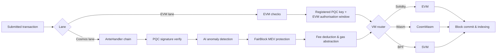

# Vue d'ensemble de l'architecture

QoreChain est un nœud blockchain modulaire composé de trois processus principaux — le nœud de la chaîne, le sidecar IA et l'indexeur de blocs — adossé à une base de données Postgres et surveillé via Prometheus et Grafana. Le mainnet (`qorechain-vladi`, ID de chaîne EVM **9801**) est en production depuis le 29 juin 2026 sur la version **v3.2.1** (règles de consensus de la v3.2.0), avec un testnet parallèle (`qorechain-diana`, ID de chaîne EVM **9800**). La chaîne est construite sur Cosmos SDK v0.53. Le diagramme suivant présente l'agencement des composants à haut niveau.

Le cycle de vie de transaction ci-dessous résume la manière dont une transaction soumise traverse le nœud — depuis la chaîne de décorateurs AnteHandler (vérifications de sécurité et de frais) jusqu'à l'exécution sur la VM et au règlement on-chain :



```
┌────────────────────────────────────────────────────────────────────────────┐
│                            QoreChain Node                                  │
│                                                                            │
│  ┌──────────────────── Virtual Machines ──────────────────────┐           │
│  │  ┌───────┐    ┌──────────┐    ┌───────┐                   │           │
│  │  │  EVM  │    │ CosmWasm │    │  SVM  │                   │           │
│  │  │(Sol.) │◄──►│ (Wasm)   │◄──►│ (BPF) │                   │           │
│  │  └───┬───┘    └────┬─────┘    └───┬───┘                   │           │
│  │      └─────────┬───┘──────────────┘                       │           │
│  │           x/crossvm (bridge)                               │           │
│  └────────────────────────────────────────────────────────────┘           │
│                                                                            │
│  ┌────────────────────── Tokenomics ─────────────────────────┐           │
│  │  ┌──────┐   ┌───────┐   ┌───────────┐                    │           │
│  │  │x/burn│   │x/xqore│   │x/inflation│                    │           │
│  │  │12 src│   │lock/  │   │capped     │                    │           │
│  │  │37/30/│   │unlock │   │emission   │                    │           │
│  │  │20/10/│   │PvP    │   │emission   │                    │           │
│  │  │3     │   │       │   │114.3M cap │                    │           │
│  │  └──────┘   └───────┘   └───────────┘                    │           │
│  └────────────────────────────────────────────────────────────┘           │
│                                                                            │
│  ┌──────────── IBC / Bridges ────────────────────────────────┐           │
│  │  ┌──────────┐  ┌──────────┐  ┌───────────┐  ┌──────────┐ │           │
│  │  │x/bridge  │  │x/babylon │  │x/abstract │  │x/gas     │ │           │
│  │  │37 QCB    │  │BTC re-   │  │ account   │  │abstract. │ │           │
│  │  │configs   │  │staking   │  │session key│  │multi-tok │ │           │
│  │  └────┬─────┘  └────┬─────┘  └───────────┘  └──────────┘ │           │
│  │  QCB Bridge     Babylon IBC   ERC-4337-like   ibc/USDC    │           │
│  │  PQC-signed     BTC finality  social recov.   ibc/ATOM    │           │
│  │  36 ext chains  checkpoint    spending rules  fee convert  │           │
│  │  ┌──────────┐                                              │           │
│  │  │x/fair    │  Lane config (not enforced): PQC|MEV|AI|... │           │
│  │  │ block    │  tIBE encrypted mempool framework           │           │
│  │  └──────────┘                                              │           │
│  └────────────────────────────────────────────────────────────┘           │
│                                                                            │
│  ┌──── Rollup Development Kit ───────────────────────────────┐           │
│  │  ┌──────────┐  ┌──────────┐  ┌───────────┐  ┌──────────┐ │           │
│  │  │ x/rdk    │  │Settlement│  │ DA Router │  │ Profiles │ │           │
│  │  │ 4 modes: │  │Optimistic│  │ Native    │  │ defi     │ │           │
│  │  │ opt/zk/  │  │ZK/Based/ │  │ Celestia* │  │ gaming   │ │           │
│  │  │ based/   │  │Sovereign │  │ Both      │  │ nft      │ │           │
│  │  │ sovereign│  │          │  │           │  │ social/  │ │           │
│  │  │          │  │          │  │           │  │ general  │ │           │
│  │  └────┬─────┘  └────┬─────┘  └───────────┘  └──────────┘ │           │
│  │  Bank escrow    Auto-finalize  SHAKE-256 commit AI-assisted │           │
│  │  Burn on create EndBlocker     Blob pruning    PRISM sugg. │           │
│  │  → x/multilayer (RegisterSidechain + AnchorState)          │           │
│  └────────────────────────────────────────────────────────────┘           │
│                                                                            │
│  ┌──────────────┐ ┌──────┐ ┌────────────┐ ┌─────┐                       │
│  │x/rlconsensus │ │ x/ai │ │x/reputation│ │x/qca│                       │
│  │  PRISM (RL)  │ │      │ │            │ │     │                       │
│  └──────┬───────┘ └──┬───┘ └────┬──────┘ └──┬──┘                       │
│   PPO MLP         AI Engine   Scoring    CPoS Pools                      │
│   Obs/Action      Fraud Det.  Decay      Bonding                         │
│   Circuit Brk     Fee Opt.    Sigmoid    Slashing                        │
│   Rollup Adv.     TEE/FL                 QDRW Gov                        │
│                                                                            │
│  ┌──────┐ ┌──────────┐                                                   │
│  │x/pqc │ │ x/multi  │                                                   │
│  └──┬───┘ └────┬─────┘                                                   │
│  Dilithium    Layer Router                                                │
│  ML-KEM       Sidechains                                                  │
│  Hybrid Sig   + Rollups                                                   │
│  SHAKE-256                                                                │
│                                                                            │
│  ┌──────┐ ┌───────┐                                                      │
│  │x/svm │ │x/cross│                                                      │
│  └──┬───┘ └───┬───┘                                                      │
│  BPF Exec   CrossVM Msg                                                   │
└────────┬──────┬───────────────────────────────────────┬───────────────────┘
         │      │                                       │
   ┌─────┴─────┐│                              ┌───────┴──────┐
   │libqorepqc ││                              │  Indexer     │
   │(Rust PQC) ││                              │  (Postgres)  │
   └───────────┘│                              └──────────────┘
   ┌───────────┐│  ┌──────────┐
   │libqoresvm ││  │AI Sidecar│
   │(Rust BPF) │└──│ (gRPC)   │
   └───────────┘   └──────────┘
```

## Composants du nœud

QoreChain s'exécute sous la forme de trois processus coopérants, chacun disposant de son propre module Go et de son propre binaire :

| Composant          | Description                                                                                                                                                                                                                                                                                          | Emplacement               |
| ------------------ | ---------------------------------------------------------------------------------------------------------------------------------------------------------------------------------------------------------------------------------------------------------------------------------------------------- | ------------------------- |
| **qorechain-node** | Le nœud principal de la blockchain. Exécute le QoreChain Consensus Engine, exécute tous les modules personnalisés, gère les trois runtimes de VM, et expose des points de terminaison RPC, REST, gRPC et JSON-RPC.                                                                                  | `qorechain-core/`         |
| **ai-sidecar**     | Un service gRPC qui fournit des capacités d'inférence IA avancées, adossé au QCAI Backend. Le sidecar traite les requêtes d'inférence qui dépassent le périmètre de l'agent RL on-chain, comme l'analyse du langage naturel et la reconnaissance de motifs complexes. Communique avec le nœud via gRPC sur le port 50051. | `qorechain-core/sidecar/` |
| **block-indexer**  | Un écouteur WebSocket qui s'abonne aux nouveaux blocs et transactions depuis le point de terminaison RPC du nœud, analyse les événements et écrit des données structurées dans une base Postgres pour des requêtes rapides par les explorateurs et les API.                                          | `qorechain-core/indexer/` |

## Ports

| Port  | Protocole      | Service                                                                           |
| ----- | -------------- | --------------------------------------------------------------------------------- |
| 26657 | HTTP/WebSocket | RPC du QoreChain Consensus Engine (blocs, transactions, état du consensus)        |
| 1317  | HTTP           | API REST (points de terminaison de requête, diffusion de transactions)            |
| 9090  | gRPC           | Points de terminaison gRPC pour les requêtes et les transactions                  |
| 8545  | HTTP           | JSON-RPC EVM (espaces de noms `eth_`, `web3_`, `net_`, `txpool_`)                 |
| 8546  | WebSocket      | JSON-RPC EVM (abonnements WebSocket)                                              |
| 8899  | HTTP           | JSON-RPC SVM (compatible Solana : `getAccountInfo`, `getBalance`, `getSlot`, etc.) |
| 50051 | gRPC           | Sidecar IA (requêtes d'inférence depuis le nœud)                                  |
| 5432  | TCP            | Postgres (stockage de l'indexeur de blocs)                                        |
| 26660 | HTTP           | Point de terminaison des métriques Prometheus du nœud                             |
| 9091  | HTTP           | Serveur Prometheus (port hôte dans la pile Docker Compose)                        |
| 3001  | HTTP           | Tableaux de bord Grafana (port hôte dans la pile Docker Compose ; port du conteneur 3000) |

## Cartographie des modules

QoreChain enregistre **48 modules de genèse, dont 20 propres à QoreChain**, regroupés par fonction :

**Sécurité**

* `x/pqc` — Cryptographie post-quantique : Dilithium-5, ML-KEM-1024, hybride secp256k1 (ECDSA) + ML-DSA-87, SHAKE-256, agilité algorithmique

**IA et apprentissage automatique**

* `x/ai` — Routage des transactions, détection d'anomalies, détection de fraude, optimisation des frais, attestation TEE, apprentissage fédéré
* `x/reputation` — Score de réputation des validateurs multi-facteurs avec décroissance temporelle
* `x/rlconsensus` — Agent RL on-chain (PPO MLP), conception d'ajustement du consensus, coupe-circuit, conseil pour les rollups — la couche d'optimisation PRISM (observation uniquement sur les réseaux en production : aucune politique n'est chargée)

**Consensus**

* `x/qca` — Conception de PoS composite à triple pool (RPoS/DPoS/PoS), courbe de bonding personnalisée, slashing progressif, gouvernance QDRW — implémenté mais pas encore branché sur la production de blocs, les récompenses, le slashing ni le décompte de la gouvernance

**Machines virtuelles**

* `x/vm` — Routage des VM et gestion de leur cycle de vie
* `x/svm` — Runtime SVM : déploiement/exécution BPF, collecte de loyer, RPC compatible Solana
* `x/crossvm` — Communication inter-VM : précompilé EVM-CosmWasm + événements asynchrones SVM

**Tokenomics et liquidité**

* `x/burn` — 12 sources de burn, distribution des frais en EndBlocker (répartition 37/30/20/10/3)
* `x/xqore` — Conception de staking boosté par la gouvernance : verrouillage/déverrouillage, pénalités de sortie graduées, rebase PvP (comptabilité uniquement ; les transactions de verrouillage et de déverrouillage ne sont pas encore branchées sur les réseaux en production)
* `x/inflation` — Émission plafonnée : un montant fixe est émis à chaque époque jusqu'à l'atteinte d'un plafond cumulé strict (114 285 714 QOR)
* `x/amm` — Liquidité on-chain / teneur de marché automatisé

**Ponts et interopérabilité**

* `x/bridge` — 37 configurations de chaînes (36 chaînes externes plus Injective via IBC) couvrant tous les principaux types de chaînes, attestations signées PQC, coupe-circuits (toutes les configurations sont `pending` ; non en production)
* `x/babylon` — Restaking BTC via le protocole Babylon, points de contrôle d'époque (stade de conception ; aucune transaction activée)
* `x/multilayer` — Gestion des couches sidechain/paychain/rollup, ancrage d'état

**Extensions de gouvernance et de licence**

* `x/abstractaccount` — Comptes intelligents : multisig, récupération sociale, clés de session, règles de dépense (désactivé sur les deux réseaux : `enabled = false`)
* `x/fairblock` — Protection contre le MEV : cadre de mempool chiffré par IBE à seuil (désactivé sur les deux réseaux)
* `x/gasabstraction` — Conception du paiement de gas multi-tokens : conversion des frais ibc/USDC, ibc/ATOM (aucun canal IBC n'est encore ouvert, les frais sont donc payés en QOR)
* `x/license` — Licence de la chaîne

**Rollups**

* `x/rdk` — Rollup Development Kit : 4 modes de règlement (optimistic, zk, based, sovereign), profils prédéfinis, DA native, séquestre bancaire

## Chaîne AnteHandler

Chaque transaction traverse une chaîne de décorateurs avant son exécution ; n'importe quel décorateur peut la rejeter. Il existe deux chaînes.

**Lane Cosmos** (dans l'ordre) : `RejectMessages` (aucun `MsgEthereumTx` sur cette lane) → `AuthzLimiter` (aucun message EVM ni de création de vesting dans authz) → `SetUpContext` → garde-fous du mempool et de la profondeur multisig → décorateurs CosmWasm de gas de simulation, de compteur de transactions, de registre de gas et de contrats → `CircuitBreaker` → vérification de l'option d'extension → `ValidateBasic` → `TxTimeout` → `Memo` → porte de licence de validateur (`MsgCreateValidator`) → `PQCVerify` → `PQCHybridVerify` → `PQCReplayGuard` → `AIAnomaly` (inclut la limite de débit par expéditeur) → `FairBlock` → `SVMComputeBudget` → `SVMDeductFee` → `MinGasPrice` → `ConsumeTxSize` → `GasAbstraction` → `DeductFee` → `SetPubKey` → `ValidateSigCount` → `SigGasConsume` → `SigVerify` → `IncrementSequence` → compteur de transactions de burn → vérification de relais IBC redondant → suivi du gas demandé.

**Lane EVM** (transactions portant l'option d'extension Ethereum) : `CircuitBreaker` → le décorateur monolithique EVM (vérifications de signature, de nonce, de frais et de solde) → `EVMWindowDecorator` (clé post-quantique enregistrée et fenêtre d'autorisation active ; voir [Fenêtre d'autorisation EVM](/getting-started/first-transaction#evm-window)).

Décorateurs clés de la lane Cosmos :

1. **PQCVerify** — Module `x/pqc`. Vérifie les signatures Dilithium-5 sur les transactions marquées PQC.
2. **PQCHybridVerify** — Module `x/pqc`. Vérifie les signatures hybrides doubles secp256k1 (ECDSA) + ML-DSA-87.
3. **AIAnomaly** — Module `x/ai`. Exécute la détection d'anomalies par forêt d'isolement et le calcul du score de risque, et applique la limite de transactions par expéditeur.
4. **FairBlock** — Module `x/fairblock`. Traite les transactions chiffrées par tIBE pour la protection contre le MEV (désactivé sur les réseaux en production).
5. **SVMComputeBudget** — Module `x/svm`. Valide et alloue les unités de calcul pour les programmes SVM.
6. **SVMDeductFee** — Module `x/svm`. Déduit les frais d'exécution spécifiques à SVM.
7. **GasAbstraction** — Module `x/gasabstraction`. Convertit les tokens de frais non natifs avant déduction (les frais sont actuellement payés en QOR).

## Pile Docker Compose

La pile de développement complète s'exécute sous forme d'un déploiement Docker Compose à six services sur un réseau bridge partagé (`qorechain-net`) :

| Service          | Image                      | Rôle                                                |
| ---------------- | -------------------------- | --------------------------------------------------- |
| `qorechain-node` | `qorechain-core:latest` (construite localement à partir du Dockerfile ; aucune image de nœud publiée) | Nœud de la chaîne avec tous les modules, les VM et les points de terminaison RPC |
| `ai-sidecar`     | `ghcr.io/qorechain/ai-sidecar:latest` | Service d'inférence IA (gRPC + QCAI Backend)        |
| `block-indexer`  | `ghcr.io/qorechain/block-indexer:latest` | Indexeur de blocs/transactions (WebSocket + Postgres) |
| `postgres`       | `postgres:16-alpine`       | Base de données pour l'indexeur de blocs            |
| `prometheus`     | `prom/prometheus:v3.10.0`  | Collecte et stockage des métriques                  |
| `grafana`        | `grafana/grafana:12.4.1`   | Tableaux de bord de supervision et alertes          |

Démarrer la pile complète :

```bash
docker compose up -d
```

Avant le premier démarrage, copiez `.env.example` vers `.env` et `.env.sidecar.example` vers `.env.sidecar`, puis définissez `GRAFANA_PASSWORD` (Compose refuse de démarrer sans cette variable).

Toutes les données persistantes sont stockées dans des volumes Docker nommés : `node-data`, `postgres-data`, `prometheus-data` et `grafana-data`.

## Voir aussi

* [Architecture multicouche](/architecture/multilayer-architecture) — enregistrement des sidechains et ancrage d'état.
* [Mécanisme de consensus](/architecture/consensus-mechanism) — production de blocs, finalité et slashing.
* [Moteur de consensus PRISM](/architecture/prism-consensus-engine) — optimisation des paramètres pilotée par IA.
* [Sécurité post-quantique](/architecture/post-quantum-security) — signatures Dilithium-5 dans toute la pile.
