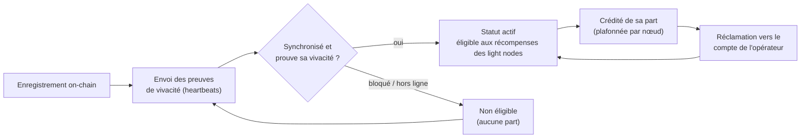

# Récompenses et surveillance

Un light node enregistré est crédité d'une part de l'allocation des light nodes et **doit rester en bonne santé** pour continuer à y être éligible. Cette page couvre la part de récompenses de 3 % réservée aux light nodes, la manière dont les récompenses sont créditées et réclamées, ce que le nœud fait et ne fait pas avec les délégations, ainsi que la surveillance du nœud.

:::note Rien ici ne constitue une promesse de gains
L'enregistrement est ouvert sur les deux réseaux ; voir [Statut du programme de récompenses](/light-node/overview#reward-program-status) pour l'état actuel. Ce dont un nœud est crédité dépend de l'allocation des light nodes, du nombre de nœuds éligibles, de leur stake et de leur disponibilité, ainsi que du plafond par nœud décrit ci-dessous.
:::

## La part de 3 % des récompenses de bloc

La distribution des frais de QoreChain réserve une part fixe de **3 % aux light nodes** qui servent des données réseau. C'est l'une des cinq destinations de la répartition des récompenses du protocole — validateurs (37 %), brûlés (30 %), trésorerie (20 %), stakers (10 %) et **light nodes (3 %)** — appliquée on-chain. Voir [Tokenomics](/architecture/tokenomics) pour la répartition complète.

Pour participer à cette part, un nœud doit remplir les conditions suivantes, vérifiées on-chain plutôt que déclarées par le nœud lui-même : une licence `lightnode_operator` active (vérifiée lors de l'enregistrement), au moins **1 000 QOR délégués à des validateurs bondés** — comptabilisés comme votre total cumulé sur l'ensemble des validateurs auxquels vous déléguez, et non par validateur ; les délégations à des validateurs emprisonnés (jailed) ou non bondés ne comptent pas ; exigés lors de l'enregistrement et relus depuis le staking à chaque crédit de récompenses — et des frais d'enregistrement de **1 QOR**, payés une seule fois lors de l'enregistrement. La participation est plafonnée à l'échelle du réseau à **10 000 light nodes**. Voir [Enregistrement et licences](/light-node/registration-and-licensing) pour le fonctionnement de l'enregistrement et [Statut du programme de récompenses](/light-node/overview#reward-program-status) pour l'état actuel.

Les 3 % correspondent à ce qui afflue dans le module light-node, et non à un droit par nœud : chaque nœud éligible est crédité de sa part, pondérée par le stake, de ce qui s'est accumulé, plafonnée par nœud, et tout ce qui n'est pas gagné va dans une réserve que seul un vote de gouvernance peut libérer. Depuis la chaîne v3.2.3, le plafond par nœud est de **2 000 QOR par 30 jours** (`max_reward_per_month_per_node`), au prorata du temps de bloc écoulé entre les règlements et mis à l'échelle selon la disponibilité (la règle `lightnode-monthly-cap`) ; il remplace l'ancien plafond par bloc (`max_reward_per_block_per_node`, `1713` uqor par bloc). À partir de la v3.2.4 (mainnet depuis le 23 octobre 2026, testnet depuis le 19 octobre 2026), le plafond d'un nœud démarre au plus tardif entre le règlement précédent et l'enregistrement propre du nœud, de sorte qu'un nœud nouvellement enregistré n'est pas crédité pour la période antérieure à son enregistrement. Voir [la part de 3 % des récompenses des light nodes](/light-node/overview#the-3-light-node-reward-share).

Une fois enregistré et délégué, rester éligible revient à rester actif. Un nœud doit maintenir au moins **80 % de disponibilité (uptime)**, et doit continuer à soumettre des preuves de vivacité (heartbeats) sur un intervalle de **1 000 blocs** (environ 52 minutes sur le mainnet, pour un temps de bloc moyen mesuré d'environ 3,1 s ; environ 22 minutes sur le testnet, à raison d'environ 1,3 s par bloc).

**Les règles de timing.** La chaîne rejette un heartbeat envoyé **moins de 1 000 blocs après le précédent** (`heartbeat submitted too early`) ; votre premier heartbeat après l'enregistrement n'a pas de telle limite inférieure. Si aucun heartbeat n'arrive dans les **1 000 + 100 blocs** (le `heartbeat_interval` plus le `heartbeat_grace_period` ; sur le mainnet, environ 52 minutes plus un délai de grâce d'environ 5 minutes) suivant le dernier — ou suivant l'enregistrement, si vous n'en avez pas envoyé —, le nœud est marqué inactif et cesse d'être crédité. Un heartbeat envoyé plus tard est tout de même accepté et le réactive. Le daemon envoie le heartbeat suivant dès que 1 000 blocs se sont écoulés depuis le `last_heartbeat` propre à la chaîne pour votre nœud, en vérifiant toutes les 60 secondes.

**Manquer la fenêtre coûte de la disponibilité, pas votre enregistrement.** Un nœud qui la manque est marqué inactif et cesse de gagner, mais le tout prochain heartbeat réussi le réactive — il n'y a pas de réenregistrement à effectuer. Votre **disponibilité (uptime)** est le ratio courant entre les heartbeats reçus et les heartbeats attendus (un par tranche de 1 000 blocs) depuis le bloc de votre enregistrement, plafonné à 1. En dessous du seuil `min_uptime_for_rewards` (`0.80`), un nœud ne gagne rien ; à ce seuil ou au-dessus, le plafond par nœud est mis à l'échelle selon votre disponibilité. Une longue interruption fait donc baisser le ratio, qui ne remonte qu'à mesure que des heartbeats ponctuels s'accumulent. Vérifiez `status` si un nœud apparaît comme inactif : il indique l'état du signataire, de la licence et de l'enregistrement.

:::note Ce qu'un heartbeat prouve réellement
Un heartbeat réussi prouve que la clé de l'opérateur a signé à temps — il ne prouve pas qu'un nœud exécute en continu l'intégralité du logiciel. Considérez-le comme une signature de vivacité, et non comme une « vérification qu'il s'agit d'un nœud actif ».
:::

:::note `last_heartbeat` est une hauteur de bloc, pas un horodatage
Si vous interrogez directement l'enregistrement on-chain d'un nœud, `last_heartbeat` est une hauteur de bloc, et une valeur de `0` signifie qu'aucun heartbeat n'a encore été enregistré — la chaîne mesure alors l'échéance d'inactivité à partir de la hauteur `registered_at` du nœud. Lire `0` comme un calcul naïf de temps écoulé fait apparaître un nœud fraîchement enregistré comme s'il avait des millions de blocs de retard.
:::

*Éligibilité aux récompenses : détenir une licence on-chain active et le stake bondé minimum, s'enregistrer, puis continuer à prouver sa vivacité via des heartbeats pour rester au-dessus des seuils de disponibilité et d'intervalle de heartbeat.*



## Fonctionnement des récompenses {#how-rewards-work}

### Crédit

Toutes les 100 blocs, la chaîne crédite chaque nœud éligible (actif, avec au moins le stake délégué minimum et au moins la disponibilité minimale) de sa part de ce qui s'est accumulé, plafonnée par nœud (au plus 2 000 QOR par 30 jours, au prorata du temps écoulé depuis le règlement précédent) comme décrit dans [la part de 3 % des récompenses des light nodes](/light-node/overview#the-3-light-node-reward-share). Le montant est ajouté aux `accumulated_rewards` du nœud. Lisez-le avec :

```bash
curl -s https://api.qore.host/qorechain/lightnode/v1/rewards/<operator-address>
# or: qorechaind query lightnode rewards <operator-address>
```

(Utilisez `https://api-testnet.qore.host` pour le testnet.)

### Réclamation

Les récompenses créditées restent sur l'enregistrement du nœud jusqu'à ce que vous les réclamiez. Le nœud peut les réclamer pour vous : définissez `auto_claim = true` sous `[delegation]`, et le daemon réclame les récompenses de light node accumulées vers le compte de l'opérateur dès qu'elles dépassent `min_reward_claim` (par défaut `1000000` uqor, soit 1 QOR), en vérifiant toutes les `compound_interval` (par défaut `1h`). Il signe la réclamation de la même manière que les heartbeats (nativement, ou via le repli `qorechaind`). La réclamation automatique est **désactivée par défaut**, et elle ne fait que réclamer : le nœud ne re-délègue jamais et ne déplace jamais de stake.

Pour réclamer manuellement avec `qorechaind` (la clé de l'opérateur dans un keyring `qorechaind`, et la clé post-quantique exportée avec `lightnode-sx keys export <key-name> --out ~/.qorechaind/pqc/<key-name>.dilithium`), utilisez une paire génération puis co-signature :

```bash
qorechaind tx lightnode claim-rewards --from operator --chain-id <chain-id> --node https://rpc.qore.host --gas 300000 --fees 30000uqor --generate-only > claim.json
qorechaind tx pqc cosign claim.json --from operator --pqc-key <key-name> --chain-id <chain-id> --node https://rpc.qore.host
```

`qorechaind tx lightnode deregister` supprime l'enregistrement et verse tout ce qui est encore crédité ; les frais d'enregistrement ne sont pas remboursés.

### Suivi des délégations et alertes de stake {#delegation-alerts}

Le nœud reflète les délégations du compte de l'opérateur depuis la chaîne au démarrage, puis toutes les cinq minutes. Il ne déplace jamais de stake : modifiez les délégations depuis votre propre portefeuille. Les avertissements émis dépendent de la version du light node :

- **3.1.11 et ultérieures (avec `rebalance_enabled = true`, la valeur par défaut).** Il avertit lorsqu'un validateur auquel vous déléguez est emprisonné (jailed), lorsqu'il ne fait pas partie de l'ensemble actif, et lorsque votre stake bondé tombe sous `min_delegated_stake` (1 000 QOR). Dans ces trois cas, la chaîne cesse de créditer le nœud et n'émet aucun message. Un avertissement est consigné à son apparition, toutes les heures tant qu'il dure, et une fois lorsqu'il disparaît.
- **Score de réputation (3.1.12, testnet uniquement pour l'instant).** Le nœud lit aussi le score de chaque validateur délégué via `GET /qorechain/reputation/v1/validator/<valoper>` et avertit lorsqu'il est inférieur à `min_reputation` (par défaut `0.5`). Un validateur que la chaîne n'a pas encore noté (`404`) est ignoré. Le testnet sert cette route dès maintenant ; **le mainnet pas encore, même après la v3.2.5 (vérifié le 30 octobre 2026 : la route répond « Not Implemented ») ; il le fera à partir d'une version de chaîne ultérieure**. Tant que la route n'est pas servie, le nœud note une seule fois que les scores ne sont pas publiés et réessaie toutes les six heures.
- **3.1.10 et antérieures.** La vérification de la réputation n'a jamais fonctionné : elle consignait « failed to check reputation » toutes les cinq minutes et ne déclenchait aucun avertissement. Ne comptez pas sur les alertes de ces versions ; installez la 3.1.12 à la main une fois (voir [Édition SX : mise à jour](/light-node/sx-edition#updating)).

Les options `validators` et `split_weights` de `[delegation]` sont acceptées mais ne sont pas exploitées pour l'instant.

### Inspection des récompenses et des délégations

```bash
lightnode-sx validators   # the bonded validator set
lightnode-sx delegation   # the operator account's delegations, as mirrored by the running daemon
lightnode-sx rewards      # the operator account's pending staking rewards
```

Depuis la version 3.1.6, ces commandes, ainsi que la vue **Delegation** de l'UX, lisent le compte indiqué dans `operator_address`. `rewards` affiche les récompenses de **staking** issues de vos délégations, et non les récompenses de light node. Pour tout lire directement depuis la chaîne :

```bash
curl -s https://api.qore.host/cosmos/staking/v1beta1/delegations/<operator-address>
curl -s https://api.qore.host/cosmos/distribution/v1beta1/delegators/<operator-address>/rewards
curl -s https://api.qore.host/qorechain/lightnode/v1/rewards/<operator-address>   # light-node rewards
```

## Surveillance

Maintenir le nœud en bonne santé est ce qui le maintient éligible aux récompenses. Trois points méritent d'être surveillés.

### Télémétrie

La télémétrie en temps réel couvre les validateurs, le consensus/réseau, le bridge et la tokenomics, chacun étant actualisé selon son propre intervalle (configuré sous `[telemetry]` dans `config.toml`). Depuis la CLI :

```bash
lightnode-sx status    # node and light-client sync status
lightnode-sx network   # recent synced headers and latest height
```

L'édition UX affiche les mêmes données en direct dans ses vues **Overview**, **Network**, **Bridge** et **Tokenomics** — voir [Édition UX](/light-node/ux-edition).

### Santé de la synchronisation et des heartbeats

La commande `status` indique l'ID de la chaîne, la hauteur de bloc la plus récente, si la chaîne est en train de rattraper son retard, la hauteur synchronisée et l'état de synchronisation du light client, le `Signer` (natif, ou `qorechaind`, ou indisponible avec la raison), ainsi que — une fois `operator_address` défini — l'état de la `Licence` et de la `Registration` (y compris le statut du nœud et la hauteur de son dernier heartbeat). Un nœud enregistré, synchronisé et en cours d'exécution continue à soumettre des **preuves de vivacité (heartbeats)** et reste ainsi éligible aux récompenses. Ces heartbeats sont produits via un **pipeline de transactions co-signées PQC** (hybride Dilithium-5 / ML-DSA-87), cohérent avec le défaut de la chaîne exigeant la PQC — voir [Enregistrement et licences](/light-node/registration-and-licensing#pqc-cosigned-heartbeat-pipeline) pour le fonctionnement du pipeline et la manière dont le nœud choisit son signataire. Si `status` indique que le nœud est bloqué ou ne se synchronise pas, il se peut qu'il échoue à prouver sa vivacité — investiguez avant que l'éligibilité ne soit affectée.

### Santé de l'auto-test

Si vous suspectez un problème avec la pile cryptographique, exécutez l'auto-test PQC à tout moment :

```bash
lightnode-sx selftest
```

Il exécute génération de clés → signature → vérification → détection d'altération (cinq vérifications) et se termine avec un code non nul en cas d'échec. C'est le moyen le plus rapide d'écarter un problème avec la pile de signature post-quantique lors du diagnostic des problèmes de nœud. Voir [Édition SX](/light-node/sx-edition) pour le détail complet de l'auto-test.

### Requêtes de la chaîne {#chain-queries}

URL de base : `https://api.qore.host` (mainnet) et `https://api-testnet.qore.host` (testnet).

| Requête | Renvoie |
| --- | --- |
| `GET /qorechain/lightnode/v1/params` | Frais d'enregistrement, intervalle de heartbeat et délai de grâce, stake délégué minimum, part de récompense, disponibilité minimale, plafond de nœuds. |
| `GET /qorechain/lightnode/v1/stats` | Nombre de nœuds enregistrés et actifs, total des récompenses créditées. |
| `GET /qorechain/lightnode/v1/node/{address}` | L'enregistrement d'un nœud (`status`, `last_heartbeat`, `total_heartbeats`, `expected_heartbeats`, `accumulated_rewards`). |
| `GET /qorechain/lightnode/v1/rewards/{address}` | Récompenses créditées et pas encore réclamées. |
| `GET /qorechain/lightnode/v1/reward_pool` | Comment le solde du module se répartit entre la réserve, les récompenses créditées et le prochain versement ; inclut les plafonds par nœud (`max_reward_per_month_per_node`, et l'ancien `max_reward_per_block_per_node`). |
| `GET /qorechain/license/v1/check/{address}/lightnode_operator` | Indique si une adresse détient une licence active. |

## Où aller ensuite

- [Enregistrement et licences](/light-node/registration-and-licensing) — s'enregistrer et rester actif.
- [Tokenomics](/architecture/tokenomics) — le modèle complet de récompenses et de burn.
