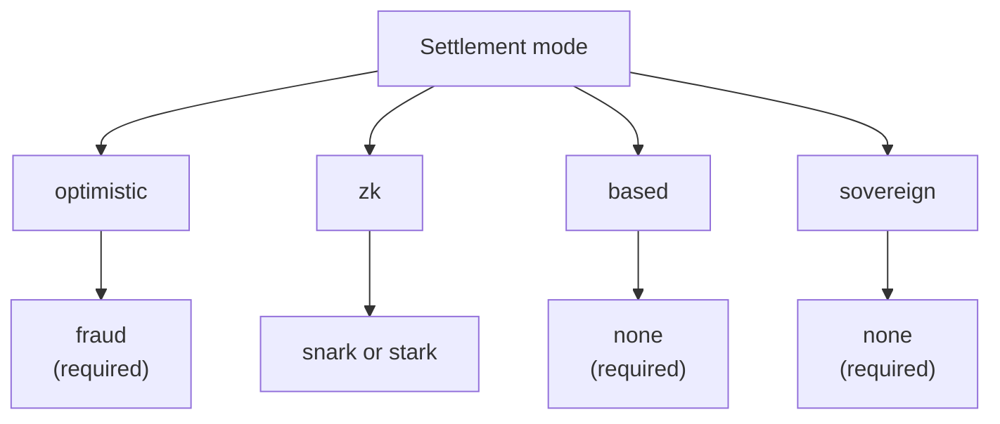

# Aperçu des Rollups

Le **Rollup Development Kit (RDK)** de QoreChain — le module `x/rdk` — permet aux développeurs de lancer des rollups spécifiques à une application qui se règlent sur QoreChain. Chaque rollup est un environnement d'exécution indépendant avec son propre temps de bloc, sa propre machine virtuelle, son propre modèle de frais et son propre séquencement, tout en héritant des garanties de sécurité, de cryptographie post-quantique et de disponibilité des données de QoreChain.

:::caution Capacité à un stade précoce
Le RDK est déployé sur les deux réseaux, mais **aucun rollup n'a encore été créé sur l'un ou l'autre** (vérifié le 27 octobre 2026), de sorte que les flux décrits dans cette section n'ont pas été éprouvés par des tiers. Le mainnet (**`qorechain-vladi`**, EVM chain ID **9801**, en service depuis le 7 juin 2026) exécute la version de chaîne **v3.2.4** (appliquée à la hauteur 3 742 566 le 23 octobre 2026, proposition de gouvernance 13) ; le testnet (**`qorechain-diana`**, EVM chain ID **9800**) exécute la **v3.2.6** (la v3.2.4 l'a atteint le 19 octobre 2026, la v3.2.5 le 26 octobre et la v3.2.6 le 27 octobre). La proposition de gouvernance 14 du mainnet appliquerait la v3.2.5 à la hauteur 3 906 833 et était en période de vote au moment de la rédaction ; ce que la v3.2.5 change pour les rollups sera documenté le jour où le mainnet l'appliquera. Lorsque le comportement a changé entre la v3.2.3 et la v3.2.4, cette section indique quelle version s'applique. Validez chaque déploiement d'abord sur le testnet, et lisez les notes d'état de chaque page : plusieurs capacités (vérification ZK, disponibilité des données Celestia, QCAI Copilot, appels cross-VM, reçus de règlement) ne sont pas utilisables de bout en bout aujourd'hui, et les clients RDK publiés ont leurs propres limites (voir [RDK 0.6.1 : changements et limites](/rollups/deploying-a-rollup#rdk-050-limits)).
:::

## Ce qui existe aujourd'hui {#what-exists-today}

| | Statut |
|---|---|
| Rollups enregistrés (mainnet et testnet) | Aucun |
| Module `x/rdk` et ses paramètres | Déployé sur les deux réseaux ; consultez-les avec `qorechaind query rdk config` |
| Requêtes RDK | Disponibles sur les deux réseaux via la CLI, gRPC et REST (`/qorechain/rdk/v1/…`), de sorte que les lectures via REST, comme `rdk.params()` en TypeScript, fonctionnent face au mainnet |
| Ancrages de règlement écrits par le RDK | Aucun. Depuis la v3.2.2, un batch peut porter une `anchor_signature` et est alors ancré dans `x/multilayer` dans la même transaction ; sans elle, le batch se règle sans ancrage. Aucun rollup, aucune couche ni aucun ancrage n'existe encore. Le RDK TypeScript (0.6.0 et 0.6.1) envoie ce champ lorsque son client signe en hybride et qu'il est le créateur du rollup (non testé en production) ; les clients Python, Go, Rust et Java ne l'envoient pas |
| Couches de rollup enregistrées dans `x/multilayer` | Aucune |
| Retraits | Payés depuis un registre d'entiercement propre à chaque rollup depuis la v3.2.3 (voir [ZK / STARK et retraits](/rollups/zk-stark-withdrawals)) ; aucun n'a été effectué, car aucun rollup n'existe |

Pour la référence de bas niveau du module — paramètres du module, éléments internes du cycle de vie, intégration du burn et ancrage multicouche — voir la page **[Rollup Development Kit](/architecture/rollup-development-kit)** dans la section Architecture. Cette section Rollups est le guide pratique destiné aux développeurs : ce qu'est le RDK, quel paradigme choisir, comment déployer, comment fonctionne la disponibilité des données, et comment les retraits se règlent du L2 vers le L1.

---

## Ce que le RDK vous apporte

Un rollup créé via le RDK regroupe quatre aspects configurables :

| Aspect | Ce qu'il contrôle | Options |
| ------- | ---------------- | ------- |
| **Mode de règlement** | Comment les transitions d'état du rollup sont vérifiées et finalisées sur QoreChain | `optimistic`, `zk`, `based`, `sovereign` |
| **Système de preuve** | Le mécanisme cryptographique ou économique garantissant le règlement | `fraud`, `snark`, `stark`, `none` |
| **Mode de séquenceur** | Qui ordonne les transactions avant leur règlement | `dedicated`, `shared`, `based` |
| **Disponibilité des données** | Où les données de transaction sont publiées afin que quiconque puisse reconstruire l'état | `native`, `celestia`, `both` |

Chaque rollup est enregistré avec un `rollup-id` unique, garanti par une caution de stake en QOR, et se voit attribuer un statut de cycle de vie (`pending`, `active`, `paused`, `stopped`). Voir **[Déployer un rollup](/rollups/deploying-a-rollup)** pour le flux complet de création et de cycle de vie.

---

## Ce qui distingue le RDK de QoreChain

Au-delà des fonctionnalités standard de tout kit de rollup, le RDK de QoreChain inclut trois capacités propres à QoreChain, construites autour de la Layer 1 de QoreChain — plus un auto-challenger watchtower. Leur statut diffère ; le tableau indique ce qui fonctionne aujourd'hui. Le RDK est livré en cinq langages (TypeScript, Python, Go, Rust, Java). **La version 0.6.1 est publiée sur les cinq registres** (vérifié le 27 octobre 2026 : npm `@qorechain/rdk`, `@qorechain/rdk-cli` et `create-qorechain-rollup` ; PyPI `qorechain-rdk` ; crates.io `qorechain-rdk` ; Maven Central `io.github.qorechain:qorechain-rdk` ; module Go `v0.6.1`, que sert aussi le `@latest` du proxy aujourd'hui ; épinglez explicitement la version). Sur les cinq, seul le client TypeScript signe des transactions hybrides. Les préréglages `mainnet` et `testnet` intègrent directement les points de terminaison publics `qore.host`, de sorte que `createRdkClient({ network })` ne nécessite aucune configuration manuelle de point de terminaison, et que ses lectures REST fonctionnent face aux deux réseaux.

| Différenciateur | Ce qu'il fait |
| -------------- | ------------ |
| **[Reçus de règlement à sécurité quantique](/rollups/settlement-receipts)** | Regroupent un ancrage de règlement en un reçu portable portant une signature post-quantique (ML-DSA-87 / Dilithium-5). Stade précoce : aucun ancrage n'existe encore, donc rien n'a été vérifié face à un véritable ancrage ; un reçu est une affirmation qui doit être vérifiée par rapport à l'état de la chaîne, ce que fait le vérificateur de la 0.6.1, champ par champ. |
| **[QCAI Rollup Copilot](/rollups/qcai-copilot)** | Un assistant consultatif en lecture seule pour un rollup (estimation des frais, recommandations, enquêtes anti-fraude). Les services consultatifs qu'il lit ne sont pas encore exposés sur les points de terminaison publics. |
| **[Appels cross-VM Multi-VM](/rollups/multi-vm)** | Outillage pour encoder un appel EVM → QoreChain Native via le précompilé cross-VM (`0x…0901`). Le précompilé n'est pas activé sur les réseaux en service, donc un appel ne fait rien ; l'encodeur depuis la 0.6.0 correspond à la disposition que la chaîne décode. |
| **[Watchtower](/rollups/watchtower)** | Un framework d'auto-challenger pour les rollups optimistes qui signale les nouveaux batches et les échéances de fenêtre de contestation, et conteste les batches invalides selon votre prédicat de validité. Il lit via REST, que les deux réseaux servent ; depuis la 0.6.0, il juge la fenêtre de chaque batch comme le fait la chaîne (la 0.6.1 conserve ce comportement). |

Voir **[Pourquoi le RDK QoreChain](/rollups/why)** pour la justification complète et des exemples de code.

---

## Les quatre paradigmes de règlement

Le RDK QoreChain prend en charge quatre modes de règlement distincts, chacun avec des hypothèses de confiance, des caractéristiques de finalité et des exigences de preuve différentes. La combinaison du mode de règlement et du système de preuve est validée on-chain — un appariement incompatible est rejeté à la création. Le diagramme ci-dessous met en correspondance chaque mode de règlement avec son système de preuve valide.

### Optimistic

Les rollups optimistes considèrent par défaut que les batches soumis sont valides et s'appuient sur les **preuves de fraude** (fraud proofs) pour la résolution des litiges.

* **Système de preuve** : `fraud` — preuves de fraude interactives
* **Séquenceur** : `dedicated` ou `shared`
* **Finalité** : Différée jusqu'à l'expiration d'une fenêtre de contestation configurable sans contestation réussie
* **Litiges** : Quiconque peut contester un batch soumis pendant la fenêtre en déposant une caution et une preuve de fraude. Une contestation gèle le batch ; le créateur du rollup la tranche ensuite, et la chaîne vérifie elle-même la preuve — une fraude confirmée rejette le batch et rémunère le contestataire, une contestation rejetée remet le batch à l'état `submitted`. Voir [Déployer un rollup](/rollups/deploying-a-rollup#challenge-a-batch-optimistic-rollups).
* **Durée de la fenêtre** : la fenêtre par défaut est de 604 800 « secondes » sur le mainnet (le `default_challenge_window` du module ; la valeur par défaut du testnet est de 3 600 secondes, lue le 27 octobre 2026, et un rollup peut définir la sienne). **Avant la v3.2.4 (sur le mainnet, avant la hauteur 3 742 566)**, la chaîne les convertit en blocs à raison fixe de 6 secondes par bloc — soit **100 800 blocs** — de sorte que le temps réellement écoulé dépend du temps de bloc effectif (environ 3,7 jours avec les blocs actuels du mainnet à ≈3,2 s) ; planifiez en blocs, pas en jours. **À partir de la v3.2.4**, un batch soumis à partir de la hauteur de mise à niveau reçoit une fenêtre mesurée en secondes de temps de bloc (soit 7 jours complets) ; les batches antérieurs conservent la règle du nombre de blocs. La hauteur de mise à niveau est 8 337 253 sur le testnet (depuis le 19 octobre 2026) et 3 742 566 sur le mainnet (23 octobre 2026) : la règle du nombre de blocs s'applique donc à tout batch soumis en dessous de cette hauteur, et la règle du temps de bloc à partir de celle-ci.

### ZK (Zero-Knowledge)

Les rollups ZK associent une preuve cryptographique de validité à chaque batch, prouvant la correction de la transition d'état sans réexécution.

* **Système de preuve** : `snark` (preuves succinctes) ou `stark` (preuves transparentes, sans configuration de confiance)
* **Séquenceur** : `dedicated` ou `shared`
* **Finalité** : Dès la vérification d'une preuve valide — aucune fenêtre de contestation requise
* **Maturité** : Les batches SNARK sont vérifiés on-chain (Groth16 sur BLS12-381) par rapport à une clé de vérification stockée avec le rollup. Un rollup créé via `create-rollup` ne porte actuellement pas de clé de vérification, de sorte que les batches ZK ne peuvent pas encore être finalisés de bout en bout. La vérification STARK est expérimentale : elle est optionnelle et vérifie un circuit de démonstration, pas la transition d'état propre à votre rollup. Considérez le règlement ZK comme non prêt pour la production. Voir **[ZK / STARK et retraits](/rollups/zk-stark-withdrawals)**.

### Based

Les rollups Based délèguent le séquencement des transactions aux proposeurs de QoreChain (L1), héritant ainsi de la vivacité et de la résistance à la censure de la chaîne hôte.

* **Système de preuve** : `none` — les proposeurs L1 sont la source de vérité pour l'ordonnancement
* **Séquenceur** : `based` (obligatoire — imposé par la validation on-chain)
* **Finalité** : Suit la confirmation de la chaîne hôte
* **Compromis** : Modèle opérationnel le plus simple, puisque les validateurs QoreChain gèrent le séquencement, au prix du contrôle de latence d'un séquenceur dédié
* **Statut aujourd'hui** : `based` est enregistré dans la configuration du rollup, mais QoreChain n'admet pas encore les proposeurs L1 comme soumetteurs de batches — c'est le créateur du rollup qui soumet (voir [Modes de séquenceur](#sequencer-modes))

### Sovereign

Les rollups Sovereign exécutent leur propre consensus et s'auto-séquencent. Ils ancrent leur état sur QoreChain à des fins de vérifiabilité, mais ne dépendent pas de la chaîne hôte pour la finalité.

* **Système de preuve** : `none`
* **Séquenceur** : autogéré par le rollup
* **Finalité** : Indépendante — déterminée par le consensus propre du rollup
* **Ancrage d'état** : Les racines d'état sont publiées sur QoreChain à des fins de transparence, mais la chaîne hôte ne les impose pas

---

## Compatibilité des systèmes de preuve

Le mode de règlement détermine les systèmes de preuve valides. Ces appariements sont imposés lors de la création d'un rollup.

| Mode de règlement | `fraud` | `snark` | `stark` | `none` |
| --------------- | :-----: | :-----: | :-----: | :----: |
| **optimistic**  | Obligatoire | — | — | — |
| **zk**          | — | Pris en charge | Pris en charge | — |
| **based**       | — | — | — | Obligatoire |
| **sovereign**   | — | — | — | Obligatoire |

---

## Modes de séquenceur {#sequencer-modes}

Le séquenceur détermine qui ordonne les transactions au sein d'un bloc de rollup avant le règlement.

| Mode | Qui séquence | Notes |
| ---- | ------------- | ----- |
| **`dedicated`** | Une seule adresse d'opérateur désignée | Latence la plus faible ; nécessite de faire confiance à l'opérateur pour la vivacité et l'équité de l'ordonnancement |
| **`shared`** | Un ensemble de séquenceurs partagé | Ordonnancement réparti sur l'ensemble ; surcharge de coordination légèrement plus élevée |
| **`based`** | Proposeurs L1 de QoreChain | Hérite de la sécurité des validateurs et de la résistance à la censure de la chaîne hôte ; requis pour le règlement `based` |

:::note Ce qui est imposé aujourd'hui
On-chain, un batch ne peut être soumis que par l'adresse de séquenceur configurée du rollup ou, lorsqu'aucune n'est définie (c'est le cas de tous les préréglages), par son créateur. Les modes `shared` et `based` sont enregistrés dans la configuration du rollup, mais QoreChain n'admet pas encore de liste de séquenceurs partagés ni de proposeurs L1 comme soumetteurs de batches ; ces modes décrivent la conception visée.
:::

---

## Choisir un paradigme

| Si vous voulez... | Envisagez |
| -------------- | -------- |
| La configuration opérationnelle la plus simple, avec le séquencement assuré par les validateurs QoreChain | **based** |
| Une finalité rapide avec des garanties cryptographiques (pas encore prêt pour la production) | **zk** (`snark` / `stark`) |
| Un modèle bien maîtrisé avec résolution économique des litiges | **optimistic** (`fraud`) |
| Une indépendance totale avec votre propre consensus, ancré à des fins de vérifiabilité | **sovereign** |

Vous ne savez pas par où commencer ? Le RDK propose des **profils préréglés** qui regroupent ces choix pour les catégories d'applications courantes — voir **[Profils préréglés](/rollups/preset-profiles)** — et, lorsque le RPC consultatif est disponible, un assistant `suggest-profile` (pour l'instant il renvoie un repli fixe `defi`, choisissez donc à partir du tableau des profils).

Pour les développeurs, le RDK est également disponible sous forme de SDK TypeScript public **`@qorechain/rdk`**, accompagné du générateur de projet **`create-qorechain-rollup`**, qui pilotent tous deux le même module on-chain depuis le code — voir **[Déployer un rollup](/rollups/deploying-a-rollup#deploy-with-the-typescript-rdk-qorechainrdk)**.

## Voir aussi

* [Déployer un rollup](/rollups/deploying-a-rollup) — lancez un rollup depuis la CLI ou le RDK TypeScript.
* [Profils préréglés](/rollups/preset-profiles) — des configurations en un clic pour les catégories d'applications courantes.
* [Disponibilité des données](/rollups/data-availability) — le routeur DA natif et le stockage de blobs.
* [Retraits ZK / STARK](/rollups/zk-stark-withdrawals) — des flux de retrait garantis par preuve.
