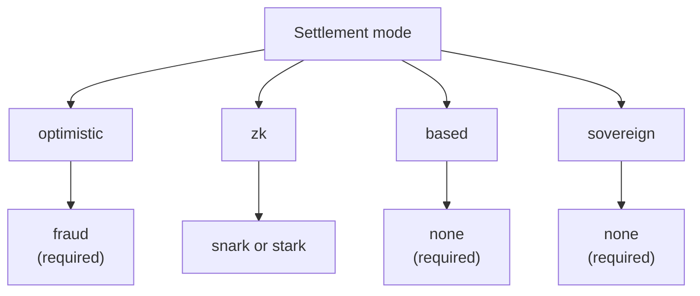

# Aperçu des Rollups

Le **Rollup Development Kit (RDK)** de QoreChain est un ensemble de bibliothèques clientes (TypeScript, Python, Go, Rust et Java), un outil en ligne de commande pour les opérateurs et des modèles de démarrage pour construire des rollups spécifiques à une application qui se règlent sur QoreChain via le module on-chain `x/rdk`. Il vous permet de configurer un rollup, de construire et signer ses transactions, de lire son état, de suivre ses fenêtres de contestation, d'émettre et de vérifier des reçus de règlement, et d'assembler des appels cross-VM et des preuves de retrait. Chaque rollup est un environnement d'exécution indépendant avec son propre temps de bloc, sa propre machine virtuelle, son propre modèle de frais et son propre séquencement, tout en héritant de la sécurité, de la cryptographie post-quantique et de la disponibilité des données de QoreChain. Cette page s'adresse aux développeurs qui veulent lancer ou exploiter un rollup, et à quiconque se demande si le RDK convient à son application.

:::caution Capacité à un stade précoce
Le RDK est déployé sur les deux réseaux, mais **aucun rollup n'a encore été créé sur l'un ou l'autre** (vérifié le 27 octobre 2026), de sorte que les flux décrits dans cette section n'ont pas été éprouvés par des tiers. **Le règlement ZK (le profil `defi`, le modèle `defi-rollup` et tout rollup `zk`) ne peut encore être utilisé sur aucun des deux réseaux :** la chaîne n'a aucun moyen d'enregistrer une clé de vérification, de sorte que chaque batch ZK est refusé après le paiement de ses frais. L'enregistrement des clés est prévu pour la version de chaîne v3.2.7. Utilisez le règlement `optimistic` d'ici là.

Le mainnet (**`qorechain-vladi`**, EVM chain ID **9801**, en service depuis le 7 juin 2026) exécute la version de chaîne **v3.2.5** (la proposition de gouvernance 14 l'a appliquée à la hauteur 3 906 833 le 29 octobre 2026 ; la v3.2.4 avait été appliquée à la hauteur 3 742 566 le 23 octobre 2026, proposition 13) ; le testnet (**`qorechain-diana`**, EVM chain ID **9800**) exécute la **v3.2.6** (la v3.2.4 l'a atteint le 19 octobre 2026, la v3.2.5 le 26 octobre et la v3.2.6 le 27 octobre). Ce que la v3.2.5 change pour les rollups est énuméré sous [comportement de la chaîne v3.2.5](#v325) ; cela s'applique aux deux réseaux. Lorsque le comportement a changé entre la v3.2.3 et la v3.2.4, cette section indique quelle version s'applique. Validez chaque déploiement d'abord sur le testnet, et lisez les notes d'état de chaque page : plusieurs capacités (vérification ZK, disponibilité des données Celestia, QCAI Copilot, appels cross-VM, reçus de règlement) ne sont pas utilisables de bout en bout aujourd'hui.
:::

## Innovations {#innovations}

* **Reçus de règlement post-quantiques.** L'ancrage d'état d'un batch est signé avec ML-DSA-87 par la clé enregistrée du créateur du rollup. `verifySettlementReceipt` relit chaque champ du reçu depuis la chaîne (rollup, couche, racine du batch, et l'ancrage : racine d'état, hauteur de couche, hauteur de la chaîne principale, heure de l'ancrage, hash de l'ensemble de validateurs, nombre de transactions, preuve, signature). La clé de vérification provient de la chaîne et jamais du reçu ; le reçu doit désigner le réseau que vous interrogez ; une version de reçu inconnue ou un algorithme autre que ML-DSA-87 est refusé avant toute lecture ; et une vérification de signature seule n'est jamais déclarée valide. Le message d'ancrage a une première forme en dessous de la hauteur de la v3.2.2 de la chaîne et une seconde forme, qui lie aussi l'identifiant de chaîne, à partir de celle-ci ; la version est choisie selon la hauteur de l'ancrage. Voir [Reçus de règlement](/rollups/settlement-receipts).
* **Signature hybride avec deux dérivations de clé.** Les transactions sont signées avec secp256k1 plus ML-DSA-87. La clé post-quantique est dérivée de la phrase mnémonique à la fois de manière canonique (SHAKE-256 sur `qorechain:pqc:v1|`, l'adresse et la phrase mnémonique) et de manière héritée, et le client utilise celle des deux clés que la chaîne a enregistrée pour le compte. Aujourd'hui, seul le client TypeScript signe en hybride.
* **Preuves de retrait construites comme la chaîne les construit.** `withdrawalsTree` (0.7.0, dans les cinq langages) construit la racine des retraits d'un batch et chaque preuve exactement comme le fait la chaîne : la position de la feuille est l'index du retrait, les nœuds sont hachés avec SHAKE-256, et les batches issus de la v3.2.5 de la chaîne utilisent des feuilles de seconde forme qui désignent aussi l'identifiant de chaîne. Il est testé avec des vecteurs produits par le code même de la chaîne, et chaque preuve de ces vecteurs est acceptée par le vérificateur de la chaîne. `qorollup withdraw` refuse avant de payer des frais lorsque son résultat n'est pas la `withdrawals_root` on-chain du batch.
* **Racine de transition canonique.** `batchTransitionRoot` calcule la racine d'état exacte d'après laquelle la chaîne juge un batch optimiste (la forme que le mainnet applique aujourd'hui est un engagement SHAKE-256 de la racine d'état précédente, du hash des données et du nombre de transactions ; `transitionRootVersionFor` sélectionne la forme qu'applique le réseau connecté), et `fraudProof` construit à partir de celle-ci la preuve de 64 octets. Les deux ont été testés avec des vecteurs générés par le code même de la chaîne.
* **Fenêtres de contestation exactes à la chaîne.** `batchChallengeWindow` calcule la fenêtre d'un batch comme le fait la chaîne (basée sur le temps : ouverte tant que le temps de bloc est inférieur au temps de soumission plus la fenêtre ; pour les batches plus anciens, la fenêtre divisée par six en blocs à partir de la hauteur de soumission) et la juge par rapport à la pointe de la chaîne lue depuis le RPC `/status`, non d'après l'horloge locale. Le [Watchtower](/rollups/watchtower) et le moniteur de santé l'utilisent. Depuis la 0.7.0, `getRollupHealth` indique aussi `heldBackBy` lorsque la finalité dans l'ordre de la chaîne (v3.2.5, les deux réseaux, voir [comportement de la chaîne v3.2.5](#v325)) retient un batch, et `qorollup watchtower --canonical` signale les batches qu'une contestation ferait gagner.
* **Vérifications avant tout paiement de frais.** Le kit refuse un identifiant de rollup hors de `^[a-z0-9][a-z0-9._-]{2,63}$` ; un retrait qui n'est pas en `uqor`, a un montant nul, porte une preuve de plus de 64 niveaux de 32 octets ou désigne une adresse bech32 invalide ; une racine des retraits qui n'est ni vide ni d'exactement 32 octets ; un arrêt de rollup que la chaîne refusera (v3.2.5 et ultérieure) ; et, lorsqu'il peut lire le rollup, un batch qui désigne un hash de données sur un rollup à disponibilité des données `native` ou `both`. Chacun de ces cas serait sinon refusé par la chaîne une fois les frais dépensés.
* **Calldata cross-VM et vérification en direct.** `encodeCrossVmCalldata` construit le calldata pour `executeCrossVMCall(uint8,string,bytes)` (sélecteur `0x3c11078c`, précompilé `0x...0901`), et `isCrossVmPrecompileActive` lit si le précompilé est actif sur le réseau. Depuis la 0.7.0, `getCrossVmParams`, `crossVmTargetReady`, `decodeCrossVmResult` et `decodeRevertReason` couvrent la liste d'autorisation et les formats de réponse de la v3.2.5 de la chaîne (les deux réseaux). Voir [Multi-VM](/rollups/multi-vm).
* **Un seul jeu de vecteurs de test pour cinq langages.** Les paquets TypeScript, Python, Go, Rust et Java sont vérifiés par rapport à la même fixture de référence (le paquet Go compte 100 tests unitaires, Rust 77 et Java 75).

## Comment l'utiliser {#how-to-use}

Les lectures ne nécessitent ni clé ni fonds. Les extraits ci-dessous lisent les paramètres en direct du module `rdk` et la liste des rollups sur le testnet public (`qorechain-diana`) et ont été exécutés le 27 octobre 2026 à partir des paquets publiés (la version actuelle est la 0.7.0 ; l'extrait TypeScript et la ligne de commande ont été relancés avec la 0.7.0 depuis npm, et le hub développeur consigne les extraits Python, Rust, Go et Java comme réussis face à la même version). Chacun a affiché les paramètres du testnet (rollups maximum 200, stake minimum 10 000 QOR, taux de burn à la création 0,01, fenêtre de contestation par défaut 3 600 secondes, taille maximale d'un blob DA 2 097 152 octets, rétention des blobs 432 000 blocs, maximum 10 batches par bloc) et `0 rollups`.

### TypeScript (testé)

```bash
npm install @qorechain/rdk
```

```ts
import { createRdkClient } from "@qorechain/rdk";

// Public testnet (chain id qorechain-diana).
const rdk = createRdkClient({
  network: "testnet",
  endpoints: { rest: "https://api-testnet.qore.host" },
});

// Read the live rdk module parameters and the registered rollups.
const params = await rdk.params();
const rollups = await rdk.rest.listRollups();
console.log(rdk.network.chainId, params, `${rollups.length} rollups`);
```

Les préréglages `mainnet` et `testnet` intègrent déjà les points de terminaison publics `qore.host`, de sorte que `createRdkClient({ network: "testnet" })` fonctionne sans le champ `endpoints` ; il est montré ci-dessus parce que l'extrait testé le passait. Exécutez avec Node 20 ou une version ultérieure (le test a utilisé Node 26).

### Python (testé)

```bash
pip install qorechain-rdk
```

```python
from qorrdk import create_rdk_client

# Public testnet (chain id qorechain-diana).
rdk = create_rdk_client(network="testnet", endpoints={"rest": "https://api-testnet.qore.host"})

# Read the live rdk module parameters and the registered rollups.
params = rdk.params()
rollups = rdk.rest.list_rollups()
print(rdk.network.chain_id, params, f"{len(rollups)} rollups")
```

Python 3.10 ou ultérieur. `qorechain-rdk` dépend de `qorechain-pqc`, qui tire `liboqs-python` et nécessite la bibliothèque `liboqs` ; sur une machine qui ne l'a pas, le premier import la compile (git, CMake et un compilateur C sont nécessaires). Testé dans un environnement virtuel neuf sous Python 3.12.

### Go (testé)

```bash
go get github.com/qorechain/qorechain-rdk/packages/go@v0.7.0
```

```go
package main

import (
	"context"
	"fmt"

	rdk "github.com/qorechain/qorechain-rdk/packages/go"
)

func main() {
	// Public testnet (chain id qorechain-diana).
	client := rdk.NewRdkClient(rdk.RdkClientOptions{
		Network:   "testnet",
		Endpoints: &rdk.Endpoints{Rest: "https://api-testnet.qore.host"},
	})
	ctx := context.Background()
	// Read the live rdk module parameters and the registered rollups.
	params, err := client.Params(ctx)
	if err != nil {
		panic(err)
	}
	rollups, _ := client.Rest.ListRollups(ctx)
	fmt.Printf("%s %+v %d rollups\n", client.Network.ChainID, params, len(rollups))
}
```

Testé avec Go 1.26, le module étant récupéré depuis le proxy Go.

### Rust (testé)

```bash
cargo add qorechain-rdk
```

```rust
use qorechain_rdk::client::{RdkClient, RdkClientOptions};

fn main() -> Result<(), Box<dyn std::error::Error>> {
    // Public testnet (chain id qorechain-diana).
    let rdk = RdkClient::new(RdkClientOptions {
        rest_url: Some("https://api-testnet.qore.host".into()),
        ..Default::default()
    });

    // Read the live rdk module parameters and the registered rollups.
    let params = rdk.params()?;
    let rollups = rdk.rest.list_rollups()?;
    println!("{} {:?} {} rollups", rdk.network.chain_id, params, rollups.len());
    Ok(())
}
```

La bibliothèque est `qorechain_rdk`. Testé avec Rust 1.95, compilé contre crates.io.

### Java (testé)

```kotlin
// build.gradle.kts
implementation("io.github.qorechain:qorechain-rdk:0.7.0")
```

```java
import io.github.qorechain.rdk.client.RdkClient;
import io.github.qorechain.rdk.client.Views.ParamsView;
import io.github.qorechain.rdk.config.Networks;

public class RdkQuickstart {
    public static void main(String[] args) {
        // Public testnet (chain id qorechain-diana).
        RdkClient.Options options = new RdkClient.Options();
        options.network = "testnet";
        options.endpoints = new Networks.Endpoints();
        options.endpoints.rest = "https://api-testnet.qore.host";
        RdkClient rdk = new RdkClient(options);

        // Read the live rdk module parameters and the registered rollups.
        ParamsView params = rdk.params();
        int rollups = rdk.rest.listRollups().size();
        System.out.println(rdk.network.chainId + " maxRollups=" + params.maxRollups
                + " minStakeForRollup=" + params.minStakeForRollup + " " + rollups + " rollups");
    }
}
```

JDK 17 ou ultérieur ; testé avec JDK 21 et Gradle 9.6 résolvant depuis Maven Central. Le fichier doit s'appeler `RdkQuickstart.java`. Maven Central sert la 0.6.2 et la 0.7.0 (vérifié le 27 octobre 2026).

### Ligne de commande (testé)

```bash
npm install -g @qorechain/rdk-cli
qorollup --version
qorollup params --network testnet
```

`qorollup --version` affiche `0.7.0` et `qorollup params --network testnet` affiche les paramètres du module en direct. **Cela fonctionne à partir de la 0.6.2.** Les versions 0.6.1 et antérieures se terminaient avec le code 0 et n'affichaient rien lorsqu'elles étaient installées depuis npm. Le test a installé `@qorechain/rdk-cli@0.7.0` dans un projet vide et l'a exécuté via `node_modules/.bin/qorollup` ; une installation globale et `npx` utilisent le même lien bin. Node 20 ou ultérieur est requis.

### Échafauder un projet (testé)

```bash
npx create-qorechain-rollup my-rollup --template nft-rollup --network testnet --yes
cd my-rollup && npm run doctor
```

Les modèles sont `defi-rollup`, `gaming-rollup`, `nft-rollup`, `enterprise-rollup`, `custom-rollup` et `multivm-rollup`. Le projet échafaudé dépend de `@qorechain/rdk` `^0.7.0`. L'échafaudage de `nft-rollup` avec le générateur 0.6.1 a produit un projet dont le `npm run doctor` a réussi face au testnet (REST joignable, paramètres lisibles, réseau `qorechain-diana` ; il avertit au sujet de la disponibilité des données Celestia et d'un signataire manquant) ; l'échafaudage de `defi-rollup` suivi de `npm run typecheck` a de nouveau réussi le 27 octobre 2026 avec la version actuelle. **N'utilisez pas encore `defi-rollup` pour lancer un rollup** (voir [Limites](#limits)). Pour créer un rollup et soumettre des batches, suivez [Déployer un rollup](/rollups/deploying-a-rollup) ; les transactions nécessitent une clé post-quantique enregistrée et, dans le RDK, le client TypeScript muni d'un `pqcKeypair`.

## Comment y accéder {#how-to-access}

**Réseaux et points de terminaison.** Le RDK dialogue avec les points de terminaison publics des deux réseaux ; les préréglages `mainnet` et `testnet` les intègrent déjà.

| Réseau | Identifiant de chaîne | EVM chain ID | Point de terminaison REST | Version de la chaîne |
| ------- | -------- | ------------ | ------------- | ------------- |
| Mainnet | `qorechain-vladi` | 9801 | `https://api.qore.host` | v3.2.5 |
| Testnet | `qorechain-diana` | 9800 | `https://api-testnet.qore.host` | v3.2.6 |

Les deux réseaux servent les requêtes RDK (`/qorechain/rdk/v1/...`) via REST, gRPC et la CLI, de sorte que des lectures comme `rdk.params()` fonctionnent face à l'un comme à l'autre. Le testnet est un réseau de préproduction avec ses propres paramètres : la fenêtre de contestation par défaut est de 3 600 secondes sur le testnet et de 604 800 sur le mainnet, 200 rollups au plus peuvent exister sur le testnet et 100 sur le mainnet, et le module multilayer autorise 64 couches sidechain sur le testnet et 10 sur le mainnet (vérifié le 27 octobre 2026). Lisez `GET /qorechain/rdk/v1/params` sur le réseau que vous visez.

**Prérequis pour créer un rollup.**

| Exigence | Détails |
| ----------- | ------- |
| **Compte approvisionné** | Un compte disposant de suffisamment de QOR pour le stake, le stake de couche et les frais. |
| **Stake mis sous séquestre** | La création d'un rollup place sous séquestre `min_stake_for_rollup`, soit **10 000 QOR** sur les deux réseaux. **1 % du stake (100 QOR) est brûlé** à la création ; le reste demeure sous séquestre et est restitué lorsque le rollup est arrêté. |
| **Stake de couche** | La création enregistre aussi la couche du rollup dans le module multilayer (stake minimum 1 000 QOR). Si la couche ne peut pas être enregistrée, le rollup est tout de même créé mais n'a pas de véritable couche, de sorte que ses batches ne peuvent pas être ancrés et qu'aucun reçu ne peut être émis. |
| **Clé post-quantique enregistrée** | Une clé ML-DSA-87 enregistrée pour le compte. Les transactions de la voie native signées uniquement avec la clé classique sont refusées. |
| **Frais** | Le plancher de frais est de 0,1 uqor par unité de gas ; définissez ensemble la limite de gas et les frais. |
| **Outils** | Node 20 ou ultérieur pour la CLI et le générateur de projet ; Python 3.10 ou ultérieur (avec `liboqs`, voir ci-dessus) pour le client Python ; JDK 17 ou ultérieur pour Java ; le module Go `github.com/qorechain/qorechain-rdk/packages/go`. |

La lecture de l'état n'exige rien de tout cela. Vous pouvez aussi demander un rollup via le Dashboard (un formulaire de demande, pas une transaction on-chain) ou en créer un avec la CLI de la chaîne ; voir [Déployer un rollup](/rollups/deploying-a-rollup) pour le flux complet, les commandes CLI et le chemin de signature TypeScript.

### Comportement de la chaîne v3.2.5 : en service sur les deux réseaux {#v325}

La v3.2.5 de la chaîne est en service sur le mainnet (appliquée à la hauteur 3 906 833 le 29 octobre 2026, proposition de gouvernance 14) et sur le testnet (depuis le 26 octobre 2026). Le testnet exécute la v3.2.6, qui l'inclut. Le RDK 0.7.0 prend en charge les deux. Ces règles s'appliquent aux deux réseaux ; aucun rollup n'a encore été créé sur le mainnet (`GET /qorechain/rdk/v1/rollups` renvoie une liste vide, vérifié le 30 octobre 2026), de sorte que les règles ci-dessous sont celles de la version et n'ont pas encore été exercées par un rollup mainnet en service. Pour un développeur de rollup :

| Comportement | Les deux réseaux (v3.2.5 et ultérieure) |
| --------- | -------------------------------- |
| Qui peut trancher une contestation | Tout compte |
| Après une fraude confirmée | Le batch et tous les batches non finalisés suivants sont rejetés ; le séquenceur soumet à nouveau à partir de la dernière bonne racine, sous les mêmes index |
| Ordre de finalité | Les batches sont finalisés dans l'ordre des index |
| Batches optimistes en attente | 4 096 au plus par rollup |
| Arrêt d'un rollup | Refusé tant que le dernier batch est `submitted` ou `challenged` ; un rollup arrêté libère son emplacement |
| `withdrawals_root` | Vide ou exactement 32 octets ; les feuilles de retrait de seconde forme désignent l'identifiant de chaîne |
| Pont cross-VM | `GET /qorechain/crossvm/v1/params` sert la liste d'autorisation (`bridge_allowed_targets`, vide sur les deux réseaux, vérifié le 30 octobre 2026) ; le précompilé renvoie `abi.encode(bytes)` et refuse avec `Error(string)` |
| Précompilé cross-VM `0x...0901` | Toujours inactif |

Ce qui reste propre au testnet est la v3.2.6 (par exemple la limite de débit IBC, le transfert de paquets et les messages 08-wasm) ; rien de cela ne change la façon dont un rollup règle.

### Ce qui existe aujourd'hui {#what-exists-today}

| | Statut |
|---|---|
| Rollups enregistrés (mainnet et testnet) | Aucun |
| Module `x/rdk` et ses paramètres | Déployé sur les deux réseaux ; consultez-les avec `qorechaind query rdk config` |
| Requêtes RDK | Disponibles sur les deux réseaux via la CLI, gRPC et REST (`/qorechain/rdk/v1/...`), de sorte que les lectures via REST, comme `rdk.params()` en TypeScript, fonctionnent face au mainnet |
| Ancrages de règlement écrits par le RDK | Aucun. Depuis la v3.2.2, un batch peut porter une `anchor_signature` et est alors ancré dans `x/multilayer` dans la même transaction ; sans elle, le batch se règle sans ancrage. Aucun rollup, aucune couche ni aucun ancrage n'existe encore. Le RDK TypeScript (0.6.0 à 0.7.0) envoie ce champ lorsque son client signe en hybride et qu'il est le créateur du rollup (non testé en production) ; les clients Python, Go, Rust et Java ne l'envoient pas |
| Couches de rollup enregistrées dans `x/multilayer` | Aucune |
| Règlement ZK | Ne peut encore être utilisé sur aucun des deux réseaux (aucun moyen d'enregistrer une clé de vérification ; prévu pour la version de chaîne v3.2.7) |
| Retraits | Payés depuis un registre d'entiercement propre à chaque rollup depuis la v3.2.3 (voir [ZK / STARK et retraits](/rollups/zk-stark-withdrawals)) ; aucun n'a été effectué, car aucun rollup n'existe |

Pour la référence de bas niveau du module (paramètres du module, éléments internes du cycle de vie, intégration du burn et ancrage multicouche), voir la page **[Rollup Development Kit](/architecture/rollup-development-kit)** dans la section Architecture. Cette section Rollups est le guide pratique destiné aux développeurs.

## Où il est publié {#where-published}

Versions vérifiées sur les registres le 27 octobre 2026. Tous les paquets sont sous licence Apache-2.0.

| Registre | Paquet | Version actuelle | Lien |
| -------- | ------- | --------------- | ---- |
| npm | `@qorechain/rdk` (client TypeScript) | 0.7.0 | [npmjs.com](https://www.npmjs.com/package/@qorechain/rdk) |
| npm | `@qorechain/rdk-cli` (`qorollup`) | 0.7.0 | [npmjs.com](https://www.npmjs.com/package/@qorechain/rdk-cli) |
| npm | `create-qorechain-rollup` (générateur de projet) | 0.7.0 | [npmjs.com](https://www.npmjs.com/package/create-qorechain-rollup) |
| PyPI | `qorechain-rdk` (import `qorrdk`) | 0.7.0 | [pypi.org](https://pypi.org/project/qorechain-rdk/) |
| crates.io | `qorechain-rdk` (bibliothèque `qorechain_rdk`) | 0.7.0 | [crates.io](https://crates.io/crates/qorechain-rdk) |
| Proxy de modules Go | `github.com/qorechain/qorechain-rdk/packages/go` | v0.7.0 | [pkg.go.dev](https://pkg.go.dev/github.com/qorechain/qorechain-rdk/packages/go) |
| Maven Central | `io.github.qorechain:qorechain-rdk` | 0.7.0 | [central.sonatype.com](https://central.sonatype.com/artifact/io.github.qorechain/qorechain-rdk) |

Maven Central sert la 0.6.2 et la 0.7.0 ainsi que les versions antérieures, et le `@latest` du proxy Go peut avoir du retard sur un nouveau tag ; épinglez donc la version Go. Le code source est public sur [github.com/qorechain/qorechain-rdk](https://github.com/qorechain/qorechain-rdk), les notes de version se trouvent sur [v0.7.0](https://github.com/qorechain/qorechain-rdk/releases/tag/v0.7.0), et la documentation propre au kit est sur [qorechain.github.io/qorechain-rdk](https://qorechain.github.io/qorechain-rdk/). Le paquet TypeScript dépend de `@qorechain/sdk` `^0.10.0` (à partir de la 0.7.0 ; la 0.6.x utilisait `^0.9.0`) et de `@qorechain/evm` `^0.8.0`, et le paquet Python de `qorechain-pqc` 0.2.x. La logique du module `x/rdk` de la chaîne elle-même ne fait pas partie du kit public.

## Limites et problèmes connus {#limits}

* **Le règlement ZK ne peut encore être utilisé sur aucun des deux réseaux.** Cela couvre le profil `defi`, le modèle `defi-rollup` et tout rollup créé avec le règlement `zk`. La chaîne n'a aucun moyen d'enregistrer une clé de vérification pour un rollup, de sorte que chaque batch ZK est refusé après le paiement de ses frais. L'enregistrement des clés est prévu pour la version de chaîne v3.2.7. Utilisez le règlement `optimistic` d'ici là (voir [ZK / STARK et retraits](/rollups/zk-stark-withdrawals)).
* **Aucun rollup n'a été créé sur l'un ou l'autre réseau.** Les chemins de création, de batch, de contestation, de reçu et de retrait sont couverts par des tests unitaires et des vecteurs partagés, mais n'ont pas été éprouvés on-chain.
* **Seul le client TypeScript signe des transactions hybrides.** Les chemins de transaction Python, Go, Rust et Java ainsi que les commandes de transaction de `qorollup` (`create`, `pause`, `resume`, `stop`, `withdraw`) signent en classique uniquement, ce que les deux réseaux refusent. Leurs lectures fonctionnent. Pour envoyer des transactions depuis ceux-ci, construisez le message et cosignez-le avec la CLI de la chaîne, ou utilisez le client TypeScript avec un `pqcKeypair`.
* **(a) La CLI `qorollup` n'affichait rien lorsqu'elle était installée depuis npm en 0.6.1 et avant.** Cela est **corrigé en 0.6.2** : après `npm i -g @qorechain/rdk-cli`, `qorollup ...` fonctionne et `qorollup --version` affiche 0.6.2.
* **(b) Les assistants Merkle de retrait utilisaient SHA-256 par défaut en 0.6.2 et avant, alors que la chaîne utilise SHAKE-256.** Une preuve construite avec ces valeurs par défaut ne se vérifiait jamais on-chain. **Corrigé en 0.7.0 :** `withdrawalsTree` construit l'arbre exact de la chaîne et a été vérifié face au vérificateur même de la chaîne (voir [Encodage des feuilles et des nœuds](/rollups/zk-stark-withdrawals#leaf-and-node-encoding)). Mettez à jour ; le code qui s'appuyait sur les valeurs par défaut SHA-256 doit désormais passer `hash` explicitement.
* **(c) `buildDaBlob` hachait avec SHA-256 en 0.6.2 et avant, alors que l'engagement de blob de la chaîne est en SHAKE-256.** **Corrigé en 0.7.0**, où son engagement est celui de la chaîne. Cela n'a jamais eu d'effet pratique, car aucune transaction ne publie de blob ; laissez `dataHash` vide pour la disponibilité des données `native` et `both` (voir [Disponibilité des données](/rollups/data-availability)).
* **(d) Le circuit de démonstration du modèle `defi` ne peut pas se vérifier.** C'est un multiplicateur `snarkjs`, et la chaîne vérifie du Groth16 sur BLS12-381 avec la racine d'état précédente, la racine d'état et le hash des données comme entrées publiques, que ce circuit n'expose pas. Même une fois l'enregistrement des clés livré, vous avez besoin de votre propre circuit.
* **Tout compte peut trancher une contestation (v3.2.5 et ultérieure, les deux réseaux).** La chaîne vérifie elle-même la preuve de fraude ; avant la v3.2.5, seul le créateur du rollup pouvait soumettre la résolution (voir [comportement de la chaîne v3.2.5](#v325) et [Optimistic](#optimistic)).
* **Non utilisables sur les réseaux en service :** la disponibilité des données Celestia (non implémentée), le [QCAI Rollup Copilot](/rollups/qcai-copilot) (ses services consultatifs ne sont pas sur les points de terminaison publics), les appels cross-VM (le précompilé à `0x...0901` n'est pas actif), les séquenceurs partagés et based (la chaîne n'admet que le séquenceur configuré ou, si aucun n'est défini, le créateur), et `suggest-profile` (il renvoie `defi` comme repli fixe).
* **Notes de version.** Utilisez la 0.7.0 pour tout : la 0.6.2 et les versions antérieures construisent des preuves de retrait qui ne se vérifient jamais on-chain, et la 0.6.1 et les versions antérieures n'affichent rien depuis `qorollup` lorsqu'elles sont installées depuis npm. La 0.5.0 et les versions antérieures ne doivent pas être utilisées pour les reçus, le Watchtower ni le calldata cross-VM. La liste complète de ce que chaque version a changé figure dans [RDK 0.7.0 : changements et limites](/rollups/deploying-a-rollup#rdk-050-limits).

---

## Référence : de quoi est fait un rollup {#reference}

### Ce que le RDK vous apporte

Un rollup créé via le RDK regroupe quatre aspects configurables :

| Aspect | Ce qu'il contrôle | Options |
| ------- | ---------------- | ------- |
| **Mode de règlement** | Comment les transitions d'état du rollup sont vérifiées et finalisées sur QoreChain | `optimistic`, `zk`, `based`, `sovereign` |
| **Système de preuve** | Le mécanisme cryptographique ou économique garantissant le règlement | `fraud`, `snark`, `stark`, `none` |
| **Mode de séquenceur** | Qui ordonne les transactions avant leur règlement | `dedicated`, `shared`, `based` |
| **Disponibilité des données** | Où les données de transaction sont publiées afin que quiconque puisse reconstruire l'état | `native`, `celestia`, `both` |

Chaque rollup est enregistré avec un `rollup-id` unique, garanti par une caution de stake en QOR, et se voit attribuer un statut de cycle de vie (`pending`, `active`, `paused`, `stopped`). Voir **[Déployer un rollup](/rollups/deploying-a-rollup)** pour le flux complet de création et de cycle de vie.

### Capacités propres à QoreChain et leur statut

Au-delà des fonctionnalités standard de tout kit de rollup, le RDK inclut trois capacités construites autour de la Layer 1 de QoreChain, plus un auto-challenger watchtower. Leur statut diffère ; le tableau indique ce qui fonctionne aujourd'hui.

| Capacité | Ce qu'elle fait |
| ---------- | ------------ |
| **[Reçus de règlement](/rollups/settlement-receipts)** | Regroupent un ancrage de règlement en un reçu portable portant une signature post-quantique (ML-DSA-87 / Dilithium-5). Stade précoce : aucun ancrage n'existe encore, donc rien n'a été vérifié face à un véritable ancrage ; un reçu est une affirmation qui doit être vérifiée par rapport à l'état de la chaîne, ce que fait le vérificateur de la 0.7.0, champ par champ. |
| **[QCAI Rollup Copilot](/rollups/qcai-copilot)** | Un assistant consultatif en lecture seule pour un rollup (estimation des frais, recommandations, enquêtes anti-fraude). Les services consultatifs qu'il lit ne sont pas encore exposés sur les points de terminaison publics. |
| **[Appels cross-VM Multi-VM](/rollups/multi-vm)** | Outillage pour encoder un appel EVM vers QoreChain Native via le précompilé cross-VM (`0x...0901`). Le précompilé n'est pas activé sur les réseaux en service, donc un appel ne fait rien ; l'encodeur depuis la 0.6.0 correspond à la disposition que la chaîne décode. |
| **[Watchtower](/rollups/watchtower)** | Un framework d'auto-challenger pour les rollups optimistes qui signale les nouveaux batches et les échéances de fenêtre de contestation, et conteste les batches invalides selon votre prédicat de validité. Il lit via REST, que les deux réseaux servent ; depuis la 0.6.0, il juge la fenêtre de chaque batch comme le fait la chaîne (les versions suivantes conservent ce comportement). |

Voir **[Pourquoi le RDK QoreChain](/rollups/why)** pour la justification complète et des exemples de code.

### Les quatre paradigmes de règlement {#settlement-paradigms}

Le RDK QoreChain prend en charge quatre modes de règlement, chacun avec des hypothèses de confiance, des caractéristiques de finalité et des exigences de preuve différentes. La combinaison du mode de règlement et du système de preuve est validée on-chain, et un appariement incompatible est rejeté à la création. Le diagramme met en correspondance chaque mode de règlement avec son système de preuve valide.



#### Optimistic {#optimistic}

Les rollups optimistes considèrent par défaut que les batches soumis sont valides et s'appuient sur les **preuves de fraude** (fraud proofs) pour la résolution des litiges.

* **Système de preuve** : `fraud` (preuves de fraude interactives).
* **Séquenceur** : `dedicated` ou `shared`.
* **Finalité** : différée jusqu'à l'expiration d'une fenêtre de contestation configurable sans contestation réussie.
* **Litiges** : quiconque peut contester un batch soumis pendant la fenêtre en déposant une caution et une preuve de fraude. Une contestation gèle le batch ; à partir de la v3.2.5 (les deux réseaux), tout compte peut ensuite la trancher, alors qu'avant la v3.2.5 seul le créateur du rollup le pouvait. La chaîne vérifie elle-même la preuve : une fraude confirmée rejette le batch et rémunère le contestataire, une contestation rejetée remet le batch à l'état `submitted`. À partir de la v3.2.5, une fraude confirmée rejette aussi tous les batches non finalisés suivants, que le séquenceur soumet à nouveau à partir de la dernière bonne racine sous les mêmes index (voir [comportement de la chaîne v3.2.5](#v325)). Voir [Déployer un rollup](/rollups/deploying-a-rollup#challenge-a-batch-optimistic-rollups).
* **Durée de la fenêtre** : la fenêtre par défaut est de 604 800 « secondes » sur le mainnet (le `default_challenge_window` du module ; la valeur par défaut du testnet est de 3 600 secondes, lue le 27 octobre 2026, et un rollup peut définir la sienne). **Avant la v3.2.4 (sur le mainnet, avant la hauteur 3 742 566)**, la chaîne convertit cette valeur en blocs à raison fixe de 6 secondes par bloc, soit **100 800 blocs**, de sorte que le temps réellement écoulé dépend du temps de bloc effectif (environ 3,7 jours avec les blocs actuels du mainnet à ≈3,1 s) ; planifiez en blocs, pas en jours. **À partir de la v3.2.4**, un batch soumis à partir de la hauteur de mise à niveau reçoit une fenêtre mesurée en secondes de temps de bloc (soit 7 jours complets) ; les batches antérieurs conservent la règle du nombre de blocs. La hauteur de mise à niveau est 8 337 253 sur le testnet (depuis le 19 octobre 2026) et 3 742 566 sur le mainnet (23 octobre 2026).

#### ZK (zero-knowledge) {#zk}

Les rollups ZK associent une preuve cryptographique de validité à chaque batch, prouvant la correction de la transition d'état sans réexécution.

* **Système de preuve** : `snark` (preuves succinctes) ou `stark` (preuves transparentes, sans configuration de confiance).
* **Séquenceur** : `dedicated` ou `shared`.
* **Finalité** : dès la vérification d'une preuve valide, sans fenêtre de contestation.
* **Maturité** : **le règlement ZK ne peut encore être utilisé sur aucun des deux réseaux.** Les batches SNARK sont destinés à être vérifiés on-chain (Groth16 sur BLS12-381) par rapport à une clé de vérification stockée avec le rollup, et la chaîne n'a pas encore de moyen d'en enregistrer une, de sorte que chaque batch ZK est refusé après le paiement de ses frais. L'enregistrement des clés est prévu pour la version de chaîne v3.2.7. La vérification STARK est expérimentale : elle est optionnelle et vérifie un circuit de démonstration, pas la transition d'état propre à votre rollup. Voir **[ZK / STARK et retraits](/rollups/zk-stark-withdrawals)**.

#### Based {#based}

Les rollups Based délèguent le séquencement des transactions aux proposeurs de QoreChain (L1), héritant ainsi de la vivacité et de la résistance à la censure de la chaîne hôte.

* **Système de preuve** : `none` (les proposeurs L1 sont la source de vérité pour l'ordonnancement).
* **Séquenceur** : `based` (obligatoire, imposé par la validation on-chain).
* **Finalité** : suit la confirmation de la chaîne hôte.
* **Compromis** : modèle opérationnel le plus simple, puisque les validateurs QoreChain gèrent le séquencement, au prix du contrôle de latence d'un séquenceur dédié.
* **Statut aujourd'hui** : `based` est enregistré dans la configuration du rollup, mais QoreChain n'admet pas encore les proposeurs L1 comme soumetteurs de batches ; c'est le créateur du rollup qui soumet (voir [Modes de séquenceur](#sequencer-modes)).

#### Sovereign {#sovereign}

Les rollups Sovereign exécutent leur propre consensus et s'auto-séquencent. Ils ancrent leur état sur QoreChain à des fins de vérifiabilité, mais ne dépendent pas de la chaîne hôte pour la finalité.

* **Système de preuve** : `none`.
* **Séquenceur** : autogéré par le rollup.
* **Finalité** : indépendante, déterminée par le consensus propre du rollup.
* **Ancrage d'état** : les racines d'état sont publiées sur QoreChain à des fins de transparence, mais la chaîne hôte ne les impose pas.

### Compatibilité des systèmes de preuve

Le mode de règlement détermine les systèmes de preuve valides. Ces appariements sont imposés lors de la création d'un rollup.

| Mode de règlement | `fraud` | `snark` | `stark` | `none` |
| --------------- | :-----: | :-----: | :-----: | :----: |
| **optimistic**  | Obligatoire | - | - | - |
| **zk**          | - | Pris en charge | Pris en charge | - |
| **based**       | - | - | - | Obligatoire |
| **sovereign**   | - | - | - | Obligatoire |

### Modes de séquenceur {#sequencer-modes}

Le séquenceur détermine qui ordonne les transactions au sein d'un bloc de rollup avant le règlement.

| Mode | Qui séquence | Notes |
| ---- | ------------- | ----- |
| **`dedicated`** | Une seule adresse d'opérateur désignée | Latence la plus faible ; nécessite de faire confiance à l'opérateur pour la vivacité et l'équité de l'ordonnancement |
| **`shared`** | Un ensemble de séquenceurs partagé | Ordonnancement réparti sur l'ensemble ; surcharge de coordination légèrement plus élevée |
| **`based`** | Proposeurs L1 de QoreChain | Hérite de la sécurité des validateurs et de la résistance à la censure de la chaîne hôte ; requis pour le règlement `based` |

:::note Ce qui est imposé aujourd'hui
On-chain, un batch ne peut être soumis que par l'adresse de séquenceur configurée du rollup ou, lorsqu'aucune n'est définie (c'est le cas de tous les préréglages), par son créateur. Les modes `shared` et `based` sont enregistrés dans la configuration du rollup, mais QoreChain n'admet pas encore de liste de séquenceurs partagés ni de proposeurs L1 comme soumetteurs de batches ; ces modes décrivent la conception visée.
:::

### Choisir un paradigme

| Si vous voulez... | Envisagez |
| -------------- | -------- |
| La configuration opérationnelle la plus simple, avec le séquencement assuré par les validateurs QoreChain | **based** |
| Une finalité rapide avec des garanties cryptographiques (pas encore utilisable) | **zk** (`snark` / `stark`) |
| Un modèle bien maîtrisé avec résolution économique des litiges | **optimistic** (`fraud`) |
| Une indépendance totale avec votre propre consensus, ancré à des fins de vérifiabilité | **sovereign** |

Vous ne savez pas par où commencer ? Le RDK propose des **profils préréglés** qui regroupent ces choix pour les catégories d'applications courantes ; voir **[Profils préréglés](/rollups/preset-profiles)**. Un assistant `suggest-profile` existe, mais il renvoie actuellement un repli fixe `defi` (et `defi` ne peut pas encore être utilisé), choisissez donc à partir du tableau des profils.

## Voir aussi

* [Déployer un rollup](/rollups/deploying-a-rollup) : lancez un rollup depuis la CLI ou le RDK TypeScript.
* [Profils préréglés](/rollups/preset-profiles) : des configurations regroupées pour les catégories d'applications courantes.
* [Disponibilité des données](/rollups/data-availability) : le routeur DA natif et le stockage de blobs.
* [Retraits ZK / STARK](/rollups/zk-stark-withdrawals) : des flux de retrait garantis par preuve.
* [Reçus de règlement](/rollups/settlement-receipts), [Watchtower](/rollups/watchtower), [Multi-VM](/rollups/multi-vm) et [Pourquoi le RDK QoreChain](/rollups/why).
